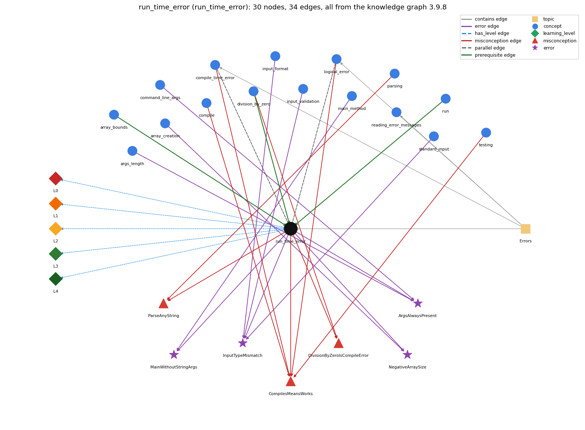

# run_time_error (`run_time_error`)

an error raised while the program executes (e.g. ArrayIndexOutOfBounds, NumberFormatException)

Section 1.1 Your First Program, topic 1.1.c Errors. From the knowledge graph 3.9.8 (`data/raw/chapter1_kg_updated.json`).

## Concepts associated with run\_time\_error (16)

| Concept | Description | How it is associated |
| --- | --- | --- |
| **args\_length** | args.length gives the number of command-line arguments | shares error ArgsAlwaysPresent |
| **array\_bounds** | valid indices are 0 .. length-1; otherwise throws | prerequisite of it (it needs this) |
| **array\_creation** | new int[n] -- allocates n slots | shares error NegativeArraySize |
| **command\_line\_args** | args[] -- strings passed at launch | shares error ArgsAlwaysPresent |
| **compile** | javac turns source into bytecode | shares misconception CompilesMeansWorks |
| **compile\_time\_error** | an error javac reports before the program can run (syntax, types) | parallel concept composition rule (R) with it shares misconception CompilesMeansWorks same topic (topic1.1.c) |
| **division\_by\_zero** | int division by zero throws; double division gives Infinity or NaN | prerequisite of it (it needs this) shares misconception DivisionByZeroIsCompileError |
| **input\_format** | StdIn reads whitespace-separated tokens of the expected type | shares error InputTypeMismatch |
| **input\_validation** | checking the next input before reading it | shares error InputTypeMismatch |
| **logical\_error** | the program runs but computes the wrong result | parallel concept composition rule (R) with it shares misconception CompilesMeansWorks same topic (topic1.1.c) |
| **main\_method** | public static void main(String[] args) -- entry point | shares error MainWithoutStringArgs |
| **parsing** | Integer.parseInt / Double.parseDouble turn text into numbers | shares misconception ParseAnyString |
| **reading\_error\_messages** | how to read compiler error messages: first error first; reported line may follow the real fault | same topic (topic1.1.c) |
| **run** | java executes main in the JVM | prerequisite of it (it needs this) composition rule (R) with it |
| **standard\_input** | StdIn -- reading a stream of values | shares error InputTypeMismatch |
| **testing** | running a program on chosen inputs, including boundary and unusual ones, and comparing the output with what it should be | shares misconception CompilesMeansWorks |

## Every edge in this view and its full label (34)

| From | Edge | To | Full edge label |
| --- | --- | --- | --- |
| **array\_bounds** | prerequisite | **run\_time\_error** | An index outside 0 .. length-1 is not caught by the compiler; the access is checked when the program runs and stops it with ArrayIndexOutOfBoundsException. grounding: book\_passage |
| **division\_by\_zero** | prerequisite | **run\_time\_error** | Dividing an int by zero compiles but throws ArithmeticException when the program runs: a run-time error. grounding: spec\_passage |
| **run** | prerequisite | **run\_time\_error** | A run-time error appears only while java Name executes, after compiling has succeeded. grounding: book\_passage composition rule (R) of run with run\_time\_error: A run-time error appears only while java Name executes; the JVM stops the program and prints the exception. composition rule (R) of run\_time\_error with run: A run-time error appears only while java Name executes, after compiling has succeeded. |
| **compile\_time\_error** | parallel | **run\_time\_error** | A compile-time error is found by javac before the program runs; a run-time error is found while it runs. grounding: book\_passage composition rule (R) of compile\_time\_error with run\_time\_error: A compile-time error is found by javac before the program runs; a run-time error only while it runs, so code that compiles can still crash. composition rule (R) of run\_time\_error with compile\_time\_error: javac cannot detect it because it depends on run-time values (the argument typed, the divisor's value). |
| **run\_time\_error** | parallel | **logical\_error** | A run-time error stops the program with an exception; a logical error lets it finish with wrong output. grounding: book\_passage composition rule (R) of run\_time\_error with logical\_error: A run-time error stops the program with an exception message; a logic error lets it finish with wrong output and no message. composition rule (R) of logical\_error with run\_time\_error: A run-time error stops the program with an exception; a logic error lets it finish with wrong output. |
| **compile** | misconception | **CompilesMeansWorks** | **wrong rule:** Code that compiles is code that works. **right rule:** Code that compiles can still have run-time and logical errors. role: primary |
| **compile\_time\_error** | misconception | **CompilesMeansWorks** | **wrong rule:** Code that compiles is code that works. **right rule:** Code that compiles can still have run-time and logical errors. role: context |
| **division\_by\_zero** | misconception | **DivisionByZeroIsCompileError** | **wrong rule:** System.out.println(5 / 0); is rejected by the compiler. **right rule:** It compiles; the ArithmeticException happens when the program runs. role: primary |
| **logical\_error** | misconception | **CompilesMeansWorks** | **wrong rule:** Code that compiles is code that works. **right rule:** Code that compiles can still have run-time and logical errors. role: context |
| **parsing** | misconception | **ParseAnyString** | **wrong rule:** Integer.parseInt works on any text, e.g. "five" or "12.2". **right rule:** Integer.parseInt throws a NumberFormatException at run time when the string is not an integer written in digits. role: primary |
| **run\_time\_error** | misconception | **CompilesMeansWorks** | **wrong rule:** Code that compiles is code that works. **right rule:** Code that compiles can still have run-time and logical errors. role: context |
| **run\_time\_error** | misconception | **DivisionByZeroIsCompileError** | **wrong rule:** System.out.println(5 / 0); is rejected by the compiler. **right rule:** It compiles; the ArithmeticException happens when the program runs. role: context |
| **run\_time\_error** | misconception | **ParseAnyString** | **wrong rule:** Integer.parseInt works on any text, e.g. "five" or "12.2". **right rule:** Integer.parseInt throws a NumberFormatException at run time when the string is not an integer written in digits. role: context |
| **testing** | misconception | **CompilesMeansWorks** | **wrong rule:** Code that compiles is code that works. **right rule:** Code that compiles can still have run-time and logical errors. role: context |
| **args\_length** | error | **ArgsAlwaysPresent** | **wrong rule:** args[0] can always be read. **right rule:** If you run the program without typing the command-line argument it expects, reading args[0] fails with java.lang.ArrayIndexOutOfBoundsException: 0. role: primary |
| **array\_creation** | error | **NegativeArraySize** | **wrong rule:** new int[n] with a negative n creates an empty array. **right rule:** Creating an array with a negative length throws NegativeArraySizeException at run time. role: primary |
| **command\_line\_args** | error | **ArgsAlwaysPresent** | **wrong rule:** args[0] can always be read. **right rule:** If you run the program without typing the command-line argument it expects, reading args[0] fails with java.lang.ArrayIndexOutOfBoundsException: 0. role: context |
| **input\_format** | error | **InputTypeMismatch** | **wrong rule:** StdIn.readInt() accepts any typed text such as abc or 12.2. **right rule:** If the next token is not an int (e.g. abc, 12.2, true), StdIn.readInt() throws a NumberFormatException at run time (Scanner.nextInt throws InputMismatchException). role: primary |
| **input\_validation** | error | **InputTypeMismatch** | **wrong rule:** StdIn.readInt() accepts any typed text such as abc or 12.2. **right rule:** If the next token is not an int (e.g. abc, 12.2, true), StdIn.readInt() throws a NumberFormatException at run time (Scanner.nextInt throws InputMismatchException). role: context |
| **main\_method** | error | **MainWithoutStringArgs** | **wrong rule:** public static void main() is an acceptable entry point. **right rule:** main is written public static void main(String[] args); these keywords and the args parameter are required. role: primary |
| **run\_time\_error** | error | **ArgsAlwaysPresent** | **wrong rule:** args[0] can always be read. **right rule:** If you run the program without typing the command-line argument it expects, reading args[0] fails with java.lang.ArrayIndexOutOfBoundsException: 0. role: context |
| **run\_time\_error** | error | **InputTypeMismatch** | **wrong rule:** StdIn.readInt() accepts any typed text such as abc or 12.2. **right rule:** If the next token is not an int (e.g. abc, 12.2, true), StdIn.readInt() throws a NumberFormatException at run time (Scanner.nextInt throws InputMismatchException). role: context |
| **run\_time\_error** | error | **MainWithoutStringArgs** | **wrong rule:** public static void main() is an acceptable entry point. **right rule:** main is written public static void main(String[] args); these keywords and the args parameter are required. role: context |
| **run\_time\_error** | error | **NegativeArraySize** | **wrong rule:** new int[n] with a negative n creates an empty array. **right rule:** Creating an array with a negative length throws NegativeArraySizeException at run time. role: context |
| **standard\_input** | error | **InputTypeMismatch** | **wrong rule:** StdIn.readInt() accepts any typed text such as abc or 12.2. **right rule:** If the next token is not an int (e.g. abc, 12.2, true), StdIn.readInt() throws a NumberFormatException at run time (Scanner.nextInt throws InputMismatchException). role: context |
| **run\_time\_error** | has\_level | **run\_time\_error@L0** | run time error -&gt; L0 (Prestructural): the answer holds a rule that contradicts Java (5 ways). **[0] everyday\_reading** (E): Everyday reading: if the program compiled, the computer has accepted it, so any problem would have been reported then. Java rule: run-time errors are detected only while the program executes, on particular data (e.g. no argument, a divisor of 0), and stop it with an exception. **[1] misconception** (M) &rarr; CompilesMeansWorks: wrong rule: Code that compiles is code that works. Right rule: Code that compiles can still fail at run time (an exception) or give wrong output. **[2] misconception** (M) &rarr; DivisionByZeroIsCompileError: wrong rule: System.out.println(5 / 0); is rejected by the compiler. Right rule: It compiles; integer division by zero throws ArithmeticException when the statement runs. **[3] inconsistent\_trace** (T) &rarr; CompilesMeansWorks: Applies the exception rule (LT: execution stops at the faulty statement) unevenly: lets the program keep printing after the failing statement on one trace, or reports the error before any earlier output on another. (here mixing in: "Code that compiles is code that works") **[4] misconception** (M) &rarr; ParseAnyString: wrong rule: Integer.parseInt works on any text, e.g. "five" or "12.2". Right rule: Integer.parseInt throws a NumberFormatException at run time when the string is not an integer written in digits. |
| **run\_time\_error** | has\_level | **run\_time\_error@L1** | run time error -&gt; L1 (Unistructural): the answer states one correct rule without applying it (2 ways). **[0] names\_the\_element** (N): A run-time error (exception) is an error that does not show up until the program is executed and makes it impossible to run to completion. **[1] states\_the\_rule** (S): When a run-time error occurs, the program 'crashes' (terminates) and the JVM prints the exception name, a message, and the method, file and line where it happened. |
| **run\_time\_error** | has\_level | **run\_time\_error@L2** | run time error -&gt; L2 (Multistructural): the answer applies the rules of run time error to every part of the code, in order (3 ways). **[0] line\_by\_line\_trace** (LT): Statements before the faulty one run normally (their output appears); the faulty statement throws; no later statement runs. **[1] output\_prediction** (OP): Output: any earlier output, then Exception in thread "main" java.lang.&lt;Name&gt;: &lt;detail&gt; at Class.main(Class.java:&lt;line&gt;). **[2] one\_step\_execution** (OS): The throwing step changes no variable it was meant to set (the operation does not complete) and transfers control out of main, ending the program. |
| **run\_time\_error** | has\_level | **run\_time\_error@L3** | run time error -&gt; L3 (Relational): the answer relates the parts (4 ways). **[0] relation\_to\_neighbour** (R): A run-time error appears only while java Name executes, after compiling has succeeded. **[1] relation\_to\_neighbour** (R): javac cannot detect it because it depends on run-time values (the argument typed, the divisor's value). **[2] relation\_to\_neighbour** (R): A run-time error stops the program with an exception message; a logic error lets it finish with wrong output and no message. **[3] purpose\_of\_the\_whole** (P): Purpose (of exceptions): stop the program at the point where something impossible was asked, instead of continuing with an undefined value, and report what and where. |
| **run\_time\_error** | has\_level | **run\_time\_error@L4** | run time error -&gt; L4 (Extended abstract): the answer reasons beyond the given code (8 ways). **[0] predict\_a\_change** (C) &rarr; CompilesMeansWorks: The same compiled program may run fine on one input and throw on another (UseArgument with and without an argument); adding a guard such as checking args.length removes the trigger without changing correct runs. **[1] diagnose\_an\_error** (D): rule broken: main is written public static void main(String[] args). Kind: launch error. Trigger class: header public static void main(): compiles, but java Name cannot find the main method **[2] diagnose\_an\_error** (D): rule broken: Array length must be &gt;= 0. Kind: run-time exception. Trigger class: new int[n] with n &lt; 0: NegativeArraySizeException **[3] diagnose\_an\_error** (D): rule broken: args[k] exists only if at least k+1 arguments were typed. Kind: run-time exception. Trigger class: running without the expected argument: java.lang.ArrayIndexOutOfBoundsException: 0 **[4] transfer\_to\_a\_new\_program** (X): Expect a run-time error when correctness depends on data (array indices, divisors, parsed input, presence of arguments); validate such data before use. Errors that depend only on the text are compile-time; wrong-but-legal results are logic errors. **[5] diagnose\_an\_error** (D): rule broken: StdIn.readInt() needs the next token to be an int. Kind: run-time exception. Trigger class: next token abc, 12.2 or true (StdIn: InputMismatchException/NumberFormatException depending on version; Scanner.nextInt: InputMismatchException) **[6] diagnose\_an\_error** (D): rule broken: Integer division and remainder by zero are undefined. Kind: run-time exception. Trigger class: a / b or a % b with int b == 0: ArithmeticException: / by zero **[7] diagnose\_an\_error** (D): rule broken: Integer.parseInt needs an integer written in digits. Kind: run-time exception. Trigger class: parsing "five" or "12.2": NumberFormatException |
| **topic1.1.c** | contains | **compile\_time\_error** | topic topic1.1.c contains compile\_time\_error |
| **topic1.1.c** | contains | **logical\_error** | topic topic1.1.c contains logical\_error |
| **topic1.1.c** | contains | **reading\_error\_messages** | topic topic1.1.c contains reading\_error\_messages |
| **topic1.1.c** | contains | **run\_time\_error** | topic topic1.1.c contains run\_time\_error |
