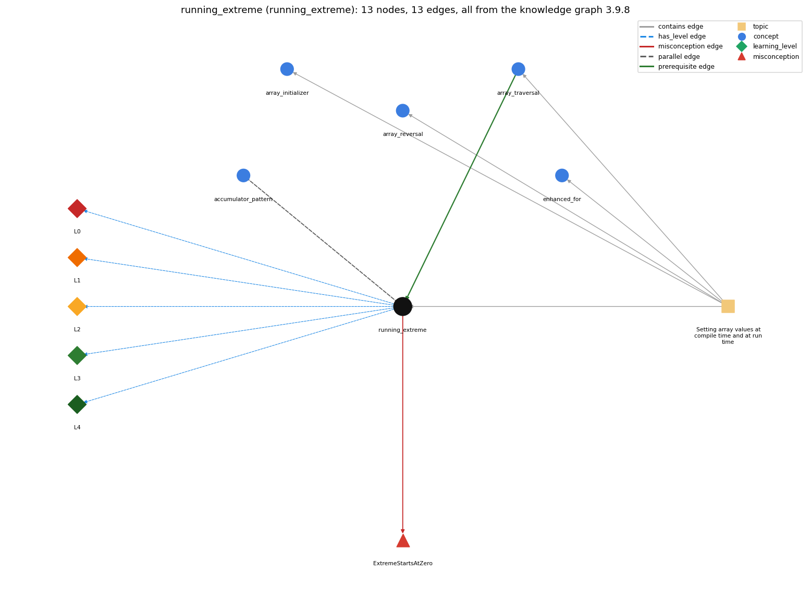

# running_extreme (`running_extreme`)

tracking the max or min of a stream

Section 1.4 1.4 Arrays, topic 1.4.c Setting array values at compile time and at run time.

## At a glance

- **Needs first:** `array_traversal`
- **Leads to:** nothing
- **Learned alongside:** `accumulator_pattern`
- **Misconceptions:** `ExtremeStartsAtZero`
- **Errors:** none
- **Levels:** L0, L1, L2, L3, L4

Everything below comes from the knowledge graph 3.9.8 (`data/raw/chapter1_kg_updated.json`): 13 edges around this concept, each explained in the graph's own words.

## What it needs first (1)

A prerequisite edge means the other concept has to be understood before `running_extreme`.

### `array_traversal` comes before `running_extreme`

*walking the array with an index loop*

The running maximum is found by traversing the array once, keeping the largest value seen so far (starting from Double.NEGATIVE\_INFINITY).

- **Grounding:** book passage
- **How `running_extreme` combines with `array_traversal`:** The maximum is found in one traversal, keeping the largest value seen so far, starting from Double.NEGATIVE\_INFINITY.
- **How `array_traversal` combines with `running_extreme`:** The running maximum is found in one traversal that keeps the largest value seen so far, starting from Double.NEGATIVE\_INFINITY.

## What it leads to (0)

These concepts need `running_extreme` first.

No concept has this one as a prerequisite.

## Learned alongside (1)

A parallel edge joins two concepts that sit side by side: neither is needed before the other.

### `running_extreme` alongside `accumulator_pattern`

*building up a running total/result*

Both make one pass over the values with one variable kept across passes. An accumulator (gatherer role) combines every value into it (sum += a[i]), so it starts at the identity 0.0; a running extreme (most-wanted holder) replaces it only when a better value is found (if (a[i] &gt; max) max = a[i]), so it starts at Double.NEGATIVE\_INFINITY or the first value.

- **Grounding:** book passage

## Misconceptions (1)

A misconception edge states the wrong rule a student may hold about this concept, and the right rule.

### ExtremeStartsAtZero

- **Wrong rule:** The running maximum can always start at 0.
- **Right rule:** Start the running maximum at the most negative possible value (Double.NEGATIVE\_INFINITY, or the smallest int), so that the first value read replaces it.
- **Role of this concept:** primary
- **Shows at level L0 as:** misconception: wrong rule: The running maximum can always start at 0. Right rule: Start the running maximum at the most negative possible value (Double.NEGATIVE\_INFINITY, or the smallest int) so that the first value read replaces it.
- **Shows at level L0 as:** inconsistent trace: Points to LT: on each pass, compare a[i] with max and assign max = a[i] only if a[i] is larger. Inconsistent application: max is overwritten without the comparison on some passes, or compared with a stale value. (here mixing in: "The running maximum can always start at 0")

## Errors (0)

An error edge states the rule that gets broken in a program, and the right rule.

The graph has no error edge from this concept.

## Levels L0 to L4 (5 of 5)

Each level edge lists the ways a student shows that level, each with its exact rule.

### L0: Prestructural / sensorimotor

L0 for running extreme: the answer holds a rule that contradicts Java.

*Deciding question: Does every rule the answer applies to running extreme agree with the language rule? If it reads the code with everyday meanings, applies a wrong rule, or switches rules within one trace, it is L0. A slip in an otherwise rule-correct trace is L2 with an error, not L0.*

running extreme -&gt; L0 (Prestructural): the answer holds a rule that contradicts Java (3 ways).

- **everyday reading** (folk-meaning rule): Folk meaning: 'the biggest so far' starts from nothing, i.e. 0, because everyday quantities are positive. Rule: the running maximum must start at a value no data can be below (Double.NEGATIVE\_INFINITY, Integer.MIN\_VALUE) or at the first element, so that the first value read replaces it.
- **misconception** (wrong rule / right rule; shows `ExtremeStartsAtZero`): wrong rule: The running maximum can always start at 0. Right rule: Start the running maximum at the most negative possible value (Double.NEGATIVE\_INFINITY, or the smallest int) so that the first value read replaces it.
- **inconsistent trace** (uneven-application rule; shows `ExtremeStartsAtZero`): Points to LT: on each pass, compare a[i] with max and assign max = a[i] only if a[i] is larger. Inconsistent application: max is overwritten without the comparison on some passes, or compared with a stale value. (here mixing in: "The running maximum can always start at 0")

### L1: Unistructural / atom x text surface

L1 for running extreme: the answer states one correct rule without applying it.

*Deciding question: Does the answer cover every part of the code, in order, with the values (L2)? If it covers one part or only states the rule, it is L1.*

running extreme -&gt; L1 (Unistructural): the answer states one correct rule without applying it (2 ways).

- **names the element** (identity rule): Identity: a running maximum (or minimum), a variable holding the largest (smallest) value seen so far in a pass over the data; Sajaniemi's most-wanted holder.
- **states the rule** (declarative rule): Declarative: double max = Double.NEGATIVE\_INFINITY; for (int i = 0; i &lt; N; i++) if (a[i] &gt; max) max = a[i];.

### L2: Multistructural / block x execution / preoperational

L2 for running extreme: the answer applies these rules to every part of the code, in order.

*Deciding question: Is the answer many segments mapped onto lines (L2), or one segment stating the purpose of the whole (L3)? A correct output with no value-by-value justification is not levelled.*

running extreme -&gt; L2 (Multistructural): the answer applies the rules of running extreme to every part of the code, in order (3 ways).

- **line by line trace** (operational sequencing rule): Sequencing: initialize max before the loop; in each pass evaluate a[i] &gt; max, and if it is true assign max = a[i]; read max only after the loop ends.
- **output prediction** (evaluation / result rule): Result: the largest element (of the element type). For an empty array (or no input) max stays at its start value: NEGATIVE\_INFINITY, or MIN\_VALUE for int.
- **one step execution** (state-transition rule): State transition: one pass changes max only when a[i] &gt; max; otherwise nothing changes.

### L3: Relational / relations x function (concrete operational begins)

L3 for running extreme: the answer relates the parts by these rules.

*Deciding question: Was the purpose deduced from the code, or only guessed from traced input/output pairs (then L2)? Does the answer stay within the given code (L3), or reason about changed code, an error class or a new program (L4)?*

running extreme -&gt; L3 (Relational): the answer relates the parts (3 ways).

- **relation to neighbour** (composition rule (with a neighbour)): The maximum is found in one traversal, keeping the largest value seen so far, starting from Double.NEGATIVE\_INFINITY.
- **relation to neighbour** (composition rule (with a neighbour)): Both make one pass over the values with one variable kept across passes. An accumulator (gatherer role) combines every value into it (sum += a[i]), so it starts at the identity 0.0; a running extreme (most-wanted holder) replaces it only when a better value is found (if (a[i] &gt; max) max = a[i]), so it starts at Double.NEGATIVE\_INFINITY or the first value.
- **purpose of the whole** (plan / role rule): Plan/role: most-wanted holder (Sajaniemi). It finds the extreme in one pass with constant extra memory; the same plan tracks the minimum with &lt;.

### L4: Extended abstract (concrete-operational reversibility and conservation)

L4 for running extreme: the answer reasons beyond the given code by these rules.

*Deciding question: Does the answer link the code to a broader context: a changed program, a class of inputs, an unseen problem? Re-tracing changed code value by value is L2; fixing one given failing case is L3.*

running extreme -&gt; L4 (Extended abstract): the answer reasons beyond the given code (4 ways).

- **predict a change** (conservation rule; shows `ExtremeStartsAtZero`): Conservation: replacing &gt; by &gt;= keeps the maximum value but changes which tied position is the last one recorded. Remembering the index of the extreme instead of its value conserves the specification.
- **transfer to a new program** (applicability rule): Applicability: use a running extreme when only the max or min (or its position) is needed, in a single pass. For further facts such as how many items equal the maximum, keep the data (an array) and make a second pass.
- **diagnose an error** (error rule): rule broken: The start value must not exceed every possible data value. Kind: silent logic error. Trigger class: max starts at 0 (or Double.MIN\_VALUE, which is the smallest positive double) and all data are negative, so the result is the start value
- **diagnose an error** (error rule): rule broken: Update only when the new value beats the current extreme. Kind: silent logic error. Trigger class: the comparison is reversed (a[i] &lt; max), so the minimum is found, or max = a[i] is unconditional, so the last value is found

## Same topic

`running_extreme` belongs to the topic **Setting array values at compile time and at run time** (`topic1.4.c`). The topic also contains: `array_initializer`, `array_reversal`, `array_traversal`, `enhanced_for`.

## Rules of the concept (14)

- **folk-meaning rule:** Folk meaning: 'the biggest so far' starts from nothing, i.e. 0, because everyday quantities are positive. Rule: the running maximum must start at a value no data can be below (Double.NEGATIVE\_INFINITY, Integer.MIN\_VALUE) or at the first element, so that the first value read replaces it.
- **wrong rule / right rule:** ExtremeStartsAtZero: wrong: The running maximum can always start at 0. \| right: Start the running maximum at the most negative possible value (Double.NEGATIVE\_INFINITY, or the smallest int) so that the first value read replaces it.
- **uneven-application rule:** Points to LT: on each pass, compare a[i] with max and assign max = a[i] only if a[i] is larger. Inconsistent application: max is overwritten without the comparison on some passes, or compared with a stale value.
- **identity rule:** Identity: a running maximum (or minimum), a variable holding the largest (smallest) value seen so far in a pass over the data; Sajaniemi's most-wanted holder.
- **declarative rule:** Declarative: double max = Double.NEGATIVE\_INFINITY; for (int i = 0; i &lt; N; i++) if (a[i] &gt; max) max = a[i];.
- **operational sequencing rule:** Sequencing: initialize max before the loop; in each pass evaluate a[i] &gt; max, and if it is true assign max = a[i]; read max only after the loop ends.
- **evaluation / result rule:** Result: the largest element (of the element type). For an empty array (or no input) max stays at its start value: NEGATIVE\_INFINITY, or MIN\_VALUE for int.
- **state-transition rule:** State transition: one pass changes max only when a[i] &gt; max; otherwise nothing changes.
- **composition rule (with a neighbour):** with array\_traversal: The maximum is found in one traversal, keeping the largest value seen so far, starting from Double.NEGATIVE\_INFINITY.
- **plan / role rule:** Plan/role: most-wanted holder (Sajaniemi). It finds the extreme in one pass with constant extra memory; the same plan tracks the minimum with &lt;.
- **conservation rule:** Conservation: replacing &gt; by &gt;= keeps the maximum value but changes which tied position is the last one recorded. Remembering the index of the extreme instead of its value conserves the specification.
- **error rule:** rule broken: The start value must not exceed every possible data value. (silent logic error)
- **error rule:** rule broken: Update only when the new value beats the current extreme. (silent logic error)
- **applicability rule:** Applicability: use a running extreme when only the max or min (or its position) is needed, in a single pass. For further facts such as how many items equal the maximum, keep the data (an array) and make a second pass.

## The whole prerequisite chain

- **Everything it builds on (23):** `arithmetic_operators`, `array_creation`, `array_declaration`, `array_initializer`, `array_traversal`, `boolean`, `boolean_expression`, `comparison_operators`, `data_structure`, `data_type`, `do_while_loop`, `expression`, `for_loop`, `identifier`, `indexing`, `length_field`, `literal`, `logical_operators`, `loop_control`, `loop_variable`, `primitive_type`, `variable`, `while_loop`
- **Everything that builds on it (0):** nothing
