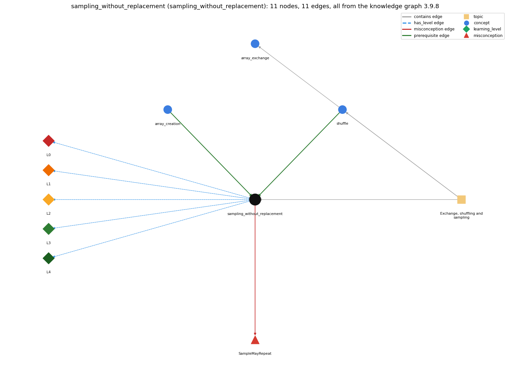

# sampling_without_replacement (`sampling_without_replacement`)

choosing m distinct items at random

Section 1.4 Arrays, topic 1.4.d Exchange, shuffling and sampling. From the knowledge graph 3.9.8 (`data/raw/chapter1_kg_updated.json`).

## Concepts associated with sampling\_without\_replacement (3)

| Concept | Description | How it is associated |
| --- | --- | --- |
| **array\_creation** | new int[n] -- allocates n slots | prerequisite of it (it needs this) |
| **array\_exchange** | swap a[i] and a[j] through a temporary variable | same topic (topic1.4.d) |
| **shuffle** | Knuth shuffle -- swap a[i] with a random a[r], r in i..n-1 | prerequisite of it (it needs this) composition rule (R) with it same topic (topic1.4.d) |

## Every edge in this view and its full label (11)

| From | Edge | To | Full edge label |
| --- | --- | --- | --- |
| **array\_creation** | prerequisite | **sampling\_without\_replacement** | Sampling without replacement first creates an array of all candidates (perm), then picks from the part not yet chosen. grounding: book\_passage |
| **shuffle** | prerequisite | **sampling\_without\_replacement** | Sample uses the basic operation underlying shuffling: for each of the first M positions it exchanges perm[i] with a random element to its right. grounding: book\_passage composition rule (R) of shuffle with sampling\_without\_replacement: Stopping the shuffle after the first M passes leaves a uniform random sample in positions 0..M-1. composition rule (R) of sampling\_without\_replacement with shuffle: The sample is the first M passes of the shuffle applied to the identity permutation. |
| **sampling\_without\_replacement** | misconception | **SampleMayRepeat** | **wrong rule:** A sample drawn without replacement may contain the same item twice. **right rule:** Each member of the set appears at most once in the sample. role: primary |
| **sampling\_without\_replacement** | has\_level | **sampling\_without\_replacement@L0** | sampling without replacement -&gt; L0 (Prestructural): the answer holds a rule that contradicts Java (3 ways). **[0] everyday\_reading** (E): Folk meaning: 'pick M random items' is read as M independent random picks, so repeats seem acceptable. Rule: in sampling without replacement each member of the set appears at most once, like lottery balls not put back. **[1] misconception** (M) &rarr; SampleMayRepeat: wrong rule: A sample drawn without replacement may contain the same item twice. Right rule: Each member of the set appears at most once in the sample. **[2] inconsistent\_trace** (T) &rarr; SampleMayRepeat: Points to LT: perm[] is first filled with 0..N-1, then the first M shuffle passes run, then perm[0..M-1] is printed. Inconsistent application: the sample is read before all M exchanges are done, or the identity fill is skipped on a trace. (here mixing in: "A sample drawn without replacement may contain the same item twice") |
| **sampling\_without\_replacement** | has\_level | **sampling\_without\_replacement@L1** | sampling without replacement -&gt; L1 (Unistructural): the answer states one correct rule without applying it (2 ways). **[0] names\_the\_element** (N): Identity: sampling without replacement draws a random sample of M items from N in which no item can be chosen twice. **[1] states\_the\_rule** (S): Declarative (Program 1.4.1): perm[j] = j for all j; for i &lt; M, r = i + (int) (Math.random() \* (N-i)) and exchange perm[i] with perm[r]; perm[0..M-1] is the sample. |
| **sampling\_without\_replacement** | has\_level | **sampling\_without\_replacement@L2** | sampling without replacement -&gt; L2 (Multistructural): the answer applies the rules of sampling without replacement to every part of the code, in order (3 ways). **[0] line\_by\_line\_trace** (LT): Sequencing: read M and N, create perm, fill it with the identity, run M exchange passes left to right, then print perm[0] .. perm[M-1]. **[1] output\_prediction** (OP): Result: M distinct integers from 0..N-1 (e.g. java Sample 6 16 prints 9 5 13 1 11 8). If M == N the result is a random permutation; if M &gt; N the program throws ArrayIndexOutOfBoundsException. **[2] one\_step\_execution** (OS): State transition: each pass exchanges perm[i] with one element to its right, fixing perm[i] as the next sampled item; perm stays a permutation of 0..N-1. |
| **sampling\_without\_replacement** | has\_level | **sampling\_without\_replacement@L3** | sampling without replacement -&gt; L3 (Relational): the answer relates the parts (2 ways). **[0] relation\_to\_neighbour** (R): The sample is the first M passes of the shuffle applied to the identity permutation. **[1] purpose\_of\_the\_whole** (P): Plan/role: draw lottery numbers or deal a hand. The permutation can also serve as indices into another array (deck[perm[i]]) to sample it without rearranging it. |
| **sampling\_without\_replacement** | has\_level | **sampling\_without\_replacement@L4** | sampling without replacement -&gt; L4 (Extended abstract): the answer reasons beyond the given code (4 ways). **[0] predict\_a\_change** (C) &rarr; SampleMayRepeat: Conservation: perm remains a permutation of 0..N-1 after every exchange, so no value can appear twice for any M &lt;= N; changing M changes only how many passes run. **[1] transfer\_to\_a\_new\_program** (X): Applicability: use it when the sample must contain distinct items (lotteries, card hands, survey samples). When repeats are allowed (sampling with replacement), independent random indices are simpler. **[2] diagnose\_an\_error** (D): rule broken: The sample size cannot exceed the population size. Kind: run-time exception. Trigger class: M &gt; N on the command line, so perm[i] is indexed at i = N (ArrayIndexOutOfBoundsException) **[3] diagnose\_an\_error** (D): rule broken: Each pick must come from the items not yet sampled. Kind: silent logic error. Trigger class: independent picks (int) (Math.random() \* N) without exchanging, which can repeat an item |
| **topic1.4.d** | contains | **array\_exchange** | topic topic1.4.d contains array\_exchange |
| **topic1.4.d** | contains | **sampling\_without\_replacement** | topic topic1.4.d contains sampling\_without\_replacement |
| **topic1.4.d** | contains | **shuffle** | topic topic1.4.d contains shuffle |
