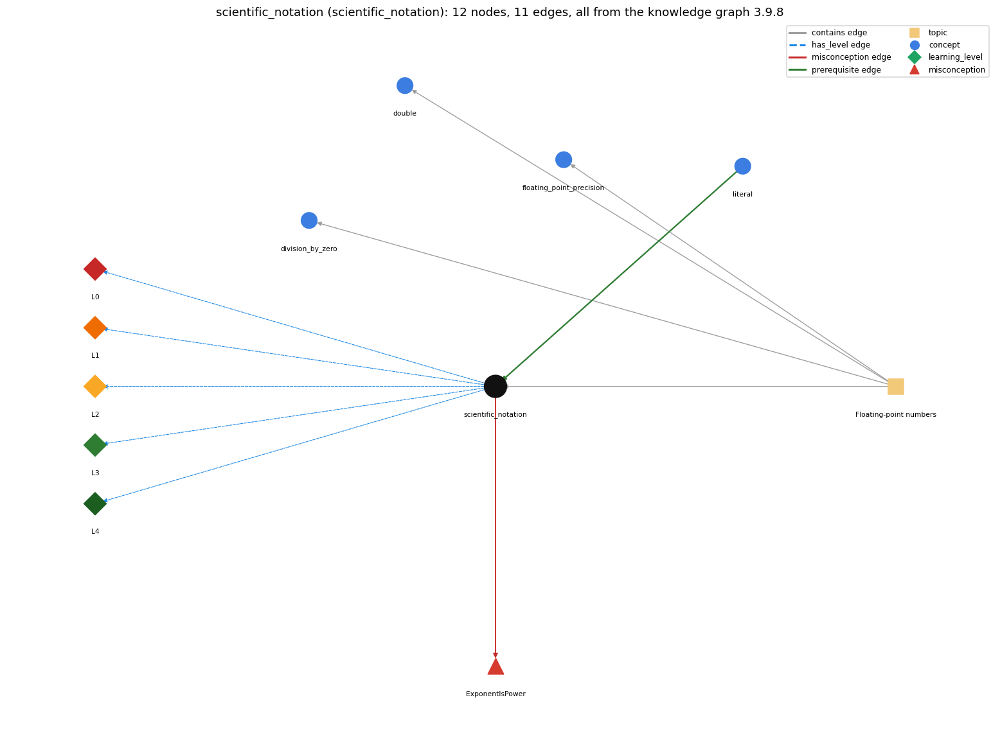

# scientific_notation (`scientific_notation`)

double literals like 6.022E23

Section 1.2 Built-in Types of Data, topic 1.2.d Floating-point numbers. From the knowledge graph 3.9.8 (`data/raw/chapter1_kg_updated.json`).

## Concepts associated with scientific\_notation (4)

| Concept | Description | How it is associated |
| --- | --- | --- |
| **division\_by\_zero** | int division by zero throws; double division gives Infinity or NaN | same topic (topic1.2.d) |
| **double** | 64-bit floating-point primitive | same topic (topic1.2.d) |
| **floating\_point\_precision** | double values are approximations; == on doubles is unreliable | same topic (topic1.2.d) |
| **literal** | a constant value written in code (42, 3.14, true, 'a', "hi") | prerequisite of it (it needs this) composition rule (R) with it |

## Every edge in this view and its full label (11)

| From | Edge | To | Full edge label |
| --- | --- | --- | --- |
| **literal** | prerequisite | **scientific\_notation** | Scientific notation is a form of double literal. grounding: book\_passage composition rule (R) of literal with scientific\_notation: E-notation is a form of double literal. 6.022e23 and even 1e6 are doubles, so int n = 1e6; needs a cast. composition rule (R) of scientific\_notation with literal: Scientific notation is a double literal, so the literal rules for double apply: it cannot initialize an int without a cast (int n = 1e6; does not compile). |
| **scientific\_notation** | misconception | **ExponentIsPower** | **wrong rule:** 6.022E23 means 6.022 times e to the power 23. **right rule:** E23 means times 10 to the 23rd. role: primary |
| **scientific\_notation** | has\_level | **scientific\_notation@L0** | scientific notation -&gt; L0 (Prestructural): the answer holds a rule that contradicts Java (3 ways). **[0] everyday\_reading** (E): Folk meaning: in maths e is Euler's number 2.718..., so 6.022E23 reads as 6.022 times e to the 23rd. Java rule: inside a numeric literal, e or E means 'times ten to the power', so 6.022e23 is 6.022 x 10^23; Euler's number is Math.E and e^x is Math.exp(x). **[1] misconception** (M) &rarr; ExponentIsPower: wrong rule: 6.022E23 means 6.022 times e to the power 23. Right rule: E23 means times 10 to the 23rd; e to a power is computed with Math.exp(23), and the constant e is Math.E. **[2] inconsistent\_trace** (T) &rarr; ExponentIsPower: Points to LT (the literal is converted once, at compile time, to the nearest double). Applied unevenly: the student shifts the decimal point the right way for 1e6 but the wrong way for a negative exponent such as 1e-15, or treats 1e6 as an int on some lines. (here mixing in: "6.022E23 means 6.022 times e to the power 23") |
| **scientific\_notation** | has\_level | **scientific\_notation@L1** | scientific notation -&gt; L1 (Unistructural): the answer states one correct rule without applying it (2 ways). **[0] names\_the\_element** (N): Scientific notation is a form of floating-point (double) literal: a mantissa, then e or E, then a signed integer exponent of ten. **[1] states\_the\_rule** (S): mEn denotes m x 10^n and is always of type double, even when the value is whole (1e6 is 1000000.0); the exponent may be negative (1e-15). |
| **scientific\_notation** | has\_level | **scientific\_notation@L2** | scientific notation -&gt; L2 (Multistructural): the answer applies the rules of scientific notation to every part of the code, in order (3 ways). **[0] line\_by\_line\_trace** (LT): The value is fixed at compile time; at run time the literal is just a double operand, so the usual promotion applies to the other operand of each operator it meets. **[1] output\_prediction** (OP): Type double: 6.02e23 / 2.0 is 3.01E23; 1e6 is 1000000.0; 1e-15 is 1.0E-15; println prints very large or very small doubles back in E notation. **[2] one\_step\_execution** (OS): Evaluating the literal changes nothing; double big = 6.022e23; stores the nearest double to 6.022 x 10^23 in big. |
| **scientific\_notation** | has\_level | **scientific\_notation@L3** | scientific notation -&gt; L3 (Relational): the answer relates the parts (2 ways). **[0] relation\_to\_neighbour** (R): Scientific notation is a double literal, so the literal rules for double apply: it cannot initialize an int without a cast (int n = 1e6; does not compile). **[1] purpose\_of\_the\_whole** (P): Used to write very large or very small fixed constants readably, e.g. Avogadro's number or a tolerance epsilon = 1e-15 (Sajaniemi role: fixed value). |
| **scientific\_notation** | has\_level | **scientific\_notation@L4** | scientific notation -&gt; L4 (Extended abstract): the answer reasons beyond the given code (4 ways). **[0] predict\_a\_change** (C) &rarr; ExponentIsPower: Changing the sign of the exponent changes the magnitude by a factor 10^(2n); replacing 1e6 by 10^6 changes the value to 12 (^ is exclusive or); replacing it by Math.pow(10, 6) keeps the value but computes it at run time. **[1] transfer\_to\_a\_new\_program** (X): Use e-notation for double constants spanning many orders of magnitude (physical constants, tolerances); for exact integers use int or long literals, and for computed powers use Math.pow. **[2] diagnose\_an\_error** (D): rule broken: A power of ten is written with e-notation (or Math.pow), not with ^. Kind: silent logic error. Trigger class: Writing 10^6 (or 2^n) with int operands: it compiles and evaluates the exclusive or (10^6 is 12). **[3] diagnose\_an\_error** (D): rule broken: An e-notation literal is a double and cannot be stored in an int without a cast. Kind: compile-time. Trigger class: int n = 1e6; or passing 1e3 to an int parameter. |
| **topic1.2.d** | contains | **division\_by\_zero** | topic topic1.2.d contains division\_by\_zero |
| **topic1.2.d** | contains | **double** | topic topic1.2.d contains double |
| **topic1.2.d** | contains | **floating\_point\_precision** | topic topic1.2.d contains floating\_point\_precision |
| **topic1.2.d** | contains | **scientific\_notation** | topic topic1.2.d contains scientific\_notation |
