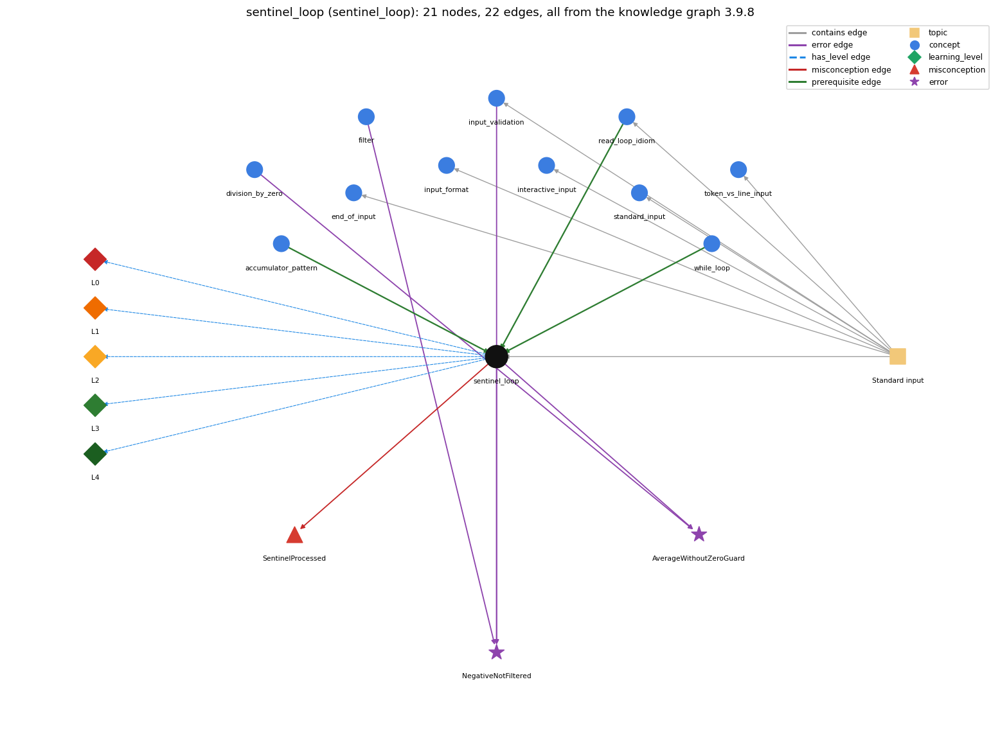

# sentinel_loop (`sentinel_loop`)

reading until a special stop value (Rainfall problem)

Section 1.5 Input and Output, topic 1.5.c Standard input.

## At a glance

- **Needs first:** `accumulator_pattern`, `read_loop_idiom`, `while_loop`
- **Leads to:** nothing
- **Learned alongside:** nothing
- **Misconceptions:** `SentinelProcessed`
- **Errors:** `AverageWithoutZeroGuard`, `NegativeNotFiltered`
- **Levels:** L0, L1, L2, L3, L4

Everything below comes from the knowledge graph 3.9.8 (`data/raw/chapter1_kg_updated.json`): 22 edges around this concept. The edge logic, the wrong and right rules and the exact rules of the ways are copied word for word from the graph.

## To work on (1)

- no aliases: a student's words cannot name this concept

## What it needs first (3)

A prerequisite edge means the other concept has to be understood before `sentinel_loop`.

### `accumulator_pattern` comes before `sentinel_loop`

*building up a running total/result*

- **Edge:** `pre:accumulator_pattern->sentinel_loop`
- **Exact edge logic:** Sum and count are accumulators.
- **Grounding:** questionable
- **Composition rule (R) of `sentinel_loop` with `accumulator_pattern`:** sum (a gatherer) and count must change only for values that are not the sentinel and pass the filter. The average is computed once, after the loop.
- **Composition rule (R) of `accumulator_pattern` with `sentinel_loop`:** In a sentinel loop the sum and the count of the values read are both accumulators, updated only for values that are not the sentinel.

### `read_loop_idiom` comes before `sentinel_loop`

*reading until end-of-input*

- **Edge:** `pre:read_loop_idiom->sentinel_loop`
- **Exact edge logic:** The sentinel loop is a read loop with its own stop value.
- **Grounding:** questionable
- **Composition rule (R) of `sentinel_loop` with `read_loop_idiom`:** The sentinel test replaces, or is added to, the isEmpty() test. If the sentinel may be missing, keep !StdIn.isEmpty() in the condition so the program does not read past the end.
- **Composition rule (R) of `read_loop_idiom` with `sentinel_loop`:** A sentinel loop keeps the read-then-test structure but stops on a special data value instead of, or as well as, isEmpty(). The sentinel must be tested before it is processed.

### `while_loop` comes before `sentinel_loop`

*repeat a block while a condition holds*

- **Edge:** `pre:while_loop->sentinel_loop`
- **Exact edge logic:** A sentinel loop is a while loop whose condition tests each value read against the stop value.
- **Grounding:** spec\_passage

## What it leads to (0)

These concepts need `sentinel_loop` first.

No concept has this one as a prerequisite.

## Learned alongside (0)

A parallel edge joins two concepts that sit side by side: neither is needed before the other.

No parallel edge touches this concept.

## Misconceptions (1)

A misconception edge states the wrong rule a student may hold about this concept, and the right rule.

### SentinelProcessed

- **Edge:** `sentinel_loop` &rarr; `SentinelProcessed` (misconception)
- **Exact edge logic (the wrong rule):** The sentinel value (e.g. 999999) is added to the total like the other values.
- **Twin logic (the right rule):** The loop stops at the sentinel without processing it.
- **Wrong belief (on the node):** The sentinel value (e.g. 999999) is added to the total like the other values.
- **Correct rule (on the node):** The loop stops at the sentinel without processing it.
- **Provenance:** published
- **Role of this concept:** primary
- **L0 way linked to it:** yes
- **L0 way [1] misconception, exact rule:** wrong rule: The sentinel value (e.g. 99999) is added to the total like the other values. Right rule: The value is tested against the sentinel before it is processed. The loop stops at the sentinel, which is never added or counted.
- **L0 way [2] inconsistent\_trace, exact rule:** Points to LT (read, test for the sentinel, then process). An uneven trace processes before testing on the last pass, so the sentinel is included that time. (here mixing in: "The sentinel value (e.g. 999999) is added to the total like the other values")

## Errors (2)

An error edge states the rule that gets broken in a program, and the right rule.

### AverageWithoutZeroGuard

- **Edge:** `sentinel_loop` &rarr; `AverageWithoutZeroGuard` (error)
- **Exact edge logic (the wrong rule):** Computes sum / count without checking that count is above 0.
- **Twin logic (the right rule):** If no value was read (count is 0), do not compute the average: with int operands sum / count is a division by zero, a run-time exception that stops the program; with a double sum the division does not stop the program and gives a meaningless value instead of an average.
- **Wrong belief (on the node):** Computes sum / count without checking that count is above 0.
- **Correct rule (on the node):** If no value was read (count is 0), do not compute the average: with int operands sum / count is a division by zero, a run-time exception that stops the program; with a double sum the division does not stop the program and gives a meaningless value instead of an average.
- **Provenance:** published
- **Role of this concept:** primary
- **Edge `division_by_zero` &rarr; `AverageWithoutZeroGuard`, exact edge logic:** Computes sum / count without checking that count is above 0. **Twin logic:** If no value was read (count is 0), do not compute the average: with int operands sum / count is a division by zero, a run-time exception that stops the program; with a double sum the division does not stop the program and gives a meaningless value instead of an average. (role: context)

### NegativeNotFiltered

- **Edge:** `sentinel_loop` &rarr; `NegativeNotFiltered` (error)
- **Exact edge logic (the wrong rule):** Adds negative rainfall values to the total.
- **Twin logic (the right rule):** Values outside the range of interest must be filtered out (for example with if (t &gt;= lo &amp;&amp; t &lt;= hi)) before they are processed.
- **Wrong belief (on the node):** Adds negative rainfall values to the total.
- **Correct rule (on the node):** Values outside the range of interest must be filtered out (for example with if (t &gt;= lo &amp;&amp; t &lt;= hi)) before they are processed.
- **Provenance:** published
- **Role of this concept:** primary
- **Edge `filter` &rarr; `NegativeNotFiltered`, exact edge logic:** Adds negative rainfall values to the total. **Twin logic:** Values outside the range of interest must be filtered out (for example with if (t &gt;= lo &amp;&amp; t &lt;= hi)) before they are processed. (role: context)
- **Edge `input_validation` &rarr; `NegativeNotFiltered`, exact edge logic:** Adds negative rainfall values to the total. **Twin logic:** Values outside the range of interest must be filtered out (for example with if (t &gt;= lo &amp;&amp; t &lt;= hi)) before they are processed. (role: context)

## Levels L0 to L4 (5 of 5)

Each level edge lists the ways a student shows that level, each with its exact rule.

### L0: Prestructural / sensorimotor

L0 for sentinel loop: the answer holds a rule that contradicts Java.

*Deciding question: Does every rule the answer applies to sentinel loop agree with the language rule? If it reads the code with everyday meanings, applies a wrong rule, or switches rules within one trace, it is L0. A slip in an otherwise rule-correct trace is L2 with an error, not L0.*

- **Edge:** `sentinel_loop` &rarr; `sentinel_loop@L0` (has_level)
- **Exact edge logic:** sentinel loop -&gt; L0 (Prestructural): the answer holds a rule that contradicts Java (3 ways).

Ways (3), each with its exact rule:

- **[0] everyday\_reading** (rule type E, folk-meaning rule): In everyday lists the last number written is part of the data. A sentinel such as 99999 is a stop marker, not data, so it must not be summed or counted.
- **[1] misconception** (rule type M, wrong rule / right rule) &rarr; `SentinelProcessed`: wrong rule: The sentinel value (e.g. 99999) is added to the total like the other values. Right rule: The value is tested against the sentinel before it is processed. The loop stops at the sentinel, which is never added or counted.
- **[2] inconsistent\_trace** (rule type T, uneven-application rule) &rarr; `SentinelProcessed`: Points to LT (read, test for the sentinel, then process). An uneven trace processes before testing on the last pass, so the sentinel is included that time. (here mixing in: "The sentinel value (e.g. 999999) is added to the total like the other values")

### L1: Unistructural / atom x text surface

L1 for sentinel loop: the answer states one correct rule without applying it.

*Deciding question: Does the answer cover every part of the code, in order, with the values (L2)? If it covers one part or only states the rule, it is L1.*

- **Edge:** `sentinel_loop` &rarr; `sentinel_loop@L1` (has_level)
- **Exact edge logic:** sentinel loop -&gt; L1 (Unistructural): the answer states one correct rule without applying it (2 ways).

Ways (2), each with its exact rule:

- **[0] names\_the\_element** (rule type N, identity rule): A sentinel loop is a read loop that stops when it reads a designated stop value that cannot occur as real data (the Rainfall problem).
- **[1] states\_the\_rule** (rule type S, declarative rule): Read a value; while it is not the sentinel, process it and read the next one. The sentinel is never processed.

### L2: Multistructural / block x execution / preoperational

L2 for sentinel loop: the answer applies these rules to every part of the code, in order.

*Deciding question: Is the answer many segments mapped onto lines (L2), or one segment stating the purpose of the whole (L3)? A correct output with no value-by-value justification is not levelled.*

- **Edge:** `sentinel_loop` &rarr; `sentinel_loop@L2` (has_level)
- **Exact edge logic:** sentinel loop -&gt; L2 (Multistructural): the answer applies the rules of sentinel loop to every part of the code, in order (3 ways).

Ways (3), each with its exact rule:

- **[0] line\_by\_line\_trace** (rule type LT, operational sequencing rule): A priming read comes before the loop, then each pass runs: test value != SENTINEL, process (sum += v; count++), then read the next value at the end of the body. An equivalent form is while (true) { v = read; if (v == SENTINEL) break; process; }.
- **[1] output\_prediction** (rule type OP, evaluation / result rule): With input 3 -1 5 99999 7, keeping only non-negative values, the Rainfall average is (3+5)/2 = 4.0. The 7 after the sentinel is never read.
- **[2] one\_step\_execution** (rule type OS, state-transition rule): One pass reads one value. If it is the sentinel, the loop ends with sum and count unchanged; otherwise the (valid) value updates sum and count.

### L3: Relational / relations x function (concrete operational begins)

L3 for sentinel loop: the answer relates the parts by these rules.

*Deciding question: Was the purpose deduced from the code, or only guessed from traced input/output pairs (then L2)? Does the answer stay within the given code (L3), or reason about changed code, an error class or a new program (L4)?*

- **Edge:** `sentinel_loop` &rarr; `sentinel_loop@L3` (has_level)
- **Exact edge logic:** sentinel loop -&gt; L3 (Relational): the answer relates the parts (3 ways).

Ways (3), each with its exact rule:

- **[0] relation\_to\_neighbour** (rule type R, composition rule (with a neighbour)): The sentinel test replaces, or is added to, the isEmpty() test. If the sentinel may be missing, keep !StdIn.isEmpty() in the condition so the program does not read past the end.
- **[1] relation\_to\_neighbour** (rule type R, composition rule (with a neighbour)): sum (a gatherer) and count must change only for values that are not the sentinel and pass the filter. The average is computed once, after the loop.
- **[2] purpose\_of\_the\_whole** (rule type P, plan / role rule): Plan: Soloway's sentinel-controlled running-total loop (Rainfall). Roles: sum is a gatherer, count a stepper, and the value read a most-recent holder.

### L4: Extended abstract (concrete-operational reversibility and conservation)

L4 for sentinel loop: the answer reasons beyond the given code by these rules.

*Deciding question: Does the answer link the code to a broader context: a changed program, a class of inputs, an unseen problem? Re-tracing changed code value by value is L2; fixing one given failing case is L3.*

- **Edge:** `sentinel_loop` &rarr; `sentinel_loop@L4` (has_level)
- **Exact edge logic:** sentinel loop -&gt; L4 (Extended abstract): the answer reasons beyond the given code (6 ways).

Ways (6), each with its exact rule:

- **[0] predict\_a\_change** (rule type C, conservation rule) &rarr; `SentinelProcessed`: Changing the sentinel keeps the behaviour only if the new value cannot occur in the data. Moving the test after the processing step breaks the invariant that the sentinel is never processed.
- **[1] diagnose\_an\_error** (rule type D, error rule): rule broken: Check count &gt; 0 before computing sum / count. Kind: run-time exception. Trigger class: The sentinel is the first value (count stays 0). With int operands this gives ArithmeticException (/ by zero); with a double sum it gives NaN silently.
- **[2] diagnose\_an\_error** (rule type D, error rule): rule broken: Only values in the range of interest may be processed. Kind: silent logic error. Trigger class: Inputs below 0 (or outside lo..hi) are added to the total because no if (t &gt;= lo &amp;&amp; t &lt;= hi) guard comes before the update.
- **[3] transfer\_to\_a\_new\_program** (rule type X, applicability rule): Use a sentinel when the data stream marks its own end with a value outside the valid range (keyed entry with no end-of-file). If every value could be real data, use isEmpty() or a count instead.
- **[4] diagnose\_an\_error** (rule type D, error rule): rule broken: The sentinel must appear, or the loop must also test isEmpty(). Kind: run-time exception. Trigger class: The input ends without the sentinel, so the next read happens after the input is exhausted.
- **[5] diagnose\_an\_error** (rule type D, error rule): rule broken: The sentinel must not be included in the computation. Kind: silent logic error. Trigger class: A process-then-test ordering adds 99999 to sum and count once.

## Same topic

`sentinel_loop` belongs to the topic **Standard input** (`topic1.5.c`). The topic also contains: `end_of_input`, `input_format`, `input_validation`, `interactive_input`, `read_loop_idiom`, `standard_input`, `token_vs_line_input`.

## Rules of the concept (17)

- **Book** (SW-1.5, ): "reads in nonnegative integers (representing rainfall) one at a time until 999999 is entered, and then prints out the average of value (not including 999999)"
- **E** (folk-meaning rule): In everyday lists the last number written is part of the data. A sentinel such as 99999 is a stop marker, not data, so it must not be summed or counted.
- **M** (wrong rule / right rule): SentinelProcessed: wrong: The sentinel value (e.g. 99999) is added to the total like the other values. \| right: The value is tested against the sentinel before it is processed. The loop stops at the sentinel, which is never added or counted.
- **T** (uneven-application rule): Points to LT (read, test for the sentinel, then process). An uneven trace processes before testing on the last pass, so the sentinel is included that time.
- **N** (identity rule): A sentinel loop is a read loop that stops when it reads a designated stop value that cannot occur as real data (the Rainfall problem).
- **S** (declarative rule): Read a value; while it is not the sentinel, process it and read the next one. The sentinel is never processed.
- **LT** (operational sequencing rule): A priming read comes before the loop, then each pass runs: test value != SENTINEL, process (sum += v; count++), then read the next value at the end of the body. An equivalent form is while (true) { v = read; if (v == SENTINEL) break; process; }.
- **OP** (evaluation / result rule): With input 3 -1 5 99999 7, keeping only non-negative values, the Rainfall average is (3+5)/2 = 4.0. The 7 after the sentinel is never read.
- **OS** (state-transition rule): One pass reads one value. If it is the sentinel, the loop ends with sum and count unchanged; otherwise the (valid) value updates sum and count.
- **R** (composition rule (with a neighbour)): with read\_loop\_idiom: The sentinel test replaces, or is added to, the isEmpty() test. If the sentinel may be missing, keep !StdIn.isEmpty() in the condition so the program does not read past the end.
- **R** (composition rule (with a neighbour)): with accumulator\_pattern: sum (a gatherer) and count must change only for values that are not the sentinel and pass the filter. The average is computed once, after the loop.
- **P** (plan / role rule): Plan: Soloway's sentinel-controlled running-total loop (Rainfall). Roles: sum is a gatherer, count a stepper, and the value read a most-recent holder.
- **C** (conservation rule): Changing the sentinel keeps the behaviour only if the new value cannot occur in the data. Moving the test after the processing step breaks the invariant that the sentinel is never processed.
- **D** (error rule): rule broken: Check count &gt; 0 before computing sum / count. (run-time exception)
- **D** (error rule): rule broken: Only values in the range of interest may be processed. (silent logic error)
- **D** (error rule): rule broken: The sentinel must appear, or the loop must also test isEmpty(). (run-time exception)
- **D** (error rule): rule broken: The sentinel must not be included in the computation. (silent logic error)
- **X** (applicability rule): Use a sentinel when the data stream marks its own end with a value outside the valid range (keyed entry with no end-of-file). If every value could be real data, use isEmpty() or a count instead.

## How it is found in code and answers (reader block)

- **Aliases:** none
- **Code patterns:** `(?:!=|==)\s*-?9{3,}\b`, `while\s*\(\s*\w+\s*!=\s*-1\s*\)`, `while\s*\(\s*\w+\s*!=\s*-?\d+\s*\)[\s\S]{0,400}?(?:StdIn\.read\w*|\.next\w*)\s*\(`, `while\s*\(\s*!\s*\w+\.equals\s*\(`
- **Operator symbols:** none
- **Java types:** none
- **Signal named\_sentinel** (scope program): `while\s*\(\s*\w+\s*!=\s*[A-Z][A-Z_0-9]*\s*\)[\s\S]{0,400}?(?:StdIn\.read\w*|\.next\w*)\s*\(`

## The whole prerequisite chain

- **Everything it builds on (32):** `accumulator_pattern`, `arithmetic_operators`, `assignment`, `boolean`, `boolean_expression`, `class_declaration`, `command_line_args`, `comparison_operators`, `compound_assignment`, `data_type`, `declaration`, `do_while_loop`, `explicit_cast`, `expression`, `for_loop`, `identifier`, `integer_division`, `literal`, `logical_operators`, `loop_body`, `loop_control`, `loop_variable`, `main_method`, `parsing`, `primitive_type`, `program_text`, `read_loop_idiom`, `standard_input`, `stream_model`, `type_conversion`, `variable`, `while_loop`
- **Everything that builds on it (0):** nothing

## Every edge in this view and its exact edge logic (22)

All the edges drawn in the picture, in the order: prerequisite, parallel, misconception, error, has_level, contains.

**1. `accumulator_pattern` &rarr; `sentinel_loop`** (prerequisite)

- **Exact edge logic:** Sum and count are accumulators.
- **Grounding:** questionable
- **Composition rule (R) of `accumulator_pattern` with `sentinel_loop`:** In a sentinel loop the sum and the count of the values read are both accumulators, updated only for values that are not the sentinel.
- **Composition rule (R) of `sentinel_loop` with `accumulator_pattern`:** sum (a gatherer) and count must change only for values that are not the sentinel and pass the filter. The average is computed once, after the loop.

**2. `read_loop_idiom` &rarr; `sentinel_loop`** (prerequisite)

- **Exact edge logic:** The sentinel loop is a read loop with its own stop value.
- **Grounding:** questionable
- **Composition rule (R) of `read_loop_idiom` with `sentinel_loop`:** A sentinel loop keeps the read-then-test structure but stops on a special data value instead of, or as well as, isEmpty(). The sentinel must be tested before it is processed.
- **Composition rule (R) of `sentinel_loop` with `read_loop_idiom`:** The sentinel test replaces, or is added to, the isEmpty() test. If the sentinel may be missing, keep !StdIn.isEmpty() in the condition so the program does not read past the end.

**3. `while_loop` &rarr; `sentinel_loop`** (prerequisite)

- **Exact edge logic:** A sentinel loop is a while loop whose condition tests each value read against the stop value.
- **Grounding:** spec\_passage

**4. `sentinel_loop` &rarr; `SentinelProcessed`** (misconception)

- **Exact edge logic (the wrong rule):** The sentinel value (e.g. 999999) is added to the total like the other values.
- **Twin logic (the right rule):** The loop stops at the sentinel without processing it.
- **Role:** primary

**5. `sentinel_loop` &rarr; `AverageWithoutZeroGuard`** (error)

- **Exact edge logic (the wrong rule):** Computes sum / count without checking that count is above 0.
- **Twin logic (the right rule):** If no value was read (count is 0), do not compute the average: with int operands sum / count is a division by zero, a run-time exception that stops the program; with a double sum the division does not stop the program and gives a meaningless value instead of an average.
- **Role:** primary

**6. `sentinel_loop` &rarr; `NegativeNotFiltered`** (error)

- **Exact edge logic (the wrong rule):** Adds negative rainfall values to the total.
- **Twin logic (the right rule):** Values outside the range of interest must be filtered out (for example with if (t &gt;= lo &amp;&amp; t &lt;= hi)) before they are processed.
- **Role:** primary

**7. `division_by_zero` &rarr; `AverageWithoutZeroGuard`** (error)

- **Exact edge logic (the wrong rule):** Computes sum / count without checking that count is above 0.
- **Twin logic (the right rule):** If no value was read (count is 0), do not compute the average: with int operands sum / count is a division by zero, a run-time exception that stops the program; with a double sum the division does not stop the program and gives a meaningless value instead of an average.
- **Role:** context

**8. `filter` &rarr; `NegativeNotFiltered`** (error)

- **Exact edge logic (the wrong rule):** Adds negative rainfall values to the total.
- **Twin logic (the right rule):** Values outside the range of interest must be filtered out (for example with if (t &gt;= lo &amp;&amp; t &lt;= hi)) before they are processed.
- **Role:** context

**9. `input_validation` &rarr; `NegativeNotFiltered`** (error)

- **Exact edge logic (the wrong rule):** Adds negative rainfall values to the total.
- **Twin logic (the right rule):** Values outside the range of interest must be filtered out (for example with if (t &gt;= lo &amp;&amp; t &lt;= hi)) before they are processed.
- **Role:** context

**10. `sentinel_loop` &rarr; `sentinel_loop@L0`** (has_level)

- **Exact edge logic:** sentinel loop -&gt; L0 (Prestructural): the answer holds a rule that contradicts Java (3 ways).
  - **[0] everyday\_reading** (rule type E, folk-meaning rule): In everyday lists the last number written is part of the data. A sentinel such as 99999 is a stop marker, not data, so it must not be summed or counted.
  - **[1] misconception** (rule type M, wrong rule / right rule) &rarr; `SentinelProcessed`: wrong rule: The sentinel value (e.g. 99999) is added to the total like the other values. Right rule: The value is tested against the sentinel before it is processed. The loop stops at the sentinel, which is never added or counted.
  - **[2] inconsistent\_trace** (rule type T, uneven-application rule) &rarr; `SentinelProcessed`: Points to LT (read, test for the sentinel, then process). An uneven trace processes before testing on the last pass, so the sentinel is included that time. (here mixing in: "The sentinel value (e.g. 999999) is added to the total like the other values")

**11. `sentinel_loop` &rarr; `sentinel_loop@L1`** (has_level)

- **Exact edge logic:** sentinel loop -&gt; L1 (Unistructural): the answer states one correct rule without applying it (2 ways).
  - **[0] names\_the\_element** (rule type N, identity rule): A sentinel loop is a read loop that stops when it reads a designated stop value that cannot occur as real data (the Rainfall problem).
  - **[1] states\_the\_rule** (rule type S, declarative rule): Read a value; while it is not the sentinel, process it and read the next one. The sentinel is never processed.

**12. `sentinel_loop` &rarr; `sentinel_loop@L2`** (has_level)

- **Exact edge logic:** sentinel loop -&gt; L2 (Multistructural): the answer applies the rules of sentinel loop to every part of the code, in order (3 ways).
  - **[0] line\_by\_line\_trace** (rule type LT, operational sequencing rule): A priming read comes before the loop, then each pass runs: test value != SENTINEL, process (sum += v; count++), then read the next value at the end of the body. An equivalent form is while (true) { v = read; if (v == SENTINEL) break; process; }.
  - **[1] output\_prediction** (rule type OP, evaluation / result rule): With input 3 -1 5 99999 7, keeping only non-negative values, the Rainfall average is (3+5)/2 = 4.0. The 7 after the sentinel is never read.
  - **[2] one\_step\_execution** (rule type OS, state-transition rule): One pass reads one value. If it is the sentinel, the loop ends with sum and count unchanged; otherwise the (valid) value updates sum and count.

**13. `sentinel_loop` &rarr; `sentinel_loop@L3`** (has_level)

- **Exact edge logic:** sentinel loop -&gt; L3 (Relational): the answer relates the parts (3 ways).
  - **[0] relation\_to\_neighbour** (rule type R, composition rule (with a neighbour)): The sentinel test replaces, or is added to, the isEmpty() test. If the sentinel may be missing, keep !StdIn.isEmpty() in the condition so the program does not read past the end.
  - **[1] relation\_to\_neighbour** (rule type R, composition rule (with a neighbour)): sum (a gatherer) and count must change only for values that are not the sentinel and pass the filter. The average is computed once, after the loop.
  - **[2] purpose\_of\_the\_whole** (rule type P, plan / role rule): Plan: Soloway's sentinel-controlled running-total loop (Rainfall). Roles: sum is a gatherer, count a stepper, and the value read a most-recent holder.

**14. `sentinel_loop` &rarr; `sentinel_loop@L4`** (has_level)

- **Exact edge logic:** sentinel loop -&gt; L4 (Extended abstract): the answer reasons beyond the given code (6 ways).
  - **[0] predict\_a\_change** (rule type C, conservation rule) &rarr; `SentinelProcessed`: Changing the sentinel keeps the behaviour only if the new value cannot occur in the data. Moving the test after the processing step breaks the invariant that the sentinel is never processed.
  - **[1] diagnose\_an\_error** (rule type D, error rule): rule broken: Check count &gt; 0 before computing sum / count. Kind: run-time exception. Trigger class: The sentinel is the first value (count stays 0). With int operands this gives ArithmeticException (/ by zero); with a double sum it gives NaN silently.
  - **[2] diagnose\_an\_error** (rule type D, error rule): rule broken: Only values in the range of interest may be processed. Kind: silent logic error. Trigger class: Inputs below 0 (or outside lo..hi) are added to the total because no if (t &gt;= lo &amp;&amp; t &lt;= hi) guard comes before the update.
  - **[3] transfer\_to\_a\_new\_program** (rule type X, applicability rule): Use a sentinel when the data stream marks its own end with a value outside the valid range (keyed entry with no end-of-file). If every value could be real data, use isEmpty() or a count instead.
  - **[4] diagnose\_an\_error** (rule type D, error rule): rule broken: The sentinel must appear, or the loop must also test isEmpty(). Kind: run-time exception. Trigger class: The input ends without the sentinel, so the next read happens after the input is exhausted.
  - **[5] diagnose\_an\_error** (rule type D, error rule): rule broken: The sentinel must not be included in the computation. Kind: silent logic error. Trigger class: A process-then-test ordering adds 99999 to sum and count once.

**15. `topic1.5.c` &rarr; `sentinel_loop`** (contains)

- topic `topic1.5.c` contains `sentinel_loop`

**16. `topic1.5.c` &rarr; `end_of_input`** (contains)

- topic `topic1.5.c` contains `end_of_input`

**17. `topic1.5.c` &rarr; `input_format`** (contains)

- topic `topic1.5.c` contains `input_format`

**18. `topic1.5.c` &rarr; `input_validation`** (contains)

- topic `topic1.5.c` contains `input_validation`

**19. `topic1.5.c` &rarr; `interactive_input`** (contains)

- topic `topic1.5.c` contains `interactive_input`

**20. `topic1.5.c` &rarr; `read_loop_idiom`** (contains)

- topic `topic1.5.c` contains `read_loop_idiom`

**21. `topic1.5.c` &rarr; `standard_input`** (contains)

- topic `topic1.5.c` contains `standard_input`

**22. `topic1.5.c` &rarr; `token_vs_line_input`** (contains)

- topic `topic1.5.c` contains `token_vs_line_input`
