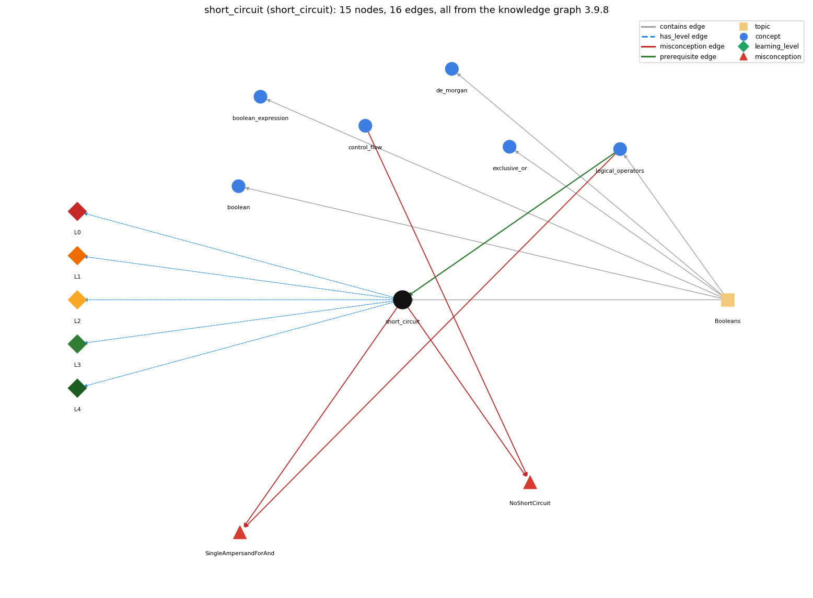

# short_circuit (`short_circuit`)

&amp;&amp;/\|\| stop evaluating once the result is known

Section 1.2 Built-in Types of Data, topic 1.2.e Booleans. From the knowledge graph 3.9.8 (`data/raw/chapter1_kg_updated.json`).

## Concepts associated with short\_circuit (6)

| Concept | Description | How it is associated |
| --- | --- | --- |
| **boolean** | true/false primitive | same topic (topic1.2.e) |
| **boolean\_expression** | an expression that evaluates to true/false | same topic (topic1.2.e) |
| **control\_flow** | the order in which statements are executed | shares misconception NoShortCircuit |
| **de\_morgan** | !(a &amp;&amp; b) == !a \|\| !b and !(a \|\| b) == !a &amp;&amp; !b | same topic (topic1.2.e) |
| **exclusive\_or** | ^ on booleans is true when the operands differ | same topic (topic1.2.e) |
| **logical\_operators** | &amp;&amp; \|\| ! | prerequisite of it (it needs this) composition rule (R) with it shares misconception SingleAmpersandForAnd same topic (topic1.2.e) |

## Every edge in this view and its full label (16)

| From | Edge | To | Full edge label |
| --- | --- | --- | --- |
| **logical\_operators** | prerequisite | **short\_circuit** | &amp;&amp; and \|\| evaluate their second operand only when the first has not already decided the result (false &amp;&amp; x is false, true \|\| x is true). grounding: book\_passage composition rule (R) of logical\_operators with short\_circuit: &amp;&amp; and \|\| are the short-circuit operators: in a guard such as (x != 0 &amp;&amp; y / x &gt; 1) the operand order matters, because the right test runs only when the left one allows it. composition rule (R) of short\_circuit with logical\_operators: Short-circuiting is the defining evaluation order of &amp;&amp; and \|\| only; the book's other boolean operators (! and ^, and &amp; / \| if used) evaluate all their operands. |
| **control\_flow** | misconception | **NoShortCircuit** | **wrong rule:** logical AND/OR always evaluate both sides (Java short-circuits them) **right rule:** In p &amp;&amp; q, q is evaluated only when p is true; in p \|\| q, q is evaluated only when p is false. role: context |
| **logical\_operators** | misconception | **SingleAmpersandForAnd** | **wrong rule:** &amp; and \| are the same as &amp;&amp; and \|\| for conditions, so either can be used. **right rule:** &amp;&amp; and \|\| skip the right operand when the left decides the result; &amp; and \| always evaluate both, which fails when the right side depends on the left (e.g. x != 0 &amp; y / x &gt; 1). role: context |
| **short\_circuit** | misconception | **NoShortCircuit** | **wrong rule:** In p &amp;&amp; q, both p and q are always evaluated. **right rule:** In p &amp;&amp; q, q is evaluated only when p is true; in p \|\| q, q is evaluated only when p is false. role: primary |
| **short\_circuit** | misconception | **SingleAmpersandForAnd** | **wrong rule:** &amp; and \| are the same as &amp;&amp; and \|\| for conditions, so either can be used. **right rule:** &amp;&amp; and \|\| skip the right operand when the left decides the result; &amp; and \| always evaluate both, which fails when the right side depends on the left (e.g. x != 0 &amp; y / x &gt; 1). role: primary |
| **short\_circuit** | has\_level | **short\_circuit@L0** | short circuit -&gt; L0 (Prestructural): the answer holds a rule that contradicts Java (4 ways). **[0] everyday\_reading** (E): Folk meaning: in maths and logic the value of 'p and q' is read off a truth table with both sides known, so both sides are always 'computed'. Java rule: &amp;&amp; and \|\| evaluate left to right and skip the right operand when the left already decides the result (false &amp;&amp; x, true \|\| x). **[1] misconception** (M) &rarr; NoShortCircuit: wrong rule: Logical AND/OR always evaluate both sides. Right rule: In p &amp;&amp; q, q is evaluated only when p is true; in p \|\| q, q is evaluated only when p is false. **[2] misconception** (M) &rarr; SingleAmpersandForAnd: wrong rule: &amp; and \| are the same as &amp;&amp; and \|\| for conditions, so either can be used. Right rule: &amp;&amp; and \|\| skip the right operand when the left decides the result; &amp; and \| always evaluate both, which fails when the right side depends on the left (e.g. x != 0 &amp; y / x &gt; 1). **[3] inconsistent\_trace** (T) &rarr; NoShortCircuit: Points to LT (evaluate the left operand; stop if it decides; otherwise evaluate the right). Applied unevenly: on some passes of a loop the student counts the side effect of the right operand (e.g. ++i) although the left operand was already false, or lets a guarded index be read on the pass where the guard failed. (here mixing in: "logical AND/OR always evaluate both sides (Java short-circuits them)") |
| **short\_circuit** | has\_level | **short\_circuit@L1** | short circuit -&gt; L1 (Unistructural): the answer states one correct rule without applying it (2 ways). **[0] names\_the\_element** (N): Short-circuit evaluation is the way Java evaluates the logical operators &amp;&amp; and \|\|: the second operand is evaluated only if necessary. **[1] states\_the\_rule** (S): In a &amp;&amp; b, b is evaluated only if a is true (false &amp;&amp; b is false); in a \|\| b, b is evaluated only if a is false (true \|\| b is true). &amp;, \| and ^ do not short-circuit. |
| **short\_circuit** | has\_level | **short\_circuit@L2** | short circuit -&gt; L2 (Multistructural): the answer applies the rules of short circuit to every part of the code, in order (3 ways). **[0] line\_by\_line\_trace** (LT): Evaluate the left operand fully; if it is false (for &amp;&amp;) or true (for \|\|) the whole expression takes that value immediately; otherwise evaluate the right operand, whose value is the result. **[1] output\_prediction** (OP): The value is the same as under full evaluation whenever the right operand would have completed normally; with n = 0, (n != 0 &amp;&amp; 10 / n &gt; 1) is false and throws no exception. **[2] one\_step\_execution** (OS): When the right operand is skipped, none of its side effects happen: with i = 0, after (false &amp;&amp; ++i &gt; 0) i is still 0, while (true &amp;&amp; ++i &gt; 0) makes i 1. |
| **short\_circuit** | has\_level | **short\_circuit@L3** | short circuit -&gt; L3 (Relational): the answer relates the parts (2 ways). **[0] relation\_to\_neighbour** (R): Short-circuiting is the defining evaluation order of &amp;&amp; and \|\| only; the book's other boolean operators (! and ^, and &amp; / \| if used) evaluate all their operands. **[1] purpose\_of\_the\_whole** (P): Guard plan: put the safety test first so the risky test runs only when it is safe, e.g. (i &lt; a.length &amp;&amp; a[i] != 0), (count != 0 &amp;&amp; sum / count &gt; 5), (str == null \|\| str.isEmpty()). |
| **short\_circuit** | has\_level | **short\_circuit@L4** | short circuit -&gt; L4 (Extended abstract): the answer reasons beyond the given code (4 ways). **[0] predict\_a\_change** (C) &rarr; NoShortCircuit: Swapping the operands of a guard (a[i] != 0 &amp;&amp; i &lt; a.length) keeps the truth table but lets the risky test run first and throw; replacing &amp;&amp; by &amp; removes the protection; moving a needed side effect into the right operand makes it happen only sometimes. **[1] transfer\_to\_a\_new\_program** (X): Rely on short-circuiting when the second test is only valid or meaningful if the first holds (bounds, zero, null) or is expensive; do not put side effects you need into the right operand. **[2] diagnose\_an\_error** (D): rule broken: The protecting test must be the left operand of &amp;&amp; / \|\|. Kind: run-time exception. Trigger class: A guard written after the test it protects, or with &amp; / \|: index out of bounds, divisor 0, or null when the guard condition is false. **[3] diagnose\_an\_error** (D): rule broken: The right operand of &amp;&amp; / \|\| is not always evaluated. Kind: silent logic error. Trigger class: A required side effect (++, assignment, method call) placed in the right operand, on runs where the left operand decides the result. |
| **topic1.2.e** | contains | **boolean** | topic topic1.2.e contains boolean |
| **topic1.2.e** | contains | **boolean\_expression** | topic topic1.2.e contains boolean\_expression |
| **topic1.2.e** | contains | **de\_morgan** | topic topic1.2.e contains de\_morgan |
| **topic1.2.e** | contains | **exclusive\_or** | topic topic1.2.e contains exclusive\_or |
| **topic1.2.e** | contains | **logical\_operators** | topic topic1.2.e contains logical\_operators |
| **topic1.2.e** | contains | **short\_circuit** | topic topic1.2.e contains short\_circuit |
