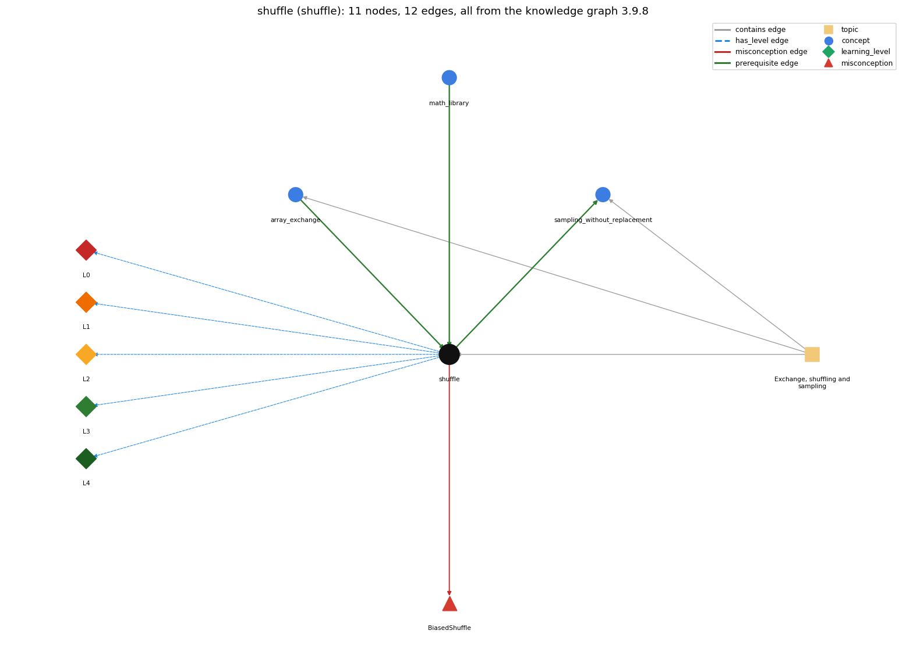

# shuffle (`shuffle`)

Knuth shuffle -- swap a[i] with a random a[r], r in i..n-1

Section 1.4 Arrays, topic 1.4.d Exchange, shuffling and sampling.

## At a glance

- **Needs first:** `array_exchange`, `math_library`
- **Leads to:** `sampling_without_replacement`
- **Learned alongside:** nothing
- **Misconceptions:** `BiasedShuffle`
- **Errors:** none
- **Levels:** L0, L1, L2, L3, L4

Everything below comes from the knowledge graph 3.9.8 (`data/raw/chapter1_kg_updated.json`): 12 edges around this concept. The edge logic, the wrong and right rules and the exact rules of the ways are copied word for word from the graph.

## To work on (1)

- no aliases: a student's words cannot name this concept

## What it needs first (2)

A prerequisite edge means the other concept has to be understood before `shuffle`.

### `array_exchange` comes before `shuffle`

*swap a[i] and a[j] through a temporary variable*

- **Edge:** `pre:array_exchange->shuffle`
- **Exact edge logic:** Shuffling is a loop of exchanges with randomly chosen positions.
- **Grounding:** book\_passage
- **Composition rule (R) of `shuffle` with `array_exchange`:** Using the exchange idiom guarantees the deck holds the same cards after the shuffle.
- **Composition rule (R) of `array_exchange` with `shuffle`:** Shuffling is a loop of exchanges with random partner positions; using exchanges guarantees the same cards before and after.

### `math_library` comes before `shuffle`

*Math.abs, Math.sqrt, Math.max, Math.random, Math.round ...*

- **Edge:** `pre:math_library->shuffle`
- **Exact edge logic:** The random position r between i and N-1 is computed with Math.random(), so each remaining card is equally likely to be chosen.
- **Grounding:** book\_passage
- **Composition rule (R) of `shuffle` with `math_library`:** (int) (Math.random() \* (N-i)) is a uniform int in 0..N-i-1, so r = i + that value is uniform in i..N-1.
- **Composition rule (R) of `math_library` with `shuffle`:** In the shuffle, r = i + (int) (Math.random() \* (N-i)) scales Math.random() to a uniformly random position between i and N-1, so each remaining card is equally likely.

## What it leads to (1)

These concepts need `shuffle` first.

### `shuffle` comes before `sampling_without_replacement`

*choosing m distinct items at random*

- **Edge:** `pre:shuffle->sampling_without_replacement`
- **Exact edge logic:** Sample uses the basic operation underlying shuffling: for each of the first M positions it exchanges perm[i] with a random element to its right.
- **Grounding:** book\_passage
- **Composition rule (R) of `shuffle` with `sampling_without_replacement`:** Stopping the shuffle after the first M passes leaves a uniform random sample in positions 0..M-1.
- **Composition rule (R) of `sampling_without_replacement` with `shuffle`:** The sample is the first M passes of the shuffle applied to the identity permutation.

## Learned alongside (0)

A parallel edge joins two concepts that sit side by side: neither is needed before the other.

No parallel edge touches this concept.

## Misconceptions (1)

A misconception edge states the wrong rule a student may hold about this concept, and the right rule.

### BiasedShuffle

- **Edge:** `shuffle` &rarr; `BiasedShuffle` (misconception)
- **Exact edge logic (the wrong rule):** Swapping each a[i] with a random element from the whole array gives a uniformly random order.
- **Twin logic (the right rule):** r must be chosen between i and n - 1 for every ordering to be equally likely.
- **Wrong belief (on the node):** Swapping each a[i] with a random element from the whole array gives a uniformly random order.
- **Correct rule (on the node):** r must be chosen between i and n - 1 for every ordering to be equally likely.
- **Provenance:** textbook
- **Role of this concept:** primary
- **L0 way linked to it:** yes
- **L0 way [1] misconception, exact rule:** wrong rule: Swapping each a[i] with a random element from the whole array gives a uniformly random order. Right rule: r must be chosen between i and n - 1 for every ordering to be equally likely.
- **L0 way [2] inconsistent\_trace, exact rule:** Points to LT: for each i from left to right, compute r in i..N-1 and then exchange deck[i] and deck[r]. Inconsistent application: r is drawn from the whole range on some passes, or the exchange is skipped when r == i. (here mixing in: "Swapping each a[i] with a random element from the whole array gives a uniformly random order")

## Errors (0)

An error edge states the rule that gets broken in a program, and the right rule.

The graph has no error edge from this concept.

## Levels L0 to L4 (5 of 5)

Each level edge lists the ways a student shows that level, each with its exact rule.

### L0: Prestructural / sensorimotor

L0 for shuffle: the answer holds a rule that contradicts Java.

*Deciding question: Does every rule the answer applies to shuffle agree with the language rule? If it reads the code with everyday meanings, applies a wrong rule, or switches rules within one trace, it is L0. A slip in an otherwise rule-correct trace is L2 with an error, not L0.*

- **Edge:** `shuffle` &rarr; `shuffle@L0` (has_level)
- **Exact edge logic:** shuffle -&gt; L0 (Prestructural): the answer holds a rule that contradicts Java (3 ways).

Ways (3), each with its exact rule:

- **[0] everyday\_reading** (rule type E, folk-meaning rule): Folk meaning: 'shuffle' means mix randomly, so any random swapping seems good enough. Java/algorithm rule: picking the partner r uniformly from i..N-1 makes all N! orders equally likely; picking from 0..N-1 does not.
- **[1] misconception** (rule type M, wrong rule / right rule) &rarr; `BiasedShuffle`: wrong rule: Swapping each a[i] with a random element from the whole array gives a uniformly random order. Right rule: r must be chosen between i and n - 1 for every ordering to be equally likely.
- **[2] inconsistent\_trace** (rule type T, uneven-application rule) &rarr; `BiasedShuffle`: Points to LT: for each i from left to right, compute r in i..N-1 and then exchange deck[i] and deck[r]. Inconsistent application: r is drawn from the whole range on some passes, or the exchange is skipped when r == i. (here mixing in: "Swapping each a[i] with a random element from the whole array gives a uniformly random order")

### L1: Unistructural / atom x text surface

L1 for shuffle: the answer states one correct rule without applying it.

*Deciding question: Does the answer cover every part of the code, in order, with the values (L2)? If it covers one part or only states the rule, it is L1.*

- **Edge:** `shuffle` &rarr; `shuffle@L1` (has_level)
- **Exact edge logic:** shuffle -&gt; L1 (Unistructural): the answer states one correct rule without applying it (2 ways).

Ways (2), each with its exact rule:

- **[0] names\_the\_element** (rule type N, identity rule): Identity: the Knuth (Fisher-Yates) shuffle, which produces a random permutation by exchanging each position, left to right, with a uniformly chosen position at or to its right.
- **[1] states\_the\_rule** (rule type S, declarative rule): Declarative: for (int i = 0; i &lt; N; i++) { int r = i + (int) (Math.random() \* (N-i)); exchange deck[i] and deck[r]; }.

### L2: Multistructural / block x execution / preoperational

L2 for shuffle: the answer applies these rules to every part of the code, in order.

*Deciding question: Is the answer many segments mapped onto lines (L2), or one segment stating the purpose of the whole (L3)? A correct output with no value-by-value justification is not levelled.*

- **Edge:** `shuffle` &rarr; `shuffle@L2` (has_level)
- **Exact edge logic:** shuffle -&gt; L2 (Multistructural): the answer applies the rules of shuffle to every part of the code, in order (3 ways).

Ways (3), each with its exact rule:

- **[0] line\_by\_line\_trace** (rule type LT, operational sequencing rule): Sequencing: N = deck.length is read once; on each pass r is computed first (Math.random(), times N-i, cast to int, plus i), then the three-step exchange runs, then i increases.
- **[1] output\_prediction** (rule type OP, evaluation / result rule): Result: a permutation of the original elements with every one of the N! orders equally likely; the output differs from run to run.
- **[2] one\_step\_execution** (rule type OS, state-transition rule): State transition: one pass picks r and exchanges deck[i] with deck[r]; afterwards deck[0..i] is fixed for the rest of the shuffle.

### L3: Relational / relations x function (concrete operational begins)

L3 for shuffle: the answer relates the parts by these rules.

*Deciding question: Was the purpose deduced from the code, or only guessed from traced input/output pairs (then L2)? Does the answer stay within the given code (L3), or reason about changed code, an error class or a new program (L4)?*

- **Edge:** `shuffle` &rarr; `shuffle@L3` (has_level)
- **Exact edge logic:** shuffle -&gt; L3 (Relational): the answer relates the parts (4 ways).

Ways (4), each with its exact rule:

- **[0] relation\_to\_neighbour** (rule type R, composition rule (with a neighbour)): Using the exchange idiom guarantees the deck holds the same cards after the shuffle.
- **[1] relation\_to\_neighbour** (rule type R, composition rule (with a neighbour)): (int) (Math.random() \* (N-i)) is a uniform int in 0..N-i-1, so r = i + that value is uniform in i..N-1.
- **[2] relation\_to\_neighbour** (rule type R, composition rule (with a neighbour)): Stopping the shuffle after the first M passes leaves a uniform random sample in positions 0..M-1.
- **[3] purpose\_of\_the\_whole** (rule type P, plan / role rule): Plan/role: randomize the order of an array in place in linear time (dealing cards, random permutations); the array is an organizer.

### L4: Extended abstract (concrete-operational reversibility and conservation)

L4 for shuffle: the answer reasons beyond the given code by these rules.

*Deciding question: Does the answer link the code to a broader context: a changed program, a class of inputs, an unseen problem? Re-tracing changed code value by value is L2; fixing one given failing case is L3.*

- **Edge:** `shuffle` &rarr; `shuffle@L4` (has_level)
- **Exact edge logic:** shuffle -&gt; L4 (Extended abstract): the answer reasons beyond the given code (5 ways).

Ways (5), each with its exact rule:

- **[0] predict\_a\_change** (rule type C, conservation rule) &rarr; `BiasedShuffle`: Conservation: the set of cards is invariant (exchanges only), and after pass i, deck[0..i] is a uniform random sample. Widening r's range to 0..N-1 keeps the set but breaks uniformity.
- **[1] transfer\_to\_a\_new\_program** (rule type X, applicability rule): Applicability: use it to randomize a whole array in place. For only M random items, run the first M passes. When the original order must be kept, shuffle an index permutation and use it to index the data.
- **[2] diagnose\_an\_error** (rule type D, error rule): rule broken: r must be uniform over i..N-1. Kind: silent logic error. Trigger class: r = (int) (Math.random() \* N): the shuffle runs and looks random, but some orders are more likely than others
- **[3] diagnose\_an\_error** (rule type D, error rule): rule broken: The cast applies to the scaled product. Kind: silent logic error. Trigger class: (int) Math.random() \* (N-i) casts first and is always 0, so r == i and nothing moves
- **[4] diagnose\_an\_error** (rule type D, error rule): rule broken: r must stay within 0..N-1. Kind: run-time exception. Trigger class: r = i + (int) (Math.random() \* N) can exceed N-1 (ArrayIndexOutOfBoundsException)

## Same topic

`shuffle` belongs to the topic **Exchange, shuffling and sampling** (`topic1.4.d`). The topic also contains: `array_exchange`, `sampling_without_replacement`.

## Rules of the concept (17)

- **Book** (SW-1e, p. 93 (pdf 103)): "Second, we ensure that the shuffle is random by choosing uniformly from the cards not yet chosen."
- **Book** (SW-1.4, p. 93 (pdf 103)): "we pick a random card from deck[i] through deck[n-1] (each card equally likely) and exchange it with deck[i]."
- **E** (folk-meaning rule): Folk meaning: 'shuffle' means mix randomly, so any random swapping seems good enough. Java/algorithm rule: picking the partner r uniformly from i..N-1 makes all N! orders equally likely; picking from 0..N-1 does not.
- **M** (wrong rule / right rule): BiasedShuffle: wrong: Swapping each a[i] with a random element from the whole array gives a uniformly random order. \| right: r must be chosen between i and n - 1 for every ordering to be equally likely.
- **T** (uneven-application rule): Points to LT: for each i from left to right, compute r in i..N-1 and then exchange deck[i] and deck[r]. Inconsistent application: r is drawn from the whole range on some passes, or the exchange is skipped when r == i.
- **N** (identity rule): Identity: the Knuth (Fisher-Yates) shuffle, which produces a random permutation by exchanging each position, left to right, with a uniformly chosen position at or to its right.
- **S** (declarative rule): Declarative: for (int i = 0; i &lt; N; i++) { int r = i + (int) (Math.random() \* (N-i)); exchange deck[i] and deck[r]; }.
- **LT** (operational sequencing rule): Sequencing: N = deck.length is read once; on each pass r is computed first (Math.random(), times N-i, cast to int, plus i), then the three-step exchange runs, then i increases.
- **OP** (evaluation / result rule): Result: a permutation of the original elements with every one of the N! orders equally likely; the output differs from run to run.
- **OS** (state-transition rule): State transition: one pass picks r and exchanges deck[i] with deck[r]; afterwards deck[0..i] is fixed for the rest of the shuffle.
- **R** (composition rule (with a neighbour)): with array\_exchange: Using the exchange idiom guarantees the deck holds the same cards after the shuffle.
- **R** (composition rule (with a neighbour)): with math\_library: (int) (Math.random() \* (N-i)) is a uniform int in 0..N-i-1, so r = i + that value is uniform in i..N-1.
- **R** (composition rule (with a neighbour)): with sampling\_without\_replacement: Stopping the shuffle after the first M passes leaves a uniform random sample in positions 0..M-1.
- **P** (plan / role rule): Plan/role: randomize the order of an array in place in linear time (dealing cards, random permutations); the array is an organizer.
- **C** (conservation rule): Conservation: the set of cards is invariant (exchanges only), and after pass i, deck[0..i] is a uniform random sample. Widening r's range to 0..N-1 keeps the set but breaks uniformity.
- **D** (error rule): rule broken: r must be uniform over i..N-1. (silent logic error)
- **D** (error rule): rule broken: The cast applies to the scaled product. (silent logic error)
- **D** (error rule): rule broken: r must stay within 0..N-1. (run-time exception)
- **X** (applicability rule): Applicability: use it to randomize a whole array in place. For only M random items, run the first M passes. When the original order must be kept, shuffle an index permutation and use it to index the data.

## How it is found in code and answers (reader block)

- **Aliases:** none
- **Code patterns:** `Math\.random\s*\(\s*\)\s*\*\s*\(\s*\w+\s*-\s*\w+\s*\)`, `StdRandom\.shuffle\s*\(`, `StdRandom\.uniform\s*\(\s*\w+\s*,`
- **Operator symbols:** none
- **Java types:** none

## The whole prerequisite chain

- **Everything it builds on (17):** `arithmetic_operators`, `array_creation`, `array_declaration`, `array_exchange`, `array_initializer`, `assignment`, `data_structure`, `data_type`, `declaration`, `expression`, `identifier`, `indexing`, `literal`, `math_library`, `method_call`, `primitive_type`, `variable`
- **Everything that builds on it (1):** `sampling_without_replacement`

## Every edge in this view and its exact edge logic (12)

All the edges drawn in the picture, in the order: prerequisite, parallel, misconception, error, has_level, contains.

**1. `array_exchange` &rarr; `shuffle`** (prerequisite)

- **Exact edge logic:** Shuffling is a loop of exchanges with randomly chosen positions.
- **Grounding:** book\_passage
- **Composition rule (R) of `array_exchange` with `shuffle`:** Shuffling is a loop of exchanges with random partner positions; using exchanges guarantees the same cards before and after.
- **Composition rule (R) of `shuffle` with `array_exchange`:** Using the exchange idiom guarantees the deck holds the same cards after the shuffle.

**2. `math_library` &rarr; `shuffle`** (prerequisite)

- **Exact edge logic:** The random position r between i and N-1 is computed with Math.random(), so each remaining card is equally likely to be chosen.
- **Grounding:** book\_passage
- **Composition rule (R) of `math_library` with `shuffle`:** In the shuffle, r = i + (int) (Math.random() \* (N-i)) scales Math.random() to a uniformly random position between i and N-1, so each remaining card is equally likely.
- **Composition rule (R) of `shuffle` with `math_library`:** (int) (Math.random() \* (N-i)) is a uniform int in 0..N-i-1, so r = i + that value is uniform in i..N-1.

**3. `shuffle` &rarr; `sampling_without_replacement`** (prerequisite)

- **Exact edge logic:** Sample uses the basic operation underlying shuffling: for each of the first M positions it exchanges perm[i] with a random element to its right.
- **Grounding:** book\_passage
- **Composition rule (R) of `shuffle` with `sampling_without_replacement`:** Stopping the shuffle after the first M passes leaves a uniform random sample in positions 0..M-1.
- **Composition rule (R) of `sampling_without_replacement` with `shuffle`:** The sample is the first M passes of the shuffle applied to the identity permutation.

**4. `shuffle` &rarr; `BiasedShuffle`** (misconception)

- **Exact edge logic (the wrong rule):** Swapping each a[i] with a random element from the whole array gives a uniformly random order.
- **Twin logic (the right rule):** r must be chosen between i and n - 1 for every ordering to be equally likely.
- **Role:** primary

**5. `shuffle` &rarr; `shuffle@L0`** (has_level)

- **Exact edge logic:** shuffle -&gt; L0 (Prestructural): the answer holds a rule that contradicts Java (3 ways).
  - **[0] everyday\_reading** (rule type E, folk-meaning rule): Folk meaning: 'shuffle' means mix randomly, so any random swapping seems good enough. Java/algorithm rule: picking the partner r uniformly from i..N-1 makes all N! orders equally likely; picking from 0..N-1 does not.
  - **[1] misconception** (rule type M, wrong rule / right rule) &rarr; `BiasedShuffle`: wrong rule: Swapping each a[i] with a random element from the whole array gives a uniformly random order. Right rule: r must be chosen between i and n - 1 for every ordering to be equally likely.
  - **[2] inconsistent\_trace** (rule type T, uneven-application rule) &rarr; `BiasedShuffle`: Points to LT: for each i from left to right, compute r in i..N-1 and then exchange deck[i] and deck[r]. Inconsistent application: r is drawn from the whole range on some passes, or the exchange is skipped when r == i. (here mixing in: "Swapping each a[i] with a random element from the whole array gives a uniformly random order")

**6. `shuffle` &rarr; `shuffle@L1`** (has_level)

- **Exact edge logic:** shuffle -&gt; L1 (Unistructural): the answer states one correct rule without applying it (2 ways).
  - **[0] names\_the\_element** (rule type N, identity rule): Identity: the Knuth (Fisher-Yates) shuffle, which produces a random permutation by exchanging each position, left to right, with a uniformly chosen position at or to its right.
  - **[1] states\_the\_rule** (rule type S, declarative rule): Declarative: for (int i = 0; i &lt; N; i++) { int r = i + (int) (Math.random() \* (N-i)); exchange deck[i] and deck[r]; }.

**7. `shuffle` &rarr; `shuffle@L2`** (has_level)

- **Exact edge logic:** shuffle -&gt; L2 (Multistructural): the answer applies the rules of shuffle to every part of the code, in order (3 ways).
  - **[0] line\_by\_line\_trace** (rule type LT, operational sequencing rule): Sequencing: N = deck.length is read once; on each pass r is computed first (Math.random(), times N-i, cast to int, plus i), then the three-step exchange runs, then i increases.
  - **[1] output\_prediction** (rule type OP, evaluation / result rule): Result: a permutation of the original elements with every one of the N! orders equally likely; the output differs from run to run.
  - **[2] one\_step\_execution** (rule type OS, state-transition rule): State transition: one pass picks r and exchanges deck[i] with deck[r]; afterwards deck[0..i] is fixed for the rest of the shuffle.

**8. `shuffle` &rarr; `shuffle@L3`** (has_level)

- **Exact edge logic:** shuffle -&gt; L3 (Relational): the answer relates the parts (4 ways).
  - **[0] relation\_to\_neighbour** (rule type R, composition rule (with a neighbour)): Using the exchange idiom guarantees the deck holds the same cards after the shuffle.
  - **[1] relation\_to\_neighbour** (rule type R, composition rule (with a neighbour)): (int) (Math.random() \* (N-i)) is a uniform int in 0..N-i-1, so r = i + that value is uniform in i..N-1.
  - **[2] relation\_to\_neighbour** (rule type R, composition rule (with a neighbour)): Stopping the shuffle after the first M passes leaves a uniform random sample in positions 0..M-1.
  - **[3] purpose\_of\_the\_whole** (rule type P, plan / role rule): Plan/role: randomize the order of an array in place in linear time (dealing cards, random permutations); the array is an organizer.

**9. `shuffle` &rarr; `shuffle@L4`** (has_level)

- **Exact edge logic:** shuffle -&gt; L4 (Extended abstract): the answer reasons beyond the given code (5 ways).
  - **[0] predict\_a\_change** (rule type C, conservation rule) &rarr; `BiasedShuffle`: Conservation: the set of cards is invariant (exchanges only), and after pass i, deck[0..i] is a uniform random sample. Widening r's range to 0..N-1 keeps the set but breaks uniformity.
  - **[1] transfer\_to\_a\_new\_program** (rule type X, applicability rule): Applicability: use it to randomize a whole array in place. For only M random items, run the first M passes. When the original order must be kept, shuffle an index permutation and use it to index the data.
  - **[2] diagnose\_an\_error** (rule type D, error rule): rule broken: r must be uniform over i..N-1. Kind: silent logic error. Trigger class: r = (int) (Math.random() \* N): the shuffle runs and looks random, but some orders are more likely than others
  - **[3] diagnose\_an\_error** (rule type D, error rule): rule broken: The cast applies to the scaled product. Kind: silent logic error. Trigger class: (int) Math.random() \* (N-i) casts first and is always 0, so r == i and nothing moves
  - **[4] diagnose\_an\_error** (rule type D, error rule): rule broken: r must stay within 0..N-1. Kind: run-time exception. Trigger class: r = i + (int) (Math.random() \* N) can exceed N-1 (ArrayIndexOutOfBoundsException)

**10. `topic1.4.d` &rarr; `shuffle`** (contains)

- topic `topic1.4.d` contains `shuffle`

**11. `topic1.4.d` &rarr; `array_exchange`** (contains)

- topic `topic1.4.d` contains `array_exchange`

**12. `topic1.4.d` &rarr; `sampling_without_replacement`** (contains)

- topic `topic1.4.d` contains `sampling_without_replacement`
