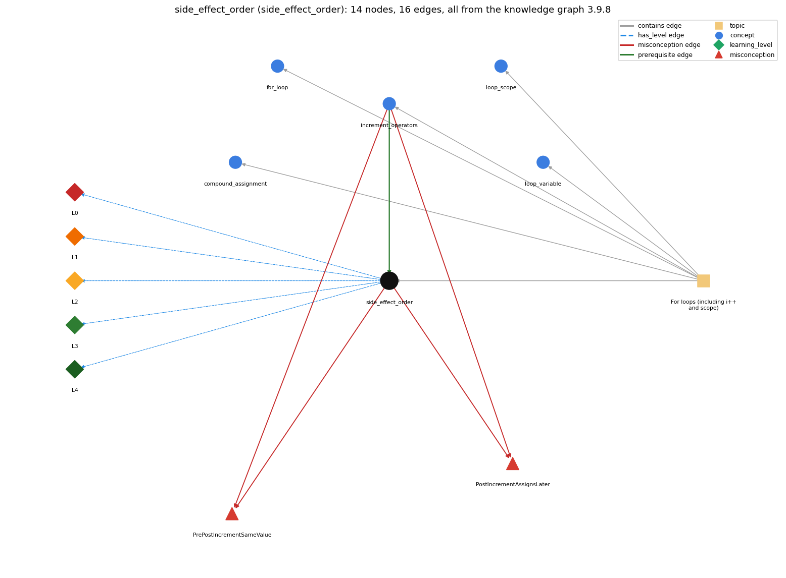

# side_effect_order (`side_effect_order`)

i = i++ and other expressions with side effects

Section 1.3 Conditionals and Loops, topic 1.3.d For loops (including i++ and scope).

## At a glance

- **Needs first:** `increment_operators`
- **Leads to:** nothing
- **Learned alongside:** nothing
- **Misconceptions:** `PostIncrementAssignsLater`, `PrePostIncrementSameValue`
- **Errors:** none
- **Levels:** L0, L1, L2, L3, L4

Everything below comes from the knowledge graph 3.9.8 (`data/raw/chapter1_kg_updated.json`): 16 edges around this concept, each explained in the graph's own words.

## What it needs first (1)

A prerequisite edge means the other concept has to be understood before `side_effect_order`.

### `increment_operators` comes before `side_effect_order`

*++ / -- (and +=)*

The result depends on the value an increment expression evaluates to.

- **Grounding:** book passage
- **How `side_effect_order` combines with `increment_operators`:** The result of an expression with a side effect depends on the value the increment expression evaluates to: old for i++, new for ++i.
- **How `increment_operators` combines with `side_effect_order`:** Inside a larger expression the result depends on which value (old or new) the increment yields and on left-to-right evaluation, e.g. j += j++ in Exercise 1.3.6.

## What it leads to (0)

These concepts need `side_effect_order` first.

No concept has this one as a prerequisite.

## Learned alongside (0)

A parallel edge joins two concepts that sit side by side: neither is needed before the other.

No parallel edge touches this concept.

## Misconceptions (2)

A misconception edge states the wrong rule a student may hold about this concept, and the right rule.

### PostIncrementAssignsLater

- **Wrong rule:** i = i++ increases i by 1.
- **Right rule:** i++ evaluates to the old value, so i = i++ stores the old value back.
- **Role of this concept:** primary
- **Shows at level L0 as:** misconception: wrong rule: i = i++ increases i by 1. Right rule: i++ evaluates to the old value, so i = i++ stores the old value back.
- **Shows at level L0 as:** inconsistent trace: Applies left-to-right evaluation (LT) unevenly: lets an increment happen 'at the end of the statement' in one place but immediately in another. (here mixing in: "i = i++ increases i by 1")
- **Also an edge from `increment_operators`:** i = i++ increases i by 1.

### PrePostIncrementSameValue

- **Wrong rule:** x = i++ and x = ++i store the same value in x.
- **Right rule:** Both increment i, but ++i has the value after the increment and i++ the value before.
- **Role of this concept:** context
- **Shows at level L0 as:** misconception: wrong rule: x = i++ and x = ++i store the same value in x. Right rule: Both increment i, but ++i has the value after the increment and i++ the value before.
- **Also an edge from `increment_operators`:** x = i++ and x = ++i store the same value in x.

## Errors (0)

An error edge states the rule that gets broken in a program, and the right rule.

The graph has no error edge from this concept.

## Levels L0 to L4 (5 of 5)

Each level edge lists the ways a student shows that level, each with its exact rule.

### L0: Prestructural / sensorimotor

L0 for side effect order: the answer holds a rule that contradicts Java.

*Deciding question: Does every rule the answer applies to side effect order agree with the language rule? If it reads the code with everyday meanings, applies a wrong rule, or switches rules within one trace, it is L0. A slip in an otherwise rule-correct trace is L2 with an error, not L0.*

side effect order -&gt; L0 (Prestructural): the answer holds a rule that contradicts Java (4 ways).

- **everyday reading** (folk-meaning rule): Folk meaning: in maths an expression has no effects, so i = i++ and x = ++i look like statements about equal quantities. In Java ++ changes i as soon as it is evaluated, and the expression's value (old or new) is then used by the rest of the expression.
- **misconception** (wrong rule / right rule; shows `PostIncrementAssignsLater`): wrong rule: i = i++ increases i by 1. Right rule: i++ evaluates to the old value, so i = i++ stores the old value back.
- **inconsistent trace** (uneven-application rule; shows `PostIncrementAssignsLater`): Applies left-to-right evaluation (LT) unevenly: lets an increment happen 'at the end of the statement' in one place but immediately in another. (here mixing in: "i = i++ increases i by 1")
- **misconception** (wrong rule / right rule; shows `PrePostIncrementSameValue`): wrong rule: x = i++ and x = ++i store the same value in x. Right rule: Both increment i, but ++i has the value after the increment and i++ the value before.

### L1: Unistructural / atom x text surface

L1 for side effect order: the answer states one correct rule without applying it.

*Deciding question: Does the answer cover every part of the code, in order, with the values (L2)? If it covers one part or only states the rule, it is L1.*

side effect order -&gt; L1 (Unistructural): the answer states one correct rule without applying it (2 ways).

- **names the element** (identity rule): A side effect is a change to a variable's value made while evaluating an expression, e.g. by ++, -- or an assignment used inside a larger expression.
- **states the rule** (declarative rule): Java evaluates the left operand of a binary operator fully before the right, and all operands (except &amp;&amp;, \|\|, ?:) before the operation; ++i yields the new value and i++ the old one.

### L2: Multistructural / block x execution / preoperational

L2 for side effect order: the answer applies these rules to every part of the code, in order.

*Deciding question: Is the answer many segments mapped onto lines (L2), or one segment stating the purpose of the whole (L3)? A correct output with no value-by-value justification is not levelled.*

side effect order -&gt; L2 (Multistructural): the answer applies the rules of side effect order to every part of the code, in order (3 ways).

- **line by line trace** (operational sequencing rule): Evaluate operands left to right, applying each side effect at the moment its operand is evaluated; then apply the operator; for an assignment, the right side's value is stored last.
- **output prediction** (evaluation / result rule): With i = 5: i = i++ leaves 5 (old value stored back after the increment); x = i++ + i gives 5 + 6 = 11; j += j++ with j = 1 gives 2.
- **one step execution** (state-transition rule): One evaluation of i++ changes i by 1 and returns the old value; a later assignment in the same statement can overwrite that change.

### L3: Relational / relations x function (concrete operational begins)

L3 for side effect order: the answer relates the parts by these rules.

*Deciding question: Was the purpose deduced from the code, or only guessed from traced input/output pairs (then L2)? Does the answer stay within the given code (L3), or reason about changed code, an error class or a new program (L4)?*

side effect order -&gt; L3 (Relational): the answer relates the parts (2 ways).

- **relation to neighbour** (composition rule (with a neighbour)): The result of an expression with a side effect depends on the value the increment expression evaluates to: old for i++, new for ++i.
- **purpose of the whole** (plan / role rule): Plan: avoid it - write each change as its own statement (x = i; i++;) so the order of effects is visible; the book avoids statements like x = ++i.

### L4: Extended abstract (concrete-operational reversibility and conservation)

L4 for side effect order: the answer reasons beyond the given code by these rules.

*Deciding question: Does the answer link the code to a broader context: a changed program, a class of inputs, an unseen problem? Re-tracing changed code value by value is L2; fixing one given failing case is L3.*

side effect order -&gt; L4 (Extended abstract): the answer reasons beyond the given code (4 ways).

- **predict a change** (conservation rule; shows `PostIncrementAssignsLater`): Splitting x = i++; into x = i; i++; preserves behaviour; splitting it into i++; x = i; changes x by 1. Reordering the operands of an expression that contains a side effect can change the result.
- **transfer to a new program** (applicability rule): Rely on side-effect order only when reading other people's code; in your own code keep at most one side effect per statement and never read and modify the same variable in one expression.
- **diagnose an error** (error rule): rule broken: i++ yields the old value; assigning it back undoes the increment. Kind: silent logic error. Trigger class: i = i++ (or j = j++) used as an update: the variable never changes.
- **diagnose an error** (error rule): rule broken: Pre- and post-increment yield different values. Kind: silent logic error. Trigger class: Using x = ++i where x = i++ was meant (or vice versa): x is off by one.

## Same topic

`side_effect_order` belongs to the topic **For loops (including i++ and scope)** (`topic1.3.d`). The topic also contains: `compound_assignment`, `for_loop`, `increment_operators`, `loop_scope`, `loop_variable`.

## Rules of the concept (15)

- **folk-meaning rule:** Folk meaning: in maths an expression has no effects, so i = i++ and x = ++i look like statements about equal quantities. In Java ++ changes i as soon as it is evaluated, and the expression's value (old or new) is then used by the rest of the expression.
- **wrong rule / right rule:** PostIncrementAssignsLater: wrong: i = i++ increases i by 1. \| right: i++ evaluates to the old value, so i = i++ stores the old value back.
- **wrong rule / right rule:** PrePostIncrementSameValue: wrong: x = i++ and x = ++i store the same value in x. \| right: Both increment i, but ++i has the value after the increment and i++ the value before.
- **uneven-application rule:** Applies left-to-right evaluation (LT) unevenly: lets an increment happen 'at the end of the statement' in one place but immediately in another.
- **identity rule:** A side effect is a change to a variable's value made while evaluating an expression, e.g. by ++, -- or an assignment used inside a larger expression.
- **declarative rule:** Java evaluates the left operand of a binary operator fully before the right, and all operands (except &amp;&amp;, \|\|, ?:) before the operation; ++i yields the new value and i++ the old one.
- **operational sequencing rule:** Evaluate operands left to right, applying each side effect at the moment its operand is evaluated; then apply the operator; for an assignment, the right side's value is stored last.
- **evaluation / result rule:** With i = 5: i = i++ leaves 5 (old value stored back after the increment); x = i++ + i gives 5 + 6 = 11; j += j++ with j = 1 gives 2.
- **state-transition rule:** One evaluation of i++ changes i by 1 and returns the old value; a later assignment in the same statement can overwrite that change.
- **composition rule (with a neighbour):** with increment\_operators: The result of an expression with a side effect depends on the value the increment expression evaluates to: old for i++, new for ++i.
- **plan / role rule:** Plan: avoid it - write each change as its own statement (x = i; i++;) so the order of effects is visible; the book avoids statements like x = ++i.
- **conservation rule:** Splitting x = i++; into x = i; i++; preserves behaviour; splitting it into i++; x = i; changes x by 1. Reordering the operands of an expression that contains a side effect can change the result.
- **error rule:** rule broken: i++ yields the old value; assigning it back undoes the increment. (silent logic error)
- **error rule:** rule broken: Pre- and post-increment yield different values. (silent logic error)
- **applicability rule:** Rely on side-effect order only when reading other people's code; in your own code keep at most one side effect per statement and never read and modify the same variable in one expression.

## The whole prerequisite chain

- **Everything it builds on (18):** `arithmetic_operators`, `assignment`, `boolean`, `boolean_expression`, `comparison_operators`, `data_type`, `declaration`, `do_while_loop`, `expression`, `identifier`, `increment_operators`, `literal`, `logical_operators`, `loop_control`, `loop_variable`, `primitive_type`, `variable`, `while_loop`
- **Everything that builds on it (0):** nothing
