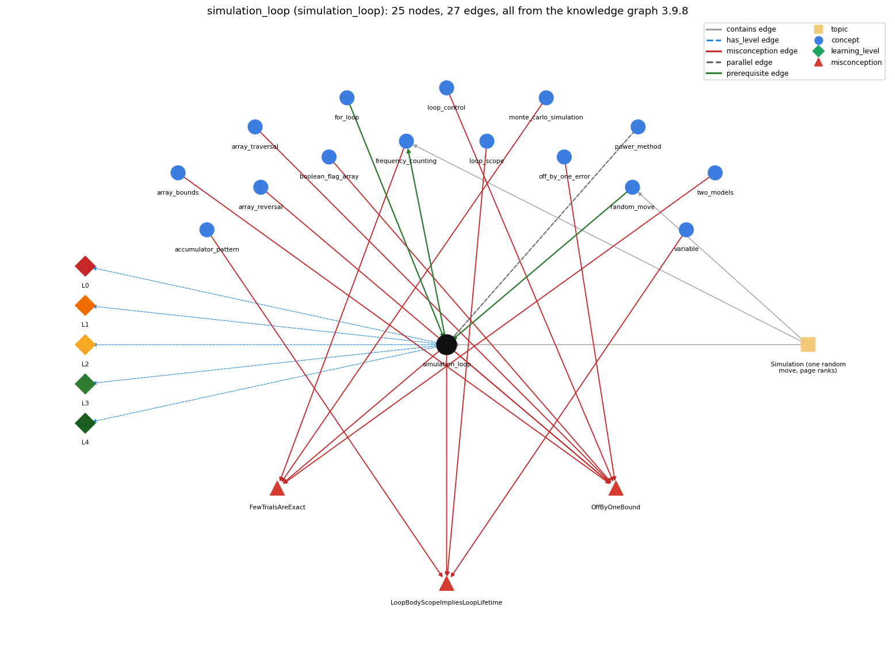

# simulation_loop (`simulation_loop`)

take many random steps

Section 1.6 Case Study: Random Web Surfer, topic 1.6.b Simulation (one random move, page ranks). From the knowledge graph 3.9.8 (`data/raw/chapter1_kg_updated.json`).

## Concepts associated with simulation\_loop (15)

| Concept | Description | How it is associated |
| --- | --- | --- |
| **accumulator\_pattern** | building up a running total/result | shares misconception LoopBodyScopeImpliesLoopLifetime |
| **array\_bounds** | valid indices are 0 .. length-1; otherwise throws | shares misconception OffByOneBound |
| **array\_reversal** | reversing an array in place | shares misconception OffByOneBound |
| **array\_traversal** | walking the array with an index loop | shares misconception OffByOneBound |
| **boolean\_flag\_array** | boolean[] used to mark which values are seen (coupon collector, sieve) | shares misconception OffByOneBound |
| **for\_loop** | a while with init/condition/update packaged together | prerequisite of it (it needs this) composition rule (R) with it |
| **frequency\_counting** | tally visits to estimate page rank | builds on it (needs it) composition rule (R) with it shares misconception FewTrialsAreExact same topic (topic1.6.b) |
| **loop\_control** | the three slots: init ; condition ; update | shares misconception OffByOneBound |
| **loop\_scope** | lifetime/scope of variables in/around the loop | shares misconception LoopBodyScopeImpliesLoopLifetime |
| **monte\_carlo\_simulation** | estimating a probability by repeating random trials | shares misconception FewTrialsAreExact |
| **off\_by\_one\_error** | a loop or index that runs one time too many or too few (&lt; vs &lt;=, 0..n vs 1..n, length vs length-1) | shares misconception OffByOneBound |
| **power\_method** | repeated vector-matrix multiplication to compute page ranks | parallel concept composition rule (R) with it |
| **random\_move** | pick the next page from a cumulative-probability test | prerequisite of it (it needs this) composition rule (R) with it same topic (topic1.6.b) |
| **two\_models** | simulation vs. repeated matrix multiplication (mixing) | shares misconception FewTrialsAreExact |
| **variable** | a named, typed box that holds a value | shares misconception LoopBodyScopeImpliesLoopLifetime |

## Every edge in this view and its full label (27)

| From | Edge | To | Full edge label |
| --- | --- | --- | --- |
| **for\_loop** | prerequisite | **simulation\_loop** | The simulation is a for loop over t = 0 ... T - 1 that makes one random move per pass. grounding: book\_passage composition rule (R) of for\_loop with simulation\_loop: A simulation runs a fixed number of trials with an outer for loop (for (int t = 0; t &lt; T; t++)), each trial simulated inside the body. composition rule (R) of simulation\_loop with for\_loop: A counted for loop with t &lt; T fixes the number of moves at T; the loop variable t is scoped to the loop. |
| **random\_move** | prerequisite | **simulation\_loop** | The simulation repeats the random move T times, each move starting from the page the previous move reached. grounding: book\_passage composition rule (R) of random\_move with simulation\_loop: Each move starts from the page the previous move produced, and the simulation repeats it T times; the next row used is p[new page]. composition rule (R) of simulation\_loop with random\_move: The loop body is one random move; page carries state from one pass to the next, so each move uses the row of the page reached last. |
| **simulation\_loop** | prerequisite | **frequency\_counting** | On each pass the simulation adds 1 to freq[page] for the page just reached. grounding: book\_passage composition rule (R) of simulation\_loop with frequency\_counting: freq[page]++ must come after the move and inside the loop, once per pass, so the counts total T. composition rule (R) of frequency\_counting with simulation\_loop: The increment is the last statement of each pass, so the counts tally the pages reached by the T moves (sum = T). |
| **simulation\_loop** | parallel | **power\_method** | The power method used in Markov is far more efficient than simulating the behavior of a random surfer. grounding: book\_passage composition rule (R) of simulation\_loop with power\_method: Both compute the same page ranks; the power method gets them exactly with far fewer iterations. composition rule (R) of power\_method with simulation\_loop: Computes the same ranks far more efficiently than simulating moves. |
| **accumulator\_pattern** | misconception | **LoopBodyScopeImpliesLoopLifetime** | **wrong rule:** a variable declared in the loop body lives across all iterations **right rule:** A variable declared inside the body is created anew on every pass and does not keep the previous pass's value. role: context |
| **array\_bounds** | misconception | **OffByOneBound** | **wrong rule:** &lt; vs &lt;= and 0..n vs 0..n-1 are interchangeable **right rule:** for (i = 0; i &lt; n; i++) runs n times with i going up to n - 1; with &lt;= it runs n + 1 times and reaches i = n. role: context |
| **array\_reversal** | misconception | **OffByOneBound** | **wrong rule:** &lt; vs &lt;= and 0..n vs 0..n-1 are interchangeable **right rule:** for (i = 0; i &lt; n; i++) runs n times with i going up to n - 1; with &lt;= it runs n + 1 times and reaches i = n. role: context |
| **array\_traversal** | misconception | **OffByOneBound** | **wrong rule:** &lt; vs &lt;= and 0..n vs 0..n-1 are interchangeable **right rule:** for (i = 0; i &lt; n; i++) runs n times with i going up to n - 1; with &lt;= it runs n + 1 times and reaches i = n. role: context |
| **boolean\_flag\_array** | misconception | **OffByOneBound** | **wrong rule:** &lt; vs &lt;= and 0..n vs 0..n-1 are interchangeable **right rule:** for (i = 0; i &lt; n; i++) runs n times with i going up to n - 1; with &lt;= it runs n + 1 times and reaches i = n. role: context |
| **frequency\_counting** | misconception | **FewTrialsAreExact** | **wrong rule:** A short simulation gives the exact page ranks. **right rule:** A simulation only estimates the page ranks: RandomSurfer needs 10^n moves to get answers precise to n decimal places and many more moves for those answers to become accurate (tens of thousands of moves for two accurate places, millions for three). role: primary |
| **loop\_control** | misconception | **OffByOneBound** | **wrong rule:** i &lt; n and i &lt;= n mean the same, so the loop runs until i equals n and the last pass can use a[n]. **right rule:** for (i = 0; i &lt; n; i++) runs n times with i going up to n - 1; with &lt;= it runs n + 1 times and reaches i = n. role: primary |
| **loop\_scope** | misconception | **LoopBodyScopeImpliesLoopLifetime** | **wrong rule:** A variable declared inside the loop body keeps its value from one pass to the next. **right rule:** A variable declared inside the body is created anew on every pass and does not keep the previous pass's value. role: primary |
| **monte\_carlo\_simulation** | misconception | **FewTrialsAreExact** | **wrong rule:** A short simulation gives the exact page ranks. **right rule:** A simulation only estimates the page ranks: RandomSurfer needs 10^n moves to get answers precise to n decimal places and many more moves for those answers to become accurate (tens of thousands of moves for two accurate places, millions for three). role: context |
| **off\_by\_one\_error** | misconception | **OffByOneBound** | **wrong rule:** &lt; vs &lt;= and 0..n vs 0..n-1 are interchangeable **right rule:** for (i = 0; i &lt; n; i++) runs n times with i going up to n - 1; with &lt;= it runs n + 1 times and reaches i = n. role: context |
| **simulation\_loop** | misconception | **FewTrialsAreExact** | **wrong rule:** A short simulation gives the exact page ranks. **right rule:** A simulation only estimates the page ranks: RandomSurfer needs 10^n moves to get answers precise to n decimal places and many more moves for those answers to become accurate (tens of thousands of moves for two accurate places, millions for three). role: context |
| **simulation\_loop** | misconception | **LoopBodyScopeImpliesLoopLifetime** | **wrong rule:** Declaring page inside the simulation loop still lets the surfer continue from the previous page. **right rule:** If page is declared inside the loop body it is recreated each pass, so it must be declared before the loop to carry the walk forward. role: context |
| **simulation\_loop** | misconception | **OffByOneBound** | **wrong rule:** t &lt; T and t &lt;= T give the same number of moves. **right rule:** for (t = 0; t &lt; T; t++) makes exactly T moves; with &lt;= it makes T + 1. role: context |
| **two\_models** | misconception | **FewTrialsAreExact** | **wrong rule:** A short simulation gives the exact page ranks. **right rule:** A simulation only estimates the page ranks: RandomSurfer needs 10^n moves to get answers precise to n decimal places and many more moves for those answers to become accurate (tens of thousands of moves for two accurate places, millions for three). role: context |
| **variable** | misconception | **LoopBodyScopeImpliesLoopLifetime** | **wrong rule:** a variable declared in the loop body lives across all iterations **right rule:** A variable declared inside the body is created anew on every pass and does not keep the previous pass's value. role: context |
| **simulation\_loop** | has\_level | **simulation\_loop@L0** | simulation loop -&gt; L0 (Prestructural): the answer holds a rule that contradicts Java (5 ways). **[0] everyday\_reading** (E): Everyday "simulate" suggests replaying a known process to get its answer; here each run of RandomSurfer draws fresh random numbers and gives different estimates (100 moves: 0.24 0.23 0.16 0.25 0.12), which only approach the page ranks as T grows. **[1] misconception** (M) &rarr; OffByOneBound: wrong rule: &lt; vs &lt;= and 0..n vs 0..n-1 are interchangeable. Right rule: for (int t = 0; t &lt; T; t++) makes exactly T moves; with &lt;= it makes T + 1, while the ranks are still divided by T. **[2] misconception** (M) &rarr; FewTrialsAreExact: wrong rule: A short simulation gives the exact page ranks. Right rule: A simulation only estimates the ranks: about 10^n moves for n-digit precision, tens of thousands of moves for two accurate places and millions for three. **[3] inconsistent\_trace** (T) &rarr; OffByOneBound: Applies LT (draw r, find next page, then freq[page]++) unevenly: e.g. counting the current page before the move on some passes, or resetting sum only on the first pass. (here mixing in: "&lt; vs &lt;= and 0..n vs 0..n-1 are interchangeable") **[4] misconception** (M) &rarr; LoopBodyScopeImpliesLoopLifetime: wrong rule: A variable declared in the loop body lives across all iterations. Right rule: r and sum are declared inside the t-loop body and are created anew on every move; freq and page must be declared before the loop to persist. |
| **simulation\_loop** | has\_level | **simulation\_loop@L1** | simulation loop -&gt; L1 (Unistructural): the answer states one correct rule without applying it (2 ways). **[0] names\_the\_element** (N): A Monte Carlo simulation: a for loop over t = 0..T-1 that makes one random move per pass and tallies the page reached. **[1] states\_the\_rule** (S): RandomSurfer reads a transition matrix, starts at page 0, makes T moves (T from the command line) according to the matrix, and counts the visits to each page. |
| **simulation\_loop** | has\_level | **simulation\_loop@L2** | simulation loop -&gt; L2 (Multistructural): the answer applies the rules of simulation loop to every part of the code, in order (3 ways). **[0] line\_by\_line\_trace** (LT): Per pass: r = Math.random(); sum = 0.0; inner j loop picks the next page; freq[page]++; t++ and test t &lt; T. After the loop, each freq[i] is divided by T and printed. **[1] output\_prediction** (OP): Prints N doubles (%8.5f) that sum to about 1 and vary between runs; 1,000,000 moves on tiny.txt gave 0.27324 0.26568 0.14581 0.24737 0.06790. **[2] one\_step\_execution** (OS): One pass changes page (to the next page) and increases freq[page] by 1; t increases by 1. |
| **simulation\_loop** | has\_level | **simulation\_loop@L3** | simulation loop -&gt; L3 (Relational): the answer relates the parts (5 ways). **[0] relation\_to\_neighbour** (R): The loop body is one random move; page carries state from one pass to the next, so each move uses the row of the page reached last. **[1] relation\_to\_neighbour** (R): freq[page]++ must come after the move and inside the loop, once per pass, so the counts total T. **[2] relation\_to\_neighbour** (R): A counted for loop with t &lt; T fixes the number of moves at T; the loop variable t is scoped to the loop. **[3] relation\_to\_neighbour** (R): Both compute the same page ranks; the power method gets them exactly with far fewer iterations. **[4] purpose\_of\_the\_whole** (P): Monte Carlo estimation plan: repeat a random experiment many times and count outcomes; t is a stepper, page a most-recent holder, freq[] the per-page gatherers. |
| **simulation\_loop** | has\_level | **simulation\_loop@L4** | simulation loop -&gt; L4 (Extended abstract): the answer reasons beyond the given code (6 ways). **[0] predict\_a\_change** (C) &rarr; OffByOneBound: Changing the start page keeps the limit (mixing); increasing T keeps the estimates but makes them more accurate (about 10x moves per extra digit); changing &lt; to &lt;= or the division by T breaks the normalisation. **[1] transfer\_to\_a\_new\_program** (X): Use when the process is easy to simulate and a rough estimate suffices (or no matrix is available); not for accurate ranks or large models, where a huge number of trials is needed and the power method is far more efficient. **[2] diagnose\_an\_error** (D): rule broken: Loop must run t = 0..T-1. Kind: silent logic error. Trigger class: t &lt;= T makes T+1 moves but ranks are divided by T, so they sum to slightly more than 1. **[3] diagnose\_an\_error** (D): rule broken: A variable declared in the body is recreated each pass. Kind: silent logic error. Trigger class: int[] freq = new int[N] declared inside the loop body: counts reset every move (and freq is out of scope after the loop, a compile-time error if printed there). **[4] diagnose\_an\_error** (D): rule broken: freq[i] / T must be floating-point division. Kind: silent logic error. Trigger class: Printing freq[i] / T without the (double) cast: every rank prints as 0 (or 1). **[5] diagnose\_an\_error** (D): rule broken: The number of moves is args[0]. Kind: run-time exception. Trigger class: Run without a command-line argument: args[0] throws ArrayIndexOutOfBoundsException; a non-numeric argument makes Integer.parseInt throw NumberFormatException. |
| **topic1.6.b** | contains | **frequency\_counting** | topic topic1.6.b contains frequency\_counting |
| **topic1.6.b** | contains | **random\_move** | topic topic1.6.b contains random\_move |
| **topic1.6.b** | contains | **simulation\_loop** | topic topic1.6.b contains simulation\_loop |
