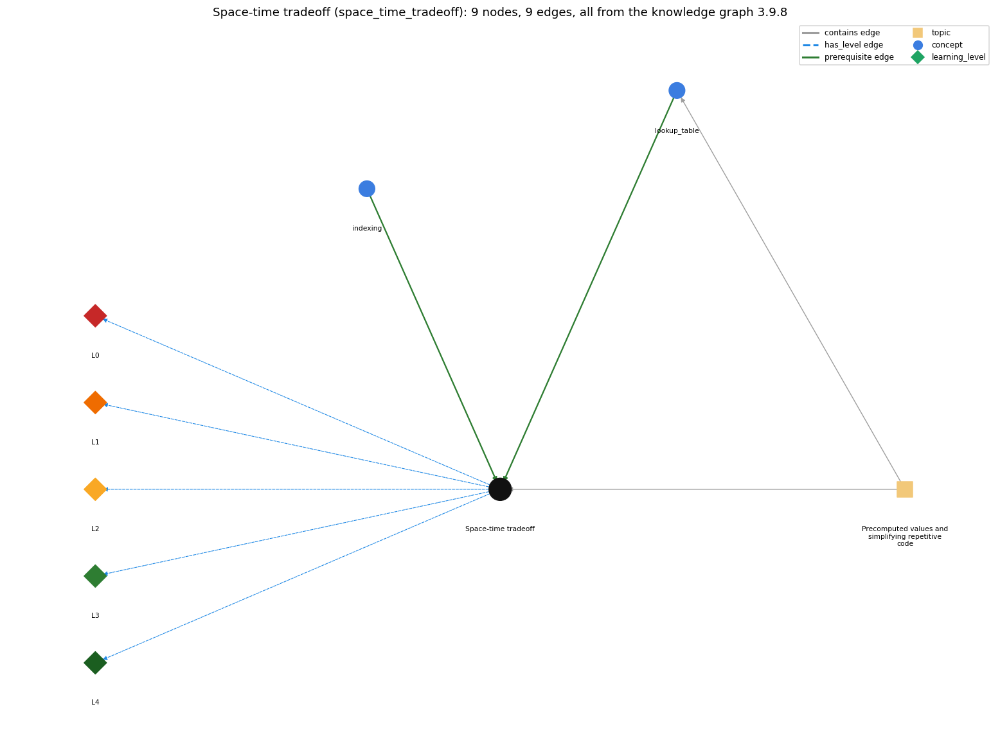

# Space-time tradeoff (`space_time_tradeoff`)

investing memory (an array of saved values) to save computation time

Section 1.4 1.4 Arrays, topic 1.4.e Precomputed values and simplifying repetitive code.

## At a glance

- **Needs first:** `indexing`, `lookup_table`
- **Leads to:** nothing
- **Learned alongside:** nothing
- **Misconceptions:** none
- **Errors:** none
- **Levels:** L0, L1, L2, L3, L4

Everything below comes from the knowledge graph 3.9.8 (`data/raw/chapter1_kg_updated.json`): 9 edges around this concept. The edge logic, the wrong and right rules and the exact rules of the ways are copied word for word from the graph.

## To work on (2)

- no misconception or error edge
- no aliases: a student's words cannot name this concept

## What it needs first (2)

A prerequisite edge means the other concept has to be understood before `space_time_tradeoff`.

### `indexing` comes before `space_time_tradeoff`

*a[i] -- 0-based access*

- **Edge:** `pre:indexing->space_time_tradeoff`
- **Exact edge logic:** Saved values are read back by index, H[i], instead of being recomputed.
- **Grounding:** book\_passage

### `lookup_table` comes before `space_time_tradeoff`

*an array of precomputed values or names indexed by position*

- **Edge:** `pre:lookup_table->space_time_tradeoff`
- **Exact edge logic:** Saving precomputed values in an array trades memory for time: each value is computed once and then looked up.
- **Grounding:** book\_passage
- **Composition rule (R) of `space_time_tradeoff` with `lookup_table`:** The lookup table is the stored space: each value is computed once and then read by index.
- **Composition rule (R) of `lookup_table` with `space_time_tradeoff`:** Storing precomputed values trades memory for time: each value is computed once and then looked up.

## What it leads to (0)

These concepts need `space_time_tradeoff` first.

No concept has this one as a prerequisite.

## Learned alongside (0)

A parallel edge joins two concepts that sit side by side: neither is needed before the other.

No parallel edge touches this concept.

## Misconceptions (0)

A misconception edge states the wrong rule a student may hold about this concept, and the right rule.

The graph has no misconception edge from this concept.

## Errors (0)

An error edge states the rule that gets broken in a program, and the right rule.

The graph has no error edge from this concept.

## Levels L0 to L4 (5 of 5)

Each level edge lists the ways a student shows that level, each with its exact rule.

### L0: Prestructural / sensorimotor

L0 for Space-time tradeoff: the answer holds a rule that contradicts Java.

*Deciding question: Does every rule the answer applies to Space-time tradeoff agree with the language rule? If it reads the code with everyday meanings, applies a wrong rule, or switches rules within one trace, it is L0. A slip in an otherwise rule-correct trace is L2 with an error, not L0.*

- **Edge:** `space_time_tradeoff` &rarr; `space_time_tradeoff@L0` (has_level)
- **Exact edge logic:** Space-time tradeoff -&gt; L0 (Prestructural): the answer holds a rule that contradicts Java (1 way).

Ways (1), each with its exact rule:

- **[0] everyday\_reading** (rule type E, folk-meaning rule): Folk meaning: saving results is always better, and storing data is free. Rule: precomputation spends memory proportional to the number of saved values to save time, which pays off only when values are reused and the table fits in memory.

### L1: Unistructural / atom x text surface

L1 for Space-time tradeoff: the answer states one correct rule without applying it.

*Deciding question: Does the answer cover every part of the code, in order, with the values (L2)? If it covers one part or only states the rule, it is L1.*

- **Edge:** `space_time_tradeoff` &rarr; `space_time_tradeoff@L1` (has_level)
- **Exact edge logic:** Space-time tradeoff -&gt; L1 (Unistructural): the answer states one correct rule without applying it (2 ways).

Ways (2), each with its exact rule:

- **[0] names\_the\_element** (rule type N, identity rule): Identity: a space-time tradeoff invests memory (an array of saved values) to save computation time.
- **[1] states\_the\_rule** (rule type S, declarative rule): Declarative: by investing in space (saving values) we save time (no recomputation). PrimeSieve trades a boolean array of size N for speed over the two-variable trial-division method.

### L2: Multistructural / block x execution / preoperational

L2 for Space-time tradeoff: the answer applies these rules to every part of the code, in order.

*Deciding question: Is the answer many segments mapped onto lines (L2), or one segment stating the purpose of the whole (L3)? A correct output with no value-by-value justification is not levelled.*

- **Edge:** `space_time_tradeoff` &rarr; `space_time_tradeoff@L2` (has_level)
- **Exact edge logic:** Space-time tradeoff -&gt; L2 (Multistructural): the answer applies the rules of Space-time tradeoff to every part of the code, in order (3 ways).

Ways (3), each with its exact rule:

- **[0] line\_by\_line\_trace** (rule type LT, operational sequencing rule): Sequencing: a precompute phase (one pass storing N values) runs first, then a use phase in which each query is one array read.
- **[1] output\_prediction** (rule type OP, evaluation / result rule): Result: the same answers as recomputation, using about N extra memory cells and much less time per query.
- **[2] one\_step\_execution** (rule type OS, state-transition rule): State transition: during precomputation each step stores one value in the table; during use each lookup changes nothing.

### L3: Relational / relations x function (concrete operational begins)

L3 for Space-time tradeoff: the answer relates the parts by these rules.

*Deciding question: Was the purpose deduced from the code, or only guessed from traced input/output pairs (then L2)? Does the answer stay within the given code (L3), or reason about changed code, an error class or a new program (L4)?*

- **Edge:** `space_time_tradeoff` &rarr; `space_time_tradeoff@L3` (has_level)
- **Exact edge logic:** Space-time tradeoff -&gt; L3 (Relational): the answer relates the parts (2 ways).

Ways (2), each with its exact rule:

- **[0] relation\_to\_neighbour** (rule type R, composition rule (with a neighbour)): The lookup table is the stored space: each value is computed once and then read by index.
- **[1] purpose\_of\_the\_whole** (rule type P, plan / role rule): Plan/role: speed up programs that need the same values many times (harmonic numbers, primes up to N).

### L4: Extended abstract (concrete-operational reversibility and conservation)

L4 for Space-time tradeoff: the answer reasons beyond the given code by these rules.

*Deciding question: Does the answer link the code to a broader context: a changed program, a class of inputs, an unseen problem? Re-tracing changed code value by value is L2; fixing one given failing case is L3.*

- **Edge:** `space_time_tradeoff` &rarr; `space_time_tradeoff@L4` (has_level)
- **Exact edge logic:** Space-time tradeoff -&gt; L4 (Extended abstract): the answer reasons beyond the given code (4 ways).

Ways (4), each with its exact rule:

- **[0] predict\_a\_change** (rule type C, conservation rule): Conservation: results are unchanged by precomputing. Memory grows linearly with N, so for huge N or for values used only once the tradeoff stops paying.
- **[1] transfer\_to\_a\_new\_program** (rule type X, applicability rule): Applicability: precompute when the values are needed for small N many times and memory is ample. Recompute when N is huge, memory is tight, or each value is used once.
- **[2] diagnose\_an\_error** (rule type D, error rule): rule broken: The table must fit in the memory Java allows. Kind: run-time exception. Trigger class: N too large for the array (OutOfMemoryError, or NegativeArraySizeException if N+1 overflows)
- **[3] diagnose\_an\_error** (rule type D, error rule): rule broken: Precomputation pays only when values are reused. Kind: silent logic error. Trigger class: a huge table is built for a single query, so the program is slower and larger with no benefit

## Same topic

`space_time_tradeoff` belongs to the topic **Precomputed values and simplifying repetitive code** (`topic1.4.e`). The topic also contains: `lookup_table`.

## Rules of the concept (13)

- **Book** (SW-1e, p. 95 (pdf 105)): "Precomputing values in this way is an example of a space-time tradeoff"
- **E** (folk-meaning rule): Folk meaning: saving results is always better, and storing data is free. Rule: precomputation spends memory proportional to the number of saved values to save time, which pays off only when values are reused and the table fits in memory.
- **T** (uneven-application rule): Points to LT: precompute every value once, then answer each query by lookup. Inconsistent application: the trace recomputes some values despite the table, or reads entries before they are computed.
- **N** (identity rule): Identity: a space-time tradeoff invests memory (an array of saved values) to save computation time.
- **S** (declarative rule): Declarative: by investing in space (saving values) we save time (no recomputation). PrimeSieve trades a boolean array of size N for speed over the two-variable trial-division method.
- **LT** (operational sequencing rule): Sequencing: a precompute phase (one pass storing N values) runs first, then a use phase in which each query is one array read.
- **OP** (evaluation / result rule): Result: the same answers as recomputation, using about N extra memory cells and much less time per query.
- **OS** (state-transition rule): State transition: during precomputation each step stores one value in the table; during use each lookup changes nothing.
- **R** (composition rule (with a neighbour)): with lookup\_table: The lookup table is the stored space: each value is computed once and then read by index.
- **P** (plan / role rule): Plan/role: speed up programs that need the same values many times (harmonic numbers, primes up to N).
- **C** (conservation rule): Conservation: results are unchanged by precomputing. Memory grows linearly with N, so for huge N or for values used only once the tradeoff stops paying.
- **D** (error rule): rule broken: The table must fit in the memory Java allows. (run-time exception)
- **D** (error rule): rule broken: Precomputation pays only when values are reused. (silent logic error)
- **X** (applicability rule): Applicability: precompute when the values are needed for small N many times and memory is ample. Recompute when N is huge, memory is tight, or each value is used once.

## How it is found in code and answers (reader block)

- **Aliases:** none
- **Code patterns:** `\w+\s*\[\s*\w+\s*\]\s*=\s*\w+\s*\[\s*\w+\s*-\s*1\s*\](?=\s*[+*])`
- **Operator symbols:** none
- **Java types:** none

## The whole prerequisite chain

- **Everything it builds on (7):** `array_creation`, `array_declaration`, `array_initializer`, `data_structure`, `data_type`, `indexing`, `lookup_table`
- **Everything that builds on it (0):** nothing

## Every edge in this view and its exact edge logic (9)

All the edges drawn in the picture, in the order: prerequisite, parallel, misconception, error, has_level, contains.

**1. `indexing` &rarr; `space_time_tradeoff`** (prerequisite)

- **Exact edge logic:** Saved values are read back by index, H[i], instead of being recomputed.
- **Grounding:** book\_passage

**2. `lookup_table` &rarr; `space_time_tradeoff`** (prerequisite)

- **Exact edge logic:** Saving precomputed values in an array trades memory for time: each value is computed once and then looked up.
- **Grounding:** book\_passage
- **Composition rule (R) of `lookup_table` with `space_time_tradeoff`:** Storing precomputed values trades memory for time: each value is computed once and then looked up.
- **Composition rule (R) of `space_time_tradeoff` with `lookup_table`:** The lookup table is the stored space: each value is computed once and then read by index.

**3. `space_time_tradeoff` &rarr; `space_time_tradeoff@L0`** (has_level)

- **Exact edge logic:** Space-time tradeoff -&gt; L0 (Prestructural): the answer holds a rule that contradicts Java (1 way).
  - **[0] everyday\_reading** (rule type E, folk-meaning rule): Folk meaning: saving results is always better, and storing data is free. Rule: precomputation spends memory proportional to the number of saved values to save time, which pays off only when values are reused and the table fits in memory.

**4. `space_time_tradeoff` &rarr; `space_time_tradeoff@L1`** (has_level)

- **Exact edge logic:** Space-time tradeoff -&gt; L1 (Unistructural): the answer states one correct rule without applying it (2 ways).
  - **[0] names\_the\_element** (rule type N, identity rule): Identity: a space-time tradeoff invests memory (an array of saved values) to save computation time.
  - **[1] states\_the\_rule** (rule type S, declarative rule): Declarative: by investing in space (saving values) we save time (no recomputation). PrimeSieve trades a boolean array of size N for speed over the two-variable trial-division method.

**5. `space_time_tradeoff` &rarr; `space_time_tradeoff@L2`** (has_level)

- **Exact edge logic:** Space-time tradeoff -&gt; L2 (Multistructural): the answer applies the rules of Space-time tradeoff to every part of the code, in order (3 ways).
  - **[0] line\_by\_line\_trace** (rule type LT, operational sequencing rule): Sequencing: a precompute phase (one pass storing N values) runs first, then a use phase in which each query is one array read.
  - **[1] output\_prediction** (rule type OP, evaluation / result rule): Result: the same answers as recomputation, using about N extra memory cells and much less time per query.
  - **[2] one\_step\_execution** (rule type OS, state-transition rule): State transition: during precomputation each step stores one value in the table; during use each lookup changes nothing.

**6. `space_time_tradeoff` &rarr; `space_time_tradeoff@L3`** (has_level)

- **Exact edge logic:** Space-time tradeoff -&gt; L3 (Relational): the answer relates the parts (2 ways).
  - **[0] relation\_to\_neighbour** (rule type R, composition rule (with a neighbour)): The lookup table is the stored space: each value is computed once and then read by index.
  - **[1] purpose\_of\_the\_whole** (rule type P, plan / role rule): Plan/role: speed up programs that need the same values many times (harmonic numbers, primes up to N).

**7. `space_time_tradeoff` &rarr; `space_time_tradeoff@L4`** (has_level)

- **Exact edge logic:** Space-time tradeoff -&gt; L4 (Extended abstract): the answer reasons beyond the given code (4 ways).
  - **[0] predict\_a\_change** (rule type C, conservation rule): Conservation: results are unchanged by precomputing. Memory grows linearly with N, so for huge N or for values used only once the tradeoff stops paying.
  - **[1] transfer\_to\_a\_new\_program** (rule type X, applicability rule): Applicability: precompute when the values are needed for small N many times and memory is ample. Recompute when N is huge, memory is tight, or each value is used once.
  - **[2] diagnose\_an\_error** (rule type D, error rule): rule broken: The table must fit in the memory Java allows. Kind: run-time exception. Trigger class: N too large for the array (OutOfMemoryError, or NegativeArraySizeException if N+1 overflows)
  - **[3] diagnose\_an\_error** (rule type D, error rule): rule broken: Precomputation pays only when values are reused. Kind: silent logic error. Trigger class: a huge table is built for a single query, so the program is slower and larger with no benefit

**8. `topic1.4.e` &rarr; `space_time_tradeoff`** (contains)

- topic `topic1.4.e` contains `space_time_tradeoff`

**9. `topic1.4.e` &rarr; `lookup_table`** (contains)

- topic `topic1.4.e` contains `lookup_table`
