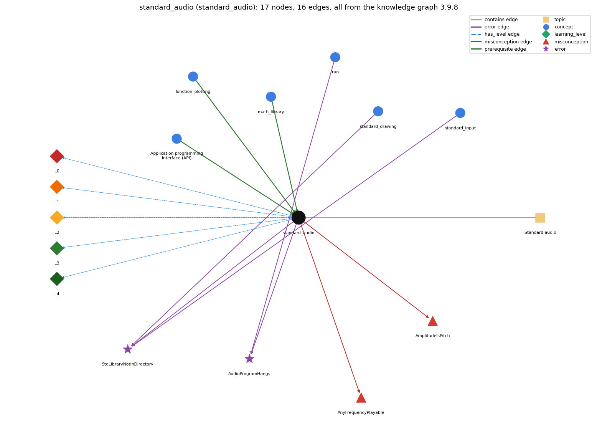

# standard_audio (`standard_audio`)

StdAudio: sound as an array of samples

Section 1.5 Input and Output, topic 1.5.f Standard audio. From the knowledge graph 3.9.8 (`data/raw/chapter1_kg_updated.json`).

## Concepts associated with standard\_audio (6)

| Concept | Description | How it is associated |
| --- | --- | --- |
| **api** | a table of library methods giving each method's signature and a short description of what it computes | prerequisite of it (it needs this) |
| **function\_plotting** | sampling a function and joining the points with lines | prerequisite of it (it needs this) composition rule (R) with it |
| **math\_library** | Math.abs, Math.sqrt, Math.max, Math.random, Math.round ... | prerequisite of it (it needs this) composition rule (R) with it |
| **run** | java executes main in the JVM | shares error AudioProgramHangs |
| **standard\_drawing** | StdDraw -- graphical output (book-specific) | shares error StdLibraryNotInDirectory |
| **standard\_input** | StdIn -- reading a stream of values | shares error StdLibraryNotInDirectory |

## Every edge in this view and its full label (16)

| From | Edge | To | Full edge label |
| --- | --- | --- | --- |
| **api** | prerequisite | **standard\_audio** | StdAudio is a library used through its API of static methods. grounding: book\_passage |
| **function\_plotting** | prerequisite | **standard\_audio** | A sound wave is sampled at regular intervals exactly as a function is sampled for plotting, giving the array of samples that StdAudio plays. grounding: book\_passage composition rule (R) of function\_plotting with standard\_audio: A sound wave is sampled at regular intervals in exactly the way a function is sampled for plotting. The same array can be drawn or played. composition rule (R) of standard\_audio with function\_plotting: Sampling for sound is the same as sampling for a plot. The same array can be sent to StdDraw and to StdAudio. |
| **math\_library** | prerequisite | **standard\_audio** | To play a tone, each sample a[i] of the sound array is computed with Math.sin at evenly spaced times. grounding: book\_passage composition rule (R) of math\_library with standard\_audio: Each sample a[i] = Math.sin(2\*Math.PI \* i \* hz / sps) is taken at evenly spaced times; the 2\*Math.PI factor is needed because Math.sin works in radians, one cycle being 2 pi. composition rule (R) of standard\_audio with math\_library: Each sample is computed with Math.sin at evenly spaced times t = i/sps. The note's frequency comes from Math.pow(2, pitch/12.0). |
| **standard\_audio** | misconception | **AmplitudeIsPitch** | **wrong rule:** Making the sample values larger raises the pitch of the note. **right rule:** The amplitude (y-value) corresponds to the volume; the frequency sets the pitch. role: primary |
| **standard\_audio** | misconception | **AnyFrequencyPlayable** | **wrong rule:** A sine wave of any frequency, e.g. 30,000 Hz, plays correctly with StdAudio. **right rule:** With 44,100 samples per second the highest frequency that can be reproduced is the Nyquist frequency, 22,050 Hz. role: primary |
| **run** | error | **AudioProgramHangs** | **wrong rule:** Ends a StdAudio program with no System.exit(0), so the terminal hangs and needs &lt;ctrl-c&gt;. **right rule:** In the book's setup, a program that uses StdAudio should end main() with System.exit(0). role: context |
| **standard\_audio** | error | **AudioProgramHangs** | **wrong rule:** Ends a StdAudio program with no System.exit(0), so the terminal hangs and needs &lt;ctrl-c&gt;. **right rule:** In the book's setup, a program that uses StdAudio should end main() with System.exit(0). role: primary |
| **standard\_audio** | error | **StdLibraryNotInDirectory** | **wrong rule:** Uses StdIn (or StdDraw/StdAudio) without StdIn.java in the working directory. **right rule:** The Std\* libraries are not built into Java; StdIn.java etc. must be in the same directory (or on the classpath), otherwise Java reports NoClassDefFoundError. role: context |
| **standard\_drawing** | error | **StdLibraryNotInDirectory** | **wrong rule:** Uses StdIn (or StdDraw/StdAudio) without StdIn.java in the working directory. **right rule:** The Std\* libraries are not built into Java; StdIn.java etc. must be in the same directory (or on the classpath), otherwise Java reports NoClassDefFoundError. role: context |
| **standard\_input** | error | **StdLibraryNotInDirectory** | **wrong rule:** Uses StdIn (or StdDraw/StdAudio) without StdIn.java in the working directory. **right rule:** The Std\* libraries are not built into Java; StdIn.java etc. must be in the same directory (or on the classpath), otherwise Java reports NoClassDefFoundError. role: primary |
| **standard\_audio** | has\_level | **standard\_audio@L0** | standard audio -&gt; L0 (Prestructural): the answer holds a rule that contradicts Java (4 ways). **[0] everyday\_reading** (E): Everyday intuition links 'bigger numbers' with a 'higher note'. In digital sound the sample amplitude (y-value) sets the volume, and the frequency of oscillation sets the pitch (doubling it raises the note an octave). **[1] misconception** (M) &rarr; AmplitudeIsPitch: wrong rule: Making the sample values larger raises the pitch of the note. Right rule: The amplitude (y-value) corresponds to the volume, and the frequency sets the pitch. **[2] misconception** (M) &rarr; AnyFrequencyPlayable: wrong rule: A sine wave of any frequency, e.g. 30,000 Hz, plays correctly with StdAudio. Right rule: At 44,100 samples per second the highest reproducible frequency is the Nyquist frequency, 22,050 Hz. **[3] inconsistent\_trace** (T) &rarr; AmplitudeIsPitch: Points to LT (compute N, allocate N+1 samples, fill a[i] = sin(2\*pi\*i\*hz/sps), then play). An uneven trace uses i/sps on some samples and i\*hz/sps on others, or plays before filling. (here mixing in: "Making the sample values larger raises the pitch of the note") |
| **standard\_audio** | has\_level | **standard\_audio@L1** | standard audio -&gt; L1 (Unistructural): the answer states one correct rule without applying it (2 ways). **[0] names\_the\_element** (N): StdAudio is a booksite library for playing, saving and reading sound, which it represents as an array of samples. **[1] states\_the\_rule** (S): Sound is an array of doubles between -1 and +1, sampled 44,100 times per second. StdAudio.play(double[] a) plays the sound that the array represents. |
| **standard\_audio** | has\_level | **standard\_audio@L2** | standard audio -&gt; L2 (Multistructural): the answer applies the rules of standard audio to every part of the code, in order (3 ways). **[0] line\_by\_line\_trace** (LT): N = (int) (sps \* duration), a = new double[N+1], then for i = 0..N a[i] = Math.sin(2\*Math.PI\*i\*hz/sps), then StdAudio.play(a). The samples sound in index order, 44,100 per second. **[1] output\_prediction** (OP): Ten seconds of concert A (440 Hz) needs 441,001 sample values, and each one is in [-1, 1]. play is void: its result is sound. **[2] one\_step\_execution** (OS): play(a) plays a.length/44,100 seconds of sound and leaves a unchanged. play(double x) plays one sample for 1/44,100 second. save writes a .wav file and read returns an array. |
| **standard\_audio** | has\_level | **standard\_audio@L3** | standard audio -&gt; L3 (Relational): the answer relates the parts (3 ways). **[0] relation\_to\_neighbour** (R): Each sample is computed with Math.sin at evenly spaced times t = i/sps. The note's frequency comes from Math.pow(2, pitch/12.0). **[1] relation\_to\_neighbour** (R): Sampling for sound is the same as sampling for a plot. The same array can be sent to StdDraw and to StdAudio. **[2] purpose\_of\_the\_whole** (P): Plan: sample-and-play synthesis. In PlayThatTune it is driven by data: a loop reads (pitch, duration) pairs and plays each note. |
| **standard\_audio** | has\_level | **standard\_audio@L4** | standard audio -&gt; L4 (Extended abstract): the answer reasons beyond the given code (5 ways). **[0] predict\_a\_change** (C) &rarr; AmplitudeIsPitch: Doubling hz moves the note up an octave and keeps the duration. Multiplying all samples by a factor below 1 changes only the volume. Writing pitch / 12 (integer division) instead of pitch / 12.0 breaks the pitch. **[1] diagnose\_an\_error** (D): rule broken: In the book's setup a StdAudio program should end main() with System.exit(0). Kind: silent logic error. Trigger class: A StdAudio program without System.exit(0): after the sound ends, the terminal does not return to a prompt and needs &lt;ctrl-c&gt;. **[2] transfer\_to\_a\_new\_program** (X): Use StdAudio to synthesize or sonify sampled data (tones, tunes, signal processing). Long recordings are stored in binary .wav files, not as text streams. **[3] diagnose\_an\_error** (D): rule broken: StdAudio.java must be in the working directory or on the classpath. Kind: run-time exception. Trigger class: StdAudio.class is absent at run time: NoClassDefFoundError (javac reports 'cannot find symbol' at compile time). **[4] diagnose\_an\_error** (D): rule broken: Frequencies must stay below the Nyquist frequency, 22,050 Hz. Kind: silent logic error. Trigger class: Sonifying a 30,000 Hz sine wave gives weird (aliased) sound. |
| **topic1.5.f** | contains | **standard\_audio** | topic topic1.5.f contains standard\_audio |
