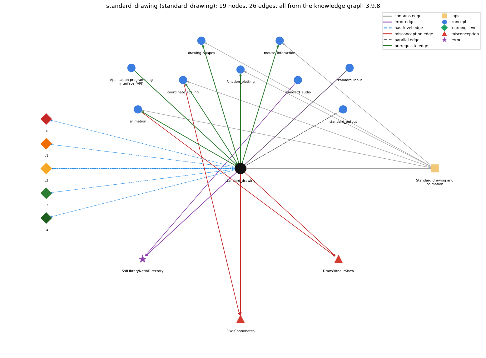

# standard_drawing (`standard_drawing`)

StdDraw -- graphical output (book-specific)

Section 1.5 Input and Output, topic 1.5.e Standard drawing and animation.

## At a glance

- **Needs first:** `api`
- **Leads to:** `animation`, `coordinate_scaling`, `drawing_shapes`, `function_plotting`, `mouse_interaction`
- **Learned alongside:** `standard_input`, `standard_output`
- **Misconceptions:** `DrawWithoutShow`, `PixelCoordinates`
- **Errors:** `StdLibraryNotInDirectory`
- **Levels:** L0, L1, L2, L3, L4

Everything below comes from the knowledge graph 3.9.8 (`data/raw/chapter1_kg_updated.json`): 26 edges around this concept, each explained in the graph's own words.

## What it needs first (1)

A prerequisite edge means the other concept has to be understood before `standard_drawing`.

### `api` comes before `standard_drawing`

*Application programming interface (API): a table of library methods giving each method's signature and a short description of what it computes*

StdDraw is a library used through its API of static methods.

- **Grounding:** book passage

## What it leads to (5)

These concepts need `standard_drawing` first.

### `standard_drawing` comes before `animation`

*StdDraw animation: clear, draw, show, pause in a loop*

Animation uses StdDraw's clear() and show() methods to make dynamic changes to the image on the screen.

- **Grounding:** book passage
- **How `standard_drawing` combines with `animation`:** Animation reuses StdDraw's drawing commands but adds clear() and show(t), which control when the canvas is erased and displayed.
- **How `animation` combines with `standard_drawing`:** Animation uses StdDraw's drawing commands plus clear() and show(t). show(t) switches off the default show-after-every-command.

### `standard_drawing` comes before `coordinate_scaling`

*StdDraw's unit square and setXscale/setYscale*

Scaling sets the coordinate system StdDraw uses.

- **Grounding:** book passage
- **How `standard_drawing` combines with `coordinate_scaling`:** setXscale and setYscale set the coordinate system that every later StdDraw command uses.
- **How `coordinate_scaling` combines with `standard_drawing`:** The scale fixes how every later StdDraw coordinate is interpreted. The pen radius is unaffected by it.

### `standard_drawing` comes before `drawing_shapes`

*outline vs filled shapes, square half-length, colour and text*

Shape commands are StdDraw drawing commands.

- **Grounding:** book passage
- **How `standard_drawing` combines with `drawing_shapes`:** Shape commands are StdDraw drawing commands. They use the same coordinates, pen color and pen radius as line and point.
- **How `drawing_shapes` combines with `standard_drawing`:** Shapes use StdDraw's current coordinate scale, pen radius and color, and paint over earlier marks.

### `standard_drawing` comes before `function_plotting`

*sampling a function and joining the points with lines*

A function is plotted by drawing its sampled points and lines with StdDraw.

- **Grounding:** book passage

### `standard_drawing` comes before `mouse_interaction`

*reading mouse position and clicks from StdDraw*

Mouse position and clicks are read through StdDraw methods such as StdDraw.mousePressed().

- **Grounding:** order only

## Learned alongside (2)

A parallel edge joins two concepts that sit side by side: neither is needed before the other.

### `standard_drawing` alongside `standard_input`

*StdIn -- reading a stream of values*

Like StdIn, StdDraw is a library downloaded from the booksite; StdIn brings values into the program, while StdDraw produces drawings as output.

- **Grounding:** book passage
- **How `standard_drawing` combines with `standard_input`:** StdIn values can be drawn directly: PlotFilter reads the bounding box, then point coordinates, and calls StdDraw.point for each pair. Both libraries must be downloaded into the program's directory.
- **How `standard_input` combines with `standard_drawing`:** StdIn values can drive StdDraw output. PlotFilter reads x, y pairs and draws a point for each, after scaling from the first four numbers.

### `standard_drawing` alongside `standard_output`

*StdOut / System.out*

StdOut writes text to the output stream; StdDraw draws shapes at (x, y) coordinates in a window.

- **Grounding:** book passage
- **How `standard_drawing` combines with `standard_output`:** StdOut writes text to a stream, while StdDraw draws in a separate window at (x, y) coordinates. Neither affects the other.
- **How `standard_output` combines with `standard_drawing`:** StdOut text and StdDraw pictures are independent outputs: printing does not draw, and drawing does not print.

## Misconceptions (2)

A misconception edge states the wrong rule a student may hold about this concept, and the right rule.

### DrawWithoutShow

- **Wrong rule:** With double buffering on, each drawing command appears on screen immediately.
- **Right rule:** By default each drawing command appears at once; after StdDraw.show(t) turns animation mode on, drawing is collected and appears only at the next show(t), which then pauses t milliseconds; show() with no argument turns per-command display back on.
- **Role of this concept:** context
- **Shows at level L0 as:** misconception: wrong rule: With double buffering on, each drawing command appears on screen immediately. Right rule: By default each command is shown at once. After StdDraw.show(t) turns animation mode on, drawing is collected off-screen and appears only at the next show(t). show() with no argument turns per-command display back on. (Newer StdDraw versions use enableDoubleBuffering().)
- **Also an edge from `animation`:** With double buffering on, each drawing command appears on screen immediately.

### PixelCoordinates

- **Wrong rule:** StdDraw.point(256, 256) draws in the middle of the default window.
- **Right rule:** The default coordinate scale is the unit square, so the middle is (0.5, 0.5).
- **Role of this concept:** primary
- **Shows at level L0 as:** misconception: wrong rule: StdDraw.point(256, 256) draws in the middle of the default window. Right rule: The default window is 512-by-512 pixels, but coordinates are in the unit square, so the middle is (0.5, 0.5). (256, 256) is far off the canvas.
- **Shows at level L0 as:** inconsistent trace: Points to LT (commands run in program order; each uses the current scale, color and pen radius; later marks cover earlier ones). An uneven trace uses pixel units for some points, puts y downwards, or applies a setting to commands issued before it. (here mixing in: "StdDraw.point(256, 256) draws in the middle of the default window")
- **Also an edge from `coordinate_scaling`:** StdDraw.point(256, 256) draws in the middle of the default window.

## Errors (1)

An error edge states the rule that gets broken in a program, and the right rule.

### StdLibraryNotInDirectory

- **Wrong rule:** Uses StdIn (or StdDraw/StdAudio) without StdIn.java in the working directory.
- **Right rule:** The Std\* libraries are not built into Java; StdIn.java etc. must be in the same directory (or on the classpath), otherwise Java reports NoClassDefFoundError.
- **Role of this concept:** context
- **Also an edge from `standard_audio`:** Uses StdIn (or StdDraw/StdAudio) without StdIn.java in the working directory.
- **Also an edge from `standard_input`:** Uses StdIn (or StdDraw/StdAudio) without StdIn.java in the working directory.

## Levels L0 to L4 (5 of 5)

Each level edge lists the ways a student shows that level, each with its exact rule.

### L0: Prestructural / sensorimotor

L0 for standard drawing: the answer holds a rule that contradicts Java.

*Deciding question: Does every rule the answer applies to standard drawing agree with the language rule? If it reads the code with everyday meanings, applies a wrong rule, or switches rules within one trace, it is L0. A slip in an otherwise rule-correct trace is L2 with an error, not L0.*

standard drawing -&gt; L0 (Prestructural): the answer holds a rule that contradicts Java (4 ways).

- **everyday reading** (folk-meaning rule): In geometry a point has no size, and on screens positions are pixels with y pointing down. StdDraw.point(x, y) draws a visible spot (a circle of the pen radius) in user coordinates: the default is the unit square, with (0, 0) at the lower-left corner.
- **misconception** (wrong rule / right rule; shows `PixelCoordinates`): wrong rule: StdDraw.point(256, 256) draws in the middle of the default window. Right rule: The default window is 512-by-512 pixels, but coordinates are in the unit square, so the middle is (0.5, 0.5). (256, 256) is far off the canvas.
- **inconsistent trace** (uneven-application rule; shows `PixelCoordinates`): Points to LT (commands run in program order; each uses the current scale, color and pen radius; later marks cover earlier ones). An uneven trace uses pixel units for some points, puts y downwards, or applies a setting to commands issued before it. (here mixing in: "StdDraw.point(256, 256) draws in the middle of the default window")
- **misconception** (wrong rule / right rule; shows `DrawWithoutShow`): wrong rule: With double buffering on, each drawing command appears on screen immediately. Right rule: By default each command is shown at once. After StdDraw.show(t) turns animation mode on, drawing is collected off-screen and appears only at the next show(t). show() with no argument turns per-command display back on. (Newer StdDraw versions use enableDoubleBuffering().)

### L1: Unistructural / atom x text surface

L1 for standard drawing: the answer states one correct rule without applying it.

*Deciding question: Does the answer cover every part of the code, in order, with the values (L2)? If it covers one part or only states the rule, it is L1.*

standard drawing -&gt; L1 (Unistructural): the answer states one correct rule without applying it (2 ways).

- **names the element** (identity rule): StdDraw is a booksite library of static methods for graphical output: lines, points, shapes and text drawn on a 2-D canvas in a window.
- **states the rule** (declarative rule): StdDraw models an abstract device that draws lines and points on a two-dimensional canvas. The default scale is the unit square, and methods with no arguments reset to the defaults.

### L2: Multistructural / block x execution / preoperational

L2 for standard drawing: the answer applies these rules to every part of the code, in order.

*Deciding question: Is the answer many segments mapped onto lines (L2), or one segment stating the purpose of the whole (L3)? A correct output with no value-by-value justification is not levelled.*

standard drawing -&gt; L2 (Multistructural): the answer applies the rules of standard drawing to every part of the code, in order (3 ways).

- **line by line trace** (operational sequencing rule): Calls run in program order. Each control command (setXscale, setPenRadius, setPenColor) affects only the drawing commands after it, and each drawing command paints over what is already on the canvas.
- **output prediction** (evaluation / result rule): The result is a picture in a window, not a value: the methods are void. Triangle's three line() calls and one point() call produce an equilateral triangle with a dot inside.
- **one step execution** (state-transition rule): One drawing command adds marks to the canvas (shown at once by default). One control command changes the drawing state (scale, pen radius or color) without drawing anything.

### L3: Relational / relations x function (concrete operational begins)

L3 for standard drawing: the answer relates the parts by these rules.

*Deciding question: Was the purpose deduced from the code, or only guessed from traced input/output pairs (then L2)? Does the answer stay within the given code (L3), or reason about changed code, an error class or a new program (L4)?*

standard drawing -&gt; L3 (Relational): the answer relates the parts (6 ways).

- **relation to neighbour** (composition rule (with a neighbour)): StdIn values can be drawn directly: PlotFilter reads the bounding box, then point coordinates, and calls StdDraw.point for each pair. Both libraries must be downloaded into the program's directory.
- **relation to neighbour** (composition rule (with a neighbour)): StdOut writes text to a stream, while StdDraw draws in a separate window at (x, y) coordinates. Neither affects the other.
- **relation to neighbour** (composition rule (with a neighbour)): Animation reuses StdDraw's drawing commands but adds clear() and show(t), which control when the canvas is erased and displayed.
- **relation to neighbour** (composition rule (with a neighbour)): setXscale and setYscale set the coordinate system that every later StdDraw command uses.
- **relation to neighbour** (composition rule (with a neighbour)): Shape commands are StdDraw drawing commands. They use the same coordinates, pen color and pen radius as line and point.
- **purpose of the whole** (plan / role rule): StdDraw is used to visualize data and functions, which is often more meaningful than lists of numbers.

### L4: Extended abstract (concrete-operational reversibility and conservation)

L4 for standard drawing: the answer reasons beyond the given code by these rules.

*Deciding question: Does the answer link the code to a broader context: a changed program, a class of inputs, an unseen problem? Re-tracing changed code value by value is L2; fixing one given failing case is L3.*

standard drawing -&gt; L4 (Extended abstract): the answer reasons beyond the given code (5 ways).

- **predict a change** (conservation rule; shows `PixelCoordinates`): Rescaling the coordinates together with the data keeps the picture. The pen radius is not affected by scaling. Reordering drawing commands changes which mark covers which.
- **transfer to a new program** (applicability rule): Use StdDraw for simple plots, data visualizations and teaching animations. It is crude compared with production graphics libraries, and exact numeric results belong on standard output.
- **diagnose an error** (error rule): rule broken: StdDraw.java must be in the working directory or on the classpath. Kind: run-time exception. Trigger class: Running without StdDraw.class available: NoClassDefFoundError: StdDraw (javac reports 'cannot find symbol' if it is missing at compile time).
- **diagnose an error** (error rule): rule broken: Coordinates must lie inside the current scale to be visible. Kind: silent logic error. Trigger class: Pixel-style coordinates such as (256, 256) with the default unit square: nothing visible is drawn.
- **diagnose an error** (error rule): rule broken: setCanvasSize must be called before any drawing. Kind: silent logic error. Trigger class: Calling setCanvasSize() after drawing commands, so the earlier drawing is lost.

## Same topic

`standard_drawing` belongs to the topic **Standard drawing and animation** (`topic1.5.e`). The topic also contains: `animation`, `coordinate_scaling`, `drawing_shapes`, `function_plotting`, `mouse_interaction`.

## Rules of the concept (20)

- **folk-meaning rule:** In geometry a point has no size, and on screens positions are pixels with y pointing down. StdDraw.point(x, y) draws a visible spot (a circle of the pen radius) in user coordinates: the default is the unit square, with (0, 0) at the lower-left corner.
- **wrong rule / right rule:** DrawWithoutShow: wrong: With double buffering on, each drawing command appears on screen immediately. \| right: By default each command is shown at once. After StdDraw.show(t) turns animation mode on, drawing is collected off-screen and appears only at the next show(t). show() with no argument turns per-command display back on. (Newer StdDraw versions use enableDoubleBuffering().)
- **wrong rule / right rule:** PixelCoordinates: wrong: StdDraw.point(256, 256) draws in the middle of the default window. \| right: The default window is 512-by-512 pixels, but coordinates are in the unit square, so the middle is (0.5, 0.5). (256, 256) is far off the canvas.
- **uneven-application rule:** Points to LT (commands run in program order; each uses the current scale, color and pen radius; later marks cover earlier ones). An uneven trace uses pixel units for some points, puts y downwards, or applies a setting to commands issued before it.
- **identity rule:** StdDraw is a booksite library of static methods for graphical output: lines, points, shapes and text drawn on a 2-D canvas in a window.
- **declarative rule:** StdDraw models an abstract device that draws lines and points on a two-dimensional canvas. The default scale is the unit square, and methods with no arguments reset to the defaults.
- **operational sequencing rule:** Calls run in program order. Each control command (setXscale, setPenRadius, setPenColor) affects only the drawing commands after it, and each drawing command paints over what is already on the canvas.
- **evaluation / result rule:** The result is a picture in a window, not a value: the methods are void. Triangle's three line() calls and one point() call produce an equilateral triangle with a dot inside.
- **state-transition rule:** One drawing command adds marks to the canvas (shown at once by default). One control command changes the drawing state (scale, pen radius or color) without drawing anything.
- **composition rule (with a neighbour):** with standard\_input: StdIn values can be drawn directly: PlotFilter reads the bounding box, then point coordinates, and calls StdDraw.point for each pair. Both libraries must be downloaded into the program's directory.
- **composition rule (with a neighbour):** with standard\_output: StdOut writes text to a stream, while StdDraw draws in a separate window at (x, y) coordinates. Neither affects the other.
- **composition rule (with a neighbour):** with animation: Animation reuses StdDraw's drawing commands but adds clear() and show(t), which control when the canvas is erased and displayed.
- **composition rule (with a neighbour):** with coordinate\_scaling: setXscale and setYscale set the coordinate system that every later StdDraw command uses.
- **composition rule (with a neighbour):** with drawing\_shapes: Shape commands are StdDraw drawing commands. They use the same coordinates, pen color and pen radius as line and point.
- **plan / role rule:** StdDraw is used to visualize data and functions, which is often more meaningful than lists of numbers.
- **conservation rule:** Rescaling the coordinates together with the data keeps the picture. The pen radius is not affected by scaling. Reordering drawing commands changes which mark covers which.
- **error rule:** rule broken: StdDraw.java must be in the working directory or on the classpath. (run-time exception)
- **error rule:** rule broken: Coordinates must lie inside the current scale to be visible. (silent logic error)
- **error rule:** rule broken: setCanvasSize must be called before any drawing. (silent logic error)
- **applicability rule:** Use StdDraw for simple plots, data visualizations and teaching animations. It is crude compared with production graphics libraries, and exact numeric results belong on standard output.

## The whole prerequisite chain

- **Everything it builds on (9):** `api`, `arithmetic_operators`, `data_type`, `expression`, `identifier`, `literal`, `method_call`, `primitive_type`, `variable`
- **Everything that builds on it (6):** `animation`, `coordinate_scaling`, `drawing_shapes`, `function_plotting`, `mouse_interaction`, `standard_audio`
