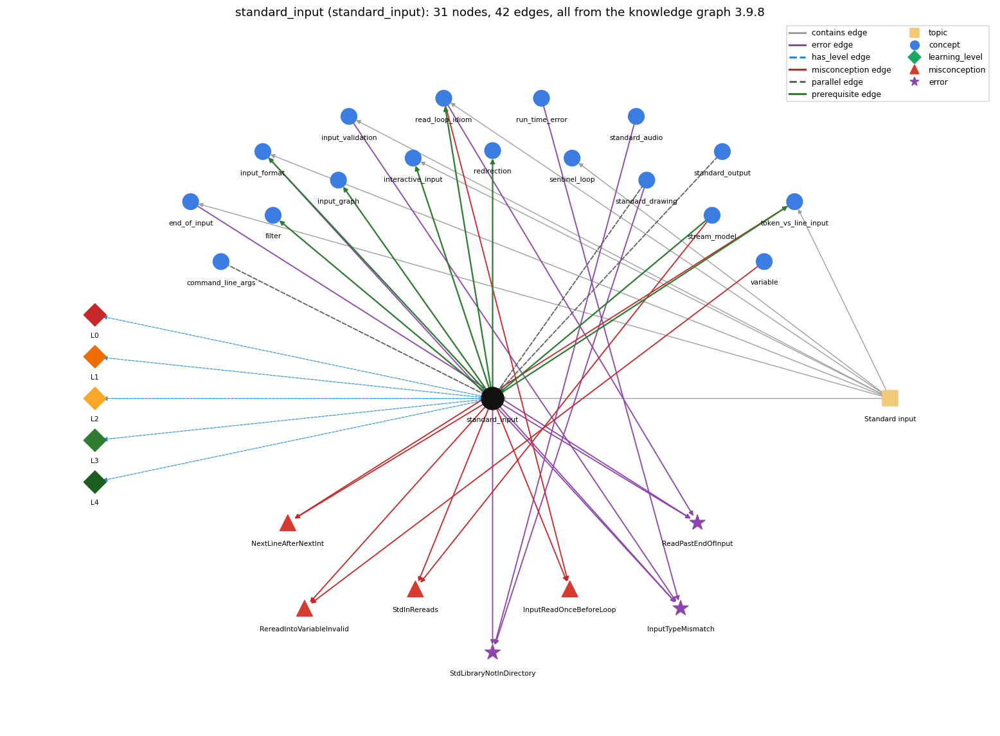

# standard_input (`standard_input`)

StdIn -- reading a stream of values

Section 1.5 Input and Output, topic 1.5.c Standard input.

## At a glance

- **Needs first:** `stream_model`
- **Leads to:** `filter`, `input_format`, `input_graph`, `interactive_input`, `read_loop_idiom`, `redirection`, `token_vs_line_input`
- **Learned alongside:** `command_line_args`, `standard_drawing`, `standard_output`
- **Misconceptions:** `InputReadOnceBeforeLoop`, `NextLineAfterNextInt`, `RereadIntoVariableInvalid`, `StdInRereads`
- **Errors:** `InputTypeMismatch`, `ReadPastEndOfInput`, `StdLibraryNotInDirectory`
- **Levels:** L0, L1, L2, L3, L4

Everything below comes from the knowledge graph 3.9.8 (`data/raw/chapter1_kg_updated.json`): 42 edges around this concept. The edge logic, the wrong and right rules and the exact rules of the ways are copied word for word from the graph.

## To work on (0)

Nothing is missing for this concept.

## What it needs first (1)

A prerequisite edge means the other concept has to be understood before `standard_input`.

### `stream_model` comes before `standard_input`

*input and output as sequential streams*

- **Edge:** `pre:stream_model->standard_input`
- **Exact edge logic:** StdIn reads a stream: values arrive in order and each value is consumed once.
- **Grounding:** book\_passage
- **Composition rule (R) of `standard_input` with `stream_model`:** Every StdIn call takes from the same stream position, so values are delivered once, in order.
- **Composition rule (R) of `stream_model` with `standard_input`:** All StdIn calls in a program share one input position. A read before a loop and reads inside the loop therefore take successive values, never the same one.

## What it leads to (7)

These concepts need `standard_input` first.

### `standard_input` comes before `filter`

*a program that reads standard input and writes standard output*

- **Edge:** `pre:standard_input->filter`
- **Exact edge logic:** A filter reads its data from standard input and writes what it keeps to standard output.
- **Grounding:** book\_passage

### `standard_input` comes before `input_format`

*StdIn reads whitespace-separated tokens of the expected type*

- **Edge:** `pre:standard_input->input_format`
- **Exact edge logic:** Input format rules apply to every StdIn read.
- **Grounding:** book\_passage
- **Composition rule (R) of `standard_input` with `input_format`:** The method called fixes the type the next token must have: readInt needs an int literal, and readDouble accepts 5 or 5.0.
- **Composition rule (R) of `input_format` with `standard_input`:** Every StdIn read applies these format rules. The type of the method called decides which tokens are legal.

### `standard_input` comes before `input_graph`

*read the page links from input*

- **Edge:** `pre:standard_input->input_graph`
- **Exact edge logic:** The graph is read from standard input: first the number of pages n, then the link pairs i j.
- **Grounding:** book\_passage
- **Composition rule (R) of `standard_input` with `input_graph`:** The reads must follow the file's layout: one readInt() for n first, then pairs of readInt() for each link i j until isEmpty().
- **Composition rule (R) of `input_graph` with `standard_input`:** The graph is consumed through StdIn as whitespace-separated tokens: readInt() for N, then a !StdIn.isEmpty() loop reading pairs; each value is consumed once, so the read order fixes which number is N, which is i and which is j.

### `standard_input` comes before `interactive_input`

*the user's input can change the program's control flow while it runs*

- **Edge:** `pre:standard_input->interactive_input`
- **Exact edge logic:** Standard input can be read at any time while the program runs, so the user can type values that change its control flow during execution.
- **Grounding:** book\_passage
- **Composition rule (R) of `standard_input` with `interactive_input`:** Because a read can run at any point in execution, a read inside a loop lets each typed value decide the next branch.
- **Composition rule (R) of `interactive_input` with `standard_input`:** Because a StdIn read can run at any point, a read placed inside the game loop lets each reply choose the branch taken in that round.

### `standard_input` comes before `read_loop_idiom`

*reading until end-of-input*

- **Edge:** `pre:standard_input->read_loop_idiom`
- **Exact edge logic:** The read loop repeats StdIn reads until StdIn.isEmpty() returns true.
- **Grounding:** book\_passage
- **Composition rule (R) of `standard_input` with `read_loop_idiom`:** To read an unknown number of values, each read must be guarded by !StdIn.isEmpty() as the condition of a while loop whose body reads.
- **Composition rule (R) of `read_loop_idiom` with `standard_input`:** isEmpty() false guarantees only one more token. A body that reads k values per pass assumes the input count is a multiple of k.

### `standard_input` comes before `redirection`

*&lt; / &gt; send a file in/out as standard input/output*

- **Edge:** `pre:standard_input->redirection`
- **Exact edge logic:** &lt; file makes the contents of the file the standard input stream.
- **Grounding:** book\_passage
- **Composition rule (R) of `standard_input` with `redirection`:** With \`&lt; file\` the same StdIn calls read from the file instead of the keyboard. The program text does not change.
- **Composition rule (R) of `redirection` with `standard_input`:** \`&lt; file\` makes the file's contents the standard input stream: the same StdIn calls read the file's tokens in order.

### `standard_input` comes before `token_vs_line_input`

*reading tokens (readInt) versus whole lines (readLine)*

- **Edge:** `pre:standard_input->token_vs_line_input`
- **Exact edge logic:** They are standard-input operations.
- **Grounding:** book\_passage
- **Composition rule (R) of `standard_input` with `token_vs_line_input`:** Token reads (readInt, readString) and line reads (readLine) share one position. A token read leaves the rest of its line for the next readLine, so it is best not to mix the two.
- **Composition rule (R) of `token_vs_line_input` with `standard_input`:** Both kinds of call share the single StdIn position, so a token read changes what the next readLine returns. Mixing them needs care.

## Learned alongside (3)

A parallel edge joins two concepts that sit side by side: neither is needed before the other.

### `standard_input` alongside `command_line_args`

*args[] -- strings passed at launch*

- **Edge:** `par:standard_input~command_line_args`
- **Exact edge logic:** Command-line arguments are a fixed number of strings given once when the program starts (args[]); standard input is a stream of any length read while the program runs (StdIn.readInt()). Both arrive as text and must be parsed into numbers.
- **Grounding:** book\_passage

### `standard_input` alongside `standard_drawing`

*StdDraw -- graphical output (book-specific)*

- **Edge:** `par:standard_input~standard_drawing`
- **Exact edge logic:** Like StdIn, StdDraw is a library downloaded from the booksite; StdIn brings values into the program, while StdDraw produces drawings as output.
- **Grounding:** book\_passage
- **Composition rule (R) of `standard_input` with `standard_drawing`:** StdIn values can drive StdDraw output. PlotFilter reads x, y pairs and draws a point for each, after scaling from the first four numbers.
- **Composition rule (R) of `standard_drawing` with `standard_input`:** StdIn values can be drawn directly: PlotFilter reads the bounding box, then point coordinates, and calls StdDraw.point for each pair. Both libraries must be downloaded into the program's directory.

### `standard_input` alongside `standard_output`

*StdOut / System.out*

- **Edge:** `par:standard_input~standard_output`
- **Exact edge logic:** StdIn takes values in from the input stream; StdOut sends values out to the output stream.
- **Grounding:** book\_passage
- **Composition rule (R) of `standard_input` with `standard_output`:** The program turns the input stream into the output stream: values read with StdIn are processed and the results are written with StdOut. The two streams are independent.
- **Composition rule (R) of `standard_output` with `standard_input`:** A prompt printed with print (not println) shows on the same line where the user then types, before the following StdIn read blocks. Output and input are separate streams.

## Misconceptions (4)

A misconception edge states the wrong rule a student may hold about this concept, and the right rule.

### InputReadOnceBeforeLoop

- **Edge:** `standard_input` &rarr; `InputReadOnceBeforeLoop` (misconception)
- **Exact edge logic (the wrong rule):** Reading a value once before the loop is enough; the loop will process each new input value.
- **Twin logic (the right rule):** A read loop must read the next value inside the body on every pass; otherwise it keeps processing the same value.
- **Wrong belief (on the node):** Reading a value once before the loop is enough; the loop will process each new input value.
- **Correct rule (on the node):** A read loop must read the next value inside the body on every pass; otherwise it keeps processing the same value.
- **Provenance:** published
- **Role of this concept:** context
- **L0 way linked to it:** yes
- **L0 way [5] misconception, exact rule:** wrong rule: Reading a value once before the loop is enough; the loop will process each new input value. Right rule: A loop must call a read inside its body on every pass. A single read before the loop gives one value, which is processed over and over.
- **Edge `read_loop_idiom` &rarr; `InputReadOnceBeforeLoop`, exact edge logic:** Reading a value once before the loop is enough; the loop will process each new input value. **Twin logic:** A read loop must read the next value inside the body on every pass; otherwise it keeps processing the same value. (role: primary)

### NextLineAfterNextInt

- **Edge:** `standard_input` &rarr; `NextLineAfterNextInt` (misconception)
- **Exact edge logic (the wrong rule):** A line read after a number read returns the next line typed.
- **Twin logic (the right rule):** The number read leaves the newline, so the line read returns "" unless the newline is consumed first.
- **Wrong belief (on the node):** A line read after a number read returns the next line typed.
- **Correct rule (on the node):** The number read leaves the newline, so the line read returns "" unless the newline is consumed first.
- **Provenance:** textbook
- **Role of this concept:** context
- **L0 way linked to it:** yes
- **L0 way [4] misconception, exact rule:** wrong rule: A line read after a number read returns the next line typed. Right rule: readInt() stops right after the number and leaves the rest of that line, including the line separator. A following readLine() returns that rest (often ""), not the next line.
- **Edge `token_vs_line_input` &rarr; `NextLineAfterNextInt`, exact edge logic:** A line read after a number read returns the next line typed. **Twin logic:** The number read leaves the newline, so the line read returns "" unless the newline is consumed first. (role: primary)

### RereadIntoVariableInvalid

- **Edge:** `standard_input` &rarr; `RereadIntoVariableInvalid` (misconception)
- **Exact edge logic (the wrong rule):** Reading a second input value into a variable that already holds one is an error, so the program cannot run.
- **Twin logic (the right rule):** A later read simply overwrites the variable's current value.
- **Wrong belief (on the node):** Reading a second input value into a variable that already holds one is an error, so the program cannot run.
- **Correct rule (on the node):** A later read simply overwrites the variable's current value.
- **Provenance:** published
- **Role of this concept:** primary
- **L0 way linked to it:** yes
- **L0 way [2] misconception, exact rule:** wrong rule: Reading a second input value into a variable that already holds one is an error, so the program cannot run. Right rule: A later read assigns a new value, which overwrites the old one. y = StdIn.readInt(); y = StdIn.readInt(); is legal, and y keeps the second value.
- **Edge `variable` &rarr; `RereadIntoVariableInvalid`, exact edge logic:** Reading a second input value into a variable that already holds one is an error, so the program cannot run. **Twin logic:** A later read simply overwrites the variable's current value. (role: context)

### StdInRereads

- **Edge:** `standard_input` &rarr; `StdInRereads` (misconception)
- **Exact edge logic (the wrong rule):** Calling StdIn.readInt() twice returns the same value twice.
- **Twin logic (the right rule):** The program consumes values when it reads them, so each call returns the next value.
- **Wrong belief (on the node):** Calling StdIn.readInt() twice returns the same value twice.
- **Correct rule (on the node):** The program consumes values when it reads them, so each call returns the next value.
- **Provenance:** textbook
- **Role of this concept:** primary
- **L0 way linked to it:** yes
- **L0 way [1] misconception, exact rule:** wrong rule: Calling StdIn.readInt() twice returns the same value twice. Right rule: Each read consumes its value, so the second call returns the next value.
- **L0 way [3] inconsistent\_trace, exact rule:** Points to LT (each call blocks, then consumes exactly one token, in order). An uneven trace gives a variable a value that was already consumed, skips a token on some reads, or merges two READs into one. (here mixing in: "Calling StdIn.readInt() twice returns the same value twice")
- **Edge `stream_model` &rarr; `StdInRereads`, exact edge logic:** Calling StdIn.readInt() twice returns the same value twice. **Twin logic:** The program consumes values when it reads them, so each call returns the next value. (role: context)

## Errors (3)

An error edge states the rule that gets broken in a program, and the right rule.

### InputTypeMismatch

- **Edge:** `standard_input` &rarr; `InputTypeMismatch` (error)
- **Exact edge logic (the wrong rule):** StdIn.readInt() accepts any typed text such as abc or 12.2.
- **Twin logic (the right rule):** If the next token is not an int (e.g. abc, 12.2, true), StdIn.readInt() throws a NumberFormatException at run time (Scanner.nextInt throws InputMismatchException).
- **Wrong belief (on the node):** StdIn.readInt() accepts any typed text such as abc or 12.2.
- **Correct rule (on the node):** If the next token is not an int (e.g. abc, 12.2, true), StdIn.readInt() throws a NumberFormatException at run time (Scanner.nextInt throws InputMismatchException).
- **Provenance:** textbook
- **Role of this concept:** context
- **Edge `input_format` &rarr; `InputTypeMismatch`, exact edge logic:** StdIn.readInt() accepts any typed text such as abc or 12.2. **Twin logic:** If the next token is not an int (e.g. abc, 12.2, true), StdIn.readInt() throws a NumberFormatException at run time (Scanner.nextInt throws InputMismatchException). (role: primary)
- **Edge `input_validation` &rarr; `InputTypeMismatch`, exact edge logic:** StdIn.readInt() accepts any typed text such as abc or 12.2. **Twin logic:** If the next token is not an int (e.g. abc, 12.2, true), StdIn.readInt() throws a NumberFormatException at run time (Scanner.nextInt throws InputMismatchException). (role: context)
- **Edge `run_time_error` &rarr; `InputTypeMismatch`, exact edge logic:** StdIn.readInt() accepts any typed text such as abc or 12.2. **Twin logic:** If the next token is not an int (e.g. abc, 12.2, true), StdIn.readInt() throws a NumberFormatException at run time (Scanner.nextInt throws InputMismatchException). (role: context)

### ReadPastEndOfInput

- **Edge:** `standard_input` &rarr; `ReadPastEndOfInput` (error)
- **Exact edge logic (the wrong rule):** Calls StdIn.readInt() again after the input has run out.
- **Twin logic (the right rule):** Reading after standard input is exhausted is a run-time error; test StdIn.isEmpty() before each read.
- **Wrong belief (on the node):** Calls StdIn.readInt() again after the input has run out.
- **Correct rule (on the node):** Reading after standard input is exhausted is a run-time error; test StdIn.isEmpty() before each read.
- **Provenance:** textbook
- **Role of this concept:** context
- **Edge `end_of_input` &rarr; `ReadPastEndOfInput`, exact edge logic:** Calls StdIn.readInt() again after the input has run out. **Twin logic:** Reading after standard input is exhausted is a run-time error; test StdIn.isEmpty() before each read. (role: primary)
- **Edge `read_loop_idiom` &rarr; `ReadPastEndOfInput`, exact edge logic:** Calls StdIn.readInt() again after the input has run out. **Twin logic:** Reading after standard input is exhausted is a run-time error; test StdIn.isEmpty() before each read. (role: context)

### StdLibraryNotInDirectory

- **Edge:** `standard_input` &rarr; `StdLibraryNotInDirectory` (error)
- **Exact edge logic (the wrong rule):** Uses StdIn (or StdDraw/StdAudio) without StdIn.java in the working directory.
- **Twin logic (the right rule):** The Std\* libraries are not built into Java; StdIn.java etc. must be in the same directory (or on the classpath), otherwise Java reports NoClassDefFoundError.
- **Wrong belief (on the node):** Uses StdIn (or StdDraw/StdAudio) without StdIn.java in the working directory.
- **Correct rule (on the node):** The Std\* libraries are not built into Java; StdIn.java etc. must be in the same directory (or on the classpath), otherwise Java reports NoClassDefFoundError.
- **Provenance:** textbook
- **Role of this concept:** primary
- **Edge `standard_audio` &rarr; `StdLibraryNotInDirectory`, exact edge logic:** Uses StdIn (or StdDraw/StdAudio) without StdIn.java in the working directory. **Twin logic:** The Std\* libraries are not built into Java; StdIn.java etc. must be in the same directory (or on the classpath), otherwise Java reports NoClassDefFoundError. (role: context)
- **Edge `standard_drawing` &rarr; `StdLibraryNotInDirectory`, exact edge logic:** Uses StdIn (or StdDraw/StdAudio) without StdIn.java in the working directory. **Twin logic:** The Std\* libraries are not built into Java; StdIn.java etc. must be in the same directory (or on the classpath), otherwise Java reports NoClassDefFoundError. (role: context)

## Levels L0 to L4 (5 of 5)

Each level edge lists the ways a student shows that level, each with its exact rule.

### L0: Prestructural / sensorimotor

L0 for standard input: the answer holds a rule that contradicts Java.

*Deciding question: Does every rule the answer applies to standard input agree with the language rule? If it reads the code with everyday meanings, applies a wrong rule, or switches rules within one trace, it is L0. A slip in an otherwise rule-correct trace is L2 with an error, not L0.*

- **Edge:** `standard_input` &rarr; `standard_input@L0` (has_level)
- **Exact edge logic:** standard input -&gt; L0 (Prestructural): the answer holds a rule that contradicts Java (6 ways).

Ways (6), each with its exact rule:

- **[0] everyday\_reading** (rule type E, folk-meaning rule): In everyday reading of \`INPUT A\` or \`readInt\`, the command looks like it inputs the letter A, or 'looks at' a number without using it up. In fact a read takes the next token from the input stream, converts it, and returns the value, which the program must store (e.g. int a = StdIn.readInt()).
- **[1] misconception** (rule type M, wrong rule / right rule) &rarr; `StdInRereads`: wrong rule: Calling StdIn.readInt() twice returns the same value twice. Right rule: Each read consumes its value, so the second call returns the next value.
- **[2] misconception** (rule type M, wrong rule / right rule) &rarr; `RereadIntoVariableInvalid`: wrong rule: Reading a second input value into a variable that already holds one is an error, so the program cannot run. Right rule: A later read assigns a new value, which overwrites the old one. y = StdIn.readInt(); y = StdIn.readInt(); is legal, and y keeps the second value.
- **[3] inconsistent\_trace** (rule type T, uneven-application rule) &rarr; `StdInRereads`: Points to LT (each call blocks, then consumes exactly one token, in order). An uneven trace gives a variable a value that was already consumed, skips a token on some reads, or merges two READs into one. (here mixing in: "Calling StdIn.readInt() twice returns the same value twice")
- **[4] misconception** (rule type M, wrong rule / right rule) &rarr; `NextLineAfterNextInt`: wrong rule: A line read after a number read returns the next line typed. Right rule: readInt() stops right after the number and leaves the rest of that line, including the line separator. A following readLine() returns that rest (often ""), not the next line.
- **[5] misconception** (rule type M, wrong rule / right rule) &rarr; `InputReadOnceBeforeLoop`: wrong rule: Reading a value once before the loop is enough; the loop will process each new input value. Right rule: A loop must call a read inside its body on every pass. A single read before the loop gives one value, which is processed over and over.

### L1: Unistructural / atom x text surface

L1 for standard input: the answer states one correct rule without applying it.

*Deciding question: Does the answer cover every part of the code, in order, with the values (L2)? If it covers one part or only states the rule, it is L1.*

- **Edge:** `standard_input` &rarr; `standard_input@L1` (has_level)
- **Exact edge logic:** standard input -&gt; L1 (Unistructural): the answer states one correct rule without applying it (2 ways).

Ways (2), each with its exact rule:

- **[0] names\_the\_element** (rule type N, identity rule): StdIn is a booksite library of static methods that read typed values from the standard input stream: isEmpty, readInt, readDouble, readLong, readBoolean, readChar, readString, readLine, readAll.
- **[1] states\_the\_rule** (rule type S, declarative rule): StdIn reads from a stream that may be empty or may contain values separated by whitespace. readInt() reads the next token, parses it as an int and returns it, and the token must have the type the method expects. Outside the book's StdIn library, standard Java reads keyboard input with java.util.Scanner (nextInt(), nextDouble(), nextLine()); a token of the wrong type stops the program with InputMismatchException.

### L2: Multistructural / block x execution / preoperational

L2 for standard input: the answer applies these rules to every part of the code, in order.

*Deciding question: Is the answer many segments mapped onto lines (L2), or one segment stating the purpose of the whole (L3)? A correct output with no value-by-value justification is not levelled.*

- **Edge:** `standard_input` &rarr; `standard_input@L2` (has_level)
- **Exact edge logic:** standard input -&gt; L2 (Multistructural): the answer applies the rules of standard input to every part of the code, in order (3 ways).

Ways (3), each with its exact rule:

- **[0] line\_by\_line\_trace** (rule type LT, operational sequencing rule): When execution reaches a read, the program blocks until a complete token is available (at the terminal, until &lt;return&gt;). The read then parses the token and returns, the assignment stores the value, and the next statement runs.
- **[1] output\_prediction** (rule type OP, evaluation / result rule): readInt returns an int, readDouble a double, readString a String, readBoolean a boolean. AddInts 4 with input 144 233 377 1024 prints Sum is 1778.
- **[2] one\_step\_execution** (rule type OS, state-transition rule): One read moves the input position past one token and returns its value. Assigning that value overwrites the variable's previous value. No other variable changes.

### L3: Relational / relations x function (concrete operational begins)

L3 for standard input: the answer relates the parts by these rules.

*Deciding question: Was the purpose deduced from the code, or only guessed from traced input/output pairs (then L2)? Does the answer stay within the given code (L3), or reason about changed code, an error class or a new program (L4)?*

- **Edge:** `standard_input` &rarr; `standard_input@L3` (has_level)
- **Exact edge logic:** standard input -&gt; L3 (Relational): the answer relates the parts (11 ways).

Ways (11), each with its exact rule:

- **[0] relation\_to\_neighbour** (rule type R, composition rule (with a neighbour)): Every StdIn call takes from the same stream position, so values are delivered once, in order.
- **[1] relation\_to\_neighbour** (rule type R, composition rule (with a neighbour)): To read an unknown number of values, each read must be guarded by !StdIn.isEmpty() as the condition of a while loop whose body reads.
- **[2] relation\_to\_neighbour** (rule type R, composition rule (with a neighbour)): With \`&lt; file\` the same StdIn calls read from the file instead of the keyboard. The program text does not change.
- **[3] relation\_to\_neighbour** (rule type R, composition rule (with a neighbour)): The reads must follow the file's layout: one readInt() for n first, then pairs of readInt() for each link i j until isEmpty().
- **[4] relation\_to\_neighbour** (rule type R, composition rule (with a neighbour)): The program turns the input stream into the output stream: values read with StdIn are processed and the results are written with StdOut. The two streams are independent.
- **[5] relation\_to\_neighbour** (rule type R, composition rule (with a neighbour)): StdIn values can drive StdDraw output. PlotFilter reads x, y pairs and draws a point for each, after scaling from the first four numbers.
- **[6] relation\_to\_neighbour** (rule type R, composition rule (with a neighbour)): The method called fixes the type the next token must have: readInt needs an int literal, and readDouble accepts 5 or 5.0.
- **[7] relation\_to\_neighbour** (rule type R, composition rule (with a neighbour)): Because a read can run at any point in execution, a read inside a loop lets each typed value decide the next branch.
- **[8] relation\_to\_neighbour** (rule type R, composition rule (with a neighbour)): Token reads (readInt, readString) and line reads (readLine) share one position. A token read leaves the rest of its line for the next readLine, so it is best not to mix the two.
- **[9] relation\_to\_neighbour** (rule type R, composition rule (with a neighbour)): Command-line arguments are a fixed number of strings given once when the program starts (args[]); standard input is a stream of any length read while the program runs (StdIn.readInt()). Both arrive as text and must be parsed into numbers.
- **[10] purpose\_of\_the\_whole** (rule type P, plan / role rule): StdIn brings an unbounded amount of data into a running program. The variable that receives each read plays the Sajaniemi role of most-recent holder.

### L4: Extended abstract (concrete-operational reversibility and conservation)

L4 for standard input: the answer reasons beyond the given code by these rules.

*Deciding question: Does the answer link the code to a broader context: a changed program, a class of inputs, an unseen problem? Re-tracing changed code value by value is L2; fixing one given failing case is L3.*

- **Edge:** `standard_input` &rarr; `standard_input@L4` (has_level)
- **Exact edge logic:** standard input -&gt; L4 (Extended abstract): the answer reasons beyond the given code (5 ways).

Ways (5), each with its exact rule:

- **[0] predict\_a\_change** (rule type C, conservation rule) &rarr; `StdInRereads`: Changing the input data changes the results without recompiling. Swapping two reads swaps the values the two variables get. Changing readInt to readDouble accepts more inputs; the reverse breaks on tokens like 12.2.
- **[1] diagnose\_an\_error** (rule type D, error rule): rule broken: StdIn/StdOut/StdDraw/StdAudio are not part of Java; their files must be in the working directory or on the classpath. Kind: run-time exception. Trigger class: StdIn.class is absent when the program runs: java.lang.NoClassDefFoundError: StdIn. If StdIn.java is absent when compiling, javac reports 'cannot find symbol' instead.
- **[2] transfer\_to\_a\_new\_program** (rule type X, applicability rule): Use StdIn when the amount of data is large or unknown, comes from a file or another program, or must be supplied while the program runs. Use command-line arguments for a few parameters fixed at launch.
- **[3] diagnose\_an\_error** (rule type D, error rule): rule broken: The next token must parse as the requested type. Kind: run-time exception. Trigger class: The next token is not an int literal, e.g. abc, 12.2 or true for readInt(). StdIn throws NumberFormatException in the book's version and InputMismatchException in the booksite/Scanner version.
- **[4] diagnose\_an\_error** (rule type D, error rule): rule broken: A read requires a remaining value; test StdIn.isEmpty() first. Kind: run-time exception. Trigger class: More reads than values: a fixed-count loop with too few inputs, or an unguarded read after EOF.

## Same topic

`standard_input` belongs to the topic **Standard input** (`topic1.5.c`). The topic also contains: `end_of_input`, `input_format`, `input_validation`, `interactive_input`, `read_loop_idiom`, `sentinel_loop`, `token_vs_line_input`.

## Rules of the concept (26)

- **Book** (SW-1e, p. 126 (pdf 136)): "Our StdIn library takes data from a standard input stream that may be empty or may contain a sequence of values separated by whitespace"
- **Book** (SW-1.5, p. 126 (pdf 136)): "One of the key features of the standard input stream is that your program consumes values when it reads them."
- **Book** (SW-1.5, ): "Our StdIn library takes data from a standard input stream that contains a sequence of values separated by whitespace ... your program consumes values when it reads them."
- **E** (folk-meaning rule): In everyday reading of \`INPUT A\` or \`readInt\`, the command looks like it inputs the letter A, or 'looks at' a number without using it up. In fact a read takes the next token from the input stream, converts it, and returns the value, which the program must store (e.g. int a = StdIn.readInt()).
- **M** (wrong rule / right rule): NextLineAfterNextInt: wrong: A line read after a number read returns the next line typed. \| right: readInt() stops right after the number and leaves the rest of that line, including the line separator. A following readLine() returns that rest (often ""), not the next line.
- **M** (wrong rule / right rule): StdInRereads: wrong: Calling StdIn.readInt() twice returns the same value twice. \| right: Each read consumes its value, so the second call returns the next value.
- **M** (wrong rule / right rule): RereadIntoVariableInvalid: wrong: Reading a second input value into a variable that already holds one is an error, so the program cannot run. \| right: A later read assigns a new value, which overwrites the old one. y = StdIn.readInt(); y = StdIn.readInt(); is legal, and y keeps the second value.
- **M** (wrong rule / right rule): InputReadOnceBeforeLoop: wrong: Reading a value once before the loop is enough; the loop will process each new input value. \| right: A loop must call a read inside its body on every pass. A single read before the loop gives one value, which is processed over and over.
- **T** (uneven-application rule): Points to LT (each call blocks, then consumes exactly one token, in order). An uneven trace gives a variable a value that was already consumed, skips a token on some reads, or merges two READs into one.
- **N** (identity rule): StdIn is a booksite library of static methods that read typed values from the standard input stream: isEmpty, readInt, readDouble, readLong, readBoolean, readChar, readString, readLine, readAll.
- **S** (declarative rule): StdIn reads from a stream that may be empty or may contain values separated by whitespace. readInt() reads the next token, parses it as an int and returns it, and the token must have the type the method expects. Outside the book's StdIn library, standard Java reads keyboard input with java.util.Scanner (nextInt(), nextDouble(), nextLine()); a token of the wrong type stops the program with InputMismatchException.
- **LT** (operational sequencing rule): When execution reaches a read, the program blocks until a complete token is available (at the terminal, until &lt;return&gt;). The read then parses the token and returns, the assignment stores the value, and the next statement runs.
- **OP** (evaluation / result rule): readInt returns an int, readDouble a double, readString a String, readBoolean a boolean. AddInts 4 with input 144 233 377 1024 prints Sum is 1778.
- **OS** (state-transition rule): One read moves the input position past one token and returns its value. Assigning that value overwrites the variable's previous value. No other variable changes.
- **R** (composition rule (with a neighbour)): with stream\_model: Every StdIn call takes from the same stream position, so values are delivered once, in order.
- **R** (composition rule (with a neighbour)): with read\_loop\_idiom: To read an unknown number of values, each read must be guarded by !StdIn.isEmpty() as the condition of a while loop whose body reads.
- **R** (composition rule (with a neighbour)): with redirection: With \`&lt; file\` the same StdIn calls read from the file instead of the keyboard. The program text does not change.
- **R** (composition rule (with a neighbour)): with input\_graph: The reads must follow the file's layout: one readInt() for n first, then pairs of readInt() for each link i j until isEmpty().
- **R** (composition rule (with a neighbour)): with standard\_output: The program turns the input stream into the output stream: values read with StdIn are processed and the results are written with StdOut. The two streams are independent.
- **R** (composition rule (with a neighbour)): with standard\_drawing: StdIn values can drive StdDraw output. PlotFilter reads x, y pairs and draws a point for each, after scaling from the first four numbers.
- **R** (composition rule (with a neighbour)): with input\_format: The method called fixes the type the next token must have: readInt needs an int literal, and readDouble accepts 5 or 5.0.
- **R** (composition rule (with a neighbour)): with interactive\_input: Because a read can run at any point in execution, a read inside a loop lets each typed value decide the next branch.
- **R** (composition rule (with a neighbour)): with token\_vs\_line\_input: Token reads (readInt, readString) and line reads (readLine) share one position. A token read leaves the rest of its line for the next readLine, so it is best not to mix the two.
- **P** (plan / role rule): StdIn brings an unbounded amount of data into a running program. The variable that receives each read plays the Sajaniemi role of most-recent holder.
- **C** (conservation rule): Changing the input data changes the results without recompiling. Swapping two reads swaps the values the two variables get. Changing readInt to readDouble accepts more inputs; the reverse breaks on tokens like 12.2.
- **D** (error rule): rule broken: The next token must parse as the requested type. (run-time exception)
- **D** (error rule): rule broken: A read requires a remaining value; test StdIn.isEmpty() first. (run-time exception)
- **D** (error rule): rule broken: StdIn/StdOut/StdDraw/StdAudio are not part of Java; their files must be in the working directory or on the classpath. (run-time exception)
- **X** (applicability rule): Use StdIn when the amount of data is large or unknown, comes from a file or another program, or must be supplied while the program runs. Use command-line arguments for a few parameters fixed at launch.

## How it is found in code and answers (reader block)

- **Aliases:** standard input, stdin, input stream, reads input
- **Code patterns:** `\bStdIn\.`, `\bnew\s+Scanner\s*\(`, `\bSystem\.in\b`, `\.(?:next(?:Int|Double|Long|Boolean|Line)?|hasNext\w*)\s*\(`
- **Operator symbols:** none
- **Java types:** none

## The whole prerequisite chain

- **Everything it builds on (1):** `stream_model`
- **Everything that builds on it (22):** `convergence_rate`, `dangling_pages`, `data_driven_code`, `end_of_input`, `filter`, `frequency_counting`, `input_format`, `input_graph`, `input_validation`, `interactive_input`, `markov_chain`, `normalization`, `piping`, `power_method`, `random_move`, `read_loop_idiom`, `redirection`, `sentinel_loop`, `simulation_loop`, `token_vs_line_input`, `transition_matrix`, `two_models`

## Every edge in this view and its exact edge logic (42)

All the edges drawn in the picture, in the order: prerequisite, parallel, misconception, error, has_level, contains.

**1. `standard_input` &rarr; `filter`** (prerequisite)

- **Exact edge logic:** A filter reads its data from standard input and writes what it keeps to standard output.
- **Grounding:** book\_passage

**2. `standard_input` &rarr; `input_format`** (prerequisite)

- **Exact edge logic:** Input format rules apply to every StdIn read.
- **Grounding:** book\_passage
- **Composition rule (R) of `standard_input` with `input_format`:** The method called fixes the type the next token must have: readInt needs an int literal, and readDouble accepts 5 or 5.0.
- **Composition rule (R) of `input_format` with `standard_input`:** Every StdIn read applies these format rules. The type of the method called decides which tokens are legal.

**3. `standard_input` &rarr; `input_graph`** (prerequisite)

- **Exact edge logic:** The graph is read from standard input: first the number of pages n, then the link pairs i j.
- **Grounding:** book\_passage
- **Composition rule (R) of `standard_input` with `input_graph`:** The reads must follow the file's layout: one readInt() for n first, then pairs of readInt() for each link i j until isEmpty().
- **Composition rule (R) of `input_graph` with `standard_input`:** The graph is consumed through StdIn as whitespace-separated tokens: readInt() for N, then a !StdIn.isEmpty() loop reading pairs; each value is consumed once, so the read order fixes which number is N, which is i and which is j.

**4. `standard_input` &rarr; `interactive_input`** (prerequisite)

- **Exact edge logic:** Standard input can be read at any time while the program runs, so the user can type values that change its control flow during execution.
- **Grounding:** book\_passage
- **Composition rule (R) of `standard_input` with `interactive_input`:** Because a read can run at any point in execution, a read inside a loop lets each typed value decide the next branch.
- **Composition rule (R) of `interactive_input` with `standard_input`:** Because a StdIn read can run at any point, a read placed inside the game loop lets each reply choose the branch taken in that round.

**5. `standard_input` &rarr; `read_loop_idiom`** (prerequisite)

- **Exact edge logic:** The read loop repeats StdIn reads until StdIn.isEmpty() returns true.
- **Grounding:** book\_passage
- **Composition rule (R) of `standard_input` with `read_loop_idiom`:** To read an unknown number of values, each read must be guarded by !StdIn.isEmpty() as the condition of a while loop whose body reads.
- **Composition rule (R) of `read_loop_idiom` with `standard_input`:** isEmpty() false guarantees only one more token. A body that reads k values per pass assumes the input count is a multiple of k.

**6. `standard_input` &rarr; `redirection`** (prerequisite)

- **Exact edge logic:** &lt; file makes the contents of the file the standard input stream.
- **Grounding:** book\_passage
- **Composition rule (R) of `standard_input` with `redirection`:** With \`&lt; file\` the same StdIn calls read from the file instead of the keyboard. The program text does not change.
- **Composition rule (R) of `redirection` with `standard_input`:** \`&lt; file\` makes the file's contents the standard input stream: the same StdIn calls read the file's tokens in order.

**7. `standard_input` &rarr; `token_vs_line_input`** (prerequisite)

- **Exact edge logic:** They are standard-input operations.
- **Grounding:** book\_passage
- **Composition rule (R) of `standard_input` with `token_vs_line_input`:** Token reads (readInt, readString) and line reads (readLine) share one position. A token read leaves the rest of its line for the next readLine, so it is best not to mix the two.
- **Composition rule (R) of `token_vs_line_input` with `standard_input`:** Both kinds of call share the single StdIn position, so a token read changes what the next readLine returns. Mixing them needs care.

**8. `stream_model` &rarr; `standard_input`** (prerequisite)

- **Exact edge logic:** StdIn reads a stream: values arrive in order and each value is consumed once.
- **Grounding:** book\_passage
- **Composition rule (R) of `stream_model` with `standard_input`:** All StdIn calls in a program share one input position. A read before a loop and reads inside the loop therefore take successive values, never the same one.
- **Composition rule (R) of `standard_input` with `stream_model`:** Every StdIn call takes from the same stream position, so values are delivered once, in order.

**9. `standard_input` &harr; `command_line_args`** (parallel)

- **Exact edge logic:** Command-line arguments are a fixed number of strings given once when the program starts (args[]); standard input is a stream of any length read while the program runs (StdIn.readInt()). Both arrive as text and must be parsed into numbers.
- **Grounding:** book\_passage

**10. `standard_input` &harr; `standard_drawing`** (parallel)

- **Exact edge logic:** Like StdIn, StdDraw is a library downloaded from the booksite; StdIn brings values into the program, while StdDraw produces drawings as output.
- **Grounding:** book\_passage
- **Composition rule (R) of `standard_input` with `standard_drawing`:** StdIn values can drive StdDraw output. PlotFilter reads x, y pairs and draws a point for each, after scaling from the first four numbers.
- **Composition rule (R) of `standard_drawing` with `standard_input`:** StdIn values can be drawn directly: PlotFilter reads the bounding box, then point coordinates, and calls StdDraw.point for each pair. Both libraries must be downloaded into the program's directory.

**11. `standard_input` &harr; `standard_output`** (parallel)

- **Exact edge logic:** StdIn takes values in from the input stream; StdOut sends values out to the output stream.
- **Grounding:** book\_passage
- **Composition rule (R) of `standard_input` with `standard_output`:** The program turns the input stream into the output stream: values read with StdIn are processed and the results are written with StdOut. The two streams are independent.
- **Composition rule (R) of `standard_output` with `standard_input`:** A prompt printed with print (not println) shows on the same line where the user then types, before the following StdIn read blocks. Output and input are separate streams.

**12. `standard_input` &rarr; `InputReadOnceBeforeLoop`** (misconception)

- **Exact edge logic (the wrong rule):** Reading a value once before the loop is enough; the loop will process each new input value.
- **Twin logic (the right rule):** A read loop must read the next value inside the body on every pass; otherwise it keeps processing the same value.
- **Role:** context

**13. `standard_input` &rarr; `NextLineAfterNextInt`** (misconception)

- **Exact edge logic (the wrong rule):** A line read after a number read returns the next line typed.
- **Twin logic (the right rule):** The number read leaves the newline, so the line read returns "" unless the newline is consumed first.
- **Role:** context

**14. `standard_input` &rarr; `RereadIntoVariableInvalid`** (misconception)

- **Exact edge logic (the wrong rule):** Reading a second input value into a variable that already holds one is an error, so the program cannot run.
- **Twin logic (the right rule):** A later read simply overwrites the variable's current value.
- **Role:** primary

**15. `standard_input` &rarr; `StdInRereads`** (misconception)

- **Exact edge logic (the wrong rule):** Calling StdIn.readInt() twice returns the same value twice.
- **Twin logic (the right rule):** The program consumes values when it reads them, so each call returns the next value.
- **Role:** primary

**16. `read_loop_idiom` &rarr; `InputReadOnceBeforeLoop`** (misconception)

- **Exact edge logic (the wrong rule):** Reading a value once before the loop is enough; the loop will process each new input value.
- **Twin logic (the right rule):** A read loop must read the next value inside the body on every pass; otherwise it keeps processing the same value.
- **Role:** primary

**17. `stream_model` &rarr; `StdInRereads`** (misconception)

- **Exact edge logic (the wrong rule):** Calling StdIn.readInt() twice returns the same value twice.
- **Twin logic (the right rule):** The program consumes values when it reads them, so each call returns the next value.
- **Role:** context

**18. `token_vs_line_input` &rarr; `NextLineAfterNextInt`** (misconception)

- **Exact edge logic (the wrong rule):** A line read after a number read returns the next line typed.
- **Twin logic (the right rule):** The number read leaves the newline, so the line read returns "" unless the newline is consumed first.
- **Role:** primary

**19. `variable` &rarr; `RereadIntoVariableInvalid`** (misconception)

- **Exact edge logic (the wrong rule):** Reading a second input value into a variable that already holds one is an error, so the program cannot run.
- **Twin logic (the right rule):** A later read simply overwrites the variable's current value.
- **Role:** context

**20. `standard_input` &rarr; `InputTypeMismatch`** (error)

- **Exact edge logic (the wrong rule):** StdIn.readInt() accepts any typed text such as abc or 12.2.
- **Twin logic (the right rule):** If the next token is not an int (e.g. abc, 12.2, true), StdIn.readInt() throws a NumberFormatException at run time (Scanner.nextInt throws InputMismatchException).
- **Role:** context

**21. `standard_input` &rarr; `ReadPastEndOfInput`** (error)

- **Exact edge logic (the wrong rule):** Calls StdIn.readInt() again after the input has run out.
- **Twin logic (the right rule):** Reading after standard input is exhausted is a run-time error; test StdIn.isEmpty() before each read.
- **Role:** context

**22. `standard_input` &rarr; `StdLibraryNotInDirectory`** (error)

- **Exact edge logic (the wrong rule):** Uses StdIn (or StdDraw/StdAudio) without StdIn.java in the working directory.
- **Twin logic (the right rule):** The Std\* libraries are not built into Java; StdIn.java etc. must be in the same directory (or on the classpath), otherwise Java reports NoClassDefFoundError.
- **Role:** primary

**23. `end_of_input` &rarr; `ReadPastEndOfInput`** (error)

- **Exact edge logic (the wrong rule):** Calls StdIn.readInt() again after the input has run out.
- **Twin logic (the right rule):** Reading after standard input is exhausted is a run-time error; test StdIn.isEmpty() before each read.
- **Role:** primary

**24. `input_format` &rarr; `InputTypeMismatch`** (error)

- **Exact edge logic (the wrong rule):** StdIn.readInt() accepts any typed text such as abc or 12.2.
- **Twin logic (the right rule):** If the next token is not an int (e.g. abc, 12.2, true), StdIn.readInt() throws a NumberFormatException at run time (Scanner.nextInt throws InputMismatchException).
- **Role:** primary

**25. `input_validation` &rarr; `InputTypeMismatch`** (error)

- **Exact edge logic (the wrong rule):** StdIn.readInt() accepts any typed text such as abc or 12.2.
- **Twin logic (the right rule):** If the next token is not an int (e.g. abc, 12.2, true), StdIn.readInt() throws a NumberFormatException at run time (Scanner.nextInt throws InputMismatchException).
- **Role:** context

**26. `read_loop_idiom` &rarr; `ReadPastEndOfInput`** (error)

- **Exact edge logic (the wrong rule):** Calls StdIn.readInt() again after the input has run out.
- **Twin logic (the right rule):** Reading after standard input is exhausted is a run-time error; test StdIn.isEmpty() before each read.
- **Role:** context

**27. `run_time_error` &rarr; `InputTypeMismatch`** (error)

- **Exact edge logic (the wrong rule):** StdIn.readInt() accepts any typed text such as abc or 12.2.
- **Twin logic (the right rule):** If the next token is not an int (e.g. abc, 12.2, true), StdIn.readInt() throws a NumberFormatException at run time (Scanner.nextInt throws InputMismatchException).
- **Role:** context

**28. `standard_audio` &rarr; `StdLibraryNotInDirectory`** (error)

- **Exact edge logic (the wrong rule):** Uses StdIn (or StdDraw/StdAudio) without StdIn.java in the working directory.
- **Twin logic (the right rule):** The Std\* libraries are not built into Java; StdIn.java etc. must be in the same directory (or on the classpath), otherwise Java reports NoClassDefFoundError.
- **Role:** context

**29. `standard_drawing` &rarr; `StdLibraryNotInDirectory`** (error)

- **Exact edge logic (the wrong rule):** Uses StdIn (or StdDraw/StdAudio) without StdIn.java in the working directory.
- **Twin logic (the right rule):** The Std\* libraries are not built into Java; StdIn.java etc. must be in the same directory (or on the classpath), otherwise Java reports NoClassDefFoundError.
- **Role:** context

**30. `standard_input` &rarr; `standard_input@L0`** (has_level)

- **Exact edge logic:** standard input -&gt; L0 (Prestructural): the answer holds a rule that contradicts Java (6 ways).
  - **[0] everyday\_reading** (rule type E, folk-meaning rule): In everyday reading of \`INPUT A\` or \`readInt\`, the command looks like it inputs the letter A, or 'looks at' a number without using it up. In fact a read takes the next token from the input stream, converts it, and returns the value, which the program must store (e.g. int a = StdIn.readInt()).
  - **[1] misconception** (rule type M, wrong rule / right rule) &rarr; `StdInRereads`: wrong rule: Calling StdIn.readInt() twice returns the same value twice. Right rule: Each read consumes its value, so the second call returns the next value.
  - **[2] misconception** (rule type M, wrong rule / right rule) &rarr; `RereadIntoVariableInvalid`: wrong rule: Reading a second input value into a variable that already holds one is an error, so the program cannot run. Right rule: A later read assigns a new value, which overwrites the old one. y = StdIn.readInt(); y = StdIn.readInt(); is legal, and y keeps the second value.
  - **[3] inconsistent\_trace** (rule type T, uneven-application rule) &rarr; `StdInRereads`: Points to LT (each call blocks, then consumes exactly one token, in order). An uneven trace gives a variable a value that was already consumed, skips a token on some reads, or merges two READs into one. (here mixing in: "Calling StdIn.readInt() twice returns the same value twice")
  - **[4] misconception** (rule type M, wrong rule / right rule) &rarr; `NextLineAfterNextInt`: wrong rule: A line read after a number read returns the next line typed. Right rule: readInt() stops right after the number and leaves the rest of that line, including the line separator. A following readLine() returns that rest (often ""), not the next line.
  - **[5] misconception** (rule type M, wrong rule / right rule) &rarr; `InputReadOnceBeforeLoop`: wrong rule: Reading a value once before the loop is enough; the loop will process each new input value. Right rule: A loop must call a read inside its body on every pass. A single read before the loop gives one value, which is processed over and over.

**31. `standard_input` &rarr; `standard_input@L1`** (has_level)

- **Exact edge logic:** standard input -&gt; L1 (Unistructural): the answer states one correct rule without applying it (2 ways).
  - **[0] names\_the\_element** (rule type N, identity rule): StdIn is a booksite library of static methods that read typed values from the standard input stream: isEmpty, readInt, readDouble, readLong, readBoolean, readChar, readString, readLine, readAll.
  - **[1] states\_the\_rule** (rule type S, declarative rule): StdIn reads from a stream that may be empty or may contain values separated by whitespace. readInt() reads the next token, parses it as an int and returns it, and the token must have the type the method expects. Outside the book's StdIn library, standard Java reads keyboard input with java.util.Scanner (nextInt(), nextDouble(), nextLine()); a token of the wrong type stops the program with InputMismatchException.

**32. `standard_input` &rarr; `standard_input@L2`** (has_level)

- **Exact edge logic:** standard input -&gt; L2 (Multistructural): the answer applies the rules of standard input to every part of the code, in order (3 ways).
  - **[0] line\_by\_line\_trace** (rule type LT, operational sequencing rule): When execution reaches a read, the program blocks until a complete token is available (at the terminal, until &lt;return&gt;). The read then parses the token and returns, the assignment stores the value, and the next statement runs.
  - **[1] output\_prediction** (rule type OP, evaluation / result rule): readInt returns an int, readDouble a double, readString a String, readBoolean a boolean. AddInts 4 with input 144 233 377 1024 prints Sum is 1778.
  - **[2] one\_step\_execution** (rule type OS, state-transition rule): One read moves the input position past one token and returns its value. Assigning that value overwrites the variable's previous value. No other variable changes.

**33. `standard_input` &rarr; `standard_input@L3`** (has_level)

- **Exact edge logic:** standard input -&gt; L3 (Relational): the answer relates the parts (11 ways).
  - **[0] relation\_to\_neighbour** (rule type R, composition rule (with a neighbour)): Every StdIn call takes from the same stream position, so values are delivered once, in order.
  - **[1] relation\_to\_neighbour** (rule type R, composition rule (with a neighbour)): To read an unknown number of values, each read must be guarded by !StdIn.isEmpty() as the condition of a while loop whose body reads.
  - **[2] relation\_to\_neighbour** (rule type R, composition rule (with a neighbour)): With \`&lt; file\` the same StdIn calls read from the file instead of the keyboard. The program text does not change.
  - **[3] relation\_to\_neighbour** (rule type R, composition rule (with a neighbour)): The reads must follow the file's layout: one readInt() for n first, then pairs of readInt() for each link i j until isEmpty().
  - **[4] relation\_to\_neighbour** (rule type R, composition rule (with a neighbour)): The program turns the input stream into the output stream: values read with StdIn are processed and the results are written with StdOut. The two streams are independent.
  - **[5] relation\_to\_neighbour** (rule type R, composition rule (with a neighbour)): StdIn values can drive StdDraw output. PlotFilter reads x, y pairs and draws a point for each, after scaling from the first four numbers.
  - **[6] relation\_to\_neighbour** (rule type R, composition rule (with a neighbour)): The method called fixes the type the next token must have: readInt needs an int literal, and readDouble accepts 5 or 5.0.
  - **[7] relation\_to\_neighbour** (rule type R, composition rule (with a neighbour)): Because a read can run at any point in execution, a read inside a loop lets each typed value decide the next branch.
  - **[8] relation\_to\_neighbour** (rule type R, composition rule (with a neighbour)): Token reads (readInt, readString) and line reads (readLine) share one position. A token read leaves the rest of its line for the next readLine, so it is best not to mix the two.
  - **[9] relation\_to\_neighbour** (rule type R, composition rule (with a neighbour)): Command-line arguments are a fixed number of strings given once when the program starts (args[]); standard input is a stream of any length read while the program runs (StdIn.readInt()). Both arrive as text and must be parsed into numbers.
  - **[10] purpose\_of\_the\_whole** (rule type P, plan / role rule): StdIn brings an unbounded amount of data into a running program. The variable that receives each read plays the Sajaniemi role of most-recent holder.

**34. `standard_input` &rarr; `standard_input@L4`** (has_level)

- **Exact edge logic:** standard input -&gt; L4 (Extended abstract): the answer reasons beyond the given code (5 ways).
  - **[0] predict\_a\_change** (rule type C, conservation rule) &rarr; `StdInRereads`: Changing the input data changes the results without recompiling. Swapping two reads swaps the values the two variables get. Changing readInt to readDouble accepts more inputs; the reverse breaks on tokens like 12.2.
  - **[1] diagnose\_an\_error** (rule type D, error rule): rule broken: StdIn/StdOut/StdDraw/StdAudio are not part of Java; their files must be in the working directory or on the classpath. Kind: run-time exception. Trigger class: StdIn.class is absent when the program runs: java.lang.NoClassDefFoundError: StdIn. If StdIn.java is absent when compiling, javac reports 'cannot find symbol' instead.
  - **[2] transfer\_to\_a\_new\_program** (rule type X, applicability rule): Use StdIn when the amount of data is large or unknown, comes from a file or another program, or must be supplied while the program runs. Use command-line arguments for a few parameters fixed at launch.
  - **[3] diagnose\_an\_error** (rule type D, error rule): rule broken: The next token must parse as the requested type. Kind: run-time exception. Trigger class: The next token is not an int literal, e.g. abc, 12.2 or true for readInt(). StdIn throws NumberFormatException in the book's version and InputMismatchException in the booksite/Scanner version.
  - **[4] diagnose\_an\_error** (rule type D, error rule): rule broken: A read requires a remaining value; test StdIn.isEmpty() first. Kind: run-time exception. Trigger class: More reads than values: a fixed-count loop with too few inputs, or an unguarded read after EOF.

**35. `topic1.5.c` &rarr; `standard_input`** (contains)

- topic `topic1.5.c` contains `standard_input`

**36. `topic1.5.c` &rarr; `end_of_input`** (contains)

- topic `topic1.5.c` contains `end_of_input`

**37. `topic1.5.c` &rarr; `input_format`** (contains)

- topic `topic1.5.c` contains `input_format`

**38. `topic1.5.c` &rarr; `input_validation`** (contains)

- topic `topic1.5.c` contains `input_validation`

**39. `topic1.5.c` &rarr; `interactive_input`** (contains)

- topic `topic1.5.c` contains `interactive_input`

**40. `topic1.5.c` &rarr; `read_loop_idiom`** (contains)

- topic `topic1.5.c` contains `read_loop_idiom`

**41. `topic1.5.c` &rarr; `sentinel_loop`** (contains)

- topic `topic1.5.c` contains `sentinel_loop`

**42. `topic1.5.c` &rarr; `token_vs_line_input`** (contains)

- topic `topic1.5.c` contains `token_vs_line_input`
