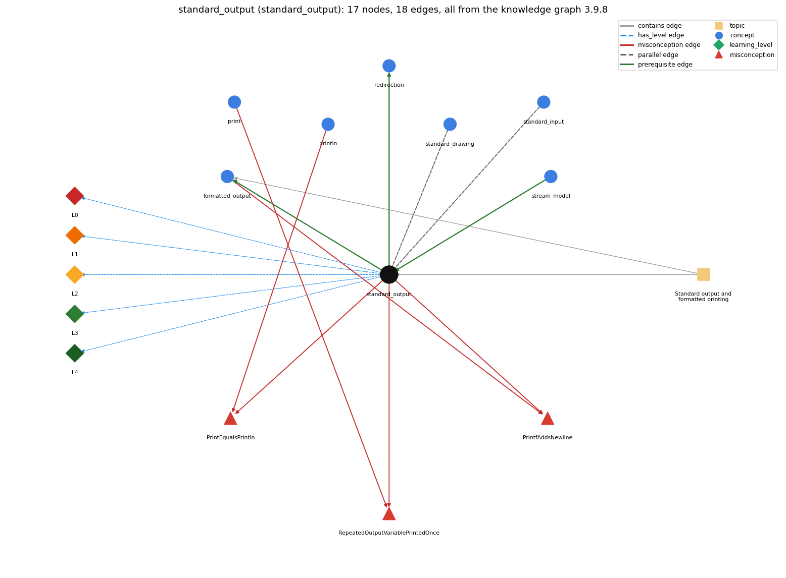

# standard_output (`standard_output`)

StdOut / System.out

Section 1.5 Input and Output, topic 1.5.b Standard output and formatted printing.

## At a glance

- **Needs first:** `stream_model`
- **Leads to:** `formatted_output`, `redirection`
- **Learned alongside:** `standard_drawing`, `standard_input`
- **Misconceptions:** `PrintEqualsPrintln`, `PrintfAddsNewline`, `RepeatedOutputVariablePrintedOnce`
- **Errors:** none
- **Levels:** L0, L1, L2, L3, L4

Everything below comes from the knowledge graph 3.9.8 (`data/raw/chapter1_kg_updated.json`): 18 edges around this concept. The edge logic, the wrong and right rules and the exact rules of the ways are copied word for word from the graph.

## To work on (0)

Nothing is missing for this concept.

## What it needs first (1)

A prerequisite edge means the other concept has to be understood before `standard_output`.

### `stream_model` comes before `standard_output`

*input and output as sequential streams*

- **Edge:** `pre:stream_model->standard_output`
- **Exact edge logic:** StdOut writes a stream: each print appends its text to the end of the output.
- **Grounding:** book\_passage
- **Composition rule (R) of `standard_output` with `stream_model`:** Each output call appends to the end of the single output stream, so the order of output is the order of execution.
- **Composition rule (R) of `stream_model` with `standard_output`:** All StdOut/System.out calls write to one output stream in execution order, and text already written cannot be taken back.

## What it leads to (2)

These concepts need `standard_output` first.

### `standard_output` comes before `formatted_output`

*printf with a format string such as %d, %.2f, %s*

- **Edge:** `pre:standard_output->formatted_output`
- **Exact edge logic:** printf writes to standard output, like print, but formats each value first.
- **Grounding:** book\_passage
- **Composition rule (R) of `standard_output` with `formatted_output`:** printf writes to the same stream as print and println, so mixed calls appear in call order. Unlike println, printf ends a line only when the format contains \n.
- **Composition rule (R) of `formatted_output` with `standard_output`:** printf output goes into the same stream as print/println and lands at the point in the stream where it was called. It does not end the line.

### `standard_output` comes before `redirection`

*&lt; / &gt; send a file in/out as standard input/output*

- **Edge:** `pre:standard_output->redirection`
- **Exact edge logic:** &gt; file sends everything written to standard output into the file instead of the screen.
- **Grounding:** book\_passage
- **Composition rule (R) of `standard_output` with `redirection`:** With \`&gt; file\`, every print/println/printf writes to the file and nothing appears in the terminal. The program code is unchanged.
- **Composition rule (R) of `redirection` with `standard_output`:** \`&gt; file\` diverts all standard output (print, println, printf) into the file, so nothing appears in the terminal.

## Learned alongside (2)

A parallel edge joins two concepts that sit side by side: neither is needed before the other.

### `standard_output` alongside `standard_drawing`

*StdDraw -- graphical output (book-specific)*

- **Edge:** `par:standard_output~standard_drawing`
- **Exact edge logic:** StdOut writes text to the output stream; StdDraw draws shapes at (x, y) coordinates in a window.
- **Grounding:** book\_passage
- **Composition rule (R) of `standard_output` with `standard_drawing`:** StdOut text and StdDraw pictures are independent outputs: printing does not draw, and drawing does not print.
- **Composition rule (R) of `standard_drawing` with `standard_output`:** StdOut writes text to a stream, while StdDraw draws in a separate window at (x, y) coordinates. Neither affects the other.

### `standard_output` alongside `standard_input`

*StdIn -- reading a stream of values*

- **Edge:** `par:standard_input~standard_output`
- **Exact edge logic:** StdIn takes values in from the input stream; StdOut sends values out to the output stream.
- **Grounding:** book\_passage
- **Composition rule (R) of `standard_output` with `standard_input`:** A prompt printed with print (not println) shows on the same line where the user then types, before the following StdIn read blocks. Output and input are separate streams.
- **Composition rule (R) of `standard_input` with `standard_output`:** The program turns the input stream into the output stream: values read with StdIn are processed and the results are written with StdOut. The two streams are independent.

## Misconceptions (3)

A misconception edge states the wrong rule a student may hold about this concept, and the right rule.

### PrintEqualsPrintln

- **Edge:** `standard_output` &rarr; `PrintEqualsPrintln` (misconception)
- **Exact edge logic (the wrong rule):** print and println behave the same (no newline difference)
- **Twin logic (the right rule):** println ends the line after printing and print does not, so print(s1); print(s2); puts s1 and s2 on the same line.
- **Wrong belief (on the node):** print and println behave the same (no newline difference)
- **Correct rule (on the node):** println ends the line after printing and print does not, so print(s1); print(s2); puts s1 and s2 on the same line.
- **Provenance:** derived
- **Role of this concept:** context
- **L0 way linked to it:** yes
- **L0 way [1] misconception, exact rule:** wrong rule: print and println behave the same (no newline difference). Right rule: println(s) prints s and then ends the line, but print(s) does not, so print("a"); print("b"); gives ab on one line.
- **L0 way [2] inconsistent\_trace, exact rule:** Points to LT (output appears in the order the output calls execute, with a line break only after println). An uneven trace drops a repeated value, puts output lines out of order, or adds line breaks after print on some calls. (here mixing in: "print and println behave the same (no newline difference)")
- **Edge `println` &rarr; `PrintEqualsPrintln`, exact edge logic:** print and println do the same thing, so print(s1); print(s2); puts s1 and s2 on separate lines. **Twin logic:** println ends the line after printing and print does not, so print(s1); print(s2); puts s1 and s2 on the same line. (role: primary)

### PrintfAddsNewline

- **Edge:** `standard_output` &rarr; `PrintfAddsNewline` (misconception)
- **Exact edge logic (the wrong rule):** printf() ends the line like println().
- **Twin logic (the right rule):** printf() does not add a newline; put \n in the format string to end the line.
- **Wrong belief (on the node):** printf() ends the line like println().
- **Correct rule (on the node):** printf() does not add a newline; put \n in the format string to end the line.
- **Provenance:** textbook
- **Role of this concept:** context
- **L0 way linked to it:** yes
- **L0 way [3] misconception, exact rule:** wrong rule: printf() ends the line like println(). Right rule: printf() adds no newline. Put \n (or %n) in the format string to end the line.
- **Edge `formatted_output` &rarr; `PrintfAddsNewline`, exact edge logic:** printf() ends the line like println(). **Twin logic:** printf() does not add a newline; put \n in the format string to end the line. (role: primary)

### RepeatedOutputVariablePrintedOnce

- **Edge:** `standard_output` &rarr; `RepeatedOutputVariablePrintedOnce` (misconception)
- **Exact edge logic (the wrong rule):** An output statement that names the same variable twice (WRITE y, x, y) prints it only once.
- **Twin logic (the right rule):** Each expression in the output list is printed, so a repeated variable prints its value each time.
- **Wrong belief (on the node):** An output statement that names the same variable twice (WRITE y, x, y) prints it only once.
- **Correct rule (on the node):** Each expression in the output list is printed, so a repeated variable prints its value each time.
- **Provenance:** published
- **Role of this concept:** context
- **L0 way linked to it:** yes
- **L0 way [4] misconception, exact rule:** wrong rule: An output statement that names the same variable twice (WRITE y, x, y) prints it only once. Right rule: Every expression in the output is printed, so System.out.println(y + " " + x + " " + y) with x=6, y=9 prints 9 6 9.
- **Edge `print` &rarr; `RepeatedOutputVariablePrintedOnce`, exact edge logic:** An output statement that names the same variable twice (WRITE y, x, y) prints it only once. **Twin logic:** Each expression in the output list is printed, so a repeated variable prints its value each time. (role: primary)

## Errors (0)

An error edge states the rule that gets broken in a program, and the right rule.

The graph has no error edge from this concept.

## Levels L0 to L4 (5 of 5)

Each level edge lists the ways a student shows that level, each with its exact rule.

### L0: Prestructural / sensorimotor

L0 for standard output: the answer holds a rule that contradicts Java.

*Deciding question: Does every rule the answer applies to standard output agree with the language rule? If it reads the code with everyday meanings, applies a wrong rule, or switches rules within one trace, it is L0. A slip in an otherwise rule-correct trace is L2 with an error, not L0.*

- **Edge:** `standard_output` &rarr; `standard_output@L0` (has_level)
- **Exact edge logic:** standard output -&gt; L0 (Prestructural): the answer holds a rule that contradicts Java (5 ways).

Ways (5), each with its exact rule:

- **[0] everyday\_reading** (rule type E, folk-meaning rule): Novices take output text literally, as if it acted on the program: printing "The value of X is 1" is read as setting X to 1. They also take 'print' to mean producing a finished line. In Java, print only appends characters to the output stream; it changes no variables and ends the line only for println.
- **[1] misconception** (rule type M, wrong rule / right rule) &rarr; `PrintEqualsPrintln`: wrong rule: print and println behave the same (no newline difference). Right rule: println(s) prints s and then ends the line, but print(s) does not, so print("a"); print("b"); gives ab on one line.
- **[2] inconsistent\_trace** (rule type T, uneven-application rule) &rarr; `PrintEqualsPrintln`: Points to LT (output appears in the order the output calls execute, with a line break only after println). An uneven trace drops a repeated value, puts output lines out of order, or adds line breaks after print on some calls. (here mixing in: "print and println behave the same (no newline difference)")
- **[3] misconception** (rule type M, wrong rule / right rule) &rarr; `PrintfAddsNewline`: wrong rule: printf() ends the line like println(). Right rule: printf() adds no newline. Put \n (or %n) in the format string to end the line.
- **[4] misconception** (rule type M, wrong rule / right rule) &rarr; `RepeatedOutputVariablePrintedOnce`: wrong rule: An output statement that names the same variable twice (WRITE y, x, y) prints it only once. Right rule: Every expression in the output is printed, so System.out.println(y + " " + x + " " + y) with x=6, y=9 prints 9 6 9.

### L1: Unistructural / atom x text surface

L1 for standard output: the answer states one correct rule without applying it.

*Deciding question: Does the answer cover every part of the code, in order, with the values (L2)? If it covers one part or only states the rule, it is L1.*

- **Edge:** `standard_output` &rarr; `standard_output@L1` (has_level)
- **Exact edge logic:** standard output -&gt; L1 (Unistructural): the answer states one correct rule without applying it (2 ways).

Ways (2), each with its exact rule:

- **[0] names\_the\_element** (rule type N, identity rule): Standard output (System.out, StdOut) is the library abstraction for a program's text output: an output stream of characters written by print, println and printf.
- **[1] states\_the\_rule** (rule type S, declarative rule): print(s) writes s. println(s) writes s and then the line separator. println() only ends the line. A null String prints as "null". By default the stream goes to the terminal window.

### L2: Multistructural / block x execution / preoperational

L2 for standard output: the answer applies these rules to every part of the code, in order.

*Deciding question: Is the answer many segments mapped onto lines (L2), or one segment stating the purpose of the whole (L3)? A correct output with no value-by-value justification is not levelled.*

- **Edge:** `standard_output` &rarr; `standard_output@L2` (has_level)
- **Exact edge logic:** standard output -&gt; L2 (Multistructural): the answer applies the rules of standard output to every part of the code, in order (3 ways).

Ways (3), each with its exact rule:

- **[0] line\_by\_line\_trace** (rule type LT, operational sequencing rule): First the argument expression is evaluated, e.g. the concatenation "Sum is " + sum. Then its string form is appended, and println appends the line separator after it. Successive calls appear in execution order.
- **[1] output\_prediction** (rule type OP, evaluation / result rule): The output is the argument's string form. System.out.println(Math.PI) prints 3.141592653589793 (all digits), and println("Sum is " + 1778) prints Sum is 1778 followed by a newline. The methods return void.
- **[2] one\_step\_execution** (rule type OS, state-transition rule): One call appends text to the output (println also appends the line separator). It changes no variables and returns nothing.

### L3: Relational / relations x function (concrete operational begins)

L3 for standard output: the answer relates the parts by these rules.

*Deciding question: Was the purpose deduced from the code, or only guessed from traced input/output pairs (then L2)? Does the answer stay within the given code (L3), or reason about changed code, an error class or a new program (L4)?*

- **Edge:** `standard_output` &rarr; `standard_output@L3` (has_level)
- **Exact edge logic:** standard output -&gt; L3 (Relational): the answer relates the parts (6 ways).

Ways (6), each with its exact rule:

- **[0] relation\_to\_neighbour** (rule type R, composition rule (with a neighbour)): Each output call appends to the end of the single output stream, so the order of output is the order of execution.
- **[1] relation\_to\_neighbour** (rule type R, composition rule (with a neighbour)): With \`&gt; file\`, every print/println/printf writes to the file and nothing appears in the terminal. The program code is unchanged.
- **[2] relation\_to\_neighbour** (rule type R, composition rule (with a neighbour)): A prompt printed with print (not println) shows on the same line where the user then types, before the following StdIn read blocks. Output and input are separate streams.
- **[3] relation\_to\_neighbour** (rule type R, composition rule (with a neighbour)): StdOut text and StdDraw pictures are independent outputs: printing does not draw, and drawing does not print.
- **[4] relation\_to\_neighbour** (rule type R, composition rule (with a neighbour)): printf writes to the same stream as print and println, so mixed calls appear in call order. Unlike println, printf ends a line only when the format contains \n.
- **[5] purpose\_of\_the\_whole** (rule type P, plan / role rule): Standard output reports results (to a person, or to a file or program further down the line). Plan: an 'output' step after a computation, or one println per item inside a loop to list values.

### L4: Extended abstract (concrete-operational reversibility and conservation)

L4 for standard output: the answer reasons beyond the given code by these rules.

*Deciding question: Does the answer link the code to a broader context: a changed program, a class of inputs, an unseen problem? Re-tracing changed code value by value is L2; fixing one given failing case is L3.*

- **Edge:** `standard_output` &rarr; `standard_output@L4` (has_level)
- **Exact edge logic:** standard output -&gt; L4 (Extended abstract): the answer reasons beyond the given code (5 ways).

Ways (5), each with its exact rule:

- **[0] predict\_a\_change** (rule type C, conservation rule) &rarr; `PrintEqualsPrintln`: Switching System.out.print/println to StdOut.print/println keeps the output. Changing println to print keeps every character but removes the line break, so lines join.
- **[1] transfer\_to\_a\_new\_program** (rule type X, applicability rule): Use standard output for text results meant for a reader or for the next program in a pipeline. Use printf when digits or column widths matter, and StdDraw/StdAudio for pictures and sound.
- **[2] diagnose\_an\_error** (rule type D, error rule): rule broken: Output order and line breaks follow the order of the calls and the print/println choice. Kind: silent logic error. Trigger class: Output statements in the wrong order, or a missing println, so text fragments run together (e.g. the next prompt ends up on the same line).
- **[3] diagnose\_an\_error** (rule type D, error rule): rule broken: PrintStream methods never throw IOException; a write failure only sets an internal flag. Kind: silent logic error. Trigger class: Output to a closed or failing destination: nothing is reported unless checkError() is called.
- **[4] diagnose\_an\_error** (rule type D, error rule): rule broken: println/print take a single argument; pieces must be joined with +. Kind: compile-time. Trigger class: Calls like System.out.println("x =", x) with a comma-separated argument list: 'no suitable method found'.

## Same topic

`standard_output` belongs to the topic **Standard output and formatted printing** (`topic1.5.b`). The topic also contains: `formatted_output`.

## Rules of the concept (21)

- **Book** (SW-1e, p. 121 (pdf 131)): "Java puts the results of a program's sequence of calls on these methods into the form of an abstract stream of characters known as standard output."
- **Book** (SW-1.5, ): "Java sends the results to an abstract stream of characters known as standard output."
- **E** (folk-meaning rule): Novices take output text literally, as if it acted on the program: printing "The value of X is 1" is read as setting X to 1. They also take 'print' to mean producing a finished line. In Java, print only appends characters to the output stream; it changes no variables and ends the line only for println.
- **M** (wrong rule / right rule): PrintEqualsPrintln: wrong: print and println behave the same (no newline difference). \| right: println(s) prints s and then ends the line, but print(s) does not, so print("a"); print("b"); gives ab on one line.
- **M** (wrong rule / right rule): PrintfAddsNewline: wrong: printf() ends the line like println(). \| right: printf() adds no newline. Put \n (or %n) in the format string to end the line.
- **M** (wrong rule / right rule): RepeatedOutputVariablePrintedOnce: wrong: An output statement that names the same variable twice (WRITE y, x, y) prints it only once. \| right: Every expression in the output is printed, so System.out.println(y + " " + x + " " + y) with x=6, y=9 prints 9 6 9.
- **T** (uneven-application rule): Points to LT (output appears in the order the output calls execute, with a line break only after println). An uneven trace drops a repeated value, puts output lines out of order, or adds line breaks after print on some calls.
- **N** (identity rule): Standard output (System.out, StdOut) is the library abstraction for a program's text output: an output stream of characters written by print, println and printf.
- **S** (declarative rule): print(s) writes s. println(s) writes s and then the line separator. println() only ends the line. A null String prints as "null". By default the stream goes to the terminal window.
- **LT** (operational sequencing rule): First the argument expression is evaluated, e.g. the concatenation "Sum is " + sum. Then its string form is appended, and println appends the line separator after it. Successive calls appear in execution order.
- **OP** (evaluation / result rule): The output is the argument's string form. System.out.println(Math.PI) prints 3.141592653589793 (all digits), and println("Sum is " + 1778) prints Sum is 1778 followed by a newline. The methods return void.
- **OS** (state-transition rule): One call appends text to the output (println also appends the line separator). It changes no variables and returns nothing.
- **R** (composition rule (with a neighbour)): with stream\_model: Each output call appends to the end of the single output stream, so the order of output is the order of execution.
- **R** (composition rule (with a neighbour)): with redirection: With \`&gt; file\`, every print/println/printf writes to the file and nothing appears in the terminal. The program code is unchanged.
- **R** (composition rule (with a neighbour)): with standard\_input: A prompt printed with print (not println) shows on the same line where the user then types, before the following StdIn read blocks. Output and input are separate streams.
- **R** (composition rule (with a neighbour)): with standard\_drawing: StdOut text and StdDraw pictures are independent outputs: printing does not draw, and drawing does not print.
- **R** (composition rule (with a neighbour)): with formatted\_output: printf writes to the same stream as print and println, so mixed calls appear in call order. Unlike println, printf ends a line only when the format contains \n.
- **P** (plan / role rule): Standard output reports results (to a person, or to a file or program further down the line). Plan: an 'output' step after a computation, or one println per item inside a loop to list values.
- **C** (conservation rule): Switching System.out.print/println to StdOut.print/println keeps the output. Changing println to print keeps every character but removes the line break, so lines join.
- **D** (error rule): rule broken: Output order and line breaks follow the order of the calls and the print/println choice. (silent logic error)
- **D** (error rule): rule broken: PrintStream methods never throw IOException; a write failure only sets an internal flag. (silent logic error)
- **D** (error rule): rule broken: println/print take a single argument; pieces must be joined with +. (compile-time)
- **X** (applicability rule): Use standard output for text results meant for a reader or for the next program in a pipeline. Use printf when digits or column widths matter, and StdDraw/StdAudio for pictures and sound.

## How it is found in code and answers (reader block)

- **Aliases:** standard output, stdout, console, the screen, terminal
- **Code patterns:** `System\.out\.`, `StdOut\.`
- **Operator symbols:** none
- **Java types:** none

## The whole prerequisite chain

- **Everything it builds on (1):** `stream_model`
- **Everything that builds on it (5):** `data_driven_code`, `filter`, `formatted_output`, `piping`, `redirection`

## Every edge in this view and its exact edge logic (18)

All the edges drawn in the picture, in the order: prerequisite, parallel, misconception, error, has_level, contains.

**1. `standard_output` &rarr; `formatted_output`** (prerequisite)

- **Exact edge logic:** printf writes to standard output, like print, but formats each value first.
- **Grounding:** book\_passage
- **Composition rule (R) of `standard_output` with `formatted_output`:** printf writes to the same stream as print and println, so mixed calls appear in call order. Unlike println, printf ends a line only when the format contains \n.
- **Composition rule (R) of `formatted_output` with `standard_output`:** printf output goes into the same stream as print/println and lands at the point in the stream where it was called. It does not end the line.

**2. `standard_output` &rarr; `redirection`** (prerequisite)

- **Exact edge logic:** &gt; file sends everything written to standard output into the file instead of the screen.
- **Grounding:** book\_passage
- **Composition rule (R) of `standard_output` with `redirection`:** With \`&gt; file\`, every print/println/printf writes to the file and nothing appears in the terminal. The program code is unchanged.
- **Composition rule (R) of `redirection` with `standard_output`:** \`&gt; file\` diverts all standard output (print, println, printf) into the file, so nothing appears in the terminal.

**3. `stream_model` &rarr; `standard_output`** (prerequisite)

- **Exact edge logic:** StdOut writes a stream: each print appends its text to the end of the output.
- **Grounding:** book\_passage
- **Composition rule (R) of `stream_model` with `standard_output`:** All StdOut/System.out calls write to one output stream in execution order, and text already written cannot be taken back.
- **Composition rule (R) of `standard_output` with `stream_model`:** Each output call appends to the end of the single output stream, so the order of output is the order of execution.

**4. `standard_input` &harr; `standard_output`** (parallel)

- **Exact edge logic:** StdIn takes values in from the input stream; StdOut sends values out to the output stream.
- **Grounding:** book\_passage
- **Composition rule (R) of `standard_input` with `standard_output`:** The program turns the input stream into the output stream: values read with StdIn are processed and the results are written with StdOut. The two streams are independent.
- **Composition rule (R) of `standard_output` with `standard_input`:** A prompt printed with print (not println) shows on the same line where the user then types, before the following StdIn read blocks. Output and input are separate streams.

**5. `standard_output` &harr; `standard_drawing`** (parallel)

- **Exact edge logic:** StdOut writes text to the output stream; StdDraw draws shapes at (x, y) coordinates in a window.
- **Grounding:** book\_passage
- **Composition rule (R) of `standard_output` with `standard_drawing`:** StdOut text and StdDraw pictures are independent outputs: printing does not draw, and drawing does not print.
- **Composition rule (R) of `standard_drawing` with `standard_output`:** StdOut writes text to a stream, while StdDraw draws in a separate window at (x, y) coordinates. Neither affects the other.

**6. `standard_output` &rarr; `PrintEqualsPrintln`** (misconception)

- **Exact edge logic (the wrong rule):** print and println behave the same (no newline difference)
- **Twin logic (the right rule):** println ends the line after printing and print does not, so print(s1); print(s2); puts s1 and s2 on the same line.
- **Role:** context

**7. `standard_output` &rarr; `PrintfAddsNewline`** (misconception)

- **Exact edge logic (the wrong rule):** printf() ends the line like println().
- **Twin logic (the right rule):** printf() does not add a newline; put \n in the format string to end the line.
- **Role:** context

**8. `standard_output` &rarr; `RepeatedOutputVariablePrintedOnce`** (misconception)

- **Exact edge logic (the wrong rule):** An output statement that names the same variable twice (WRITE y, x, y) prints it only once.
- **Twin logic (the right rule):** Each expression in the output list is printed, so a repeated variable prints its value each time.
- **Role:** context

**9. `formatted_output` &rarr; `PrintfAddsNewline`** (misconception)

- **Exact edge logic (the wrong rule):** printf() ends the line like println().
- **Twin logic (the right rule):** printf() does not add a newline; put \n in the format string to end the line.
- **Role:** primary

**10. `print` &rarr; `RepeatedOutputVariablePrintedOnce`** (misconception)

- **Exact edge logic (the wrong rule):** An output statement that names the same variable twice (WRITE y, x, y) prints it only once.
- **Twin logic (the right rule):** Each expression in the output list is printed, so a repeated variable prints its value each time.
- **Role:** primary

**11. `println` &rarr; `PrintEqualsPrintln`** (misconception)

- **Exact edge logic (the wrong rule):** print and println do the same thing, so print(s1); print(s2); puts s1 and s2 on separate lines.
- **Twin logic (the right rule):** println ends the line after printing and print does not, so print(s1); print(s2); puts s1 and s2 on the same line.
- **Role:** primary

**12. `standard_output` &rarr; `standard_output@L0`** (has_level)

- **Exact edge logic:** standard output -&gt; L0 (Prestructural): the answer holds a rule that contradicts Java (5 ways).
  - **[0] everyday\_reading** (rule type E, folk-meaning rule): Novices take output text literally, as if it acted on the program: printing "The value of X is 1" is read as setting X to 1. They also take 'print' to mean producing a finished line. In Java, print only appends characters to the output stream; it changes no variables and ends the line only for println.
  - **[1] misconception** (rule type M, wrong rule / right rule) &rarr; `PrintEqualsPrintln`: wrong rule: print and println behave the same (no newline difference). Right rule: println(s) prints s and then ends the line, but print(s) does not, so print("a"); print("b"); gives ab on one line.
  - **[2] inconsistent\_trace** (rule type T, uneven-application rule) &rarr; `PrintEqualsPrintln`: Points to LT (output appears in the order the output calls execute, with a line break only after println). An uneven trace drops a repeated value, puts output lines out of order, or adds line breaks after print on some calls. (here mixing in: "print and println behave the same (no newline difference)")
  - **[3] misconception** (rule type M, wrong rule / right rule) &rarr; `PrintfAddsNewline`: wrong rule: printf() ends the line like println(). Right rule: printf() adds no newline. Put \n (or %n) in the format string to end the line.
  - **[4] misconception** (rule type M, wrong rule / right rule) &rarr; `RepeatedOutputVariablePrintedOnce`: wrong rule: An output statement that names the same variable twice (WRITE y, x, y) prints it only once. Right rule: Every expression in the output is printed, so System.out.println(y + " " + x + " " + y) with x=6, y=9 prints 9 6 9.

**13. `standard_output` &rarr; `standard_output@L1`** (has_level)

- **Exact edge logic:** standard output -&gt; L1 (Unistructural): the answer states one correct rule without applying it (2 ways).
  - **[0] names\_the\_element** (rule type N, identity rule): Standard output (System.out, StdOut) is the library abstraction for a program's text output: an output stream of characters written by print, println and printf.
  - **[1] states\_the\_rule** (rule type S, declarative rule): print(s) writes s. println(s) writes s and then the line separator. println() only ends the line. A null String prints as "null". By default the stream goes to the terminal window.

**14. `standard_output` &rarr; `standard_output@L2`** (has_level)

- **Exact edge logic:** standard output -&gt; L2 (Multistructural): the answer applies the rules of standard output to every part of the code, in order (3 ways).
  - **[0] line\_by\_line\_trace** (rule type LT, operational sequencing rule): First the argument expression is evaluated, e.g. the concatenation "Sum is " + sum. Then its string form is appended, and println appends the line separator after it. Successive calls appear in execution order.
  - **[1] output\_prediction** (rule type OP, evaluation / result rule): The output is the argument's string form. System.out.println(Math.PI) prints 3.141592653589793 (all digits), and println("Sum is " + 1778) prints Sum is 1778 followed by a newline. The methods return void.
  - **[2] one\_step\_execution** (rule type OS, state-transition rule): One call appends text to the output (println also appends the line separator). It changes no variables and returns nothing.

**15. `standard_output` &rarr; `standard_output@L3`** (has_level)

- **Exact edge logic:** standard output -&gt; L3 (Relational): the answer relates the parts (6 ways).
  - **[0] relation\_to\_neighbour** (rule type R, composition rule (with a neighbour)): Each output call appends to the end of the single output stream, so the order of output is the order of execution.
  - **[1] relation\_to\_neighbour** (rule type R, composition rule (with a neighbour)): With \`&gt; file\`, every print/println/printf writes to the file and nothing appears in the terminal. The program code is unchanged.
  - **[2] relation\_to\_neighbour** (rule type R, composition rule (with a neighbour)): A prompt printed with print (not println) shows on the same line where the user then types, before the following StdIn read blocks. Output and input are separate streams.
  - **[3] relation\_to\_neighbour** (rule type R, composition rule (with a neighbour)): StdOut text and StdDraw pictures are independent outputs: printing does not draw, and drawing does not print.
  - **[4] relation\_to\_neighbour** (rule type R, composition rule (with a neighbour)): printf writes to the same stream as print and println, so mixed calls appear in call order. Unlike println, printf ends a line only when the format contains \n.
  - **[5] purpose\_of\_the\_whole** (rule type P, plan / role rule): Standard output reports results (to a person, or to a file or program further down the line). Plan: an 'output' step after a computation, or one println per item inside a loop to list values.

**16. `standard_output` &rarr; `standard_output@L4`** (has_level)

- **Exact edge logic:** standard output -&gt; L4 (Extended abstract): the answer reasons beyond the given code (5 ways).
  - **[0] predict\_a\_change** (rule type C, conservation rule) &rarr; `PrintEqualsPrintln`: Switching System.out.print/println to StdOut.print/println keeps the output. Changing println to print keeps every character but removes the line break, so lines join.
  - **[1] transfer\_to\_a\_new\_program** (rule type X, applicability rule): Use standard output for text results meant for a reader or for the next program in a pipeline. Use printf when digits or column widths matter, and StdDraw/StdAudio for pictures and sound.
  - **[2] diagnose\_an\_error** (rule type D, error rule): rule broken: Output order and line breaks follow the order of the calls and the print/println choice. Kind: silent logic error. Trigger class: Output statements in the wrong order, or a missing println, so text fragments run together (e.g. the next prompt ends up on the same line).
  - **[3] diagnose\_an\_error** (rule type D, error rule): rule broken: PrintStream methods never throw IOException; a write failure only sets an internal flag. Kind: silent logic error. Trigger class: Output to a closed or failing destination: nothing is reported unless checkError() is called.
  - **[4] diagnose\_an\_error** (rule type D, error rule): rule broken: println/print take a single argument; pieces must be joined with +. Kind: compile-time. Trigger class: Calls like System.out.println("x =", x) with a comma-separated argument list: 'no suitable method found'.

**17. `topic1.5.b` &rarr; `standard_output`** (contains)

- topic `topic1.5.b` contains `standard_output`

**18. `topic1.5.b` &rarr; `formatted_output`** (contains)

- topic `topic1.5.b` contains `formatted_output`
