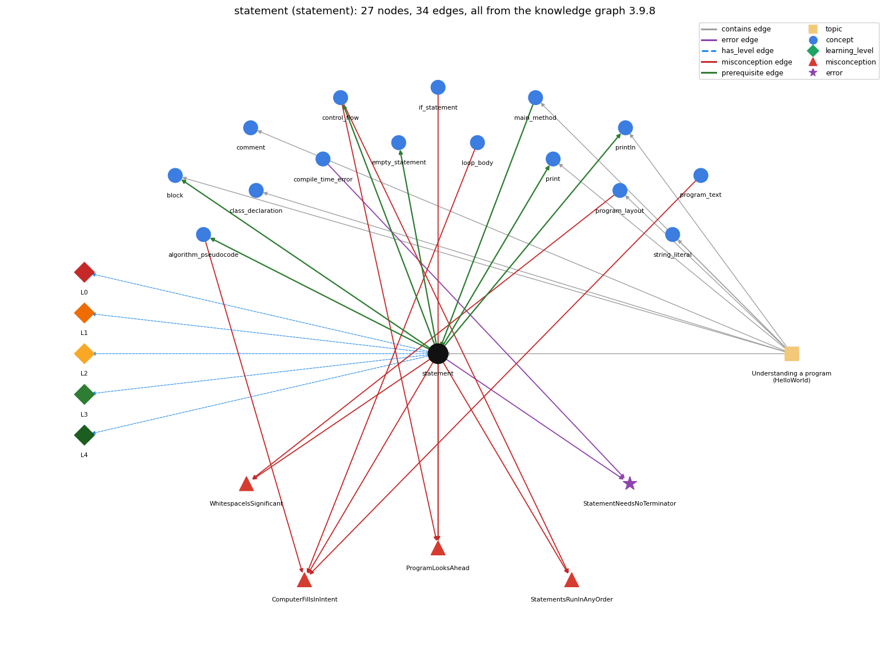

# statement (`statement`)

one step, terminated by ;, executed in sequence

Section 1.1 Your First Program, topic 1.1.b Understanding a program (HelloWorld).

## At a glance

- **Needs first:** `main_method`
- **Leads to:** `algorithm_pseudocode`, `block`, `control_flow`, `empty_statement`, `print`, `println`
- **Learned alongside:** nothing
- **Misconceptions:** `ComputerFillsInIntent`, `ProgramLooksAhead`, `StatementsRunInAnyOrder`, `WhitespaceIsSignificant`
- **Errors:** `StatementNeedsNoTerminator`
- **Levels:** L0, L1, L2, L3, L4

Everything below comes from the knowledge graph 3.9.8 (`data/raw/chapter1_kg_updated.json`): 34 edges around this concept, each explained in the graph's own words.

## What it needs first (1)

A prerequisite edge means the other concept has to be understood before `statement`.

### `main_method` comes before `statement`

*public static void main(String[] args) -- entry point*

Statements are written in main's body, and running the program executes main's statements in order, one by one.

- **Grounding:** book passage
- **How `statement` combines with `main_method`:** Statements live in main's body; running the program executes main's statements in order.
- **How `main_method` combines with `statement`:** main's body holds the statements; running the program executes them in order, one by one.

## What it leads to (6)

These concepts need `statement` first.

### `statement` comes before `algorithm_pseudocode`

*an algorithm is a sequence of steps that solves a problem; pseudocode outlines it in English and Java before it is coded*

An algorithm becomes a program as a sequence of statements, executed once each in the order given.

- **Grounding:** book passage
- **How `algorithm_pseudocode` combines with `statement`:** Each step of the algorithm becomes one or more statements, executed in the same order.

### `statement` comes before `block`

*{ ... } grouping statements*

A statement block is a sequence of statements, each terminated by a semicolon, enclosed in braces; the body of main() is such a sequence.

- **Grounding:** book passage
- **How `statement` combines with `block`:** A block groups a sequence of statements in braces; the body of main() is such a block.
- **How `block` combines with `statement`:** A block is built from statements, each ended by ;, and is itself usable as a single statement (e.g. a loop body).

### `statement` comes before `control_flow`

*the order in which statements are executed*

Control flow is the order in which statements run.

- **Grounding:** book passage
- **How `statement` combines with `control_flow`:** Control flow is the order in which statements run; without control statements it is straight-line, each once in order.
- **How `control_flow` combines with `statement`:** Control flow is defined over statements: statements are executed for their effect, and if/while/for are themselves statements that may be used wherever a statement is allowed, so they can nest.

### `statement` comes before `empty_statement`

*a lone ; is an empty statement; a block can stand alone*

Any part of a for loop, including its body, can be left empty (a null statement, a lone ;); the book prefers a while loop to null statements.

- **Grounding:** book passage
- **How `statement` combines with `empty_statement`:** A lone ; is the empty statement, which does nothing; it can fill a for-loop part or, by accident, end an if or loop header.
- **How `empty_statement` combines with `statement`:** The empty statement can stand wherever a statement is required (if body, loop body, for slots), and a block { } can stand alone; a ; after a header therefore silently becomes the body.

### `statement` comes before `print`

*System.out.print -- output with no newline*

System.out.print(s); is itself a statement, so it runs at its own place in the sequence of statements.

- **Grounding:** book passage
- **How `statement` combines with `print`:** System.out.print(s); is a statement, so its output appears exactly at its place in the sequence, with no newline.
- **How `print` combines with `statement`:** System.out.print(s); is a statement, so its output appears at its place in the statement sequence.

### `statement` comes before `println`

*System.out.println -- output with a trailing newline*

System.out.println(s); is itself a statement, so its line of output appears at its own place in the sequence.

- **Grounding:** book passage
- **How `statement` combines with `println`:** System.out.println(s); is a statement, so its line of output appears at its place in the sequence; swapping two println statements swaps the output lines.
- **How `println` combines with `statement`:** System.out.println(s); is a statement, so its line of output appears at its own place in the sequence.

## Learned alongside (0)

A parallel edge joins two concepts that sit side by side: neither is needed before the other.

No parallel edge touches this concept.

## Misconceptions (4)

A misconception edge states the wrong rule a student may hold about this concept, and the right rule.

### ComputerFillsInIntent

- **Wrong rule:** The computer fills in omitted steps or values that the programmer meant, e.g. REPEAT 4 [FORWARD 30] draws a square without a turn command.
- **Right rule:** The computer executes only what the code states; every needed step and value must be written.
- **Role of this concept:** primary
- **Shows at level L0 as:** misconception: wrong rule: The computer fills in omitted steps or values the programmer meant. Right rule: The computer executes only the statements written; every needed step and value must be written.
- **Shows at level L0 as:** inconsistent trace: Applies the sequencing rule (LT) unevenly: executes the statements in order on some lines but lets a later statement's effect leak into an earlier one, or skips or repeats a statement on one pass. (here mixing in: "The computer fills in omitted steps or values that the programmer meant, e.g. REPEAT 4 [FORWARD 30] draws a square without a turn command")
- **Also an edge from `algorithm_pseudocode`:** The computer fills in omitted steps or values that the programmer meant, e.g. REPEAT 4 [FORWARD 30] draws a square without a turn command.
- **Also an edge from `loop_body`:** The computer fills in omitted steps or values that the programmer meant, e.g. REPEAT 4 [FORWARD 30] draws a square without a turn command.
- **Also an edge from `program_text`:** The computer fills in omitted steps or values that the programmer meant, e.g. REPEAT 4 [FORWARD 30] draws a square without a turn command.

### ProgramLooksAhead

- **Wrong rule:** The program knows or sees what later lines will do and acts on those goals at the current line, e.g. it stops 'at ten' because it wants to draw a box.
- **Right rule:** Each statement executes using only the current state; later lines have no effect until control reaches them.
- **Role of this concept:** context
- **Shows at level L0 as:** misconception: wrong rule: The program knows what later lines will do and acts on that goal at the current line. Right rule: Each statement executes using only the current state; later lines have no effect until control reaches them.
- **Also an edge from `control_flow`:** The program knows or sees what later lines will do and acts on those goals at the current line, e.g. it stops 'at ten' because it wants to draw a box.
- **Also an edge from `if_statement`:** The program knows or sees what later lines will do and acts on those goals at the current line, e.g. it stops 'at ten' because it wants to draw a box.

### StatementsRunInAnyOrder

- **Wrong rule:** Statements in a program can run in any order.
- **Right rule:** Without control statements, statements run once each, top to bottom.
- **Role of this concept:** context
- **Shows at level L0 as:** misconception: wrong rule: Statements in a program can run in any order, so their order makes no difference. Right rule: Without control statements, statements run once each, top to bottom, in the order written.
- **Also an edge from `control_flow`:** Statements in a program can run in any order.

### WhitespaceIsSignificant

- **Wrong rule:** Line breaks and indentation change what the program does, so each statement must be on its own line.
- **Right rule:** Java compilers consider all whitespace in program text (outside quotation marks) to be equivalent; layout is for human readers.
- **Role of this concept:** context
- **Shows at level L0 as:** misconception: wrong rule: Line breaks and indentation change what the program does, so each statement must be on its own line. Right rule: Java compilers treat all whitespace outside quotes as equivalent; statements are separated by ;, not by line breaks.
- **Also an edge from `program_layout`:** Line breaks and indentation change what the program does, so each statement must be on its own line.

## Errors (1)

An error edge states the rule that gets broken in a program, and the right rule.

### StatementNeedsNoTerminator

- **Wrong rule:** A statement still compiles and runs if the semicolon at its end is left out, or if a stray ; is put right after if (c) or for (...).
- **Right rule:** Each statement must end with ;, otherwise javac reports ';' expected.
- **Role of this concept:** primary
- **Also an edge from `compile_time_error`:** a statement runs without the ;

## Levels L0 to L4 (5 of 5)

Each level edge lists the ways a student shows that level, each with its exact rule.

### L0: Prestructural / sensorimotor

L0 for statement: the answer holds a rule that contradicts Java.

*Deciding question: Does every rule the answer applies to statement agree with the language rule? If it reads the code with everyday meanings, applies a wrong rule, or switches rules within one trace, it is L0. A slip in an otherwise rule-correct trace is L2 with an error, not L0.*

statement -&gt; L0 (Prestructural): the answer holds a rule that contradicts Java (6 ways).

- **everyday reading** (folk-meaning rule): Everyday reading: a program is read like a text or a list of wishes that the computer takes in all at once, so line order, goals of later lines or what the writer meant can matter. Java rule: each statement is one step, ended by ;, executed once, in written order, using only the current state.
- **misconception** (wrong rule / right rule; shows `ComputerFillsInIntent`): wrong rule: The computer fills in omitted steps or values the programmer meant. Right rule: The computer executes only the statements written; every needed step and value must be written.
- **inconsistent trace** (uneven-application rule; shows `ComputerFillsInIntent`): Applies the sequencing rule (LT) unevenly: executes the statements in order on some lines but lets a later statement's effect leak into an earlier one, or skips or repeats a statement on one pass. (here mixing in: "The computer fills in omitted steps or values that the programmer meant, e.g. REPEAT 4 [FORWARD 30] draws a square without a turn command")
- **misconception** (wrong rule / right rule; shows `StatementsRunInAnyOrder`): wrong rule: Statements in a program can run in any order, so their order makes no difference. Right rule: Without control statements, statements run once each, top to bottom, in the order written.
- **misconception** (wrong rule / right rule; shows `WhitespaceIsSignificant`): wrong rule: Line breaks and indentation change what the program does, so each statement must be on its own line. Right rule: Java compilers treat all whitespace outside quotes as equivalent; statements are separated by ;, not by line breaks.
- **misconception** (wrong rule / right rule; shows `ProgramLooksAhead`): wrong rule: The program knows what later lines will do and acts on that goal at the current line. Right rule: Each statement executes using only the current state; later lines have no effect until control reaches them.

### L1: Unistructural / atom x text surface

L1 for statement: the answer states one correct rule without applying it.

*Deciding question: Does the answer cover every part of the code, in order, with the values (L2)? If it covers one part or only states the rule, it is L1.*

statement -&gt; L1 (Unistructural): the answer states one correct rule without applying it (2 ways).

- **names the element** (identity rule): A statement is one step of a program (a declaration, assignment, method call such as System.out.println(...), or control statement), ended by a semicolon when it is a simple statement.
- **states the rule** (declarative rule): A method body is a sequence of statements enclosed in braces and each followed by a semicolon; statements are executed for their effect and have no value; an expression statement evaluates its expression and discards any value.

### L2: Multistructural / block x execution / preoperational

L2 for statement: the answer applies these rules to every part of the code, in order.

*Deciding question: Is the answer many segments mapped onto lines (L2), or one segment stating the purpose of the whole (L3)? A correct output with no value-by-value justification is not levelled.*

statement -&gt; L2 (Multistructural): the answer applies the rules of statement to every part of the code, in order (3 ways).

- **line by line trace** (operational sequencing rule): Statements run one at a time, from first to last; each completes (normally or abruptly) before the next starts.
- **output prediction** (evaluation / result rule): A statement has no value; its result is its effect: a changed variable, printed output, or a change of control flow.
- **one step execution** (state-transition rule): Executing one statement applies its single effect to the current state (e.g. prints one string, or stores one value) and then control moves to the next statement.

### L3: Relational / relations x function (concrete operational begins)

L3 for statement: the answer relates the parts by these rules.

*Deciding question: Was the purpose deduced from the code, or only guessed from traced input/output pairs (then L2)? Does the answer stay within the given code (L3), or reason about changed code, an error class or a new program (L4)?*

statement -&gt; L3 (Relational): the answer relates the parts (8 ways).

- **relation to neighbour** (composition rule (with a neighbour)): Statements live in main's body; running the program executes main's statements in order.
- **relation to neighbour** (composition rule (with a neighbour)): A block groups a sequence of statements in braces; the body of main() is such a block.
- **relation to neighbour** (composition rule (with a neighbour)): System.out.print(s); is a statement, so its output appears exactly at its place in the sequence, with no newline.
- **relation to neighbour** (composition rule (with a neighbour)): System.out.println(s); is a statement, so its line of output appears at its place in the sequence; swapping two println statements swaps the output lines.
- **relation to neighbour** (composition rule (with a neighbour)): Control flow is the order in which statements run; without control statements it is straight-line, each once in order.
- **relation to neighbour** (composition rule (with a neighbour)): A lone ; is the empty statement, which does nothing; it can fill a for-loop part or, by accident, end an if or loop header.
- **relation to neighbour** (composition rule (with a neighbour)): An algorithm becomes a program as a sequence of statements, executed once each in the order given.
- **purpose of the whole** (plan / role rule): Purpose: a statement is the unit of action; a program is characterized by its sequence of statements, each doing one step of the algorithm.

### L4: Extended abstract (concrete-operational reversibility and conservation)

L4 for statement: the answer reasons beyond the given code by these rules.

*Deciding question: Does the answer link the code to a broader context: a changed program, a class of inputs, an unseen problem? Re-tracing changed code value by value is L2; fixing one given failing case is L3.*

statement -&gt; L4 (Extended abstract): the answer reasons beyond the given code (4 ways).

- **predict a change** (conservation rule; shows `ComputerFillsInIntent`): Swapping two statements that touch the same variable or the output generally changes the result; swapping independent statements, or changing only whitespace between them, keeps it.
- **diagnose an error** (error rule): rule broken: Each simple statement must end with ;. Kind: compile-time. Trigger class: omitting the ; at the end of a statement: javac reports ';' expected (often at the end of that line or the next)
- **transfer to a new program** (applicability rule): Write one statement per step and order them as the algorithm requires; straight-line sequence suffices when every step runs once, otherwise use conditionals or loops.
- **diagnose an error** (error rule): rule broken: A ; directly after an if/while/for header is an empty statement. Kind: silent logic error. Trigger class: if (x &gt; 0); or while (cond); followed by the intended body

## Same topic

`statement` belongs to the topic **Understanding a program (HelloWorld)** (`topic1.1.b`). The topic also contains: `block`, `class_declaration`, `comment`, `main_method`, `print`, `println`, `program_layout`, `string_literal`.

## Rules of the concept (22)

- **folk-meaning rule:** Everyday reading: a program is read like a text or a list of wishes that the computer takes in all at once, so line order, goals of later lines or what the writer meant can matter. Java rule: each statement is one step, ended by ;, executed once, in written order, using only the current state.
- **wrong rule / right rule:** StatementsRunInAnyOrder: wrong: Statements in a program can run in any order, so their order makes no difference. \| right: Without control statements, statements run once each, top to bottom, in the order written.
- **wrong rule / right rule:** WhitespaceIsSignificant: wrong: Line breaks and indentation change what the program does, so each statement must be on its own line. \| right: Java compilers treat all whitespace outside quotes as equivalent; statements are separated by ;, not by line breaks.
- **wrong rule / right rule:** ProgramLooksAhead: wrong: The program knows what later lines will do and acts on that goal at the current line. \| right: Each statement executes using only the current state; later lines have no effect until control reaches them.
- **wrong rule / right rule:** ComputerFillsInIntent: wrong: The computer fills in omitted steps or values the programmer meant. \| right: The computer executes only the statements written; every needed step and value must be written.
- **uneven-application rule:** Applies the sequencing rule (LT) unevenly: executes the statements in order on some lines but lets a later statement's effect leak into an earlier one, or skips or repeats a statement on one pass.
- **identity rule:** A statement is one step of a program (a declaration, assignment, method call such as System.out.println(...), or control statement), ended by a semicolon when it is a simple statement.
- **declarative rule:** A method body is a sequence of statements enclosed in braces and each followed by a semicolon; statements are executed for their effect and have no value; an expression statement evaluates its expression and discards any value.
- **operational sequencing rule:** Statements run one at a time, from first to last; each completes (normally or abruptly) before the next starts.
- **evaluation / result rule:** A statement has no value; its result is its effect: a changed variable, printed output, or a change of control flow.
- **state-transition rule:** Executing one statement applies its single effect to the current state (e.g. prints one string, or stores one value) and then control moves to the next statement.
- **composition rule (with a neighbour):** with main\_method: Statements live in main's body; running the program executes main's statements in order.
- **composition rule (with a neighbour):** with block: A block groups a sequence of statements in braces; the body of main() is such a block.
- **composition rule (with a neighbour):** with print: System.out.print(s); is a statement, so its output appears exactly at its place in the sequence, with no newline.
- **composition rule (with a neighbour):** with println: System.out.println(s); is a statement, so its line of output appears at its place in the sequence; swapping two println statements swaps the output lines.
- **composition rule (with a neighbour):** with control\_flow: Control flow is the order in which statements run; without control statements it is straight-line, each once in order.
- **composition rule (with a neighbour):** with empty\_statement: A lone ; is the empty statement, which does nothing; it can fill a for-loop part or, by accident, end an if or loop header.
- **plan / role rule:** Purpose: a statement is the unit of action; a program is characterized by its sequence of statements, each doing one step of the algorithm.
- **conservation rule:** Swapping two statements that touch the same variable or the output generally changes the result; swapping independent statements, or changing only whitespace between them, keeps it.
- **error rule:** rule broken: Each simple statement must end with ; (compile-time)
- **error rule:** rule broken: A ; directly after an if/while/for header is an empty statement (silent logic error)
- **applicability rule:** Write one statement per step and order them as the algorithm requires; straight-line sequence suffices when every step runs once, otherwise use conditionals or loops.

## The whole prerequisite chain

- **Everything it builds on (3):** `class_declaration`, `main_method`, `program_text`
- **Everything that builds on it (18):** `algorithm_pseudocode`, `block`, `conditional_operator`, `control_flow`, `dangling_else`, `debugging`, `else_if_chain`, `empty_statement`, `flowchart`, `if_else_statement`, `if_statement`, `logical_error`, `nested_conditionals`, `print`, `printing_array_reference`, `println`, `program_layout`, `switch_statement`
