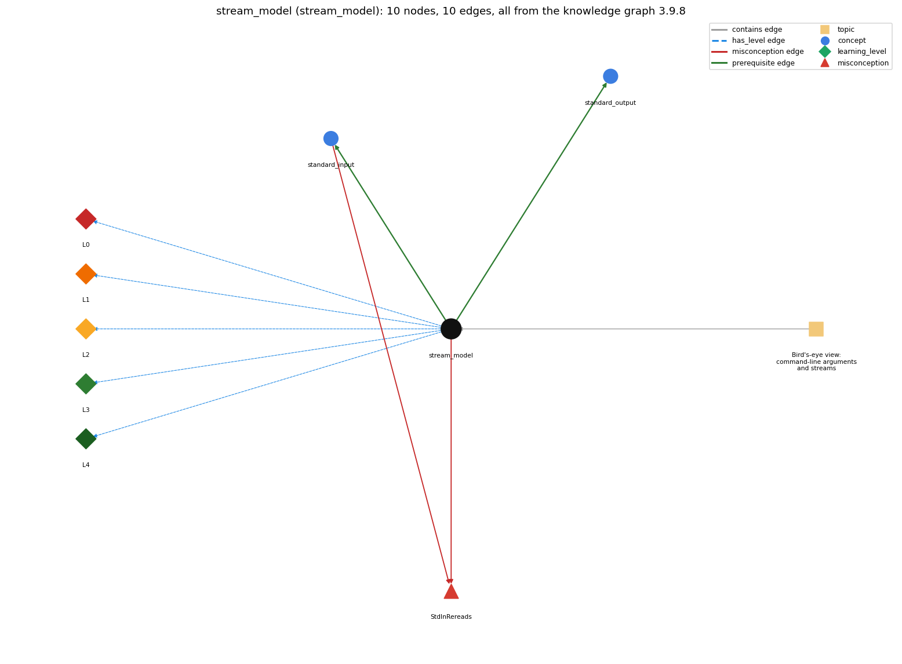

# stream_model (`stream_model`)

input and output as sequential streams

Section 1.5 Input and Output, topic 1.5.a Bird's-eye view: command-line arguments and streams.

## At a glance

- **Needs first:** nothing
- **Leads to:** `standard_input`, `standard_output`
- **Learned alongside:** nothing
- **Misconceptions:** `StdInRereads`
- **Errors:** none
- **Levels:** L0, L1, L2, L3, L4

Everything below comes from the knowledge graph 3.9.8 (`data/raw/chapter1_kg_updated.json`): 10 edges around this concept. The edge logic, the wrong and right rules and the exact rules of the ways are copied word for word from the graph.

## To work on (1)

- no aliases: a student's words cannot name this concept

## What it needs first (0)

A prerequisite edge means the other concept has to be understood before `stream_model`.

No prerequisite edge leads into this concept.

## What it leads to (2)

These concepts need `stream_model` first.

### `stream_model` comes before `standard_input`

*StdIn -- reading a stream of values*

- **Edge:** `pre:stream_model->standard_input`
- **Exact edge logic:** StdIn reads a stream: values arrive in order and each value is consumed once.
- **Grounding:** book\_passage
- **Composition rule (R) of `stream_model` with `standard_input`:** All StdIn calls in a program share one input position. A read before a loop and reads inside the loop therefore take successive values, never the same one.
- **Composition rule (R) of `standard_input` with `stream_model`:** Every StdIn call takes from the same stream position, so values are delivered once, in order.

### `stream_model` comes before `standard_output`

*StdOut / System.out*

- **Edge:** `pre:stream_model->standard_output`
- **Exact edge logic:** StdOut writes a stream: each print appends its text to the end of the output.
- **Grounding:** book\_passage
- **Composition rule (R) of `stream_model` with `standard_output`:** All StdOut/System.out calls write to one output stream in execution order, and text already written cannot be taken back.
- **Composition rule (R) of `standard_output` with `stream_model`:** Each output call appends to the end of the single output stream, so the order of output is the order of execution.

## Learned alongside (0)

A parallel edge joins two concepts that sit side by side: neither is needed before the other.

No parallel edge touches this concept.

## Misconceptions (1)

A misconception edge states the wrong rule a student may hold about this concept, and the right rule.

### StdInRereads

- **Edge:** `stream_model` &rarr; `StdInRereads` (misconception)
- **Exact edge logic (the wrong rule):** Calling StdIn.readInt() twice returns the same value twice.
- **Twin logic (the right rule):** The program consumes values when it reads them, so each call returns the next value.
- **Wrong belief (on the node):** Calling StdIn.readInt() twice returns the same value twice.
- **Correct rule (on the node):** The program consumes values when it reads them, so each call returns the next value.
- **Provenance:** textbook
- **Role of this concept:** context
- **L0 way linked to it:** yes
- **L0 way [1] misconception, exact rule:** wrong rule: Calling StdIn.readInt() twice returns the same value twice. Right rule: Each read consumes the value it returns, so a second StdIn.readInt() returns the next value in the stream (input 3 5 gives 3, then 5).
- **L0 way [2] inconsistent\_trace, exact rule:** Points to LT (reads take values from the front in order; prints append at the end in order). An uneven trace reuses an already-consumed value on some reads, or writes some output out of execution order. (here mixing in: "Calling StdIn.readInt() twice returns the same value twice")
- **Edge `standard_input` &rarr; `StdInRereads`, exact edge logic:** Calling StdIn.readInt() twice returns the same value twice. **Twin logic:** The program consumes values when it reads them, so each call returns the next value. (role: primary)

## Errors (0)

An error edge states the rule that gets broken in a program, and the right rule.

The graph has no error edge from this concept.

## Levels L0 to L4 (5 of 5)

Each level edge lists the ways a student shows that level, each with its exact rule.

### L0: Prestructural / sensorimotor

L0 for stream model: the answer holds a rule that contradicts Java.

*Deciding question: Does every rule the answer applies to stream model agree with the language rule? If it reads the code with everyday meanings, applies a wrong rule, or switches rules within one trace, it is L0. A slip in an otherwise rule-correct trace is L2 with an error, not L0.*

- **Edge:** `stream_model` &rarr; `stream_model@L0` (has_level)
- **Exact edge logic:** stream model -&gt; L0 (Prestructural): the answer holds a rule that contradicts Java (3 ways).

Ways (3), each with its exact rule:

- **[0] everyday\_reading** (rule type E, folk-meaning rule): Everyday 'reading' (a page, a list) leaves the text in place so you can glance back at it; a Java input stream is consumed: each read removes the next value, and there is no going back.
- **[1] misconception** (rule type M, wrong rule / right rule) &rarr; `StdInRereads`: wrong rule: Calling StdIn.readInt() twice returns the same value twice. Right rule: Each read consumes the value it returns, so a second StdIn.readInt() returns the next value in the stream (input 3 5 gives 3, then 5).
- **[2] inconsistent\_trace** (rule type T, uneven-application rule) &rarr; `StdInRereads`: Points to LT (reads take values from the front in order; prints append at the end in order). An uneven trace reuses an already-consumed value on some reads, or writes some output out of execution order. (here mixing in: "Calling StdIn.readInt() twice returns the same value twice")

### L1: Unistructural / atom x text surface

L1 for stream model: the answer states one correct rule without applying it.

*Deciding question: Does the answer cover every part of the code, in order, with the values (L2)? If it covers one part or only states the rule, it is L1.*

- **Edge:** `stream_model` &rarr; `stream_model@L1` (has_level)
- **Exact edge logic:** stream model -&gt; L1 (Unistructural): the answer states one correct rule without applying it (2 ways).

Ways (2), each with its exact rule:

- **[0] names\_the\_element** (rule type N, identity rule): A stream is an I/O abstraction: an ordered sequence of values or characters, with no length limit from the program's point of view. Input is read from the front and output is appended at the end.
- **[1] states\_the\_rule** (rule type S, declarative rule): A Java program turns a standard input stream and command-line arguments into a standard output stream (plus drawing and audio). It consumes values when it reads them, so it cannot back up.

### L2: Multistructural / block x execution / preoperational

L2 for stream model: the answer applies these rules to every part of the code, in order.

*Deciding question: Is the answer many segments mapped onto lines (L2), or one segment stating the purpose of the whole (L3)? A correct output with no value-by-value justification is not levelled.*

- **Edge:** `stream_model` &rarr; `stream_model@L2` (has_level)
- **Exact edge logic:** stream model -&gt; L2 (Multistructural): the answer applies the rules of stream model to every part of the code, in order (3 ways).

Ways (3), each with its exact rule:

- **[0] line\_by\_line\_trace** (rule type LT, operational sequencing rule): Input values are delivered strictly in stream order: each read removes the next value from the front. Output appears in the order the output calls execute, because each call appends to the end.
- **[1] output\_prediction** (rule type OP, evaluation / result rule): A read returns the next unread value, converted to the requested type. With input \`3 5 7\`, three StdIn.readInt() calls return 3, 5, 7. The output stream is the concatenation of all printed text in execution order.
- **[2] one\_step\_execution** (rule type OS, state-transition rule): One read advances the input position past exactly one value and returns it. One print appends its text to the output and returns nothing (void). No other state changes.

### L3: Relational / relations x function (concrete operational begins)

L3 for stream model: the answer relates the parts by these rules.

*Deciding question: Was the purpose deduced from the code, or only guessed from traced input/output pairs (then L2)? Does the answer stay within the given code (L3), or reason about changed code, an error class or a new program (L4)?*

- **Edge:** `stream_model` &rarr; `stream_model@L3` (has_level)
- **Exact edge logic:** stream model -&gt; L3 (Relational): the answer relates the parts (3 ways).

Ways (3), each with its exact rule:

- **[0] relation\_to\_neighbour** (rule type R, composition rule (with a neighbour)): All StdIn calls in a program share one input position. A read before a loop and reads inside the loop therefore take successive values, never the same one.
- **[1] relation\_to\_neighbour** (rule type R, composition rule (with a neighbour)): All StdOut/System.out calls write to one output stream in execution order, and text already written cannot be taken back.
- **[2] purpose\_of\_the\_whole** (rule type P, plan / role rule): Streams let a program process an amount of data that is unbounded and not known in advance. They also decouple the program from the device. Plan: input-process-output (the 'filter' plan).

### L4: Extended abstract (concrete-operational reversibility and conservation)

L4 for stream model: the answer reasons beyond the given code by these rules.

*Deciding question: Does the answer link the code to a broader context: a changed program, a class of inputs, an unseen problem? Re-tracing changed code value by value is L2; fixing one given failing case is L3.*

- **Edge:** `stream_model` &rarr; `stream_model@L4` (has_level)
- **Exact edge logic:** stream model -&gt; L4 (Extended abstract): the answer reasons beyond the given code (4 ways).

Ways (4), each with its exact rule:

- **[0] predict\_a\_change** (rule type C, conservation rule) &rarr; `StdInRereads`: Changing where a stream comes from or goes to (keyboard, file, pipe, another device) keeps the program's behaviour. Changing the order of two reads swaps which value lands in which variable.
- **[1] transfer\_to\_a\_new\_program** (rule type X, applicability rule): Use the stream model when data are processed in one sequential pass, possibly of unknown or huge length. If the program must revisit values (sorting, k-th smallest), first save them in an array.
- **[2] diagnose\_an\_error** (rule type D, error rule): rule broken: A read must be preceded by available input (the stream is finite and cannot be re-read). Kind: run-time exception. Trigger class: More read calls than values in the stream, e.g. reading 3 values from input \`4 7\`.
- **[3] diagnose\_an\_error** (rule type D, error rule): rule broken: Values are consumed once; to use a value again it must be stored in a variable or array. Kind: silent logic error. Trigger class: Code that calls a read a second time expecting the same value (e.g. readInt() in a test and again in the body), so it silently skips values.

## Same topic

`stream_model` belongs to the topic **Bird's-eye view: command-line arguments and streams** (`topic1.5.a`). It is the only concept of that topic.

## Rules of the concept (15)

- **Book** (SW-1e, p. 126 (pdf 136)): "One of the key features of the standard input stream is that your program consumes values when it reads them."
- **Book** (SW-1.5, ): "Our StdIn library takes data from a standard input stream that contains a sequence of values separated by whitespace ... your program consumes values when it reads them."
- **E** (folk-meaning rule): Everyday 'reading' (a page, a list) leaves the text in place so you can glance back at it; a Java input stream is consumed: each read removes the next value, and there is no going back.
- **M** (wrong rule / right rule): StdInRereads: wrong: Calling StdIn.readInt() twice returns the same value twice. \| right: Each read consumes the value it returns, so a second StdIn.readInt() returns the next value in the stream (input 3 5 gives 3, then 5).
- **T** (uneven-application rule): Points to LT (reads take values from the front in order; prints append at the end in order). An uneven trace reuses an already-consumed value on some reads, or writes some output out of execution order.
- **N** (identity rule): A stream is an I/O abstraction: an ordered sequence of values or characters, with no length limit from the program's point of view. Input is read from the front and output is appended at the end.
- **S** (declarative rule): A Java program turns a standard input stream and command-line arguments into a standard output stream (plus drawing and audio). It consumes values when it reads them, so it cannot back up.
- **LT** (operational sequencing rule): Input values are delivered strictly in stream order: each read removes the next value from the front. Output appears in the order the output calls execute, because each call appends to the end.
- **OP** (evaluation / result rule): A read returns the next unread value, converted to the requested type. With input \`3 5 7\`, three StdIn.readInt() calls return 3, 5, 7. The output stream is the concatenation of all printed text in execution order.
- **OS** (state-transition rule): One read advances the input position past exactly one value and returns it. One print appends its text to the output and returns nothing (void). No other state changes.
- **R** (composition rule (with a neighbour)): with standard\_input: All StdIn calls in a program share one input position. A read before a loop and reads inside the loop therefore take successive values, never the same one.
- **R** (composition rule (with a neighbour)): with standard\_output: All StdOut/System.out calls write to one output stream in execution order, and text already written cannot be taken back.
- **P** (plan / role rule): Streams let a program process an amount of data that is unbounded and not known in advance. They also decouple the program from the device. Plan: input-process-output (the 'filter' plan).
- **C** (conservation rule): Changing where a stream comes from or goes to (keyboard, file, pipe, another device) keeps the program's behaviour. Changing the order of two reads swaps which value lands in which variable.
- **D** (error rule): rule broken: A read must be preceded by available input (the stream is finite and cannot be re-read). (run-time exception)
- **D** (error rule): rule broken: Values are consumed once; to use a value again it must be stored in a variable or array. (silent logic error)
- **X** (applicability rule): Use the stream model when data are processed in one sequential pass, possibly of unknown or huge length. If the program must revisit values (sorting, k-th smallest), first save them in an array.

## How it is found in code and answers (reader block)

- **Aliases:** none
- **Code patterns:** `StdIn\.`, `System\.in\b`
- **Operator symbols:** none
- **Java types:** none

## The whole prerequisite chain

- **Everything it builds on (0):** nothing
- **Everything that builds on it (25):** `convergence_rate`, `dangling_pages`, `data_driven_code`, `end_of_input`, `filter`, `formatted_output`, `frequency_counting`, `input_format`, `input_graph`, `input_validation`, `interactive_input`, `markov_chain`, `normalization`, `piping`, `power_method`, `random_move`, `read_loop_idiom`, `redirection`, `sentinel_loop`, `simulation_loop`, `standard_input`, `standard_output`, `token_vs_line_input`, `transition_matrix`, `two_models`

## Every edge in this view and its exact edge logic (10)

All the edges drawn in the picture, in the order: prerequisite, parallel, misconception, error, has_level, contains.

**1. `stream_model` &rarr; `standard_input`** (prerequisite)

- **Exact edge logic:** StdIn reads a stream: values arrive in order and each value is consumed once.
- **Grounding:** book\_passage
- **Composition rule (R) of `stream_model` with `standard_input`:** All StdIn calls in a program share one input position. A read before a loop and reads inside the loop therefore take successive values, never the same one.
- **Composition rule (R) of `standard_input` with `stream_model`:** Every StdIn call takes from the same stream position, so values are delivered once, in order.

**2. `stream_model` &rarr; `standard_output`** (prerequisite)

- **Exact edge logic:** StdOut writes a stream: each print appends its text to the end of the output.
- **Grounding:** book\_passage
- **Composition rule (R) of `stream_model` with `standard_output`:** All StdOut/System.out calls write to one output stream in execution order, and text already written cannot be taken back.
- **Composition rule (R) of `standard_output` with `stream_model`:** Each output call appends to the end of the single output stream, so the order of output is the order of execution.

**3. `stream_model` &rarr; `StdInRereads`** (misconception)

- **Exact edge logic (the wrong rule):** Calling StdIn.readInt() twice returns the same value twice.
- **Twin logic (the right rule):** The program consumes values when it reads them, so each call returns the next value.
- **Role:** context

**4. `standard_input` &rarr; `StdInRereads`** (misconception)

- **Exact edge logic (the wrong rule):** Calling StdIn.readInt() twice returns the same value twice.
- **Twin logic (the right rule):** The program consumes values when it reads them, so each call returns the next value.
- **Role:** primary

**5. `stream_model` &rarr; `stream_model@L0`** (has_level)

- **Exact edge logic:** stream model -&gt; L0 (Prestructural): the answer holds a rule that contradicts Java (3 ways).
  - **[0] everyday\_reading** (rule type E, folk-meaning rule): Everyday 'reading' (a page, a list) leaves the text in place so you can glance back at it; a Java input stream is consumed: each read removes the next value, and there is no going back.
  - **[1] misconception** (rule type M, wrong rule / right rule) &rarr; `StdInRereads`: wrong rule: Calling StdIn.readInt() twice returns the same value twice. Right rule: Each read consumes the value it returns, so a second StdIn.readInt() returns the next value in the stream (input 3 5 gives 3, then 5).
  - **[2] inconsistent\_trace** (rule type T, uneven-application rule) &rarr; `StdInRereads`: Points to LT (reads take values from the front in order; prints append at the end in order). An uneven trace reuses an already-consumed value on some reads, or writes some output out of execution order. (here mixing in: "Calling StdIn.readInt() twice returns the same value twice")

**6. `stream_model` &rarr; `stream_model@L1`** (has_level)

- **Exact edge logic:** stream model -&gt; L1 (Unistructural): the answer states one correct rule without applying it (2 ways).
  - **[0] names\_the\_element** (rule type N, identity rule): A stream is an I/O abstraction: an ordered sequence of values or characters, with no length limit from the program's point of view. Input is read from the front and output is appended at the end.
  - **[1] states\_the\_rule** (rule type S, declarative rule): A Java program turns a standard input stream and command-line arguments into a standard output stream (plus drawing and audio). It consumes values when it reads them, so it cannot back up.

**7. `stream_model` &rarr; `stream_model@L2`** (has_level)

- **Exact edge logic:** stream model -&gt; L2 (Multistructural): the answer applies the rules of stream model to every part of the code, in order (3 ways).
  - **[0] line\_by\_line\_trace** (rule type LT, operational sequencing rule): Input values are delivered strictly in stream order: each read removes the next value from the front. Output appears in the order the output calls execute, because each call appends to the end.
  - **[1] output\_prediction** (rule type OP, evaluation / result rule): A read returns the next unread value, converted to the requested type. With input \`3 5 7\`, three StdIn.readInt() calls return 3, 5, 7. The output stream is the concatenation of all printed text in execution order.
  - **[2] one\_step\_execution** (rule type OS, state-transition rule): One read advances the input position past exactly one value and returns it. One print appends its text to the output and returns nothing (void). No other state changes.

**8. `stream_model` &rarr; `stream_model@L3`** (has_level)

- **Exact edge logic:** stream model -&gt; L3 (Relational): the answer relates the parts (3 ways).
  - **[0] relation\_to\_neighbour** (rule type R, composition rule (with a neighbour)): All StdIn calls in a program share one input position. A read before a loop and reads inside the loop therefore take successive values, never the same one.
  - **[1] relation\_to\_neighbour** (rule type R, composition rule (with a neighbour)): All StdOut/System.out calls write to one output stream in execution order, and text already written cannot be taken back.
  - **[2] purpose\_of\_the\_whole** (rule type P, plan / role rule): Streams let a program process an amount of data that is unbounded and not known in advance. They also decouple the program from the device. Plan: input-process-output (the 'filter' plan).

**9. `stream_model` &rarr; `stream_model@L4`** (has_level)

- **Exact edge logic:** stream model -&gt; L4 (Extended abstract): the answer reasons beyond the given code (4 ways).
  - **[0] predict\_a\_change** (rule type C, conservation rule) &rarr; `StdInRereads`: Changing where a stream comes from or goes to (keyboard, file, pipe, another device) keeps the program's behaviour. Changing the order of two reads swaps which value lands in which variable.
  - **[1] transfer\_to\_a\_new\_program** (rule type X, applicability rule): Use the stream model when data are processed in one sequential pass, possibly of unknown or huge length. If the program must revisit values (sorting, k-th smallest), first save them in an array.
  - **[2] diagnose\_an\_error** (rule type D, error rule): rule broken: A read must be preceded by available input (the stream is finite and cannot be re-read). Kind: run-time exception. Trigger class: More read calls than values in the stream, e.g. reading 3 values from input \`4 7\`.
  - **[3] diagnose\_an\_error** (rule type D, error rule): rule broken: Values are consumed once; to use a value again it must be stored in a variable or array. Kind: silent logic error. Trigger class: Code that calls a read a second time expecting the same value (e.g. readInt() in a test and again in the body), so it silently skips values.

**10. `topic1.5.a` &rarr; `stream_model`** (contains)

- topic `topic1.5.a` contains `stream_model`
