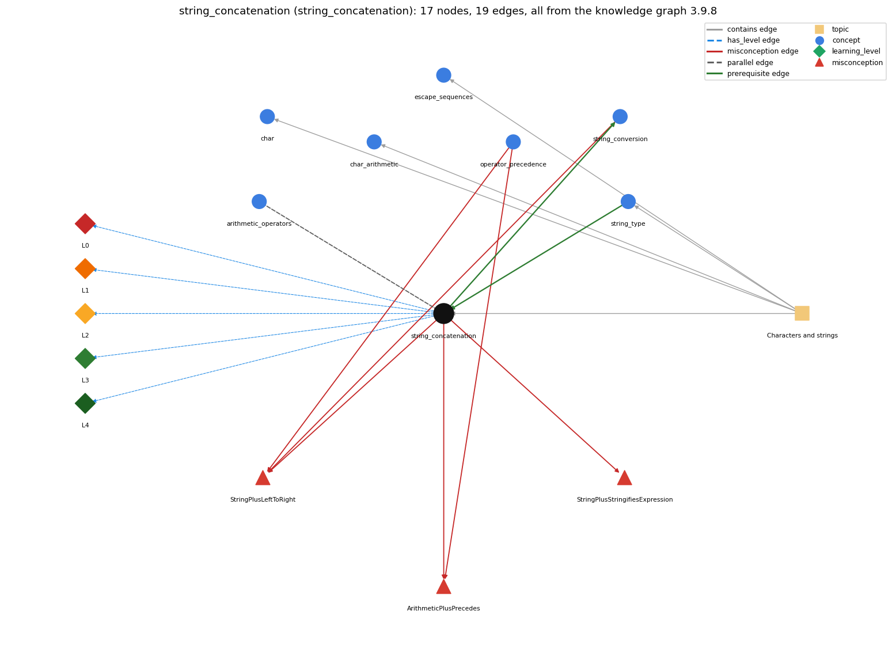

# string_concatenation (`string_concatenation`)

+ with a String builds a new string

Section 1.2 Built-in Types of Data, topic 1.2.b Characters and strings.

## At a glance

- **Needs first:** `string_type`
- **Leads to:** `string_conversion`
- **Learned alongside:** `arithmetic_operators`
- **Misconceptions:** `ArithmeticPlusPrecedes`, `StringPlusLeftToRight`, `StringPlusStringifiesExpression`
- **Errors:** none
- **Levels:** L0, L1, L2, L3, L4

Everything below comes from the knowledge graph 3.9.8 (`data/raw/chapter1_kg_updated.json`): 19 edges around this concept. The edge logic, the wrong and right rules and the exact rules of the ways are copied word for word from the graph.

## To work on (0)

Nothing is missing for this concept.

## What it needs first (1)

A prerequisite edge means the other concept has to be understood before `string_concatenation`.

### `string_type` comes before `string_concatenation`

*String -- a reference type, not a primitive*

- **Edge:** `pre:string_type->string_concatenation`
- **Exact edge logic:** + builds a new String whenever at least one of its operands is a String.
- **Grounding:** book\_passage
- **Composition rule (R) of `string_concatenation` with `string_type`:** Concatenation always yields a String, even when one operand is a number, so its result cannot be used in arithmetic without parsing.
- **Composition rule (R) of `string_type` with `string_concatenation`:** + produces a new String whenever at least one operand is a String; the other operand is converted to text first.

## What it leads to (1)

These concepts need `string_concatenation` first.

### `string_concatenation` comes before `string_conversion`

*+ with a String converts the other operand to text*

- **Edge:** `pre:string_concatenation->string_conversion`
- **Exact edge logic:** When one operand of + is a String, Java converts the other operand to a String before concatenating.
- **Grounding:** book\_passage
- **Composition rule (R) of `string_concatenation` with `string_conversion`:** The non-String operand is converted to its printed form (int 99 to "99", double 1.0 to "1.0", char 'a' to "a") before joining.
- **Composition rule (R) of `string_conversion` with `string_concatenation`:** Conversion happens first, then concatenation: the non-String operand is turned into its characters before the two Strings are joined.

## Learned alongside (1)

A parallel edge joins two concepts that sit side by side: neither is needed before the other.

### `string_concatenation` alongside `arithmetic_operators`

*+ - \* / %*

- **Edge:** `par:string_concatenation~arithmetic_operators`
- **Exact edge logic:** + adds when both operands are numbers and concatenates when either operand is a String, converting the other operand to a String. It is left-associative, so 1 + 2 + "3" is "33" but "1" + 2 + 3 is "123".
- **Grounding:** book\_passage

## Misconceptions (3)

A misconception edge states the wrong rule a student may hold about this concept, and the right rule.

### ArithmeticPlusPrecedes

- **Edge:** `string_concatenation` &rarr; `ArithmeticPlusPrecedes` (misconception)
- **Exact edge logic (the wrong rule):** In "s" + a + b, the numbers a and b are added first and their sum is joined to s.
- **Twin logic (the right rule):** Both uses of + have the same precedence and are evaluated left to right, so "s" + a + b joins a and then b as text; only "s" + (a + b) adds them first.
- **Wrong belief (on the node):** arithmetic + binds tighter than string-concatenation +
- **Correct rule (on the node):** Both uses of + have the same precedence and are evaluated left to right, so "s" + a + b joins a and then b as text; only "s" + (a + b) adds them first.
- **Provenance:** published
- **Role of this concept:** primary
- **L0 way linked to it:** yes
- **L0 way [4] misconception, exact rule:** wrong rule: arithmetic + binds tighter than string-concatenation +. Right rule: Both uses of + have the same precedence and are evaluated left to right, so "s" + a + b joins a and then b as text; only "s" + (a + b) adds them first.
- **Edge `operator_precedence` &rarr; `ArithmeticPlusPrecedes`, exact edge logic:** In "s" + a + b, the numbers a and b are added first and their sum is joined to s. **Twin logic:** Both uses of + have the same precedence and are evaluated left to right, so "s" + a + b joins a and then b as text; only "s" + (a + b) adds them first. (role: context)

### StringPlusLeftToRight

- **Edge:** `string_concatenation` &rarr; `StringPlusLeftToRight` (misconception)
- **Exact edge logic (the wrong rule):** 2 + 3 + "bc" and "bc" + 2 + 3 give the same text.
- **Twin logic (the right rule):** + is evaluated left to right: 2 + 3 + "bc" is "5bc" but "bc" + 2 + 3 is "bc23".
- **Wrong belief (on the node):** 2 + 3 + "bc" and "bc" + 2 + 3 give the same text.
- **Correct rule (on the node):** + is evaluated left to right: 2 + 3 + "bc" is "5bc" but "bc" + 2 + 3 is "bc23".
- **Provenance:** textbook
- **Role of this concept:** context
- **L0 way linked to it:** yes
- **L0 way [2] misconception, exact rule:** wrong rule: 2 + 3 + "bc" and "bc" + 2 + 3 give the same text. Right rule: + is evaluated left to right: 2 + 3 + "bc" is "5bc" but "bc" + 2 + 3 is "bc23".
- **Edge `operator_precedence` &rarr; `StringPlusLeftToRight`, exact edge logic:** 2 + 3 + "bc" and "bc" + 2 + 3 give the same text. **Twin logic:** + is evaluated left to right: 2 + 3 + "bc" is "5bc" but "bc" + 2 + 3 is "bc23". (role: context)
- **Edge `string_conversion` &rarr; `StringPlusLeftToRight`, exact edge logic:** 2 + 3 + "bc" and "bc" + 2 + 3 give the same text. **Twin logic:** + is evaluated left to right: 2 + 3 + "bc" is "5bc" but "bc" + 2 + 3 is "bc23". (role: primary)

### StringPlusStringifiesExpression

- **Edge:** `string_concatenation` &rarr; `StringPlusStringifiesExpression` (misconception)
- **Exact edge logic (the wrong rule):** In "s" + (a + b), the text a + b is joined to s instead of its value.
- **Twin logic (the right rule):** The expression (a + b) is evaluated first, and its value is then turned into text and joined to s.
- **Wrong belief (on the node):** + with a String turns the whole other side into a string first
- **Correct rule (on the node):** The expression (a + b) is evaluated first, and its value is then turned into text and joined to s.
- **Provenance:** published
- **Role of this concept:** primary
- **L0 way linked to it:** yes
- **L0 way [1] misconception, exact rule:** wrong rule: + with a String turns the whole other side into a string first. Right rule: The expression (a + b) is evaluated first, and its value is then turned into text and joined to s.
- **L0 way [3] inconsistent\_trace, exact rule:** Points to LT (left to right, and each + adds or concatenates according to its operands at that moment). Applied unevenly, a student keeps adding numbers after a String has appeared, or concatenates before any String appears (1 + 2 + "x" as "12x"). (here mixing in: "+ with a String turns the whole other side into a string first")

## Errors (0)

An error edge states the rule that gets broken in a program, and the right rule.

The graph has no error edge from this concept.

## Levels L0 to L4 (5 of 5)

Each level edge lists the ways a student shows that level, each with its exact rule.

### L0: Prestructural / sensorimotor

L0 for string concatenation: the answer holds a rule that contradicts Java.

*Deciding question: Does every rule the answer applies to string concatenation agree with the language rule? If it reads the code with everyday meanings, applies a wrong rule, or switches rules within one trace, it is L0. A slip in an otherwise rule-correct trace is L2 with an error, not L0.*

- **Edge:** `string_concatenation` &rarr; `string_concatenation@L0` (has_level)
- **Exact edge logic:** string concatenation -&gt; L0 (Prestructural): the answer holds a rule that contradicts Java (5 ways).

Ways (5), each with its exact rule:

- **[0] everyday\_reading** (rule type E, folk-meaning rule): In arithmetic, + always means 'add', and 'plus' combines quantities, so novices expect "1" + 2 to be 3. In Java, + with a String operand joins text end to end, and a chain of + is processed left to right, one operator at a time.
- **[1] misconception** (rule type M, wrong rule / right rule) &rarr; `StringPlusStringifiesExpression`: wrong rule: + with a String turns the whole other side into a string first. Right rule: The expression (a + b) is evaluated first, and its value is then turned into text and joined to s.
- **[2] misconception** (rule type M, wrong rule / right rule) &rarr; `StringPlusLeftToRight`: wrong rule: 2 + 3 + "bc" and "bc" + 2 + 3 give the same text. Right rule: + is evaluated left to right: 2 + 3 + "bc" is "5bc" but "bc" + 2 + 3 is "bc23".
- **[3] inconsistent\_trace** (rule type T, uneven-application rule) &rarr; `StringPlusStringifiesExpression`: Points to LT (left to right, and each + adds or concatenates according to its operands at that moment). Applied unevenly, a student keeps adding numbers after a String has appeared, or concatenates before any String appears (1 + 2 + "x" as "12x"). (here mixing in: "+ with a String turns the whole other side into a string first")
- **[4] misconception** (rule type M, wrong rule / right rule) &rarr; `ArithmeticPlusPrecedes`: wrong rule: arithmetic + binds tighter than string-concatenation +. Right rule: Both uses of + have the same precedence and are evaluated left to right, so "s" + a + b joins a and then b as text; only "s" + (a + b) adds them first.

### L1: Unistructural / atom x text surface

L1 for string concatenation: the answer states one correct rule without applying it.

*Deciding question: Does the answer cover every part of the code, in order, with the values (L2)? If it covers one part or only states the rule, it is L1.*

- **Edge:** `string_concatenation` &rarr; `string_concatenation@L1` (has_level)
- **Exact edge logic:** string concatenation -&gt; L1 (Unistructural): the answer states one correct rule without applying it (2 ways).

Ways (2), each with its exact rule:

- **[0] names\_the\_element** (rule type N, identity rule): String concatenation: the + operator with a String operand, which joins two values end to end into a new String.
- **[1] states\_the\_rule** (rule type S, declarative rule): If either operand of + is a String, the other is converted to a String, and the result is a new String made of the first operand's characters followed by the second's.

### L2: Multistructural / block x execution / preoperational

L2 for string concatenation: the answer applies these rules to every part of the code, in order.

*Deciding question: Is the answer many segments mapped onto lines (L2), or one segment stating the purpose of the whole (L3)? A correct output with no value-by-value justification is not levelled.*

- **Edge:** `string_concatenation` &rarr; `string_concatenation@L2` (has_level)
- **Exact edge logic:** string concatenation -&gt; L2 (Multistructural): the answer applies the rules of string concatenation to every part of the code, in order (3 ways).

Ways (3), each with its exact rule:

- **[0] line\_by\_line\_trace** (rule type LT, operational sequencing rule): A chain of + is evaluated left to right, after any parenthesized parts. At each + the current operand types decide: two numbers are added, otherwise the values are concatenated.
- **[1] output\_prediction** (rule type OP, evaluation / result rule): The result is a String: 2 + "bc" is "2bc", 2 + 3 + "bc" is "5bc", "bc" + 2 + 3 is "bc23", and "bc" + (2+3) is "bc5".
- **[2] one\_step\_execution** (rule type OS, state-transition rule): Concatenation creates a new String and changes no operand. A variable changes only if the result is assigned, as in ruler = ruler + i + ruler;.

### L3: Relational / relations x function (concrete operational begins)

L3 for string concatenation: the answer relates the parts by these rules.

*Deciding question: Was the purpose deduced from the code, or only guessed from traced input/output pairs (then L2)? Does the answer stay within the given code (L3), or reason about changed code, an error class or a new program (L4)?*

- **Edge:** `string_concatenation` &rarr; `string_concatenation@L3` (has_level)
- **Exact edge logic:** string concatenation -&gt; L3 (Relational): the answer relates the parts (4 ways).

Ways (4), each with its exact rule:

- **[0] relation\_to\_neighbour** (rule type R, composition rule (with a neighbour)): Concatenation always yields a String, even when one operand is a number, so its result cannot be used in arithmetic without parsing.
- **[1] relation\_to\_neighbour** (rule type R, composition rule (with a neighbour)): The non-String operand is converted to its printed form (int 99 to "99", double 1.0 to "1.0", char 'a' to "a") before joining.
- **[2] relation\_to\_neighbour** (rule type R, composition rule (with a neighbour)): + adds when both operands are numbers and concatenates when either operand is a String, converting the other operand to a String. It is left-associative, so 1 + 2 + "3" is "33" but "1" + 2 + 3 is "123".
- **[3] purpose\_of\_the\_whole** (rule type P, plan / role rule): Concatenation builds output lines and labels from computed values (a + " + " + b + " = " + c). Repeated s = s + piece makes s a gatherer of text.

### L4: Extended abstract (concrete-operational reversibility and conservation)

L4 for string concatenation: the answer reasons beyond the given code by these rules.

*Deciding question: Does the answer link the code to a broader context: a changed program, a class of inputs, an unseen problem? Re-tracing changed code value by value is L2; fixing one given failing case is L3.*

- **Edge:** `string_concatenation` &rarr; `string_concatenation@L4` (has_level)
- **Exact edge logic:** string concatenation -&gt; L4 (Extended abstract): the answer reasons beyond the given code (5 ways).

Ways (5), each with its exact rule:

- **[0] predict\_a\_change** (rule type C, conservation rule) &rarr; `StringPlusStringifiesExpression`: Parenthesizing numeric parts changes the result ("sum " + (a + b) adds before joining). Moving numbers before or after the first String changes whether they are added. Concatenating into a printf format string removes the separate argument printf needs.
- **[1] transfer\_to\_a\_new\_program** (rule type X, applicability rule): Use + concatenation for simple output and labels, putting parentheses around any arithmetic inside. Use printf when numbers need formatting, and parse Strings before using them as numbers.
- **[2] diagnose\_an\_error** (rule type D, error rule): rule broken: Once a String appears in a + chain, every later + concatenates. Kind: silent logic error. Trigger class: "Sum: " + a + b with numbers a and b prints both digit strings side by side (e.g. Sum: 23).
- **[3] diagnose\_an\_error** (rule type D, error rule): rule broken: char + char is numeric addition, not concatenation. Kind: silent logic error. Trigger class: Joining two chars with + when no String is involved ('b' + 'c' prints 197).
- **[4] diagnose\_an\_error** (rule type D, error rule): rule broken: printf needs its values as separate arguments matching the format specifiers. Kind: run-time exception. Trigger class: Concatenating the value into the format (printf("inches = %d" + inch)): MissingFormatArgumentException.

## Same topic

`string_concatenation` belongs to the topic **Characters and strings** (`topic1.2.b`). The topic also contains: `char`, `char_arithmetic`, `escape_sequences`, `string_type`.

## Rules of the concept (18)

- **Book** (SW-1e, p. 19 (pdf 29)): "the concatenation operator (+) that we just considered is built in to the language as a binary operator in the same way as familiar operations on numbers."
- **Book** (OT-Op1, ): "The + operator can also be used for concatenating (joining) two strings together"
- **Book** (SW-1.2, ): "The most common operation that we perform on strings is known as concatenation."
- **E** (folk-meaning rule): In arithmetic, + always means 'add', and 'plus' combines quantities, so novices expect "1" + 2 to be 3. In Java, + with a String operand joins text end to end, and a chain of + is processed left to right, one operator at a time.
- **M** (wrong rule / right rule): ArithmeticPlusPrecedes: wrong: arithmetic + binds tighter than string-concatenation + \| right: Both uses of + have the same precedence and are evaluated left to right, so "s" + a + b joins a and then b as text; only "s" + (a + b) adds them first.
- **M** (wrong rule / right rule): StringPlusLeftToRight: wrong: 2 + 3 + "bc" and "bc" + 2 + 3 give the same text. \| right: + is evaluated left to right: 2 + 3 + "bc" is "5bc" but "bc" + 2 + 3 is "bc23".
- **M** (wrong rule / right rule): StringPlusStringifiesExpression: wrong: + with a String turns the whole other side into a string first \| right: The expression (a + b) is evaluated first, and its value is then turned into text and joined to s.
- **T** (uneven-application rule): Points to LT (left to right, and each + adds or concatenates according to its operands at that moment). Applied unevenly, a student keeps adding numbers after a String has appeared, or concatenates before any String appears (1 + 2 + "x" as "12x").
- **N** (identity rule): String concatenation: the + operator with a String operand, which joins two values end to end into a new String.
- **S** (declarative rule): If either operand of + is a String, the other is converted to a String, and the result is a new String made of the first operand's characters followed by the second's.
- **LT** (operational sequencing rule): A chain of + is evaluated left to right, after any parenthesized parts. At each + the current operand types decide: two numbers are added, otherwise the values are concatenated.
- **OP** (evaluation / result rule): The result is a String: 2 + "bc" is "2bc", 2 + 3 + "bc" is "5bc", "bc" + 2 + 3 is "bc23", and "bc" + (2+3) is "bc5".
- **OS** (state-transition rule): Concatenation creates a new String and changes no operand. A variable changes only if the result is assigned, as in ruler = ruler + i + ruler;.
- **R** (composition rule (with a neighbour)): with string\_type: Concatenation always yields a String, even when one operand is a number, so its result cannot be used in arithmetic without parsing.
- **R** (composition rule (with a neighbour)): with string\_conversion: The non-String operand is converted to its printed form (int 99 to "99", double 1.0 to "1.0", char 'a' to "a") before joining.
- **P** (plan / role rule): Concatenation builds output lines and labels from computed values (a + " + " + b + " = " + c). Repeated s = s + piece makes s a gatherer of text.
- **C** (conservation rule): Parenthesizing numeric parts changes the result ("sum " + (a + b) adds before joining). Moving numbers before or after the first String changes whether they are added. Concatenating into a printf format string removes the separate argument printf needs.
- **D** (error rule): rule broken: Once a String appears in a + chain, every later + concatenates. (silent logic error)
- **D** (error rule): rule broken: char + char is numeric addition, not concatenation. (silent logic error)
- **D** (error rule): rule broken: printf needs its values as separate arguments matching the format specifiers. (run-time exception)
- **X** (applicability rule): Use + concatenation for simple output and labels, putting parentheses around any arithmetic inside. Use printf when numbers need formatting, and parse Strings before using them as numbers.

## How it is found in code and answers (reader block)

- **Aliases:** concatenation, concatenate, concatenates, joins, glue
- **Code patterns:** `\"(?:\\.|[^\"\\])*\"\s*\+|\+\s*\"(?:\\.|[^\"\\])*\"`, `\+=\s*\"(?:\\.|[^\"\\])*\"`
- **Operator symbols:** none
- **Java types:** none

## The whole prerequisite chain

- **Everything it builds on (1):** `string_type`
- **Everything that builds on it (1):** `string_conversion`

## Every edge in this view and its exact edge logic (19)

All the edges drawn in the picture, in the order: prerequisite, parallel, misconception, error, has_level, contains.

**1. `string_concatenation` &rarr; `string_conversion`** (prerequisite)

- **Exact edge logic:** When one operand of + is a String, Java converts the other operand to a String before concatenating.
- **Grounding:** book\_passage
- **Composition rule (R) of `string_concatenation` with `string_conversion`:** The non-String operand is converted to its printed form (int 99 to "99", double 1.0 to "1.0", char 'a' to "a") before joining.
- **Composition rule (R) of `string_conversion` with `string_concatenation`:** Conversion happens first, then concatenation: the non-String operand is turned into its characters before the two Strings are joined.

**2. `string_type` &rarr; `string_concatenation`** (prerequisite)

- **Exact edge logic:** + builds a new String whenever at least one of its operands is a String.
- **Grounding:** book\_passage
- **Composition rule (R) of `string_type` with `string_concatenation`:** + produces a new String whenever at least one operand is a String; the other operand is converted to text first.
- **Composition rule (R) of `string_concatenation` with `string_type`:** Concatenation always yields a String, even when one operand is a number, so its result cannot be used in arithmetic without parsing.

**3. `string_concatenation` &harr; `arithmetic_operators`** (parallel)

- **Exact edge logic:** + adds when both operands are numbers and concatenates when either operand is a String, converting the other operand to a String. It is left-associative, so 1 + 2 + "3" is "33" but "1" + 2 + 3 is "123".
- **Grounding:** book\_passage

**4. `string_concatenation` &rarr; `ArithmeticPlusPrecedes`** (misconception)

- **Exact edge logic (the wrong rule):** In "s" + a + b, the numbers a and b are added first and their sum is joined to s.
- **Twin logic (the right rule):** Both uses of + have the same precedence and are evaluated left to right, so "s" + a + b joins a and then b as text; only "s" + (a + b) adds them first.
- **Role:** primary

**5. `string_concatenation` &rarr; `StringPlusLeftToRight`** (misconception)

- **Exact edge logic (the wrong rule):** 2 + 3 + "bc" and "bc" + 2 + 3 give the same text.
- **Twin logic (the right rule):** + is evaluated left to right: 2 + 3 + "bc" is "5bc" but "bc" + 2 + 3 is "bc23".
- **Role:** context

**6. `string_concatenation` &rarr; `StringPlusStringifiesExpression`** (misconception)

- **Exact edge logic (the wrong rule):** In "s" + (a + b), the text a + b is joined to s instead of its value.
- **Twin logic (the right rule):** The expression (a + b) is evaluated first, and its value is then turned into text and joined to s.
- **Role:** primary

**7. `operator_precedence` &rarr; `ArithmeticPlusPrecedes`** (misconception)

- **Exact edge logic (the wrong rule):** In "s" + a + b, the numbers a and b are added first and their sum is joined to s.
- **Twin logic (the right rule):** Both uses of + have the same precedence and are evaluated left to right, so "s" + a + b joins a and then b as text; only "s" + (a + b) adds them first.
- **Role:** context

**8. `operator_precedence` &rarr; `StringPlusLeftToRight`** (misconception)

- **Exact edge logic (the wrong rule):** 2 + 3 + "bc" and "bc" + 2 + 3 give the same text.
- **Twin logic (the right rule):** + is evaluated left to right: 2 + 3 + "bc" is "5bc" but "bc" + 2 + 3 is "bc23".
- **Role:** context

**9. `string_conversion` &rarr; `StringPlusLeftToRight`** (misconception)

- **Exact edge logic (the wrong rule):** 2 + 3 + "bc" and "bc" + 2 + 3 give the same text.
- **Twin logic (the right rule):** + is evaluated left to right: 2 + 3 + "bc" is "5bc" but "bc" + 2 + 3 is "bc23".
- **Role:** primary

**10. `string_concatenation` &rarr; `string_concatenation@L0`** (has_level)

- **Exact edge logic:** string concatenation -&gt; L0 (Prestructural): the answer holds a rule that contradicts Java (5 ways).
  - **[0] everyday\_reading** (rule type E, folk-meaning rule): In arithmetic, + always means 'add', and 'plus' combines quantities, so novices expect "1" + 2 to be 3. In Java, + with a String operand joins text end to end, and a chain of + is processed left to right, one operator at a time.
  - **[1] misconception** (rule type M, wrong rule / right rule) &rarr; `StringPlusStringifiesExpression`: wrong rule: + with a String turns the whole other side into a string first. Right rule: The expression (a + b) is evaluated first, and its value is then turned into text and joined to s.
  - **[2] misconception** (rule type M, wrong rule / right rule) &rarr; `StringPlusLeftToRight`: wrong rule: 2 + 3 + "bc" and "bc" + 2 + 3 give the same text. Right rule: + is evaluated left to right: 2 + 3 + "bc" is "5bc" but "bc" + 2 + 3 is "bc23".
  - **[3] inconsistent\_trace** (rule type T, uneven-application rule) &rarr; `StringPlusStringifiesExpression`: Points to LT (left to right, and each + adds or concatenates according to its operands at that moment). Applied unevenly, a student keeps adding numbers after a String has appeared, or concatenates before any String appears (1 + 2 + "x" as "12x"). (here mixing in: "+ with a String turns the whole other side into a string first")
  - **[4] misconception** (rule type M, wrong rule / right rule) &rarr; `ArithmeticPlusPrecedes`: wrong rule: arithmetic + binds tighter than string-concatenation +. Right rule: Both uses of + have the same precedence and are evaluated left to right, so "s" + a + b joins a and then b as text; only "s" + (a + b) adds them first.

**11. `string_concatenation` &rarr; `string_concatenation@L1`** (has_level)

- **Exact edge logic:** string concatenation -&gt; L1 (Unistructural): the answer states one correct rule without applying it (2 ways).
  - **[0] names\_the\_element** (rule type N, identity rule): String concatenation: the + operator with a String operand, which joins two values end to end into a new String.
  - **[1] states\_the\_rule** (rule type S, declarative rule): If either operand of + is a String, the other is converted to a String, and the result is a new String made of the first operand's characters followed by the second's.

**12. `string_concatenation` &rarr; `string_concatenation@L2`** (has_level)

- **Exact edge logic:** string concatenation -&gt; L2 (Multistructural): the answer applies the rules of string concatenation to every part of the code, in order (3 ways).
  - **[0] line\_by\_line\_trace** (rule type LT, operational sequencing rule): A chain of + is evaluated left to right, after any parenthesized parts. At each + the current operand types decide: two numbers are added, otherwise the values are concatenated.
  - **[1] output\_prediction** (rule type OP, evaluation / result rule): The result is a String: 2 + "bc" is "2bc", 2 + 3 + "bc" is "5bc", "bc" + 2 + 3 is "bc23", and "bc" + (2+3) is "bc5".
  - **[2] one\_step\_execution** (rule type OS, state-transition rule): Concatenation creates a new String and changes no operand. A variable changes only if the result is assigned, as in ruler = ruler + i + ruler;.

**13. `string_concatenation` &rarr; `string_concatenation@L3`** (has_level)

- **Exact edge logic:** string concatenation -&gt; L3 (Relational): the answer relates the parts (4 ways).
  - **[0] relation\_to\_neighbour** (rule type R, composition rule (with a neighbour)): Concatenation always yields a String, even when one operand is a number, so its result cannot be used in arithmetic without parsing.
  - **[1] relation\_to\_neighbour** (rule type R, composition rule (with a neighbour)): The non-String operand is converted to its printed form (int 99 to "99", double 1.0 to "1.0", char 'a' to "a") before joining.
  - **[2] relation\_to\_neighbour** (rule type R, composition rule (with a neighbour)): + adds when both operands are numbers and concatenates when either operand is a String, converting the other operand to a String. It is left-associative, so 1 + 2 + "3" is "33" but "1" + 2 + 3 is "123".
  - **[3] purpose\_of\_the\_whole** (rule type P, plan / role rule): Concatenation builds output lines and labels from computed values (a + " + " + b + " = " + c). Repeated s = s + piece makes s a gatherer of text.

**14. `string_concatenation` &rarr; `string_concatenation@L4`** (has_level)

- **Exact edge logic:** string concatenation -&gt; L4 (Extended abstract): the answer reasons beyond the given code (5 ways).
  - **[0] predict\_a\_change** (rule type C, conservation rule) &rarr; `StringPlusStringifiesExpression`: Parenthesizing numeric parts changes the result ("sum " + (a + b) adds before joining). Moving numbers before or after the first String changes whether they are added. Concatenating into a printf format string removes the separate argument printf needs.
  - **[1] transfer\_to\_a\_new\_program** (rule type X, applicability rule): Use + concatenation for simple output and labels, putting parentheses around any arithmetic inside. Use printf when numbers need formatting, and parse Strings before using them as numbers.
  - **[2] diagnose\_an\_error** (rule type D, error rule): rule broken: Once a String appears in a + chain, every later + concatenates. Kind: silent logic error. Trigger class: "Sum: " + a + b with numbers a and b prints both digit strings side by side (e.g. Sum: 23).
  - **[3] diagnose\_an\_error** (rule type D, error rule): rule broken: char + char is numeric addition, not concatenation. Kind: silent logic error. Trigger class: Joining two chars with + when no String is involved ('b' + 'c' prints 197).
  - **[4] diagnose\_an\_error** (rule type D, error rule): rule broken: printf needs its values as separate arguments matching the format specifiers. Kind: run-time exception. Trigger class: Concatenating the value into the format (printf("inches = %d" + inch)): MissingFormatArgumentException.

**15. `topic1.2.b` &rarr; `string_concatenation`** (contains)

- topic `topic1.2.b` contains `string_concatenation`

**16. `topic1.2.b` &rarr; `char`** (contains)

- topic `topic1.2.b` contains `char`

**17. `topic1.2.b` &rarr; `char_arithmetic`** (contains)

- topic `topic1.2.b` contains `char_arithmetic`

**18. `topic1.2.b` &rarr; `escape_sequences`** (contains)

- topic `topic1.2.b` contains `escape_sequences`

**19. `topic1.2.b` &rarr; `string_type`** (contains)

- topic `topic1.2.b` contains `string_type`
