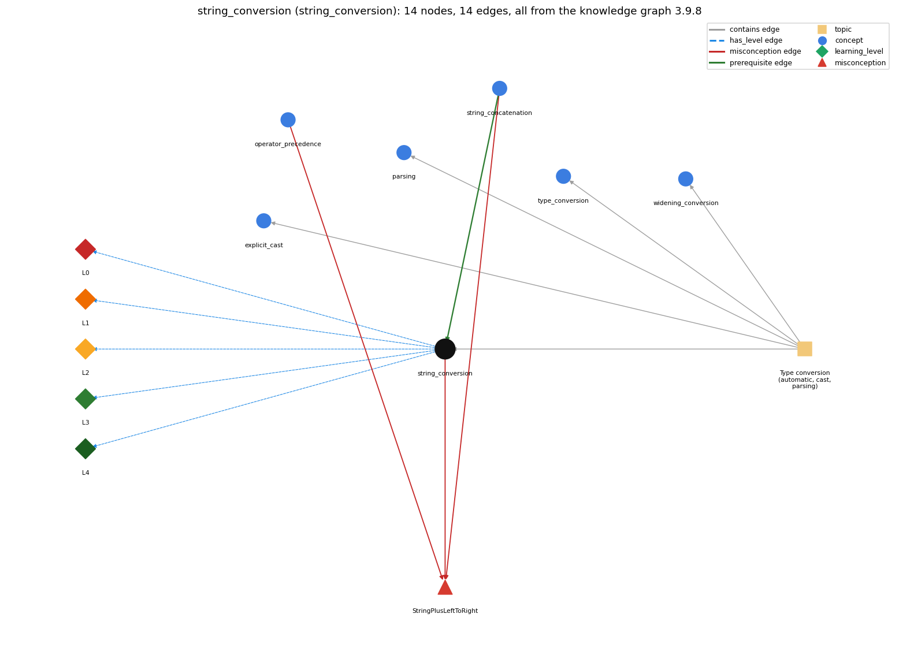

# string_conversion (`string_conversion`)

+ with a String converts the other operand to text

Section 1.2 Built-in Types of Data, topic 1.2.h Type conversion (automatic, cast, parsing). From the knowledge graph 3.9.8 (`data/raw/chapter1_kg_updated.json`).

## Concepts associated with string\_conversion (6)

| Concept | Description | How it is associated |
| --- | --- | --- |
| **explicit\_cast** | (int) x -- converts between numeric types, truncating toward zero | same topic (topic1.2.h) |
| **operator\_precedence** | the order operators bind in an expression | shares misconception StringPlusLeftToRight |
| **parsing** | Integer.parseInt / Double.parseDouble turn text into numbers | same topic (topic1.2.h) |
| **string\_concatenation** | + with a String builds a new string | prerequisite of it (it needs this) composition rule (R) with it shares misconception StringPlusLeftToRight |
| **type\_conversion** | implicit widening and explicit (cast) | same topic (topic1.2.h) |
| **widening\_conversion** | automatic conversion to a type with a larger range | same topic (topic1.2.h) |

## Every edge in this view and its full label (14)

| From | Edge | To | Full edge label |
| --- | --- | --- | --- |
| **string\_concatenation** | prerequisite | **string\_conversion** | When one operand of + is a String, Java converts the other operand to a String before concatenating. grounding: book\_passage composition rule (R) of string\_concatenation with string\_conversion: The non-String operand is converted to its printed form (int 99 to "99", double 1.0 to "1.0", char 'a' to "a") before joining. composition rule (R) of string\_conversion with string\_concatenation: Conversion happens first, then concatenation: the non-String operand is turned into its characters before the two Strings are joined. |
| **operator\_precedence** | misconception | **StringPlusLeftToRight** | **wrong rule:** 2 + 3 + "bc" and "bc" + 2 + 3 give the same text. **right rule:** + is evaluated left to right: 2 + 3 + "bc" is "5bc" but "bc" + 2 + 3 is "bc23". role: context |
| **string\_concatenation** | misconception | **StringPlusLeftToRight** | **wrong rule:** 2 + 3 + "bc" and "bc" + 2 + 3 give the same text. **right rule:** + is evaluated left to right: 2 + 3 + "bc" is "5bc" but "bc" + 2 + 3 is "bc23". role: context |
| **string\_conversion** | misconception | **StringPlusLeftToRight** | **wrong rule:** 2 + 3 + "bc" and "bc" + 2 + 3 give the same text. **right rule:** + is evaluated left to right: 2 + 3 + "bc" is "5bc" but "bc" + 2 + 3 is "bc23". role: primary |
| **string\_conversion** | has\_level | **string\_conversion@L0** | string conversion -&gt; L0 (Prestructural): the answer holds a rule that contradicts Java (3 ways). **[0] everyday\_reading** (E): Folk meaning: + is addition, which is commutative and associative, so 2 + 3 + "bc" and "bc" + 2 + 3 must give the same thing. Java rule: when one operand of + is a String the other is converted to a String and concatenated, and + is evaluated left to right, so 2 + 3 + "bc" is "5bc" but "bc" + 2 + 3 is "bc23". **[1] misconception** (M) &rarr; StringPlusLeftToRight: wrong rule: 2 + 3 + "bc" and "bc" + 2 + 3 give the same text. Right rule: + is evaluated left to right: 2 + 3 + "bc" is "5bc" but "bc" + 2 + 3 is "bc23". **[2] inconsistent\_trace** (T) &rarr; StringPlusLeftToRight: Points to LT (+ is applied left to right, each + deciding between addition and concatenation from its two operands at that moment). Applied unevenly: once a String has appeared the student goes back to numeric addition for later terms, or concatenates two numbers that come before any String. (here mixing in: "2 + 3 + "bc" and "bc" + 2 + 3 give the same text") |
| **string\_conversion** | has\_level | **string\_conversion@L1** | string conversion -&gt; L1 (Unistructural): the answer states one correct rule without applying it (2 ways). **[0] names\_the\_element** (N): String conversion is the automatic conversion of a non-String operand of + into its String form when the other operand is a String (also done for print/println arguments). **[1] states\_the\_rule** (S): When either operand of + is a String, the other operand is converted to a String and the result is the characters of the first followed by those of the second; System.out.print and println also convert any argument to a String. |
| **string\_conversion** | has\_level | **string\_conversion@L2** | string conversion -&gt; L2 (Multistructural): the answer applies the rules of string conversion to every part of the code, in order (3 ways). **[0] line\_by\_line\_trace** (LT): Evaluate + operators left to right (same precedence, left-associative): at each +, if either current operand is a String, convert the other and concatenate; otherwise add numerically. Parenthesized parts are evaluated first. **[1] output\_prediction** (OP): A String: 2 + "bc" is "2bc", 2 + 3 + "bc" is "5bc", "bc" + (2+3) is "bc5", "bc" + 2 + 3 is "bc23", "1234" + 99 is "123499". **[2] one\_step\_execution** (OS): Concatenation creates a new String and changes no variable; state changes only by assignment, e.g. String c = a + b; with a = "1234" and int b = 99 gives c the value "123499". |
| **string\_conversion** | has\_level | **string\_conversion@L3** | string conversion -&gt; L3 (Relational): the answer relates the parts (2 ways). **[0] relation\_to\_neighbour** (R): Conversion happens first, then concatenation: the non-String operand is turned into its characters before the two Strings are joined. **[1] purpose\_of\_the\_whole** (P): Used to build output messages and labels from computed values, e.g. System.out.println(a + " + " + b + " = " + c);. |
| **string\_conversion** | has\_level | **string\_conversion@L4** | string conversion -&gt; L4 (Extended abstract): the answer reasons beyond the given code (4 ways). **[0] predict\_a\_change** (C) &rarr; StringPlusLeftToRight: Adding parentheses around the numeric part changes "bc23" into "bc5"; moving a String operand earlier turns every later + into concatenation; the order of operands matters, unlike numeric addition. **[1] transfer\_to\_a\_new\_program** (X): Use string conversion with + to produce output and labels; do not use it to do arithmetic on numeric text (parse first), and parenthesize numeric parts that must be added before concatenation. **[2] diagnose\_an\_error** (D): rule broken: + is left-associative, so terms after a String are concatenated, not added. Kind: silent logic error. Trigger class: A numeric sum written after a String without parentheses, e.g. "Sum: " + a + b printing "Sum: 34" for a = 3, b = 4. **[3] diagnose\_an\_error** (D): rule broken: Only + converts to String; other arithmetic operators are not defined on Strings. Kind: compile-time. Trigger class: Using -, \*, / with a String operand, e.g. "Hello" - 1 or "12" \* 2. |
| **topic1.2.h** | contains | **explicit\_cast** | topic topic1.2.h contains explicit\_cast |
| **topic1.2.h** | contains | **parsing** | topic topic1.2.h contains parsing |
| **topic1.2.h** | contains | **string\_conversion** | topic topic1.2.h contains string\_conversion |
| **topic1.2.h** | contains | **type\_conversion** | topic topic1.2.h contains type\_conversion |
| **topic1.2.h** | contains | **widening\_conversion** | topic topic1.2.h contains widening\_conversion |
