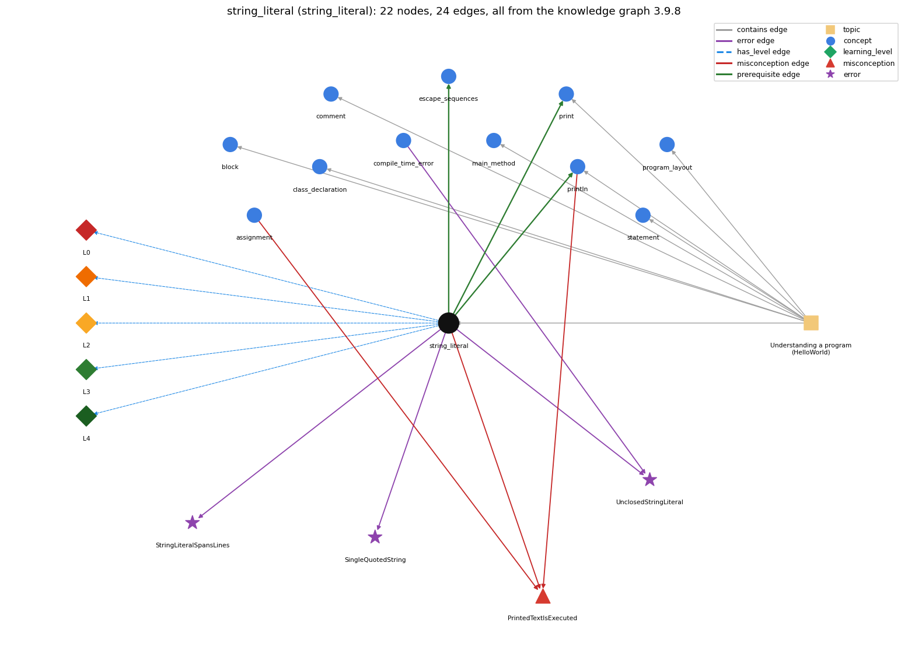

# string_literal (`string_literal`)

"Hello, World" -- the text being printed

Section 1.1 Your First Program, topic 1.1.b Understanding a program (HelloWorld).

## At a glance

- **Needs first:** nothing
- **Leads to:** `escape_sequences`, `print`, `println`
- **Learned alongside:** nothing
- **Misconceptions:** `PrintedTextIsExecuted`
- **Errors:** `SingleQuotedString`, `StringLiteralSpansLines`, `UnclosedStringLiteral`
- **Levels:** L0, L1, L2, L3, L4

Everything below comes from the knowledge graph 3.9.8 (`data/raw/chapter1_kg_updated.json`): 24 edges around this concept, each explained in the graph's own words.

## What it needs first (0)

A prerequisite edge means the other concept has to be understood before `string_literal`.

No prerequisite edge leads into this concept.

## What it leads to (3)

These concepts need `string_literal` first.

### `string_literal` comes before `escape_sequences`

*backslash codes inside literals: '\t' tab, '\n' newline*

Escape sequences are written inside string or char literals.

- **Grounding:** book passage
- **How `string_literal` combines with `escape_sequences`:** Escape sequences (\n, \t, \", \\) are written inside string or char literals to stand for one character that cannot be typed directly.
- **How `escape_sequences` combines with `string_literal`:** Escapes are written inside "..." or '...'. \" puts a double quote inside a String literal without ending it.

### `string_literal` comes before `print`

*System.out.print -- output with no newline*

print("s") outputs exactly the characters between the quotes, without the quotes.

- **Grounding:** book passage
- **How `string_literal` combines with `print`:** print("s") outputs exactly the characters between the quotes, without the quotes.
- **How `print` combines with `string_literal`:** print("s") outputs exactly the characters between the quotes, without the quotes; spaces inside the quotes are printed.

### `string_literal` comes before `println`

*System.out.println -- output with a trailing newline*

println("s") outputs exactly the characters between the quotes and then ends the line.

- **Grounding:** book passage
- **How `string_literal` combines with `println`:** println("s") outputs exactly the characters between the quotes and then ends the line.
- **How `println` combines with `string_literal`:** println("s") outputs exactly the characters between the quotes and then ends the line.

## Learned alongside (0)

A parallel edge joins two concepts that sit side by side: neither is needed before the other.

No parallel edge touches this concept.

## Misconceptions (1)

A misconception edge states the wrong rule a student may hold about this concept, and the right rule.

### PrintedTextIsExecuted

- **Wrong rule:** System.out.println("x is 5"); sets x to 5 (text inside the quotes is run as code).
- **Right rule:** Characters inside double quotes are printed literally; println only displays them and changes no variable. Only an assignment such as x = 5; sets x.
- **Role of this concept:** context
- **Also an edge from `assignment`:** System.out.println("x is 5"); sets x to 5 (text inside the quotes is run as code).
- **Also an edge from `println`:** System.out.println("x is 5"); sets x to 5 (text inside the quotes is run as code).

## Errors (3)

An error edge states the rule that gets broken in a program, and the right rule.

### SingleQuotedString

- **Wrong rule:** Writes a string literal in single quotes: 'Hello'.
- **Right rule:** String literals use double quotes; single quotes are for one char.
- **Role of this concept:** primary

### StringLiteralSpansLines

- **Wrong rule:** Breaks a string literal across two lines of code.
- **Right rule:** String literals must not span more than one line of a program.
- **Role of this concept:** primary

### UnclosedStringLiteral

- **Wrong rule:** A string literal can be left without its closing quote.
- **Right rule:** A String literal is enclosed in a pair of double quotes.
- **Role of this concept:** primary
- **Also an edge from `compile_time_error`:** A string literal can be left without its closing quote.

## Levels L0 to L4 (5 of 5)

Each level edge lists the ways a student shows that level, each with its exact rule.

### L0: Prestructural / sensorimotor

L0 for string literal: the answer holds a rule that contradicts Java.

*Deciding question: Does every rule the answer applies to string literal agree with the language rule? If it reads the code with everyday meanings, applies a wrong rule, or switches rules within one trace, it is L0. A slip in an otherwise rule-correct trace is L2 with an error, not L0.*

string literal -&gt; L0 (Prestructural): the answer holds a rule that contradicts Java (1 way).

- **everyday reading** (folk-meaning rule): Everyday reading: quotation marks are just decoration, and spacing inside them is tidied up like ordinary text; single and double quotes mean the same thing. Java rule: characters within double quotes are taken literally (every space counts), the quotes are not part of the value, and single quotes are for one char.

### L1: Unistructural / atom x text surface

L1 for string literal: the answer states one correct rule without applying it.

*Deciding question: Does the answer cover every part of the code, in order, with the values (L2)? If it covers one part or only states the rule, it is L1.*

string literal -&gt; L1 (Unistructural): the answer states one correct rule without applying it (2 ways).

- **names the element** (identity rule): A string literal is a sequence of characters written in double quotes in the source code, e.g. "Hello, World"; it is a value of type String.
- **states the rule** (declarative rule): A String literal is enclosed in a pair of double quotes; everything inside is taken literally, special characters such as " and newline are written with escape sequences, and the literal must close on the same source line.

### L2: Multistructural / block x execution / preoperational

L2 for string literal: the answer applies these rules to every part of the code, in order.

*Deciding question: Is the answer many segments mapped onto lines (L2), or one segment stating the purpose of the whole (L3)? A correct output with no value-by-value justification is not levelled.*

string literal -&gt; L2 (Multistructural): the answer applies the rules of string literal to every part of the code, in order (3 ways).

- **line by line trace** (operational sequencing rule): The literal is a constant: it is fixed at compile time and simply supplies its value when the expression containing it is evaluated.
- **output prediction** (evaluation / result rule): Value is the String of the characters between the quotes (escape sequences replaced by the characters they stand for), without the quotes: "Hi, " has 4 characters, and printing it shows Hi, followed by a space.
- **one step execution** (state-transition rule): Evaluating a literal changes no state; it just yields the same String value every time.

### L3: Relational / relations x function (concrete operational begins)

L3 for string literal: the answer relates the parts by these rules.

*Deciding question: Was the purpose deduced from the code, or only guessed from traced input/output pairs (then L2)? Does the answer stay within the given code (L3), or reason about changed code, an error class or a new program (L4)?*

string literal -&gt; L3 (Relational): the answer relates the parts (4 ways).

- **relation to neighbour** (composition rule (with a neighbour)): print("s") outputs exactly the characters between the quotes, without the quotes.
- **relation to neighbour** (composition rule (with a neighbour)): println("s") outputs exactly the characters between the quotes and then ends the line.
- **relation to neighbour** (composition rule (with a neighbour)): Escape sequences (\n, \t, \", \\) are written inside string or char literals to stand for one character that cannot be typed directly.
- **purpose of the whole** (plan / role rule): Purpose: state fixed text exactly, such as messages, labels and prompts, so you can precisely specify what gets printed.

### L4: Extended abstract (concrete-operational reversibility and conservation)

L4 for string literal: the answer reasons beyond the given code by these rules.

*Deciding question: Does the answer link the code to a broader context: a changed program, a class of inputs, an unseen problem? Re-tracing changed code value by value is L2; fixing one given failing case is L3.*

string literal -&gt; L4 (Extended abstract): the answer reasons beyond the given code (6 ways).

- **predict a change** (conservation rule): Changing any character inside the quotes (including adding a space) changes the output by exactly that character; changing spaces outside the quotes changes nothing.
- **diagnose an error** (error rule): rule broken: A String literal is enclosed in a pair of double quotes. Kind: compile-time. Trigger class: a missing closing (or opening) quote; the compiler may get very confused and report errors elsewhere
- **diagnose an error** (error rule): rule broken: String literals use double quotes; single quotes are for one char. Kind: compile-time. Trigger class: 'Hello' (more than one character in single quotes): unclosed character literal
- **diagnose an error** (error rule): rule broken: A string literal must not span source lines. Kind: compile-time. Trigger class: a line break inside "...": unclosed string literal
- **transfer to a new program** (applicability rule): Use a string literal for fixed text known when the program is written; use args, input or variables for text that varies between runs, and char literals for a single character.
- **diagnose an error** (error rule): rule broken: A double quote inside a string must be escaped. Kind: compile-time. Trigger class: "She said "Hi"" without \"

## Same topic

`string_literal` belongs to the topic **Understanding a program (HelloWorld)** (`topic1.1.b`). The topic also contains: `block`, `class_declaration`, `comment`, `main_method`, `print`, `println`, `program_layout`, `statement`.

## Rules of the concept (17)

- **folk-meaning rule:** Everyday reading: quotation marks are just decoration, and spacing inside them is tidied up like ordinary text; single and double quotes mean the same thing. Java rule: characters within double quotes are taken literally (every space counts), the quotes are not part of the value, and single quotes are for one char.
- **uneven-application rule:** Applies the literal rule unevenly: prints the quotes on one line but not another, or collapses spaces inside one string but keeps them in another.
- **identity rule:** A string literal is a sequence of characters written in double quotes in the source code, e.g. "Hello, World"; it is a value of type String.
- **declarative rule:** A String literal is enclosed in a pair of double quotes; everything inside is taken literally, special characters such as " and newline are written with escape sequences, and the literal must close on the same source line.
- **operational sequencing rule:** The literal is a constant: it is fixed at compile time and simply supplies its value when the expression containing it is evaluated.
- **evaluation / result rule:** Value is the String of the characters between the quotes (escape sequences replaced by the characters they stand for), without the quotes: "Hi, " has 4 characters, and printing it shows Hi, followed by a space.
- **state-transition rule:** Evaluating a literal changes no state; it just yields the same String value every time.
- **composition rule (with a neighbour):** with print: print("s") outputs exactly the characters between the quotes, without the quotes.
- **composition rule (with a neighbour):** with println: println("s") outputs exactly the characters between the quotes and then ends the line.
- **composition rule (with a neighbour):** with escape\_sequences: Escape sequences (\n, \t, \", \\) are written inside string or char literals to stand for one character that cannot be typed directly.
- **plan / role rule:** Purpose: state fixed text exactly, such as messages, labels and prompts, so you can precisely specify what gets printed.
- **conservation rule:** Changing any character inside the quotes (including adding a space) changes the output by exactly that character; changing spaces outside the quotes changes nothing.
- **error rule:** rule broken: String literals use double quotes; single quotes are for one char (compile-time)
- **error rule:** rule broken: A string literal must not span source lines (compile-time)
- **error rule:** rule broken: A String literal is enclosed in a pair of double quotes (compile-time)
- **error rule:** rule broken: A double quote inside a string must be escaped (compile-time)
- **applicability rule:** Use a string literal for fixed text known when the program is written; use args, input or variables for text that varies between runs, and char literals for a single character.

## The whole prerequisite chain

- **Everything it builds on (0):** nothing
- **Everything that builds on it (4):** `escape_sequences`, `print`, `printing_array_reference`, `println`
