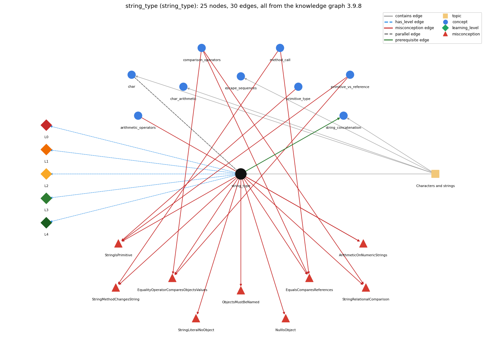

# string_type (`string_type`)

String -- a reference type, not a primitive

Section 1.2 Built-in Types of Data, topic 1.2.b Characters and strings.

## At a glance

- **Needs first:** nothing
- **Leads to:** `string_concatenation`
- **Learned alongside:** `char`
- **Misconceptions:** `ArithmeticOnNumericStrings`, `EqualityOperatorComparesObjectsValues`, `EqualsComparesReferences`, `NullIsObject`, `ObjectsMustBeNamed`, `StringIsPrimitive`, `StringLiteralNoObject`, `StringMethodChangesString`, `StringRelationalComparison`
- **Errors:** none
- **Levels:** L0, L1, L2, L3, L4

Everything below comes from the knowledge graph 3.9.8 (`data/raw/chapter1_kg_updated.json`): 30 edges around this concept. The edge logic, the wrong and right rules and the exact rules of the ways are copied word for word from the graph.

## To work on (1)

- misconceptions with no L0 way linked to them: NullIsObject, ObjectsMustBeNamed, StringMethodChangesString

## What it needs first (0)

A prerequisite edge means the other concept has to be understood before `string_type`.

No prerequisite edge leads into this concept.

## What it leads to (1)

These concepts need `string_type` first.

### `string_type` comes before `string_concatenation`

*+ with a String builds a new string*

- **Edge:** `pre:string_type->string_concatenation`
- **Exact edge logic:** + builds a new String whenever at least one of its operands is a String.
- **Grounding:** book\_passage
- **Composition rule (R) of `string_type` with `string_concatenation`:** + produces a new String whenever at least one operand is a String; the other operand is converted to text first.
- **Composition rule (R) of `string_concatenation` with `string_type`:** Concatenation always yields a String, even when one operand is a number, so its result cannot be used in arithmetic without parsing.

## Learned alongside (1)

A parallel edge joins two concepts that sit side by side: neither is needed before the other.

### `string_type` alongside `char`

*16-bit character primitive*

- **Edge:** `par:char~string_type`
- **Exact edge logic:** 'a' is a char (one 16-bit character code, a primitive); "a" is a String (a sequence of characters, an object). 'a' + 'b' is the int 195, while "a" + "b" is "ab".
- **Grounding:** book\_passage

## Misconceptions (9)

A misconception edge states the wrong rule a student may hold about this concept, and the right rule.

### ArithmeticOnNumericStrings

- **Edge:** `string_type` &rarr; `ArithmeticOnNumericStrings` (misconception)
- **Exact edge logic (the wrong rule):** "10" - 1 or "6" \* "2" works because the strings look like numbers.
- **Twin logic (the right rule):** Arithmetic operators other than + are not defined for Strings; a String of digits must first be converted to a number, e.g. with Integer.parseInt.
- **Wrong belief (on the node):** "10" - 1 or "6" \* "2" works because the strings look like numbers.
- **Correct rule (on the node):** Arithmetic operators other than + are not defined for Strings; a String of digits must first be converted to a number, e.g. with Integer.parseInt.
- **Provenance:** textbook
- **Role of this concept:** primary
- **L0 way linked to it:** yes
- **L0 way [3] misconception, exact rule:** wrong rule: "10" - 1 or "6" \* "2" works because the strings look like numbers. Right rule: Arithmetic operators other than + are not defined for Strings; a String of digits must first be converted to a number, e.g. with Integer.parseInt.
- **Edge `arithmetic_operators` &rarr; `ArithmeticOnNumericStrings`, exact edge logic:** "10" - 1 or "6" \* "2" works because the strings look like numbers. **Twin logic:** Arithmetic operators other than + are not defined for Strings; a String of digits must first be converted to a number, e.g. with Integer.parseInt. (role: context)

### EqualityOperatorComparesObjectsValues

- **Edge:** `string_type` &rarr; `EqualityOperatorComparesObjectsValues` (misconception)
- **Exact edge logic (the wrong rule):** s == t is true whenever the two Strings contain the same text.
- **Twin logic (the right rule):** s == t is true only when s and t refer to the same object; s.equals(t) compares the text.
- **Wrong belief (on the node):** == compares contents (the String == bug)
- **Correct rule (on the node):** s == t is true only when s and t refer to the same object; s.equals(t) compares the text.
- **Provenance:** published
- **Role of this concept:** context
- **L0 way linked to it:** yes
- **L0 way [6] misconception, exact rule:** wrong rule: == compares contents (the String == bug). Right rule: s == t is true only when s and t refer to the same object; s.equals(t) compares the text.
- **Edge `comparison_operators` &rarr; `EqualityOperatorComparesObjectsValues`, exact edge logic:** s == t is true whenever the two Strings contain the same text. **Twin logic:** s == t is true only when s and t refer to the same object; s.equals(t) compares the text. (role: primary)
- **Edge `primitive_vs_reference` &rarr; `EqualityOperatorComparesObjectsValues`, exact edge logic:** == compares contents (the String == bug) **Twin logic:** s == t is true only when s and t refer to the same object; s.equals(t) compares the text. (role: context)

### EqualsComparesReferences

- **Edge:** `string_type` &rarr; `EqualsComparesReferences` (misconception)
- **Exact edge logic (the wrong rule):** s.equals(t) checks whether s and t are the same object.
- **Twin logic (the right rule):** s.equals(t) checks whether the two Strings contain the same characters.
- **Wrong belief (on the node):** .equals() compares references, not contents
- **Correct rule (on the node):** s.equals(t) checks whether the two Strings contain the same characters.
- **Provenance:** published
- **Role of this concept:** primary
- **L0 way linked to it:** yes
- **L0 way [2] misconception, exact rule:** wrong rule: .equals() compares references, not contents. Right rule: s.equals(t) checks whether the two Strings contain the same characters.
- **Edge `comparison_operators` &rarr; `EqualsComparesReferences`, exact edge logic:** .equals() compares references, not contents **Twin logic:** s.equals(t) checks whether the two Strings contain the same characters. (role: context)
- **Edge `method_call` &rarr; `EqualsComparesReferences`, exact edge logic:** .equals() compares references, not contents **Twin logic:** s.equals(t) checks whether the two Strings contain the same characters. (role: context)

### NullIsObject

- **Edge:** `string_type` &rarr; `NullIsObject` (misconception)
- **Exact edge logic (the wrong rule):** null is an object, so a method can be called on a variable that is null.
- **Twin logic (the right rule):** null means the variable refers to no object, so calling a method on it throws an exception.
- **Wrong belief (on the node):** null is an object
- **Correct rule (on the node):** null means the variable refers to no object, so calling a method on it throws an exception.
- **Provenance:** published
- **Role of this concept:** primary
- **L0 way linked to it:** no

### ObjectsMustBeNamed

- **Edge:** `string_type` &rarr; `ObjectsMustBeNamed` (misconception)
- **Exact edge logic (the wrong rule):** An object can only be created by first storing it in a variable.
- **Twin logic (the right rule):** An object can be created and used directly without a variable, as in "s".length() or passing new int[n] as an argument.
- **Wrong belief (on the node):** you need a variable to create an object
- **Correct rule (on the node):** An object can be created and used directly without a variable, as in "s".length() or passing new int[n] as an argument.
- **Provenance:** published
- **Role of this concept:** primary
- **L0 way linked to it:** no

### StringIsPrimitive

- **Edge:** `string_type` &rarr; `StringIsPrimitive` (misconception)
- **Exact edge logic (the wrong rule):** String is a primitive type like int.
- **Twin logic (the right rule):** String is not a primitive type; it is a class whose values are objects, although Java gives it some built-in support (literals, +).
- **Wrong belief (on the node):** String is a primitive type like int.
- **Correct rule (on the node):** String is not a primitive type; it is a class whose values are objects, although Java gives it some built-in support (literals, +).
- **Provenance:** derived
- **Role of this concept:** context
- **L0 way linked to it:** yes
- **L0 way [5] misconception, exact rule:** wrong rule: String is a primitive type like int. Right rule: String is not a primitive type; it is a class whose values are objects, although Java gives it some built-in support (literals, +).
- **Edge `primitive_type` &rarr; `StringIsPrimitive`, exact edge logic:** String is a primitive type like int. **Twin logic:** String is not a primitive type; it is a class whose values are objects, although Java gives it some built-in support (literals, +). (role: primary)
- **Edge `primitive_vs_reference` &rarr; `StringIsPrimitive`, exact edge logic:** String is a primitive type like int. **Twin logic:** String is not a primitive type; it is a class whose values are objects, although Java gives it some built-in support (literals, +). (role: context)

### StringLiteralNoObject

- **Edge:** `string_type` &rarr; `StringLiteralNoObject` (misconception)
- **Exact edge logic (the wrong rule):** "text" is not a String object until new String(...) is called.
- **Twin logic (the right rule):** A string literal is already a String object, so "text".length() works directly.
- **Wrong belief (on the node):** a string literal isn't a String object until the constructor is called
- **Correct rule (on the node):** A string literal is already a String object, so "text".length() works directly.
- **Provenance:** published
- **Role of this concept:** primary
- **L0 way linked to it:** yes
- **L0 way [1] misconception, exact rule:** wrong rule: a string literal isn't a String object until the constructor is called. Right rule: A string literal is already a String object, so "text".length() works directly.
- **L0 way [4] inconsistent\_trace, exact rule:** Points to LT (String expressions produce references to String objects, and operations build new strings). Applied unevenly, a student compares with equals in one test and == in another, or treats "12" as a number in one + and as text in the next. (here mixing in: "a string literal isn't a String object until the constructor is called")

### StringMethodChangesString

- **Edge:** `string_type` &rarr; `StringMethodChangesString` (misconception)
- **Exact edge logic (the wrong rule):** name.toUpperCase(); changes name.
- **Twin logic (the right rule):** Strings are immutable: String methods return a new String, which must be assigned, e.g. name = name.toUpperCase();
- **Wrong belief (on the node):** name.toUpperCase(); changes name.
- **Correct rule (on the node):** Strings are immutable: String methods return a new String, which must be assigned, e.g. name = name.toUpperCase();
- **Provenance:** textbook
- **Role of this concept:** primary
- **L0 way linked to it:** no
- **Edge `method_call` &rarr; `StringMethodChangesString`, exact edge logic:** name.toUpperCase(); changes name. **Twin logic:** Strings are immutable: String methods return a new String, which must be assigned, e.g. name = name.toUpperCase(); (role: context)

### StringRelationalComparison

- **Edge:** `string_type` &rarr; `StringRelationalComparison` (misconception)
- **Exact edge logic (the wrong rule):** s &lt; t compares two Strings alphabetically.
- **Twin logic (the right rule):** &lt; and &gt; are defined only for primitive types; comparing Strings with them does not compile.
- **Wrong belief (on the node):** s &lt; t compares two Strings alphabetically.
- **Correct rule (on the node):** &lt; and &gt; are defined only for primitive types; comparing Strings with them does not compile.
- **Provenance:** textbook
- **Role of this concept:** context
- **L0 way linked to it:** yes
- **L0 way [7] misconception, exact rule:** wrong rule: s &lt; t compares two Strings alphabetically. Right rule: &lt; and &gt; are defined only for primitive types; comparing Strings with them does not compile.
- **Edge `comparison_operators` &rarr; `StringRelationalComparison`, exact edge logic:** s &lt; t compares two Strings alphabetically. **Twin logic:** &lt; and &gt; are defined only for primitive types; comparing Strings with them does not compile. (role: primary)

## Errors (0)

An error edge states the rule that gets broken in a program, and the right rule.

The graph has no error edge from this concept.

## Levels L0 to L4 (5 of 5)

Each level edge lists the ways a student shows that level, each with its exact rule.

### L0: Prestructural / sensorimotor

L0 for string type: the answer holds a rule that contradicts Java.

*Deciding question: Does every rule the answer applies to string type agree with the language rule? If it reads the code with everyday meanings, applies a wrong rule, or switches rules within one trace, it is L0. A slip in an otherwise rule-correct trace is L2 with an error, not L0.*

- **Edge:** `string_type` &rarr; `string_type@L0` (has_level)
- **Exact edge logic:** string type -&gt; L0 (Prestructural): the answer holds a rule that contradicts Java (8 ways).

Ways (8), each with its exact rule:

- **[0] everyday\_reading** (rule type E, folk-meaning rule): In everyday writing, quotes only mark words, "10" is the number ten, and two texts are 'equal' when they read the same. In Java a String is an object reached through a reference: "10" is text, + concatenates, and == compares references rather than contents.
- **[1] misconception** (rule type M, wrong rule / right rule) &rarr; `StringLiteralNoObject`: wrong rule: a string literal isn't a String object until the constructor is called. Right rule: A string literal is already a String object, so "text".length() works directly.
- **[2] misconception** (rule type M, wrong rule / right rule) &rarr; `EqualsComparesReferences`: wrong rule: .equals() compares references, not contents. Right rule: s.equals(t) checks whether the two Strings contain the same characters.
- **[3] misconception** (rule type M, wrong rule / right rule) &rarr; `ArithmeticOnNumericStrings`: wrong rule: "10" - 1 or "6" \* "2" works because the strings look like numbers. Right rule: Arithmetic operators other than + are not defined for Strings; a String of digits must first be converted to a number, e.g. with Integer.parseInt.
- **[4] inconsistent\_trace** (rule type T, uneven-application rule) &rarr; `StringLiteralNoObject`: Points to LT (String expressions produce references to String objects, and operations build new strings). Applied unevenly, a student compares with equals in one test and == in another, or treats "12" as a number in one + and as text in the next. (here mixing in: "a string literal isn't a String object until the constructor is called")
- **[5] misconception** (rule type M, wrong rule / right rule) &rarr; `StringIsPrimitive`: wrong rule: String is a primitive type like int. Right rule: String is not a primitive type; it is a class whose values are objects, although Java gives it some built-in support (literals, +).
- **[6] misconception** (rule type M, wrong rule / right rule) &rarr; `EqualityOperatorComparesObjectsValues`: wrong rule: == compares contents (the String == bug). Right rule: s == t is true only when s and t refer to the same object; s.equals(t) compares the text.
- **[7] misconception** (rule type M, wrong rule / right rule) &rarr; `StringRelationalComparison`: wrong rule: s &lt; t compares two Strings alphabetically. Right rule: &lt; and &gt; are defined only for primitive types; comparing Strings with them does not compile.

### L1: Unistructural / atom x text surface

L1 for string type: the answer states one correct rule without applying it.

*Deciding question: Does the answer cover every part of the code, in order, with the values (L2)? If it covers one part or only states the rule, it is L1.*

- **Edge:** `string_type` &rarr; `string_type@L1` (has_level)
- **Exact edge logic:** string type -&gt; L1 (Unistructural): the answer states one correct rule without applying it (2 ways).

Ways (2), each with its exact rule:

- **[0] names\_the\_element** (rule type N, identity rule): String: Java's built-in non-primitive (reference) type for a sequence of characters.
- **[1] states\_the\_rule** (rule type S, declarative rule): A String literal is characters in double quotes and denotes a String object. + concatenates. Contents are compared with equals, not ==. &lt; and &gt; are not defined for Strings, and Strings are immutable.

### L2: Multistructural / block x execution / preoperational

L2 for string type: the answer applies these rules to every part of the code, in order.

*Deciding question: Is the answer many segments mapped onto lines (L2), or one segment stating the purpose of the whole (L3)? A correct output with no value-by-value justification is not levelled.*

- **Edge:** `string_type` &rarr; `string_type@L2` (has_level)
- **Exact edge logic:** string type -&gt; L2 (Multistructural): the answer applies the rules of string type to every part of the code, in order (3 ways).

Ways (3), each with its exact rule:

- **[0] line\_by\_line\_trace** (rule type LT, operational sequencing rule): A String expression is evaluated left to right. At each + with a String operand, the other operand is converted to a String and a new String object is made. Methods such as toUpperCase return a new String and leave the original unchanged.
- **[1] output\_prediction** (rule type OP, evaluation / result rule): "Hi, " + "Bob" is "Hi, Bob" and "1234" + "99" is "123499". s.equals(t) is true exactly when the characters match, while "abc" == "ab" + x can be false for x = "c".
- **[2] one\_step\_execution** (rule type OS, state-transition rule): No operation changes an existing String. s = s + "x" makes s refer to a new String, and other variables still referring to the old one are unaffected.

### L3: Relational / relations x function (concrete operational begins)

L3 for string type: the answer relates the parts by these rules.

*Deciding question: Was the purpose deduced from the code, or only guessed from traced input/output pairs (then L2)? Does the answer stay within the given code (L3), or reason about changed code, an error class or a new program (L4)?*

- **Edge:** `string_type` &rarr; `string_type@L3` (has_level)
- **Exact edge logic:** string type -&gt; L3 (Relational): the answer relates the parts (3 ways).

Ways (3), each with its exact rule:

- **[0] relation\_to\_neighbour** (rule type R, composition rule (with a neighbour)): + produces a new String whenever at least one operand is a String; the other operand is converted to text first.
- **[1] relation\_to\_neighbour** (rule type R, composition rule (with a neighbour)): 'a' is a char (one 16-bit character code, a primitive); "a" is a String (a sequence of characters, an object). 'a' + 'b' is the int 195, while "a" + "b" is "ab".
- **[2] purpose\_of\_the\_whole** (rule type P, plan / role rule): Strings handle all text: messages, labels, formatted output and command-line arguments (args[] are Strings and must be parsed before arithmetic).

### L4: Extended abstract (concrete-operational reversibility and conservation)

L4 for string type: the answer reasons beyond the given code by these rules.

*Deciding question: Does the answer link the code to a broader context: a changed program, a class of inputs, an unseen problem? Re-tracing changed code value by value is L2; fixing one given failing case is L3.*

- **Edge:** `string_type` &rarr; `string_type@L4` (has_level)
- **Exact edge logic:** string type -&gt; L4 (Extended abstract): the answer reasons beyond the given code (6 ways).

Ways (6), each with its exact rule:

- **[0] predict\_a\_change** (rule type C, conservation rule) &rarr; `StringLiteralNoObject`: Replacing equals with == may still pass for two identical literals but fails for computed or input strings. Changing "5" to 5 turns concatenation into addition.
- **[1] transfer\_to\_a\_new\_program** (rule type X, applicability rule): Use String for any text: names, messages, tokens and output lines. Convert to int or double with Integer.parseInt or Double.parseDouble before arithmetic. Use char for a single character whose code matters.
- **[2] diagnose\_an\_error** (rule type D, error rule): rule broken: String contents are compared with equals; == compares references. Kind: silent logic error. Trigger class: Comparing a String read from input or built by + against a literal with == or !=: false even though the text matches.
- **[3] diagnose\_an\_error** (rule type D, error rule): rule broken: &lt; and &gt; (and - \* /) are defined only for primitive types, not for Strings. Kind: compile-time. Trigger class: s &lt; t, "10" - 1, "6" \* "2": 'bad operand types for binary operator'.
- **[4] diagnose\_an\_error** (rule type D, error rule): rule broken: A String variable can hold only a String (or null). Kind: compile-time. Trigger class: String message = 123;: 'incompatible types: int cannot be converted to String'.
- **[5] diagnose\_an\_error** (rule type D, error rule): rule broken: A method cannot be called through a null reference. Kind: run-time exception. Trigger class: Calling length(), equals() or charAt() on a String variable whose value is null: NullPointerException.

## Same topic

`string_type` belongs to the topic **Characters and strings** (`topic1.2.b`). The topic also contains: `char`, `char_arithmetic`, `escape_sequences`, `string_concatenation`.

## Rules of the concept (21)

- **Book** (SW-1e, p. 19 (pdf 29)): "A String is a sequence of characters."
- **Book** (SW-1e, p. 19 (pdf 29)): "The String data type is not a primitive type, but Java sometimes treats it like one."
- **Book** (SW-1.2, p. 19 (pdf 29)): "A String is a sequence of characters."
- **Book** (SW-1.2, ): "The most common operation that we perform on strings is known as concatenation."
- **E** (folk-meaning rule): In everyday writing, quotes only mark words, "10" is the number ten, and two texts are 'equal' when they read the same. In Java a String is an object reached through a reference: "10" is text, + concatenates, and == compares references rather than contents.
- **M** (wrong rule / right rule): EqualsComparesReferences: wrong: .equals() compares references, not contents \| right: s.equals(t) checks whether the two Strings contain the same characters.
- **M** (wrong rule / right rule): StringIsPrimitive: wrong: String is a primitive type like int. \| right: String is not a primitive type; it is a class whose values are objects, although Java gives it some built-in support (literals, +).
- **M** (wrong rule / right rule): StringLiteralNoObject: wrong: a string literal isn't a String object until the constructor is called \| right: A string literal is already a String object, so "text".length() works directly.
- **M** (wrong rule / right rule): EqualityOperatorComparesObjectsValues: wrong: == compares contents (the String == bug) \| right: s == t is true only when s and t refer to the same object; s.equals(t) compares the text.
- **M** (wrong rule / right rule): StringRelationalComparison: wrong: s &lt; t compares two Strings alphabetically. \| right: &lt; and &gt; are defined only for primitive types; comparing Strings with them does not compile.
- **M** (wrong rule / right rule): ArithmeticOnNumericStrings: wrong: "10" - 1 or "6" \* "2" works because the strings look like numbers. \| right: Arithmetic operators other than + are not defined for Strings; a String of digits must first be converted to a number, e.g. with Integer.parseInt.
- **T** (uneven-application rule): Points to LT (String expressions produce references to String objects, and operations build new strings). Applied unevenly, a student compares with equals in one test and == in another, or treats "12" as a number in one + and as text in the next.
- **N** (identity rule): String: Java's built-in non-primitive (reference) type for a sequence of characters.
- **S** (declarative rule): A String literal is characters in double quotes and denotes a String object. + concatenates. Contents are compared with equals, not ==. &lt; and &gt; are not defined for Strings, and Strings are immutable.
- **LT** (operational sequencing rule): A String expression is evaluated left to right. At each + with a String operand, the other operand is converted to a String and a new String object is made. Methods such as toUpperCase return a new String and leave the original unchanged.
- **OP** (evaluation / result rule): "Hi, " + "Bob" is "Hi, Bob" and "1234" + "99" is "123499". s.equals(t) is true exactly when the characters match, while "abc" == "ab" + x can be false for x = "c".
- **OS** (state-transition rule): No operation changes an existing String. s = s + "x" makes s refer to a new String, and other variables still referring to the old one are unaffected.
- **R** (composition rule (with a neighbour)): with string\_concatenation: + produces a new String whenever at least one operand is a String; the other operand is converted to text first.
- **P** (plan / role rule): Strings handle all text: messages, labels, formatted output and command-line arguments (args[] are Strings and must be parsed before arithmetic).
- **C** (conservation rule): Replacing equals with == may still pass for two identical literals but fails for computed or input strings. Changing "5" to 5 turns concatenation into addition.
- **D** (error rule): rule broken: String contents are compared with equals; == compares references. (silent logic error)
- **D** (error rule): rule broken: &lt; and &gt; (and - \* /) are defined only for primitive types, not for Strings. (compile-time)
- **D** (error rule): rule broken: A String variable can hold only a String (or null). (compile-time)
- **D** (error rule): rule broken: A method cannot be called through a null reference. (run-time exception)
- **X** (applicability rule): Use String for any text: names, messages, tokens and output lines. Convert to int or double with Integer.parseInt or Double.parseDouble before arithmetic. Use char for a single character whose code matters.

## How it is found in code and answers (reader block)

- **Aliases:** string, strings
- **Code patterns:** `\bString\b`
- **Operator symbols:** none
- **Java types:** `String`

## The whole prerequisite chain

- **Everything it builds on (0):** nothing
- **Everything that builds on it (2):** `string_concatenation`, `string_conversion`

## Every edge in this view and its exact edge logic (30)

All the edges drawn in the picture, in the order: prerequisite, parallel, misconception, error, has_level, contains.

**1. `string_type` &rarr; `string_concatenation`** (prerequisite)

- **Exact edge logic:** + builds a new String whenever at least one of its operands is a String.
- **Grounding:** book\_passage
- **Composition rule (R) of `string_type` with `string_concatenation`:** + produces a new String whenever at least one operand is a String; the other operand is converted to text first.
- **Composition rule (R) of `string_concatenation` with `string_type`:** Concatenation always yields a String, even when one operand is a number, so its result cannot be used in arithmetic without parsing.

**2. `char` &harr; `string_type`** (parallel)

- **Exact edge logic:** 'a' is a char (one 16-bit character code, a primitive); "a" is a String (a sequence of characters, an object). 'a' + 'b' is the int 195, while "a" + "b" is "ab".
- **Grounding:** book\_passage

**3. `string_type` &rarr; `ArithmeticOnNumericStrings`** (misconception)

- **Exact edge logic (the wrong rule):** "10" - 1 or "6" \* "2" works because the strings look like numbers.
- **Twin logic (the right rule):** Arithmetic operators other than + are not defined for Strings; a String of digits must first be converted to a number, e.g. with Integer.parseInt.
- **Role:** primary

**4. `string_type` &rarr; `EqualityOperatorComparesObjectsValues`** (misconception)

- **Exact edge logic (the wrong rule):** s == t is true whenever the two Strings contain the same text.
- **Twin logic (the right rule):** s == t is true only when s and t refer to the same object; s.equals(t) compares the text.
- **Role:** context

**5. `string_type` &rarr; `EqualsComparesReferences`** (misconception)

- **Exact edge logic (the wrong rule):** s.equals(t) checks whether s and t are the same object.
- **Twin logic (the right rule):** s.equals(t) checks whether the two Strings contain the same characters.
- **Role:** primary

**6. `string_type` &rarr; `NullIsObject`** (misconception)

- **Exact edge logic (the wrong rule):** null is an object, so a method can be called on a variable that is null.
- **Twin logic (the right rule):** null means the variable refers to no object, so calling a method on it throws an exception.
- **Role:** primary

**7. `string_type` &rarr; `ObjectsMustBeNamed`** (misconception)

- **Exact edge logic (the wrong rule):** An object can only be created by first storing it in a variable.
- **Twin logic (the right rule):** An object can be created and used directly without a variable, as in "s".length() or passing new int[n] as an argument.
- **Role:** primary

**8. `string_type` &rarr; `StringIsPrimitive`** (misconception)

- **Exact edge logic (the wrong rule):** String is a primitive type like int.
- **Twin logic (the right rule):** String is not a primitive type; it is a class whose values are objects, although Java gives it some built-in support (literals, +).
- **Role:** context

**9. `string_type` &rarr; `StringLiteralNoObject`** (misconception)

- **Exact edge logic (the wrong rule):** "text" is not a String object until new String(...) is called.
- **Twin logic (the right rule):** A string literal is already a String object, so "text".length() works directly.
- **Role:** primary

**10. `string_type` &rarr; `StringMethodChangesString`** (misconception)

- **Exact edge logic (the wrong rule):** name.toUpperCase(); changes name.
- **Twin logic (the right rule):** Strings are immutable: String methods return a new String, which must be assigned, e.g. name = name.toUpperCase();
- **Role:** primary

**11. `string_type` &rarr; `StringRelationalComparison`** (misconception)

- **Exact edge logic (the wrong rule):** s &lt; t compares two Strings alphabetically.
- **Twin logic (the right rule):** &lt; and &gt; are defined only for primitive types; comparing Strings with them does not compile.
- **Role:** context

**12. `arithmetic_operators` &rarr; `ArithmeticOnNumericStrings`** (misconception)

- **Exact edge logic (the wrong rule):** "10" - 1 or "6" \* "2" works because the strings look like numbers.
- **Twin logic (the right rule):** Arithmetic operators other than + are not defined for Strings; a String of digits must first be converted to a number, e.g. with Integer.parseInt.
- **Role:** context

**13. `comparison_operators` &rarr; `EqualityOperatorComparesObjectsValues`** (misconception)

- **Exact edge logic (the wrong rule):** s == t is true whenever the two Strings contain the same text.
- **Twin logic (the right rule):** s == t is true only when s and t refer to the same object; s.equals(t) compares the text.
- **Role:** primary

**14. `comparison_operators` &rarr; `EqualsComparesReferences`** (misconception)

- **Exact edge logic (the wrong rule):** .equals() compares references, not contents
- **Twin logic (the right rule):** s.equals(t) checks whether the two Strings contain the same characters.
- **Role:** context

**15. `comparison_operators` &rarr; `StringRelationalComparison`** (misconception)

- **Exact edge logic (the wrong rule):** s &lt; t compares two Strings alphabetically.
- **Twin logic (the right rule):** &lt; and &gt; are defined only for primitive types; comparing Strings with them does not compile.
- **Role:** primary

**16. `method_call` &rarr; `EqualsComparesReferences`** (misconception)

- **Exact edge logic (the wrong rule):** .equals() compares references, not contents
- **Twin logic (the right rule):** s.equals(t) checks whether the two Strings contain the same characters.
- **Role:** context

**17. `method_call` &rarr; `StringMethodChangesString`** (misconception)

- **Exact edge logic (the wrong rule):** name.toUpperCase(); changes name.
- **Twin logic (the right rule):** Strings are immutable: String methods return a new String, which must be assigned, e.g. name = name.toUpperCase();
- **Role:** context

**18. `primitive_type` &rarr; `StringIsPrimitive`** (misconception)

- **Exact edge logic (the wrong rule):** String is a primitive type like int.
- **Twin logic (the right rule):** String is not a primitive type; it is a class whose values are objects, although Java gives it some built-in support (literals, +).
- **Role:** primary

**19. `primitive_vs_reference` &rarr; `EqualityOperatorComparesObjectsValues`** (misconception)

- **Exact edge logic (the wrong rule):** == compares contents (the String == bug)
- **Twin logic (the right rule):** s == t is true only when s and t refer to the same object; s.equals(t) compares the text.
- **Role:** context

**20. `primitive_vs_reference` &rarr; `StringIsPrimitive`** (misconception)

- **Exact edge logic (the wrong rule):** String is a primitive type like int.
- **Twin logic (the right rule):** String is not a primitive type; it is a class whose values are objects, although Java gives it some built-in support (literals, +).
- **Role:** context

**21. `string_type` &rarr; `string_type@L0`** (has_level)

- **Exact edge logic:** string type -&gt; L0 (Prestructural): the answer holds a rule that contradicts Java (8 ways).
  - **[0] everyday\_reading** (rule type E, folk-meaning rule): In everyday writing, quotes only mark words, "10" is the number ten, and two texts are 'equal' when they read the same. In Java a String is an object reached through a reference: "10" is text, + concatenates, and == compares references rather than contents.
  - **[1] misconception** (rule type M, wrong rule / right rule) &rarr; `StringLiteralNoObject`: wrong rule: a string literal isn't a String object until the constructor is called. Right rule: A string literal is already a String object, so "text".length() works directly.
  - **[2] misconception** (rule type M, wrong rule / right rule) &rarr; `EqualsComparesReferences`: wrong rule: .equals() compares references, not contents. Right rule: s.equals(t) checks whether the two Strings contain the same characters.
  - **[3] misconception** (rule type M, wrong rule / right rule) &rarr; `ArithmeticOnNumericStrings`: wrong rule: "10" - 1 or "6" \* "2" works because the strings look like numbers. Right rule: Arithmetic operators other than + are not defined for Strings; a String of digits must first be converted to a number, e.g. with Integer.parseInt.
  - **[4] inconsistent\_trace** (rule type T, uneven-application rule) &rarr; `StringLiteralNoObject`: Points to LT (String expressions produce references to String objects, and operations build new strings). Applied unevenly, a student compares with equals in one test and == in another, or treats "12" as a number in one + and as text in the next. (here mixing in: "a string literal isn't a String object until the constructor is called")
  - **[5] misconception** (rule type M, wrong rule / right rule) &rarr; `StringIsPrimitive`: wrong rule: String is a primitive type like int. Right rule: String is not a primitive type; it is a class whose values are objects, although Java gives it some built-in support (literals, +).
  - **[6] misconception** (rule type M, wrong rule / right rule) &rarr; `EqualityOperatorComparesObjectsValues`: wrong rule: == compares contents (the String == bug). Right rule: s == t is true only when s and t refer to the same object; s.equals(t) compares the text.
  - **[7] misconception** (rule type M, wrong rule / right rule) &rarr; `StringRelationalComparison`: wrong rule: s &lt; t compares two Strings alphabetically. Right rule: &lt; and &gt; are defined only for primitive types; comparing Strings with them does not compile.

**22. `string_type` &rarr; `string_type@L1`** (has_level)

- **Exact edge logic:** string type -&gt; L1 (Unistructural): the answer states one correct rule without applying it (2 ways).
  - **[0] names\_the\_element** (rule type N, identity rule): String: Java's built-in non-primitive (reference) type for a sequence of characters.
  - **[1] states\_the\_rule** (rule type S, declarative rule): A String literal is characters in double quotes and denotes a String object. + concatenates. Contents are compared with equals, not ==. &lt; and &gt; are not defined for Strings, and Strings are immutable.

**23. `string_type` &rarr; `string_type@L2`** (has_level)

- **Exact edge logic:** string type -&gt; L2 (Multistructural): the answer applies the rules of string type to every part of the code, in order (3 ways).
  - **[0] line\_by\_line\_trace** (rule type LT, operational sequencing rule): A String expression is evaluated left to right. At each + with a String operand, the other operand is converted to a String and a new String object is made. Methods such as toUpperCase return a new String and leave the original unchanged.
  - **[1] output\_prediction** (rule type OP, evaluation / result rule): "Hi, " + "Bob" is "Hi, Bob" and "1234" + "99" is "123499". s.equals(t) is true exactly when the characters match, while "abc" == "ab" + x can be false for x = "c".
  - **[2] one\_step\_execution** (rule type OS, state-transition rule): No operation changes an existing String. s = s + "x" makes s refer to a new String, and other variables still referring to the old one are unaffected.

**24. `string_type` &rarr; `string_type@L3`** (has_level)

- **Exact edge logic:** string type -&gt; L3 (Relational): the answer relates the parts (3 ways).
  - **[0] relation\_to\_neighbour** (rule type R, composition rule (with a neighbour)): + produces a new String whenever at least one operand is a String; the other operand is converted to text first.
  - **[1] relation\_to\_neighbour** (rule type R, composition rule (with a neighbour)): 'a' is a char (one 16-bit character code, a primitive); "a" is a String (a sequence of characters, an object). 'a' + 'b' is the int 195, while "a" + "b" is "ab".
  - **[2] purpose\_of\_the\_whole** (rule type P, plan / role rule): Strings handle all text: messages, labels, formatted output and command-line arguments (args[] are Strings and must be parsed before arithmetic).

**25. `string_type` &rarr; `string_type@L4`** (has_level)

- **Exact edge logic:** string type -&gt; L4 (Extended abstract): the answer reasons beyond the given code (6 ways).
  - **[0] predict\_a\_change** (rule type C, conservation rule) &rarr; `StringLiteralNoObject`: Replacing equals with == may still pass for two identical literals but fails for computed or input strings. Changing "5" to 5 turns concatenation into addition.
  - **[1] transfer\_to\_a\_new\_program** (rule type X, applicability rule): Use String for any text: names, messages, tokens and output lines. Convert to int or double with Integer.parseInt or Double.parseDouble before arithmetic. Use char for a single character whose code matters.
  - **[2] diagnose\_an\_error** (rule type D, error rule): rule broken: String contents are compared with equals; == compares references. Kind: silent logic error. Trigger class: Comparing a String read from input or built by + against a literal with == or !=: false even though the text matches.
  - **[3] diagnose\_an\_error** (rule type D, error rule): rule broken: &lt; and &gt; (and - \* /) are defined only for primitive types, not for Strings. Kind: compile-time. Trigger class: s &lt; t, "10" - 1, "6" \* "2": 'bad operand types for binary operator'.
  - **[4] diagnose\_an\_error** (rule type D, error rule): rule broken: A String variable can hold only a String (or null). Kind: compile-time. Trigger class: String message = 123;: 'incompatible types: int cannot be converted to String'.
  - **[5] diagnose\_an\_error** (rule type D, error rule): rule broken: A method cannot be called through a null reference. Kind: run-time exception. Trigger class: Calling length(), equals() or charAt() on a String variable whose value is null: NullPointerException.

**26. `topic1.2.b` &rarr; `string_type`** (contains)

- topic `topic1.2.b` contains `string_type`

**27. `topic1.2.b` &rarr; `char`** (contains)

- topic `topic1.2.b` contains `char`

**28. `topic1.2.b` &rarr; `char_arithmetic`** (contains)

- topic `topic1.2.b` contains `char_arithmetic`

**29. `topic1.2.b` &rarr; `escape_sequences`** (contains)

- topic `topic1.2.b` contains `escape_sequences`

**30. `topic1.2.b` &rarr; `string_concatenation`** (contains)

- topic `topic1.2.b` contains `string_concatenation`
