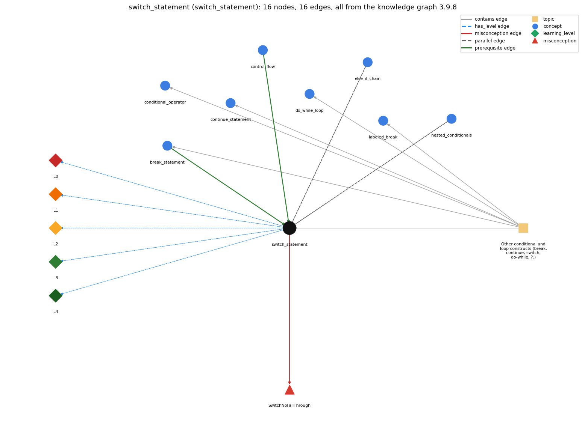

# switch_statement (`switch_statement`)

switch (x) { case v: ...; break; default: ... }

Section 1.3 Conditionals and Loops, topic 1.3.g Other conditional and loop constructs (break, continue, switch, do-while, ?:). From the knowledge graph 3.9.8 (`data/raw/chapter1_kg_updated.json`).

## Concepts associated with switch\_statement (8)

| Concept | Description | How it is associated |
| --- | --- | --- |
| **break\_statement** | break -- immediately exits the innermost loop or switch | prerequisite of it (it needs this) composition rule (R) with it same topic (topic1.3.g) |
| **conditional\_operator** | c ? a : b -- an expression that picks one of two values | same topic (topic1.3.g) |
| **continue\_statement** | continue -- skips to the next iteration of the innermost loop | same topic (topic1.3.g) |
| **control\_flow** | the order in which statements are executed | prerequisite of it (it needs this) |
| **do\_while\_loop** | do { body } while (c); -- body first, test after | same topic (topic1.3.g) |
| **else\_if\_chain** | if ... else if ... else picks exactly one branch | parallel concept |
| **labeled\_break** | labeled break/continue exit or continue an outer loop | same topic (topic1.3.g) |
| **nested\_conditionals** | else-if chains and conditionals inside conditionals | parallel concept composition rule (R) with it |

## Every edge in this view and its full label (16)

| From | Edge | To | Full edge label |
| --- | --- | --- | --- |
| **break\_statement** | prerequisite | **switch\_statement** | Each case of a switch normally ends with break, which exits the switch body. grounding: book\_passage composition rule (R) of break\_statement with switch\_statement: In a switch, break ends the switch body; without it, execution falls through into the next case. A break inside a switch that is inside a loop exits only the switch, not the loop. composition rule (R) of switch\_statement with break\_statement: Each case is normally ended by break, which exits the switch body. Leaving it out makes that case fall into the next. Inside a loop, that break exits the switch, not the loop. |
| **control\_flow** | prerequisite | **switch\_statement** | switch directs the flow of control to one of several case labels, depending on the value of one expression. grounding: book\_passage |
| **nested\_conditionals** | parallel | **switch\_statement** | When there are more than two mutually exclusive alternatives, a chain of if-else statements works, but a switch statement provides a direct solution that evaluates one expression against many possible values. grounding: book\_passage composition rule (R) of nested\_conditionals with switch\_statement: For more than two mutually exclusive alternatives a chain of if-else statements works, but a switch tests one expression against many values directly. composition rule (R) of switch\_statement with nested\_conditionals: A switch replaces an if-else chain only when every test is \`expr == constant\` on the same expression. Range tests such as the income-bracket chain (\`income &lt; 47450\`) must stay an if-else chain. |
| **switch\_statement** | parallel | **else\_if\_chain** | Both pick one of several alternatives. A switch compares one value with constant case labels and falls through without break; an else-if chain tests each condition in turn and runs only the first true branch. grounding: book\_passage |
| **switch\_statement** | misconception | **SwitchNoFallThrough** | **wrong rule:** After the matching case runs, the switch ends even without break. **right rule:** Without break, statements in switch blocks fall through into the following cases. role: primary |
| **switch\_statement** | has\_level | **switch\_statement@L0** | switch statement -&gt; L0 (Prestructural): the answer holds a rule that contradicts Java (3 ways). **[0] everyday\_reading** (E): Folk meaning: everyday 'switch' means flip to one setting, and 'case' reads like 'in case of X do Y', a self-contained rule. Novices therefore expect only the matching case to run. In a Java switch statement, the case labels are only entry points: execution starts at the matching label and falls through the following cases until a break. **[1] misconception** (M) &rarr; SwitchNoFallThrough: wrong rule: After the matching case runs, the switch ends even without break. Right rule: Without break, all the statements after the matching label run, including those under later case labels, until a break or the end of the switch. **[2] inconsistent\_trace** (T) &rarr; SwitchNoFallThrough: Applies the LT rule unevenly: on a trace the selector is matched correctly but execution stops at the next case label on some runs and falls through on others, or default is run even though a case matched. (here mixing in: "After the matching case runs, the switch ends even without break") |
| **switch\_statement** | has\_level | **switch\_statement@L1** | switch statement -&gt; L1 (Unistructural): the answer states one correct rule without applying it (2 ways). **[0] names\_the\_element** (N): Selection statement: \`switch (expr) { case v1: ...; break; ... default: ... }\` chooses among many alternatives by the value of one expression. **[1] states\_the\_rule** (S): The selector is an int-like (char, byte, short, int), String or enum expression. Case labels are distinct constants of that type, and default is optional. Control jumps to the matching label (or to default, or past the switch), and the case statements usually end with break. Without a break, execution falls through into the statements of the next case; default runs when no case matches. |
| **switch\_statement** | has\_level | **switch\_statement@L2** | switch statement -&gt; L2 (Multistructural): the answer applies the rules of switch statement to every part of the code, in order (3 ways). **[0] line\_by\_line\_trace** (LT): Order: evaluate the selector once; compare it with the case constants; jump to the matching label (else default, else skip the switch). Then execute the statements from there in order, through later labels, until a break or the closing brace. **[1] output\_prediction** (OP): A switch statement has no value. Its result is the effect of the case(s) run: with \`day = 3\`, the S&amp;W day switch prints Wed. Without breaks, day = 5 would print Fri, then Sat. **[2] one\_step\_execution** (OS): One execution evaluates the selector once (any side effect in it happens once) and runs the statements of one entry point and any cases it falls into. It changes only what those statements change. |
| **switch\_statement** | has\_level | **switch\_statement@L3** | switch statement -&gt; L3 (Relational): the answer relates the parts (3 ways). **[0] relation\_to\_neighbour** (R): A switch replaces an if-else chain only when every test is \`expr == constant\` on the same expression. Range tests such as the income-bracket chain (\`income &lt; 47450\`) must stay an if-else chain. **[1] relation\_to\_neighbour** (R): Each case is normally ended by break, which exits the switch body. Leaving it out makes that case fall into the next. Inside a loop, that break exits the switch, not the loop. **[2] purpose\_of\_the\_whole** (P): Plan: multiway dispatch or lookup. It maps one discrete value (day number, menu choice, character) to one of several actions or results. Grouped labels (\`case "apple": case "banana":\`) map several values to one action. |
| **switch\_statement** | has\_level | **switch\_statement@L4** | switch statement -&gt; L4 (Extended abstract): the answer reasons beyond the given code (6 ways). **[0] predict\_a\_change** (C) &rarr; SwitchNoFallThrough: When every case ends with break, reordering the cases does not change behaviour (labels are distinct constants). Removing one break changes behaviour for that value only. Adding a default changes only values with no matching label. **[1] transfer\_to\_a\_new\_program** (X): Use switch for more than two mutually exclusive alternatives decided by equality of one int, char, String or enum value. Use an if-else chain for ranges, doubles or unrelated conditions. Use an array lookup (S&amp;W 1.4) when each case only selects a value. **[2] diagnose\_an\_error** (D): rule broken: Without break, execution falls through into the following cases. Kind: silent logic error. Trigger class: Any selector value whose case lacks a break: the following cases' statements also run (e.g. both Fri and Sat printed). **[3] diagnose\_an\_error** (D): rule broken: Values that match no case do nothing unless a default is present. Kind: silent logic error. Trigger class: An out-of-range selector (day = 7) with no default: nothing happens, and a variable assigned only in the cases may stay unassigned. **[4] diagnose\_an\_error** (D): rule broken: Case labels must be distinct compile-time constants of the selector type, and the selector may not be double, float, long or boolean. Kind: compile-time. Trigger class: Duplicate \`case 1:\` labels, a variable as a label, or \`switch (x)\` with x a double. **[5] diagnose\_an\_error** (D): rule broken: A String selector is dereferenced. Kind: run-time exception. Trigger class: Switching on a String variable that is null throws NullPointerException. |
| **topic1.3.g** | contains | **break\_statement** | topic topic1.3.g contains break\_statement |
| **topic1.3.g** | contains | **conditional\_operator** | topic topic1.3.g contains conditional\_operator |
| **topic1.3.g** | contains | **continue\_statement** | topic topic1.3.g contains continue\_statement |
| **topic1.3.g** | contains | **do\_while\_loop** | topic topic1.3.g contains do\_while\_loop |
| **topic1.3.g** | contains | **labeled\_break** | topic topic1.3.g contains labeled\_break |
| **topic1.3.g** | contains | **switch\_statement** | topic topic1.3.g contains switch\_statement |
