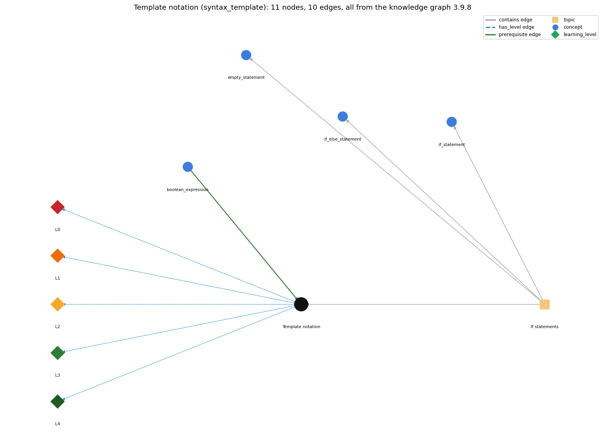

# Template notation (`syntax_template`)

the book's notation for a construct: a name in angle brackets, such as &lt;boolean expression&gt;, stands for any instance of that construct

Section 1.3 1.3 Conditionals and Loops, topic 1.3.b If statements. From the knowledge graph 3.9.8 (`data/raw/chapter1_kg_updated.json`).

## Concepts associated with syntax\_template (4)

| Concept | Description | How it is associated |
| --- | --- | --- |
| **boolean\_expression** | an expression that evaluates to true/false | prerequisite of it (it needs this) composition rule (R) with it |
| **empty\_statement** | a lone ; is an empty statement; a block can stand alone | same topic (topic1.3.b) |
| **if\_else\_statement** | choose one of two blocks | same topic (topic1.3.b) |
| **if\_statement** | run a block only when the condition holds | same topic (topic1.3.b) |

## Every edge in this view and its full label (10)

| From | Edge | To | Full edge label |
| --- | --- | --- | --- |
| **boolean\_expression** | prerequisite | **syntax\_template** | In the template if (&lt;boolean expression&gt;) { &lt;statements&gt; }, &lt;boolean expression&gt; stands for any expression of type boolean. grounding: book\_passage composition rule (R) of boolean\_expression with syntax\_template: In the template if (&lt;boolean expression&gt;) { &lt;statements&gt; } the placeholder may be filled by any boolean-typed expression: a literal, a boolean variable, a comparison or a combination with logical operators. composition rule (R) of syntax\_template with boolean\_expression: The \`&lt;boolean expression&gt;\` slot accepts only expressions of type boolean (\`x &gt; y\`, \`found\`, \`a &amp;&amp; b\`). An int expression or an assignment such as \`x = y\` with int x is a compile error in that slot. |
| **syntax\_template** | has\_level | **syntax\_template@L0** | Template notation -&gt; L0 (Prestructural): the answer holds a rule that contradicts Java (1 way). **[0] everyday\_reading** (E): Folk meaning: angle brackets read as the less-than and greater-than signs, or as text to be typed. In a template, \`&lt;boolean expression&gt;\` is a placeholder that is replaced by any instance of that construct; only the other tokens (if, parentheses, braces) are typed literally. |
| **syntax\_template** | has\_level | **syntax\_template@L1** | Template notation -&gt; L1 (Unistructural): the answer states one correct rule without applying it (2 ways). **[0] names\_the\_element** (N): Notation (metalanguage): a template is S&amp;W's pattern for the form of a Java construct. Fixed tokens are written literally, and a name in angle brackets stands for any instance of a previously defined construct. **[1] states\_the\_rule** (S): In \`if (&lt;boolean expression&gt;) { &lt;statements&gt; }\`, \`if\`, \`(\`, \`)\`, \`{\`, \`}\` must appear as written. \`&lt;boolean expression&gt;\` may be any expression of type boolean, and \`&lt;statements&gt;\` any statement block. The braces are optional for a single statement. Syntax is the form a statement must have, checked by the compiler (syntax errors); semantics is what the statement means when it runs, which the compiler does not check. |
| **syntax\_template** | has\_level | **syntax\_template@L2** | Template notation -&gt; L2 (Multistructural): the answer applies the rules of Template notation to every part of the code, in order (3 ways). **[0] line\_by\_line\_trace** (LT): Reading order: match the template's fixed tokens left to right against the code, then for each placeholder check that the code in that position is an instance of the named construct, recursively (a boolean expression may itself contain sub-expressions). **[1] output\_prediction** (OP): Filling a template produces one concrete, legal Java construct. For example, if (&lt;boolean expression&gt;) &lt;statements&gt; becomes \`if (x &lt; 0) x = -x;\`. **[2] one\_step\_execution** (OS): One substitution step replaces one placeholder with one instance of its construct and leaves the rest of the template unchanged. |
| **syntax\_template** | has\_level | **syntax\_template@L3** | Template notation -&gt; L3 (Relational): the answer relates the parts (2 ways). **[0] relation\_to\_neighbour** (R): The \`&lt;boolean expression&gt;\` slot accepts only expressions of type boolean (\`x &gt; y\`, \`found\`, \`a &amp;&amp; b\`). An int expression or an assignment such as \`x = y\` with int x is a compile error in that slot. **[1] purpose\_of\_the\_whole** (P): Purpose: to describe compactly what every instance of a construct looks like (if, while, for, do-while), so that you can write new instances and check existing code against the form. |
| **syntax\_template** | has\_level | **syntax\_template@L4** | Template notation -&gt; L4 (Extended abstract): the answer reasons beyond the given code (5 ways). **[0] predict\_a\_change** (C): Changing what fills a placeholder (any other boolean expression) keeps the code legal. Changing or omitting a fixed token (dropping the parentheses, adding \`then\`) breaks it. **[1] transfer\_to\_a\_new\_program** (X): Use templates to learn or check the form of a new construct. They show syntax, not meaning (the meaning of while vs if is not in the template), and they leave out details such as optional braces, so read them together with the semantic rule. **[2] diagnose\_an\_error** (D): rule broken: Fixed tokens of the template must appear exactly. Kind: compile-time. Trigger class: Dropping the parentheses (\`if a &gt; b { c = 0; }\`) or adding a word (\`if (a &gt; b) then c = 0;\`). **[3] diagnose\_an\_error** (D): rule broken: A placeholder must be filled by an instance of the named construct. Kind: compile-time. Trigger class: Putting an int expression in a \`&lt;boolean expression&gt;\` slot (\`if (x)\` with int x, \`if (t = goal)\`): incompatible types. **[4] diagnose\_an\_error** (D): rule broken: Angle brackets are notation, not code. Kind: compile-time. Trigger class: Typing the template text literally (\`if (&lt;boolean expression&gt;)\`). |
| **topic1.3.b** | contains | **empty\_statement** | topic topic1.3.b contains empty\_statement |
| **topic1.3.b** | contains | **if\_else\_statement** | topic topic1.3.b contains if\_else\_statement |
| **topic1.3.b** | contains | **if\_statement** | topic topic1.3.b contains if\_statement |
| **topic1.3.b** | contains | **syntax\_template** | topic topic1.3.b contains syntax\_template |
