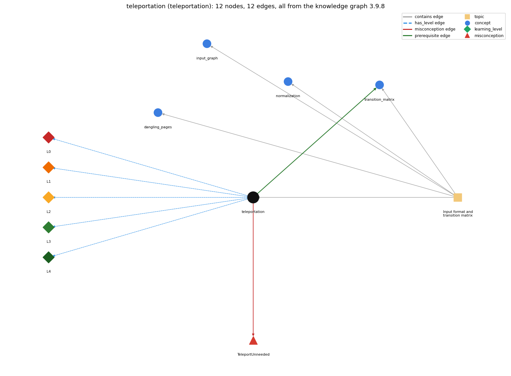

# teleportation (`teleportation`)

the 90-10 rule: follow a link or jump to a random page

Section 1.6 Case Study: Random Web Surfer, topic 1.6.a Input format and transition matrix.

## At a glance

- **Needs first:** nothing
- **Leads to:** `transition_matrix`
- **Learned alongside:** nothing
- **Misconceptions:** `TeleportUnneeded`
- **Errors:** none
- **Levels:** L0, L1, L2, L3, L4

Everything below comes from the knowledge graph 3.9.8 (`data/raw/chapter1_kg_updated.json`): 12 edges around this concept. The edge logic, the wrong and right rules and the exact rules of the ways are copied word for word from the graph.

## To work on (1)

- no aliases: a student's words cannot name this concept

## What it needs first (0)

A prerequisite edge means the other concept has to be understood before `teleportation`.

No prerequisite edge leads into this concept.

## What it leads to (1)

These concepts need `teleportation` first.

### `teleportation` comes before `transition_matrix`

*a 2-D array of move probabilities (rows sum to 1)*

- **Edge:** `pre:teleportation->transition_matrix`
- **Exact edge logic:** The 90-10 rule says the surfer follows a random link 90 percent of the time and jumps to a random page 10 percent of the time, and each transition-matrix entry is computed from it.
- **Grounding:** questionable
- **Composition rule (R) of `teleportation` with `transition_matrix`:** Every entry is built as link part plus leap part; the .90 and .10 weights must sum to 1 for each row to remain a distribution.
- **Composition rule (R) of `transition_matrix` with `teleportation`:** The .10/N term, added to every entry, is the teleport (random-page) part of each row; the .90 factor scales the link part so the two parts sum to 1.

## Learned alongside (0)

A parallel edge joins two concepts that sit side by side: neither is needed before the other.

No parallel edge touches this concept.

## Misconceptions (1)

A misconception edge states the wrong rule a student may hold about this concept, and the right rule.

### TeleportUnneeded

- **Edge:** `teleportation` &rarr; `TeleportUnneeded` (misconception)
- **Exact edge logic (the wrong rule):** Without teleporting, the surfer still visits every page.
- **Twin logic (the right rule):** Without the random leap the surfer can get stuck (e.g. in a spider trap with no outgoing links); the 90-10 rule guarantees mixing.
- **Wrong belief (on the node):** Without teleporting, the surfer still visits every page.
- **Correct rule (on the node):** Without the random leap the surfer can get stuck (e.g. in a spider trap with no outgoing links); the 90-10 rule guarantees mixing.
- **Provenance:** derived
- **Role of this concept:** primary
- **L0 way linked to it:** yes
- **L0 way [1] misconception, exact rule:** wrong rule: Without teleporting, the surfer still visits every page. Right rule: Without the random leap the surfer can get stuck (e.g. in a spider trap with no outgoing links); the 90-10 rule guarantees mixing.
- **L0 way [2] inconsistent\_trace, exact rule:** Applies LT (add .10/N to every entry of every row, after the link term) unevenly: e.g. adds it only to entries that have links, or only to the diagonal, so rows sum to less than 1. (here mixing in: "Without teleporting, the surfer still visits every page")

## Errors (0)

An error edge states the rule that gets broken in a program, and the right rule.

The graph has no error edge from this concept.

## Levels L0 to L4 (5 of 5)

Each level edge lists the ways a student shows that level, each with its exact rule.

### L0: Prestructural / sensorimotor

L0 for teleportation: the answer holds a rule that contradicts Java.

*Deciding question: Does every rule the answer applies to teleportation agree with the language rule? If it reads the code with everyday meanings, applies a wrong rule, or switches rules within one trace, it is L0. A slip in an otherwise rule-correct trace is L2 with an error, not L0.*

- **Edge:** `teleportation` &rarr; `teleportation@L0` (has_level)
- **Exact edge logic:** teleportation -&gt; L0 (Prestructural): the answer holds a rule that contradicts Java (3 ways).

Ways (3), each with its exact rule:

- **[0] everyday\_reading** (rule type E, folk-meaning rule): Everyday "90 percent of the time" reads as a quota (exactly 9 of every 10 moves follow links); in the model it is a probability applied independently on every move, folded into each matrix entry as .90\*(link share) + .10/N.
- **[1] misconception** (rule type M, wrong rule / right rule) &rarr; `TeleportUnneeded`: wrong rule: Without teleporting, the surfer still visits every page. Right rule: Without the random leap the surfer can get stuck (e.g. in a spider trap with no outgoing links); the 90-10 rule guarantees mixing.
- **[2] inconsistent\_trace** (rule type T, uneven-application rule) &rarr; `TeleportUnneeded`: Applies LT (add .10/N to every entry of every row, after the link term) unevenly: e.g. adds it only to entries that have links, or only to the diagonal, so rows sum to less than 1. (here mixing in: "Without teleporting, the surfer still visits every page")

### L1: Unistructural / atom x text surface

L1 for teleportation: the answer states one correct rule without applying it.

*Deciding question: Does the answer cover every part of the code, in order, with the values (L2)? If it covers one part or only states the rule, it is L1.*

- **Edge:** `teleportation` &rarr; `teleportation@L1` (has_level)
- **Exact edge logic:** teleportation -&gt; L1 (Unistructural): the answer states one correct rule without applying it (2 ways).

Ways (2), each with its exact rule:

- **[0] names\_the\_element** (rule type N, identity rule): A model rule: the random leap of the 90-10 rule, a jump to a page chosen uniformly from all N pages with probability .10.
- **[1] states\_the\_rule** (rule type S, declarative rule): 90 percent of the time the surfer clicks a random link on the current page (each link equally likely) and 10 percent of the time goes directly to a random page (all pages equally likely); in the matrix this adds .10/N to each entry.

### L2: Multistructural / block x execution / preoperational

L2 for teleportation: the answer applies these rules to every part of the code, in order.

*Deciding question: Is the answer many segments mapped onto lines (L2), or one segment stating the purpose of the whole (L3)? A correct output with no value-by-value justification is not levelled.*

- **Edge:** `teleportation` &rarr; `teleportation@L2` (has_level)
- **Exact edge logic:** teleportation -&gt; L2 (Multistructural): the answer applies the rules of teleportation to every part of the code, in order (3 ways).

Ways (3), each with its exact rule:

- **[0] line\_by\_line\_trace** (rule type LT, operational sequencing rule): Per entry, the link term .90\*counts[i][j]/outDegree[i] is computed first and the leap term .10/N is then added to every entry, including entries with no link and the diagonal.
- **[1] output\_prediction** (rule type OP, evaluation / result rule): The leap contributes .10/N to each entry: .02 for tiny.txt (N = 5), so an entry with no link is .02 and the single link of page 0 gives .92.
- **[2] one\_step\_execution** (rule type OS, state-transition rule): Adding the leap term raises one entry p by .10/N; summed across a row it adds exactly .10.

### L3: Relational / relations x function (concrete operational begins)

L3 for teleportation: the answer relates the parts by these rules.

*Deciding question: Was the purpose deduced from the code, or only guessed from traced input/output pairs (then L2)? Does the answer stay within the given code (L3), or reason about changed code, an error class or a new program (L4)?*

- **Edge:** `teleportation` &rarr; `teleportation@L3` (has_level)
- **Exact edge logic:** teleportation -&gt; L3 (Relational): the answer relates the parts (2 ways).

Ways (2), each with its exact rule:

- **[0] relation\_to\_neighbour** (rule type R, composition rule (with a neighbour)): Every entry is built as link part plus leap part; the .90 and .10 weights must sum to 1 for each row to remain a distribution.
- **[1] purpose\_of\_the\_whole** (rule type P, plan / role rule): Guarantee mixing: the leap makes every page reachable from every page, so the chain has a unique long-run distribution and spider traps cannot capture the surfer.

### L4: Extended abstract (concrete-operational reversibility and conservation)

L4 for teleportation: the answer reasons beyond the given code by these rules.

*Deciding question: Does the answer link the code to a broader context: a changed program, a class of inputs, an unseen problem? Re-tracing changed code value by value is L2; fixing one given failing case is L3.*

- **Edge:** `teleportation` &rarr; `teleportation@L4` (has_level)
- **Exact edge logic:** teleportation -&gt; L4 (Extended abstract): the answer reasons beyond the given code (4 ways).

Ways (4), each with its exact rule:

- **[0] predict\_a\_change** (rule type C, conservation rule) &rarr; `TeleportUnneeded`: Changing the split to 80-20 or 95-5 keeps rows stochastic and mixing but changes the ranks; removing the leap (100-0) can break mixing.
- **[1] transfer\_to\_a\_new\_program** (rule type X, applicability rule): Use whenever the link graph may not be strongly connected (any real web model) to make the chain mix; the particular 90-10 split is a guess, so it is a modelling parameter, not a fact.
- **[2] diagnose\_an\_error** (rule type D, error rule): rule broken: The leap is needed for mixing. Kind: silent logic error. Trigger class: Leap term removed and graph has a spider trap or unreachable part: ranks pile up in the trap and depend on the starting page.
- **[3] diagnose\_an\_error** (rule type D, error rule): rule broken: Leap and link weights must sum to 1. Kind: silent logic error. Trigger class: Leap changed (e.g. .20/N) without changing .90: rows sum to 1.1 and the random move misbehaves.

## Same topic

`teleportation` belongs to the topic **Input format and transition matrix** (`topic1.6.a`). The topic also contains: `dangling_pages`, `input_graph`, `normalization`, `transition_matrix`.

## Rules of the concept (14)

- **Book** (SW-1e, p. 168 (pdf 178)): "The primary purpose of the 90-10 rule is to guarantee mixing and eliminate such anomalies."
- **Book** (SW-1.6, ): "90 per cent of the time the random surfer clicks a random link on the current page"
- **E** (folk-meaning rule): Everyday "90 percent of the time" reads as a quota (exactly 9 of every 10 moves follow links); in the model it is a probability applied independently on every move, folded into each matrix entry as .90\*(link share) + .10/N.
- **M** (wrong rule / right rule): TeleportUnneeded: wrong: Without teleporting, the surfer still visits every page. \| right: Without the random leap the surfer can get stuck (e.g. in a spider trap with no outgoing links); the 90-10 rule guarantees mixing.
- **T** (uneven-application rule): Applies LT (add .10/N to every entry of every row, after the link term) unevenly: e.g. adds it only to entries that have links, or only to the diagonal, so rows sum to less than 1.
- **N** (identity rule): A model rule: the random leap of the 90-10 rule, a jump to a page chosen uniformly from all N pages with probability .10.
- **S** (declarative rule): 90 percent of the time the surfer clicks a random link on the current page (each link equally likely) and 10 percent of the time goes directly to a random page (all pages equally likely); in the matrix this adds .10/N to each entry.
- **LT** (operational sequencing rule): Per entry, the link term .90\*counts[i][j]/outDegree[i] is computed first and the leap term .10/N is then added to every entry, including entries with no link and the diagonal.
- **OP** (evaluation / result rule): The leap contributes .10/N to each entry: .02 for tiny.txt (N = 5), so an entry with no link is .02 and the single link of page 0 gives .92.
- **OS** (state-transition rule): Adding the leap term raises one entry p by .10/N; summed across a row it adds exactly .10.
- **R** (composition rule (with a neighbour)): with transition\_matrix: Every entry is built as link part plus leap part; the .90 and .10 weights must sum to 1 for each row to remain a distribution.
- **P** (plan / role rule): Guarantee mixing: the leap makes every page reachable from every page, so the chain has a unique long-run distribution and spider traps cannot capture the surfer.
- **C** (conservation rule): Changing the split to 80-20 or 95-5 keeps rows stochastic and mixing but changes the ranks; removing the leap (100-0) can break mixing.
- **D** (error rule): rule broken: The leap is needed for mixing. (silent logic error)
- **D** (error rule): rule broken: Leap and link weights must sum to 1. (silent logic error)
- **X** (applicability rule): Use whenever the link graph may not be strongly connected (any real web model) to make the chain mix; the particular 90-10 split is a guess, so it is a modelling parameter, not a fact.

## How it is found in code and answers (reader block)

- **Aliases:** none
- **Code patterns:** `0\.9\d*\s*\*`, `\+\s*0\.1\d*\s*/\s*\w+`, `0\.1\d*\s*/\s*\w+\s*\+`
- **Operator symbols:** none
- **Java types:** none

## The whole prerequisite chain

- **Everything it builds on (0):** nothing
- **Everything that builds on it (10):** `convergence_rate`, `dangling_pages`, `frequency_counting`, `markov_chain`, `normalization`, `power_method`, `random_move`, `simulation_loop`, `transition_matrix`, `two_models`

## Every edge in this view and its exact edge logic (12)

All the edges drawn in the picture, in the order: prerequisite, parallel, misconception, error, has_level, contains.

**1. `teleportation` &rarr; `transition_matrix`** (prerequisite)

- **Exact edge logic:** The 90-10 rule says the surfer follows a random link 90 percent of the time and jumps to a random page 10 percent of the time, and each transition-matrix entry is computed from it.
- **Grounding:** questionable
- **Composition rule (R) of `teleportation` with `transition_matrix`:** Every entry is built as link part plus leap part; the .90 and .10 weights must sum to 1 for each row to remain a distribution.
- **Composition rule (R) of `transition_matrix` with `teleportation`:** The .10/N term, added to every entry, is the teleport (random-page) part of each row; the .90 factor scales the link part so the two parts sum to 1.

**2. `teleportation` &rarr; `TeleportUnneeded`** (misconception)

- **Exact edge logic (the wrong rule):** Without teleporting, the surfer still visits every page.
- **Twin logic (the right rule):** Without the random leap the surfer can get stuck (e.g. in a spider trap with no outgoing links); the 90-10 rule guarantees mixing.
- **Role:** primary

**3. `teleportation` &rarr; `teleportation@L0`** (has_level)

- **Exact edge logic:** teleportation -&gt; L0 (Prestructural): the answer holds a rule that contradicts Java (3 ways).
  - **[0] everyday\_reading** (rule type E, folk-meaning rule): Everyday "90 percent of the time" reads as a quota (exactly 9 of every 10 moves follow links); in the model it is a probability applied independently on every move, folded into each matrix entry as .90\*(link share) + .10/N.
  - **[1] misconception** (rule type M, wrong rule / right rule) &rarr; `TeleportUnneeded`: wrong rule: Without teleporting, the surfer still visits every page. Right rule: Without the random leap the surfer can get stuck (e.g. in a spider trap with no outgoing links); the 90-10 rule guarantees mixing.
  - **[2] inconsistent\_trace** (rule type T, uneven-application rule) &rarr; `TeleportUnneeded`: Applies LT (add .10/N to every entry of every row, after the link term) unevenly: e.g. adds it only to entries that have links, or only to the diagonal, so rows sum to less than 1. (here mixing in: "Without teleporting, the surfer still visits every page")

**4. `teleportation` &rarr; `teleportation@L1`** (has_level)

- **Exact edge logic:** teleportation -&gt; L1 (Unistructural): the answer states one correct rule without applying it (2 ways).
  - **[0] names\_the\_element** (rule type N, identity rule): A model rule: the random leap of the 90-10 rule, a jump to a page chosen uniformly from all N pages with probability .10.
  - **[1] states\_the\_rule** (rule type S, declarative rule): 90 percent of the time the surfer clicks a random link on the current page (each link equally likely) and 10 percent of the time goes directly to a random page (all pages equally likely); in the matrix this adds .10/N to each entry.

**5. `teleportation` &rarr; `teleportation@L2`** (has_level)

- **Exact edge logic:** teleportation -&gt; L2 (Multistructural): the answer applies the rules of teleportation to every part of the code, in order (3 ways).
  - **[0] line\_by\_line\_trace** (rule type LT, operational sequencing rule): Per entry, the link term .90\*counts[i][j]/outDegree[i] is computed first and the leap term .10/N is then added to every entry, including entries with no link and the diagonal.
  - **[1] output\_prediction** (rule type OP, evaluation / result rule): The leap contributes .10/N to each entry: .02 for tiny.txt (N = 5), so an entry with no link is .02 and the single link of page 0 gives .92.
  - **[2] one\_step\_execution** (rule type OS, state-transition rule): Adding the leap term raises one entry p by .10/N; summed across a row it adds exactly .10.

**6. `teleportation` &rarr; `teleportation@L3`** (has_level)

- **Exact edge logic:** teleportation -&gt; L3 (Relational): the answer relates the parts (2 ways).
  - **[0] relation\_to\_neighbour** (rule type R, composition rule (with a neighbour)): Every entry is built as link part plus leap part; the .90 and .10 weights must sum to 1 for each row to remain a distribution.
  - **[1] purpose\_of\_the\_whole** (rule type P, plan / role rule): Guarantee mixing: the leap makes every page reachable from every page, so the chain has a unique long-run distribution and spider traps cannot capture the surfer.

**7. `teleportation` &rarr; `teleportation@L4`** (has_level)

- **Exact edge logic:** teleportation -&gt; L4 (Extended abstract): the answer reasons beyond the given code (4 ways).
  - **[0] predict\_a\_change** (rule type C, conservation rule) &rarr; `TeleportUnneeded`: Changing the split to 80-20 or 95-5 keeps rows stochastic and mixing but changes the ranks; removing the leap (100-0) can break mixing.
  - **[1] transfer\_to\_a\_new\_program** (rule type X, applicability rule): Use whenever the link graph may not be strongly connected (any real web model) to make the chain mix; the particular 90-10 split is a guess, so it is a modelling parameter, not a fact.
  - **[2] diagnose\_an\_error** (rule type D, error rule): rule broken: The leap is needed for mixing. Kind: silent logic error. Trigger class: Leap term removed and graph has a spider trap or unreachable part: ranks pile up in the trap and depend on the starting page.
  - **[3] diagnose\_an\_error** (rule type D, error rule): rule broken: Leap and link weights must sum to 1. Kind: silent logic error. Trigger class: Leap changed (e.g. .20/N) without changing .90: rows sum to 1.1 and the random move misbehaves.

**8. `topic1.6.a` &rarr; `teleportation`** (contains)

- topic `topic1.6.a` contains `teleportation`

**9. `topic1.6.a` &rarr; `dangling_pages`** (contains)

- topic `topic1.6.a` contains `dangling_pages`

**10. `topic1.6.a` &rarr; `input_graph`** (contains)

- topic `topic1.6.a` contains `input_graph`

**11. `topic1.6.a` &rarr; `normalization`** (contains)

- topic `topic1.6.a` contains `normalization`

**12. `topic1.6.a` &rarr; `transition_matrix`** (contains)

- topic `topic1.6.a` contains `transition_matrix`
