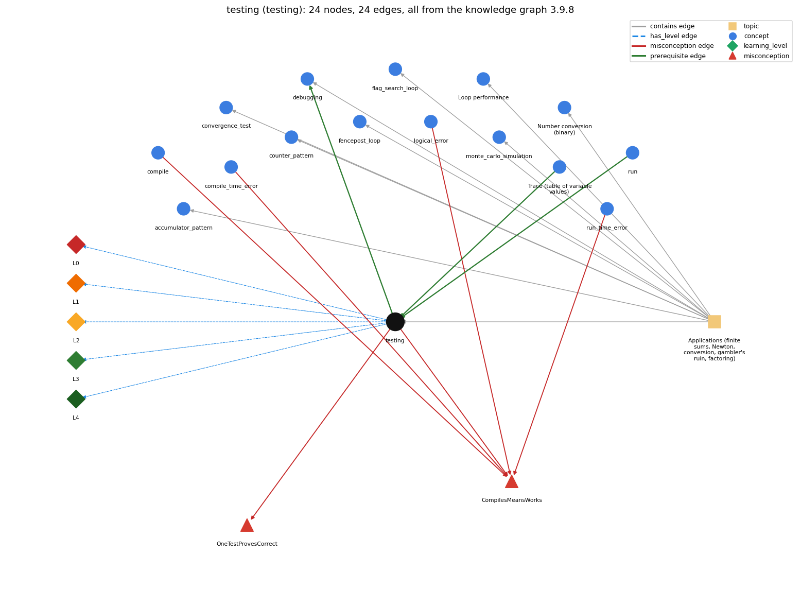

# testing (`testing`)

running a program on chosen inputs, including boundary and unusual ones, and comparing the output with what it should be

Section 1.3 Conditionals and Loops, topic 1.3.f Applications (finite sums, Newton, conversion, gambler's ruin, factoring).

## At a glance

- **Needs first:** `program_trace`, `run`
- **Leads to:** `debugging`
- **Learned alongside:** nothing
- **Misconceptions:** `CompilesMeansWorks`, `OneTestProvesCorrect`
- **Errors:** none
- **Levels:** L0, L1, L2, L3, L4

Everything below comes from the knowledge graph 3.9.8 (`data/raw/chapter1_kg_updated.json`): 24 edges around this concept. The edge logic, the wrong and right rules and the exact rules of the ways are copied word for word from the graph.

## To work on (2)

- no code pattern or signal: the code cannot tag this concept
- no aliases: a student's words cannot name this concept

## What it needs first (2)

A prerequisite edge means the other concept has to be understood before `testing`.

### `program_trace` comes before `testing`

*Trace (table of variable values): a table of the values of the variables after each statement, used to check what code does*

- **Edge:** `pre:program_trace->testing`
- **Exact edge logic:** A test needs an expected result, and the expected result comes from tracing what the program should do, step by step.
- **Grounding:** book\_passage
- **Composition rule (R) of `testing` with `program_trace`:** The expected output of a test comes from a hand trace of what the program should do for that input.

### `run` comes before `testing`

*java executes main in the JVM*

- **Edge:** `pre:run->testing`
- **Exact edge logic:** A program is tested by running it on chosen inputs and comparing what it prints with what it should print.
- **Grounding:** book\_passage
- **Composition rule (R) of `testing` with `run`:** Each test is one run with one input: java Name followed by the test arguments (or with input redirected from a file).

## What it leads to (1)

These concepts need `testing` first.

### `testing` comes before `debugging`

*finding and fixing the cause of a wrong result or error by forming a hypothesis, changing the program and checking the prediction*

- **Edge:** `pre:testing->debugging`
- **Exact edge logic:** A failing test is what starts debugging: testing finds that something is wrong, debugging finds why.
- **Grounding:** book\_passage
- **Composition rule (R) of `testing` with `debugging`:** A failing test starts debugging; after the fix, the same test is run again to confirm it.
- **Composition rule (R) of `debugging` with `testing`:** Testing tells that a program is wrong; debugging finds why. The failing test is re-run after the fix.

## Learned alongside (0)

A parallel edge joins two concepts that sit side by side: neither is needed before the other.

No parallel edge touches this concept.

## Misconceptions (2)

A misconception edge states the wrong rule a student may hold about this concept, and the right rule.

### CompilesMeansWorks

- **Edge:** `testing` &rarr; `CompilesMeansWorks` (misconception)
- **Exact edge logic (the wrong rule):** Code that compiles is code that works.
- **Twin logic (the right rule):** Code that compiles can still have run-time and logical errors.
- **Wrong belief (on the node):** Code that compiles is code that works.
- **Correct rule (on the node):** Code that compiles can still have run-time and logical errors.
- **Provenance:** published
- **Role of this concept:** context
- **L0 way linked to it:** yes
- **L0 way [3] misconception, exact rule:** wrong rule: Code that compiles is code that works. Right rule: Compiling checks only the form of the code; whether it does the right thing is found by running and testing it.
- **Edge `compile` &rarr; `CompilesMeansWorks`, exact edge logic:** Code that compiles is code that works. **Twin logic:** Code that compiles can still have run-time and logical errors. (role: primary)
- **Edge `compile_time_error` &rarr; `CompilesMeansWorks`, exact edge logic:** Code that compiles is code that works. **Twin logic:** Code that compiles can still have run-time and logical errors. (role: context)
- **Edge `logical_error` &rarr; `CompilesMeansWorks`, exact edge logic:** Code that compiles is code that works. **Twin logic:** Code that compiles can still have run-time and logical errors. (role: context)
- **Edge `run_time_error` &rarr; `CompilesMeansWorks`, exact edge logic:** Code that compiles is code that works. **Twin logic:** Code that compiles can still have run-time and logical errors. (role: context)

### OneTestProvesCorrect

- **Edge:** `testing` &rarr; `OneTestProvesCorrect` (misconception)
- **Exact edge logic (the wrong rule):** If a program gives the right output for one input, it is correct.
- **Twin logic (the right rule):** One passing run shows only that this input works; a program is checked by running it on numerous inputs, including boundary and unusual ones.
- **Wrong belief (on the node):** If a program gives the right output for one input, it is correct.
- **Correct rule (on the node):** One passing run shows only that this input works; a program is checked by running it on numerous inputs, including boundary and unusual ones.
- **Provenance:** textbook
- **Role of this concept:** primary
- **L0 way linked to it:** yes
- **L0 way [1] misconception, exact rule:** wrong rule: If a program gives the right output for one input, it is correct. Right rule: One passing run shows only that this input works; check the program on numerous inputs, including boundary and unusual ones.
- **L0 way [2] inconsistent\_trace, exact rule:** Applies the testing rule unevenly: checks the output for one input against an expected value, but accepts the output for another input without working out what it should be. (here mixing in: "If a program gives the right output for one input, it is correct")

## Errors (0)

An error edge states the rule that gets broken in a program, and the right rule.

The graph has no error edge from this concept.

## Levels L0 to L4 (5 of 5)

Each level edge lists the ways a student shows that level, each with its exact rule.

### L0: Prestructural / sensorimotor

L0 for testing: the answer holds a rule that contradicts Java.

*Deciding question: Does every rule the answer applies to testing agree with the language rule? If it reads the code with everyday meanings, applies a wrong rule, or switches rules within one trace, it is L0. A slip in an otherwise rule-correct trace is L2 with an error, not L0.*

- **Edge:** `testing` &rarr; `testing@L0` (has_level)
- **Exact edge logic:** testing -&gt; L0 (Prestructural): the answer holds a rule that contradicts Java (4 ways).

Ways (4), each with its exact rule:

- **[0] everyday\_reading** (rule type E, folk-meaning rule): Everyday 'test' means trying something once to see whether it works. A program test runs the program on several chosen inputs, each with an expected output worked out in advance, and compares the two.
- **[1] misconception** (rule type M, wrong rule / right rule) &rarr; `OneTestProvesCorrect`: wrong rule: If a program gives the right output for one input, it is correct. Right rule: One passing run shows only that this input works; check the program on numerous inputs, including boundary and unusual ones.
- **[2] inconsistent\_trace** (rule type T, uneven-application rule) &rarr; `OneTestProvesCorrect`: Applies the testing rule unevenly: checks the output for one input against an expected value, but accepts the output for another input without working out what it should be. (here mixing in: "If a program gives the right output for one input, it is correct")
- **[3] misconception** (rule type M, wrong rule / right rule) &rarr; `CompilesMeansWorks`: wrong rule: Code that compiles is code that works. Right rule: Compiling checks only the form of the code; whether it does the right thing is found by running and testing it.

### L1: Unistructural / atom x text surface

L1 for testing: the answer states one correct rule without applying it.

*Deciding question: Does the answer cover every part of the code, in order, with the values (L2)? If it covers one part or only states the rule, it is L1.*

- **Edge:** `testing` &rarr; `testing@L1` (has_level)
- **Exact edge logic:** testing -&gt; L1 (Unistructural): the answer states one correct rule without applying it (2 ways).

Ways (2), each with its exact rule:

- **[0] names\_the\_element** (rule type N, identity rule): Testing: running the program on chosen inputs and comparing each output with the expected output.
- **[1] states\_the\_rule** (rule type S, declarative rule): Write the program, then run and test it: choose inputs, work out the expected output of each in advance, run the program on each, and compare. Include the boundary cases (0, 1, the largest value, an empty input).

### L2: Multistructural / block x execution / preoperational

L2 for testing: the answer applies these rules to every part of the code, in order.

*Deciding question: Is the answer many segments mapped onto lines (L2), or one segment stating the purpose of the whole (L3)? A correct output with no value-by-value justification is not levelled.*

- **Edge:** `testing` &rarr; `testing@L2` (has_level)
- **Exact edge logic:** testing -&gt; L2 (Multistructural): the answer applies the rules of testing to every part of the code, in order (3 ways).

Ways (3), each with its exact rule:

- **[0] line\_by\_line\_trace** (rule type LT, operational sequencing rule): Sequencing: first decide the inputs and expected outputs, then run the program once per input, then compare each output with its expectation; a mismatch is recorded before anything is changed.
- **[1] output\_prediction** (rule type OP, evaluation / result rule): Result: for each input the test gives pass (output equals expectation) or fail; the program is accepted only when every chosen input passes.
- **[2] one\_step\_execution** (rule type OS, state-transition rule): State transition: one test run leaves the program unchanged and adds one pass or fail to what is known about it.

### L3: Relational / relations x function (concrete operational begins)

L3 for testing: the answer relates the parts by these rules.

*Deciding question: Was the purpose deduced from the code, or only guessed from traced input/output pairs (then L2)? Does the answer stay within the given code (L3), or reason about changed code, an error class or a new program (L4)?*

- **Edge:** `testing` &rarr; `testing@L3` (has_level)
- **Exact edge logic:** testing -&gt; L3 (Relational): the answer relates the parts (4 ways).

Ways (4), each with its exact rule:

- **[0] relation\_to\_neighbour** (rule type R, composition rule (with a neighbour)): Each test is one run with one input: java Name followed by the test arguments (or with input redirected from a file).
- **[1] relation\_to\_neighbour** (rule type R, composition rule (with a neighbour)): The expected output of a test comes from a hand trace of what the program should do for that input.
- **[2] relation\_to\_neighbour** (rule type R, composition rule (with a neighbour)): A failing test starts debugging; after the fix, the same test is run again to confirm it.
- **[3] purpose\_of\_the\_whole** (rule type P, plan / role rule): Plan: tests give evidence that a program does what it should for the inputs that matter, and catch the cases where it does not.

### L4: Extended abstract (concrete-operational reversibility and conservation)

L4 for testing: the answer reasons beyond the given code by these rules.

*Deciding question: Does the answer link the code to a broader context: a changed program, a class of inputs, an unseen problem? Re-tracing changed code value by value is L2; fixing one given failing case is L3.*

- **Edge:** `testing` &rarr; `testing@L4` (has_level)
- **Exact edge logic:** testing -&gt; L4 (Extended abstract): the answer reasons beyond the given code (3 ways).

Ways (3), each with its exact rule:

- **[0] predict\_a\_change** (rule type C, conservation rule) &rarr; `OneTestProvesCorrect`: Conservation: after any change to the program, the earlier tests must still pass; a fix for one input that breaks another is caught by re-running them all.
- **[1] transfer\_to\_a\_new\_program** (rule type X, applicability rule): Test every program you write, before using its output: on the given example, on the boundary values, and on an input whose answer you can work out by hand.
- **[2] diagnose\_an\_error** (rule type D, error rule): rule broken: A program is checked on several inputs, including the boundary cases. Kind: silent logic error. Trigger class: only the example input is tried, so a bug that shows for 0, 1, a negative value, the largest value or an empty input is never seen

## Same topic

`testing` belongs to the topic **Applications (finite sums, Newton, conversion, gambler's ruin, factoring)** (`topic1.3.f`). The topic also contains: `accumulator_pattern`, `convergence_test`, `counter_pattern`, `debugging`, `fencepost_loop`, `flag_search_loop`, `loop_performance`, `monte_carlo_simulation`, `number_conversion`.

## Rules of the concept (16)

- **Book** (SW-1e, p. 73 (pdf 83)): "For each exercise, you will write a Java program, then run and test it."
- **Book** (SW-1e, p. 177 (pdf 187)): "each one is the product of a long bout of testing, fixing bugs, and running the programs on numerous inputs."
- **Book** (TJ-2e, p. 165 (pdf 187)): "Test your method with multiple strings, including some that are balanced and some that are not."
- **E** (folk-meaning rule): Everyday 'test' means trying something once to see whether it works. A program test runs the program on several chosen inputs, each with an expected output worked out in advance, and compares the two.
- **M** (wrong rule / right rule): OneTestProvesCorrect: wrong: If a program gives the right output for one input, it is correct. \| right: One passing run shows only that this input works; check the program on numerous inputs, including boundary and unusual ones.
- **M** (wrong rule / right rule): CompilesMeansWorks: wrong: Code that compiles is code that works. \| right: Compiling checks only the form of the code; whether it does the right thing is found by running and testing it.
- **T** (uneven-application rule): Applies the testing rule unevenly: checks the output for one input against an expected value, but accepts the output for another input without working out what it should be.
- **N** (identity rule): Testing: running the program on chosen inputs and comparing each output with the expected output.
- **S** (declarative rule): Write the program, then run and test it: choose inputs, work out the expected output of each in advance, run the program on each, and compare. Include the boundary cases (0, 1, the largest value, an empty input).
- **LT** (operational sequencing rule): Sequencing: first decide the inputs and expected outputs, then run the program once per input, then compare each output with its expectation; a mismatch is recorded before anything is changed.
- **OP** (evaluation / result rule): Result: for each input the test gives pass (output equals expectation) or fail; the program is accepted only when every chosen input passes.
- **OS** (state-transition rule): State transition: one test run leaves the program unchanged and adds one pass or fail to what is known about it.
- **R** (composition rule (with a neighbour)): with run: Each test is one run with one input: java Name followed by the test arguments (or with input redirected from a file).
- **R** (composition rule (with a neighbour)): with program\_trace: The expected output of a test comes from a hand trace of what the program should do for that input.
- **R** (composition rule (with a neighbour)): with debugging: A failing test starts debugging; after the fix, the same test is run again to confirm it.
- **P** (plan / role rule): Plan: tests give evidence that a program does what it should for the inputs that matter, and catch the cases where it does not.
- **C** (conservation rule): Conservation: after any change to the program, the earlier tests must still pass; a fix for one input that breaks another is caught by re-running them all.
- **D** (error rule): rule broken: A program is checked on several inputs, including the boundary cases. (silent logic error)
- **X** (applicability rule): Test every program you write, before using its output: on the given example, on the boundary values, and on an input whose answer you can work out by hand.

## How it is found in code and answers (reader block)

- **Aliases:** none
- **Code patterns:** none
- **Operator symbols:** none
- **Java types:** none

## The whole prerequisite chain

- **Everything it builds on (11):** `assignment`, `compile`, `data_type`, `declaration`, `identifier`, `literal`, `primitive_type`, `program_text`, `program_trace`, `run`, `variable`
- **Everything that builds on it (1):** `debugging`

## Every edge in this view and its exact edge logic (24)

All the edges drawn in the picture, in the order: prerequisite, parallel, misconception, error, has_level, contains.

**1. `program_trace` &rarr; `testing`** (prerequisite)

- **Exact edge logic:** A test needs an expected result, and the expected result comes from tracing what the program should do, step by step.
- **Grounding:** book\_passage
- **Composition rule (R) of `testing` with `program_trace`:** The expected output of a test comes from a hand trace of what the program should do for that input.

**2. `run` &rarr; `testing`** (prerequisite)

- **Exact edge logic:** A program is tested by running it on chosen inputs and comparing what it prints with what it should print.
- **Grounding:** book\_passage
- **Composition rule (R) of `testing` with `run`:** Each test is one run with one input: java Name followed by the test arguments (or with input redirected from a file).

**3. `testing` &rarr; `debugging`** (prerequisite)

- **Exact edge logic:** A failing test is what starts debugging: testing finds that something is wrong, debugging finds why.
- **Grounding:** book\_passage
- **Composition rule (R) of `testing` with `debugging`:** A failing test starts debugging; after the fix, the same test is run again to confirm it.
- **Composition rule (R) of `debugging` with `testing`:** Testing tells that a program is wrong; debugging finds why. The failing test is re-run after the fix.

**4. `testing` &rarr; `CompilesMeansWorks`** (misconception)

- **Exact edge logic (the wrong rule):** Code that compiles is code that works.
- **Twin logic (the right rule):** Code that compiles can still have run-time and logical errors.
- **Role:** context

**5. `testing` &rarr; `OneTestProvesCorrect`** (misconception)

- **Exact edge logic (the wrong rule):** If a program gives the right output for one input, it is correct.
- **Twin logic (the right rule):** One passing run shows only that this input works; a program is checked by running it on numerous inputs, including boundary and unusual ones.
- **Role:** primary

**6. `compile` &rarr; `CompilesMeansWorks`** (misconception)

- **Exact edge logic (the wrong rule):** Code that compiles is code that works.
- **Twin logic (the right rule):** Code that compiles can still have run-time and logical errors.
- **Role:** primary

**7. `compile_time_error` &rarr; `CompilesMeansWorks`** (misconception)

- **Exact edge logic (the wrong rule):** Code that compiles is code that works.
- **Twin logic (the right rule):** Code that compiles can still have run-time and logical errors.
- **Role:** context

**8. `logical_error` &rarr; `CompilesMeansWorks`** (misconception)

- **Exact edge logic (the wrong rule):** Code that compiles is code that works.
- **Twin logic (the right rule):** Code that compiles can still have run-time and logical errors.
- **Role:** context

**9. `run_time_error` &rarr; `CompilesMeansWorks`** (misconception)

- **Exact edge logic (the wrong rule):** Code that compiles is code that works.
- **Twin logic (the right rule):** Code that compiles can still have run-time and logical errors.
- **Role:** context

**10. `testing` &rarr; `testing@L0`** (has_level)

- **Exact edge logic:** testing -&gt; L0 (Prestructural): the answer holds a rule that contradicts Java (4 ways).
  - **[0] everyday\_reading** (rule type E, folk-meaning rule): Everyday 'test' means trying something once to see whether it works. A program test runs the program on several chosen inputs, each with an expected output worked out in advance, and compares the two.
  - **[1] misconception** (rule type M, wrong rule / right rule) &rarr; `OneTestProvesCorrect`: wrong rule: If a program gives the right output for one input, it is correct. Right rule: One passing run shows only that this input works; check the program on numerous inputs, including boundary and unusual ones.
  - **[2] inconsistent\_trace** (rule type T, uneven-application rule) &rarr; `OneTestProvesCorrect`: Applies the testing rule unevenly: checks the output for one input against an expected value, but accepts the output for another input without working out what it should be. (here mixing in: "If a program gives the right output for one input, it is correct")
  - **[3] misconception** (rule type M, wrong rule / right rule) &rarr; `CompilesMeansWorks`: wrong rule: Code that compiles is code that works. Right rule: Compiling checks only the form of the code; whether it does the right thing is found by running and testing it.

**11. `testing` &rarr; `testing@L1`** (has_level)

- **Exact edge logic:** testing -&gt; L1 (Unistructural): the answer states one correct rule without applying it (2 ways).
  - **[0] names\_the\_element** (rule type N, identity rule): Testing: running the program on chosen inputs and comparing each output with the expected output.
  - **[1] states\_the\_rule** (rule type S, declarative rule): Write the program, then run and test it: choose inputs, work out the expected output of each in advance, run the program on each, and compare. Include the boundary cases (0, 1, the largest value, an empty input).

**12. `testing` &rarr; `testing@L2`** (has_level)

- **Exact edge logic:** testing -&gt; L2 (Multistructural): the answer applies the rules of testing to every part of the code, in order (3 ways).
  - **[0] line\_by\_line\_trace** (rule type LT, operational sequencing rule): Sequencing: first decide the inputs and expected outputs, then run the program once per input, then compare each output with its expectation; a mismatch is recorded before anything is changed.
  - **[1] output\_prediction** (rule type OP, evaluation / result rule): Result: for each input the test gives pass (output equals expectation) or fail; the program is accepted only when every chosen input passes.
  - **[2] one\_step\_execution** (rule type OS, state-transition rule): State transition: one test run leaves the program unchanged and adds one pass or fail to what is known about it.

**13. `testing` &rarr; `testing@L3`** (has_level)

- **Exact edge logic:** testing -&gt; L3 (Relational): the answer relates the parts (4 ways).
  - **[0] relation\_to\_neighbour** (rule type R, composition rule (with a neighbour)): Each test is one run with one input: java Name followed by the test arguments (or with input redirected from a file).
  - **[1] relation\_to\_neighbour** (rule type R, composition rule (with a neighbour)): The expected output of a test comes from a hand trace of what the program should do for that input.
  - **[2] relation\_to\_neighbour** (rule type R, composition rule (with a neighbour)): A failing test starts debugging; after the fix, the same test is run again to confirm it.
  - **[3] purpose\_of\_the\_whole** (rule type P, plan / role rule): Plan: tests give evidence that a program does what it should for the inputs that matter, and catch the cases where it does not.

**14. `testing` &rarr; `testing@L4`** (has_level)

- **Exact edge logic:** testing -&gt; L4 (Extended abstract): the answer reasons beyond the given code (3 ways).
  - **[0] predict\_a\_change** (rule type C, conservation rule) &rarr; `OneTestProvesCorrect`: Conservation: after any change to the program, the earlier tests must still pass; a fix for one input that breaks another is caught by re-running them all.
  - **[1] transfer\_to\_a\_new\_program** (rule type X, applicability rule): Test every program you write, before using its output: on the given example, on the boundary values, and on an input whose answer you can work out by hand.
  - **[2] diagnose\_an\_error** (rule type D, error rule): rule broken: A program is checked on several inputs, including the boundary cases. Kind: silent logic error. Trigger class: only the example input is tried, so a bug that shows for 0, 1, a negative value, the largest value or an empty input is never seen

**15. `topic1.3.f` &rarr; `testing`** (contains)

- topic `topic1.3.f` contains `testing`

**16. `topic1.3.f` &rarr; `accumulator_pattern`** (contains)

- topic `topic1.3.f` contains `accumulator_pattern`

**17. `topic1.3.f` &rarr; `convergence_test`** (contains)

- topic `topic1.3.f` contains `convergence_test`

**18. `topic1.3.f` &rarr; `counter_pattern`** (contains)

- topic `topic1.3.f` contains `counter_pattern`

**19. `topic1.3.f` &rarr; `debugging`** (contains)

- topic `topic1.3.f` contains `debugging`

**20. `topic1.3.f` &rarr; `fencepost_loop`** (contains)

- topic `topic1.3.f` contains `fencepost_loop`

**21. `topic1.3.f` &rarr; `flag_search_loop`** (contains)

- topic `topic1.3.f` contains `flag_search_loop`

**22. `topic1.3.f` &rarr; `loop_performance`** (contains)

- topic `topic1.3.f` contains `loop_performance`

**23. `topic1.3.f` &rarr; `monte_carlo_simulation`** (contains)

- topic `topic1.3.f` contains `monte_carlo_simulation`

**24. `topic1.3.f` &rarr; `number_conversion`** (contains)

- topic `topic1.3.f` contains `number_conversion`
