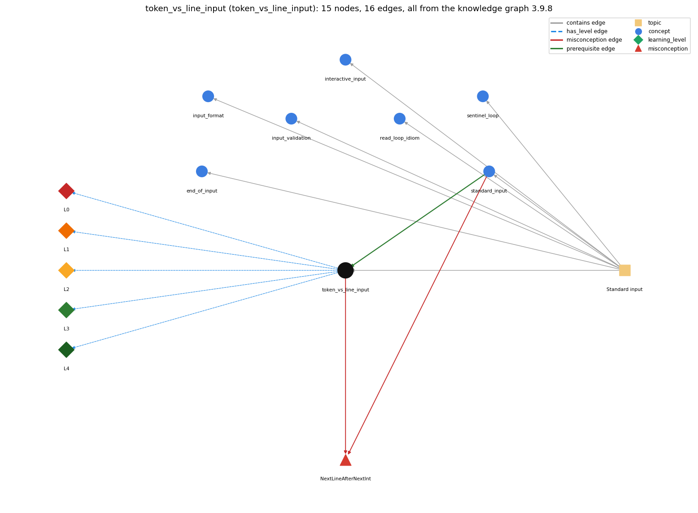

# token_vs_line_input (`token_vs_line_input`)

reading tokens (readInt) versus whole lines (readLine)

Section 1.5 Input and Output, topic 1.5.c Standard input.

## At a glance

- **Needs first:** `standard_input`
- **Leads to:** nothing
- **Learned alongside:** nothing
- **Misconceptions:** `NextLineAfterNextInt`
- **Errors:** none
- **Levels:** L0, L1, L2, L3, L4

Everything below comes from the knowledge graph 3.9.8 (`data/raw/chapter1_kg_updated.json`): 16 edges around this concept. The edge logic, the wrong and right rules and the exact rules of the ways are copied word for word from the graph.

## To work on (1)

- no aliases: a student's words cannot name this concept

## What it needs first (1)

A prerequisite edge means the other concept has to be understood before `token_vs_line_input`.

### `standard_input` comes before `token_vs_line_input`

*StdIn -- reading a stream of values*

- **Edge:** `pre:standard_input->token_vs_line_input`
- **Exact edge logic:** They are standard-input operations.
- **Grounding:** book\_passage
- **Composition rule (R) of `token_vs_line_input` with `standard_input`:** Both kinds of call share the single StdIn position, so a token read changes what the next readLine returns. Mixing them needs care.
- **Composition rule (R) of `standard_input` with `token_vs_line_input`:** Token reads (readInt, readString) and line reads (readLine) share one position. A token read leaves the rest of its line for the next readLine, so it is best not to mix the two.

## What it leads to (0)

These concepts need `token_vs_line_input` first.

No concept has this one as a prerequisite.

## Learned alongside (0)

A parallel edge joins two concepts that sit side by side: neither is needed before the other.

No parallel edge touches this concept.

## Misconceptions (1)

A misconception edge states the wrong rule a student may hold about this concept, and the right rule.

### NextLineAfterNextInt

- **Edge:** `token_vs_line_input` &rarr; `NextLineAfterNextInt` (misconception)
- **Exact edge logic (the wrong rule):** A line read after a number read returns the next line typed.
- **Twin logic (the right rule):** The number read leaves the newline, so the line read returns "" unless the newline is consumed first.
- **Wrong belief (on the node):** A line read after a number read returns the next line typed.
- **Correct rule (on the node):** The number read leaves the newline, so the line read returns "" unless the newline is consumed first.
- **Provenance:** textbook
- **Role of this concept:** primary
- **L0 way linked to it:** yes
- **L0 way [1] misconception, exact rule:** wrong rule: A line read after a number read returns the next line typed. Right rule: After readInt(), the position is just past the number. readLine() returns the rest of that line ("" if nothing follows) and consumes the line separator; a second readLine() is needed for the next line.
- **L0 way [2] inconsistent\_trace, exact rule:** Points to LT (token reads stop after the token; readLine reads to the end of the current line). An uneven trace skips the leftover line separator after a token read on some passes. (here mixing in: "A line read after a number read returns the next line typed")
- **Edge `standard_input` &rarr; `NextLineAfterNextInt`, exact edge logic:** A line read after a number read returns the next line typed. **Twin logic:** The number read leaves the newline, so the line read returns "" unless the newline is consumed first. (role: context)

## Errors (0)

An error edge states the rule that gets broken in a program, and the right rule.

The graph has no error edge from this concept.

## Levels L0 to L4 (5 of 5)

Each level edge lists the ways a student shows that level, each with its exact rule.

### L0: Prestructural / sensorimotor

L0 for token vs line input: the answer holds a rule that contradicts Java.

*Deciding question: Does every rule the answer applies to token vs line input agree with the language rule? If it reads the code with everyday meanings, applies a wrong rule, or switches rules within one trace, it is L0. A slip in an otherwise rule-correct trace is L2 with an error, not L0.*

- **Edge:** `token_vs_line_input` &rarr; `token_vs_line_input@L0` (has_level)
- **Exact edge logic:** token vs line input -&gt; L0 (Prestructural): the answer holds a rule that contradicts Java (3 ways).

Ways (3), each with its exact rule:

- **[0] everyday\_reading** (rule type E, folk-meaning rule): Everyday 'read a line' means the next full line you see. readLine() returns the rest of the current line from the read position. A preceding readInt() stops right after the number, so the 'line' may be empty.
- **[1] misconception** (rule type M, wrong rule / right rule) &rarr; `NextLineAfterNextInt`: wrong rule: A line read after a number read returns the next line typed. Right rule: After readInt(), the position is just past the number. readLine() returns the rest of that line ("" if nothing follows) and consumes the line separator; a second readLine() is needed for the next line.
- **[2] inconsistent\_trace** (rule type T, uneven-application rule) &rarr; `NextLineAfterNextInt`: Points to LT (token reads stop after the token; readLine reads to the end of the current line). An uneven trace skips the leftover line separator after a token read on some passes. (here mixing in: "A line read after a number read returns the next line typed")

### L1: Unistructural / atom x text surface

L1 for token vs line input: the answer states one correct rule without applying it.

*Deciding question: Does the answer cover every part of the code, in order, with the values (L2)? If it covers one part or only states the rule, it is L1.*

- **Edge:** `token_vs_line_input` &rarr; `token_vs_line_input@L1` (has_level)
- **Exact edge logic:** token vs line input -&gt; L1 (Unistructural): the answer states one correct rule without applying it (2 ways).

Ways (2), each with its exact rule:

- **[0] names\_the\_element** (rule type N, identity rule): StdIn's read methods come in two categories: token-based (readInt, readDouble, readString, ... separated by whitespace) and line- or text-based (readLine, readAll).
- **[1] states\_the\_rule** (rule type S, declarative rule): A token is a maximal run of non-whitespace characters. readLine() reads and returns the rest of the line without its separator. It is best not to mix the two categories in one program.

### L2: Multistructural / block x execution / preoperational

L2 for token vs line input: the answer applies these rules to every part of the code, in order.

*Deciding question: Is the answer many segments mapped onto lines (L2), or one segment stating the purpose of the whole (L3)? A correct output with no value-by-value justification is not levelled.*

- **Edge:** `token_vs_line_input` &rarr; `token_vs_line_input@L2` (has_level)
- **Exact edge logic:** token vs line input -&gt; L2 (Multistructural): the answer applies the rules of token vs line input to every part of the code, in order (3 ways).

Ways (3), each with its exact rule:

- **[0] line\_by\_line\_trace** (rule type LT, operational sequencing rule): A token read skips whitespace, including line breaks, before the token and stops immediately after it. readLine() collects characters from the current position up to the line separator, consumes the separator, and returns them without it.
- **[1] output\_prediction** (rule type OP, evaluation / result rule): For input \`42\nhello world\n\`: readInt() gives 42, then readLine() gives "", then readLine() gives "hello world". readString() on \`hello world\` gives "hello".
- **[2] one\_step\_execution** (rule type OS, state-transition rule): A token read advances past one token and leaves the line separator. A readLine() advances past exactly one line separator. Each returns what it consumed (minus the separator).

### L3: Relational / relations x function (concrete operational begins)

L3 for token vs line input: the answer relates the parts by these rules.

*Deciding question: Was the purpose deduced from the code, or only guessed from traced input/output pairs (then L2)? Does the answer stay within the given code (L3), or reason about changed code, an error class or a new program (L4)?*

- **Edge:** `token_vs_line_input` &rarr; `token_vs_line_input@L3` (has_level)
- **Exact edge logic:** token vs line input -&gt; L3 (Relational): the answer relates the parts (2 ways).

Ways (2), each with its exact rule:

- **[0] relation\_to\_neighbour** (rule type R, composition rule (with a neighbour)): Both kinds of call share the single StdIn position, so a token read changes what the next readLine returns. Mixing them needs care.
- **[1] purpose\_of\_the\_whole** (rule type P, plan / role rule): Token reads suit streams of numbers or words. Line reads suit line-structured records, e.g. a name with spaces followed by numbers on each line.

### L4: Extended abstract (concrete-operational reversibility and conservation)

L4 for token vs line input: the answer reasons beyond the given code by these rules.

*Deciding question: Does the answer link the code to a broader context: a changed program, a class of inputs, an unseen problem? Re-tracing changed code value by value is L2; fixing one given failing case is L3.*

- **Edge:** `token_vs_line_input` &rarr; `token_vs_line_input@L4` (has_level)
- **Exact edge logic:** token vs line input -&gt; L4 (Extended abstract): the answer reasons beyond the given code (4 ways).

Ways (4), each with its exact rule:

- **[0] predict\_a\_change** (rule type C, conservation rule) &rarr; `NextLineAfterNextInt`: Replacing line breaks with spaces in the input leaves every token read unchanged but changes what readLine returns.
- **[1] transfer\_to\_a\_new\_program** (rule type X, applicability rule): Use token reads when values are separated by arbitrary whitespace. Use readLine when line boundaries or spaces inside a value matter. Avoid mixing the two in one program.
- **[2] diagnose\_an\_error** (rule type D, error rule): rule broken: A token read leaves the rest of its line unread. Kind: silent logic error. Trigger class: readInt() followed by readLine() on line-per-record input: the line read returns "" and the records are shifted.
- **[3] diagnose\_an\_error** (rule type D, error rule): rule broken: Line reads must stop at end of input. Kind: run-time exception. Trigger class: Using the result of readLine() after the input is exhausted (no line left).

## Same topic

`token_vs_line_input` belongs to the topic **Standard input** (`topic1.5.c`). The topic also contains: `end_of_input`, `input_format`, `input_validation`, `interactive_input`, `read_loop_idiom`, `sentinel_loop`, `standard_input`.

## Rules of the concept (14)

- **Book** (SW-1e, p. 127 (pdf 137)): "String readLine() read the rest of the line"
- **Book** (TJ, ): "the Scanner doesn't see input as multiple lines, like we do. Instead, it gets a 'stream of characters'"
- **E** (folk-meaning rule): Everyday 'read a line' means the next full line you see. readLine() returns the rest of the current line from the read position. A preceding readInt() stops right after the number, so the 'line' may be empty.
- **M** (wrong rule / right rule): NextLineAfterNextInt: wrong: A line read after a number read returns the next line typed. \| right: After readInt(), the position is just past the number. readLine() returns the rest of that line ("" if nothing follows) and consumes the line separator; a second readLine() is needed for the next line.
- **T** (uneven-application rule): Points to LT (token reads stop after the token; readLine reads to the end of the current line). An uneven trace skips the leftover line separator after a token read on some passes.
- **N** (identity rule): StdIn's read methods come in two categories: token-based (readInt, readDouble, readString, ... separated by whitespace) and line- or text-based (readLine, readAll).
- **S** (declarative rule): A token is a maximal run of non-whitespace characters. readLine() reads and returns the rest of the line without its separator. It is best not to mix the two categories in one program.
- **LT** (operational sequencing rule): A token read skips whitespace, including line breaks, before the token and stops immediately after it. readLine() collects characters from the current position up to the line separator, consumes the separator, and returns them without it.
- **OP** (evaluation / result rule): For input \`42\nhello world\n\`: readInt() gives 42, then readLine() gives "", then readLine() gives "hello world". readString() on \`hello world\` gives "hello".
- **OS** (state-transition rule): A token read advances past one token and leaves the line separator. A readLine() advances past exactly one line separator. Each returns what it consumed (minus the separator).
- **R** (composition rule (with a neighbour)): with standard\_input: Both kinds of call share the single StdIn position, so a token read changes what the next readLine returns. Mixing them needs care.
- **P** (plan / role rule): Token reads suit streams of numbers or words. Line reads suit line-structured records, e.g. a name with spaces followed by numbers on each line.
- **C** (conservation rule): Replacing line breaks with spaces in the input leaves every token read unchanged but changes what readLine returns.
- **D** (error rule): rule broken: A token read leaves the rest of its line unread. (silent logic error)
- **D** (error rule): rule broken: Line reads must stop at end of input. (run-time exception)
- **X** (applicability rule): Use token reads when values are separated by arbitrary whitespace. Use readLine when line boundaries or spaces inside a value matter. Avoid mixing the two in one program.

## How it is found in code and answers (reader block)

- **Aliases:** none
- **Code patterns:** `StdIn\.readLine\s*\(`, `\.nextLine\s*\(`, `StdIn\.readAll\w*\s*\(`
- **Operator symbols:** none
- **Java types:** none

## The whole prerequisite chain

- **Everything it builds on (2):** `standard_input`, `stream_model`
- **Everything that builds on it (0):** nothing

## Every edge in this view and its exact edge logic (16)

All the edges drawn in the picture, in the order: prerequisite, parallel, misconception, error, has_level, contains.

**1. `standard_input` &rarr; `token_vs_line_input`** (prerequisite)

- **Exact edge logic:** They are standard-input operations.
- **Grounding:** book\_passage
- **Composition rule (R) of `standard_input` with `token_vs_line_input`:** Token reads (readInt, readString) and line reads (readLine) share one position. A token read leaves the rest of its line for the next readLine, so it is best not to mix the two.
- **Composition rule (R) of `token_vs_line_input` with `standard_input`:** Both kinds of call share the single StdIn position, so a token read changes what the next readLine returns. Mixing them needs care.

**2. `token_vs_line_input` &rarr; `NextLineAfterNextInt`** (misconception)

- **Exact edge logic (the wrong rule):** A line read after a number read returns the next line typed.
- **Twin logic (the right rule):** The number read leaves the newline, so the line read returns "" unless the newline is consumed first.
- **Role:** primary

**3. `standard_input` &rarr; `NextLineAfterNextInt`** (misconception)

- **Exact edge logic (the wrong rule):** A line read after a number read returns the next line typed.
- **Twin logic (the right rule):** The number read leaves the newline, so the line read returns "" unless the newline is consumed first.
- **Role:** context

**4. `token_vs_line_input` &rarr; `token_vs_line_input@L0`** (has_level)

- **Exact edge logic:** token vs line input -&gt; L0 (Prestructural): the answer holds a rule that contradicts Java (3 ways).
  - **[0] everyday\_reading** (rule type E, folk-meaning rule): Everyday 'read a line' means the next full line you see. readLine() returns the rest of the current line from the read position. A preceding readInt() stops right after the number, so the 'line' may be empty.
  - **[1] misconception** (rule type M, wrong rule / right rule) &rarr; `NextLineAfterNextInt`: wrong rule: A line read after a number read returns the next line typed. Right rule: After readInt(), the position is just past the number. readLine() returns the rest of that line ("" if nothing follows) and consumes the line separator; a second readLine() is needed for the next line.
  - **[2] inconsistent\_trace** (rule type T, uneven-application rule) &rarr; `NextLineAfterNextInt`: Points to LT (token reads stop after the token; readLine reads to the end of the current line). An uneven trace skips the leftover line separator after a token read on some passes. (here mixing in: "A line read after a number read returns the next line typed")

**5. `token_vs_line_input` &rarr; `token_vs_line_input@L1`** (has_level)

- **Exact edge logic:** token vs line input -&gt; L1 (Unistructural): the answer states one correct rule without applying it (2 ways).
  - **[0] names\_the\_element** (rule type N, identity rule): StdIn's read methods come in two categories: token-based (readInt, readDouble, readString, ... separated by whitespace) and line- or text-based (readLine, readAll).
  - **[1] states\_the\_rule** (rule type S, declarative rule): A token is a maximal run of non-whitespace characters. readLine() reads and returns the rest of the line without its separator. It is best not to mix the two categories in one program.

**6. `token_vs_line_input` &rarr; `token_vs_line_input@L2`** (has_level)

- **Exact edge logic:** token vs line input -&gt; L2 (Multistructural): the answer applies the rules of token vs line input to every part of the code, in order (3 ways).
  - **[0] line\_by\_line\_trace** (rule type LT, operational sequencing rule): A token read skips whitespace, including line breaks, before the token and stops immediately after it. readLine() collects characters from the current position up to the line separator, consumes the separator, and returns them without it.
  - **[1] output\_prediction** (rule type OP, evaluation / result rule): For input \`42\nhello world\n\`: readInt() gives 42, then readLine() gives "", then readLine() gives "hello world". readString() on \`hello world\` gives "hello".
  - **[2] one\_step\_execution** (rule type OS, state-transition rule): A token read advances past one token and leaves the line separator. A readLine() advances past exactly one line separator. Each returns what it consumed (minus the separator).

**7. `token_vs_line_input` &rarr; `token_vs_line_input@L3`** (has_level)

- **Exact edge logic:** token vs line input -&gt; L3 (Relational): the answer relates the parts (2 ways).
  - **[0] relation\_to\_neighbour** (rule type R, composition rule (with a neighbour)): Both kinds of call share the single StdIn position, so a token read changes what the next readLine returns. Mixing them needs care.
  - **[1] purpose\_of\_the\_whole** (rule type P, plan / role rule): Token reads suit streams of numbers or words. Line reads suit line-structured records, e.g. a name with spaces followed by numbers on each line.

**8. `token_vs_line_input` &rarr; `token_vs_line_input@L4`** (has_level)

- **Exact edge logic:** token vs line input -&gt; L4 (Extended abstract): the answer reasons beyond the given code (4 ways).
  - **[0] predict\_a\_change** (rule type C, conservation rule) &rarr; `NextLineAfterNextInt`: Replacing line breaks with spaces in the input leaves every token read unchanged but changes what readLine returns.
  - **[1] transfer\_to\_a\_new\_program** (rule type X, applicability rule): Use token reads when values are separated by arbitrary whitespace. Use readLine when line boundaries or spaces inside a value matter. Avoid mixing the two in one program.
  - **[2] diagnose\_an\_error** (rule type D, error rule): rule broken: A token read leaves the rest of its line unread. Kind: silent logic error. Trigger class: readInt() followed by readLine() on line-per-record input: the line read returns "" and the records are shifted.
  - **[3] diagnose\_an\_error** (rule type D, error rule): rule broken: Line reads must stop at end of input. Kind: run-time exception. Trigger class: Using the result of readLine() after the input is exhausted (no line left).

**9. `topic1.5.c` &rarr; `token_vs_line_input`** (contains)

- topic `topic1.5.c` contains `token_vs_line_input`

**10. `topic1.5.c` &rarr; `end_of_input`** (contains)

- topic `topic1.5.c` contains `end_of_input`

**11. `topic1.5.c` &rarr; `input_format`** (contains)

- topic `topic1.5.c` contains `input_format`

**12. `topic1.5.c` &rarr; `input_validation`** (contains)

- topic `topic1.5.c` contains `input_validation`

**13. `topic1.5.c` &rarr; `interactive_input`** (contains)

- topic `topic1.5.c` contains `interactive_input`

**14. `topic1.5.c` &rarr; `read_loop_idiom`** (contains)

- topic `topic1.5.c` contains `read_loop_idiom`

**15. `topic1.5.c` &rarr; `sentinel_loop`** (contains)

- topic `topic1.5.c` contains `sentinel_loop`

**16. `topic1.5.c` &rarr; `standard_input`** (contains)

- topic `topic1.5.c` contains `standard_input`
