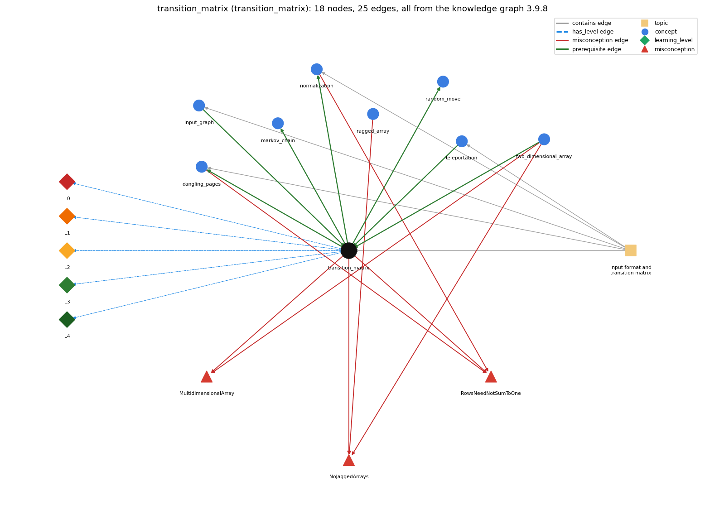

# transition_matrix (`transition_matrix`)

a 2-D array of move probabilities (rows sum to 1)

Section 1.6 Case Study: Random Web Surfer, topic 1.6.a Input format and transition matrix. From the knowledge graph 3.9.8 (`data/raw/chapter1_kg_updated.json`).

## Concepts associated with transition\_matrix (8)

| Concept | Description | How it is associated |
| --- | --- | --- |
| **dangling\_pages** | pages with no outgoing links | builds on it (needs it) composition rule (R) with it shares misconception RowsNeedNotSumToOne same topic (topic1.6.a) |
| **input\_graph** | read the page links from input | prerequisite of it (it needs this) composition rule (R) with it same topic (topic1.6.a) |
| **markov\_chain** | random process where the next state depends only on the current state | builds on it (needs it) composition rule (R) with it |
| **normalization** | scaling a row so its probabilities sum to 1 | builds on it (needs it) composition rule (R) with it shares misconception RowsNeedNotSumToOne same topic (topic1.6.a) |
| **ragged\_array** | a 2-D array whose rows have different lengths | shares misconception NoJaggedArrays |
| **random\_move** | pick the next page from a cumulative-probability test | builds on it (needs it) composition rule (R) with it |
| **teleportation** | the 90-10 rule: follow a link or jump to a random page | prerequisite of it (it needs this) composition rule (R) with it same topic (topic1.6.a) |
| **two\_dimensional\_array** | an array of arrays (a[i][j]) | prerequisite of it (it needs this) composition rule (R) with it shares misconception MultidimensionalArray shares misconception NoJaggedArrays |

## Every edge in this view and its full label (25)

| From | Edge | To | Full edge label |
| --- | --- | --- | --- |
| **input\_graph** | prerequisite | **transition\_matrix** | The links read from input fill counts[i][j], and each row of the transition matrix is built from those counts. grounding: book\_passage composition rule (R) of input\_graph with transition\_matrix: The tallies constrain the matrix: row i of the matrix is computed only from counts[i][] and outDegree[i], so a mistake in reading pair order (i/j swapped) moves probability mass into the wrong row. composition rule (R) of transition\_matrix with input\_graph: Row i depends only on the tallies read for page i (counts[i][] and outDegree[i]); the matrix cannot be computed until all links have been read. |
| **teleportation** | prerequisite | **transition\_matrix** | The 90-10 rule says the surfer follows a random link 90 percent of the time and jumps to a random page 10 percent of the time, and each transition-matrix entry is computed from it. grounding: questionable composition rule (R) of teleportation with transition\_matrix: Every entry is built as link part plus leap part; the .90 and .10 weights must sum to 1 for each row to remain a distribution. composition rule (R) of transition\_matrix with teleportation: The .10/N term, added to every entry, is the teleport (random-page) part of each row; the .90 factor scales the link part so the two parts sum to 1. |
| **transition\_matrix** | prerequisite | **dangling\_pages** | Transition assumes that every page has an outgoing link; Exercise 1.6.3 handles a page with no outgoing links by filling its row of the transition matrix with 1/N. grounding: book\_passage composition rule (R) of transition\_matrix with dangling\_pages: Transition's formula is valid only if every outDegree[i] &gt; 0; a page with no outlinks must have its row filled with 1/N. composition rule (R) of dangling\_pages with transition\_matrix: A dangling page is the case where the matrix formula breaks (division by outDegree 0); the 1/N row replaces it so the matrix stays stochastic. |
| **transition\_matrix** | prerequisite | **markov\_chain** | The transition matrix specifies the probability of each move, and the random process those probabilities define is a Markov chain. grounding: book\_passage composition rule (R) of transition\_matrix with markov\_chain: A matrix whose rows are probability distributions defines a Markov chain: the next page depends only on the current page's row. composition rule (R) of markov\_chain with transition\_matrix: The chain is defined by the matrix: it must be square with every row a probability distribution. |
| **transition\_matrix** | prerequisite | **normalization** | Each row of the transition matrix must be a probability distribution, so counts[i][j] is divided by outDegree[i] (scaled by .90, plus .10/N) to make row i sum to 1. grounding: book\_passage composition rule (R) of transition\_matrix with normalization: Dividing counts[i][j] by outDegree[i] (after scaling by .90) and adding .10/N is the normalisation that makes row i sum to 1; the double operand .90 keeps the division from being integer division. composition rule (R) of normalization with transition\_matrix: Normalisation is applied row by row: every entry of row i is divided by the same total outDegree[i], which is what makes the row a distribution the matrix requires. |
| **transition\_matrix** | prerequisite | **random\_move** | Row p[i] is the probability distribution used to choose the next page when the surfer is on page i. grounding: book\_passage composition rule (R) of transition\_matrix with random\_move: The random move reads one row p[page] as a 1-D array and accumulates its entries; it only works if that row sums to 1. composition rule (R) of random\_move with transition\_matrix: Reads exactly one row p[page]; the row must sum to 1, otherwise r can exceed the final sum and no j is chosen. |
| **two\_dimensional\_array** | prerequisite | **transition\_matrix** | The transition matrix is a 2-D double array p[i][j], with one row array per page. grounding: book\_passage composition rule (R) of two\_dimensional\_array with transition\_matrix: The transition matrix is a 2-D double array p[i][j] with one row per page; each row holds a probability distribution. composition rule (R) of transition\_matrix with two\_dimensional\_array: The matrix is double[N][N]: p[i] is the row array for page i and p[i][j] an element; indices must be in 0..N-1 and the first index is the row (from-page). |
| **dangling\_pages** | misconception | **RowsNeedNotSumToOne** | **wrong rule:** A page with no outgoing links can have an all-zero row. **right rule:** Each row is a probability distribution; a page with no links is made equally likely to move to every page. role: primary |
| **normalization** | misconception | **RowsNeedNotSumToOne** | **wrong rule:** A page with no outgoing links can have an all-zero row. **right rule:** Each row is a probability distribution; a page with no links is made equally likely to move to every page. role: context |
| **ragged\_array** | misconception | **NoJaggedArrays** | **wrong rule:** multi-dimensional arrays must be rectangular **right rule:** Each row a[i] is its own array, so rows can have different lengths a[i].length. role: primary |
| **transition\_matrix** | misconception | **MultidimensionalArray** | **wrong rule:** The transition matrix is one block of n \* n numbers, so p[i] on its own means nothing. **right rule:** p[i] is the row array of page i, holding the probabilities of moving from page i to every page. role: context |
| **transition\_matrix** | misconception | **NoJaggedArrays** | **wrong rule:** Every row of the transition matrix must be stored with the same length because 2-D arrays are always rectangular. **right rule:** Each p[i] is its own row array; the surfer's matrix is square only because every page has a row of n probabilities. role: context |
| **transition\_matrix** | misconception | **RowsNeedNotSumToOne** | **wrong rule:** A page with no outgoing links can have an all-zero row. **right rule:** Each row is a probability distribution; a page with no links is made equally likely to move to every page. role: context |
| **two\_dimensional\_array** | misconception | **MultidimensionalArray** | **wrong rule:** int[m][n] is one block of m \* n values, so a[i] on its own means nothing. **right rule:** A 2-D array is an array of m row arrays, so a[i] is a 1-D array of length n. role: primary |
| **two\_dimensional\_array** | misconception | **NoJaggedArrays** | **wrong rule:** Every row of a 2-D array must have the same length. **right rule:** Each row a[i] is its own array, so rows can have different lengths a[i].length. role: context |
| **transition\_matrix** | has\_level | **transition\_matrix@L0** | transition matrix -&gt; L0 (Prestructural): the answer holds a rule that contradicts Java (4 ways). **[0] everyday\_reading** (E): In maths classes a transition matrix is often written column-wise (column = from), and "matrix" suggests a table of counts; in SW p[i][j] is a probability, row i = the page the surfer is on, column j = the page moved to, and each row sums to 1. **[1] misconception** (M) &rarr; MultidimensionalArray: wrong rule: A 2-D array is one thing, not an array of arrays. Right rule: Java represents p[][] as an array of N row arrays; p[page] is itself a 1-D double array (the distribution used by the random move). **[2] misconception** (M) &rarr; NoJaggedArrays: wrong rule: Multi-dimensional arrays must be rectangular. Right rule: Each row is its own array, so rows can differ in length (a ragged array); the transition matrix is created square with new double[N][N]. **[3] misconception** (M) &rarr; RowsNeedNotSumToOne: wrong rule: A page with no outgoing links can have an all-zero row. Right rule: Every row must be a probability distribution summing to 1; a page with no links gets 1/N in every column. |
| **transition\_matrix** | has\_level | **transition\_matrix@L1** | transition matrix -&gt; L1 (Unistructural): the answer states one correct rule without applying it (2 ways). **[0] names\_the\_element** (N): A data structure: an N-by-N two-dimensional double array p[][] (a stochastic matrix) whose entry p[i][j] is the probability of moving from page i to page j. **[1] states\_the\_rule** (S): Entry (i, j) is the probability that the surfer on page i moves to page j; by the 90-10 rule it is .90\*counts[i][j]/outDegree[i] + .10/N, and every row is a discrete probability distribution summing to 1. |
| **transition\_matrix** | has\_level | **transition\_matrix@L2** | transition matrix -&gt; L2 (Multistructural): the answer applies the rules of transition matrix to every part of the code, in order (3 ways). **[0] line\_by\_line\_trace** (LT): Three steps in order: read N and create counts[][] and outDegree[]; read all links and accumulate counts; then, row by row (outer i) and column by column (inner j), compute and print one probability; the header "N N" is printed before the rows. **[1] output\_prediction** (OP): Output is a matrix file: the row and column counts, then N rows of N doubles printed with %8.5f; for tiny.txt row 0 is 0.02000 0.92000 0.02000 0.02000 0.02000 and row 1 is 0.02000 0.02000 0.38000 0.38000 0.20000. **[2] one\_step\_execution** (OS): One inner-loop pass evaluates one double p for the current (i, j) from counts[i][j], outDegree[i] and N, and prints it; no array is modified by this phase. |
| **transition\_matrix** | has\_level | **transition\_matrix@L3** | transition matrix -&gt; L3 (Relational): the answer relates the parts (8 ways). **[0] relation\_to\_neighbour** (R): Row i depends only on the tallies read for page i (counts[i][] and outDegree[i]); the matrix cannot be computed until all links have been read. **[1] relation\_to\_neighbour** (R): Dividing counts[i][j] by outDegree[i] (after scaling by .90) and adding .10/N is the normalisation that makes row i sum to 1; the double operand .90 keeps the division from being integer division. **[2] relation\_to\_neighbour** (R): The random move reads one row p[page] as a 1-D array and accumulates its entries; it only works if that row sums to 1. **[3] relation\_to\_neighbour** (R): The matrix is double[N][N]: p[i] is the row array for page i and p[i][j] an element; indices must be in 0..N-1 and the first index is the row (from-page). **[4] relation\_to\_neighbour** (R): A matrix whose rows are probability distributions defines a Markov chain: the next page depends only on the current page's row. **[5] relation\_to\_neighbour** (R): Transition's formula is valid only if every outDegree[i] &gt; 0; a page with no outlinks must have its row filled with 1/N. **[6] relation\_to\_neighbour** (R): The .10/N term, added to every entry, is the teleport (random-page) part of each row; the .90 factor scales the link part so the two parts sum to 1. **[7] purpose\_of\_the\_whole** (P): Specifies completely the surfer's behaviour as data; Transition is a filter turning the list-of-links representation into a matrix that RandomSurfer and Markov both read. |
| **transition\_matrix** | has\_level | **transition\_matrix@L4** | transition matrix -&gt; L4 (Extended abstract): the answer reasons beyond the given code (5 ways). **[0] predict\_a\_change** (C): Invariant: every row sums to 1. Changing the split to 80-20 or 95-5 keeps it (the two weights still sum to 1) but changes the ranks; changing .10/N to .10, or omitting the leap term, breaks it. **[1] transfer\_to\_a\_new\_program** (X): Right tool when the model has few enough pages that N\*N doubles fit in memory and both simulation and the power method need per-pair probabilities; not for millions of pages (trillions of entries). **[2] diagnose\_an\_error** (D): rule broken: outDegree[i] must be &gt; 0 (no dangling pages). Kind: silent logic error. Trigger class: A page with no outlinks: .90\*counts[i][j] is the double 0.0 and 0.0/0 gives NaN, so the whole row prints NaN with no exception. **[3] diagnose\_an\_error** (D): rule broken: Each row must sum to 1. Kind: silent logic error. Trigger class: Any row whose entries do not sum to 1 (wrong scaling, missing leap term, unhandled dangling page) makes the RandomSurfer move fail. **[4] diagnose\_an\_error** (D): rule broken: Indices i, j must be in 0..N-1. Kind: run-time exception. Trigger class: Link with page &gt;= N, or loop bound &lt;= N: ArrayIndexOutOfBoundsException. |
| **topic1.6.a** | contains | **dangling\_pages** | topic topic1.6.a contains dangling\_pages |
| **topic1.6.a** | contains | **input\_graph** | topic topic1.6.a contains input\_graph |
| **topic1.6.a** | contains | **normalization** | topic topic1.6.a contains normalization |
| **topic1.6.a** | contains | **teleportation** | topic topic1.6.a contains teleportation |
| **topic1.6.a** | contains | **transition\_matrix** | topic topic1.6.a contains transition\_matrix |
