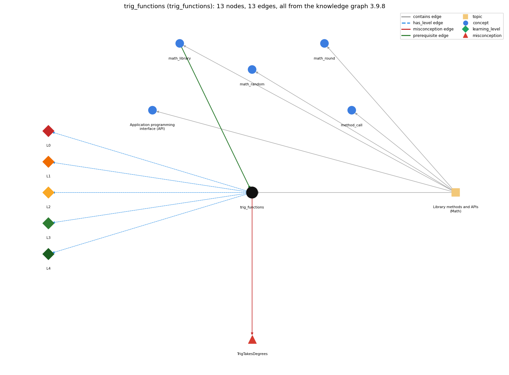

# trig_functions (`trig_functions`)

Math.sin, Math.cos, Math.atan2 work in radians

Section 1.2 Built-in Types of Data, topic 1.2.g Library methods and APIs (Math).

## At a glance

- **Needs first:** `math_library`
- **Leads to:** nothing
- **Learned alongside:** nothing
- **Misconceptions:** `TrigTakesDegrees`
- **Errors:** none
- **Levels:** L0, L1, L2, L3, L4

Everything below comes from the knowledge graph 3.9.8 (`data/raw/chapter1_kg_updated.json`): 13 edges around this concept, each explained in the graph's own words.

## What it needs first (1)

A prerequisite edge means the other concept has to be understood before `trig_functions`.

### `math_library` comes before `trig_functions`

*Math.abs, Math.sqrt, Math.max, Math.random, Math.round ...*

The trig functions are Math library methods.

- **Grounding:** book passage
- **How `trig_functions` combines with `math_library`:** The trig functions belong to the Math API, whose note fixes the unit: angles are in radians, with toDegrees() and toRadians() for conversion.
- **How `math_library` combines with `trig_functions`:** The trigonometric functions are Math methods whose angles are in radians; Math.toRadians and Math.toDegrees convert.

## What it leads to (0)

These concepts need `trig_functions` first.

No concept has this one as a prerequisite.

## Learned alongside (0)

A parallel edge joins two concepts that sit side by side: neither is needed before the other.

No parallel edge touches this concept.

## Misconceptions (1)

A misconception edge states the wrong rule a student may hold about this concept, and the right rule.

### TrigTakesDegrees

- **Wrong rule:** Math.sin(30) is the sine of 30 degrees.
- **Right rule:** Math.sin takes radians; use Math.toRadians(30).
- **Role of this concept:** primary
- **Shows at level L0 as:** misconception: wrong rule: Math.sin(30) is the sine of 30 degrees. Right rule: Math.sin takes radians; use Math.sin(Math.toRadians(30)).
- **Shows at level L0 as:** inconsistent trace: Points to LT (convert the angle to radians, then apply the function). Applied unevenly: in one program the student converts the angle before one call (Math.cos(Math.toRadians(x1))) but passes degrees directly to another (Math.sin(x2)). (here mixing in: "Math.sin(30) is the sine of 30 degrees")

## Errors (0)

An error edge states the rule that gets broken in a program, and the right rule.

The graph has no error edge from this concept.

## Levels L0 to L4 (5 of 5)

Each level edge lists the ways a student shows that level, each with its exact rule.

### L0: Prestructural / sensorimotor

L0 for trig functions: the answer holds a rule that contradicts Java.

*Deciding question: Does every rule the answer applies to trig functions agree with the language rule? If it reads the code with everyday meanings, applies a wrong rule, or switches rules within one trace, it is L0. A slip in an otherwise rule-correct trace is L2 with an error, not L0.*

trig functions -&gt; L0 (Prestructural): the answer holds a rule that contradicts Java (3 ways).

- **everyday reading** (folk-meaning rule): Folk meaning: from school and calculators in degree mode, sin 30 means the sine of 30 degrees (0.5). Java rule: Math.sin, Math.cos and Math.tan take their argument in radians, so Math.sin(30) is about -0.988; use Math.sin(Math.toRadians(30)).
- **misconception** (wrong rule / right rule; shows `TrigTakesDegrees`): wrong rule: Math.sin(30) is the sine of 30 degrees. Right rule: Math.sin takes radians; use Math.sin(Math.toRadians(30)).
- **inconsistent trace** (uneven-application rule; shows `TrigTakesDegrees`): Points to LT (convert the angle to radians, then apply the function). Applied unevenly: in one program the student converts the angle before one call (Math.cos(Math.toRadians(x1))) but passes degrees directly to another (Math.sin(x2)). (here mixing in: "Math.sin(30) is the sine of 30 degrees")

### L1: Unistructural / atom x text surface

L1 for trig functions: the answer states one correct rule without applying it.

*Deciding question: Does the answer cover every part of the code, in order, with the values (L2)? If it covers one part or only states the rule, it is L1.*

trig functions -&gt; L1 (Unistructural): the answer states one correct rule without applying it (2 ways).

- **names the element** (identity rule): The trigonometric functions are Math library methods (sin, cos, tan, and inverses asin, acos, atan, atan2) whose angles are expressed in radians.
- **states the rule** (declarative rule): double sin(double theta), cos, tan take theta in radians; Math.toRadians and Math.toDegrees convert; the inverse functions return radians, and Math.atan2(y, x) returns the angle of (x, y) in the range from -pi to pi.

### L2: Multistructural / block x execution / preoperational

L2 for trig functions: the answer applies these rules to every part of the code, in order.

*Deciding question: Is the answer many segments mapped onto lines (L2), or one segment stating the purpose of the whole (L3)? A correct output with no value-by-value justification is not levelled.*

trig functions -&gt; L2 (Multistructural): the answer applies the rules of trig functions to every part of the code, in order (3 ways).

- **line by line trace** (operational sequencing rule): The argument expression is evaluated first (an inner Math.toRadians(deg) call runs before the outer Math.sin), then the function is computed on that double.
- **output prediction** (evaluation / result rule): A double: Math.sin(Math.PI/2) is 1.0; results are approximations, so Math.sin(Math.toRadians(30)) is 0.49999999999999994 and cos^2 + sin^2 is not always exactly 1.
- **one step execution** (state-transition rule): A trig call changes no variable; the result exists only if stored or used, e.g. double height = Math.sin(angle);.

### L3: Relational / relations x function (concrete operational begins)

L3 for trig functions: the answer relates the parts by these rules.

*Deciding question: Was the purpose deduced from the code, or only guessed from traced input/output pairs (then L2)? Does the answer stay within the given code (L3), or reason about changed code, an error class or a new program (L4)?*

trig functions -&gt; L3 (Relational): the answer relates the parts (2 ways).

- **relation to neighbour** (composition rule (with a neighbour)): The trig functions belong to the Math API, whose note fixes the unit: angles are in radians, with toDegrees() and toRadians() for conversion.
- **purpose of the whole** (plan / role rule): Used for geometry and periodic signals: polar coordinates (Math.atan2), great-circle distance, sampled sound waves (Math.sin(2\*Math.PI \* i \* hz / sps)), and points on a circle for drawing.

### L4: Extended abstract (concrete-operational reversibility and conservation)

L4 for trig functions: the answer reasons beyond the given code by these rules.

*Deciding question: Does the answer link the code to a broader context: a changed program, a class of inputs, an unseen problem? Re-tracing changed code value by value is L2; fixing one given failing case is L3.*

trig functions -&gt; L4 (Extended abstract): the answer reasons beyond the given code (3 ways).

- **predict a change** (conservation rule; shows `TrigTakesDegrees`): Switching the input between degrees and radians changes the result completely (not just slightly); adding a full period 2\*Math.PI to the argument leaves the value unchanged up to rounding.
- **transfer to a new program** (applicability rule): Use the Math trig functions whenever angles or periodic behaviour are computed, converting degree inputs with Math.toRadians first; prefer Math.atan2(y, x) to Math.atan(y/x) when the full-circle angle is needed.
- **diagnose an error** (error rule): rule broken: Java's trigonometric functions take radians. Kind: silent logic error. Trigger class: An angle held in degrees (from user input, a formula given in degrees, or latitude/longitude) passed directly to Math.sin/cos/tan, or an inverse function's radian result printed as degrees.

## Same topic

`trig_functions` belongs to the topic **Library methods and APIs (Math)** (`topic1.2.g`). The topic also contains: `api`, `math_library`, `math_random`, `math_round`, `method_call`.

## Rules of the concept (13)

- **folk-meaning rule:** Folk meaning: from school and calculators in degree mode, sin 30 means the sine of 30 degrees (0.5). Java rule: Math.sin, Math.cos and Math.tan take their argument in radians, so Math.sin(30) is about -0.988; use Math.sin(Math.toRadians(30)).
- **wrong rule / right rule:** TrigTakesDegrees: wrong: Math.sin(30) is the sine of 30 degrees. \| right: Math.sin takes radians; use Math.sin(Math.toRadians(30)).
- **uneven-application rule:** Points to LT (convert the angle to radians, then apply the function). Applied unevenly: in one program the student converts the angle before one call (Math.cos(Math.toRadians(x1))) but passes degrees directly to another (Math.sin(x2)).
- **identity rule:** The trigonometric functions are Math library methods (sin, cos, tan, and inverses asin, acos, atan, atan2) whose angles are expressed in radians.
- **declarative rule:** double sin(double theta), cos, tan take theta in radians; Math.toRadians and Math.toDegrees convert; the inverse functions return radians, and Math.atan2(y, x) returns the angle of (x, y) in the range from -pi to pi.
- **operational sequencing rule:** The argument expression is evaluated first (an inner Math.toRadians(deg) call runs before the outer Math.sin), then the function is computed on that double.
- **evaluation / result rule:** A double: Math.sin(Math.PI/2) is 1.0; results are approximations, so Math.sin(Math.toRadians(30)) is 0.49999999999999994 and cos^2 + sin^2 is not always exactly 1.
- **state-transition rule:** A trig call changes no variable; the result exists only if stored or used, e.g. double height = Math.sin(angle);.
- **composition rule (with a neighbour):** with math\_library: The trig functions belong to the Math API, whose note fixes the unit: angles are in radians, with toDegrees() and toRadians() for conversion.
- **plan / role rule:** Used for geometry and periodic signals: polar coordinates (Math.atan2), great-circle distance, sampled sound waves (Math.sin(2\*Math.PI \* i \* hz / sps)), and points on a circle for drawing.
- **conservation rule:** Switching the input between degrees and radians changes the result completely (not just slightly); adding a full period 2\*Math.PI to the argument leaves the value unchanged up to rounding.
- **error rule:** rule broken: Java's trigonometric functions take radians. (silent logic error)
- **applicability rule:** Use the Math trig functions whenever angles or periodic behaviour are computed, converting degree inputs with Math.toRadians first; prefer Math.atan2(y, x) to Math.atan(y/x) when the full-circle angle is needed.

## The whole prerequisite chain

- **Everything it builds on (9):** `arithmetic_operators`, `data_type`, `expression`, `identifier`, `literal`, `math_library`, `method_call`, `primitive_type`, `variable`
- **Everything that builds on it (0):** nothing
