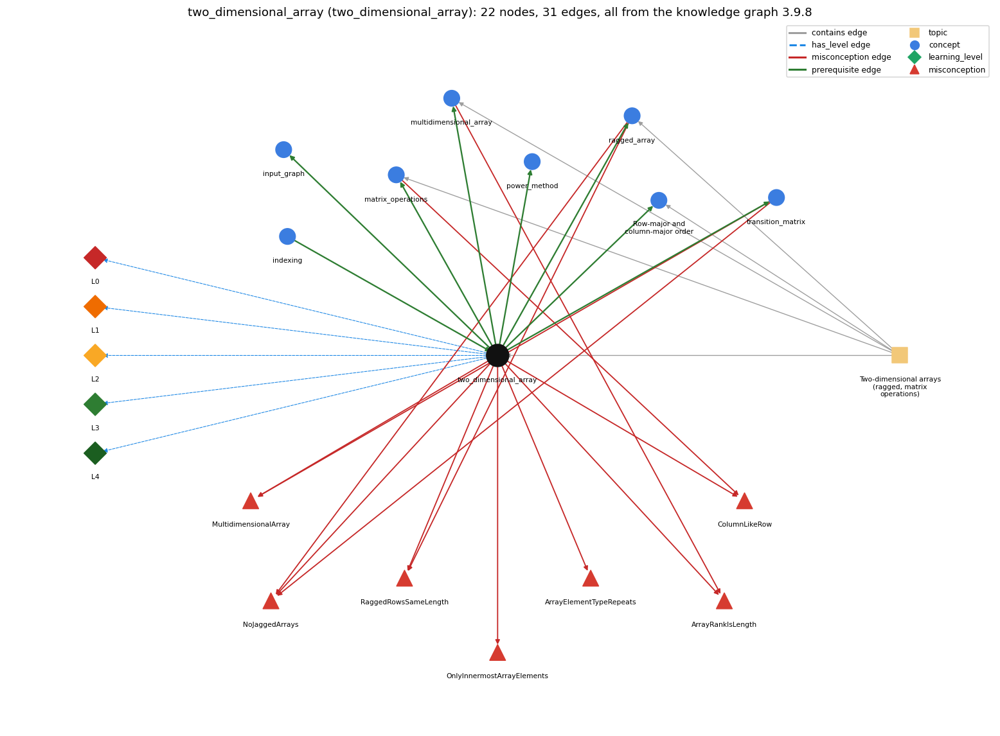

# two_dimensional_array (`two_dimensional_array`)

an array of arrays (a[i][j])

Section 1.4 Arrays, topic 1.4.g Two-dimensional arrays (ragged, matrix operations).

## At a glance

- **Needs first:** `indexing`
- **Leads to:** `input_graph`, `matrix_operations`, `multidimensional_array`, `power_method`, `ragged_array`, `row_major_order`, `transition_matrix`
- **Learned alongside:** nothing
- **Misconceptions:** `ArrayElementTypeRepeats`, `ArrayRankIsLength`, `ColumnLikeRow`, `MultidimensionalArray`, `NoJaggedArrays`, `OnlyInnermostArrayElements`, `RaggedRowsSameLength`
- **Errors:** none
- **Levels:** L0, L1, L2, L3, L4

Everything below comes from the knowledge graph 3.9.8 (`data/raw/chapter1_kg_updated.json`): 31 edges around this concept, each explained in the graph's own words.

## What it needs first (1)

A prerequisite edge means the other concept has to be understood before `two_dimensional_array`.

### `indexing` comes before `two_dimensional_array`

*a[i] -- 0-based access*

A 1-D array uses one index a[i]; a 2-D array uses two, a[i][j], where the first index chooses the row array.

- **Grounding:** book passage
- **How `two_dimensional_array` combines with `indexing`:** A 2-D array uses two indices, and the first chooses the row array: a[i][j] is (a[i])[j].
- **How `indexing` combines with `two_dimensional_array`:** a[i] on a 2-D array yields row i (itself a 1-D array), and a[i][j] then indexes into that row.

## What it leads to (7)

These concepts need `two_dimensional_array` first.

### `two_dimensional_array` comes before `input_graph`

*read the page links from input*

The links read from input are counted in a two-dimensional array, counts[i][j].

- **Grounding:** book passage

### `two_dimensional_array` comes before `matrix_operations`

*matrix addition and multiplication with nested loops*

Matrix operations index a[i][j] in nested loops.

- **Grounding:** book passage
- **How `two_dimensional_array` combines with `matrix_operations`:** Matrix operations index a[i][j] in nested loops (two for addition, three for multiplication).
- **How `matrix_operations` combines with `two_dimensional_array`:** Matrices are stored as 2-D arrays and read entry by entry as a[i][j].

### `two_dimensional_array` comes before `multidimensional_array`

*arrays with three or more indices*

Higher dimensions generalise 2-D arrays.

- **Grounding:** book passage
- **How `two_dimensional_array` combines with `multidimensional_array`:** The same notation extends to any number of dimensions: a[i][j][k] for double[][][].
- **How `multidimensional_array` combines with `two_dimensional_array`:** A 3-D array generalizes 2-D: a[i] is itself a 2-D array, and the same declaration, creation and indexing rules apply one level deeper.

### `two_dimensional_array` comes before `power_method`

*repeated vector-matrix multiplication to compute page ranks*

The power method multiplies the rank vector by the transition matrix, stored as a two-dimensional array p[i][j].

- **Grounding:** book passage

### `two_dimensional_array` comes before `ragged_array`

*a 2-D array whose rows have different lengths*

There is no requirement that all rows in a two-dimensional array have the same length; an array with rows of nonuniform length is known as a ragged array.

- **Grounding:** book passage
- **How `two_dimensional_array` combines with `ragged_array`:** Since each row is a separate array, rows may have different lengths; such arrays are ragged.
- **How `ragged_array` combines with `two_dimensional_array`:** Ragged arrays exist because a 2-D array is an array of arrays: each row is an independent 1-D array with its own length.

### `two_dimensional_array` comes before `row_major_order`

*Row-major and column-major order: processing a 2-D array row by row (row-major) or column by column (column-major)*

Row-major order visits a[i][j] row by row (outer loop over i); column-major order puts the column loop outside.

- **Grounding:** book passage
- **How `two_dimensional_array` combines with `row_major_order`:** Row-major order visits a[i][j] with the outer loop over rows i; column-major puts the loop over j outside.
- **How `row_major_order` combines with `two_dimensional_array`:** Because a[i] is a row array, row-major order walks along each row array in turn; column-major jumps between row arrays at each step.

### `two_dimensional_array` comes before `transition_matrix`

*a 2-D array of move probabilities (rows sum to 1)*

The transition matrix is a 2-D double array p[i][j], with one row array per page.

- **Grounding:** book passage
- **How `two_dimensional_array` combines with `transition_matrix`:** The transition matrix is a 2-D double array p[i][j] with one row per page; each row holds a probability distribution.
- **How `transition_matrix` combines with `two_dimensional_array`:** The matrix is double[N][N]: p[i] is the row array for page i and p[i][j] an element; indices must be in 0..N-1 and the first index is the row (from-page).

## Learned alongside (0)

A parallel edge joins two concepts that sit side by side: neither is needed before the other.

No parallel edge touches this concept.

## Misconceptions (7)

A misconception edge states the wrong rule a student may hold about this concept, and the right rule.

### ArrayElementTypeRepeats

- **Wrong rule:** A 2-D int array type is written int[] int[].
- **Right rule:** It is written int[][].
- **Role of this concept:** primary
- **Shows at level L0 as:** misconception: wrong rule: A 2-D int array type is written int[] int[]. Right rule: It is written int[][]: one element type followed by one bracket pair per dimension.

### ArrayRankIsLength

- **Wrong rule:** The number of dimensions of an array is its length.
- **Right rule:** Rank (number of dimensions) and length are different.
- **Role of this concept:** primary
- **Shows at level L0 as:** misconception: wrong rule: The number of dimensions of an array is its length. Right rule: Rank (number of bracket pairs) and length (number of elements, a.length) are different; a double[][] of size 10-by-3 has a.length == 10.
- **Also an edge from `multidimensional_array`:** The number of dimensions of an array is its length.

### ColumnLikeRow

- **Wrong rule:** Column j of a 2-D array can be picked out as a 1-D array, just like row a[i].
- **Right rule:** a[i] is row i (a 1-D array), but there is no expression for a column; loop over i and use a[i][j].
- **Role of this concept:** primary
- **Shows at level L0 as:** misconception: wrong rule: Column j of a 2-D array can be picked out as a 1-D array, just like row a[i]. Right rule: a[i] is row i (a 1-D array), but there is no expression for a column; loop over i and use a[i][j].
- **Also an edge from `matrix_operations`:** Column j of a 2-D array can be picked out as a 1-D array, just like row a[i].

### MultidimensionalArray

- **Wrong rule:** int[m][n] is one block of m \* n values, so a[i] on its own means nothing.
- **Right rule:** A 2-D array is an array of m row arrays, so a[i] is a 1-D array of length n.
- **Role of this concept:** primary
- **Shows at level L0 as:** misconception: wrong rule: A 2-D array is one thing, not an array of arrays. Right rule: A 2-D array is an array of m row arrays, so a[i] is a 1-D array of length n.
- **Also an edge from `transition_matrix`:** The transition matrix is one block of n \* n numbers, so p[i] on its own means nothing.

### NoJaggedArrays

- **Wrong rule:** Every row of a 2-D array must have the same length.
- **Right rule:** Each row a[i] is its own array, so rows can have different lengths a[i].length.
- **Role of this concept:** context
- **Shows at level L0 as:** misconception: wrong rule: Multi-dimensional arrays must be rectangular. Right rule: Each row a[i] is its own array, so rows can have different lengths a[i].length.
- **Also an edge from `ragged_array`:** multi-dimensional arrays must be rectangular
- **Also an edge from `transition_matrix`:** Every row of the transition matrix must be stored with the same length because 2-D arrays are always rectangular.

### OnlyInnermostArrayElements

- **Wrong rule:** Only single elements a[i][j] can be used, not whole rows a[i].
- **Right rule:** a[i] gives the whole row i, which can be used like any 1-D array.
- **Role of this concept:** primary
- **Shows at level L0 as:** misconception: wrong rule: Only the innermost elements are accessible. Right rule: a[i] gives the whole row i, which can be used like any 1-D array.
- **Shows at level L0 as:** inconsistent trace: Points to LT: a[i][j] is evaluated as (a[i])[j], first the row and then the element in it. Inconsistent application: the first index is taken as the row on some steps and as the column on others. (here mixing in: "only the innermost elements are accessible")

### RaggedRowsSameLength

- **Wrong rule:** All rows of a 2-D array have the same length, so one N works for every row.
- **Right rule:** Rows may differ in length; use a[i].length for row i.
- **Role of this concept:** context
- **Shows at level L0 as:** misconception: wrong rule: All rows of a 2-D array have the same length, so one N works for every row. Right rule: Rows may differ in length; use a[i].length for row i.
- **Also an edge from `ragged_array`:** All rows of a 2-D array have the same length, so one N works for every row.

## Errors (0)

An error edge states the rule that gets broken in a program, and the right rule.

The graph has no error edge from this concept.

## Levels L0 to L4 (5 of 5)

Each level edge lists the ways a student shows that level, each with its exact rule.

### L0: Prestructural / sensorimotor

L0 for two dimensional array: the answer holds a rule that contradicts Java.

*Deciding question: Does every rule the answer applies to two dimensional array agree with the language rule? If it reads the code with everyday meanings, applies a wrong rule, or switches rules within one trace, it is L0. A slip in an otherwise rule-correct trace is L2 with an error, not L0.*

two dimensional array -&gt; L0 (Prestructural): the answer holds a rule that contradicts Java (9 ways).

- **everyday reading** (folk-meaning rule): Folk meaning: a table or matrix is one grid in which rows and columns are symmetric, so a column should be as easy to pick out as a row. Java rule: a 2-D array is an array of row arrays; a[i] is row i, a[i][j] an element, and there is no expression for a column.
- **misconception** (wrong rule / right rule; shows `OnlyInnermostArrayElements`): wrong rule: Only the innermost elements are accessible. Right rule: a[i] gives the whole row i, which can be used like any 1-D array.
- **misconception** (wrong rule / right rule; shows `ArrayElementTypeRepeats`): wrong rule: A 2-D int array type is written int[] int[]. Right rule: It is written int[][]: one element type followed by one bracket pair per dimension.
- **misconception** (wrong rule / right rule; shows `ColumnLikeRow`): wrong rule: Column j of a 2-D array can be picked out as a 1-D array, just like row a[i]. Right rule: a[i] is row i (a 1-D array), but there is no expression for a column; loop over i and use a[i][j].
- **misconception** (wrong rule / right rule; shows `MultidimensionalArray`): wrong rule: A 2-D array is one thing, not an array of arrays. Right rule: A 2-D array is an array of m row arrays, so a[i] is a 1-D array of length n.
- **inconsistent trace** (uneven-application rule; shows `OnlyInnermostArrayElements`): Points to LT: a[i][j] is evaluated as (a[i])[j], first the row and then the element in it. Inconsistent application: the first index is taken as the row on some steps and as the column on others. (here mixing in: "only the innermost elements are accessible")
- **misconception** (wrong rule / right rule; shows `ArrayRankIsLength`): wrong rule: The number of dimensions of an array is its length. Right rule: Rank (number of bracket pairs) and length (number of elements, a.length) are different; a double[][] of size 10-by-3 has a.length == 10.
- **misconception** (wrong rule / right rule; shows `RaggedRowsSameLength`): wrong rule: All rows of a 2-D array have the same length, so one N works for every row. Right rule: Rows may differ in length; use a[i].length for row i.
- **misconception** (wrong rule / right rule; shows `NoJaggedArrays`): wrong rule: Multi-dimensional arrays must be rectangular. Right rule: Each row a[i] is its own array, so rows can have different lengths a[i].length.

### L1: Unistructural / atom x text surface

L1 for two dimensional array: the answer states one correct rule without applying it.

*Deciding question: Does the answer cover every part of the code, in order, with the values (L2)? If it covers one part or only states the rule, it is L1.*

two dimensional array -&gt; L1 (Unistructural): the answer states one correct rule without applying it (2 ways).

- **names the element** (identity rule): Identity: a two-dimensional array, an array of arrays used to represent a table or matrix with M rows and N columns.
- **states the rule** (declarative rule): Declarative: declare double[][] a; create with new double[M][N] (rows first, then columns); refer to row i, column j as a[i][j]. Entries start at 0 (numbers) or false (boolean).

### L2: Multistructural / block x execution / preoperational

L2 for two dimensional array: the answer applies these rules to every part of the code, in order.

*Deciding question: Is the answer many segments mapped onto lines (L2), or one segment stating the purpose of the whole (L3)? A correct output with no value-by-value justification is not levelled.*

two dimensional array -&gt; L2 (Multistructural): the answer applies the rules of two dimensional array to every part of the code, in order (3 ways).

- **line by line trace** (operational sequencing rule): Sequencing: new double[M][N] creates an array of M references and then M row arrays of N defaults. a[i][j] evaluates a[i] (checked against a.length = M) and then [j] (checked against a[i].length).
- **output prediction** (evaluation / result rule): Result: a[i][j] has the element type; a.length is the number of rows M; a[i].length is the length of row i; a[i] is a double[] row.
- **one step execution** (state-transition rule): State transition: a[i][j] = v changes one element of row i; a[i] = new double[K] replaces the whole row i with a new array; other rows are untouched.

### L3: Relational / relations x function (concrete operational begins)

L3 for two dimensional array: the answer relates the parts by these rules.

*Deciding question: Was the purpose deduced from the code, or only guessed from traced input/output pairs (then L2)? Does the answer stay within the given code (L3), or reason about changed code, an error class or a new program (L4)?*

two dimensional array -&gt; L3 (Relational): the answer relates the parts (7 ways).

- **relation to neighbour** (composition rule (with a neighbour)): The transition matrix is a 2-D double array p[i][j] with one row per page; each row holds a probability distribution.
- **relation to neighbour** (composition rule (with a neighbour)): A 2-D array uses two indices, and the first chooses the row array: a[i][j] is (a[i])[j].
- **relation to neighbour** (composition rule (with a neighbour)): Since each row is a separate array, rows may have different lengths; such arrays are ragged.
- **relation to neighbour** (composition rule (with a neighbour)): Matrix operations index a[i][j] in nested loops (two for addition, three for multiplication).
- **relation to neighbour** (composition rule (with a neighbour)): The same notation extends to any number of dimensions: a[i][j][k] for double[][][].
- **relation to neighbour** (composition rule (with a neighbour)): Row-major order visits a[i][j] with the outer loop over rows i; column-major puts the loop over j outside.
- **purpose of the whole** (plan / role rule): Plan/role: store tables, matrices, grids and images indexed by row and column (grades by student and test, lattice intersections, pixels).

### L4: Extended abstract (concrete-operational reversibility and conservation)

L4 for two dimensional array: the answer reasons beyond the given code by these rules.

*Deciding question: Does the answer link the code to a broader context: a changed program, a class of inputs, an unseen problem? Re-tracing changed code value by value is L2; fixing one given failing case is L3.*

two dimensional array -&gt; L4 (Extended abstract): the answer reasons beyond the given code (4 ways).

- **predict a change** (conservation rule; shows `OnlyInnermostArrayElements`): Conservation: swapping the loop order for an element-wise operation keeps the result but changes the processing order. Swapping the indices (a[j][i]) transposes and goes out of bounds when M != N.
- **transfer to a new program** (applicability rule): Applicability: use a 2-D array for data naturally indexed by two integers (rows by columns). Use a ragged array when rows differ, a 1-D array when one index suffices, and higher dimensions for 3-D models.
- **diagnose an error** (error rule): rule broken: Indices must be within each dimension (i &lt; a.length, j &lt; a[i].length). Kind: run-time exception. Trigger class: row and column bounds swapped in a non-square M-by-N array, or j bounded by N on a shorter ragged row (ArrayIndexOutOfBoundsException)
- **diagnose an error** (error rule): rule broken: The type is written with one bracket pair per dimension. Kind: compile-time. Trigger class: int[] int[] a; or assigning an int[] where an int[][] is required (incompatible types)

## Same topic

`two_dimensional_array` belongs to the topic **Two-dimensional arrays (ragged, matrix operations)** (`topic1.4.g`). The topic also contains: `matrix_operations`, `multidimensional_array`, `ragged_array`, `row_major_order`.

## Rules of the concept (25)

- **folk-meaning rule:** Folk meaning: a table or matrix is one grid in which rows and columns are symmetric, so a column should be as easy to pick out as a row. Java rule: a 2-D array is an array of row arrays; a[i] is row i, a[i][j] an element, and there is no expression for a column.
- **wrong rule / right rule:** ArrayElementTypeRepeats: wrong: A 2-D int array type is written int[] int[]. \| right: It is written int[][]: one element type followed by one bracket pair per dimension.
- **wrong rule / right rule:** ArrayRankIsLength: wrong: The number of dimensions of an array is its length. \| right: Rank (number of bracket pairs) and length (number of elements, a.length) are different; a double[][] of size 10-by-3 has a.length == 10.
- **wrong rule / right rule:** OnlyInnermostArrayElements: wrong: Only the innermost elements are accessible. \| right: a[i] gives the whole row i, which can be used like any 1-D array.
- **wrong rule / right rule:** ColumnLikeRow: wrong: Column j of a 2-D array can be picked out as a 1-D array, just like row a[i]. \| right: a[i] is row i (a 1-D array), but there is no expression for a column; loop over i and use a[i][j].
- **wrong rule / right rule:** RaggedRowsSameLength: wrong: All rows of a 2-D array have the same length, so one N works for every row. \| right: Rows may differ in length; use a[i].length for row i.
- **wrong rule / right rule:** MultidimensionalArray: wrong: A 2-D array is one thing, not an array of arrays. \| right: A 2-D array is an array of m row arrays, so a[i] is a 1-D array of length n.
- **wrong rule / right rule:** NoJaggedArrays: wrong: Multi-dimensional arrays must be rectangular. \| right: Each row a[i] is its own array, so rows can have different lengths a[i].length.
- **uneven-application rule:** Points to LT: a[i][j] is evaluated as (a[i])[j], first the row and then the element in it. Inconsistent application: the first index is taken as the row on some steps and as the column on others.
- **identity rule:** Identity: a two-dimensional array, an array of arrays used to represent a table or matrix with M rows and N columns.
- **declarative rule:** Declarative: declare double[][] a; create with new double[M][N] (rows first, then columns); refer to row i, column j as a[i][j]. Entries start at 0 (numbers) or false (boolean).
- **operational sequencing rule:** Sequencing: new double[M][N] creates an array of M references and then M row arrays of N defaults. a[i][j] evaluates a[i] (checked against a.length = M) and then [j] (checked against a[i].length).
- **evaluation / result rule:** Result: a[i][j] has the element type; a.length is the number of rows M; a[i].length is the length of row i; a[i] is a double[] row.
- **state-transition rule:** State transition: a[i][j] = v changes one element of row i; a[i] = new double[K] replaces the whole row i with a new array; other rows are untouched.
- **composition rule (with a neighbour):** with transition\_matrix: The transition matrix is a 2-D double array p[i][j] with one row per page; each row holds a probability distribution.
- **composition rule (with a neighbour):** with indexing: A 2-D array uses two indices, and the first chooses the row array: a[i][j] is (a[i])[j].
- **composition rule (with a neighbour):** with ragged\_array: Since each row is a separate array, rows may have different lengths; such arrays are ragged.
- **composition rule (with a neighbour):** with matrix\_operations: Matrix operations index a[i][j] in nested loops (two for addition, three for multiplication).
- **composition rule (with a neighbour):** with multidimensional\_array: The same notation extends to any number of dimensions: a[i][j][k] for double[][][].
- **composition rule (with a neighbour):** with row\_major\_order: Row-major order visits a[i][j] with the outer loop over rows i; column-major puts the loop over j outside.
- **plan / role rule:** Plan/role: store tables, matrices, grids and images indexed by row and column (grades by student and test, lattice intersections, pixels).
- **conservation rule:** Conservation: swapping the loop order for an element-wise operation keeps the result but changes the processing order. Swapping the indices (a[j][i]) transposes and goes out of bounds when M != N.
- **error rule:** rule broken: Indices must be within each dimension (i &lt; a.length, j &lt; a[i].length). (run-time exception)
- **error rule:** rule broken: The type is written with one bracket pair per dimension. (compile-time)
- **applicability rule:** Applicability: use a 2-D array for data naturally indexed by two integers (rows by columns). Use a ragged array when rows differ, a 1-D array when one index suffices, and higher dimensions for 3-D models.

## The whole prerequisite chain

- **Everything it builds on (6):** `array_creation`, `array_declaration`, `array_initializer`, `data_structure`, `data_type`, `indexing`
- **Everything that builds on it (15):** `convergence_rate`, `dangling_pages`, `frequency_counting`, `input_graph`, `markov_chain`, `matrix_operations`, `multidimensional_array`, `normalization`, `power_method`, `ragged_array`, `random_move`, `row_major_order`, `simulation_loop`, `transition_matrix`, `two_models`
