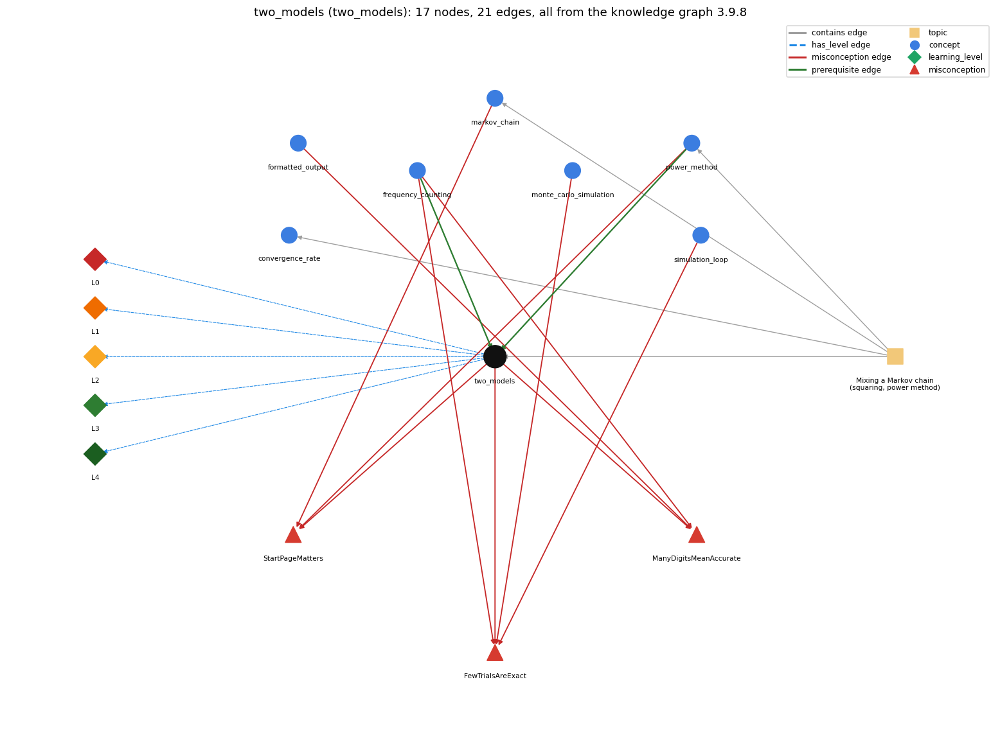

# two_models (`two_models`)

simulation vs. repeated matrix multiplication (mixing)

Section 1.6 Case Study: Random Web Surfer, topic 1.6.c Mixing a Markov chain (squaring, power method). From the knowledge graph 3.9.8 (`data/raw/chapter1_kg_updated.json`).

## Concepts associated with two\_models (7)

| Concept | Description | How it is associated |
| --- | --- | --- |
| **convergence\_rate** | how many iterations the power method needs | same topic (topic1.6.c) |
| **formatted\_output** | printf with a format string such as %d, %.2f, %s | shares misconception ManyDigitsMeanAccurate |
| **frequency\_counting** | tally visits to estimate page rank | prerequisite of it (it needs this) composition rule (R) with it shares misconception FewTrialsAreExact shares misconception ManyDigitsMeanAccurate |
| **markov\_chain** | random process where the next state depends only on the current state | shares misconception StartPageMatters same topic (topic1.6.c) |
| **monte\_carlo\_simulation** | estimating a probability by repeating random trials | shares misconception FewTrialsAreExact |
| **power\_method** | repeated vector-matrix multiplication to compute page ranks | prerequisite of it (it needs this) composition rule (R) with it shares misconception StartPageMatters same topic (topic1.6.c) |
| **simulation\_loop** | take many random steps | shares misconception FewTrialsAreExact |

## Every edge in this view and its full label (21)

| From | Edge | To | Full edge label |
| --- | --- | --- | --- |
| **frequency\_counting** | prerequisite | **two\_models** | The visit fractions freq[j] / T estimate the same page ranks that repeated matrix multiplication computes. grounding: book\_passage composition rule (R) of frequency\_counting with two\_models: freq[i]/T converges to the same page ranks the power method computes, but only as an estimate. composition rule (R) of two\_models with frequency\_counting: freq[j]/T is the simulation's estimate of the same ranks; it carries sampling error the power method does not. |
| **power\_method** | prerequisite | **two\_models** | The power method computes the move probabilities exactly (up to floating-point precision), in contrast to the simulation, which produces an estimate and needs more iterations to get a more accurate estimate. grounding: book\_passage composition rule (R) of power\_method with two\_models: Gives the move probabilities exactly (up to floating-point precision), whereas the simulation only estimates them. composition rule (R) of two\_models with power\_method: The exact side of the comparison; it reaches two decimals in 20 iterations versus tens of thousands of moves. |
| **formatted\_output** | misconception | **ManyDigitsMeanAccurate** | **wrong rule:** A result printed with many decimal places must be accurate to those places. **right rule:** A program does not produce accurate answers simply because it can print numbers to many decimal places of precision; ensuring accuracy is often the most difficult challenge. role: context |
| **frequency\_counting** | misconception | **FewTrialsAreExact** | **wrong rule:** A short simulation gives the exact page ranks. **right rule:** A simulation only estimates the page ranks: RandomSurfer needs 10^n moves to get answers precise to n decimal places and many more moves for those answers to become accurate (tens of thousands of moves for two accurate places, millions for three). role: primary |
| **frequency\_counting** | misconception | **ManyDigitsMeanAccurate** | **wrong rule:** A result printed with many decimal places must be accurate to those places. **right rule:** A program does not produce accurate answers simply because it can print numbers to many decimal places of precision; ensuring accuracy is often the most difficult challenge. role: primary |
| **markov\_chain** | misconception | **StartPageMatters** | **wrong rule:** The page ranks depend on which page the surfer starts from. **right rule:** For the random-surfer chain the long-run probabilities do not depend on the starting page. role: primary |
| **monte\_carlo\_simulation** | misconception | **FewTrialsAreExact** | **wrong rule:** A short simulation gives the exact page ranks. **right rule:** A simulation only estimates the page ranks: RandomSurfer needs 10^n moves to get answers precise to n decimal places and many more moves for those answers to become accurate (tens of thousands of moves for two accurate places, millions for three). role: context |
| **power\_method** | misconception | **StartPageMatters** | **wrong rule:** The page ranks depend on which page the surfer starts from. **right rule:** For the random-surfer chain the long-run probabilities do not depend on the starting page. role: context |
| **simulation\_loop** | misconception | **FewTrialsAreExact** | **wrong rule:** A short simulation gives the exact page ranks. **right rule:** A simulation only estimates the page ranks: RandomSurfer needs 10^n moves to get answers precise to n decimal places and many more moves for those answers to become accurate (tens of thousands of moves for two accurate places, millions for three). role: context |
| **two\_models** | misconception | **FewTrialsAreExact** | **wrong rule:** A short simulation gives the exact page ranks. **right rule:** A simulation only estimates the page ranks: RandomSurfer needs 10^n moves to get answers precise to n decimal places and many more moves for those answers to become accurate (tens of thousands of moves for two accurate places, millions for three). role: context |
| **two\_models** | misconception | **ManyDigitsMeanAccurate** | **wrong rule:** A result printed with many decimal places must be accurate to those places. **right rule:** A program does not produce accurate answers simply because it can print numbers to many decimal places of precision; ensuring accuracy is often the most difficult challenge. role: context |
| **two\_models** | misconception | **StartPageMatters** | **wrong rule:** The page ranks depend on which page the surfer starts from. **right rule:** For the random-surfer chain the long-run probabilities do not depend on the starting page. role: context |
| **two\_models** | has\_level | **two\_models@L0** | two models -&gt; L0 (Prestructural): the answer holds a rule that contradicts Java (5 ways). **[0] everyday\_reading** (E): Everyday "model" suggests each program has its own answer; the page ranks are a property of the web model, and simulation and the power method are two ways of computing the same numbers. **[1] misconception** (M) &rarr; StartPageMatters: wrong rule: The page ranks depend on which page the surfer starts from. Right rule: Both models converge to the same probabilities from any start page. **[2] misconception** (M) &rarr; FewTrialsAreExact: wrong rule: A short simulation gives the exact page ranks. Right rule: Simulation estimates; tens of thousands of moves give two accurate places and millions give three, whereas the power method needs about 20 and 40 multiplications. **[3] inconsistent\_trace** (T) &rarr; StartPageMatters: Applies the two LTs unevenly: e.g. treats one RandomSurfer move as if it advanced the whole probability vector, or one Markov iteration as if it were one sampled move. (here mixing in: "The page ranks depend on which page the surfer starts from") **[4] misconception** (M) &rarr; ManyDigitsMeanAccurate: wrong rule: A result printed with many decimal places must be accurate to those places. Right rule: Both programs print five decimals; only the power method after enough iterations is accurate to them. |
| **two\_models** | has\_level | **two\_models@L1** | two models -&gt; L1 (Unistructural): the answer states one correct rule without applying it (2 ways). **[0] names\_the\_element** (N): Two computational approaches to page ranks: simulating a random surfer and counting visits, versus mixing the Markov chain by repeated vector-matrix multiplication. **[1] states\_the\_rule** (S): Mixing guarantees a start-independent limit; the power method computes it exactly (up to floating-point precision), whereas the simulation produces an estimate that needs more iterations for more accuracy. |
| **two\_models** | has\_level | **two\_models@L2** | two models -&gt; L2 (Multistructural): the answer applies the rules of two models to every part of the code, in order (3 ways). **[0] line\_by\_line\_trace** (LT): Simulation: for T moves, draw r, pick next page, count; then divide counts by T. Power method: for T iterations, multiply the vector by p[][] and replace it; then print the vector. **[1] output\_prediction** (OP): Both yield about .273 .266 .146 .247 .068 for tiny.txt (RandomSurfer 1000000 vs Markov 40); page 0 beats page 1 by 27.3% to 26.6%. **[2] one\_step\_execution** (OS): One simulation step changes one page variable and one count; one power-method step changes every entry of the probability vector. |
| **two\_models** | has\_level | **two\_models@L3** | two models -&gt; L3 (Relational): the answer relates the parts (3 ways). **[0] relation\_to\_neighbour** (R): freq[j]/T is the simulation's estimate of the same ranks; it carries sampling error the power method does not. **[1] relation\_to\_neighbour** (R): The exact side of the comparison; it reaches two decimals in 20 iterations versus tens of thousands of moves. **[2] purpose\_of\_the\_whole** (P): Cross-check and choose a method: agreement of an independent estimate (simulation) with the exact computation validates both and shows the cost of each. |
| **two\_models** | has\_level | **two\_models@L4** | two models -&gt; L4 (Extended abstract): the answer reasons beyond the given code (3 ways). **[0] predict\_a\_change** (C) &rarr; StartPageMatters: Changing T or the start page keeps the common limit; rerunning the simulation changes its digits while Markov is deterministic. **[1] transfer\_to\_a\_new\_program** (X): Simulate when the process is easy to run but its probabilities are hard to write down; use the power method when the matrix is known and fits in memory, since it is far more efficient. **[2] diagnose\_an\_error** (D): rule broken: Agreement must be judged at the accuracy each method reaches. Kind: silent logic error. Trigger class: Comparing the two outputs digit by digit at five decimals after a short simulation: differences come from sampling error, not from a bug. |
| **topic1.6.c** | contains | **convergence\_rate** | topic topic1.6.c contains convergence\_rate |
| **topic1.6.c** | contains | **markov\_chain** | topic topic1.6.c contains markov\_chain |
| **topic1.6.c** | contains | **power\_method** | topic topic1.6.c contains power\_method |
| **topic1.6.c** | contains | **two\_models** | topic topic1.6.c contains two\_models |
