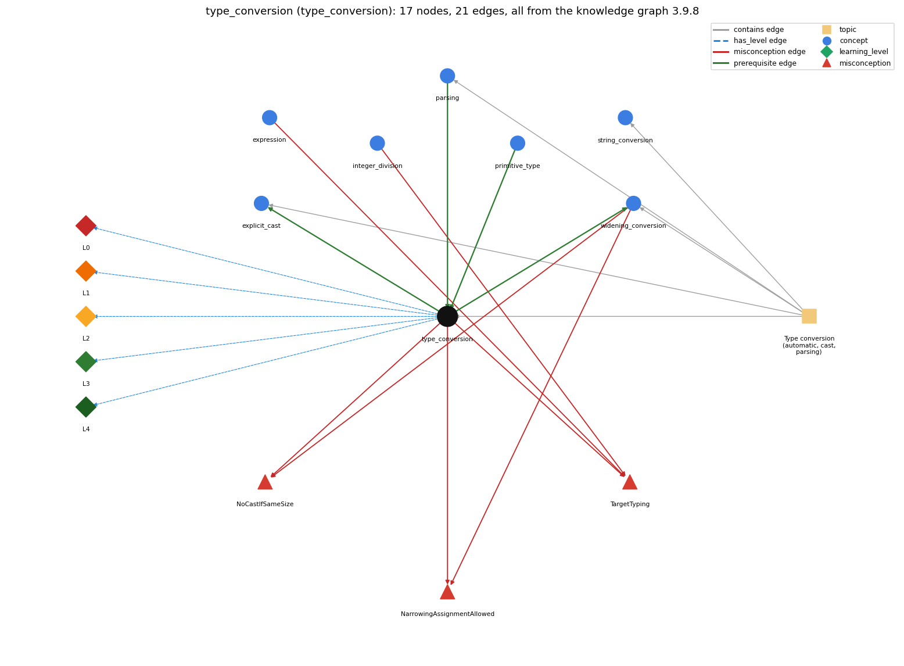

# type_conversion (`type_conversion`)

implicit widening and explicit (cast)

Section 1.2 Built-in Types of Data, topic 1.2.h Type conversion (automatic, cast, parsing).

## At a glance

- **Needs first:** `parsing`, `primitive_type`
- **Leads to:** `explicit_cast`, `widening_conversion`
- **Learned alongside:** nothing
- **Misconceptions:** `NarrowingAssignmentAllowed`, `NoCastIfSameSize`, `TargetTyping`
- **Errors:** none
- **Levels:** L0, L1, L2, L3, L4

Everything below comes from the knowledge graph 3.9.8 (`data/raw/chapter1_kg_updated.json`): 21 edges around this concept, each explained in the graph's own words.

## What it needs first (2)

A prerequisite edge means the other concept has to be understood before `type_conversion`.

### `parsing` comes before `type_conversion`

*Integer.parseInt / Double.parseDouble turn text into numbers*

Integer.parseInt(s) converts the String s into an int; SW later classifies such methods as explicit type conversion.

- **Grounding:** questionable
- **How `type_conversion` combines with `parsing`:** Parsing methods are explicit type conversion from String to a number: a method takes an argument of one type and produces a result of another.
- **How `parsing` combines with `type_conversion`:** SW classifies parse methods as explicit type conversion: a method takes an argument of one type and produces a result of another.

### `primitive_type` comes before `type_conversion`

*int, double, boolean, char*

Conversion moves a value between primitive types: int to double happens automatically, while double to int needs a cast that drops the fraction.

- **Grounding:** book passage
- **How `type_conversion` combines with `primitive_type`:** Conversions between primitive types follow their ranges: int to double happens automatically, double to int needs a cast that drops the fraction, and boolean converts to no numeric type.
- **How `primitive_type` combines with `type_conversion`:** Between numeric primitive types, widening (int to double) happens automatically, while narrowing (double to int) needs a cast that drops information. boolean converts to no numeric type.

## What it leads to (2)

These concepts need `type_conversion` first.

### `type_conversion` comes before `explicit_cast`

*(int) x -- converts between numeric types, truncating toward zero*

A cast is the explicit form of type conversion between primitive types, required when the conversion may lose information (e.g. (int) 2.71828 is 2).

- **Grounding:** book passage
- **How `type_conversion` combines with `explicit_cast`:** A cast is the explicit conversion between primitive types, required when information may be lost: (int) 2.71828 is 2.
- **How `explicit_cast` combines with `type_conversion`:** A cast is the explicit conversion between primitive types, needed exactly where automatic conversion is refused because information may be lost.

### `type_conversion` comes before `widening_conversion`

*automatic conversion to a type with a larger range*

Widening is the automatic kind of type conversion.

- **Grounding:** book passage
- **How `type_conversion` combines with `widening_conversion`:** Widening (promotion) is the automatic kind of conversion, applied at operators and assignments when the target type has a larger range.
- **How `widening_conversion` combines with `type_conversion`:** Widening is the automatic branch of type conversion; every other direction needs an explicit cast or method.

## Learned alongside (0)

A parallel edge joins two concepts that sit side by side: neither is needed before the other.

No parallel edge touches this concept.

## Misconceptions (3)

A misconception edge states the wrong rule a student may hold about this concept, and the right rule.

### NarrowingAssignmentAllowed

- **Wrong rule:** A double value can be stored in an int variable like an int in a double.
- **Right rule:** int to double is automatic; double to int needs a cast.
- **Role of this concept:** context
- **Shows at level L0 as:** misconception: wrong rule: A double value can be stored in an int variable like an int in a double. Right rule: int to double is automatic (widening); double to int needs a cast, otherwise the assignment is a compile-time error.
- **Also an edge from `widening_conversion`:** A double value can be stored in an int variable like an int in a double.

### NoCastIfSameSize

- **Wrong rule:** If a variable is at least as big as a value, no cast is needed to assign the value.
- **Right rule:** Assigning a double to an int needs a cast even when the value would fit, because a conversion that might involve loss of information leads to a compile-time error.
- **Role of this concept:** primary
- **Shows at level L0 as:** misconception: wrong rule: If a variable is at least as big as a value, no cast is needed to assign the value. Right rule: The compiler decides by types, not values: assigning a double to an int needs a cast even when the value (e.g. 3.0) would fit, because a conversion that might involve loss of information leads to a compile-time error.
- **Shows at level L0 as:** inconsistent trace: Points to LT (each subexpression is computed in its own type, and conversion happens only where the types meet). Applied unevenly: the student promotes before an int division on one line (treating 9/5 as 1.8) but not on another, or casts the whole expression on one pass and only the first operand on the next. (here mixing in: "If a variable is at least as big as a value, no cast is needed to assign the value")
- **Also an edge from `widening_conversion`:** If a variable is at least as big as a value, no cast is needed to assign the value.

### TargetTyping

- **Wrong rule:** The type of a numerical expression depends on the type expected by the surrounding context, so double d = a / b; keeps the fraction.
- **Right rule:** The type of a numerical expression is determined by the expression, so double d = a / b; with int a and b still divides as ints.
- **Role of this concept:** context
- **Shows at level L0 as:** misconception: wrong rule: The type of a numerical expression depends on the type expected by the surrounding context, so double d = a / b; keeps the fraction. Right rule: The type of a numerical expression is determined by its operands, so double d = a / b; with int a and b still divides as ints and only then widens the result (1 / 3 gives 0.0).
- **Also an edge from `expression`:** The type of a numerical expression depends on the type expected by the surrounding context, so double d = a / b; keeps the fraction.
- **Also an edge from `integer_division`:** The type of a numerical expression depends on the type expected by the surrounding context, so double d = a / b; keeps the fraction.

## Errors (0)

An error edge states the rule that gets broken in a program, and the right rule.

The graph has no error edge from this concept.

## Levels L0 to L4 (5 of 5)

Each level edge lists the ways a student shows that level, each with its exact rule.

### L0: Prestructural / sensorimotor

L0 for type conversion: the answer holds a rule that contradicts Java.

*Deciding question: Does every rule the answer applies to type conversion agree with the language rule? If it reads the code with everyday meanings, applies a wrong rule, or switches rules within one trace, it is L0. A slip in an otherwise rule-correct trace is L2 with an error, not L0.*

type conversion -&gt; L0 (Prestructural): the answer holds a rule that contradicts Java (5 ways).

- **everyday reading** (folk-meaning rule): Folk meaning: a number is a number, so 3, 3.0 and "3" are the same value, and a variable will take whatever form the context needs (the result 'becomes' double when stored in a double). Java rule: every value has a fixed type; conversions happen only by automatic promotion to a wider type, by an explicit cast, by conversion methods (Integer.parseInt, Math.round), or by String conversion with +.
- **misconception** (wrong rule / right rule; shows `NoCastIfSameSize`): wrong rule: If a variable is at least as big as a value, no cast is needed to assign the value. Right rule: The compiler decides by types, not values: assigning a double to an int needs a cast even when the value (e.g. 3.0) would fit, because a conversion that might involve loss of information leads to a compile-time error.
- **misconception** (wrong rule / right rule; shows `NarrowingAssignmentAllowed`): wrong rule: A double value can be stored in an int variable like an int in a double. Right rule: int to double is automatic (widening); double to int needs a cast, otherwise the assignment is a compile-time error.
- **inconsistent trace** (uneven-application rule; shows `NoCastIfSameSize`): Points to LT (each subexpression is computed in its own type, and conversion happens only where the types meet). Applied unevenly: the student promotes before an int division on one line (treating 9/5 as 1.8) but not on another, or casts the whole expression on one pass and only the first operand on the next. (here mixing in: "If a variable is at least as big as a value, no cast is needed to assign the value")
- **misconception** (wrong rule / right rule; shows `TargetTyping`): wrong rule: The type of a numerical expression depends on the type expected by the surrounding context, so double d = a / b; keeps the fraction. Right rule: The type of a numerical expression is determined by its operands, so double d = a / b; with int a and b still divides as ints and only then widens the result (1 / 3 gives 0.0).

### L1: Unistructural / atom x text surface

L1 for type conversion: the answer states one correct rule without applying it.

*Deciding question: Does the answer cover every part of the code, in order, with the values (L2)? If it covers one part or only states the rule, it is L1.*

type conversion -&gt; L1 (Unistructural): the answer states one correct rule without applying it (2 ways).

- **names the element** (identity rule): Type conversion is changing a value of one type into a value of another type: automatic promotion (widening), an explicit cast, an explicit conversion method (Integer.parseInt, Double.parseDouble, Math.round), or automatic conversion to String.
- **states the rule** (declarative rule): Java converts automatically to a type with a larger range (promotion) because no information is lost; a conversion that might lose information (double to int) requires an explicit cast or is a compile-time error; Strings and numbers convert only via methods or string conversion.

### L2: Multistructural / block x execution / preoperational

L2 for type conversion: the answer applies these rules to every part of the code, in order.

*Deciding question: Is the answer many segments mapped onto lines (L2), or one segment stating the purpose of the whole (L3)? A correct output with no value-by-value justification is not levelled.*

type conversion -&gt; L2 (Multistructural): the answer applies the rules of type conversion to every part of the code, in order (3 ways).

- **line by line trace** (operational sequencing rule): Innermost subexpressions are evaluated in their own types first; at each binary operator the narrower operand is promoted; a cast converts the single value right after it; at an assignment the final value is converted to the variable's type (widening allowed, narrowing rejected at compile time).
- **output prediction** (evaluation / result rule): Typical results: "1234" + 99 is the String "123499"; Integer.parseInt("123") is int 123; (int) 2.71828 is int 2; Math.round(2.71828) is long 3; 11 \* 0.3 is double 3.3; 11 \* (int) 0.3 is int 0; (int) (11 \* 0.3) is int 3.
- **one step execution** (state-transition rule): A conversion produces a new value and never changes the source variable or its declared type: after int x = (int) pi; x is 3 and pi still holds 3.14159.

### L3: Relational / relations x function (concrete operational begins)

L3 for type conversion: the answer relates the parts by these rules.

*Deciding question: Was the purpose deduced from the code, or only guessed from traced input/output pairs (then L2)? Does the answer stay within the given code (L3), or reason about changed code, an error class or a new program (L4)?*

type conversion -&gt; L3 (Relational): the answer relates the parts (5 ways).

- **relation to neighbour** (composition rule (with a neighbour)): Conversions between primitive types follow their ranges: int to double happens automatically, double to int needs a cast that drops the fraction, and boolean converts to no numeric type.
- **relation to neighbour** (composition rule (with a neighbour)): Parsing methods are explicit type conversion from String to a number: a method takes an argument of one type and produces a result of another.
- **relation to neighbour** (composition rule (with a neighbour)): A cast is the explicit conversion between primitive types, required when information may be lost: (int) 2.71828 is 2.
- **relation to neighbour** (composition rule (with a neighbour)): Widening (promotion) is the automatic kind of conversion, applied at operators and assignments when the target type has a larger range.
- **purpose of the whole** (plan / role rule): Adapts data between parts of a program: command-line text to numbers, int counts to double for an average ((double) sum / n), doubles to int indices or counts.

### L4: Extended abstract (concrete-operational reversibility and conservation)

L4 for type conversion: the answer reasons beyond the given code by these rules.

*Deciding question: Does the answer link the code to a broader context: a changed program, a class of inputs, an unseen problem? Re-tracing changed code value by value is L2; fixing one given failing case is L3.*

type conversion -&gt; L4 (Extended abstract): the answer reasons beyond the given code (6 ways).

- **predict a change** (conservation rule; shows `NoCastIfSameSize`): Moving the point of conversion changes the result: (double) (a / b) differs from (double) a / b, and (int) 11 \* 0.3 differs from (int) (11 \* 0.3). Widening int to double and back is reversible for int values; narrowing double to int loses the fraction irreversibly.
- **transfer to a new program** (applicability rule): Rely on automatic promotion when mixing int with double; write a cast only when you intend to drop information; use parse methods for text input and string conversion for output; paying attention to types avoids subtle bugs.
- **diagnose an error** (error rule): rule broken: A conversion that may lose information needs an explicit cast. Kind: compile-time. Trigger class: Assigning or passing a double (or long) expression to an int, e.g. int n = 11 \* 0.3; (possible loss of precision).
- **diagnose an error** (error rule): rule broken: Promotion happens per operator, after an int division has already truncated. Kind: silent logic error. Trigger class: All-int division inside a double formula, e.g. double y = 1 / 3; or (9/5) \* c + 32.
- **diagnose an error** (error rule): rule broken: Casts work only between compatible types; a String is converted with a parse method. Kind: compile-time. Trigger class: (int) str with a String str, or (int) flag with a boolean.
- **diagnose an error** (error rule): rule broken: A parse method accepts only a valid textual representation of the number. Kind: run-time exception. Trigger class: Integer.parseInt of text that is not an integer in digits ("five", "12.2", "").

## Same topic

`type_conversion` belongs to the topic **Type conversion (automatic, cast, parsing)** (`topic1.2.h`). The topic also contains: `explicit_cast`, `parsing`, `string_conversion`, `widening_conversion`.

## Rules of the concept (21)

- **folk-meaning rule:** Folk meaning: a number is a number, so 3, 3.0 and "3" are the same value, and a variable will take whatever form the context needs (the result 'becomes' double when stored in a double). Java rule: every value has a fixed type; conversions happen only by automatic promotion to a wider type, by an explicit cast, by conversion methods (Integer.parseInt, Math.round), or by String conversion with +.
- **wrong rule / right rule:** NarrowingAssignmentAllowed: wrong: A double value can be stored in an int variable like an int in a double. \| right: int to double is automatic (widening); double to int needs a cast, otherwise the assignment is a compile-time error.
- **wrong rule / right rule:** NoCastIfSameSize: wrong: If a variable is at least as big as a value, no cast is needed to assign the value. \| right: The compiler decides by types, not values: assigning a double to an int needs a cast even when the value (e.g. 3.0) would fit, because a conversion that might involve loss of information leads to a compile-time error.
- **wrong rule / right rule:** TargetTyping: wrong: The type of a numerical expression depends on the type expected by the surrounding context, so double d = a / b; keeps the fraction. \| right: The type of a numerical expression is determined by its operands, so double d = a / b; with int a and b still divides as ints and only then widens the result (1 / 3 gives 0.0).
- **uneven-application rule:** Points to LT (each subexpression is computed in its own type, and conversion happens only where the types meet). Applied unevenly: the student promotes before an int division on one line (treating 9/5 as 1.8) but not on another, or casts the whole expression on one pass and only the first operand on the next.
- **identity rule:** Type conversion is changing a value of one type into a value of another type: automatic promotion (widening), an explicit cast, an explicit conversion method (Integer.parseInt, Double.parseDouble, Math.round), or automatic conversion to String.
- **declarative rule:** Java converts automatically to a type with a larger range (promotion) because no information is lost; a conversion that might lose information (double to int) requires an explicit cast or is a compile-time error; Strings and numbers convert only via methods or string conversion.
- **operational sequencing rule:** Innermost subexpressions are evaluated in their own types first; at each binary operator the narrower operand is promoted; a cast converts the single value right after it; at an assignment the final value is converted to the variable's type (widening allowed, narrowing rejected at compile time).
- **evaluation / result rule:** Typical results: "1234" + 99 is the String "123499"; Integer.parseInt("123") is int 123; (int) 2.71828 is int 2; Math.round(2.71828) is long 3; 11 \* 0.3 is double 3.3; 11 \* (int) 0.3 is int 0; (int) (11 \* 0.3) is int 3.
- **state-transition rule:** A conversion produces a new value and never changes the source variable or its declared type: after int x = (int) pi; x is 3 and pi still holds 3.14159.
- **composition rule (with a neighbour):** with primitive\_type: Conversions between primitive types follow their ranges: int to double happens automatically, double to int needs a cast that drops the fraction, and boolean converts to no numeric type.
- **composition rule (with a neighbour):** with parsing: Parsing methods are explicit type conversion from String to a number: a method takes an argument of one type and produces a result of another.
- **composition rule (with a neighbour):** with explicit\_cast: A cast is the explicit conversion between primitive types, required when information may be lost: (int) 2.71828 is 2.
- **composition rule (with a neighbour):** with widening\_conversion: Widening (promotion) is the automatic kind of conversion, applied at operators and assignments when the target type has a larger range.
- **plan / role rule:** Adapts data between parts of a program: command-line text to numbers, int counts to double for an average ((double) sum / n), doubles to int indices or counts.
- **conservation rule:** Moving the point of conversion changes the result: (double) (a / b) differs from (double) a / b, and (int) 11 \* 0.3 differs from (int) (11 \* 0.3). Widening int to double and back is reversible for int values; narrowing double to int loses the fraction irreversibly.
- **error rule:** rule broken: A conversion that may lose information needs an explicit cast. (compile-time)
- **error rule:** rule broken: Promotion happens per operator, after an int division has already truncated. (silent logic error)
- **error rule:** rule broken: Casts work only between compatible types; a String is converted with a parse method. (compile-time)
- **error rule:** rule broken: A parse method accepts only a valid textual representation of the number. (run-time exception)
- **applicability rule:** Rely on automatic promotion when mixing int with double; write a cast only when you intend to drop information; use parse methods for text input and string conversion for output; paying attention to types avoids subtle bugs.

## The whole prerequisite chain

- **Everything it builds on (7):** `class_declaration`, `command_line_args`, `data_type`, `main_method`, `parsing`, `primitive_type`, `program_text`
- **Everything that builds on it (7):** `accumulator_pattern`, `compound_assignment`, `explicit_cast`, `math_random`, `monte_carlo_simulation`, `sentinel_loop`, `widening_conversion`
