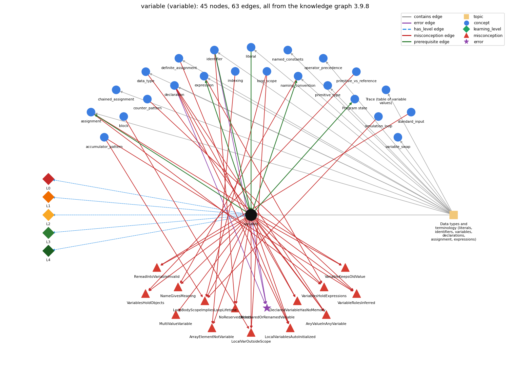

# variable (`variable`)

a named, typed box that holds a value

Section 1.2 Built-in Types of Data, topic 1.2.a Data types and terminology (literals, identifiers, variables, declarations, assignment, expressions). From the knowledge graph 3.9.8 (`data/raw/chapter1_kg_updated.json`).

## Concepts associated with variable (23)

| Concept | Description | How it is associated |
| --- | --- | --- |
| **accumulator\_pattern** | building up a running total/result | shares misconception LoopBodyScopeImpliesLoopLifetime shares misconception VariableRolesInferred |
| **assignment** | = stores the computed value of the right side | builds on it (needs it) composition rule (R) with it shares misconception VariablesHoldExpressions shares misconception VariableKeepsOldValue same topic (topic1.2.a) |
| **block** | { ... } grouping statements | shares misconception LocalVarOutsideScope |
| **chained\_assignment** | a = b = 0 assigns right to left | same topic (topic1.2.a) |
| **counter\_pattern** | counting occurrences across passes | shares misconception VariableRolesInferred |
| **data\_type** | a set of values and the operations defined on them | shares misconception AnyValueInAnyVariable same topic (topic1.2.a) |
| **declaration** | int x; -- introduces a variable name and its type | shares error UndeclaredOrRenamedVariable shares misconception AnyValueInAnyVariable shares misconception LocalVariablesAutoInitialized shares misconception DeclaredVariableHasNoMemory same topic (topic1.2.a) |
| **definite\_assignment** | a local variable must be assigned before it is read | shares misconception LocalVariablesAutoInitialized same topic (topic1.2.a) |
| **expression** | anything that evaluates to a value | builds on it (needs it) composition rule (R) with it shares misconception VariablesHoldExpressions same topic (topic1.2.a) |
| **identifier** | a name for a variable, method or class; case-sensitive, no spaces, not a keyword | prerequisite of it (it needs this) composition rule (R) with it shares error UndeclaredOrRenamedVariable shares misconception NoReservedWords same topic (topic1.2.a) |
| **indexing** | a[i] -- 0-based access | shares misconception ArrayElementNotVariable |
| **literal** | a constant value written in code (42, 3.14, true, 'a', "hi") | prerequisite of it (it needs this) composition rule (R) with it same topic (topic1.2.a) |
| **loop\_scope** | lifetime/scope of variables in/around the loop | shares misconception LoopBodyScopeImpliesLoopLifetime shares misconception LocalVarOutsideScope |
| **named\_constants** | final constants in UPPER\_CASE instead of magic numbers | same topic (topic1.2.a) |
| **naming\_convention** | choosing meaningful names: full words, lowerCamelCase, single letters only for throwaway loop counters | builds on it (needs it) composition rule (R) with it shares misconception NameGivesMeaning same topic (topic1.2.a) |
| **operator\_precedence** | the order operators bind in an expression | same topic (topic1.2.a) |
| **primitive\_type** | int, double, boolean, char | same topic (topic1.2.a) |
| **primitive\_vs\_reference** | a primitive variable holds its value; an array (or String) variable holds a reference to the object stored elsewhere | shares misconception VariablesHoldObjects |
| **program\_state** | the information needed to know what a program will do next: the values of its variables and array entries and the next statement | builds on it (needs it) composition rule (R) with it |
| **program\_trace** | a table of the values of the variables after each statement, used to check what code does | same topic (topic1.2.a) |
| **simulation\_loop** | take many random steps | shares misconception LoopBodyScopeImpliesLoopLifetime |
| **standard\_input** | StdIn -- reading a stream of values | shares misconception RereadIntoVariableInvalid |
| **variable\_swap** | exchanging two variables needs a temporary | same topic (topic1.2.a) |

## Every edge in this view and its full label (63)

| From | Edge | To | Full edge label |
| --- | --- | --- | --- |
| **identifier** | prerequisite | **variable** | Every variable is named by an identifier that follows the naming rules. grounding: book\_passage composition rule (R) of identifier with variable: Each variable is named by one identifier, which must be unique within its scope: declaring a second local with the same name in that scope is a compile error. composition rule (R) of variable with identifier: Each variable is named by an identifier, which must be legal and unique within the variable's scope. |
| **literal** | prerequisite | **variable** | A variable of type t is given a value of type t, often written as a literal. grounding: order\_only composition rule (R) of literal with variable: Literals commonly initialize variables. The literal's type must equal or widen to the variable's type: double y = 1; widens, but int x = 1.1; is an error. composition rule (R) of variable with literal: Literals commonly give variables their values, and the literal's type must fit the variable's type (int x = 1.1; is rejected). |
| **variable** | prerequisite | **assignment** | Assignment needs a declared variable on its left side to store the computed value into. grounding: book\_passage composition rule (R) of variable with assignment: Assignment is the only statement that changes a variable, and its left-hand side must be a single variable. composition rule (R) of assignment with variable: The left side must be a declared variable whose type accepts the value. Assignment is how that variable's value changes. |
| **variable** | prerequisite | **expression** | An expression can be a literal, a variable, or operations on them; we compute with a variable by using its name in an expression. grounding: book\_passage composition rule (R) of variable with expression: A variable name is itself an expression whose value is the variable's current value, and it combines with operators into larger expressions. composition rule (R) of expression with variable: A variable name inside an expression contributes the variable's value at the moment of evaluation. |
| **variable** | prerequisite | **naming\_convention** | Each variable gets a name; the convention says the name should describe what the variable holds. grounding: book\_passage composition rule (R) of variable with naming\_convention: A variable's name should describe what it holds (lowerCamelCase), but the name has no effect on its value. composition rule (R) of naming\_convention with variable: Each variable's name should describe what it holds (count, sum, maxSoFar). Single letters suit only short-lived loop indices. |
| **variable** | prerequisite | **program\_state** | Without arrays, a program's state is the values of its variables plus the next statement to run. grounding: book\_passage composition rule (R) of variable with program\_state: The current values of all variables make up the program's state. A trace records each variable's value after each statement. composition rule (R) of program\_state with variable: Without arrays the state is the values of the variables plus the next statement; each array element adds one more variable to the state. |
| **accumulator\_pattern** | misconception | **LoopBodyScopeImpliesLoopLifetime** | **wrong rule:** a variable declared in the loop body lives across all iterations **right rule:** A variable declared inside the body is created anew on every pass and does not keep the previous pass's value. role: context |
| **accumulator\_pattern** | misconception | **VariableRolesInferred** | **wrong rule:** The computer recognises that one variable plays two roles, e.g. input value and running total, and keeps the values apart; it knows which variable is the counter and which the sum. **right rule:** A variable holds one value at a time; each role (input, counter, running total) needs its own variable and explicit update. role: context |
| **assignment** | misconception | **VariableKeepsOldValue** | **wrong rule:** A variable keeps its first value after a new assignment (the static model). **right rule:** Each assignment or read replaces the variable's current value. role: context |
| **assignment** | misconception | **VariablesHoldExpressions** | **wrong rule:** y = x + k; makes y always equal to x + k, so when x changes later, y changes too. **right rule:** y = x + k; stores the value that x + k has at that moment, so later changes to x do not change y. role: primary |
| **block** | misconception | **LocalVarOutsideScope** | **wrong rule:** A variable declared inside a block can be used anywhere in the program, like a global. **right rule:** A local variable exists only from its declaration to the end of its block. role: context |
| **counter\_pattern** | misconception | **VariableRolesInferred** | **wrong rule:** The computer recognises that one variable plays two roles, e.g. input value and running total, and keeps the values apart; it knows which variable is the counter and which the sum. **right rule:** A variable holds one value at a time; each role (input, counter, running total) needs its own variable and explicit update. role: context |
| **data\_type** | misconception | **AnyValueInAnyVariable** | **wrong rule:** A variable declared int can hold 2.5 or "hi"; the type is only a label. **right rule:** A data type is a set of values and a set of operations defined on them, so an int variable holds only int values. role: primary |
| **declaration** | misconception | **AnyValueInAnyVariable** | **wrong rule:** A variable declared int can hold 2.5 or "hi"; the type is only a label. **right rule:** A data type is a set of values and a set of operations defined on them, so an int variable holds only int values. role: context |
| **declaration** | misconception | **DeclaredVariableHasNoMemory** | **wrong rule:** int x; without a value sets aside no memory; the variable only exists once something is assigned. **right rule:** A declaration creates the variable (its storage) with its type; assignment later puts a value in it. role: primary |
| **declaration** | misconception | **LocalVariablesAutoInitialized** | **wrong rule:** local variables get a default value on their own **right rule:** A local variable has no value until it is assigned, and using it before then does not compile. role: context |
| **definite\_assignment** | misconception | **LocalVariablesAutoInitialized** | **wrong rule:** local variables get a default value on their own **right rule:** A local variable has no value until it is assigned, and using it before then does not compile. role: primary |
| **expression** | misconception | **VariablesHoldExpressions** | **wrong rule:** = stores the expression itself, not its computed value **right rule:** y = x + k; stores the value that x + k has at that moment, so later changes to x do not change y. role: context |
| **identifier** | misconception | **NoReservedWords** | **wrong rule:** A keyword such as int or class can be used as a variable name. **right rule:** Keywords are reserved by Java and cannot be used as variable names. role: primary |
| **indexing** | misconception | **ArrayElementNotVariable** | **wrong rule:** An array element a[i] is not a variable, so it cannot be read into directly or used inside another index, as in a[a[i]]. **right rule:** Each element a[i] is a variable of the element type and can be used anywhere a variable of that type can, including as an index. role: primary |
| **loop\_scope** | misconception | **LocalVarOutsideScope** | **wrong rule:** A variable declared inside a block can be used anywhere in the program, like a global. **right rule:** A local variable exists only from its declaration to the end of its block. role: primary |
| **loop\_scope** | misconception | **LoopBodyScopeImpliesLoopLifetime** | **wrong rule:** A variable declared inside the loop body keeps its value from one pass to the next. **right rule:** A variable declared inside the body is created anew on every pass and does not keep the previous pass's value. role: primary |
| **naming\_convention** | misconception | **NameGivesMeaning** | **wrong rule:** Naming a variable max (or average) makes it hold the largest value (or the average) without code that computes it. **right rule:** A name only labels the variable for human readers; only the statements that assign to it decide its value. role: primary |
| **primitive\_vs\_reference** | misconception | **VariablesHoldObjects** | **wrong rule:** a reference variable holds the whole object, not a reference **right rule:** A reference variable holds only a reference to the object, which is stored separately. role: context |
| **simulation\_loop** | misconception | **LoopBodyScopeImpliesLoopLifetime** | **wrong rule:** Declaring page inside the simulation loop still lets the surfer continue from the previous page. **right rule:** If page is declared inside the loop body it is recreated each pass, so it must be declared before the loop to carry the walk forward. role: context |
| **standard\_input** | misconception | **RereadIntoVariableInvalid** | **wrong rule:** Reading a second input value into a variable that already holds one is an error, so the program cannot run. **right rule:** A later read simply overwrites the variable's current value. role: primary |
| **variable** | misconception | **AnyValueInAnyVariable** | **wrong rule:** A variable declared int can hold 2.5 or "hi"; the type is only a label. **right rule:** A data type is a set of values and a set of operations defined on them, so an int variable holds only int values. role: context |
| **variable** | misconception | **ArrayElementNotVariable** | **wrong rule:** An array element a[i] is not a variable, so it cannot be read into directly or used inside another index, as in a[a[i]]. **right rule:** Each element a[i] is a variable of the element type and can be used anywhere a variable of that type can, including as an index. role: context |
| **variable** | misconception | **DeclaredVariableHasNoMemory** | **wrong rule:** int x; without a value sets aside no memory; the variable only exists once something is assigned. **right rule:** A declaration creates the variable (its storage) with its type; assignment later puts a value in it. role: context |
| **variable** | misconception | **LocalVarOutsideScope** | **wrong rule:** A variable declared inside a block can be used anywhere in the program, like a global. **right rule:** A local variable exists only from its declaration to the end of its block. role: context |
| **variable** | misconception | **LocalVariablesAutoInitialized** | **wrong rule:** int x; inside main starts at 0, so x can be used before anything is assigned to it. **right rule:** A local variable has no value until it is assigned, and using it before then does not compile. role: context |
| **variable** | misconception | **LoopBodyScopeImpliesLoopLifetime** | **wrong rule:** a variable declared in the loop body lives across all iterations **right rule:** A variable declared inside the body is created anew on every pass and does not keep the previous pass's value. role: context |
| **variable** | misconception | **MultiValueVariable** | **wrong rule:** A variable can contain more than one value. **right rule:** A variable holds exactly one value at a time; assigning a new value replaces the old one. role: primary |
| **variable** | misconception | **NameGivesMeaning** | **wrong rule:** Naming a variable max (or average) makes it hold the largest value (or the average) without code that computes it. **right rule:** A name only labels the variable for human readers; only the statements that assign to it decide its value. role: context |
| **variable** | misconception | **NoReservedWords** | **wrong rule:** A keyword such as int or class can be used as a variable name. **right rule:** Keywords are reserved by Java and cannot be used as variable names. role: context |
| **variable** | misconception | **RereadIntoVariableInvalid** | **wrong rule:** Reading a second input value into a variable that already holds one is an error, so the program cannot run. **right rule:** A later read simply overwrites the variable's current value. role: context |
| **variable** | misconception | **VariableKeepsOldValue** | **wrong rule:** A variable keeps its first value after a new assignment (the static model). **right rule:** Each assignment or read replaces the variable's current value. role: primary |
| **variable** | misconception | **VariableRolesInferred** | **wrong rule:** The computer recognises that one variable plays two roles, e.g. input value and running total, and keeps the values apart; it knows which variable is the counter and which the sum. **right rule:** A variable holds one value at a time; each role (input, counter, running total) needs its own variable and explicit update. role: primary |
| **variable** | misconception | **VariablesHoldExpressions** | **wrong rule:** = stores the expression itself, not its computed value **right rule:** y = x + k; stores the value that x + k has at that moment, so later changes to x do not change y. role: context |
| **variable** | misconception | **VariablesHoldObjects** | **wrong rule:** A String or array variable contains the whole object inside it. **right rule:** A reference variable holds only a reference to the object, which is stored separately. role: primary |
| **declaration** | error | **UndeclaredOrRenamedVariable** | **wrong rule:** Uses a variable that was never declared, or under a different name (studentTotal vs total). **right rule:** Every variable must be declared, and used with exactly the declared name. role: context |
| **identifier** | error | **UndeclaredOrRenamedVariable** | **wrong rule:** Uses a variable that was never declared, or under a different name (studentTotal vs total). **right rule:** Every variable must be declared, and used with exactly the declared name. role: context |
| **variable** | error | **UndeclaredOrRenamedVariable** | **wrong rule:** Uses a variable that was never declared, or under a different name (studentTotal vs total). **right rule:** Every variable must be declared, and used with exactly the declared name. role: primary |
| **variable** | has\_level | **variable@L0** | variable -&gt; L0 (Prestructural): the answer holds a rule that contradicts Java (16 ways). **[0] everyday\_reading** (E): In algebra a variable is an unknown that keeps one value throughout an equation (x in x = 2y), and the 'box' metaphor suggests it can hold several things. In Java a variable is a named storage location holding exactly one value at a time, and that value changes as statements run. **[1] misconception** (M) &rarr; VariablesHoldObjects: wrong rule: a reference variable holds the whole object, not a reference. Right rule: A reference variable holds only a reference to the object, which is stored separately. **[2] misconception** (M) &rarr; MultiValueVariable: wrong rule: A variable can contain more than one value. Right rule: A variable holds exactly one value at a time; assigning a new value replaces the old one. **[3] misconception** (M) &rarr; VariableRolesInferred: wrong rule: The computer recognises that one variable plays two roles, e.g. input value and running total, and keeps the values apart; it knows which variable is the counter and which the sum. Right rule: A variable holds one value at a time; each role (input, counter, running total) needs its own variable and explicit update. **[4] misconception** (M) &rarr; VariableKeepsOldValue: wrong rule: A variable keeps its first value after a new assignment (the static model). Right rule: Each assignment or read replaces the variable's current value. **[5] inconsistent\_trace** (T) &rarr; VariablesHoldObjects: Points to LT (a read gives the current value, and each assignment replaces it). Applied unevenly, a student updates the value after some assignments but keeps the first value after others, or switches between a memory model and an equation model across tasks (y = x - y read as x = 2y). (here mixing in: "a reference variable holds the whole object, not a reference") **[6] misconception** (M) &rarr; LocalVarOutsideScope: wrong rule: A variable declared inside a block can be used anywhere in the program, like a global. Right rule: A local variable exists only from its declaration to the end of its block. **[7] misconception** (M) &rarr; LoopBodyScopeImpliesLoopLifetime: wrong rule: a variable declared in the loop body lives across all iterations. Right rule: A variable declared inside the body is created anew on every pass and does not keep the previous pass's value. **[8] misconception** (M) &rarr; NameGivesMeaning: wrong rule: Naming a variable max (or average) makes it hold the largest value (or the average) without code that computes it. Right rule: A name only labels the variable for human readers; only the statements that assign to it decide its value. **[9] misconception** (M) &rarr; VariablesHoldExpressions: wrong rule: = stores the expression itself, not its computed value. Right rule: y = x + k; stores the value that x + k has at that moment, so later changes to x do not change y. **[10] misconception** (M) &rarr; AnyValueInAnyVariable: wrong rule: A variable declared int can hold 2.5 or "hi"; the type is only a label. Right rule: A data type is a set of values and a set of operations defined on them, so an int variable holds only int values. **[11] misconception** (M) &rarr; LocalVariablesAutoInitialized: wrong rule: local variables get a default value on their own. Right rule: A local variable has no value until it is assigned, and using it before then does not compile. **[12] misconception** (M) &rarr; NoReservedWords: wrong rule: keywords may be reused as identifiers. Right rule: Keywords are reserved by Java and cannot be used as variable names. **[13] misconception** (M) &rarr; DeclaredVariableHasNoMemory: wrong rule: int x; without a value sets aside no memory; the variable only exists once something is assigned. Right rule: A declaration creates the variable (its storage) with its type; assignment later puts a value in it. **[14] misconception** (M) &rarr; RereadIntoVariableInvalid: wrong rule: Reading a second input value into a variable that already holds one is an error, so the program cannot run. Right rule: A later read simply overwrites the variable's current value. **[15] misconception** (M) &rarr; ArrayElementNotVariable: wrong rule: An array element a[i] is not a variable, so it cannot be read into directly or used inside another index, as in a[a[i]]. Right rule: Each element a[i] is a variable of the element type and can be used anywhere a variable of that type can, including as an index. |
| **variable** | has\_level | **variable@L1** | variable -&gt; L1 (Unistructural): the answer states one correct rule without applying it (2 ways). **[0] names\_the\_element** (N): Variable: a name that refers to a typed storage location holding one data-type value. **[1] states\_the\_rule** (S): A variable must be declared with a type before use. It always holds a value of that type, must be assigned before it is read, and can be used only within its scope (from its declaration to the end of the enclosing block). |
| **variable** | has\_level | **variable@L2** | variable -&gt; L2 (Multistructural): the answer applies the rules of variable to every part of the code, in order (3 ways). **[0] line\_by\_line\_trace** (LT): Each time execution reaches an expression that uses the variable, its current value is fetched at that moment. An assignment to it takes effect only after its right-hand side has been fully evaluated. **[1] output\_prediction** (OP): A variable in an expression yields the value most recently assigned to it, with its declared type. After int a = 5; int b = a; a = 3;, a is 3 and b is 5. **[2] one\_step\_execution** (OS): Only an assignment or an input read into the variable changes it, and it changes only that variable, replacing the old value. Other variables keep their values. |
| **variable** | has\_level | **variable@L3** | variable -&gt; L3 (Relational): the answer relates the parts (7 ways). **[0] relation\_to\_neighbour** (R): Literals commonly give variables their values, and the literal's type must fit the variable's type (int x = 1.1; is rejected). **[1] relation\_to\_neighbour** (R): Assignment is the only statement that changes a variable, and its left-hand side must be a single variable. **[2] relation\_to\_neighbour** (R): A variable name is itself an expression whose value is the variable's current value, and it combines with operators into larger expressions. **[3] relation\_to\_neighbour** (R): Each variable is named by an identifier, which must be legal and unique within the variable's scope. **[4] relation\_to\_neighbour** (R): A variable's name should describe what it holds (lowerCamelCase), but the name has no effect on its value. **[5] relation\_to\_neighbour** (R): The current values of all variables make up the program's state. A trace records each variable's value after each statement. **[6] purpose\_of\_the\_whole** (P): Variables keep track of values that change as a computation unfolds, each in one role (Sajaniemi): fixed value, stepper, most-recent holder, gatherer (running total), most-wanted holder, follower, one-way flag or temporary. |
| **variable** | has\_level | **variable@L4** | variable -&gt; L4 (Extended abstract): the answer reasons beyond the given code (6 ways). **[0] predict\_a\_change** (C) &rarr; VariablesHoldObjects: Renaming a variable consistently keeps behavior. Reordering statements that write and read it changes results (a = b; b = a; is not a swap). Moving its declaration into a loop body narrows its scope and resets it on every pass. **[1] diagnose\_an\_error** (D): rule broken: Every variable must be declared (with a type) before use and referred to by exactly the declared name, inside its scope. Kind: compile-time. Trigger class: Use of a name that was never declared, was declared under another name, or is used outside the block where it was declared: 'cannot find symbol' (one missing declaration can produce several errors). **[2] transfer\_to\_a\_new\_program** (X): Use a variable when a value must be remembered, changes during the computation, or deserves a name as an intermediate result. Use a final constant for a value that never changes, and an array when many values of one type must all be kept. **[3] diagnose\_an\_error** (D): rule broken: A local variable must be assigned before it is read. Kind: compile-time. Trigger class: A read on a path where no assignment has happened (declared without initializer, or assigned only inside an if or loop): 'variable might not have been initialized'. **[4] diagnose\_an\_error** (D): rule broken: A variable can be used only inside its scope. Kind: compile-time. Trigger class: Using a variable after the block, loop body or for header where it was declared has ended: 'cannot find symbol'. **[5] diagnose\_an\_error** (D): rule broken: One variable holds one value, so each role needs its own variable. Kind: silent logic error. Trigger class: Reusing the same variable as both input value and running total (or counter): the earlier value is overwritten. |
| **topic1.2.a** | contains | **assignment** | topic topic1.2.a contains assignment |
| **topic1.2.a** | contains | **chained\_assignment** | topic topic1.2.a contains chained\_assignment |
| **topic1.2.a** | contains | **data\_type** | topic topic1.2.a contains data\_type |
| **topic1.2.a** | contains | **declaration** | topic topic1.2.a contains declaration |
| **topic1.2.a** | contains | **definite\_assignment** | topic topic1.2.a contains definite\_assignment |
| **topic1.2.a** | contains | **expression** | topic topic1.2.a contains expression |
| **topic1.2.a** | contains | **identifier** | topic topic1.2.a contains identifier |
| **topic1.2.a** | contains | **literal** | topic topic1.2.a contains literal |
| **topic1.2.a** | contains | **named\_constants** | topic topic1.2.a contains named\_constants |
| **topic1.2.a** | contains | **naming\_convention** | topic topic1.2.a contains naming\_convention |
| **topic1.2.a** | contains | **operator\_precedence** | topic topic1.2.a contains operator\_precedence |
| **topic1.2.a** | contains | **primitive\_type** | topic topic1.2.a contains primitive\_type |
| **topic1.2.a** | contains | **program\_trace** | topic topic1.2.a contains program\_trace |
| **topic1.2.a** | contains | **variable** | topic topic1.2.a contains variable |
| **topic1.2.a** | contains | **variable\_swap** | topic topic1.2.a contains variable\_swap |
