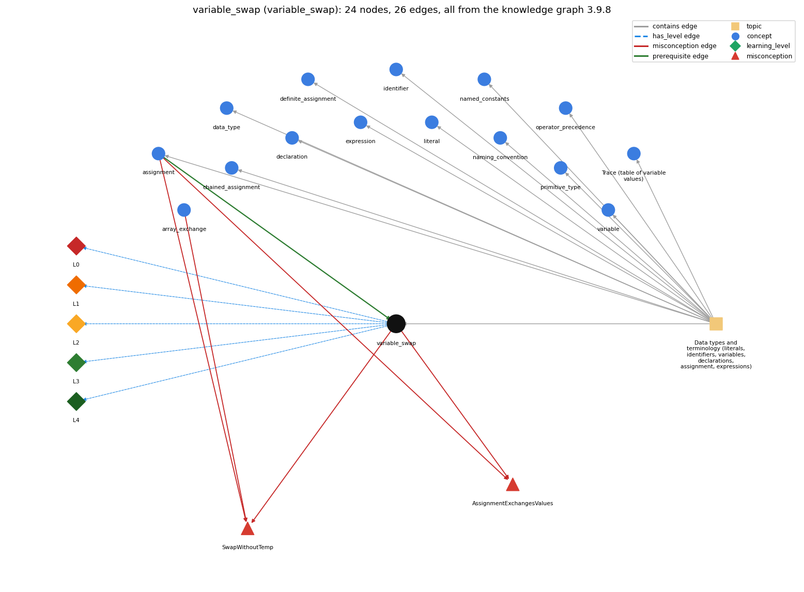

# variable_swap (`variable_swap`)

exchanging two variables needs a temporary

Section 1.2 Built-in Types of Data, topic 1.2.a Data types and terminology (literals, identifiers, variables, declarations, assignment, expressions). From the knowledge graph 3.9.8 (`data/raw/chapter1_kg_updated.json`).

## Concepts associated with variable\_swap (15)

| Concept | Description | How it is associated |
| --- | --- | --- |
| **array\_exchange** | swap a[i] and a[j] through a temporary variable | shares misconception SwapWithoutTemp |
| **assignment** | = stores the computed value of the right side | prerequisite of it (it needs this) composition rule (R) with it shares misconception SwapWithoutTemp shares misconception AssignmentExchangesValues same topic (topic1.2.a) |
| **chained\_assignment** | a = b = 0 assigns right to left | same topic (topic1.2.a) |
| **data\_type** | a set of values and the operations defined on them | same topic (topic1.2.a) |
| **declaration** | int x; -- introduces a variable name and its type | same topic (topic1.2.a) |
| **definite\_assignment** | a local variable must be assigned before it is read | same topic (topic1.2.a) |
| **expression** | anything that evaluates to a value | same topic (topic1.2.a) |
| **identifier** | a name for a variable, method or class; case-sensitive, no spaces, not a keyword | same topic (topic1.2.a) |
| **literal** | a constant value written in code (42, 3.14, true, 'a', "hi") | same topic (topic1.2.a) |
| **named\_constants** | final constants in UPPER\_CASE instead of magic numbers | same topic (topic1.2.a) |
| **naming\_convention** | choosing meaningful names: full words, lowerCamelCase, single letters only for throwaway loop counters | same topic (topic1.2.a) |
| **operator\_precedence** | the order operators bind in an expression | same topic (topic1.2.a) |
| **primitive\_type** | int, double, boolean, char | same topic (topic1.2.a) |
| **program\_trace** | a table of the values of the variables after each statement, used to check what code does | same topic (topic1.2.a) |
| **variable** | a named, typed box that holds a value | same topic (topic1.2.a) |

## Every edge in this view and its full label (26)

| From | Edge | To | Full edge label |
| --- | --- | --- | --- |
| **assignment** | prerequisite | **variable\_swap** | The three assignments int t = a; a = b; b = t; exchange the values of a and b, as a trace of the variable values after each statement shows. grounding: book\_passage composition rule (R) of assignment with variable\_swap: int t = a; a = b; b = t; works only in this order, because every assignment destroys its left variable's old value. composition rule (R) of variable\_swap with assignment: A swap is three assignments whose order matters, because each one overwrites the old value of its left variable. |
| **array\_exchange** | misconception | **SwapWithoutTemp** | **wrong rule:** a[i] = a[j]; a[j] = a[i]; exchanges the two values. **right rule:** A temporary variable must save a[i] before it is overwritten. role: primary |
| **assignment** | misconception | **AssignmentExchangesValues** | **wrong rule:** b = a exchanges the values of a and b. **right rule:** b = a copies a into b and leaves a unchanged; an exchange needs a temporary variable and three assignments. role: primary |
| **assignment** | misconception | **SwapWithoutTemp** | **wrong rule:** a[i] = a[j]; a[j] = a[i]; exchanges the two values. **right rule:** A temporary variable must save a[i] before it is overwritten. role: context |
| **variable\_swap** | misconception | **AssignmentExchangesValues** | **wrong rule:** b = a exchanges the values of a and b. **right rule:** b = a copies a into b and leaves a unchanged; an exchange needs a temporary variable and three assignments. role: context |
| **variable\_swap** | misconception | **SwapWithoutTemp** | **wrong rule:** a[i] = a[j]; a[j] = a[i]; exchanges the two values. **right rule:** A temporary variable must save a[i] before it is overwritten. role: context |
| **variable\_swap** | has\_level | **variable\_swap@L0** | variable swap -&gt; L0 (Prestructural): the answer holds a rule that contradicts Java (4 ways). **[0] everyday\_reading** (E): In everyday life two people swap objects at the same moment, hand to hand, and 'b = a' sounds like 'a and b are now the same thing'. Java statements run one at a time, so the first assignment destroys a value unless it was first saved in a temporary. **[1] misconception** (M) &rarr; SwapWithoutTemp: wrong rule: a[i] = a[j]; a[j] = a[i]; exchanges the two values. Right rule: A temporary variable must save a[i] before it is overwritten. **[2] inconsistent\_trace** (T) &rarr; SwapWithoutTemp: Points to LT (three assignments in order, each using current values). Applied unevenly, a student traces the first two steps correctly but uses a's original value in the third, or calls one segment a swap and the other a copy without tracing either. (here mixing in: "a[i] = a[j]; a[j] = a[i]; exchanges the two values") **[3] misconception** (M) &rarr; AssignmentExchangesValues: wrong rule: b = a exchanges the values of a and b. Right rule: b = a copies a into b and leaves a unchanged; an exchange needs a temporary variable and three assignments. |
| **variable\_swap** | has\_level | **variable\_swap@L1** | variable swap -&gt; L1 (Unistructural): the answer states one correct rule without applying it (2 ways). **[0] names\_the\_element** (N): Variable swap: the three-assignment idiom that exchanges the values of two variables through a temporary variable. **[1] states\_the\_rule** (S): int t = a; a = b; b = t; exchanges a and b. The temporary t must have their type, and the three statements must run in exactly this order. |
| **variable\_swap** | has\_level | **variable\_swap@L2** | variable swap -&gt; L2 (Multistructural): the answer applies the rules of variable swap to every part of the code, in order (3 ways). **[0] line\_by\_line\_trace** (LT): Step 1 saves a in t. Step 2 overwrites a with b. Step 3 copies the saved value from t into b. Each step reads values left by the previous one. **[1] output\_prediction** (OP): Starting from a = 1234 and b = 99, the swap ends with a = 99, b = 1234 and t = 1234. **[2] one\_step\_execution** (OS): Each of the three statements changes exactly one variable: first t, then a, then b. |
| **variable\_swap** | has\_level | **variable\_swap@L3** | variable swap -&gt; L3 (Relational): the answer relates the parts (2 ways). **[0] relation\_to\_neighbour** (R): A swap is three assignments whose order matters, because each one overwrites the old value of its left variable. **[1] purpose\_of\_the\_whole** (P): Plan: exchange. It is used to reorder two values (make a &lt;= b), and inside sorting and shuffling of arrays. t plays Sajaniemi's temporary role. |
| **variable\_swap** | has\_level | **variable\_swap@L4** | variable swap -&gt; L4 (Extended abstract): the answer reasons beyond the given code (4 ways). **[0] predict\_a\_change** (C) &rarr; SwapWithoutTemp: Reordering the steps (int t = a; b = t; a = b;) breaks the swap: both variables end up holding a's value. Dropping the temporary breaks it the same way. Running the correct swap twice restores the originals, so a swap is its own inverse. **[1] transfer\_to\_a\_new\_program** (X): Use the swap when two variables or array elements must exchange values (sorting, shuffling, ordering a pair). It is not needed when you only need a new variable holding the larger value, or when you can compute directly into new variables. **[2] diagnose\_an\_error** (D): rule broken: An assignment overwrites its target, so a value about to be overwritten must be saved first. Kind: silent logic error. Trigger class: Swapping without a temporary (a = b; b = a;) or in the wrong order: both variables end with the same value whenever a != b. **[3] diagnose\_an\_error** (D): rule broken: The temporary must have the type of the values being swapped. Kind: compile-time. Trigger class: Using int t to swap doubles: 'possible lossy conversion from double to int'. |
| **topic1.2.a** | contains | **assignment** | topic topic1.2.a contains assignment |
| **topic1.2.a** | contains | **chained\_assignment** | topic topic1.2.a contains chained\_assignment |
| **topic1.2.a** | contains | **data\_type** | topic topic1.2.a contains data\_type |
| **topic1.2.a** | contains | **declaration** | topic topic1.2.a contains declaration |
| **topic1.2.a** | contains | **definite\_assignment** | topic topic1.2.a contains definite\_assignment |
| **topic1.2.a** | contains | **expression** | topic topic1.2.a contains expression |
| **topic1.2.a** | contains | **identifier** | topic topic1.2.a contains identifier |
| **topic1.2.a** | contains | **literal** | topic topic1.2.a contains literal |
| **topic1.2.a** | contains | **named\_constants** | topic topic1.2.a contains named\_constants |
| **topic1.2.a** | contains | **naming\_convention** | topic topic1.2.a contains naming\_convention |
| **topic1.2.a** | contains | **operator\_precedence** | topic topic1.2.a contains operator\_precedence |
| **topic1.2.a** | contains | **primitive\_type** | topic topic1.2.a contains primitive\_type |
| **topic1.2.a** | contains | **program\_trace** | topic topic1.2.a contains program\_trace |
| **topic1.2.a** | contains | **variable** | topic topic1.2.a contains variable |
| **topic1.2.a** | contains | **variable\_swap** | topic topic1.2.a contains variable\_swap |
