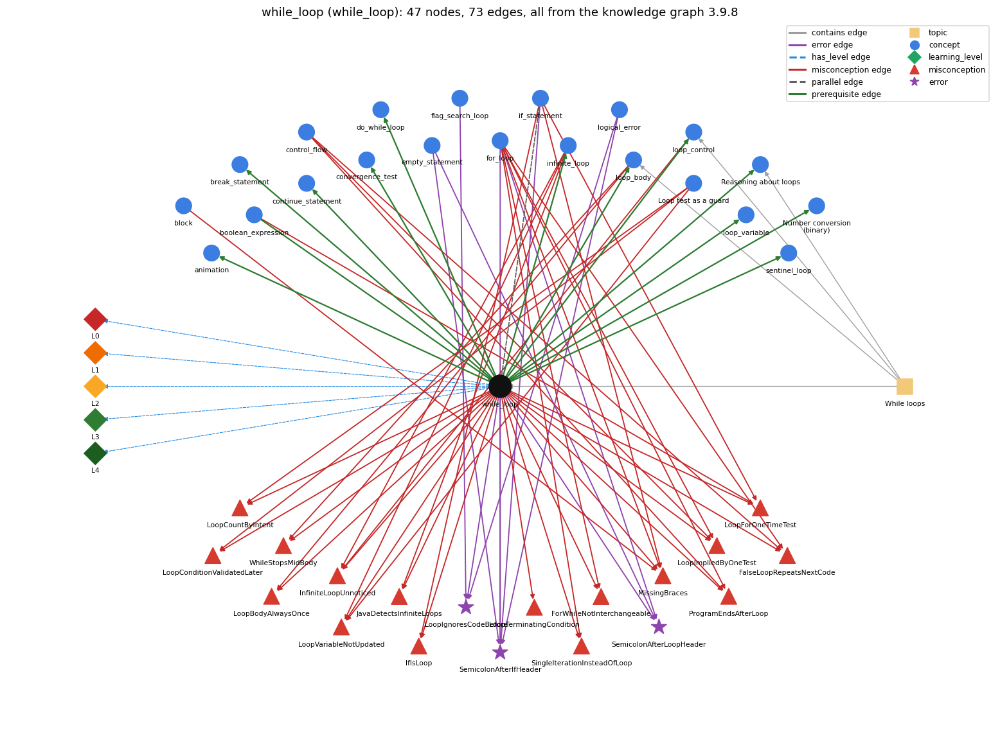

# while_loop (`while_loop`)

repeat a block while a condition holds

Section 1.3 Conditionals and Loops, topic 1.3.c While loops.

## At a glance

- **Needs first:** `boolean_expression`
- **Leads to:** `animation`, `break_statement`, `continue_statement`, `convergence_test`, `do_while_loop`, `infinite_loop`, `loop_body`, `loop_control`, `loop_invariant_reasoning`, `loop_variable`, `number_conversion`, `sentinel_loop`
- **Learned alongside:** `if_statement`
- **Misconceptions:** `FalseLoopRepeatsNextCode`, `ForWhileNotInterchangeable`, `IfIsLoop`, `InfiniteLoopUnnoticed`, `JavaDetectsInfiniteLoops`, `LoopBodyAlwaysOnce`, `LoopConditionValidatedLater`, `LoopCountByIntent`, `LoopForOneTimeTest`, `LoopImpliedByOneTest`, `LoopTerminatingCondition`, `LoopVariableNotUpdated`, `MissingBraces`, `ProgramEndsAfterLoop`, `SingleIterationInsteadOfLoop`, `WhileStopsMidBody`
- **Errors:** `LoopIgnoresCodeBefore`, `SemicolonAfterIfHeader`, `SemicolonAfterLoopHeader`
- **Levels:** L0, L1, L2, L3, L4

Everything below comes from the knowledge graph 3.9.8 (`data/raw/chapter1_kg_updated.json`): 73 edges around this concept, each explained in the graph's own words.

## What it needs first (1)

A prerequisite edge means the other concept has to be understood before `while_loop`.

### `boolean_expression` comes before `while_loop`

*an expression that evaluates to true/false*

A while tests its boolean condition before every pass and stops the first time it evaluates to false.

- **Grounding:** book passage
- **How `while_loop` combines with `boolean_expression`:** The loop condition is a boolean expression evaluated before every pass; the loop stops the first time it is false, so the body must eventually make it false.
- **How `boolean_expression` combines with `while_loop`:** The while loop re-evaluates its boolean expression before every pass and stops the first time it is false, so some variable in the expression must change in the body or the loop never ends.

## What it leads to (12)

These concepts need `while_loop` first.

### `while_loop` comes before `animation`

*StdDraw animation: clear, draw, show, pause in a loop*

BouncingBall repeats erase, draw at the new position, and show with a pause inside a while (true) loop.

- **Grounding:** book passage
- **How `while_loop` combines with `animation`:** An animation repeats clear/draw/show/pause steps inside a loop, typically one that runs indefinitely.
- **How `animation` combines with `while_loop`:** The frame loop is while (true): it never ends by its condition, so the animation runs until the window or program is closed.

### `while_loop` comes before `break_statement`

*break -- immediately exits the innermost loop or switch*

break immediately exits a loop without letting it run to completion.

- **Grounding:** book passage
- **How `while_loop` combines with `break_statement`:** break exits the loop immediately, so a while loop can end either by a false test or by a break; while (true) needs a break (or is infinite).
- **How `break_statement` combines with `while_loop`:** break gives a while loop a second exit, in the middle of the body. After the loop, the program has to tell which exit was taken by re-testing the state (as in \`if (i &gt; N/i)\`), so any variable used for that test must be declared before the loop.

### `while_loop` comes before `continue_statement`

*continue -- skips to the next iteration of the innermost loop*

continue ends the current pass of the while loop and goes straight back to the loop test.

- **Grounding:** book passage

### `while_loop` comes before `convergence_test`

*stopping a loop when a floating-point result is close enough*

The convergence test is the condition of a while loop that keeps refining an estimate until the error is below a tolerance.

- **Grounding:** book passage
- **How `while_loop` combines with `convergence_test`:** A convergence test is the while condition that keeps refining an estimate until the error is within tolerance, e.g. while (Math.abs(t - c/t) &gt; epsilon \* t).
- **How `convergence_test` combines with `while_loop`:** The convergence test is the while condition, evaluated before every pass. The body must move the estimate closer (t = (c/t + t)/2.0), or the condition stays true and the loop never ends.

### `while_loop` comes before `do_while_loop`

*do { body } while (c); -- body first, test after*

do { body } while (c); is a while loop whose test is moved to the bottom.

- **Grounding:** book passage
- **How `while_loop` combines with `do_while_loop`:** do { body } while (c); means the same as while (c) { body } except that the first test is omitted, so the body runs at least once.
- **How `do_while_loop` combines with `while_loop`:** do { S } while (c); equals \`S; while (c) { S }\`. If c is initially true it behaves exactly like \`while (c) { S }\`; if c is initially false it still runs S once where the while runs it zero times.

### `while_loop` comes before `infinite_loop`

*a loop whose condition never becomes false*

A while loop whose condition never becomes false never ends.

- **Grounding:** book passage

### `while_loop` comes before `loop_body`

*the block repeated each pass*

The loop body is the block of statements that a while (or for) loop repeats on each pass.

- **Grounding:** book passage
- **How `while_loop` combines with `loop_body`:** The body is the block that the while repeats; it runs only after a true test and is completed before the next test.
- **How `loop_body` combines with `while_loop`:** The body is what the while repeats; the condition is tested only between complete executions of it.

### `while_loop` comes before `loop_control`

*the three slots: init ; condition ; update*

A while loop has the same three control parts as a for loop, written in other places: the index set before the loop, the loop-continuation condition in the header, and the update as the last statement of the body.

- **Grounding:** book passage

### `while_loop` comes before `loop_invariant_reasoning`

*Reasoning about loops: convincing yourself a loop is correct by stating facts that hold each time through it and why it terminates*

To reason about a while loop you state what stays true on every pass and why the condition eventually becomes false.

- **Grounding:** book passage
- **How `while_loop` combines with `loop_invariant_reasoning`:** To trust a while loop, state what stays true on every pass and why the condition eventually becomes false (e.g. v is always a power of 2, v increases, so the loop terminates).
- **How `loop_invariant_reasoning` combines with `while_loop`:** The invariant is stated at the while test. The while condition supplies the extra fact available inside the body (v ≤ N/2, so 2v ≤ N), and its negation supplies the extra fact after the loop (2v &gt; N).

### `while_loop` comes before `loop_variable`

*the counter that drives the loop*

A loop variable is a counter that the loop initializes, tests in its condition and increments on each pass.

- **Grounding:** book passage
- **How `while_loop` combines with `loop_variable`:** The while condition usually tests a loop variable that is initialized before the loop and updated in the body; if the body never changes it, the loop never ends.
- **How `loop_variable` combines with `while_loop`:** In a while loop the loop variable is declared and initialized before the loop and updated inside the body, so it remains available after the loop.

### `while_loop` comes before `number_conversion`

*Number conversion (binary): converting an integer to its binary representation by casting out powers of 2 in a loop*

Binary conversion repeats one step in a while loop: find the largest power of 2 not above n, output a bit and subtract.

- **Grounding:** book passage
- **How `while_loop` combines with `number_conversion`:** Binary conversion uses while loops: one to find the largest power of 2 &lt;= N, and one to cast out powers of 2 in decreasing order.
- **How `number_conversion` combines with `while_loop`:** Two while loops in sequence: the first's exit state (v = largest power of 2 ≤ N) is the second's starting state. The second runs once per bit and ends when integer halving takes v from 1 to 0.

### `while_loop` comes before `sentinel_loop`

*reading until a special stop value (Rainfall problem)*

A sentinel loop is a while loop whose condition tests each value read against the stop value.

- **Grounding:** spec passage

## Learned alongside (1)

A parallel edge joins two concepts that sit side by side: neither is needed before the other.

### `while_loop` alongside `if_statement`

*run a block only when the condition holds*

if and while have the same form, but if tests its condition once and runs the block at most once, while while tests again after every pass and repeats the block as long as the condition is true.

- **Grounding:** book passage

## Misconceptions (16)

A misconception edge states the wrong rule a student may hold about this concept, and the right rule.

### FalseLoopRepeatsNextCode

- **Wrong rule:** A loop is an iterative if-else: while the condition is true the body repeats, and when it is false the code after the loop repeats.
- **Right rule:** Only the body is repeated; once the condition is false the code after the loop runs once.
- **Role of this concept:** context
- **Shows at level L0 as:** misconception: wrong rule: A loop is an iterative if-else: while the condition is true the body repeats, and when it is false the code after the loop repeats. Right rule: Only the body is repeated; once the condition is false the code after the loop runs once.
- **Also an edge from `control_flow`:** A loop is an iterative if-else: while the condition is true the body repeats, and when it is false the code after the loop repeats.
- **Also an edge from `for_loop`:** A loop is an iterative if-else: while the condition is true the body repeats, and when it is false the code after the loop repeats.

### ForWhileNotInterchangeable

- **Wrong rule:** Some loops can only be written with for, others only with while.
- **Right rule:** Any for loop can be rewritten as a while loop and vice versa; for just packages init, test and update.
- **Role of this concept:** context
- **Shows at level L0 as:** misconception: wrong rule: Some loops can only be written with for, others only with while. Right rule: Any for loop can be rewritten as a while loop and vice versa; for just packages init, test and update.
- **Also an edge from `for_loop`:** Some loops can only be written with for, others only with while.

### IfIsLoop

- **Wrong rule:** A while loop runs its body once when the condition is true, just like an if.
- **Right rule:** A while tests its condition again after every pass and keeps repeating while the condition stays true.
- **Role of this concept:** context
- **Shows at level L0 as:** misconception: wrong rule: an if body repeats while its condition holds. Right rule: An if body runs at most once; only a loop repeats its body.
- **Also an edge from `if_statement`:** The if body keeps repeating as long as its condition stays true.

### InfiniteLoopUnnoticed

- **Wrong rule:** a condition that never goes false still terminates
- **Right rule:** A while loop stops only when its condition is false at a check, so if no pass changes the variables in the condition, it never stops.
- **Role of this concept:** context
- **Shows at level L0 as:** misconception: wrong rule: a condition that never goes false still terminates. Right rule: A while loop stops only when its condition is false at a check, so if no pass changes the variables in the condition, it never stops.
- **Also an edge from `infinite_loop`:** a condition that never goes false still terminates
- **Also an edge from `loop_control`:** A while loop always stops on its own, even if nothing in its body can make the condition false.

### JavaDetectsInfiniteLoops

- **Wrong rule:** If my loop never ends, the compiler or Java will warn me.
- **Right rule:** Java cannot detect infinite loops in general; you must check that the loop condition eventually becomes false.
- **Role of this concept:** context
- **Shows at level L0 as:** misconception: wrong rule: If my loop never ends, the compiler or Java will warn me. Right rule: Java cannot detect infinite loops in general; you must check that the loop condition eventually becomes false.
- **Also an edge from `infinite_loop`:** If my loop never ends, the compiler or Java will warn me.

### LoopBodyAlwaysOnce

- **Wrong rule:** The loop body always runs at least once, even if the condition is false at the start.
- **Right rule:** A while or for body runs zero times when the condition is false at the start.
- **Role of this concept:** primary
- **Shows at level L0 as:** misconception: wrong rule: The loop body always runs at least once, even if the condition is false at the start. Right rule: A while or for body runs zero times when the condition is false at the start.
- **Also an edge from `loop_body`:** The loop body always runs at least once, even if the condition is false at the start.

### LoopConditionValidatedLater

- **Wrong rule:** If a loop condition is false at first but would become true later, the loop still runs (it repeats or skips until the condition is true, then runs until it is false).
- **Right rule:** A while loop whose condition is false at the first test runs zero times; nothing later revives it.
- **Role of this concept:** primary
- **Shows at level L0 as:** misconception: wrong rule: If a loop condition is false at first but would become true later, the loop still runs (it repeats or skips until the condition is true, then runs until it is false). Right rule: A while loop whose condition is false at the first test runs zero times; nothing later revives it.
- **Also an edge from `loop_guard`:** If a loop condition is false at first but would become true later, the loop still runs (it repeats or skips until the condition is true, then runs until it is false).

### LoopCountByIntent

- **Wrong rule:** How many times a loop runs is decided by what the program is meant to do, so it may go on after its condition is false.
- **Right rule:** The loop runs only while its condition is true when tested; it stops at the first false test.
- **Role of this concept:** primary
- **Shows at level L0 as:** misconception: wrong rule: How many times a loop runs is decided by what the program is meant to do, so it may go on after its condition is false. Right rule: The loop runs only while its condition is true when tested; it stops at the first false test.
- **Also an edge from `loop_guard`:** How many times a loop runs is decided by what the program is meant to do, so it may go on after its condition is false.

### LoopForOneTimeTest

- **Wrong rule:** Uses a loop where a condition needs to be tested only once.
- **Right rule:** A test made once is an if; a loop repeats.
- **Role of this concept:** primary
- **Shows at level L0 as:** misconception: wrong rule: Uses a loop where a condition needs to be tested only once. Right rule: A test made once is an if; a loop repeats.
- **Also an edge from `boolean_expression`:** Uses a loop where a condition needs to be tested only once.
- **Also an edge from `if_statement`:** Uses a loop where a condition needs to be tested only once.

### LoopImpliedByOneTest

- **Wrong rule:** Testing one case is enough; Java will repeat the test for the other values by itself.
- **Right rule:** A statement runs once each time control reaches it; repeating a test for many values needs a loop.
- **Role of this concept:** primary
- **Shows at level L0 as:** misconception: wrong rule: Testing one case is enough; Java will repeat the test for the other values by itself. Right rule: A statement runs once each time control reaches it; repeating a test for many values needs a loop.
- **Also an edge from `control_flow`:** Testing one case is enough; Java will repeat the test for the other values by itself.
- **Also an edge from `for_loop`:** Testing one case is enough; Java will repeat the test for the other values by itself.

### LoopTerminatingCondition

- **Wrong rule:** For and while loops end when the condition becomes true.
- **Right rule:** A for or while loop ends when its condition becomes false.
- **Role of this concept:** primary
- **Shows at level L0 as:** misconception: wrong rule: For and while loops end when the condition becomes true. Right rule: A for or while loop ends when its condition becomes false.
- **Shows at level L0 as:** inconsistent trace: Applies the while rule (LT) unevenly: tests the condition before some passes but not others, stops in the middle of a body on one pass, or runs the first pass without testing. (here mixing in: "For and while loops end when the condition becomes true")

### LoopVariableNotUpdated

- **Wrong rule:** A while loop ends by itself even if nothing in the body changes the variable tested in the condition.
- **Right rule:** If no statement in the body changes a variable in the condition, a condition that was true stays true and the loop never ends.
- **Role of this concept:** context
- **Shows at level L0 as:** misconception: wrong rule: A while loop ends by itself even if nothing in the body changes the variable tested in the condition. Right rule: If no statement in the body changes a variable in the condition, a condition that was true stays true and the loop never ends.
- **Also an edge from `infinite_loop`:** A while loop ends by itself even if nothing in the body changes the variable tested in the condition.
- **Also an edge from `loop_guard`:** A while loop ends by itself even if nothing in the body changes the variable tested in the condition.

### MissingBraces

- **Wrong rule:** Omits braces around a single-statement body of if, for or while.
- **Right rule:** Braces are optional for a single-statement body, but using them anyway avoids bugs when statements are added later.
- **Role of this concept:** context
- **Also an edge from `block`:** Omits braces around a single-statement body of if, for or while.
- **Also an edge from `for_loop`:** Omits braces around a single-statement body of if, for or while.
- **Also an edge from `if_statement`:** Omits braces around a single-statement body of if, for or while.

### ProgramEndsAfterLoop

- **Wrong rule:** When a loop finishes the program ends, so code after the loop never runs.
- **Right rule:** When the loop condition becomes false, control continues with the first statement after the loop.
- **Role of this concept:** primary
- **Shows at level L0 as:** misconception: wrong rule: When a loop finishes the program ends, so code after the loop never runs. Right rule: When the loop condition becomes false, control continues with the first statement after the loop.
- **Also an edge from `control_flow`:** When a loop finishes the program ends, so code after the loop never runs.
- **Also an edge from `for_loop`:** When a loop finishes the program ends, so code after the loop never runs.

### SingleIterationInsteadOfLoop

- **Wrong rule:** A task that must be repeated is written once, without a loop, as if one pass were enough.
- **Right rule:** A step that must happen several times (or an unknown number of times) needs a loop such as while or for; code without a loop runs once.
- **Role of this concept:** primary
- **Shows at level L0 as:** misconception: wrong rule: A task that must be repeated is written once, without a loop, as if one pass were enough. Right rule: A step that must happen several times (or an unknown number of times) needs a loop such as while or for; code without a loop runs once.
- **Also an edge from `for_loop`:** A task that must be repeated is written once, without a loop, as if one pass were enough.

### WhileStopsMidBody

- **Wrong rule:** The loop stops the moment the condition becomes false, even in the middle of the body.
- **Right rule:** The condition is tested only before each pass, so the whole body finishes before the loop can stop.
- **Role of this concept:** primary
- **Shows at level L0 as:** misconception: wrong rule: The loop stops the moment the condition becomes false, even in the middle of the body. Right rule: The condition is tested only before each pass, so the whole body finishes before the loop can stop.
- **Also an edge from `loop_body`:** The loop stops the moment the condition becomes false, even in the middle of the body.

## Errors (3)

An error edge states the rule that gets broken in a program, and the right rule.

### LoopIgnoresCodeBefore

- **Wrong rule:** Initializes the flag before the loop so that the loop condition is already false, and the loop body never runs.
- **Right rule:** A while loop tests its condition before the first pass: if the values set before the loop make the condition false, the body never runs.
- **Role of this concept:** primary
- **Also an edge from `flag_search_loop`:** Initializes the flag before the loop so that the loop condition is already false, and the loop body never runs.
- **Also an edge from `logical_error`:** Initializes the flag before the loop so that the loop condition is already false, and the loop body never runs.

### SemicolonAfterIfHeader

- **Wrong rule:** if (x &gt; 0); System.out.println("positive"); prints only for positive x.
- **Right rule:** The ; ends the if with an empty statement, so the next line always runs.
- **Role of this concept:** context
- **Also an edge from `empty_statement`:** if (x &gt; 0); System.out.println("positive"); prints only for positive x.
- **Also an edge from `for_loop`:** if (x &gt; 0); System.out.println("positive"); prints only for positive x.
- **Also an edge from `if_statement`:** if (x &gt; 0); System.out.println("positive"); prints only for positive x.
- **Also an edge from `logical_error`:** if (x &gt; 0); System.out.println("positive"); prints only for positive x.

### SemicolonAfterLoopHeader

- **Wrong rule:** Puts a ; right after for (...) or while (...).
- **Right rule:** A ; right after the loop header is a null (empty) loop body, so the statements written after it are not repeated by the loop.
- **Role of this concept:** context
- **Also an edge from `empty_statement`:** Puts a ; right after for (...) or while (...).
- **Also an edge from `for_loop`:** Puts a ; right after for (...) or while (...).

## Levels L0 to L4 (5 of 5)

Each level edge lists the ways a student shows that level, each with its exact rule.

### L0: Prestructural / sensorimotor

L0 for while loop: the answer holds a rule that contradicts Java.

*Deciding question: Does every rule the answer applies to while loop agree with the language rule? If it reads the code with everyday meanings, applies a wrong rule, or switches rules within one trace, it is L0. A slip in an otherwise rule-correct trace is L2 with an error, not L0.*

while loop -&gt; L0 (Prestructural): the answer holds a rule that contradicts Java (17 ways).

- **everyday reading** (folk-meaning rule): Folk meaning: English 'while' means 'during the time that', so the activity stops the instant the condition stops holding (the 'while demon'). A Java while tests its condition only before each pass; a pass that has started always finishes.
- **misconception** (wrong rule / right rule; shows `LoopTerminatingCondition`): wrong rule: For and while loops end when the condition becomes true. Right rule: A for or while loop ends when its condition becomes false.
- **misconception** (wrong rule / right rule; shows `WhileStopsMidBody`): wrong rule: The loop stops the moment the condition becomes false, even in the middle of the body. Right rule: The condition is tested only before each pass, so the whole body finishes before the loop can stop.
- **misconception** (wrong rule / right rule; shows `LoopForOneTimeTest`): wrong rule: Uses a loop where a condition needs to be tested only once. Right rule: A test made once is an if; a loop repeats.
- **misconception** (wrong rule / right rule; shows `LoopImpliedByOneTest`): wrong rule: Testing one case is enough; Java will repeat the test for the other values by itself. Right rule: A statement runs once each time control reaches it; repeating a test for many values needs a loop.
- **misconception** (wrong rule / right rule; shows `ProgramEndsAfterLoop`): wrong rule: When a loop finishes the program ends, so code after the loop never runs. Right rule: When the loop condition becomes false, control continues with the first statement after the loop.
- **misconception** (wrong rule / right rule; shows `LoopCountByIntent`): wrong rule: How many times a loop runs is decided by what the program is meant to do, so it may go on after its condition is false. Right rule: The loop runs only while its condition is true when tested; it stops at the first false test.
- **misconception** (wrong rule / right rule; shows `LoopConditionValidatedLater`): wrong rule: If a loop condition is false at first but would become true later, the loop still runs (it repeats or skips until the condition is true, then runs until it is false). Right rule: A while loop whose condition is false at the first test runs zero times; nothing later revives it.
- **misconception** (wrong rule / right rule; shows `SingleIterationInsteadOfLoop`): wrong rule: A task that must be repeated is written once, without a loop, as if one pass were enough. Right rule: A step that must happen several times (or an unknown number of times) needs a loop such as while or for; code without a loop runs once.
- **inconsistent trace** (uneven-application rule; shows `LoopTerminatingCondition`): Applies the while rule (LT) unevenly: tests the condition before some passes but not others, stops in the middle of a body on one pass, or runs the first pass without testing. (here mixing in: "For and while loops end when the condition becomes true")
- **misconception** (wrong rule / right rule; shows `IfIsLoop`): wrong rule: an if body repeats while its condition holds. Right rule: An if body runs at most once; only a loop repeats its body.
- **misconception** (wrong rule / right rule; shows `LoopBodyAlwaysOnce`): wrong rule: The loop body always runs at least once, even if the condition is false at the start. Right rule: A while or for body runs zero times when the condition is false at the start.
- **misconception** (wrong rule / right rule; shows `InfiniteLoopUnnoticed`): wrong rule: a condition that never goes false still terminates. Right rule: A while loop stops only when its condition is false at a check, so if no pass changes the variables in the condition, it never stops.
- **misconception** (wrong rule / right rule; shows `JavaDetectsInfiniteLoops`): wrong rule: If my loop never ends, the compiler or Java will warn me. Right rule: Java cannot detect infinite loops in general; you must check that the loop condition eventually becomes false.
- **misconception** (wrong rule / right rule; shows `ForWhileNotInterchangeable`): wrong rule: Some loops can only be written with for, others only with while. Right rule: Any for loop can be rewritten as a while loop and vice versa; for just packages init, test and update.
- **misconception** (wrong rule / right rule; shows `FalseLoopRepeatsNextCode`): wrong rule: A loop is an iterative if-else: while the condition is true the body repeats, and when it is false the code after the loop repeats. Right rule: Only the body is repeated; once the condition is false the code after the loop runs once.
- **misconception** (wrong rule / right rule; shows `LoopVariableNotUpdated`): wrong rule: A while loop ends by itself even if nothing in the body changes the variable tested in the condition. Right rule: If no statement in the body changes a variable in the condition, a condition that was true stays true and the loop never ends.

### L1: Unistructural / atom x text surface

L1 for while loop: the answer states one correct rule without applying it.

*Deciding question: Does the answer cover every part of the code, in order, with the values (L2)? If it covers one part or only states the rule, it is L1.*

while loop -&gt; L1 (Unistructural): the answer states one correct rule without applying it (2 ways).

- **names the element** (identity rule): The while statement is a loop (iteration statement): it repeats a body as long as a boolean condition is true.
- **states the rule** (declarative rule): Syntax: while (&lt;boolean expression&gt;) { &lt;statements&gt; } (braces optional for one statement). Meaning: if the expression is false do nothing; if true, execute the body, then check the expression again, and continue as long as it is true.

### L2: Multistructural / block x execution / preoperational

L2 for while loop: the answer applies these rules to every part of the code, in order.

*Deciding question: Is the answer many segments mapped onto lines (L2), or one segment stating the purpose of the whole (L3)? A correct output with no value-by-value justification is not levelled.*

while loop -&gt; L2 (Multistructural): the answer applies the rules of while loop to every part of the code, in order (3 ways).

- **line by line trace** (operational sequencing rule): 1. Evaluate the condition. 2. If false, skip the body and continue after the loop. 3. If true, execute the whole body, then go back to step 1.
- **output prediction** (evaluation / result rule): A while statement has no value; its result is the state and output after the passes it made: e.g. TenHellos with i = 4 and i &lt;= 10 prints 4th to 10th Hello (7 passes) and leaves i = 11.
- **one step execution** (state-transition rule): One pass: test the condition with the current values, then (if true) apply every body statement once in order; the variables assigned in the body change and nothing else; a false test ends the loop with the state unchanged.

### L3: Relational / relations x function (concrete operational begins)

L3 for while loop: the answer relates the parts by these rules.

*Deciding question: Was the purpose deduced from the code, or only guessed from traced input/output pairs (then L2)? Does the answer stay within the given code (L3), or reason about changed code, an error class or a new program (L4)?*

while loop -&gt; L3 (Relational): the answer relates the parts (11 ways).

- **relation to neighbour** (composition rule (with a neighbour)): The loop condition is a boolean expression evaluated before every pass; the loop stops the first time it is false, so the body must eventually make it false.
- **relation to neighbour** (composition rule (with a neighbour)): do { body } while (c); means the same as while (c) { body } except that the first test is omitted, so the body runs at least once.
- **relation to neighbour** (composition rule (with a neighbour)): break exits the loop immediately, so a while loop can end either by a false test or by a break; while (true) needs a break (or is infinite).
- **relation to neighbour** (composition rule (with a neighbour)): An animation repeats clear/draw/show/pause steps inside a loop, typically one that runs indefinitely.
- **relation to neighbour** (composition rule (with a neighbour)): A convergence test is the while condition that keeps refining an estimate until the error is within tolerance, e.g. while (Math.abs(t - c/t) &gt; epsilon \* t).
- **relation to neighbour** (composition rule (with a neighbour)): The body is the block that the while repeats; it runs only after a true test and is completed before the next test.
- **relation to neighbour** (composition rule (with a neighbour)): The while condition usually tests a loop variable that is initialized before the loop and updated in the body; if the body never changes it, the loop never ends.
- **relation to neighbour** (composition rule (with a neighbour)): To trust a while loop, state what stays true on every pass and why the condition eventually becomes false (e.g. v is always a power of 2, v increases, so the loop terminates).
- **relation to neighbour** (composition rule (with a neighbour)): Binary conversion uses while loops: one to find the largest power of 2 &lt;= N, and one to cast out powers of 2 in decreasing order.
- **relation to neighbour** (composition rule (with a neighbour)): if and while have the same form, but if tests its condition once and runs the block at most once, while while tests again after every pass and repeats the block as long as the condition is true.
- **purpose of the whole** (plan / role rule): Plan: indefinite (event-controlled) repetition - repeat until something happens whose number of passes is not known in advance (until convergence, until broke or goal); the condition variable is often a stepper or most-recent holder.

### L4: Extended abstract (concrete-operational reversibility and conservation)

L4 for while loop: the answer reasons beyond the given code by these rules.

*Deciding question: Does the answer link the code to a broader context: a changed program, a class of inputs, an unseen problem? Re-tracing changed code value by value is L2; fixing one given failing case is L3.*

while loop -&gt; L4 (Extended abstract): the answer reasons beyond the given code (6 ways).

- **predict a change** (conservation rule; shows `LoopTerminatingCondition`): Changing &lt; to &lt;= adds exactly one pass at the boundary; removing the update from the body makes a loop that was entered never end; a condition that is false initially gives zero passes whatever the body does. Rewriting as for (init; cond; update) preserves behaviour if no continue is involved.
- **diagnose an error** (error rule): rule broken: A while loop tests its condition before the first pass, using the values set before the loop. Kind: silent logic error. Trigger class: Initializations before the loop that already make the condition false (e.g. boolean done = true; while (!done) ...): the body runs zero times and no error is reported.
- **transfer to a new program** (applicability rule): Use while when the number of passes depends on what happens during the loop (convergence, input, simulation) or the loop variable is needed after the loop; use for for counted loops, do-while when the body must run at least once, and if when the test is needed only once.
- **diagnose an error** (error rule): rule broken: A ; right after if (...) is an empty statement that forms the whole then branch; the following statement or block is no longer part of the if. Kind: silent logic error. Trigger class: Any if (cond); followed by a statement or block: that statement runs for every input, whatever cond is (it compiles without error).
- **diagnose an error** (error rule): rule broken: A ; right after while (...) or for (...) is an empty statement that is the whole loop body; the block written next is not repeated. Kind: silent logic error. Trigger class: for (...); { body } runs the body once after the loop ends; while (cond); with a cond that the empty body cannot change hangs forever (infinite loop) when cond starts true.
- **diagnose an error** (error rule): rule broken: The body must eventually make the condition false. Kind: silent logic error. Trigger class: No body statement changes a variable in the condition, or the update moves away from the bound (e.g. while (i &gt; 3) i = i + 1;): infinite loop, endless output or a hang; Java cannot detect it in general.

## Same topic

`while_loop` belongs to the topic **While loops** (`topic1.3.c`). The topic also contains: `loop_body`, `loop_control`, `loop_invariant_reasoning`.

## Rules of the concept (38)

- **folk-meaning rule:** Folk meaning: English 'while' means 'during the time that', so the activity stops the instant the condition stops holding (the 'while demon'). A Java while tests its condition only before each pass; a pass that has started always finishes.
- **wrong rule / right rule:** IfIsLoop: wrong: an if body repeats while its condition holds \| right: An if body runs at most once; only a loop repeats its body.
- **wrong rule / right rule:** LoopBodyAlwaysOnce: wrong: The loop body always runs at least once, even if the condition is false at the start. \| right: A while or for body runs zero times when the condition is false at the start.
- **wrong rule / right rule:** LoopForOneTimeTest: wrong: Uses a loop where a condition needs to be tested only once. \| right: A test made once is an if; a loop repeats.
- **wrong rule / right rule:** LoopTerminatingCondition: wrong: For and while loops end when the condition becomes true. \| right: A for or while loop ends when its condition becomes false.
- **wrong rule / right rule:** WhileStopsMidBody: wrong: The loop stops the moment the condition becomes false, even in the middle of the body. \| right: The condition is tested only before each pass, so the whole body finishes before the loop can stop.
- **wrong rule / right rule:** InfiniteLoopUnnoticed: wrong: a condition that never goes false still terminates \| right: A while loop stops only when its condition is false at a check, so if no pass changes the variables in the condition, it never stops.
- **wrong rule / right rule:** JavaDetectsInfiniteLoops: wrong: If my loop never ends, the compiler or Java will warn me. \| right: Java cannot detect infinite loops in general; you must check that the loop condition eventually becomes false.
- **wrong rule / right rule:** ForWhileNotInterchangeable: wrong: Some loops can only be written with for, others only with while. \| right: Any for loop can be rewritten as a while loop and vice versa; for just packages init, test and update.
- **wrong rule / right rule:** LoopImpliedByOneTest: wrong: Testing one case is enough; Java will repeat the test for the other values by itself. \| right: A statement runs once each time control reaches it; repeating a test for many values needs a loop.
- **wrong rule / right rule:** ProgramEndsAfterLoop: wrong: When a loop finishes the program ends, so code after the loop never runs. \| right: When the loop condition becomes false, control continues with the first statement after the loop.
- **wrong rule / right rule:** FalseLoopRepeatsNextCode: wrong: A loop is an iterative if-else: while the condition is true the body repeats, and when it is false the code after the loop repeats. \| right: Only the body is repeated; once the condition is false the code after the loop runs once.
- **wrong rule / right rule:** LoopCountByIntent: wrong: How many times a loop runs is decided by what the program is meant to do, so it may go on after its condition is false. \| right: The loop runs only while its condition is true when tested; it stops at the first false test.
- **wrong rule / right rule:** LoopConditionValidatedLater: wrong: If a loop condition is false at first but would become true later, the loop still runs (it repeats or skips until the condition is true, then runs until it is false). \| right: A while loop whose condition is false at the first test runs zero times; nothing later revives it.
- **wrong rule / right rule:** LoopVariableNotUpdated: wrong: A while loop ends by itself even if nothing in the body changes the variable tested in the condition. \| right: If no statement in the body changes a variable in the condition, a condition that was true stays true and the loop never ends.
- **wrong rule / right rule:** SingleIterationInsteadOfLoop: wrong: A task that must be repeated is written once, without a loop, as if one pass were enough. \| right: A step that must happen several times (or an unknown number of times) needs a loop such as while or for; code without a loop runs once.
- **uneven-application rule:** Applies the while rule (LT) unevenly: tests the condition before some passes but not others, stops in the middle of a body on one pass, or runs the first pass without testing.
- **identity rule:** The while statement is a loop (iteration statement): it repeats a body as long as a boolean condition is true.
- **declarative rule:** Syntax: while (&lt;boolean expression&gt;) { &lt;statements&gt; } (braces optional for one statement). Meaning: if the expression is false do nothing; if true, execute the body, then check the expression again, and continue as long as it is true.
- **operational sequencing rule:** 1. Evaluate the condition. 2. If false, skip the body and continue after the loop. 3. If true, execute the whole body, then go back to step 1.
- **evaluation / result rule:** A while statement has no value; its result is the state and output after the passes it made: e.g. TenHellos with i = 4 and i &lt;= 10 prints 4th to 10th Hello (7 passes) and leaves i = 11.
- **state-transition rule:** One pass: test the condition with the current values, then (if true) apply every body statement once in order; the variables assigned in the body change and nothing else; a false test ends the loop with the state unchanged.
- **composition rule (with a neighbour):** with boolean\_expression: The loop condition is a boolean expression evaluated before every pass; the loop stops the first time it is false, so the body must eventually make it false.
- **composition rule (with a neighbour):** with do\_while\_loop: do { body } while (c); means the same as while (c) { body } except that the first test is omitted, so the body runs at least once.
- **composition rule (with a neighbour):** with break\_statement: break exits the loop immediately, so a while loop can end either by a false test or by a break; while (true) needs a break (or is infinite).
- **composition rule (with a neighbour):** with animation: An animation repeats clear/draw/show/pause steps inside a loop, typically one that runs indefinitely.
- **composition rule (with a neighbour):** with convergence\_test: A convergence test is the while condition that keeps refining an estimate until the error is within tolerance, e.g. while (Math.abs(t - c/t) &gt; epsilon \* t).
- **composition rule (with a neighbour):** with loop\_body: The body is the block that the while repeats; it runs only after a true test and is completed before the next test.
- **composition rule (with a neighbour):** with loop\_variable: The while condition usually tests a loop variable that is initialized before the loop and updated in the body; if the body never changes it, the loop never ends.
- **composition rule (with a neighbour):** with loop\_invariant\_reasoning: To trust a while loop, state what stays true on every pass and why the condition eventually becomes false (e.g. v is always a power of 2, v increases, so the loop terminates).
- **composition rule (with a neighbour):** with number\_conversion: Binary conversion uses while loops: one to find the largest power of 2 &lt;= N, and one to cast out powers of 2 in decreasing order.
- **plan / role rule:** Plan: indefinite (event-controlled) repetition - repeat until something happens whose number of passes is not known in advance (until convergence, until broke or goal); the condition variable is often a stepper or most-recent holder.
- **conservation rule:** Changing &lt; to &lt;= adds exactly one pass at the boundary; removing the update from the body makes a loop that was entered never end; a condition that is false initially gives zero passes whatever the body does. Rewriting as for (init; cond; update) preserves behaviour if no continue is involved.
- **error rule:** rule broken: A ; right after if (...) is an empty statement that forms the whole then branch; the following statement or block is no longer part of the if. (silent logic error)
- **error rule:** rule broken: A ; right after while (...) or for (...) is an empty statement that is the whole loop body; the block written next is not repeated. (silent logic error)
- **error rule:** rule broken: A while loop tests its condition before the first pass, using the values set before the loop. (silent logic error)
- **error rule:** rule broken: The body must eventually make the condition false. (silent logic error)
- **applicability rule:** Use while when the number of passes depends on what happens during the loop (convergence, input, simulation) or the loop variable is needed after the loop; use for for counted loops, do-while when the body must run at least once, and if when the test is needed only once.

## The whole prerequisite chain

- **Everything it builds on (11):** `arithmetic_operators`, `boolean`, `boolean_expression`, `comparison_operators`, `data_type`, `expression`, `identifier`, `literal`, `logical_operators`, `primitive_type`, `variable`
- **Everything that builds on it (42):** `accumulator_pattern`, `animation`, `array_copy`, `array_reversal`, `array_traversal`, `boolean_flag_array`, `break_statement`, `continue_statement`, `convergence_rate`, `convergence_test`, `counter_pattern`, `do_while_loop`, `enhanced_for`, `fencepost_loop`, `flag_search_loop`, `for_loop`, `frequency_counting`, `function_plotting`, `increment_operators`, `infinite_loop`, `labeled_break`, `loop_body`, `loop_control`, `loop_invariant_reasoning`, `loop_performance`, `loop_scope`, `loop_variable`, `matrix_operations`, `monte_carlo_simulation`, `mouse_interaction`, `nested_loops`, `number_conversion`, `off_by_one_error`, `power_method`, `row_major_order`, `running_extreme`, `sentinel_loop`, `side_effect_order`, `simulation_loop`, `standard_audio`, `switch_statement`, `two_models`
