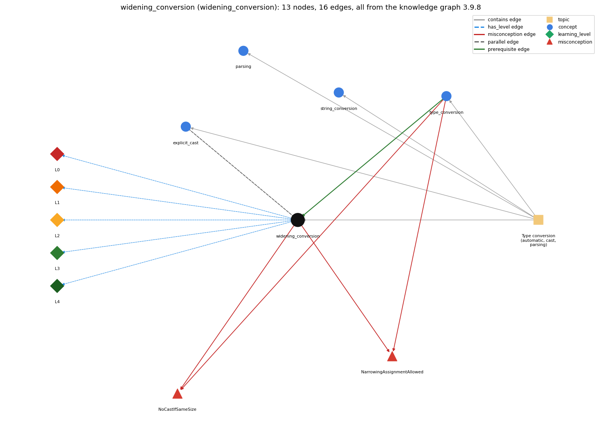

# widening_conversion (`widening_conversion`)

automatic conversion to a type with a larger range

Section 1.2 Built-in Types of Data, topic 1.2.h Type conversion (automatic, cast, parsing). From the knowledge graph 3.9.8 (`data/raw/chapter1_kg_updated.json`).

## Concepts associated with widening\_conversion (4)

| Concept | Description | How it is associated |
| --- | --- | --- |
| **explicit\_cast** | (int) x -- converts between numeric types, truncating toward zero | parallel concept same topic (topic1.2.h) |
| **parsing** | Integer.parseInt / Double.parseDouble turn text into numbers | same topic (topic1.2.h) |
| **string\_conversion** | + with a String converts the other operand to text | same topic (topic1.2.h) |
| **type\_conversion** | implicit widening and explicit (cast) | prerequisite of it (it needs this) composition rule (R) with it shares misconception NoCastIfSameSize shares misconception NarrowingAssignmentAllowed same topic (topic1.2.h) |

## Every edge in this view and its full label (16)

| From | Edge | To | Full edge label |
| --- | --- | --- | --- |
| **type\_conversion** | prerequisite | **widening\_conversion** | Widening is the automatic kind of type conversion. grounding: book\_passage composition rule (R) of type\_conversion with widening\_conversion: Widening (promotion) is the automatic kind of conversion, applied at operators and assignments when the target type has a larger range. composition rule (R) of widening\_conversion with type\_conversion: Widening is the automatic branch of type conversion; every other direction needs an explicit cast or method. |
| **widening\_conversion** | parallel | **explicit\_cast** | Widening (promotion) happens automatically when a value goes to a type with a larger range (int to double) and loses nothing; a narrowing conversion (double to int) is never automatic and needs an explicit cast, which truncates toward zero. grounding: book\_passage |
| **type\_conversion** | misconception | **NarrowingAssignmentAllowed** | **wrong rule:** A double value can be stored in an int variable like an int in a double. **right rule:** int to double is automatic; double to int needs a cast. role: context |
| **type\_conversion** | misconception | **NoCastIfSameSize** | **wrong rule:** If a variable is at least as big as a value, no cast is needed to assign the value. **right rule:** Assigning a double to an int needs a cast even when the value would fit, because a conversion that might involve loss of information leads to a compile-time error. role: primary |
| **widening\_conversion** | misconception | **NarrowingAssignmentAllowed** | **wrong rule:** A double value can be stored in an int variable like an int in a double. **right rule:** int to double is automatic; double to int needs a cast. role: primary |
| **widening\_conversion** | misconception | **NoCastIfSameSize** | **wrong rule:** If a variable is at least as big as a value, no cast is needed to assign the value. **right rule:** Assigning a double to an int needs a cast even when the value would fit, because a conversion that might involve loss of information leads to a compile-time error. role: context |
| **widening\_conversion** | has\_level | **widening\_conversion@L0** | widening conversion -&gt; L0 (Prestructural): the answer holds a rule that contradicts Java (4 ways). **[0] everyday\_reading** (E): Folk meaning: like containers, a bigger box holds a smaller thing, and a smaller box holds a big thing if it happens to fit (3.0 fits in an int). Java rule: the compiler decides by types, not values: int to long or double is automatic, but double to int is never automatic, even for 3.0. **[1] misconception** (M) &rarr; NoCastIfSameSize: wrong rule: If a variable is at least as big as a value, no cast is needed to assign the value. Right rule: The compiler decides by types, not values: assigning a double to an int needs a cast even when the value (e.g. 3.0) would fit, because a conversion that might involve loss of information leads to a compile-time error. **[2] misconception** (M) &rarr; NarrowingAssignmentAllowed: wrong rule: A double value can be stored in an int variable like an int in a double. Right rule: int to double is automatic (widening); double to int needs a cast, otherwise the assignment is a compile-time error. **[3] inconsistent\_trace** (T) &rarr; NoCastIfSameSize: Points to LT (promotion happens at each operator, at the moment an int operand meets a double). Applied unevenly: the student promotes the whole expression up front on one line (so b\*b - 4\*c is done in double) but per operator on another. (here mixing in: "If a variable is at least as big as a value, no cast is needed to assign the value") |
| **widening\_conversion** | has\_level | **widening\_conversion@L1** | widening conversion -&gt; L1 (Unistructural): the answer states one correct rule without applying it (2 ways). **[0] names\_the\_element** (N): Widening conversion (promotion) is the automatic conversion of a value to a type with a larger range, e.g. int to long or double, char to int. **[1] states\_the\_rule** (S): A value of a numeric type can be used wherever a type with a larger range is expected and is converted automatically; the magnitude is preserved (int to double is exact), though long to double may lose low-order precision. |
| **widening\_conversion** | has\_level | **widening\_conversion@L2** | widening conversion -&gt; L2 (Multistructural): the answer applies the rules of widening conversion to every part of the code, in order (3 ways). **[0] line\_by\_line\_trace** (LT): At a binary operator, if one operand is double the other is widened to double just before that operation; in an assignment or method argument, the value is widened to the target type after it has been computed. **[1] output\_prediction** (OP): The widened value has the larger type and the same magnitude: double d = 5; gives 5.0; 11 \* 0.3 is double 3.3; 'a' + 1 is int 98; (x &lt; 3.1) with int x = 3 is true. **[2] one\_step\_execution** (OS): Widening creates the converted value for the target; the source variable keeps its type and value (after double d = n; n is still an int). |
| **widening\_conversion** | has\_level | **widening\_conversion@L3** | widening conversion -&gt; L3 (Relational): the answer relates the parts (3 ways). **[0] relation\_to\_neighbour** (R): Widening is the automatic branch of type conversion; every other direction needs an explicit cast or method. **[1] relation\_to\_neighbour** (R): Widening (promotion) happens automatically when a value goes to a type with a larger range (int to double) and loses nothing; a narrowing conversion (double to int) is never automatic and needs an explicit cast, which truncates toward zero. **[2] purpose\_of\_the\_whole** (P): Lets int data feed double formulas and library methods without explicit casts, e.g. Math.sqrt(25) or an int count in a double expression. |
| **widening\_conversion** | has\_level | **widening\_conversion@L4** | widening conversion -&gt; L4 (Extended abstract): the answer reasons beyond the given code (4 ways). **[0] predict\_a\_change** (C) &rarr; NoCastIfSameSize: Widening an int to double and casting back restores the original int (reversible); widening a large long to double may not be reversible; widening an int quotient after the division cannot restore the lost fraction. **[1] transfer\_to\_a\_new\_program** (X): Rely on widening when mixing int and double in formulas or passing ints to double methods; do not expect it to fix an int division already performed; when a narrowing is intended, write the cast explicitly. **[2] diagnose\_an\_error** (D): rule broken: Only widening is automatic; narrowing needs a cast. Kind: compile-time. Trigger class: A double (or long) value assigned or passed where an int is expected. **[3] diagnose\_an\_error** (D): rule broken: Widening applies to the value after the operation that produced it. Kind: silent logic error. Trigger class: Expecting double d = a / b; with int a, b to keep the fraction (gives the truncated quotient as a double). |
| **topic1.2.h** | contains | **explicit\_cast** | topic topic1.2.h contains explicit\_cast |
| **topic1.2.h** | contains | **parsing** | topic topic1.2.h contains parsing |
| **topic1.2.h** | contains | **string\_conversion** | topic topic1.2.h contains string\_conversion |
| **topic1.2.h** | contains | **type\_conversion** | topic topic1.2.h contains type\_conversion |
| **topic1.2.h** | contains | **widening\_conversion** | topic topic1.2.h contains widening\_conversion |
