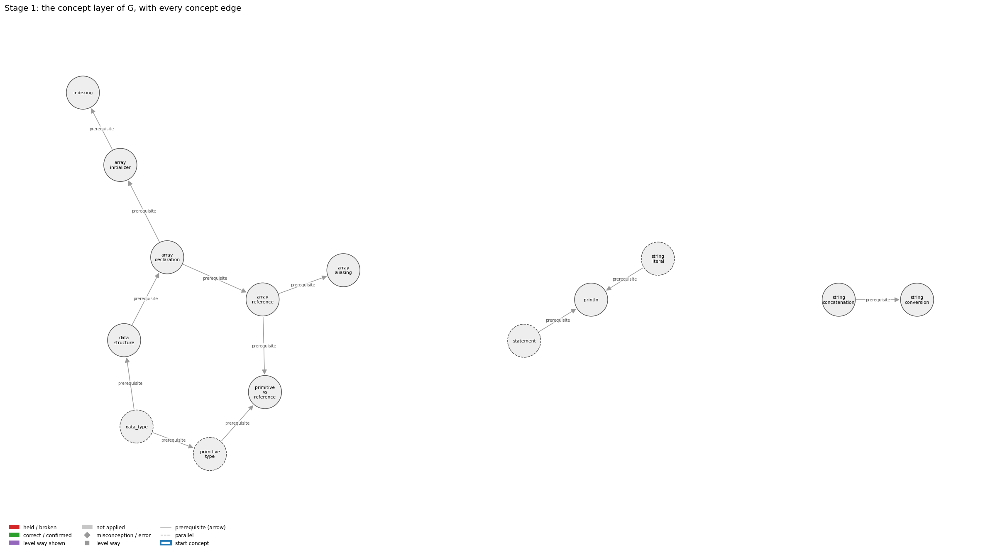
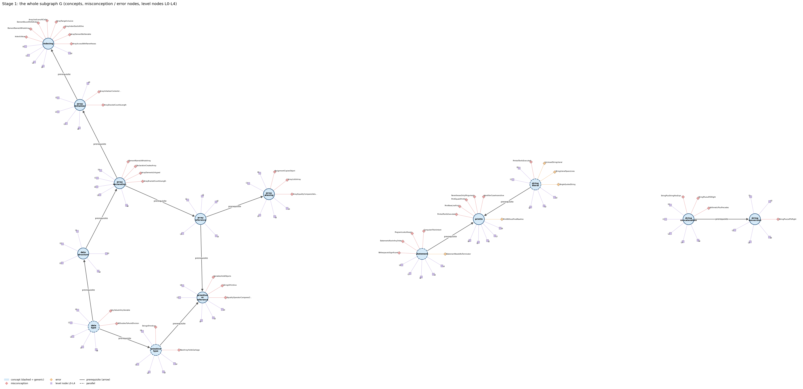
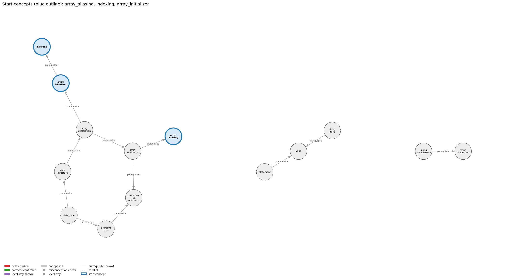
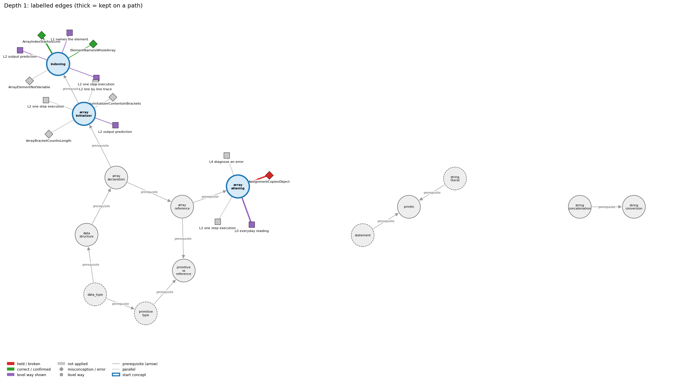
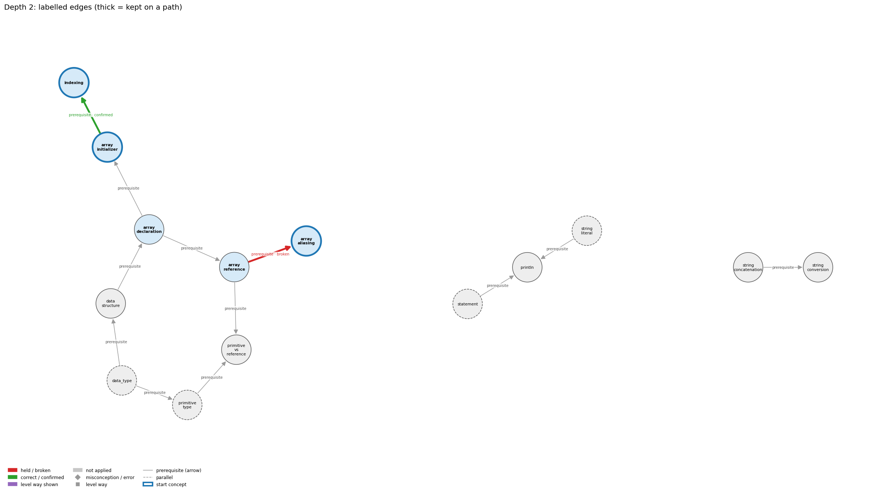
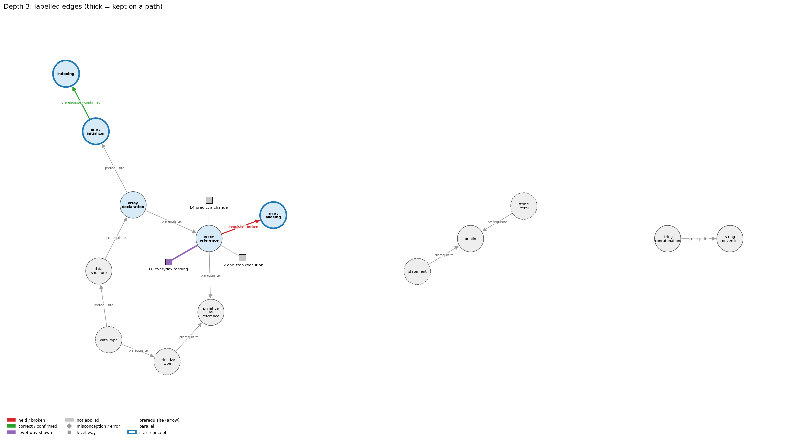
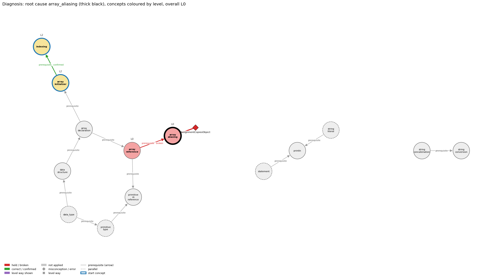

# Think on the Graph: every output of the run MY03

Files of this scenario: `input.json` (program, question, answer), `diagnosis.json`, `subgraph.json`, `traverse_log.txt`, `report.html` (this report as one full-page file, with the interactive graph `MY03_G.html`), `MY03.ipynb` (this report as a notebook).

## 0. Input
Program:
```java
int[] a = {1, 2, 3};
int[] b = a;
b[0] = 9;
System.out.println(a[0] + " " + b[0]);
```
Question: What does this program print, and why?

Student's answer: It prints 1 9. The line b = a makes b a copy of a, so b is a separate array. Changing b[0] to 9 only changes b, and a[0] is still 1.
Settings: width 3, depth 3, prune llm, backend claude-cli, model claude-opus-5-5
## 1. Stage 1: the subgraph G from the code (no model)
Masked code (string and char literals and comments blanked; this is what the patterns see):
```
int[] a = {1, 2, 3};
int[] b = a;
b[0] = 9;
System.out.println(a[0] + " " + b[0]);
```
Which code text tagged which concept (a generic concept fires on almost any Java line; it starts the walk only if the answer repeats its tag):
| concept | generic | channel | matched text | line |
|---|---|---|---|---|
| array_aliasing | False | pattern | 'int[] b = a;' | 2 |
| array_declaration | False | pattern | 'int[] a' | 1 |
| array_initializer | False | pattern | '= {' | 1 |
| array_reference | False | pattern | 'int[] b = a;' | 2 |
| data_structure | False | pattern | 'int[]' | 1 |
| data_type | True | pattern | 'int' | 1 |
| indexing | False | pattern | 'b[0]' | 3 |
| primitive_type | True | pattern | 'int' | 1 |
| primitive_vs_reference | False | pattern | 'int[] b = a;' | 2 |
| println | False | pattern | 'System.out.println(' | 4 |
| statement | True | pattern | ';' | 1 |
| string_concatenation | False | pattern | '+ " "' | 4 |
| string_conversion | False | pattern | '" + b' | 4 |
| string_literal | True | pattern | '" "' | 4 |

G: 14 concept nodes (4 generic), 12 concept edges, 43 misconception / error edges, 38 misconception / error nodes, 70 level nodes, 56 level-misconception links, 3 connected piece(s).
Note: concept nodes form 3 pieces (the KG has no edge between them): array_aliasing,array_declaration,array_initializer,array_reference,data_structure,data_type,indexing,primitive_type,primitive_vs_reference | println,statement,string_literal | string_concatenation,string_conversion

Concept edges of G (the links the walk can read; `pre:` = prerequisite A -> B, `par:` = parallel):
| edge | type | rule (logic) |
|---|---|---|
| pre:array_declaration->array_initializer | prerequisite | int[] a = {1, 2, 3}; declares the array variable and creates and fills the array in one statement. |
| pre:array_declaration->array_reference | prerequisite | Declaring an array variable creates only a variable that holds a reference to an array; the array itself is a separate object. |
| pre:array_initializer->indexing | prerequisite | The values listed in braces are stored at indices 0, 1, 2, ... in order, and a[i] reads the value at index i. |
| pre:array_reference->array_aliasing | prerequisite | Because an array variable holds a reference, b = a copies the reference, so a and b name the same array. |
| pre:array_reference->primitive_vs_reference | prerequisite | An array variable stores the memory address of the array, not its elements. |
| pre:data_structure->array_declaration | prerequisite | An array is a data structure: one name for a sequence of values of the same type, organised by index. |
| pre:data_type->data_structure | prerequisite | A data structure organizes many values of a data type; the array holds a sequence of values of one type. |
| pre:data_type->primitive_type | prerequisite | Java has eight primitive data types (boolean, char, byte, short, int, long, float, double); each, like any data type, is a set of values and a set of operations on those values. |
| pre:primitive_type->primitive_vs_reference | prerequisite | A variable of a primitive type stores the value itself in its own memory. |
| pre:statement->println | prerequisite | System.out.println(s); is itself a statement, so its line of output appears at its own place in the sequence. |
| pre:string_concatenation->string_conversion | prerequisite | When one operand of + is a String, Java converts the other operand to a String before concatenating. |
| pre:string_literal->println | prerequisite | println("s") outputs exactly the characters between the quotes and then ends the line. |

Misconception / error edges per concept (count), and level ways per concept (count):
| concept | misconception / error edges | level ways (L1-L4 + L0 non-misconception) |
|---|---|---|
| array_aliasing | 3 | 15 |
| array_declaration | 4 | 13 |
| array_initializer | 2 | 14 |
| array_reference | 0 | 12 |
| data_structure | 0 | 11 |
| data_type | 2 | 14 |
| indexing | 8 | 21 |
| primitive_type | 2 | 21 |
| primitive_vs_reference | 3 | 13 |
| println | 6 | 17 |
| statement | 5 | 19 |
| string_concatenation | 3 | 16 |
| string_conversion | 1 | 13 |
| string_literal | 4 | 16 |

**Figure 1**


**Figure 2**


## 2. Clauses and start concepts (no model)
The answer split into clauses (at sentence ends, ';', and before 'because' / 'so'; quotes removed):
| clause | text |
|---|---|
| c1 | It prints 1 9 |
| c2 | The line b = a makes b a copy of a |
| c3 | so b is a separate array |
| c4 | Changing b[0] to 9 only changes b, and a[0] is still 1 |

start: BM25 of the answer against each tagged concept: array_aliasing 25.83 (hits 1), indexing 22.43 (hits 1), array_initializer 17.18 (hits 1), array_reference 16.57 (hits 1), array_declaration 15.58 (hits 1), string_concatenation 15.20 (hits 1), println 11.96 (hits 1), primitive_vs_reference 5.23 (hits 1), data_structure 2.15 (hits 1), string_conversion 1.91 (hits 1)

start: chosen array_aliasing, indexing, array_initializer

start concepts (3): array_aliasing, indexing, array_initializer

Start concepts: array_aliasing, indexing, array_initializer

**Figure 3**


## 3. The walk, depth by depth
At each depth, for each current concept: the edges offered (a concept entering as a start concept offers its misconception / error edges and its level ways, as two families; otherwise it offers its concept edges), the prune prompt and the model's reply, then the label prompt(s) and the model's reply, parsed into label / clauses / confidence. Score = prune score x confidence.

### Depth 1: current concepts 'array_aliasing', 'indexing', 'array_initializer'

#### array_aliasing, misconceptions: 3 edges offered
Edges offered:
| edge |
|---|
| mis:array_aliasing->ArrayEqualityComparesValues \| wrong rule: a == b is true when a and b hold the same values. \| right rule: == compares whether the two arrays are the same array, not whether their values are equal. |
| mis:array_aliasing->ArrayListIsArray \| wrong rule: An ArrayList is just an array, so it has a fixed length and is indexed with []. \| right rule: An array has a fixed length and uses [] and .length; an ArrayList can grow and uses get, set and size(). |
| mis:array_aliasing->AssignmentCopiesObject \| wrong rule: assigning a reference copies the object \| right rule: b = a; copies only the reference, so a and b refer to the same array and b[i] = v also changes a[i]. |

Prune: the model's reply (edge id and score; the kept edges sum to 1):
```
mis:array_aliasing->AssignmentCopiesObject (1.00)
```
Kept by pruning: mis:array_aliasing->AssignmentCopiesObject (1.00)

Label prompt for the misconception / error edges (judged together). The model saw the program, the question, the numbered clauses, and these edges with their wrong rule and right rule:
| edge |
|---|
| mis:array_aliasing->AssignmentCopiesObject \| wrong rule: assigning a reference copies the object \| right rule: b = a; copies only the reference, so a and b refer to the same array and b[i] = v also changes a[i]. |
Model's reply:
```
mis:array_aliasing->AssignmentCopiesObject | held | clauses: 1, 2, 3, 4 | confidence: 0.97
```

Parsed labels:
| edge | label | prune score | confidence | score | clauses | words |
|---|---|---|---|---|---|---|
| mis:array_aliasing->AssignmentCopiesObject | held | 1.0 | 0.97 | 0.97 | c1, c2, c3, c4 | It prints 1 9; The line b = a makes b a copy of a; so b is a separate array; Changing b[0] to 9 only changes b, and a[0] is still 1 |

#### array_aliasing, level ways: 15 edges offered
Edges offered:
| edge |
|---|
| lvl:array_aliasing@L0#0 \| level L0 way everyday_reading: Folk meaning: in maths and English, 'b = a' means b becomes an equal but independent copy, and 'a == b' means 'have the same values'. Java rule: for arrays, b = a copies only the reference, so both names denote one array, and == tests whether two names refer to the same array. |
| lvl:array_aliasing@L0#3 \| level L0 way inconsistent_trace: Points to LT: b = a copies the reference, so every later write through b is a write to the shared array. Inconsistent application: after b = a the trace changes b[0] but leaves a[0] unchanged in its table, keeping two copies on some steps and one array on others. (here mixing in: "a == b is true when a and b hold the same values") |
| lvl:array_aliasing@L1#0 \| level L1 way names_the_element: Identity: aliasing is the situation in which two or more array variables refer to the same array object. |
| lvl:array_aliasing@L1#1 \| level L1 way states_the_rule: Declarative: an assignment makes the names a and b refer to the same array; an equality test a == b checks whether the two names refer to the same array. |
| lvl:array_aliasing@L2#0 \| level L2 way line_by_line_trace: Sequencing: in b = a, a is evaluated to its reference value, which is then stored in b; no element is read or copied. In a == b both reference values are evaluated and compared. |
| lvl:array_aliasing@L2#1 \| level L2 way output_prediction: Result: for int[] a = {1, 2, 3}; int[] b = {1, 2, 3};, the test a == b is false; after b = a it is true. A read through either name gives the same element. |
| lvl:array_aliasing@L2#2 \| level L2 way one_step_execution: State transition: b = a changes only the variable b (it now holds a's reference). A later b[0] = 17 changes the one shared array, so a[0] then reads 17 too. |
| lvl:array_aliasing@L3#0 \| level L3 way relation_to_neighbour: Only new creates a distinct array; to copy, create a new array and copy each element (or use Arrays.copyOf). |
| lvl:array_aliasing@L3#1 \| level L3 way relation_to_neighbour: Assignment, == and println(a) all act on the reference value: two aliases print the same address, while two equal-content arrays print different ones. |
| lvl:array_aliasing@L3#2 \| level L3 way relation_to_neighbour: b = a makes a second name for the same array (an alias); copying makes a second array: after a copy, changing b[i] leaves a[i] unchanged. |
| lvl:array_aliasing@L3#3 \| level L3 way purpose_of_the_whole: Plan/role: aliasing lets two names work on one array without copying (as when an array is passed to a method), but in Chapter 1 code it is mostly a source of subtle bugs. |
| lvl:array_aliasing@L4#0 \| level L4 way predict_a_change: Conservation: replacing b = a with an element-copy loop keeps b's initial contents but breaks the link, so later changes to a no longer show in b. Reassigning a = new int[n] after b = a leaves b on the old array. |
| lvl:array_aliasing@L4#1 \| level L4 way transfer_to_a_new_program: Applicability: assign an array variable when you want a second name for the same data. Use a copy loop or Arrays.copyOf for an independent copy, and an element loop or Arrays.equals to compare contents. |
| lvl:array_aliasing@L4#2 \| level L4 way diagnose_an_error: rule broken: Assignment copies the reference, not the elements. Kind: silent logic error. Trigger class: b = a is used as a 'copy', and then b is modified while a is expected to stay unchanged (or the reverse) |
| lvl:array_aliasing@L4#3 \| level L4 way diagnose_an_error: rule broken: == on arrays compares references, not contents. Kind: silent logic error. Trigger class: two separately created arrays with equal elements are compared with == (always false) |

Prune: the model's reply (edge id and score; the kept edges sum to 1):
```
{lvl:array_aliasing@L0#0 (Score: 0.5)}
{lvl:array_aliasing@L4#2 (Score: 0.3)}
{lvl:array_aliasing@L2#2 (Score: 0.2)}
```
Kept by pruning: lvl:array_aliasing@L0#0 (0.50), lvl:array_aliasing@L4#2 (0.30), lvl:array_aliasing@L2#2 (0.20)

Label prompt for level way lvl:array_aliasing@L0#0 (the model saw only the concept, the way's name 'everyday reading' and its text; no level):
> Folk meaning: in maths and English, 'b = a' means b becomes an equal but independent copy, and 'a == b' means 'have the same values'. Java rule: for arrays, b = a copies only the reference, so both names denote one array, and == tests whether two names refer to the same array.

Model's reply:
```
Label: shown
Clauses: 1, 2, 3, 4
Confidence: 0.9
```

Label prompt for level way lvl:array_aliasing@L4#2 (the model saw only the concept, the way's name 'diagnose an error' and its text; no level):
> rule broken: Assignment copies the reference, not the elements. Kind: silent logic error. Trigger class: b = a is used as a 'copy', and then b is modified while a is expected to stay unchanged (or the reverse)

Model's reply:
```
Label: not shown
Clauses: none
Confidence: 0.9
```

Label prompt for level way lvl:array_aliasing@L2#2 (the model saw only the concept, the way's name 'one step execution' and its text; no level):
> State transition: b = a changes only the variable b (it now holds a's reference). A later b[0] = 17 changes the one shared array, so a[0] then reads 17 too.

Model's reply:
```
Label: not shown
Clauses: none
Confidence: 0.95
```

Parsed labels:
| edge | label | prune score | confidence | score | clauses | words |
|---|---|---|---|---|---|---|
| lvl:array_aliasing@L0#0 | shown | 0.5 | 0.9 | 0.45 | c1, c2, c3, c4 | It prints 1 9; The line b = a makes b a copy of a; so b is a separate array; Changing b[0] to 9 only changes b, and a[0] is still 1 |
| lvl:array_aliasing@L4#2 | not applied |  |  | 0.0 |  |  |
| lvl:array_aliasing@L2#2 | not applied |  |  | 0.0 |  |  |

#### indexing, misconceptions: 8 edges offered
Edges offered:
| edge |
|---|
| mis:indexing->ArrayAccessWithParentheses \| wrong rule: a(i) accesses element i of an array. \| right rule: Array elements are accessed with square brackets, a[i]. |
| mis:indexing->ArrayElementNotVariable \| wrong rule: An array element a[i] is not a variable, so it cannot be read into directly or used inside another index, as in a[a[i]]. \| right rule: Each element a[i] is a variable of the element type and can be used anywhere a variable of that type can, including as an index. |
| mis:indexing->ArrayIndexStartsAtOne \| wrong rule: The first element of a is a[1]. \| right rule: Numbering begins with 0; the first element is a[0]. |
| mis:indexing->ArrayRangeInclusive \| wrong rule: new int[n] has slots 0 to n, inclusive. \| right rule: The slots are 0 to n - 1. |
| mis:indexing->ArrayUseScansAllCells \| wrong rule: Using an array means every cell must be scanned. \| right rule: Arrays allow random access: a[i] reaches one element directly, and a loop visits only the elements the task needs. |
| mis:indexing->ElementBoundToOldIndex \| wrong rule: After i changes, X[i] still refers to the element at the old value of i. \| right rule: a[i] is evaluated with the current value of i each time it is used. |
| mis:indexing->ElementNameIsWholeArray \| wrong rule: X[i] names the whole array, not one element. \| right rule: The array is a; a[i] is the single element at index i. |
| mis:indexing->IndexIsValue \| wrong rule: i and a[i] are the same thing, so the position is the stored value. \| right rule: i is a position; a[i] is the value stored at that position. |

Prune: the model's reply (edge id and score; the kept edges sum to 1):
```
mis:indexing->ArrayIndexStartsAtOne (0.40), mis:indexing->ElementNameIsWholeArray (0.35), mis:indexing->ArrayElementNotVariable (0.25)
```
Kept by pruning: mis:indexing->ArrayIndexStartsAtOne (0.40), mis:indexing->ElementNameIsWholeArray (0.35), mis:indexing->ArrayElementNotVariable (0.25)

Label prompt for the misconception / error edges (judged together). The model saw the program, the question, the numbered clauses, and these edges with their wrong rule and right rule:
| edge |
|---|
| mis:indexing->ArrayIndexStartsAtOne \| wrong rule: The first element of a is a[1]. \| right rule: Numbering begins with 0; the first element is a[0]. |
| mis:indexing->ElementNameIsWholeArray \| wrong rule: X[i] names the whole array, not one element. \| right rule: The array is a; a[i] is the single element at index i. |
| mis:indexing->ArrayElementNotVariable \| wrong rule: An array element a[i] is not a variable, so it cannot be read into directly or used inside another index, as in a[a[i]]. \| right rule: Each element a[i] is a variable of the element type and can be used anywhere a variable of that type can, including as an index. |
Model's reply:
```
mis:indexing->ArrayIndexStartsAtOne | correct | clauses: 1, 4 | confidence: 0.75
mis:indexing->ElementNameIsWholeArray | correct | clauses: 4 | confidence: 0.55
mis:indexing->ArrayElementNotVariable | not applied | clauses: none | confidence: 0.7
```

Parsed labels:
| edge | label | prune score | confidence | score | clauses | words |
|---|---|---|---|---|---|---|
| mis:indexing->ArrayIndexStartsAtOne | correct | 0.4 | 0.75 | 0.3 | c1, c4 | It prints 1 9; Changing b[0] to 9 only changes b, and a[0] is still 1 |
| mis:indexing->ElementNameIsWholeArray | correct | 0.35 | 0.55 | 0.19 | c4 | Changing b[0] to 9 only changes b, and a[0] is still 1 |
| mis:indexing->ArrayElementNotVariable | not applied |  |  | 0.0 |  |  |

#### indexing, level ways: 21 edges offered
Edges offered:
| edge |
|---|
| lvl:indexing@L0#0 \| level L0 way everyday_reading: Folk meaning: everyday counting starts at 1 (first = number 1), maths subscripts a_1..a_n run from 1, and f(i) with parentheses means 'apply to i'. Java rule: a[i] uses square brackets and is 0-origin, so the first element is a[0] and the last is a[a.length-1]. |
| lvl:indexing@L0#8 \| level L0 way inconsistent_trace: Points to LT: in a[i], a is evaluated, then i with its current value, then the bounds check, then the element is read or written. Inconsistent application: i is updated on one line, but a later a[i] is traced with the old i. (here mixing in: "i and a[i] are the same thing, so the position is the stored value") |
| lvl:indexing@L1#0 \| level L1 way names_the_element: Identity: an array access expression; a[i] names the single element variable at position i of the array a refers to. |
| lvl:indexing@L1#1 \| level L1 way states_the_rule: Declarative: the index is any int-valued expression in square brackets; the valid indices of an array of length n are 0 to n-1, and an access outside that range throws ArrayIndexOutOfBoundsException. |
| lvl:indexing@L2#0 \| level L2 way line_by_line_trace: Sequencing: the array reference is evaluated before the index; the index expression is fully evaluated with current variable values; the bounds are checked; then the element is fetched or, on the left of =, becomes the target. In a[i] = a[j], the target a[i] is located before a[j] is read. |
| lvl:indexing@L2#1 \| level L2 way output_prediction: Result: a[i] has the element type and the value currently stored at position i. For int[] a = {5, 7, 9}, a[1] is 7 and a[0] + a[2] is 14. |
| lvl:indexing@L2#2 \| level L2 way one_step_execution: State transition: reading a[i] changes nothing. a[i] = v changes only element i (i, a and all other elements are unchanged), and a[i]++ adds 1 to that one element. |
| lvl:indexing@L3#0 \| level L3 way relation_to_neighbour: An element can be indexed only after the array is created, and the n given to new sets the valid indices 0..n-1. |
| lvl:indexing@L3#1 \| level L3 way relation_to_neighbour: A traversal uses the loop variable as the index, so the same expression a[i] reaches a different element on each pass. |
| lvl:indexing@L3#2 \| level L3 way relation_to_neighbour: Every index value is checked against 0 and a.length at run time; any other value throws. |
| lvl:indexing@L3#3 \| level L3 way relation_to_neighbour: a[i] on a 2-D array yields row i (itself a 1-D array), and a[i][j] then indexes into that row. |
| lvl:indexing@L3#4 \| level L3 way relation_to_neighbour: The exchange reads and writes elements only through their indices: t = a[i]; a[i] = a[j]; a[j] = t. |
| lvl:indexing@L3#5 \| level L3 way relation_to_neighbour: A lookup table uses a data value as the index (months[m]), so the data must lie in 0..length-1. |
| lvl:indexing@L3#6 \| level L3 way relation_to_neighbour: Indices start at 0, so the last element is a[N-1]; misreading this convention is the usual source of off-by-one errors. |
| lvl:indexing@L3#7 \| level L3 way purpose_of_the_whole: Plan/role: random access, reaching any element directly by its position in constant time (address plus index), so code touches only the elements it needs. |
| lvl:indexing@L4#0 \| level L4 way predict_a_change: Conservation: changing the index expression (i to i+1 or i-1) shifts which element is touched and can leave the bounds at the ends. Writing a[a[i]] instead of a[i] uses an element value as the index, a different access entirely. Changing what is stored never changes the positions. |
| lvl:indexing@L4#1 \| level L4 way transfer_to_a_new_program: Applicability: index when you need a particular element by position, or when the position is computed from data (counts[score]++, months[m]). When every value is processed in order and the position is never needed, an enhanced for loop is simpler. |
| lvl:indexing@L4#2 \| level L4 way diagnose_an_error: rule broken: The index must be in 0..a.length-1. Kind: run-time exception. Trigger class: index < 0 or >= a.length, e.g. a[a.length], a[i+1] on the last pass, a[i-1] at i = 0, a[0] of an empty array (ArrayIndexOutOfBoundsException) |
| lvl:indexing@L4#3 \| level L4 way diagnose_an_error: rule broken: The index must have type int (after promotion); long or double indices are rejected. Kind: compile-time. Trigger class: a[1.5], a[x] with double x, or a[n] with long n (incompatible types: possible lossy conversion) |
| lvl:indexing@L4#4 \| level L4 way diagnose_an_error: rule broken: Elements are selected with brackets, not parentheses. Kind: compile-time. Trigger class: a(i) is written for a[i] (cannot find symbol: method a) |
| lvl:indexing@L4#5 \| level L4 way diagnose_an_error: rule broken: An index is a position, not the stored value. Kind: silent logic error. Trigger class: code uses i where a[i] is meant (or a[i] where i is meant), e.g. returning i as the maximum value or comparing positions instead of contents |

Prune: the model's reply (edge id and score; the kept edges sum to 1):
```
{lvl:indexing@L2#2 (Score: 0.45)}
{lvl:indexing@L1#0 (Score: 0.35)}
{lvl:indexing@L2#1 (Score: 0.2)}
```
Kept by pruning: lvl:indexing@L2#2 (0.45), lvl:indexing@L1#0 (0.35), lvl:indexing@L2#1 (0.20)

Label prompt for level way lvl:indexing@L2#2 (the model saw only the concept, the way's name 'one step execution' and its text; no level):
> State transition: reading a[i] changes nothing. a[i] = v changes only element i (i, a and all other elements are unchanged), and a[i]++ adds 1 to that one element.

Model's reply:
```
Label: shown
Clauses: 1, 4
Confidence: 0.6
```

Label prompt for level way lvl:indexing@L1#0 (the model saw only the concept, the way's name 'names the element' and its text; no level):
> Identity: an array access expression; a[i] names the single element variable at position i of the array a refers to.

Model's reply:
```
Label: shown
Clauses: 4
Confidence: 0.6
```

Label prompt for level way lvl:indexing@L2#1 (the model saw only the concept, the way's name 'output prediction' and its text; no level):
> Result: a[i] has the element type and the value currently stored at position i. For int[] a = {5, 7, 9}, a[1] is 7 and a[0] + a[2] is 14.

Model's reply:
```
Label: shown
Clauses: 1, 4
Confidence: 0.6
```

Parsed labels:
| edge | label | prune score | confidence | score | clauses | words |
|---|---|---|---|---|---|---|
| lvl:indexing@L2#2 | shown | 0.45 | 0.6 | 0.27 | c1, c4 | It prints 1 9; Changing b[0] to 9 only changes b, and a[0] is still 1 |
| lvl:indexing@L1#0 | shown | 0.35 | 0.6 | 0.21 | c4 | Changing b[0] to 9 only changes b, and a[0] is still 1 |
| lvl:indexing@L2#1 | shown | 0.2 | 0.6 | 0.12 | c1, c4 | It prints 1 9; Changing b[0] to 9 only changes b, and a[0] is still 1 |

#### array_initializer, misconceptions: 2 edges offered
Edges offered:
| edge |
|---|
| mis:array_initializer->ArrayBracketCountIsLength \| wrong rule: The number of brackets in an array type or initializer is the array's length. \| right rule: Brackets give the number of dimensions; the length is set at creation. |
| mis:array_initializer->ArrayInitializerContentsInBrackets \| wrong rule: Starting values go in square brackets, like int[] a = [v0, v1];. \| right rule: Starting values go in braces, like int[] a = {v0, v1};. |

Prune: the model's reply (edge id and score; the kept edges sum to 1):
```
mis:array_initializer->ArrayInitializerContentsInBrackets (0.70), mis:array_initializer->ArrayBracketCountIsLength (0.30)
```
Kept by pruning: mis:array_initializer->ArrayInitializerContentsInBrackets (0.70), mis:array_initializer->ArrayBracketCountIsLength (0.30)

Label prompt for the misconception / error edges (judged together). The model saw the program, the question, the numbered clauses, and these edges with their wrong rule and right rule:
| edge |
|---|
| mis:array_initializer->ArrayInitializerContentsInBrackets \| wrong rule: Starting values go in square brackets, like int[] a = [v0, v1];. \| right rule: Starting values go in braces, like int[] a = {v0, v1};. |
| mis:array_initializer->ArrayBracketCountIsLength \| wrong rule: The number of brackets in an array type or initializer is the array's length. \| right rule: Brackets give the number of dimensions; the length is set at creation. |
Model's reply:
```
mis:array_initializer->ArrayInitializerContentsInBrackets | not applied | clauses: none | confidence: 0.9
mis:array_initializer->ArrayBracketCountIsLength | not applied | clauses: none | confidence: 0.9
```

Parsed labels:
| edge | label | prune score | confidence | score | clauses | words |
|---|---|---|---|---|---|---|
| mis:array_initializer->ArrayInitializerContentsInBrackets | not applied |  |  | 0.0 |  |  |
| mis:array_initializer->ArrayBracketCountIsLength | not applied |  |  | 0.0 |  |  |

#### array_initializer, level ways: 14 edges offered
Edges offered:
| edge |
|---|
| lvl:array_initializer@L0#0 \| level L0 way everyday_reading: Folk meaning: in maths, braces {1, 2, 3} denote a set (unordered, no repeats) and brackets [1, 2, 3] a list, so novices write int[] a = [1, 2, 3] or expect {1, 1, 2} to have 2 elements. Java rule: braces enclose an ordered, comma-separated list whose count (repeats included) is the length. |
| lvl:array_initializer@L0#2 \| level L0 way inconsistent_trace: Points to LT: an array of length k+1 is created, then v0..vk are stored at indices 0..k in order. Inconsistent application: the trace puts the first value at index 1 for one initializer but at index 0 for another, or counts the length differently. (here mixing in: "initializer values go in [] instead of {}") |
| lvl:array_initializer@L1#0 \| level L1 way names_the_element: Identity: an array initializer is a brace-enclosed, comma-separated list of values that creates and fills an array in one step. |
| lvl:array_initializer@L1#1 \| level L1 way states_the_rule: Declarative: 'T[] a = {v0, ..., vk};' declares, creates (no new needed) and initializes an array of length k+1. For 2-D arrays each row is its own brace list. The bare form is legal only in a declaration; elsewhere write new T[]{...}. |
| lvl:array_initializer@L2#0 \| level L2 way line_by_line_trace: Sequencing: the array of length k+1 is created, the initializer expressions are evaluated left to right and stored in a[0], a[1], ..., a[k], and then the reference is assigned to a. |
| lvl:array_initializer@L2#1 \| level L2 way output_prediction: Result: int[] a = {1, 2, 3}; gives a.length == 3, a[0] == 1, a[2] == 3. String[] suit = {"Clubs", "Diamonds", "Hearts", "Spades"}; gives suit.length == 4. |
| lvl:array_initializer@L2#2 \| level L2 way one_step_execution: State transition: one execution creates one array holding the listed values and sets the variable to its reference. |
| lvl:array_initializer@L3#0 \| level L3 way relation_to_neighbour: An initializer implies array creation: it is shorthand for new T[k+1] followed by k+1 element assignments, so new is not written. |
| lvl:array_initializer@L3#1 \| level L3 way purpose_of_the_whole: Plan/role: build small fixed tables of constants known when the program is written (suits, ranks, month names), usually used as fixed-value lookup tables. |
| lvl:array_initializer@L4#0 \| level L4 way predict_a_change: Conservation: adding or removing a value changes the length. Code that uses a.length (e.g. rank.length) adapts, while code with a hard-coded size breaks. Reordering values changes which index holds which value. |
| lvl:array_initializer@L4#1 \| level L4 way transfer_to_a_new_program: Applicability: use an initializer when all values are known at compile time and the array is small. When the values must be computed at run time, create the array with new and fill it in a loop. |
| lvl:array_initializer@L4#2 \| level L4 way diagnose_an_error: rule broken: Initializer values are enclosed in braces. Kind: compile-time. Trigger class: brackets are used, as in int[] a = [1, 2, 3]; (illegal start of expression) |
| lvl:array_initializer@L4#3 \| level L4 way diagnose_an_error: rule broken: The bare {...} form is allowed only in a declaration. Kind: compile-time. Trigger class: a = {1, 2, 3}; used as a later assignment (array constants can only be used in initializers) |
| lvl:array_initializer@L4#4 \| level L4 way diagnose_an_error: rule broken: Each value must be assignable to the element type. Kind: compile-time. Trigger class: int[] a = {1, 2.5}; (incompatible types: possible lossy conversion from double to int) |

Prune: the model's reply (edge id and score; the kept edges sum to 1):
```
{lvl:array_initializer@L2#1 (Score: 0.5)}
{lvl:array_initializer@L2#2 (Score: 0.3)}
{lvl:array_initializer@L2#0 (Score: 0.2)}
```
Kept by pruning: lvl:array_initializer@L2#1 (0.50), lvl:array_initializer@L2#2 (0.30), lvl:array_initializer@L2#0 (0.20)

Label prompt for level way lvl:array_initializer@L2#1 (the model saw only the concept, the way's name 'output prediction' and its text; no level):
> Result: int[] a = {1, 2, 3}; gives a.length == 3, a[0] == 1, a[2] == 3. String[] suit = {"Clubs", "Diamonds", "Hearts", "Spades"}; gives suit.length == 4.

Model's reply:
```
Label: shown
Clauses: 1, 4
Confidence: 0.6
```

Label prompt for level way lvl:array_initializer@L2#2 (the model saw only the concept, the way's name 'one step execution' and its text; no level):
> State transition: one execution creates one array holding the listed values and sets the variable to its reference.

Model's reply:
```
Label: not shown
Clauses: none
Confidence: 0.8
```

Label prompt for level way lvl:array_initializer@L2#0 (the model saw only the concept, the way's name 'line by line trace' and its text; no level):
> Sequencing: the array of length k+1 is created, the initializer expressions are evaluated left to right and stored in a[0], a[1], ..., a[k], and then the reference is assigned to a.

Model's reply:
```
Label: not shown
Clauses: none
Confidence: 0.93
```

Parsed labels:
| edge | label | prune score | confidence | score | clauses | words |
|---|---|---|---|---|---|---|
| lvl:array_initializer@L2#1 | shown | 0.5 | 0.6 | 0.3 | c1, c4 | It prints 1 9; Changing b[0] to 9 only changes b, and a[0] is still 1 |
| lvl:array_initializer@L2#2 | not applied |  |  | 0.0 |  |  |
| lvl:array_initializer@L2#0 | not applied |  |  | 0.0 |  |  |

**Kept on a path at this depth** (best N in tiers: held misconception / broken edge, then held error, then correct / confirmed / shown):

mis:array_aliasing->AssignmentCopiesObject [held, tier 0, 0.97], lvl:array_aliasing@L0#0 [shown, tier 2, 0.45], mis:indexing->ArrayIndexStartsAtOne [correct, tier 2, 0.30]

**Clause coverage after this depth:**
| clause | text | covered by |
|---|---|---|
| c1 | It prints 1 9 | mis:array_aliasing->AssignmentCopiesObject |
| c2 | The line b = a makes b a copy of a | mis:array_aliasing->AssignmentCopiesObject |
| c3 | so b is a separate array | mis:array_aliasing->AssignmentCopiesObject |
| c4 | Changing b[0] to 9 only changes b, and a[0] is still 1 | mis:array_aliasing->AssignmentCopiesObject |

**Graph check, not yet read (the walk may not stop while these remain):** pre:array_declaration->array_initializer, pre:array_initializer->indexing, pre:array_reference->array_aliasing

**Figure 4 (the graph after depth 1)**


### Depth 2: current concepts 'array_aliasing', 'indexing', 'array_initializer'

#### array_aliasing, concept edges: 1 edges offered
Edges offered:
| edge |
|---|
| pre:array_reference->array_aliasing \| rule: Because an array variable holds a reference, b = a copies the reference, so a and b name the same array. |

Prune: the model's reply (edge id and score; the kept edges sum to 1):
```
{pre:array_reference->array_aliasing (Score: 1.0)}
```
Kept by pruning: pre:array_reference->array_aliasing (1.00)

Label prompt for concept edge pre:array_reference->array_aliasing (array_reference -> array_aliasing, prerequisite):
> Because an array variable holds a reference, b = a copies the reference, so a and b name the same array.

Model's reply:
```
Label: broken
Clauses: 2, 3, 4
Confidence: 0.95
```

Parsed labels:
| edge | label | prune score | confidence | score | clauses | words |
|---|---|---|---|---|---|---|
| pre:array_reference->array_aliasing | broken | 1.0 | 0.95 | 0.95 | c2, c3, c4 | The line b = a makes b a copy of a; so b is a separate array; Changing b[0] to 9 only changes b, and a[0] is still 1 |

#### indexing, concept edges: 1 edges offered
Edges offered:
| edge |
|---|
| pre:array_initializer->indexing \| rule: The values listed in braces are stored at indices 0, 1, 2, ... in order, and a[i] reads the value at index i. |

Prune: the model's reply (edge id and score; the kept edges sum to 1):
```
{pre:array_initializer->indexing (Score: 1.0)}
```
Kept by pruning: pre:array_initializer->indexing (1.00)

Label prompt for concept edge pre:array_initializer->indexing (array_initializer -> indexing, prerequisite):
> The values listed in braces are stored at indices 0, 1, 2, ... in order, and a[i] reads the value at index i.

Model's reply:
```
Label: confirmed
Clauses: 1, 4
Confidence: 0.75
```

Parsed labels:
| edge | label | prune score | confidence | score | clauses | words |
|---|---|---|---|---|---|---|
| pre:array_initializer->indexing | confirmed | 1.0 | 0.75 | 0.75 | c1, c4 | It prints 1 9; Changing b[0] to 9 only changes b, and a[0] is still 1 |

#### array_initializer, concept edges: 1 edges offered
Edges offered:
| edge |
|---|
| pre:array_declaration->array_initializer \| rule: int[] a = {1, 2, 3}; declares the array variable and creates and fills the array in one statement. |
| pre:array_initializer->indexing \| rule: The values listed in braces are stored at indices 0, 1, 2, ... in order, and a[i] reads the value at index i. |

Prune: the model's reply (edge id and score; the kept edges sum to 1):
```
{pre:array_declaration->array_initializer (Score: 1.0)}
```
Kept by pruning: pre:array_declaration->array_initializer (1.00)

Label prompt for concept edge pre:array_declaration->array_initializer (array_declaration -> array_initializer, prerequisite):
> int[] a = {1, 2, 3}; declares the array variable and creates and fills the array in one statement.

Model's reply:
```
Label: not applied
Clauses: none
Confidence: 0.8
```

Parsed labels:
| edge | label | prune score | confidence | score | clauses | words |
|---|---|---|---|---|---|---|
| pre:array_declaration->array_initializer | not applied |  |  | 0.0 |  |  |

**Kept on a path at this depth** (best N in tiers: held misconception / broken edge, then held error, then correct / confirmed / shown):

pre:array_reference->array_aliasing [broken, tier 0, 0.95], pre:array_initializer->indexing [confirmed, tier 2, 0.75]

reached across pre:array_reference->array_aliasing, entered next: array_reference

**Clause coverage after this depth:**
| clause | text | covered by |
|---|---|---|
| c1 | It prints 1 9 | mis:array_aliasing->AssignmentCopiesObject |
| c2 | The line b = a makes b a copy of a | mis:array_aliasing->AssignmentCopiesObject |
| c3 | so b is a separate array | mis:array_aliasing->AssignmentCopiesObject |
| c4 | Changing b[0] to 9 only changes b, and a[0] is still 1 | mis:array_aliasing->AssignmentCopiesObject |

**Graph check, not yet read (the walk may not stop while these remain):** own edges of array_reference

**Figure 5 (the graph after depth 2)**


### Depth 3: current concepts 'array_reference', 'array_aliasing', 'array_initializer', 'indexing'

#### array_reference, level ways: 12 edges offered
Edges offered:
| edge |
|---|
| lvl:array_reference@L0#0 \| level L0 way everyday_reading: Folk meaning: a variable is a box, so the array's values are 'inside' a. Java rule: the variable a holds only a reference (memory address, pointer) to the array object, which lives elsewhere. |
| lvl:array_reference@L1#0 \| level L1 way names_the_element: Identity: an array reference, the value of an array variable; it is the memory address of the array, called a pointer. |
| lvl:array_reference@L1#1 \| level L1 way states_the_rule: Declarative: a variable of array type holds a reference to an array object; operations on the name itself (assignment, ==, printing) act on that address. |
| lvl:array_reference@L2#0 \| level L2 way line_by_line_trace: Sequencing: for a[i], the address stored in a is read, the index i is added (scaled by the element size), and the memory at the resulting address is accessed: two elementary operations. |
| lvl:array_reference@L2#1 \| level L2 way output_prediction: Result: the value of a is a reference (printed as hexadecimal). With the array at locations 523..530, a[4] is found at location 523 + 4 = 527. |
| lvl:array_reference@L2#2 \| level L2 way one_step_execution: State transition: assigning a reference (a = b, or a = new ...) changes only which array the variable points to; the arrays themselves are unchanged. |
| lvl:array_reference@L3#0 \| level L3 way relation_to_neighbour: new reserves the memory and yields the array's address, which the array variable then stores. |
| lvl:array_reference@L3#1 \| level L3 way relation_to_neighbour: An array variable stores the memory address of the array, not its elements. |
| lvl:array_reference@L3#2 \| level L3 way purpose_of_the_whole: Plan/role: the model that explains constant-time indexing, aliasing, reference equality and printing of arrays. |
| lvl:array_reference@L4#0 \| level L4 way predict_a_change: Conservation: copying a reference keeps one shared array (changes through either name are seen by both); assigning a new reference breaks the link without changing either array. |
| lvl:array_reference@L4#1 \| level L4 way transfer_to_a_new_program: Applicability: reason in terms of references whenever arrays are assigned, compared, printed or passed to methods. Reason in terms of elements when indexing. |
| lvl:array_reference@L4#2 \| level L4 way diagnose_an_error: rule broken: A reference must point to an array before it is indexed. Kind: run-time exception. Trigger class: an array variable holding null (e.g. an element of a String[][] row not yet created, or a field never assigned) is indexed (NullPointerException) |

Prune: the model's reply (edge id and score; the kept edges sum to 1):
```
{lvl:array_reference@L4#0 (Score: 0.5)}
{lvl:array_reference@L0#0 (Score: 0.3)}
{lvl:array_reference@L2#2 (Score: 0.2)}
```
Kept by pruning: lvl:array_reference@L4#0 (0.50), lvl:array_reference@L0#0 (0.30), lvl:array_reference@L2#2 (0.20)

Label prompt for level way lvl:array_reference@L4#0 (the model saw only the concept, the way's name 'predict a change' and its text; no level):
> Conservation: copying a reference keeps one shared array (changes through either name are seen by both); assigning a new reference breaks the link without changing either array.

Model's reply:
```
Label: not shown
Clauses: none
Confidence: 0.95
```

Label prompt for level way lvl:array_reference@L0#0 (the model saw only the concept, the way's name 'everyday reading' and its text; no level):
> Folk meaning: a variable is a box, so the array's values are 'inside' a. Java rule: the variable a holds only a reference (memory address, pointer) to the array object, which lives elsewhere.

Model's reply:
```
Label: shown
Clauses: 2, 3, 4
Confidence: 0.8
```

Label prompt for level way lvl:array_reference@L2#2 (the model saw only the concept, the way's name 'one step execution' and its text; no level):
> State transition: assigning a reference (a = b, or a = new ...) changes only which array the variable points to; the arrays themselves are unchanged.

Model's reply:
```
Label: not shown
Clauses: none
Confidence: 0.9
```

Parsed labels:
| edge | label | prune score | confidence | score | clauses | words |
|---|---|---|---|---|---|---|
| lvl:array_reference@L4#0 | not applied |  |  | 0.0 |  |  |
| lvl:array_reference@L0#0 | shown | 0.3 | 0.8 | 0.24 | c2, c3, c4 | The line b = a makes b a copy of a; so b is a separate array; Changing b[0] to 9 only changes b, and a[0] is still 1 |
| lvl:array_reference@L2#2 | not applied |  |  | 0.0 |  |  |

#### array_initializer, concept edges: 1 edges offered
Edges offered:
| edge |
|---|
| pre:array_declaration->array_initializer \| rule: int[] a = {1, 2, 3}; declares the array variable and creates and fills the array in one statement. |
| pre:array_initializer->indexing \| rule: The values listed in braces are stored at indices 0, 1, 2, ... in order, and a[i] reads the value at index i. |

Prune: the model's reply (edge id and score; the kept edges sum to 1):
```
{pre:array_declaration->array_initializer (Score: 1.0)}
```
Kept by pruning: pre:array_declaration->array_initializer (1.00)

Label prompt for concept edge pre:array_declaration->array_initializer (array_declaration -> array_initializer, prerequisite):
> int[] a = {1, 2, 3}; declares the array variable and creates and fills the array in one statement.

Model's reply:
```
Label: not applied
Clauses: none
Confidence: 0.8
```

Parsed labels:
| edge | label | prune score | confidence | score | clauses | words |
|---|---|---|---|---|---|---|
| pre:array_declaration->array_initializer | not applied |  |  | 0.0 |  |  |

**Kept on a path at this depth** (best N in tiers: held misconception / broken edge, then held error, then correct / confirmed / shown):

lvl:array_reference@L0#0 [shown, tier 2, 0.24]

**Clause coverage after this depth:**
| clause | text | covered by |
|---|---|---|
| c1 | It prints 1 9 | mis:array_aliasing->AssignmentCopiesObject |
| c2 | The line b = a makes b a copy of a | mis:array_aliasing->AssignmentCopiesObject |
| c3 | so b is a separate array | mis:array_aliasing->AssignmentCopiesObject |
| c4 | Changing b[0] to 9 only changes b, and a[0] is still 1 | mis:array_aliasing->AssignmentCopiesObject |

**Graph check, not yet read (the walk may not stop while these remain):** pre:array_declaration->array_reference, pre:array_reference->primitive_vs_reference

**Figure 6 (the graph after depth 3)**


## 4. Diagnosis (rules over the labelled graph, no model)
Root-cause walk: held on ['array_aliasing'], broken at [] (consequences: pre:array_reference->array_aliasing), prerequisites {'array_initializer': ['array_declaration'], 'array_reference': ['array_declaration'], 'indexing': ['array_initializer'], 'array_aliasing': ['array_reference'], 'primitive_vs_reference': ['array_reference', 'primitive_type'], 'array_declaration': ['data_structure'], 'data_structure': ['data_type'], 'primitive_type': ['data_type'], 'println': ['statement', 'string_literal'], 'string_conversion': ['string_concatenation']}
- array_aliasing: L0 via misconception "It prints 1 9; The line b = a makes b a copy of a; so b is a separate array; Changing b[0] to 9 only changes b, and a[0] is still 1"
- array_initializer: L2 via output_prediction "It prints 1 9; Changing b[0] to 9 only changes b, and a[0] is still 1"
- array_reference: L0 via everyday_reading "The line b = a makes b a copy of a; so b is a separate array; Changing b[0] to 9 only changes b, and a[0] is still 1"
- indexing: L2 via one_step_execution "It prints 1 9; Changing b[0] to 9 only changes b, and a[0] is still 1"

**Stop:** max depth at depth 3; prompts {'prune': 11, 'label': 19}, fresh model calls 0, cache hits 30

### Held misconceptions
| concept | misconception | kind | quote | score | shares_evidence_with |
|---|---|---|---|---|---|
| array_aliasing | AssignmentCopiesObject | misconception | It prints 1 9; The line b = a makes b a copy of a; so b is a separate array; Changing b[0] to 9 only changes b, and a[0] is still 1 | 0.97 |  |

### Broken concept edges
| edge | quote | score | consequence_of |
|---|---|---|---|
| pre:array_reference->array_aliasing | The line b = a makes b a copy of a; so b is a separate array; Changing b[0] to 9 only changes b, and a[0] is still 1 | 0.95 | mis:array_aliasing->AssignmentCopiesObject |

### Root cause: array_aliasing / AssignmentCopiesObject

### Level per concept
| concept | level | way | misconception | source | quote | rule | also | note |
|---|---|---|---|---|---|---|---|---|
| array_aliasing | L0 | misconception | AssignmentCopiesObject | level_mis_links | It prints 1 9; The line b = a makes b a copy of a; so b is a separate array; Changing b[0] to 9 only changes b, and a[0] is still 1 | wrong rule: Assigning an array reference copies the array. Right rule: b = a; copies only the reference, so a and b refer to the same array and b[i] = v also changes a[i]. |  |  |
| array_initializer | L2 | output_prediction |  | level_way | It prints 1 9; Changing b[0] to 9 only changes b, and a[0] is still 1 |  |  |  |
| array_reference | L0 | everyday_reading |  | level_way | The line b = a makes b a copy of a; so b is a separate array; Changing b[0] to 9 only changes b, and a[0] is still 1 |  |  |  |
| indexing | L2 | one_step_execution |  | level_way | It prints 1 9; Changing b[0] to 9 only changes b, and a[0] is still 1 |  | L2 output_prediction, L1 names_the_element |  |

### Overall level: L0

Clause coverage (final):
| clause | covered by |
|---|---|
| It prints 1 9 | mis:array_aliasing->AssignmentCopiesObject |
| The line b = a makes b a copy of a | mis:array_aliasing->AssignmentCopiesObject |
| so b is a separate array | mis:array_aliasing->AssignmentCopiesObject |
| Changing b[0] to 9 only changes b, and a[0] is still 1 | mis:array_aliasing->AssignmentCopiesObject |

**Figure 7 (final picture)**


## 5. Every labelled edge (the evidence list, kept or not)
| depth | source | edge | kind | label | prune_score | confidence | score | clauses | quote |
|---|---|---|---|---|---|---|---|---|---|
| 1 | array_aliasing | mis:array_aliasing->AssignmentCopiesObject | misconception | held | 1.0 | 0.97 | 0.97 | [1, 2, 3, 4] | It prints 1 9; The line b = a makes b a copy of a; so b is a separate array; Changing b[0] to 9 only changes b, and a[0] is still 1 |
| 1 | array_aliasing | lvl:array_aliasing@L0#0 | level | shown | 0.5 | 0.9 | 0.45 | [1, 2, 3, 4] | It prints 1 9; The line b = a makes b a copy of a; so b is a separate array; Changing b[0] to 9 only changes b, and a[0] is still 1 |
| 1 | indexing | mis:indexing->ArrayIndexStartsAtOne | misconception | correct | 0.4 | 0.75 | 0.3 | [1, 4] | It prints 1 9; Changing b[0] to 9 only changes b, and a[0] is still 1 |
| 1 | indexing | mis:indexing->ElementNameIsWholeArray | misconception | correct | 0.35 | 0.55 | 0.1925 | [4] | Changing b[0] to 9 only changes b, and a[0] is still 1 |
| 1 | indexing | lvl:indexing@L2#2 | level | shown | 0.45 | 0.6 | 0.27 | [1, 4] | It prints 1 9; Changing b[0] to 9 only changes b, and a[0] is still 1 |
| 1 | indexing | lvl:indexing@L1#0 | level | shown | 0.35 | 0.6 | 0.21 | [4] | Changing b[0] to 9 only changes b, and a[0] is still 1 |
| 1 | indexing | lvl:indexing@L2#1 | level | shown | 0.2 | 0.6 | 0.12 | [1, 4] | It prints 1 9; Changing b[0] to 9 only changes b, and a[0] is still 1 |
| 1 | array_initializer | lvl:array_initializer@L2#1 | level | shown | 0.5 | 0.6 | 0.3 | [1, 4] | It prints 1 9; Changing b[0] to 9 only changes b, and a[0] is still 1 |
| 2 | array_aliasing | pre:array_reference->array_aliasing | prerequisite | broken | 1.0 | 0.95 | 0.95 | [2, 3, 4] | The line b = a makes b a copy of a; so b is a separate array; Changing b[0] to 9 only changes b, and a[0] is still 1 |
| 2 | indexing | pre:array_initializer->indexing | prerequisite | confirmed | 1.0 | 0.75 | 0.75 | [1, 4] | It prints 1 9; Changing b[0] to 9 only changes b, and a[0] is still 1 |
| 3 | array_reference | lvl:array_reference@L0#0 | level | shown | 0.3 | 0.8 | 0.24 | [2, 3, 4] | The line b = a makes b a copy of a; so b is a separate array; Changing b[0] to 9 only changes b, and a[0] is still 1 |

## 6. The paths (what the keep step kept, depth by depth)
| depth | source | edge | kind | label | score | clauses |
|---|---|---|---|---|---|---|
| 1 | array_aliasing | mis:array_aliasing->AssignmentCopiesObject | misconception | held | 0.97 | [1, 2, 3, 4] |
| 1 | array_aliasing | lvl:array_aliasing@L0#0 | level | shown | 0.45 | [1, 2, 3, 4] |
| 1 | indexing | mis:indexing->ArrayIndexStartsAtOne | misconception | correct | 0.3 | [1, 4] |
| 2 | array_aliasing | pre:array_reference->array_aliasing | prerequisite | broken | 0.95 | [2, 3, 4] |
| 2 | indexing | pre:array_initializer->indexing | prerequisite | confirmed | 0.75 | [1, 4] |
| 3 | array_reference | lvl:array_reference@L0#0 | level | shown | 0.24 | [2, 3, 4] |

## 7. Raw traversal log
```
clauses: It prints 1 9 | The line b = a makes b a copy of a | so b is a separate array | Changing b[0] to 9 only changes b, and a[0] is still 1
start: BM25 of the answer against each tagged concept: array_aliasing 25.83 (hits 1), indexing 22.43 (hits 1), array_initializer 17.18 (hits 1), array_reference 16.57 (hits 1), array_declaration 15.58 (hits 1), string_concatenation 15.20 (hits 1), println 11.96 (hits 1), primitive_vs_reference 5.23 (hits 1), data_structure 2.15 (hits 1), string_conversion 1.91 (hits 1)
start: chosen array_aliasing, indexing, array_initializer
start concepts (3): array_aliasing, indexing, array_initializer
--- depth 1: current concepts ['array_aliasing', 'indexing', 'array_initializer']
  array_aliasing (misconceptions): 3 candidates -> kept mis:array_aliasing->AssignmentCopiesObject (1.00)
    mis:array_aliasing->AssignmentCopiesObject -> held (0.97) "It prints 1 9; The line b = a makes b a copy of a; so b is a separate array; Changing b[0] to 9 only changes b, and a[0] is still 1"
  array_aliasing (level ways): 15 candidates -> kept lvl:array_aliasing@L0#0 (0.50), lvl:array_aliasing@L4#2 (0.30), lvl:array_aliasing@L2#2 (0.20)
    lvl:array_aliasing@L0#0 -> shown (0.45) "It prints 1 9; The line b = a makes b a copy of a; so b is a separate array; Changing b[0] to 9 only changes b, and a[0] is still 1"
    lvl:array_aliasing@L4#2 -> not applied (0.00) ""
    lvl:array_aliasing@L2#2 -> not applied (0.00) ""
  indexing (misconceptions): 8 candidates -> kept mis:indexing->ArrayIndexStartsAtOne (0.40), mis:indexing->ElementNameIsWholeArray (0.35), mis:indexing->ArrayElementNotVariable (0.25)
    mis:indexing->ArrayIndexStartsAtOne -> correct (0.30) "It prints 1 9; Changing b[0] to 9 only changes b, and a[0] is still 1"
    mis:indexing->ElementNameIsWholeArray -> correct (0.19) "Changing b[0] to 9 only changes b, and a[0] is still 1"
    mis:indexing->ArrayElementNotVariable -> not applied (0.00) ""
  indexing (level ways): 21 candidates -> kept lvl:indexing@L2#2 (0.45), lvl:indexing@L1#0 (0.35), lvl:indexing@L2#1 (0.20)
    lvl:indexing@L2#2 -> shown (0.27) "It prints 1 9; Changing b[0] to 9 only changes b, and a[0] is still 1"
    lvl:indexing@L1#0 -> shown (0.21) "Changing b[0] to 9 only changes b, and a[0] is still 1"
    lvl:indexing@L2#1 -> shown (0.12) "It prints 1 9; Changing b[0] to 9 only changes b, and a[0] is still 1"
  array_initializer (misconceptions): 2 candidates -> kept mis:array_initializer->ArrayInitializerContentsInBrackets (0.70), mis:array_initializer->ArrayBracketCountIsLength (0.30)
    mis:array_initializer->ArrayInitializerContentsInBrackets -> not applied (0.00) ""
    mis:array_initializer->ArrayBracketCountIsLength -> not applied (0.00) ""
  array_initializer (level ways): 14 candidates -> kept lvl:array_initializer@L2#1 (0.50), lvl:array_initializer@L2#2 (0.30), lvl:array_initializer@L2#0 (0.20)
    lvl:array_initializer@L2#1 -> shown (0.30) "It prints 1 9; Changing b[0] to 9 only changes b, and a[0] is still 1"
    lvl:array_initializer@L2#2 -> not applied (0.00) ""
    lvl:array_initializer@L2#0 -> not applied (0.00) ""
  kept: mis:array_aliasing->AssignmentCopiesObject [held, tier 0, 0.97], lvl:array_aliasing@L0#0 [shown, tier 2, 0.45], mis:indexing->ArrayIndexStartsAtOne [correct, tier 2, 0.30]
  clause coverage: c1 <- mis:array_aliasing->AssignmentCopiesObject; c2 <- mis:array_aliasing->AssignmentCopiesObject; c3 <- mis:array_aliasing->AssignmentCopiesObject; c4 <- mis:array_aliasing->AssignmentCopiesObject
  not yet read: pre:array_declaration->array_initializer, pre:array_initializer->indexing, pre:array_reference->array_aliasing
--- depth 2: current concepts ['array_aliasing', 'indexing', 'array_initializer']
  array_aliasing (concept edges): 1 candidates -> kept pre:array_reference->array_aliasing (1.00)
    pre:array_reference->array_aliasing -> broken (0.95) "The line b = a makes b a copy of a; so b is a separate array; Changing b[0] to 9 only changes b, and a[0] is still 1"
  indexing (concept edges): 1 candidates -> kept pre:array_initializer->indexing (1.00)
    pre:array_initializer->indexing -> confirmed (0.75) "It prints 1 9; Changing b[0] to 9 only changes b, and a[0] is still 1"
  array_initializer (concept edges): 1 candidates -> kept pre:array_declaration->array_initializer (1.00)
    pre:array_declaration->array_initializer -> not applied (0.00) ""
  kept: pre:array_reference->array_aliasing [broken, tier 0, 0.95], pre:array_initializer->indexing [confirmed, tier 2, 0.75]
  reached across pre:array_reference->array_aliasing, entered next: array_reference
  clause coverage: c1 <- mis:array_aliasing->AssignmentCopiesObject; c2 <- mis:array_aliasing->AssignmentCopiesObject; c3 <- mis:array_aliasing->AssignmentCopiesObject; c4 <- mis:array_aliasing->AssignmentCopiesObject
  not yet read: own edges of array_reference
--- depth 3: current concepts ['array_reference', 'array_aliasing', 'array_initializer', 'indexing']
  array_reference (level ways): 12 candidates -> kept lvl:array_reference@L4#0 (0.50), lvl:array_reference@L0#0 (0.30), lvl:array_reference@L2#2 (0.20)
    lvl:array_reference@L4#0 -> not applied (0.00) ""
    lvl:array_reference@L0#0 -> shown (0.24) "The line b = a makes b a copy of a; so b is a separate array; Changing b[0] to 9 only changes b, and a[0] is still 1"
    lvl:array_reference@L2#2 -> not applied (0.00) ""
  array_initializer (concept edges): 1 candidates -> kept pre:array_declaration->array_initializer (1.00)
    pre:array_declaration->array_initializer -> not applied (0.00) ""
  kept: lvl:array_reference@L0#0 [shown, tier 2, 0.24]
  clause coverage: c1 <- mis:array_aliasing->AssignmentCopiesObject; c2 <- mis:array_aliasing->AssignmentCopiesObject; c3 <- mis:array_aliasing->AssignmentCopiesObject; c4 <- mis:array_aliasing->AssignmentCopiesObject
  not yet read: pre:array_declaration->array_reference, pre:array_reference->primitive_vs_reference
  root-cause walk: held on ['array_aliasing'], broken at [] (consequences: pre:array_reference->array_aliasing), prerequisites {'array_initializer': ['array_declaration'], 'array_reference': ['array_declaration'], 'indexing': ['array_initializer'], 'array_aliasing': ['array_reference'], 'primitive_vs_reference': ['array_reference', 'primitive_type'], 'array_declaration': ['data_structure'], 'data_structure': ['data_type'], 'primitive_type': ['data_type'], 'println': ['statement', 'string_literal'], 'string_conversion': ['string_concatenation']}
  level array_aliasing: L0 via misconception "It prints 1 9; The line b = a makes b a copy of a; so b is a separate array; Changing b[0] to 9 only changes b, and a[0] is still 1"
  level array_initializer: L2 via output_prediction "It prints 1 9; Changing b[0] to 9 only changes b, and a[0] is still 1"
  level array_reference: L0 via everyday_reading "The line b = a makes b a copy of a; so b is a separate array; Changing b[0] to 9 only changes b, and a[0] is still 1"
  level indexing: L2 via one_step_execution "It prints 1 9; Changing b[0] to 9 only changes b, and a[0] is still 1"
```

## 8. Full diagnosis JSON
```json
{
 "scenario": "MY03",
 "settings": {
  "width": 3,
  "depth": 3,
  "prune_tools": "llm",
  "model": "claude-opus-5-5",
  "backend": "claude-cli"
 },
 "clauses": [
  "It prints 1 9",
  "The line b = a makes b a copy of a",
  "so b is a separate array",
  "Changing b[0] to 9 only changes b, and a[0] is still 1"
 ],
 "start_concepts": [
  "array_aliasing",
  "indexing",
  "array_initializer"
 ],
 "held_misconceptions": [
  {
   "concept": "array_aliasing",
   "misconception": "AssignmentCopiesObject",
   "kind": "misconception",
   "quote": "It prints 1 9; The line b = a makes b a copy of a; so b is a separate array; Changing b[0] to 9 only changes b, and a[0] is still 1",
   "score": 0.97
  }
 ],
 "error_evidence": [],
 "shadowed": [],
 "broken_edges": [
  {
   "edge": "pre:array_reference->array_aliasing",
   "quote": "The line b = a makes b a copy of a; so b is a separate array; Changing b[0] to 9 only changes b, and a[0] is still 1",
   "score": 0.95,
   "consequence_of": "mis:array_aliasing->AssignmentCopiesObject"
  }
 ],
 "root_cause": {
  "concept": "array_aliasing",
  "misconception": "AssignmentCopiesObject"
 },
 "levels": {
  "array_aliasing": {
   "level": "L0",
   "way": "misconception",
   "misconception": "AssignmentCopiesObject",
   "quote": "It prints 1 9; The line b = a makes b a copy of a; so b is a separate array; Changing b[0] to 9 only changes b, and a[0] is still 1",
   "edge": "mis:array_aliasing->AssignmentCopiesObject",
   "rule": "wrong rule: Assigning an array reference copies the array. Right rule: b = a; copies only the reference, so a and b refer to the same array and b[i] = v also changes a[i].",
   "source": "level_mis_links"
  },
  "array_initializer": {
   "level": "L2",
   "way": "output_prediction",
   "quote": "It prints 1 9; Changing b[0] to 9 only changes b, and a[0] is still 1",
   "edge": "lvl:array_initializer@L2#1",
   "source": "level_way",
   "also_shown": []
  },
  "array_reference": {
   "level": "L0",
   "way": "everyday_reading",
   "quote": "The line b = a makes b a copy of a; so b is a separate array; Changing b[0] to 9 only changes b, and a[0] is still 1",
   "edge": "lvl:array_reference@L0#0",
   "source": "level_way",
   "also_shown": []
  },
  "indexing": {
   "level": "L2",
   "way": "one_step_execution",
   "quote": "It prints 1 9; Changing b[0] to 9 only changes b, and a[0] is still 1",
   "edge": "lvl:indexing@L2#2",
   "source": "level_way",
   "also_shown": [
    "L2 output_prediction",
    "L1 names_the_element"
   ]
  }
 },
 "overall_level": "L0",
 "paths": [
  {
   "depth": 1,
   "source": "array_aliasing",
   "edge": "mis:array_aliasing->AssignmentCopiesObject",
   "target": "AssignmentCopiesObject",
   "kind": "misconception",
   "label": "held",
   "clauses": [
    1,
    2,
    3,
    4
   ],
   "quote": "It prints 1 9; The line b = a makes b a copy of a; so b is a separate array; Changing b[0] to 9 only changes b, and a[0] is still 1",
   "confidence": 0.97,
   "prune_score": 1.0,
   "score": 0.97,
   "logic": "assigning a reference copies the object",
   "twin_logic": "b = a; copies only the reference, so a and b refer to the same array and b[i] = v also changes a[i].",
   "role": "primary"
  },
  {
   "depth": 1,
   "source": "array_aliasing",
   "edge": "lvl:array_aliasing@L0#0",
   "target": "array_aliasing@L0",
   "kind": "level",
   "label": "shown",
   "clauses": [
    1,
    2,
    3,
    4
   ],
   "quote": "It prints 1 9; The line b = a makes b a copy of a; so b is a separate array; Changing b[0] to 9 only changes b, and a[0] is still 1",
   "confidence": 0.9,
   "prune_score": 0.5,
   "score": 0.45,
   "logic": "Folk meaning: in maths and English, 'b = a' means b becomes an equal but independent copy, and 'a == b' means 'have the same values'. Java rule: for arrays, b = a copies only the reference, so both names denote one array, and == tests whether two names refer to the same array.",
   "twin_logic": null,
   "level": "L0",
   "way": "everyday_reading"
  },
  {
   "depth": 1,
   "source": "indexing",
   "edge": "mis:indexing->ArrayIndexStartsAtOne",
   "target": "ArrayIndexStartsAtOne",
   "kind": "misconception",
   "label": "correct",
   "clauses": [
    1,
    4
   ],
   "quote": "It prints 1 9; Changing b[0] to 9 only changes b, and a[0] is still 1",
   "confidence": 0.75,
   "prune_score": 0.4,
   "score": 0.3,
   "logic": "The first element of a is a[1].",
   "twin_logic": "Numbering begins with 0; the first element is a[0].",
   "role": "primary"
  },
  {
   "depth": 2,
   "source": "array_aliasing",
   "edge": "pre:array_reference->array_aliasing",
   "target": "array_reference",
   "kind": "prerequisite",
   "label": "broken",
   "clauses": [
    2,
    3,
    4
   ],
   "quote": "The line b = a makes b a copy of a; so b is a separate array; Changing b[0] to 9 only changes b, and a[0] is still 1",
   "confidence": 0.95,
   "prune_score": 1.0,
   "score": 0.95,
   "logic": "Because an array variable holds a reference, b = a copies the reference, so a and b name the same array.",
   "twin_logic": null,
   "consequence_of": "mis:array_aliasing->AssignmentCopiesObject"
  },
  {
   "depth": 2,
   "source": "indexing",
   "edge": "pre:array_initializer->indexing",
   "target": "array_initializer",
   "kind": "prerequisite",
   "label": "confirmed",
   "clauses": [
    1,
    4
   ],
   "quote": "It prints 1 9; Changing b[0] to 9 only changes b, and a[0] is still 1",
   "confidence": 0.75,
   "prune_score": 1.0,
   "score": 0.75,
   "logic": "The values listed in braces are stored at indices 0, 1, 2, ... in order, and a[i] reads the value at index i.",
   "twin_logic": null
  },
  {
   "depth": 3,
   "source": "array_reference",
   "edge": "lvl:array_reference@L0#0",
   "target": "array_reference@L0",
   "kind": "level",
   "label": "shown",
   "clauses": [
    2,
    3,
    4
   ],
   "quote": "The line b = a makes b a copy of a; so b is a separate array; Changing b[0] to 9 only changes b, and a[0] is still 1",
   "confidence": 0.8,
   "prune_score": 0.3,
   "score": 0.24,
   "logic": "Folk meaning: a variable is a box, so the array's values are 'inside' a. Java rule: the variable a holds only a reference (memory address, pointer) to the array object, which lives elsewhere.",
   "twin_logic": null,
   "level": "L0",
   "way": "everyday_reading"
  }
 ],
 "evidence": [
  {
   "depth": 1,
   "source": "array_aliasing",
   "edge": "mis:array_aliasing->AssignmentCopiesObject",
   "target": "AssignmentCopiesObject",
   "kind": "misconception",
   "label": "held",
   "clauses": [
    1,
    2,
    3,
    4
   ],
   "quote": "It prints 1 9; The line b = a makes b a copy of a; so b is a separate array; Changing b[0] to 9 only changes b, and a[0] is still 1",
   "confidence": 0.97,
   "prune_score": 1.0,
   "score": 0.97,
   "logic": "assigning a reference copies the object",
   "twin_logic": "b = a; copies only the reference, so a and b refer to the same array and b[i] = v also changes a[i].",
   "role": "primary"
  },
  {
   "depth": 1,
   "source": "array_aliasing",
   "edge": "lvl:array_aliasing@L0#0",
   "target": "array_aliasing@L0",
   "kind": "level",
   "label": "shown",
   "clauses": [
    1,
    2,
    3,
    4
   ],
   "quote": "It prints 1 9; The line b = a makes b a copy of a; so b is a separate array; Changing b[0] to 9 only changes b, and a[0] is still 1",
   "confidence": 0.9,
   "prune_score": 0.5,
   "score": 0.45,
   "logic": "Folk meaning: in maths and English, 'b = a' means b becomes an equal but independent copy, and 'a == b' means 'have the same values'. Java rule: for arrays, b = a copies only the reference, so both names denote one array, and == tests whether two names refer to the same array.",
   "twin_logic": null,
   "level": "L0",
   "way": "everyday_reading"
  },
  {
   "depth": 1,
   "source": "indexing",
   "edge": "mis:indexing->ArrayIndexStartsAtOne",
   "target": "ArrayIndexStartsAtOne",
   "kind": "misconception",
   "label": "correct",
   "clauses": [
    1,
    4
   ],
   "quote": "It prints 1 9; Changing b[0] to 9 only changes b, and a[0] is still 1",
   "confidence": 0.75,
   "prune_score": 0.4,
   "score": 0.3,
   "logic": "The first element of a is a[1].",
   "twin_logic": "Numbering begins with 0; the first element is a[0].",
   "role": "primary"
  },
  {
   "depth": 1,
   "source": "indexing",
   "edge": "mis:indexing->ElementNameIsWholeArray",
   "target": "ElementNameIsWholeArray",
   "kind": "misconception",
   "label": "correct",
   "clauses": [
    4
   ],
   "quote": "Changing b[0] to 9 only changes b, and a[0] is still 1",
   "confidence": 0.55,
   "prune_score": 0.35,
   "score": 0.1925,
   "logic": "X[i] names the whole array, not one element.",
   "twin_logic": "The array is a; a[i] is the single element at index i.",
   "role": "primary"
  },
  {
   "depth": 1,
   "source": "indexing",
   "edge": "lvl:indexing@L2#2",
   "target": "indexing@L2",
   "kind": "level",
   "label": "shown",
   "clauses": [
    1,
    4
   ],
   "quote": "It prints 1 9; Changing b[0] to 9 only changes b, and a[0] is still 1",
   "confidence": 0.6,
   "prune_score": 0.45,
   "score": 0.27,
   "logic": "State transition: reading a[i] changes nothing. a[i] = v changes only element i (i, a and all other elements are unchanged), and a[i]++ adds 1 to that one element.",
   "twin_logic": null,
   "level": "L2",
   "way": "one_step_execution"
  },
  {
   "depth": 1,
   "source": "indexing",
   "edge": "lvl:indexing@L1#0",
   "target": "indexing@L1",
   "kind": "level",
   "label": "shown",
   "clauses": [
    4
   ],
   "quote": "Changing b[0] to 9 only changes b, and a[0] is still 1",
   "confidence": 0.6,
   "prune_score": 0.35,
   "score": 0.21,
   "logic": "Identity: an array access expression; a[i] names the single element variable at position i of the array a refers to.",
   "twin_logic": null,
   "level": "L1",
   "way": "names_the_element"
  },
  {
   "depth": 1,
   "source": "indexing",
   "edge": "lvl:indexing@L2#1",
   "target": "indexing@L2",
   "kind": "level",
   "label": "shown",
   "clauses": [
    1,
    4
   ],
   "quote": "It prints 1 9; Changing b[0] to 9 only changes b, and a[0] is still 1",
   "confidence": 0.6,
   "prune_score": 0.2,
   "score": 0.12,
   "logic": "Result: a[i] has the element type and the value currently stored at position i. For int[] a = {5, 7, 9}, a[1] is 7 and a[0] + a[2] is 14.",
   "twin_logic": null,
   "level": "L2",
   "way": "output_prediction"
  },
  {
   "depth": 1,
   "source": "array_initializer",
   "edge": "lvl:array_initializer@L2#1",
   "target": "array_initializer@L2",
   "kind": "level",
   "label": "shown",
   "clauses": [
    1,
    4
   ],
   "quote": "It prints 1 9; Changing b[0] to 9 only changes b, and a[0] is still 1",
   "confidence": 0.6,
   "prune_score": 0.5,
   "score": 0.3,
   "logic": "Result: int[] a = {1, 2, 3}; gives a.length == 3, a[0] == 1, a[2] == 3. String[] suit = {\"Clubs\", \"Diamonds\", \"Hearts\", \"Spades\"}; gives suit.length == 4.",
   "twin_logic": null,
   "level": "L2",
   "way": "output_prediction"
  },
  {
   "depth": 2,
   "source": "array_aliasing",
   "edge": "pre:array_reference->array_aliasing",
   "target": "array_reference",
   "kind": "prerequisite",
   "label": "broken",
   "clauses": [
    2,
    3,
    4
   ],
   "quote": "The line b = a makes b a copy of a; so b is a separate array; Changing b[0] to 9 only changes b, and a[0] is still 1",
   "confidence": 0.95,
   "prune_score": 1.0,
   "score": 0.95,
   "logic": "Because an array variable holds a reference, b = a copies the reference, so a and b name the same array.",
   "twin_logic": null,
   "consequence_of": "mis:array_aliasing->AssignmentCopiesObject"
  },
  {
   "depth": 2,
   "source": "indexing",
   "edge": "pre:array_initializer->indexing",
   "target": "array_initializer",
   "kind": "prerequisite",
   "label": "confirmed",
   "clauses": [
    1,
    4
   ],
   "quote": "It prints 1 9; Changing b[0] to 9 only changes b, and a[0] is still 1",
   "confidence": 0.75,
   "prune_score": 1.0,
   "score": 0.75,
   "logic": "The values listed in braces are stored at indices 0, 1, 2, ... in order, and a[i] reads the value at index i.",
   "twin_logic": null
  },
  {
   "depth": 3,
   "source": "array_reference",
   "edge": "lvl:array_reference@L0#0",
   "target": "array_reference@L0",
   "kind": "level",
   "label": "shown",
   "clauses": [
    2,
    3,
    4
   ],
   "quote": "The line b = a makes b a copy of a; so b is a separate array; Changing b[0] to 9 only changes b, and a[0] is still 1",
   "confidence": 0.8,
   "prune_score": 0.3,
   "score": 0.24,
   "logic": "Folk meaning: a variable is a box, so the array's values are 'inside' a. Java rule: the variable a holds only a reference (memory address, pointer) to the array object, which lives elsewhere.",
   "twin_logic": null,
   "level": "L0",
   "way": "everyday_reading"
  }
 ],
 "clause_coverage": {
  "It prints 1 9": "mis:array_aliasing->AssignmentCopiesObject",
  "The line b = a makes b a copy of a": "mis:array_aliasing->AssignmentCopiesObject",
  "so b is a separate array": "mis:array_aliasing->AssignmentCopiesObject",
  "Changing b[0] to 9 only changes b, and a[0] is still 1": "mis:array_aliasing->AssignmentCopiesObject"
 },
 "unexplained_clauses": [],
 "stop_reason": "max depth",
 "depth_reached": 3,
 "llm_calls": 0,
 "llm_cache_hits": 30,
 "llm_calls_by_step": {
  "prune": 11,
  "label": 19
 }
}
```
