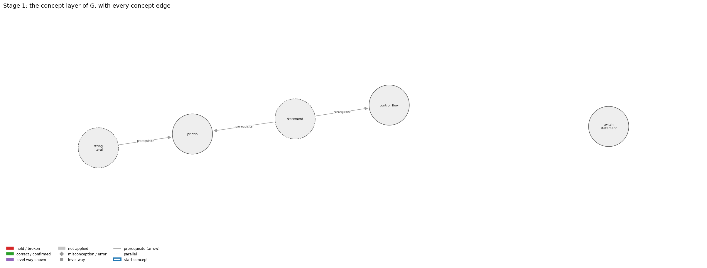
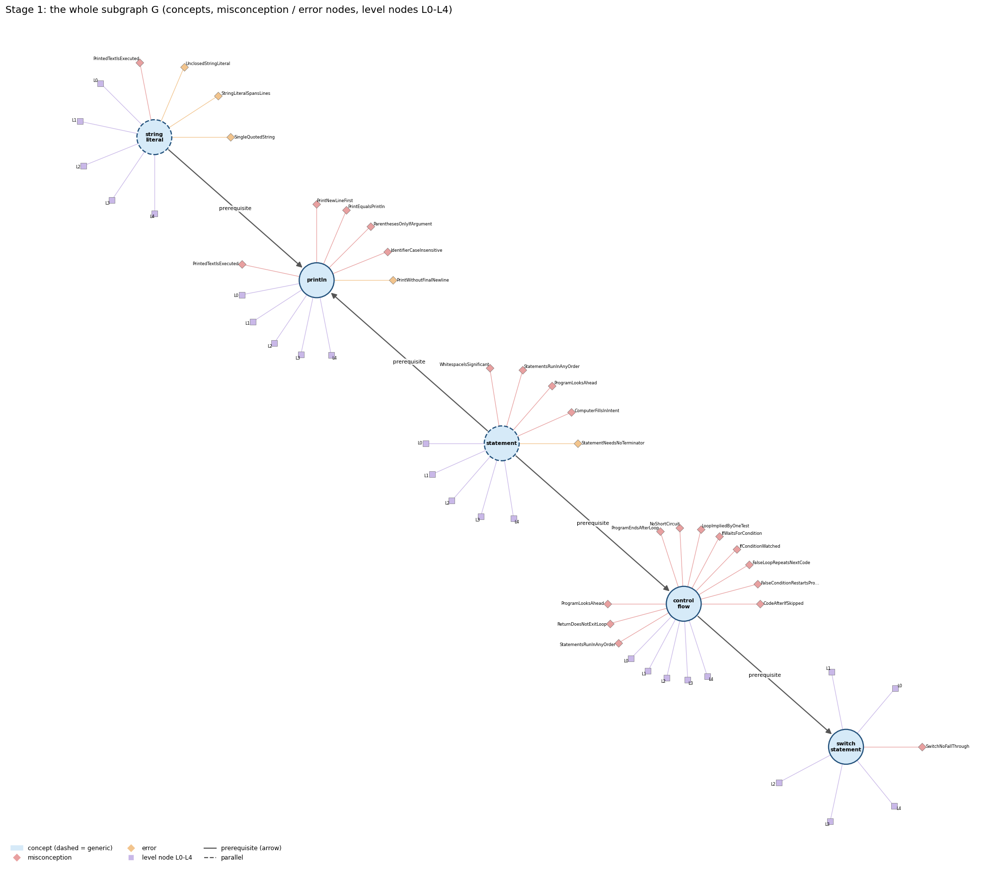
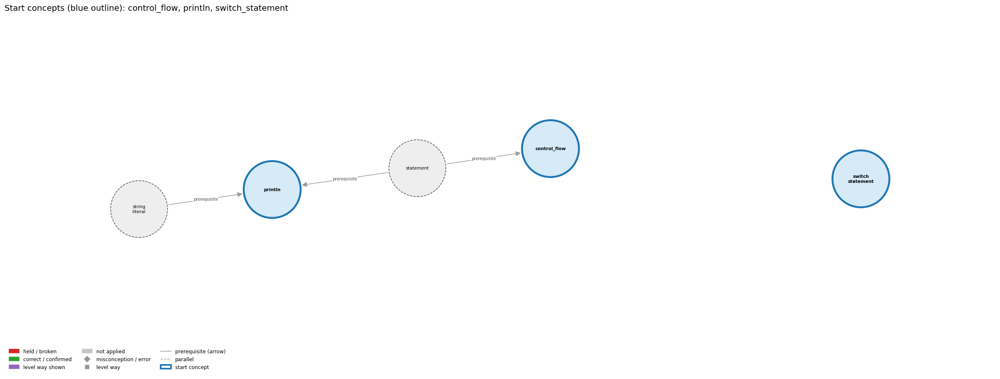
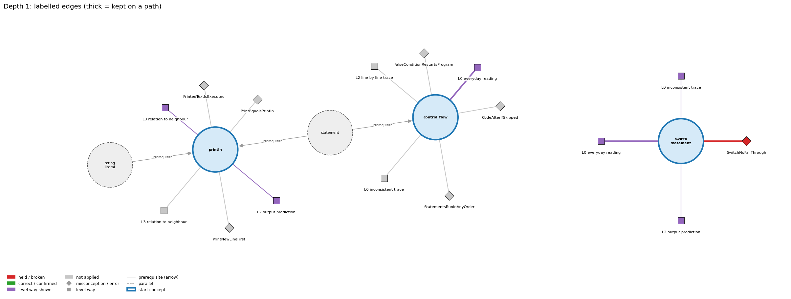
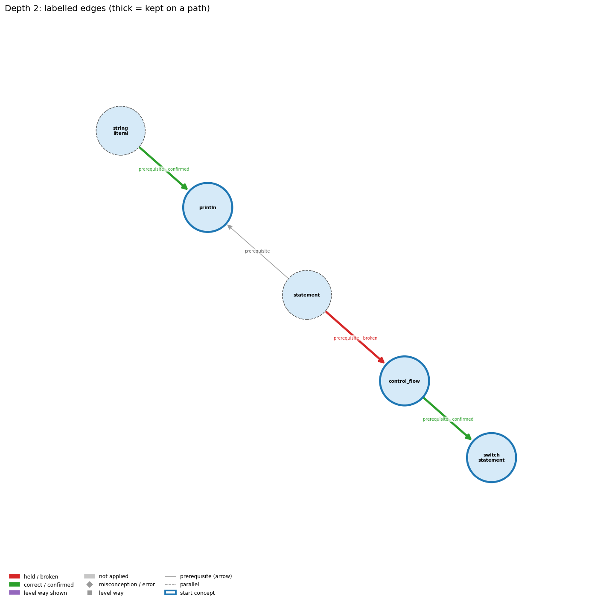
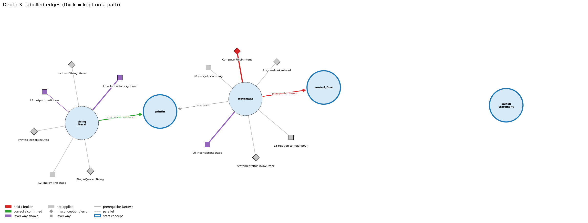
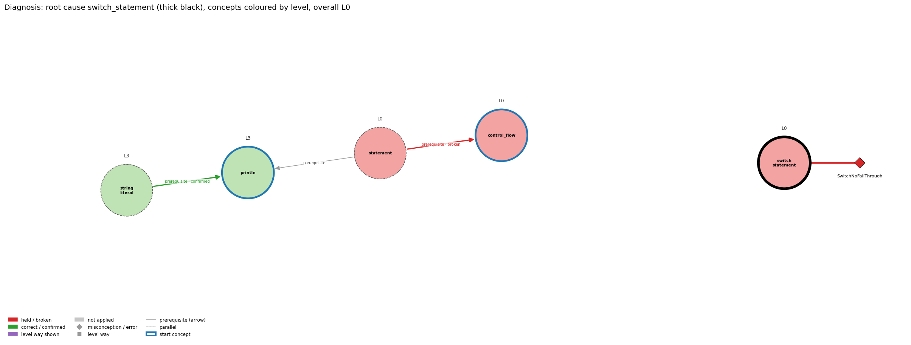

# Think on the Graph: every output of the run MY04

Files of this scenario: `input.json` (program, question, answer), `diagnosis.json`, `subgraph.json`, `traverse_log.txt`, `report.html` (this report as one full-page file, with the interactive graph `MY04_G.html`), `MY04.ipynb` (this report as a notebook).

## 0. Input
Program:
```java
int day = 2;
switch (day) {
    case 1: System.out.println("Mon");
    case 2: System.out.println("Tue");
    case 3: System.out.println("Wed");
    default: System.out.println("Other");
}
```
Question: What does this program print, and why?

Student's answer: It prints only Tue. day is 2, so the switch jumps to case 2, prints Tue, and then the switch is finished. The other cases are skipped because they do not match.
Settings: width 3, depth 3, prune llm, backend claude-cli, model claude-opus-5-5
## 1. Stage 1: the subgraph G from the code (no model)
Masked code (string and char literals and comments blanked; this is what the patterns see):
```
int day = 2;
switch (day) {
    case 1: System.out.println("   ");
    case 2: System.out.println("   ");
    case 3: System.out.println("   ");
    default: System.out.println("     ");
}
```
Which code text tagged which concept (a generic concept fires on almost any Java line; it starts the walk only if the answer repeats its tag):
| concept | generic | channel | matched text | line |
|---|---|---|---|---|
| control_flow | False | pattern | 'switch (' | 2 |
| println | False | pattern | 'System.out.println(' | 3 |
| statement | True | pattern | ';' | 1 |
| string_literal | True | pattern | '"Mon"' | 3 |
| switch_statement | False | pattern | 'switch (' | 2 |
| switch_statement | False | pattern | 'case 1:' | 3 |
| switch_statement | False | pattern | 'default:' | 6 |
| switch_statement | False | signal | 'case 1: System.out.println("   ");\n    case' | 3 |

G: 5 concept nodes (2 generic), 3 concept edges, 27 misconception / error edges, 24 misconception / error nodes, 25 level nodes, 27 level-misconception links, 2 connected piece(s).
Note: concept nodes form 2 pieces (the KG has no edge between them): control_flow,println,statement,string_literal | switch_statement

Concept edges of G (the links the walk can read; `pre:` = prerequisite A -> B, `par:` = parallel):
| edge | type | rule (logic) |
|---|---|---|
| pre:statement->control_flow | prerequisite | Control flow is the order in which statements run. |
| pre:statement->println | prerequisite | System.out.println(s); is itself a statement, so its line of output appears at its own place in the sequence. |
| pre:string_literal->println | prerequisite | println("s") outputs exactly the characters between the quotes and then ends the line. |

Misconception / error edges per concept (count), and level ways per concept (count):
| concept | misconception / error edges | level ways (L1-L4 + L0 non-misconception) |
|---|---|---|
| control_flow | 11 | 15 |
| println | 6 | 17 |
| statement | 5 | 19 |
| string_literal | 4 | 16 |
| switch_statement | 1 | 16 |

**Figure 1**


**Figure 2**


## 2. Clauses and start concepts (no model)
The answer split into clauses (at sentence ends, ';', and before 'because' / 'so'; quotes removed):
| clause | text |
|---|---|
| c1 | It prints only Tue |
| c2 | day is 2 |
| c3 | so the switch jumps to case 2, prints Tue, and then the switch is finished |
| c4 | The other cases are skipped |
| c5 | because they do not match |

start: 3 tagged concepts, all used

start concepts (3): control_flow, println, switch_statement

Start concepts: control_flow, println, switch_statement

**Figure 3**


## 3. The walk, depth by depth
At each depth, for each current concept: the edges offered (a concept entering as a start concept offers its misconception / error edges and its level ways, as two families; otherwise it offers its concept edges), the prune prompt and the model's reply, then the label prompt(s) and the model's reply, parsed into label / clauses / confidence. Score = prune score x confidence.

### Depth 1: current concepts 'control_flow', 'println', 'switch_statement'

#### control_flow, misconceptions: 11 edges offered
Edges offered:
| edge |
|---|
| mis:control_flow->CodeAfterIfSkipped \| wrong rule: When the then branch runs, the code after the if is skipped. \| right rule: After the if finishes, execution continues with the next statement either way. |
| mis:control_flow->FalseConditionRestartsProgram \| wrong rule: When an if condition is false (and there is no else), control jumps back to the start of the program. \| right rule: A false condition skips the then branch and execution continues with the statement after the if statement. |
| mis:control_flow->FalseLoopRepeatsNextCode \| wrong rule: A loop is an iterative if-else: while the condition is true the body repeats, and when it is false the code after the loop repeats. \| right rule: Only the body is repeated; once the condition is false the code after the loop runs once. |
| mis:control_flow->IfConditionWatched \| wrong rule: An if statement watches its condition while the program runs and fires as soon as the condition becomes true (if = whenever). \| right rule: An if condition is tested once, when control reaches the if statement; later changes to the variables do not trigger the branch. |
| mis:control_flow->IfWaitsForCondition \| wrong rule: An IF statement earlier in the program stays active and fires later, e.g. inside a later loop, when its condition becomes true. \| right rule: An if is evaluated once when control reaches it; afterwards it is inactive unless control returns to it. |
| mis:control_flow->LoopImpliedByOneTest \| wrong rule: Testing one case is enough; Java will repeat the test for the other values by itself. \| right rule: A statement runs once each time control reaches it; repeating a test for many values needs a loop. |
| mis:control_flow->NoShortCircuit \| wrong rule: logical AND/OR always evaluate both sides (Java short-circuits them) \| right rule: In p && q, q is evaluated only when p is true; in p \|\| q, q is evaluated only when p is false. |
| mis:control_flow->ProgramEndsAfterLoop \| wrong rule: When a loop finishes the program ends, so code after the loop never runs. \| right rule: When the loop condition becomes false, control continues with the first statement after the loop. |
| mis:control_flow->ProgramLooksAhead \| wrong rule: The program knows or sees what later lines will do and acts on those goals at the current line, e.g. it stops 'at ten' because it wants to draw a box. \| right rule: Each statement executes using only the current state; later lines have no effect until control reaches them. |
| mis:control_flow->ReturnDoesNotExitLoop \| wrong rule: A return inside a loop does not end the loop; it sets a value each pass (the last one is returned) or returns several values. \| right rule: When return executes, the method ends at once, so the loop stops on that pass. |
| mis:control_flow->StatementsRunInAnyOrder \| wrong rule: Statements in a program can run in any order. \| right rule: Without control statements, statements run once each, top to bottom. |

Prune: the model's reply (edge id and score; the kept edges sum to 1):
```
mis:control_flow->CodeAfterIfSkipped (0.60), mis:control_flow->StatementsRunInAnyOrder (0.25), mis:control_flow->FalseConditionRestartsProgram (0.15)
```
Kept by pruning: mis:control_flow->CodeAfterIfSkipped (0.60), mis:control_flow->StatementsRunInAnyOrder (0.25), mis:control_flow->FalseConditionRestartsProgram (0.15)

Label prompt for the misconception / error edges (judged together). The model saw the program, the question, the numbered clauses, and these edges with their wrong rule and right rule:
| edge |
|---|
| mis:control_flow->CodeAfterIfSkipped \| wrong rule: When the then branch runs, the code after the if is skipped. \| right rule: After the if finishes, execution continues with the next statement either way. |
| mis:control_flow->StatementsRunInAnyOrder \| wrong rule: Statements in a program can run in any order. \| right rule: Without control statements, statements run once each, top to bottom. |
| mis:control_flow->FalseConditionRestartsProgram \| wrong rule: When an if condition is false (and there is no else), control jumps back to the start of the program. \| right rule: A false condition skips the then branch and execution continues with the statement after the if statement. |
Model's reply:
```
mis:control_flow->CodeAfterIfSkipped | not applied | clauses: none | confidence: 0.75
mis:control_flow->StatementsRunInAnyOrder | not applied | clauses: none | confidence: 0.9
mis:control_flow->FalseConditionRestartsProgram | not applied | clauses: none | confidence: 0.85
```

Parsed labels:
| edge | label | prune score | confidence | score | clauses | words |
|---|---|---|---|---|---|---|
| mis:control_flow->CodeAfterIfSkipped | not applied |  |  | 0.0 |  |  |
| mis:control_flow->StatementsRunInAnyOrder | not applied |  |  | 0.0 |  |  |
| mis:control_flow->FalseConditionRestartsProgram | not applied |  |  | 0.0 |  |  |

#### control_flow, level ways: 15 edges offered
Edges offered:
| edge |
|---|
| lvl:control_flow@L0#0 \| level L0 way everyday_reading: Folk meaning: in everyday instructions a listener reads the whole list at once, does steps in a sensible order and infers what the writer wants. Java instead executes statements one at a time, top to bottom, each only when control reaches it, and nothing later in the program has any effect earlier. |
| lvl:control_flow@L0#3 \| level L0 way inconsistent_trace: Applies the sequencing rule (LT) unevenly: e.g. runs a later line before an earlier one, lets an if that was already passed fire again later, or ends the program when a loop or a false if ends instead of continuing with the next statement. (here mixing in: "Statements in a program can run in any order") |
| lvl:control_flow@L1#0 \| level L1 way names_the_element: Control flow is the order in which a program's statements are executed (statement sequencing); conditionals and loops are the statements that change it. |
| lvl:control_flow@L1#1 \| level L1 way states_the_rule: Without control statements every statement executes once, in the order given; a block executes its statements in order from first to last; if/if-else choose between one or two alternatives and loops repeat statements depending on a condition. |
| lvl:control_flow@L2#0 \| level L2 way line_by_line_trace: Execute the statement at the current point; when it completes normally, control passes to the next statement in the block. An if evaluates its condition once and then runs at most one branch; a loop evaluates its condition before each pass; after an if or a loop finishes, control continues with the statement after it. |
| lvl:control_flow@L2#1 \| level L2 way output_prediction: The output is the sequence of print statements that control actually reaches, in the order reached: e.g. TenHellos prints 1st, 2nd, 3rd Hello once each, then 4th to 10th Hello from the loop. |
| lvl:control_flow@L2#2 \| level L2 way one_step_execution: One step executes the single statement at the current control point using the current values, updates at most the variables it assigns, and moves the control point to the next statement (or, for an if/loop test, to the chosen branch, back to the test, or past the statement). |
| lvl:control_flow@L3#0 \| level L3 way relation_to_neighbour: Control flow is defined over statements: statements are executed for their effect, and if/while/for are themselves statements that may be used wherever a statement is allowed, so they can nest. |
| lvl:control_flow@L3#1 \| level L3 way relation_to_neighbour: An if changes the default top-to-bottom flow: its condition is tested once when control reaches it, its block runs only if true, and in both cases control then continues with the next statement. |
| lvl:control_flow@L3#2 \| level L3 way relation_to_neighbour: A flowchart draws control flow: each path through the diagram is a possible path of execution, with a decision box for each if or loop test. |
| lvl:control_flow@L3#3 \| level L3 way purpose_of_the_whole: Plan: control flow lets one program do different things for different inputs (selection) and do a thing many times (repetition), so a short program can specify a potentially unlimited number of executed statements. |
| lvl:control_flow@L4#0 \| level L4 way predict_a_change: Reordering two statements generally changes the result whenever one reads a variable that the other writes (e.g. swapping x = x + 1 and print(x)); reordering is safe only for statements that touch disjoint variables. Moving a statement into or out of a branch or loop body changes how many times it runs (0, 1 or n). |
| lvl:control_flow@L4#1 \| level L4 way transfer_to_a_new_program: Reason in terms of control flow whenever you must predict output or find why a statement did or did not run: trace which statement is reached next. Straight-line sequence suffices only when every input needs the same steps exactly once; otherwise add a conditional or a loop. |
| lvl:control_flow@L4#2 \| level L4 way diagnose_an_error: rule broken: A local variable must be definitely assigned on every control-flow path before it is read. Kind: compile-time. Trigger class: A variable assigned only inside an if branch (or only in a loop body) and read after it: the compiler reports 'variable might not have been initialized'. |
| lvl:control_flow@L4#3 \| level L4 way diagnose_an_error: rule broken: Statements run in the order written, so an update must come before the statement that needs the new value. Kind: silent logic error. Trigger class: Swapping two dependent statements (e.g. printing before updating, or incrementing the index before using it): output is shifted or off by one pass, with no error. |

Prune: the model's reply (edge id and score; the kept edges sum to 1):
```
{lvl:control_flow@L0#3 (Score: 0.5)}
{lvl:control_flow@L0#0 (Score: 0.3)}
{lvl:control_flow@L2#0 (Score: 0.2)}
```
Kept by pruning: lvl:control_flow@L0#3 (0.50), lvl:control_flow@L0#0 (0.30), lvl:control_flow@L2#0 (0.20)

Label prompt for level way lvl:control_flow@L0#3 (the model saw only the concept, the way's name 'inconsistent trace' and its text; no level):
> Applies the sequencing rule (LT) unevenly: e.g. runs a later line before an earlier one, lets an if that was already passed fire again later, or ends the program when a loop or a false if ends instead of continuing with the next statement. (here mixing in: "Statements in a program can run in any order")

Model's reply:
```
Label: not shown
Clauses: none
Confidence: 0.65
```

Label prompt for level way lvl:control_flow@L0#0 (the model saw only the concept, the way's name 'everyday reading' and its text; no level):
> Folk meaning: in everyday instructions a listener reads the whole list at once, does steps in a sensible order and infers what the writer wants. Java instead executes statements one at a time, top to bottom, each only when control reaches it, and nothing later in the program has any effect earlier.

Model's reply:
```
Label: shown
Clauses: 1, 3, 4, 5
Confidence: 0.7
```

Label prompt for level way lvl:control_flow@L2#0 (the model saw only the concept, the way's name 'line by line trace' and its text; no level):
> Execute the statement at the current point; when it completes normally, control passes to the next statement in the block. An if evaluates its condition once and then runs at most one branch; a loop evaluates its condition before each pass; after an if or a loop finishes, control continues with the statement after it.

Model's reply:
```
Label: not shown
Clauses: none
Confidence: 0.75
```

Parsed labels:
| edge | label | prune score | confidence | score | clauses | words |
|---|---|---|---|---|---|---|
| lvl:control_flow@L0#3 | not applied |  |  | 0.0 |  |  |
| lvl:control_flow@L0#0 | shown | 0.3 | 0.7 | 0.21 | c1, c3, c4, c5 | It prints only Tue; so the switch jumps to case 2, prints Tue, and then the switch is finished; The other cases are skipped; because they do not match |
| lvl:control_flow@L2#0 | not applied |  |  | 0.0 |  |  |

#### println, misconceptions: 6 edges offered
Edges offered:
| edge |
|---|
| err:println->PrintWithoutFinalNewline \| wrong rule: Ends the output with print and expects it to appear right away. \| right rule: Finish a line of print calls with println; some systems hold print output until a newline is printed. |
| mis:println->IdentifierCaseInsensitive \| wrong rule: System.out.Println and System.out.println name the same method. \| right rule: Java is case-sensitive: names of variables, methods and classes that differ only in capitalization are different names. |
| mis:println->ParenthesesOnlyIfArgument \| wrong rule: println with nothing to print can be written System.out.println; without the parentheses. \| right rule: A method call always needs parentheses, so an empty line is printed with System.out.println();. |
| mis:println->PrintEqualsPrintln \| wrong rule: print and println do the same thing, so print(s1); print(s2); puts s1 and s2 on separate lines. \| right rule: println ends the line after printing and print does not, so print(s1); print(s2); puts s1 and s2 on the same line. |
| mis:println->PrintNewLineFirst \| wrong rule: println(s) prints a newline and then s. \| right rule: println(s) prints s and then the newline. |
| mis:println->PrintedTextIsExecuted \| wrong rule: System.out.println("x is 5"); sets x to 5 (text inside the quotes is run as code). \| right rule: Characters inside double quotes are printed literally; println only displays them and changes no variable. Only an assignment such as x = 5; sets x. |

Prune: the model's reply (edge id and score; the kept edges sum to 1):
```
mis:println->PrintedTextIsExecuted (0.50), mis:println->PrintNewLineFirst (0.30), mis:println->PrintEqualsPrintln (0.20)
```
Kept by pruning: mis:println->PrintedTextIsExecuted (0.50), mis:println->PrintNewLineFirst (0.30), mis:println->PrintEqualsPrintln (0.20)

Label prompt for the misconception / error edges (judged together). The model saw the program, the question, the numbered clauses, and these edges with their wrong rule and right rule:
| edge |
|---|
| mis:println->PrintedTextIsExecuted \| wrong rule: System.out.println("x is 5"); sets x to 5 (text inside the quotes is run as code). \| right rule: Characters inside double quotes are printed literally; println only displays them and changes no variable. Only an assignment such as x = 5; sets x. |
| mis:println->PrintNewLineFirst \| wrong rule: println(s) prints a newline and then s. \| right rule: println(s) prints s and then the newline. |
| mis:println->PrintEqualsPrintln \| wrong rule: print and println do the same thing, so print(s1); print(s2); puts s1 and s2 on separate lines. \| right rule: println ends the line after printing and print does not, so print(s1); print(s2); puts s1 and s2 on the same line. |
Model's reply:
```
mis:println->PrintedTextIsExecuted | not applied | clauses: none | confidence: 0.9
mis:println->PrintNewLineFirst | not applied | clauses: none | confidence: 0.9
mis:println->PrintEqualsPrintln | not applied | clauses: none | confidence: 0.9
```

Parsed labels:
| edge | label | prune score | confidence | score | clauses | words |
|---|---|---|---|---|---|---|
| mis:println->PrintedTextIsExecuted | not applied |  |  | 0.0 |  |  |
| mis:println->PrintNewLineFirst | not applied |  |  | 0.0 |  |  |
| mis:println->PrintEqualsPrintln | not applied |  |  | 0.0 |  |  |

#### println, level ways: 17 edges offered
Edges offered:
| edge |
|---|
| lvl:println@L0#0 \| level L0 way everyday_reading: Everyday reading: 'println' is just 'print', and 'new line' is something you do before writing. Java rule: println(x) prints x and then ends the line; println() alone just ends the line. |
| lvl:println@L0#3 \| level L0 way inconsistent_trace: Applies the println rule (print, then end line) unevenly: puts the newline before the text on one call and after it on another, or forgets that the next output starts on a new line. (here mixing in: "print and println behave the same (no newline difference)") |
| lvl:println@L1#0 \| level L1 way names_the_element: System.out.println is a library method that prints its argument followed by a line terminator ('print line'). |
| lvl:println@L1#1 \| level L1 way states_the_rule: println(String x) behaves as though it calls print(x) and then println(); println() terminates the current line by writing the line separator string. |
| lvl:println@L2#0 \| level L2 way line_by_line_trace: Evaluate the argument, print its characters at the current position, then write the line separator so the cursor moves to the beginning of the next line. |
| lvl:println@L2#1 \| level L2 way output_prediction: Output is the value's characters followed by a line break: println("Hello, "); println("World!"); prints two lines. |
| lvl:println@L2#2 \| level L2 way one_step_execution: One call appends the text and a line separator to the output; the cursor ends at the start of the next line; no variable changes and nothing is returned. |
| lvl:println@L3#0 \| level L3 way relation_to_neighbour: System.out.println(s); is a statement, so its line of output appears at its own place in the sequence. |
| lvl:println@L3#1 \| level L3 way relation_to_neighbour: println("s") outputs exactly the characters between the quotes and then ends the line. |
| lvl:println@L3#2 \| level L3 way relation_to_neighbour: print leaves the cursor on the line; println ends it; several prints followed by one println make one line. |
| lvl:println@L3#3 \| level L3 way relation_to_neighbour: println prints numbers with all their digits and always ends the line; printf formats each value by its conversion code and ends the line only where the format has %n or \n. |
| lvl:println@L3#4 \| level L3 way purpose_of_the_whole: Purpose: produce one complete line of output, e.g. each result on its own line, or end a line built with print. |
| lvl:println@L4#0 \| level L4 way predict_a_change: Replacing println with print joins the next output onto the same line (a typical logic error); the characters printed stay the same. |
| lvl:println@L4#1 \| level L4 way transfer_to_a_new_program: Use println when each output item belongs on its own line or to end a line; use print to continue a line and printf to control number formatting. |
| lvl:println@L4#2 \| level L4 way diagnose_an_error: rule broken: Finish a line of print calls with println. Kind: silent logic error. Trigger class: output ends with print, so the last line may not be shown or runs into the shell prompt |
| lvl:println@L4#3 \| level L4 way diagnose_an_error: rule broken: Method names are case-sensitive. Kind: compile-time. Trigger class: System.out.Println or system.out.println: cannot find symbol |
| lvl:println@L4#4 \| level L4 way diagnose_an_error: rule broken: Calls need parentheses. Kind: compile-time. Trigger class: System.out.println; without () |

Prune: the model's reply (edge id and score; the kept edges sum to 1):
```
{lvl:println@L3#0 (Score: 0.4)}
{lvl:println@L3#1 (Score: 0.35)}
{lvl:println@L2#1 (Score: 0.25)}
```
Kept by pruning: lvl:println@L3#0 (0.40), lvl:println@L3#1 (0.35), lvl:println@L2#1 (0.25)

Label prompt for level way lvl:println@L3#0 (the model saw only the concept, the way's name 'relation to neighbour' and its text; no level):
> System.out.println(s); is a statement, so its line of output appears at its own place in the sequence.

Model's reply:
```
Label: not shown
Clauses: none
Confidence: 0.8
```

Label prompt for level way lvl:println@L3#1 (the model saw only the concept, the way's name 'relation to neighbour' and its text; no level):
> println("s") outputs exactly the characters between the quotes and then ends the line.

Model's reply:
```
Label: shown
Clauses: 1, 3
Confidence: 0.6
```

Label prompt for level way lvl:println@L2#1 (the model saw only the concept, the way's name 'output prediction' and its text; no level):
> Output is the value's characters followed by a line break: println("Hello, "); println("World!"); prints two lines.

Model's reply:
```
Label: shown
Clauses: 1, 3
Confidence: 0.6
```

Parsed labels:
| edge | label | prune score | confidence | score | clauses | words |
|---|---|---|---|---|---|---|
| lvl:println@L3#0 | not applied |  |  | 0.0 |  |  |
| lvl:println@L3#1 | shown | 0.35 | 0.6 | 0.21 | c1, c3 | It prints only Tue; so the switch jumps to case 2, prints Tue, and then the switch is finished |
| lvl:println@L2#1 | shown | 0.25 | 0.6 | 0.15 | c1, c3 | It prints only Tue; so the switch jumps to case 2, prints Tue, and then the switch is finished |

#### switch_statement, misconceptions: 1 edges offered
Edges offered:
| edge |
|---|
| mis:switch_statement->SwitchNoFallThrough \| wrong rule: After the matching case runs, the switch ends even without break. \| right rule: Without break, statements in switch blocks fall through into the following cases. |

Prune: the model's reply (edge id and score; the kept edges sum to 1):
```
{mis:switch_statement->SwitchNoFallThrough (Score: 1.0)}
```
Kept by pruning: mis:switch_statement->SwitchNoFallThrough (1.00)

Label prompt for the misconception / error edges (judged together). The model saw the program, the question, the numbered clauses, and these edges with their wrong rule and right rule:
| edge |
|---|
| mis:switch_statement->SwitchNoFallThrough \| wrong rule: After the matching case runs, the switch ends even without break. \| right rule: Without break, statements in switch blocks fall through into the following cases. |
Model's reply:
```
mis:switch_statement->SwitchNoFallThrough | held | clauses: 1, 3, 4, 5 | confidence: 0.96
```

Parsed labels:
| edge | label | prune score | confidence | score | clauses | words |
|---|---|---|---|---|---|---|
| mis:switch_statement->SwitchNoFallThrough | held | 1.0 | 0.96 | 0.96 | c1, c3, c4, c5 | It prints only Tue; so the switch jumps to case 2, prints Tue, and then the switch is finished; The other cases are skipped; because they do not match |

#### switch_statement, level ways: 16 edges offered
Edges offered:
| edge |
|---|
| lvl:switch_statement@L0#0 \| level L0 way everyday_reading: Folk meaning: everyday 'switch' means flip to one setting, and 'case' reads like 'in case of X do Y', a self-contained rule. Novices therefore expect only the matching case to run. In a Java switch statement, the case labels are only entry points: execution starts at the matching label and falls through the following cases until a break. |
| lvl:switch_statement@L0#2 \| level L0 way inconsistent_trace: Applies the LT rule unevenly: on a trace the selector is matched correctly but execution stops at the next case label on some runs and falls through on others, or default is run even though a case matched. (here mixing in: "After the matching case runs, the switch ends even without break") |
| lvl:switch_statement@L1#0 \| level L1 way names_the_element: Selection statement: `switch (expr) { case v1: ...; break; ... default: ... }` chooses among many alternatives by the value of one expression. |
| lvl:switch_statement@L1#1 \| level L1 way states_the_rule: The selector is an int-like (char, byte, short, int), String or enum expression. Case labels are distinct constants of that type, and default is optional. Control jumps to the matching label (or to default, or past the switch), and the case statements usually end with break. Without a break, execution falls through into the statements of the next case; default runs when no case matches. |
| lvl:switch_statement@L2#0 \| level L2 way line_by_line_trace: Order: evaluate the selector once; compare it with the case constants; jump to the matching label (else default, else skip the switch). Then execute the statements from there in order, through later labels, until a break or the closing brace. |
| lvl:switch_statement@L2#1 \| level L2 way output_prediction: A switch statement has no value. Its result is the effect of the case(s) run: with `day = 3`, the S&W day switch prints Wed. Without breaks, day = 5 would print Fri, then Sat. |
| lvl:switch_statement@L2#2 \| level L2 way one_step_execution: One execution evaluates the selector once (any side effect in it happens once) and runs the statements of one entry point and any cases it falls into. It changes only what those statements change. |
| lvl:switch_statement@L3#0 \| level L3 way relation_to_neighbour: A switch replaces an if-else chain only when every test is `expr == constant` on the same expression. Range tests such as the income-bracket chain (`income < 47450`) must stay an if-else chain. |
| lvl:switch_statement@L3#1 \| level L3 way relation_to_neighbour: Each case is normally ended by break, which exits the switch body. Leaving it out makes that case fall into the next. Inside a loop, that break exits the switch, not the loop. |
| lvl:switch_statement@L3#2 \| level L3 way purpose_of_the_whole: Plan: multiway dispatch or lookup. It maps one discrete value (day number, menu choice, character) to one of several actions or results. Grouped labels (`case "apple": case "banana":`) map several values to one action. |
| lvl:switch_statement@L4#0 \| level L4 way predict_a_change: When every case ends with break, reordering the cases does not change behaviour (labels are distinct constants). Removing one break changes behaviour for that value only. Adding a default changes only values with no matching label. |
| lvl:switch_statement@L4#1 \| level L4 way transfer_to_a_new_program: Use switch for more than two mutually exclusive alternatives decided by equality of one int, char, String or enum value. Use an if-else chain for ranges, doubles or unrelated conditions. Use an array lookup (S&W 1.4) when each case only selects a value. |
| lvl:switch_statement@L4#2 \| level L4 way diagnose_an_error: rule broken: Without break, execution falls through into the following cases. Kind: silent logic error. Trigger class: Any selector value whose case lacks a break: the following cases' statements also run (e.g. both Fri and Sat printed). |
| lvl:switch_statement@L4#3 \| level L4 way diagnose_an_error: rule broken: Values that match no case do nothing unless a default is present. Kind: silent logic error. Trigger class: An out-of-range selector (day = 7) with no default: nothing happens, and a variable assigned only in the cases may stay unassigned. |
| lvl:switch_statement@L4#4 \| level L4 way diagnose_an_error: rule broken: Case labels must be distinct compile-time constants of the selector type, and the selector may not be double, float, long or boolean. Kind: compile-time. Trigger class: Duplicate `case 1:` labels, a variable as a label, or `switch (x)` with x a double. |
| lvl:switch_statement@L4#5 \| level L4 way diagnose_an_error: rule broken: A String selector is dereferenced. Kind: run-time exception. Trigger class: Switching on a String variable that is null throws NullPointerException. |

Prune: the model's reply (edge id and score; the kept edges sum to 1):
```
{lvl:switch_statement@L0#0 (Score: 0.6)}
{lvl:switch_statement@L0#2 (Score: 0.25)}
{lvl:switch_statement@L2#1 (Score: 0.15)}
```
Kept by pruning: lvl:switch_statement@L0#0 (0.60), lvl:switch_statement@L0#2 (0.25), lvl:switch_statement@L2#1 (0.15)

Label prompt for level way lvl:switch_statement@L0#0 (the model saw only the concept, the way's name 'everyday reading' and its text; no level):
> Folk meaning: everyday 'switch' means flip to one setting, and 'case' reads like 'in case of X do Y', a self-contained rule. Novices therefore expect only the matching case to run. In a Java switch statement, the case labels are only entry points: execution starts at the matching label and falls through the following cases until a break.

Model's reply:
```
Label: shown
Clauses: 1, 3, 4, 5
Confidence: 0.93
```

Label prompt for level way lvl:switch_statement@L0#2 (the model saw only the concept, the way's name 'inconsistent trace' and its text; no level):
> Applies the LT rule unevenly: on a trace the selector is matched correctly but execution stops at the next case label on some runs and falls through on others, or default is run even though a case matched. (here mixing in: "After the matching case runs, the switch ends even without break")

Model's reply:
```
Label: shown
Clauses: 2, 3, 4
Confidence: 0.6
```

Label prompt for level way lvl:switch_statement@L2#1 (the model saw only the concept, the way's name 'output prediction' and its text; no level):
> A switch statement has no value. Its result is the effect of the case(s) run: with `day = 3`, the S&W day switch prints Wed. Without breaks, day = 5 would print Fri, then Sat.

Model's reply:
```
Label: shown
Clauses: 1, 3
Confidence: 0.6
```

Parsed labels:
| edge | label | prune score | confidence | score | clauses | words |
|---|---|---|---|---|---|---|
| lvl:switch_statement@L0#0 | shown | 0.6 | 0.93 | 0.56 | c1, c3, c4, c5 | It prints only Tue; so the switch jumps to case 2, prints Tue, and then the switch is finished; The other cases are skipped; because they do not match |
| lvl:switch_statement@L0#2 | shown | 0.25 | 0.6 | 0.15 | c2, c3, c4 | day is 2; so the switch jumps to case 2, prints Tue, and then the switch is finished; The other cases are skipped |
| lvl:switch_statement@L2#1 | shown | 0.15 | 0.6 | 0.09 | c1, c3 | It prints only Tue; so the switch jumps to case 2, prints Tue, and then the switch is finished |

**Kept on a path at this depth** (best N in tiers: held misconception / broken edge, then held error, then correct / confirmed / shown):

mis:switch_statement->SwitchNoFallThrough [held, tier 0, 0.96], lvl:switch_statement@L0#0 [shown, tier 2, 0.56], lvl:control_flow@L0#0 [shown, tier 2, 0.21]

**Graph check, not yet read (the walk may not stop while these remain):** pre:statement->control_flow, pre:statement->println, pre:string_literal->println

**Figure 4 (the graph after depth 1)**


### Depth 2: current concepts 'switch_statement', 'control_flow', 'println'

#### control_flow, concept edges: 1 edges offered
Edges offered:
| edge |
|---|
| pre:statement->control_flow \| rule: Control flow is the order in which statements run. |

Prune: the model's reply (edge id and score; the kept edges sum to 1):
```
{pre:statement->control_flow (Score: 1.0)}
```
Kept by pruning: pre:statement->control_flow (1.00)

Label prompt for concept edge pre:statement->control_flow (statement -> control_flow, prerequisite):
> Control flow is the order in which statements run.

Model's reply:
```
Label: broken
Clauses: 1, 3, 4
Confidence: 0.75
```

Parsed labels:
| edge | label | prune score | confidence | score | clauses | words |
|---|---|---|---|---|---|---|
| pre:statement->control_flow | broken | 1.0 | 0.75 | 0.75 | c1, c3, c4 | It prints only Tue; so the switch jumps to case 2, prints Tue, and then the switch is finished; The other cases are skipped |

#### println, concept edges: 2 edges offered
Edges offered:
| edge |
|---|
| pre:statement->println \| rule: System.out.println(s); is itself a statement, so its line of output appears at its own place in the sequence. |
| pre:string_literal->println \| rule: println("s") outputs exactly the characters between the quotes and then ends the line. |

Prune: the model's reply (edge id and score; the kept edges sum to 1):
```
{pre:statement->println (Score: 0.6)}
{pre:string_literal->println (Score: 0.4)}
```
Kept by pruning: pre:statement->println (0.60), pre:string_literal->println (0.40)

Label prompt for concept edge pre:statement->println (statement -> println, prerequisite):
> System.out.println(s); is itself a statement, so its line of output appears at its own place in the sequence.

Model's reply:
```
Label: not applied
Clauses: none
Confidence: 0.6
```

Label prompt for concept edge pre:string_literal->println (string_literal -> println, prerequisite):
> println("s") outputs exactly the characters between the quotes and then ends the line.

Model's reply:
```
Label: confirmed
Clauses: 1, 3
Confidence: 0.7
```

Parsed labels:
| edge | label | prune score | confidence | score | clauses | words |
|---|---|---|---|---|---|---|
| pre:statement->println | not applied |  |  | 0.0 |  |  |
| pre:string_literal->println | confirmed | 0.4 | 0.7 | 0.28 | c1, c3 | It prints only Tue; so the switch jumps to case 2, prints Tue, and then the switch is finished |

**Kept on a path at this depth** (best N in tiers: held misconception / broken edge, then held error, then correct / confirmed / shown):

pre:statement->control_flow [broken, tier 0, 0.75], pre:string_literal->println [confirmed, tier 2, 0.28]

reached across pre:statement->control_flow, entered next: statement

reached across pre:string_literal->println, entered next: string_literal

**Graph check, not yet read (the walk may not stop while these remain):** own edges of statement, own edges of string_literal

**Figure 5 (the graph after depth 2)**


### Depth 3: current concepts 'statement', 'control_flow', 'string_literal', 'println'

#### statement, misconceptions: 5 edges offered
Edges offered:
| edge |
|---|
| err:statement->StatementNeedsNoTerminator \| wrong rule: A statement still compiles and runs if the semicolon at its end is left out, or if a stray ; is put right after if (c) or for (...). \| right rule: Each statement must end with ;, otherwise javac reports ';' expected. |
| mis:statement->ComputerFillsInIntent \| wrong rule: The computer fills in omitted steps or values that the programmer meant, e.g. REPEAT 4 [FORWARD 30] draws a square without a turn command. \| right rule: The computer executes only what the code states; every needed step and value must be written. |
| mis:statement->ProgramLooksAhead \| wrong rule: The program knows or sees what later lines will do and acts on those goals at the current line, e.g. it stops 'at ten' because it wants to draw a box. \| right rule: Each statement executes using only the current state; later lines have no effect until control reaches them. |
| mis:statement->StatementsRunInAnyOrder \| wrong rule: Statements in a program can run in any order. \| right rule: Without control statements, statements run once each, top to bottom. |
| mis:statement->WhitespaceIsSignificant \| wrong rule: Line breaks and indentation change what the program does, so each statement must be on its own line. \| right rule: Java compilers consider all whitespace in program text (outside quotation marks) to be equivalent; layout is for human readers. |

Prune: the model's reply (edge id and score; the kept edges sum to 1):
```
mis:statement->ComputerFillsInIntent (0.50), mis:statement->StatementsRunInAnyOrder (0.30), mis:statement->ProgramLooksAhead (0.20)
```
Kept by pruning: mis:statement->ComputerFillsInIntent (0.50), mis:statement->StatementsRunInAnyOrder (0.30), mis:statement->ProgramLooksAhead (0.20)

Label prompt for the misconception / error edges (judged together). The model saw the program, the question, the numbered clauses, and these edges with their wrong rule and right rule:
| edge |
|---|
| mis:statement->ComputerFillsInIntent \| wrong rule: The computer fills in omitted steps or values that the programmer meant, e.g. REPEAT 4 [FORWARD 30] draws a square without a turn command. \| right rule: The computer executes only what the code states; every needed step and value must be written. |
| mis:statement->StatementsRunInAnyOrder \| wrong rule: Statements in a program can run in any order. \| right rule: Without control statements, statements run once each, top to bottom. |
| mis:statement->ProgramLooksAhead \| wrong rule: The program knows or sees what later lines will do and acts on those goals at the current line, e.g. it stops 'at ten' because it wants to draw a box. \| right rule: Each statement executes using only the current state; later lines have no effect until control reaches them. |
Model's reply:
```
mis:statement->ComputerFillsInIntent | held | clauses: 1, 3 | confidence: 0.55
mis:statement->StatementsRunInAnyOrder | not applied | clauses: none | confidence: 0.85
mis:statement->ProgramLooksAhead | not applied | clauses: none | confidence: 0.8
```

Parsed labels:
| edge | label | prune score | confidence | score | clauses | words |
|---|---|---|---|---|---|---|
| mis:statement->ComputerFillsInIntent | held | 0.5 | 0.55 | 0.28 | c1, c3 | It prints only Tue; so the switch jumps to case 2, prints Tue, and then the switch is finished |
| mis:statement->StatementsRunInAnyOrder | not applied |  |  | 0.0 |  |  |
| mis:statement->ProgramLooksAhead | not applied |  |  | 0.0 |  |  |

#### statement, level ways: 19 edges offered
Edges offered:
| edge |
|---|
| lvl:statement@L0#0 \| level L0 way everyday_reading: Everyday reading: a program is read like a text or a list of wishes that the computer takes in all at once, so line order, goals of later lines or what the writer meant can matter. Java rule: each statement is one step, ended by ;, executed once, in written order, using only the current state. |
| lvl:statement@L0#2 \| level L0 way inconsistent_trace: Applies the sequencing rule (LT) unevenly: executes the statements in order on some lines but lets a later statement's effect leak into an earlier one, or skips or repeats a statement on one pass. (here mixing in: "The computer fills in omitted steps or values that the programmer meant, e.g. REPEAT 4 [FORWARD 30] draws a square without a turn command") |
| lvl:statement@L1#0 \| level L1 way names_the_element: A statement is one step of a program (a declaration, assignment, method call such as System.out.println(...), or control statement), ended by a semicolon when it is a simple statement. |
| lvl:statement@L1#1 \| level L1 way states_the_rule: A method body is a sequence of statements enclosed in braces and each followed by a semicolon; statements are executed for their effect and have no value; an expression statement evaluates its expression and discards any value. |
| lvl:statement@L2#0 \| level L2 way line_by_line_trace: Statements run one at a time, from first to last; each completes (normally or abruptly) before the next starts. |
| lvl:statement@L2#1 \| level L2 way output_prediction: A statement has no value; its result is its effect: a changed variable, printed output, or a change of control flow. |
| lvl:statement@L2#2 \| level L2 way one_step_execution: Executing one statement applies its single effect to the current state (e.g. prints one string, or stores one value) and then control moves to the next statement. |
| lvl:statement@L3#0 \| level L3 way relation_to_neighbour: Statements live in main's body; running the program executes main's statements in order. |
| lvl:statement@L3#1 \| level L3 way relation_to_neighbour: A block groups a sequence of statements in braces; the body of main() is such a block. |
| lvl:statement@L3#2 \| level L3 way relation_to_neighbour: System.out.print(s); is a statement, so its output appears exactly at its place in the sequence, with no newline. |
| lvl:statement@L3#3 \| level L3 way relation_to_neighbour: System.out.println(s); is a statement, so its line of output appears at its place in the sequence; swapping two println statements swaps the output lines. |
| lvl:statement@L3#4 \| level L3 way relation_to_neighbour: Control flow is the order in which statements run; without control statements it is straight-line, each once in order. |
| lvl:statement@L3#5 \| level L3 way relation_to_neighbour: A lone ; is the empty statement, which does nothing; it can fill a for-loop part or, by accident, end an if or loop header. |
| lvl:statement@L3#6 \| level L3 way relation_to_neighbour: An algorithm becomes a program as a sequence of statements, executed once each in the order given. |
| lvl:statement@L3#7 \| level L3 way purpose_of_the_whole: Purpose: a statement is the unit of action; a program is characterized by its sequence of statements, each doing one step of the algorithm. |
| lvl:statement@L4#0 \| level L4 way predict_a_change: Swapping two statements that touch the same variable or the output generally changes the result; swapping independent statements, or changing only whitespace between them, keeps it. |
| lvl:statement@L4#1 \| level L4 way diagnose_an_error: rule broken: Each simple statement must end with ;. Kind: compile-time. Trigger class: omitting the ; at the end of a statement: javac reports ';' expected (often at the end of that line or the next) |
| lvl:statement@L4#2 \| level L4 way transfer_to_a_new_program: Write one statement per step and order them as the algorithm requires; straight-line sequence suffices when every step runs once, otherwise use conditionals or loops. |
| lvl:statement@L4#3 \| level L4 way diagnose_an_error: rule broken: A ; directly after an if/while/for header is an empty statement. Kind: silent logic error. Trigger class: if (x > 0); or while (cond); followed by the intended body |

Prune: the model's reply (edge id and score; the kept edges sum to 1):
```
{lvl:statement@L0#2 (Score: 0.5)}
{lvl:statement@L0#0 (Score: 0.3)}
{lvl:statement@L3#4 (Score: 0.2)}
```
Kept by pruning: lvl:statement@L0#2 (0.50), lvl:statement@L0#0 (0.30), lvl:statement@L3#4 (0.20)

Label prompt for level way lvl:statement@L0#2 (the model saw only the concept, the way's name 'inconsistent trace' and its text; no level):
> Applies the sequencing rule (LT) unevenly: executes the statements in order on some lines but lets a later statement's effect leak into an earlier one, or skips or repeats a statement on one pass. (here mixing in: "The computer fills in omitted steps or values that the programmer meant, e.g. REPEAT 4 [FORWARD 30] draws a square without a turn command")

Model's reply:
```
Label: shown
Clauses: 1, 3, 4
Confidence: 0.72
```

Label prompt for level way lvl:statement@L0#0 (the model saw only the concept, the way's name 'everyday reading' and its text; no level):
> Everyday reading: a program is read like a text or a list of wishes that the computer takes in all at once, so line order, goals of later lines or what the writer meant can matter. Java rule: each statement is one step, ended by ;, executed once, in written order, using only the current state.

Model's reply:
```
Label: not shown
Clauses: none
Confidence: 0.6
```

Label prompt for level way lvl:statement@L3#4 (the model saw only the concept, the way's name 'relation to neighbour' and its text; no level):
> Control flow is the order in which statements run; without control statements it is straight-line, each once in order.

Model's reply:
```
Label: not shown
Clauses: none
Confidence: 0.7
```

Parsed labels:
| edge | label | prune score | confidence | score | clauses | words |
|---|---|---|---|---|---|---|
| lvl:statement@L0#2 | shown | 0.5 | 0.72 | 0.36 | c1, c3, c4 | It prints only Tue; so the switch jumps to case 2, prints Tue, and then the switch is finished; The other cases are skipped |
| lvl:statement@L0#0 | not applied |  |  | 0.0 |  |  |
| lvl:statement@L3#4 | not applied |  |  | 0.0 |  |  |

#### string_literal, misconceptions: 4 edges offered
Edges offered:
| edge |
|---|
| err:string_literal->SingleQuotedString \| wrong rule: Writes a string literal in single quotes: 'Hello'. \| right rule: String literals use double quotes; single quotes are for one char. |
| err:string_literal->StringLiteralSpansLines \| wrong rule: Breaks a string literal across two lines of code. \| right rule: String literals must not span more than one line of a program. |
| err:string_literal->UnclosedStringLiteral \| wrong rule: A string literal can be left without its closing quote. \| right rule: A String literal is enclosed in a pair of double quotes. |
| mis:string_literal->PrintedTextIsExecuted \| wrong rule: System.out.println("x is 5"); sets x to 5 (text inside the quotes is run as code). \| right rule: Characters inside double quotes are printed literally; println only displays them and changes no variable. Only an assignment such as x = 5; sets x. |

Prune: the model's reply (edge id and score; the kept edges sum to 1):
```
{mis:string_literal->PrintedTextIsExecuted (Score: 0.8)}
{err:string_literal->UnclosedStringLiteral (Score: 0.1)}
{err:string_literal->SingleQuotedString (Score: 0.1)}
```
Kept by pruning: mis:string_literal->PrintedTextIsExecuted (0.80), err:string_literal->UnclosedStringLiteral (0.10), err:string_literal->SingleQuotedString (0.10)

Label prompt for the misconception / error edges (judged together). The model saw the program, the question, the numbered clauses, and these edges with their wrong rule and right rule:
| edge |
|---|
| mis:string_literal->PrintedTextIsExecuted \| wrong rule: System.out.println("x is 5"); sets x to 5 (text inside the quotes is run as code). \| right rule: Characters inside double quotes are printed literally; println only displays them and changes no variable. Only an assignment such as x = 5; sets x. |
| err:string_literal->UnclosedStringLiteral \| wrong rule: A string literal can be left without its closing quote. \| right rule: A String literal is enclosed in a pair of double quotes. |
| err:string_literal->SingleQuotedString \| wrong rule: Writes a string literal in single quotes: 'Hello'. \| right rule: String literals use double quotes; single quotes are for one char. |
Model's reply:
```
mis:string_literal->PrintedTextIsExecuted | not applied | clauses: none | confidence: 0.8
err:string_literal->UnclosedStringLiteral | not applied | clauses: none | confidence: 0.95
err:string_literal->SingleQuotedString | not applied | clauses: none | confidence: 0.95
```

Parsed labels:
| edge | label | prune score | confidence | score | clauses | words |
|---|---|---|---|---|---|---|
| mis:string_literal->PrintedTextIsExecuted | not applied |  |  | 0.0 |  |  |
| err:string_literal->UnclosedStringLiteral | not applied |  |  | 0.0 |  |  |
| err:string_literal->SingleQuotedString | not applied |  |  | 0.0 |  |  |

#### string_literal, level ways: 16 edges offered
Edges offered:
| edge |
|---|
| lvl:string_literal@L0#0 \| level L0 way everyday_reading: Everyday reading: quotation marks are just decoration, and spacing inside them is tidied up like ordinary text; single and double quotes mean the same thing. Java rule: characters within double quotes are taken literally (every space counts), the quotes are not part of the value, and single quotes are for one char. |
| lvl:string_literal@L1#0 \| level L1 way names_the_element: A string literal is a sequence of characters written in double quotes in the source code, e.g. "Hello, World"; it is a value of type String. |
| lvl:string_literal@L1#1 \| level L1 way states_the_rule: A String literal is enclosed in a pair of double quotes; everything inside is taken literally, special characters such as " and newline are written with escape sequences, and the literal must close on the same source line. |
| lvl:string_literal@L2#0 \| level L2 way line_by_line_trace: The literal is a constant: it is fixed at compile time and simply supplies its value when the expression containing it is evaluated. |
| lvl:string_literal@L2#1 \| level L2 way output_prediction: Value is the String of the characters between the quotes (escape sequences replaced by the characters they stand for), without the quotes: "Hi, " has 4 characters, and printing it shows Hi, followed by a space. |
| lvl:string_literal@L2#2 \| level L2 way one_step_execution: Evaluating a literal changes no state; it just yields the same String value every time. |
| lvl:string_literal@L3#0 \| level L3 way relation_to_neighbour: print("s") outputs exactly the characters between the quotes, without the quotes. |
| lvl:string_literal@L3#1 \| level L3 way relation_to_neighbour: println("s") outputs exactly the characters between the quotes and then ends the line. |
| lvl:string_literal@L3#2 \| level L3 way relation_to_neighbour: Escape sequences (\n, \t, \", \\) are written inside string or char literals to stand for one character that cannot be typed directly. |
| lvl:string_literal@L3#3 \| level L3 way purpose_of_the_whole: Purpose: state fixed text exactly, such as messages, labels and prompts, so you can precisely specify what gets printed. |
| lvl:string_literal@L4#0 \| level L4 way predict_a_change: Changing any character inside the quotes (including adding a space) changes the output by exactly that character; changing spaces outside the quotes changes nothing. |
| lvl:string_literal@L4#1 \| level L4 way diagnose_an_error: rule broken: A String literal is enclosed in a pair of double quotes. Kind: compile-time. Trigger class: a missing closing (or opening) quote; the compiler may get very confused and report errors elsewhere |
| lvl:string_literal@L4#2 \| level L4 way diagnose_an_error: rule broken: String literals use double quotes; single quotes are for one char. Kind: compile-time. Trigger class: 'Hello' (more than one character in single quotes): unclosed character literal |
| lvl:string_literal@L4#3 \| level L4 way diagnose_an_error: rule broken: A string literal must not span source lines. Kind: compile-time. Trigger class: a line break inside "...": unclosed string literal |
| lvl:string_literal@L4#4 \| level L4 way transfer_to_a_new_program: Use a string literal for fixed text known when the program is written; use args, input or variables for text that varies between runs, and char literals for a single character. |
| lvl:string_literal@L4#5 \| level L4 way diagnose_an_error: rule broken: A double quote inside a string must be escaped. Kind: compile-time. Trigger class: "She said "Hi"" without \" |

Prune: the model's reply (edge id and score; the kept edges sum to 1):
```
{lvl:string_literal@L3#1 (Score: 0.45)}
{lvl:string_literal@L2#1 (Score: 0.35)}
{lvl:string_literal@L2#0 (Score: 0.2)}
```
Kept by pruning: lvl:string_literal@L3#1 (0.45), lvl:string_literal@L2#1 (0.35), lvl:string_literal@L2#0 (0.20)

Label prompt for level way lvl:string_literal@L3#1 (the model saw only the concept, the way's name 'relation to neighbour' and its text; no level):
> println("s") outputs exactly the characters between the quotes and then ends the line.

Model's reply:
```
Label: shown
Clauses: 1, 3
Confidence: 0.6
```

Label prompt for level way lvl:string_literal@L2#1 (the model saw only the concept, the way's name 'output prediction' and its text; no level):
> Value is the String of the characters between the quotes (escape sequences replaced by the characters they stand for), without the quotes: "Hi, " has 4 characters, and printing it shows Hi, followed by a space.

Model's reply:
```
Label: shown
Clauses: 1, 3
Confidence: 0.55
```

Label prompt for level way lvl:string_literal@L2#0 (the model saw only the concept, the way's name 'line by line trace' and its text; no level):
> The literal is a constant: it is fixed at compile time and simply supplies its value when the expression containing it is evaluated.

Model's reply:
```
Label: not shown
Clauses: none
Confidence: 0.8
```

Parsed labels:
| edge | label | prune score | confidence | score | clauses | words |
|---|---|---|---|---|---|---|
| lvl:string_literal@L3#1 | shown | 0.45 | 0.6 | 0.27 | c1, c3 | It prints only Tue; so the switch jumps to case 2, prints Tue, and then the switch is finished |
| lvl:string_literal@L2#1 | shown | 0.35 | 0.55 | 0.19 | c1, c3 | It prints only Tue; so the switch jumps to case 2, prints Tue, and then the switch is finished |
| lvl:string_literal@L2#0 | not applied |  |  | 0.0 |  |  |

#### println, concept edges: 1 edges offered
Edges offered:
| edge |
|---|
| pre:statement->println \| rule: System.out.println(s); is itself a statement, so its line of output appears at its own place in the sequence. |
| pre:string_literal->println \| rule: println("s") outputs exactly the characters between the quotes and then ends the line. |

Prune: the model's reply (edge id and score; the kept edges sum to 1):
```
{pre:statement->println (Score: 1.0)}
```
Kept by pruning: pre:statement->println (1.00)

Label prompt for concept edge pre:statement->println (statement -> println, prerequisite):
> System.out.println(s); is itself a statement, so its line of output appears at its own place in the sequence.

Model's reply:
```
Label: not applied
Clauses: none
Confidence: 0.6
```

Parsed labels:
| edge | label | prune score | confidence | score | clauses | words |
|---|---|---|---|---|---|---|
| pre:statement->println | not applied |  |  | 0.0 |  |  |

**Kept on a path at this depth** (best N in tiers: held misconception / broken edge, then held error, then correct / confirmed / shown):

mis:statement->ComputerFillsInIntent [held, tier 0, 0.28], lvl:statement@L0#2 [shown, tier 2, 0.36], lvl:string_literal@L3#1 [shown, tier 2, 0.27]

**Figure 6 (the graph after depth 3)**


## 4. Diagnosis (rules over the labelled graph, no model)
Root-cause walk: held on ['switch_statement'], broken at [] (consequences: pre:statement->control_flow), prerequisites {'control_flow': ['statement'], 'println': ['statement', 'string_literal']}
- control_flow: L0 via everyday_reading "It prints only Tue; so the switch jumps to case 2, prints Tue, and then the switch is finished; The other cases are skipped; because they do not match"
- println: L3 via relation_to_neighbour "It prints only Tue; so the switch jumps to case 2, prints Tue, and then the switch is finished"
- statement: L0 via inconsistent_trace "It prints only Tue; so the switch jumps to case 2, prints Tue, and then the switch is finished; The other cases are skipped"
- string_literal: L3 via relation_to_neighbour "It prints only Tue; so the switch jumps to case 2, prints Tue, and then the switch is finished"
- switch_statement: L0 via misconception "It prints only Tue; so the switch jumps to case 2, prints Tue, and then the switch is finished; The other cases are skipped; because they do not match"

**Stop:** max depth at depth 3; prompts {'prune': 13, 'label': 24}, fresh model calls 0, cache hits 37

### Held misconceptions
| concept | misconception | kind | quote | score | shares_evidence_with |
|---|---|---|---|---|---|
| switch_statement | SwitchNoFallThrough | misconception | It prints only Tue; so the switch jumps to case 2, prints Tue, and then the switch is finished; The other cases are skipped; because they do not match | 0.96 |  |

### Broken concept edges
| edge | quote | score | consequence_of |
|---|---|---|---|
| pre:statement->control_flow | It prints only Tue; so the switch jumps to case 2, prints Tue, and then the switch is finished; The other cases are skipped | 0.75 | mis:switch_statement->SwitchNoFallThrough |

### Root cause: switch_statement / SwitchNoFallThrough

### Level per concept
| concept | level | way | misconception | source | quote | rule | also | note |
|---|---|---|---|---|---|---|---|---|
| control_flow | L0 | everyday_reading |  | level_way | It prints only Tue; so the switch jumps to case 2, prints Tue, and then the switch is finished; The other cases are skipped; because they do not match |  |  |  |
| println | L3 | relation_to_neighbour |  | level_way | It prints only Tue; so the switch jumps to case 2, prints Tue, and then the switch is finished |  | L2 output_prediction |  |
| statement | L0 | inconsistent_trace |  | level_way | It prints only Tue; so the switch jumps to case 2, prints Tue, and then the switch is finished; The other cases are skipped |  |  |  |
| string_literal | L3 | relation_to_neighbour |  | level_way | It prints only Tue; so the switch jumps to case 2, prints Tue, and then the switch is finished |  | L2 output_prediction |  |
| switch_statement | L0 | misconception | SwitchNoFallThrough | level_mis_links | It prints only Tue; so the switch jumps to case 2, prints Tue, and then the switch is finished; The other cases are skipped; because they do not match | wrong rule: After the matching case runs, the switch ends even without break. Right rule: Without break, all the statements after the matching label run, including those under later case labels, until a break or the end of the switch. |  |  |

### Overall level: L0

Clause coverage (final):
| clause | covered by |
|---|---|
| It prints only Tue | lvl:control_flow@L0#0 |
| day is 2 | lvl:switch_statement@L0#2 |
| so the switch jumps to case 2, prints Tue, and then the switch is finished | lvl:control_flow@L0#0 |
| The other cases are skipped | lvl:control_flow@L0#0 |
| because they do not match | lvl:control_flow@L0#0 |

**Figure 7 (final picture)**


## 5. Every labelled edge (the evidence list, kept or not)
| depth | source | edge | kind | label | prune_score | confidence | score | clauses | quote |
|---|---|---|---|---|---|---|---|---|---|
| 1 | control_flow | lvl:control_flow@L0#0 | level | shown | 0.3 | 0.7 | 0.21 | [1, 3, 4, 5] | It prints only Tue; so the switch jumps to case 2, prints Tue, and then the switch is finished; The other cases are skipped; because they do not match |
| 1 | println | lvl:println@L3#1 | level | shown | 0.35 | 0.6 | 0.21 | [1, 3] | It prints only Tue; so the switch jumps to case 2, prints Tue, and then the switch is finished |
| 1 | println | lvl:println@L2#1 | level | shown | 0.25 | 0.6 | 0.15 | [1, 3] | It prints only Tue; so the switch jumps to case 2, prints Tue, and then the switch is finished |
| 1 | switch_statement | mis:switch_statement->SwitchNoFallThrough | misconception | held | 1.0 | 0.96 | 0.96 | [1, 3, 4, 5] | It prints only Tue; so the switch jumps to case 2, prints Tue, and then the switch is finished; The other cases are skipped; because they do not match |
| 1 | switch_statement | lvl:switch_statement@L0#0 | level | shown | 0.6 | 0.93 | 0.558 | [1, 3, 4, 5] | It prints only Tue; so the switch jumps to case 2, prints Tue, and then the switch is finished; The other cases are skipped; because they do not match |
| 1 | switch_statement | lvl:switch_statement@L0#2 | level | shown | 0.25 | 0.6 | 0.15 | [2, 3, 4] | day is 2; so the switch jumps to case 2, prints Tue, and then the switch is finished; The other cases are skipped |
| 1 | switch_statement | lvl:switch_statement@L2#1 | level | shown | 0.15 | 0.6 | 0.09 | [1, 3] | It prints only Tue; so the switch jumps to case 2, prints Tue, and then the switch is finished |
| 2 | control_flow | pre:statement->control_flow | prerequisite | broken | 1.0 | 0.75 | 0.75 | [1, 3, 4] | It prints only Tue; so the switch jumps to case 2, prints Tue, and then the switch is finished; The other cases are skipped |
| 2 | println | pre:string_literal->println | prerequisite | confirmed | 0.4 | 0.7 | 0.28 | [1, 3] | It prints only Tue; so the switch jumps to case 2, prints Tue, and then the switch is finished |
| 3 | statement | mis:statement->ComputerFillsInIntent | misconception | held | 0.5 | 0.55 | 0.275 | [1, 3] | It prints only Tue; so the switch jumps to case 2, prints Tue, and then the switch is finished |
| 3 | statement | lvl:statement@L0#2 | level | shown | 0.5 | 0.72 | 0.36 | [1, 3, 4] | It prints only Tue; so the switch jumps to case 2, prints Tue, and then the switch is finished; The other cases are skipped |
| 3 | string_literal | lvl:string_literal@L3#1 | level | shown | 0.45 | 0.6 | 0.27 | [1, 3] | It prints only Tue; so the switch jumps to case 2, prints Tue, and then the switch is finished |
| 3 | string_literal | lvl:string_literal@L2#1 | level | shown | 0.35 | 0.55 | 0.1925 | [1, 3] | It prints only Tue; so the switch jumps to case 2, prints Tue, and then the switch is finished |

## 6. The paths (what the keep step kept, depth by depth)
| depth | source | edge | kind | label | score | clauses |
|---|---|---|---|---|---|---|
| 1 | switch_statement | mis:switch_statement->SwitchNoFallThrough | misconception | held | 0.96 | [1, 3, 4, 5] |
| 1 | switch_statement | lvl:switch_statement@L0#0 | level | shown | 0.558 | [1, 3, 4, 5] |
| 1 | control_flow | lvl:control_flow@L0#0 | level | shown | 0.21 | [1, 3, 4, 5] |
| 2 | control_flow | pre:statement->control_flow | prerequisite | broken | 0.75 | [1, 3, 4] |
| 2 | println | pre:string_literal->println | prerequisite | confirmed | 0.28 | [1, 3] |
| 3 | statement | mis:statement->ComputerFillsInIntent | misconception | held | 0.275 | [1, 3] |
| 3 | statement | lvl:statement@L0#2 | level | shown | 0.36 | [1, 3, 4] |
| 3 | string_literal | lvl:string_literal@L3#1 | level | shown | 0.27 | [1, 3] |

## 7. Raw traversal log
```
clauses: It prints only Tue | day is 2 | so the switch jumps to case 2, prints Tue, and then the switch is finished | The other cases are skipped | because they do not match
start: 3 tagged concepts, all used
start concepts (3): control_flow, println, switch_statement
--- depth 1: current concepts ['control_flow', 'println', 'switch_statement']
  control_flow (misconceptions): 11 candidates -> kept mis:control_flow->CodeAfterIfSkipped (0.60), mis:control_flow->StatementsRunInAnyOrder (0.25), mis:control_flow->FalseConditionRestartsProgram (0.15)
    mis:control_flow->CodeAfterIfSkipped -> not applied (0.00) ""
    mis:control_flow->StatementsRunInAnyOrder -> not applied (0.00) ""
    mis:control_flow->FalseConditionRestartsProgram -> not applied (0.00) ""
  control_flow (level ways): 15 candidates -> kept lvl:control_flow@L0#3 (0.50), lvl:control_flow@L0#0 (0.30), lvl:control_flow@L2#0 (0.20)
    lvl:control_flow@L0#3 -> not applied (0.00) ""
    lvl:control_flow@L0#0 -> shown (0.21) "It prints only Tue; so the switch jumps to case 2, prints Tue, and then the switch is finished; The other cases are skipped; because they do not match"
    lvl:control_flow@L2#0 -> not applied (0.00) ""
  println (misconceptions): 6 candidates -> kept mis:println->PrintedTextIsExecuted (0.50), mis:println->PrintNewLineFirst (0.30), mis:println->PrintEqualsPrintln (0.20)
    mis:println->PrintedTextIsExecuted -> not applied (0.00) ""
    mis:println->PrintNewLineFirst -> not applied (0.00) ""
    mis:println->PrintEqualsPrintln -> not applied (0.00) ""
  println (level ways): 17 candidates -> kept lvl:println@L3#0 (0.40), lvl:println@L3#1 (0.35), lvl:println@L2#1 (0.25)
    lvl:println@L3#0 -> not applied (0.00) ""
    lvl:println@L3#1 -> shown (0.21) "It prints only Tue; so the switch jumps to case 2, prints Tue, and then the switch is finished"
    lvl:println@L2#1 -> shown (0.15) "It prints only Tue; so the switch jumps to case 2, prints Tue, and then the switch is finished"
  switch_statement (misconceptions): 1 candidates -> kept mis:switch_statement->SwitchNoFallThrough (1.00)
    mis:switch_statement->SwitchNoFallThrough -> held (0.96) "It prints only Tue; so the switch jumps to case 2, prints Tue, and then the switch is finished; The other cases are skipped; because they do not match"
  switch_statement (level ways): 16 candidates -> kept lvl:switch_statement@L0#0 (0.60), lvl:switch_statement@L0#2 (0.25), lvl:switch_statement@L2#1 (0.15)
    lvl:switch_statement@L0#0 -> shown (0.56) "It prints only Tue; so the switch jumps to case 2, prints Tue, and then the switch is finished; The other cases are skipped; because they do not match"
    lvl:switch_statement@L0#2 -> shown (0.15) "day is 2; so the switch jumps to case 2, prints Tue, and then the switch is finished; The other cases are skipped"
    lvl:switch_statement@L2#1 -> shown (0.09) "It prints only Tue; so the switch jumps to case 2, prints Tue, and then the switch is finished"
  kept: mis:switch_statement->SwitchNoFallThrough [held, tier 0, 0.96], lvl:switch_statement@L0#0 [shown, tier 2, 0.56], lvl:control_flow@L0#0 [shown, tier 2, 0.21]
  clause coverage (rule edges): c1 <- mis:switch_statement->SwitchNoFallThrough; c2 uncovered; c3 <- mis:switch_statement->SwitchNoFallThrough; c4 <- mis:switch_statement->SwitchNoFallThrough; c5 <- mis:switch_statement->SwitchNoFallThrough
  not yet read: pre:statement->control_flow, pre:statement->println, pre:string_literal->println
--- depth 2: current concepts ['switch_statement', 'control_flow', 'println']
  control_flow (concept edges): 1 candidates -> kept pre:statement->control_flow (1.00)
    pre:statement->control_flow -> broken (0.75) "It prints only Tue; so the switch jumps to case 2, prints Tue, and then the switch is finished; The other cases are skipped"
  println (concept edges): 2 candidates -> kept pre:statement->println (0.60), pre:string_literal->println (0.40)
    pre:statement->println -> not applied (0.00) ""
    pre:string_literal->println -> confirmed (0.28) "It prints only Tue; so the switch jumps to case 2, prints Tue, and then the switch is finished"
  kept: pre:statement->control_flow [broken, tier 0, 0.75], pre:string_literal->println [confirmed, tier 2, 0.28]
  reached across pre:statement->control_flow, entered next: statement
  reached across pre:string_literal->println, entered next: string_literal
  clause coverage (rule edges): c1 <- mis:switch_statement->SwitchNoFallThrough; c2 uncovered; c3 <- mis:switch_statement->SwitchNoFallThrough; c4 <- mis:switch_statement->SwitchNoFallThrough; c5 <- mis:switch_statement->SwitchNoFallThrough
  not yet read: own edges of statement, own edges of string_literal
--- depth 3: current concepts ['statement', 'control_flow', 'string_literal', 'println']
  statement (misconceptions): 5 candidates -> kept mis:statement->ComputerFillsInIntent (0.50), mis:statement->StatementsRunInAnyOrder (0.30), mis:statement->ProgramLooksAhead (0.20)
    mis:statement->ComputerFillsInIntent -> held (0.28) "It prints only Tue; so the switch jumps to case 2, prints Tue, and then the switch is finished"
    mis:statement->StatementsRunInAnyOrder -> not applied (0.00) ""
    mis:statement->ProgramLooksAhead -> not applied (0.00) ""
  statement (level ways): 19 candidates -> kept lvl:statement@L0#2 (0.50), lvl:statement@L0#0 (0.30), lvl:statement@L3#4 (0.20)
    lvl:statement@L0#2 -> shown (0.36) "It prints only Tue; so the switch jumps to case 2, prints Tue, and then the switch is finished; The other cases are skipped"
    lvl:statement@L0#0 -> not applied (0.00) ""
    lvl:statement@L3#4 -> not applied (0.00) ""
  string_literal (misconceptions): 4 candidates -> kept mis:string_literal->PrintedTextIsExecuted (0.80), err:string_literal->UnclosedStringLiteral (0.10), err:string_literal->SingleQuotedString (0.10)
    mis:string_literal->PrintedTextIsExecuted -> not applied (0.00) ""
    err:string_literal->UnclosedStringLiteral -> not applied (0.00) ""
    err:string_literal->SingleQuotedString -> not applied (0.00) ""
  string_literal (level ways): 16 candidates -> kept lvl:string_literal@L3#1 (0.45), lvl:string_literal@L2#1 (0.35), lvl:string_literal@L2#0 (0.20)
    lvl:string_literal@L3#1 -> shown (0.27) "It prints only Tue; so the switch jumps to case 2, prints Tue, and then the switch is finished"
    lvl:string_literal@L2#1 -> shown (0.19) "It prints only Tue; so the switch jumps to case 2, prints Tue, and then the switch is finished"
    lvl:string_literal@L2#0 -> not applied (0.00) ""
  println (concept edges): 1 candidates -> kept pre:statement->println (1.00)
    pre:statement->println -> not applied (0.00) ""
  kept: mis:statement->ComputerFillsInIntent [held, tier 0, 0.28], lvl:statement@L0#2 [shown, tier 2, 0.36], lvl:string_literal@L3#1 [shown, tier 2, 0.27]
  clause coverage (rule edges): c1 <- mis:switch_statement->SwitchNoFallThrough; c2 uncovered; c3 <- mis:switch_statement->SwitchNoFallThrough; c4 <- mis:switch_statement->SwitchNoFallThrough; c5 <- mis:switch_statement->SwitchNoFallThrough
  shadows: mis:statement->ComputerFillsInIntent (shadow of mis:switch_statement->SwitchNoFallThrough)
  root-cause walk: held on ['switch_statement'], broken at [] (consequences: pre:statement->control_flow), prerequisites {'control_flow': ['statement'], 'println': ['statement', 'string_literal']}
  level control_flow: L0 via everyday_reading "It prints only Tue; so the switch jumps to case 2, prints Tue, and then the switch is finished; The other cases are skipped; because they do not match"
  level println: L3 via relation_to_neighbour "It prints only Tue; so the switch jumps to case 2, prints Tue, and then the switch is finished"
  level statement: L0 via inconsistent_trace "It prints only Tue; so the switch jumps to case 2, prints Tue, and then the switch is finished; The other cases are skipped"
  level string_literal: L3 via relation_to_neighbour "It prints only Tue; so the switch jumps to case 2, prints Tue, and then the switch is finished"
  level switch_statement: L0 via misconception "It prints only Tue; so the switch jumps to case 2, prints Tue, and then the switch is finished; The other cases are skipped; because they do not match"
```

## 8. Full diagnosis JSON
```json
{
 "scenario": "MY04",
 "settings": {
  "width": 3,
  "depth": 3,
  "prune_tools": "llm",
  "model": "claude-opus-5-5",
  "backend": "claude-cli"
 },
 "clauses": [
  "It prints only Tue",
  "day is 2",
  "so the switch jumps to case 2, prints Tue, and then the switch is finished",
  "The other cases are skipped",
  "because they do not match"
 ],
 "start_concepts": [
  "control_flow",
  "println",
  "switch_statement"
 ],
 "held_misconceptions": [
  {
   "concept": "switch_statement",
   "misconception": "SwitchNoFallThrough",
   "kind": "misconception",
   "quote": "It prints only Tue; so the switch jumps to case 2, prints Tue, and then the switch is finished; The other cases are skipped; because they do not match",
   "score": 0.96
  }
 ],
 "error_evidence": [],
 "shadowed": [
  {
   "concept": "statement",
   "misconception": "ComputerFillsInIntent",
   "shadow_of": "mis:switch_statement->SwitchNoFallThrough",
   "quote": "It prints only Tue; so the switch jumps to case 2, prints Tue, and then the switch is finished",
   "score": 0.275
  }
 ],
 "broken_edges": [
  {
   "edge": "pre:statement->control_flow",
   "quote": "It prints only Tue; so the switch jumps to case 2, prints Tue, and then the switch is finished; The other cases are skipped",
   "score": 0.75,
   "consequence_of": "mis:switch_statement->SwitchNoFallThrough"
  }
 ],
 "root_cause": {
  "concept": "switch_statement",
  "misconception": "SwitchNoFallThrough"
 },
 "levels": {
  "control_flow": {
   "level": "L0",
   "way": "everyday_reading",
   "quote": "It prints only Tue; so the switch jumps to case 2, prints Tue, and then the switch is finished; The other cases are skipped; because they do not match",
   "edge": "lvl:control_flow@L0#0",
   "source": "level_way",
   "also_shown": []
  },
  "println": {
   "level": "L3",
   "way": "relation_to_neighbour",
   "quote": "It prints only Tue; so the switch jumps to case 2, prints Tue, and then the switch is finished",
   "edge": "lvl:println@L3#1",
   "source": "level_way",
   "also_shown": [
    "L2 output_prediction"
   ]
  },
  "statement": {
   "level": "L0",
   "way": "inconsistent_trace",
   "quote": "It prints only Tue; so the switch jumps to case 2, prints Tue, and then the switch is finished; The other cases are skipped",
   "edge": "lvl:statement@L0#2",
   "source": "level_way",
   "also_shown": []
  },
  "string_literal": {
   "level": "L3",
   "way": "relation_to_neighbour",
   "quote": "It prints only Tue; so the switch jumps to case 2, prints Tue, and then the switch is finished",
   "edge": "lvl:string_literal@L3#1",
   "source": "level_way",
   "also_shown": [
    "L2 output_prediction"
   ]
  },
  "switch_statement": {
   "level": "L0",
   "way": "misconception",
   "misconception": "SwitchNoFallThrough",
   "quote": "It prints only Tue; so the switch jumps to case 2, prints Tue, and then the switch is finished; The other cases are skipped; because they do not match",
   "edge": "mis:switch_statement->SwitchNoFallThrough",
   "rule": "wrong rule: After the matching case runs, the switch ends even without break. Right rule: Without break, all the statements after the matching label run, including those under later case labels, until a break or the end of the switch.",
   "source": "level_mis_links"
  }
 },
 "overall_level": "L0",
 "paths": [
  {
   "depth": 1,
   "source": "switch_statement",
   "edge": "mis:switch_statement->SwitchNoFallThrough",
   "target": "SwitchNoFallThrough",
   "kind": "misconception",
   "label": "held",
   "clauses": [
    1,
    3,
    4,
    5
   ],
   "quote": "It prints only Tue; so the switch jumps to case 2, prints Tue, and then the switch is finished; The other cases are skipped; because they do not match",
   "confidence": 0.96,
   "prune_score": 1.0,
   "score": 0.96,
   "logic": "After the matching case runs, the switch ends even without break.",
   "twin_logic": "Without break, statements in switch blocks fall through into the following cases."
  },
  {
   "depth": 1,
   "source": "switch_statement",
   "edge": "lvl:switch_statement@L0#0",
   "target": "switch_statement@L0",
   "kind": "level",
   "label": "shown",
   "clauses": [
    1,
    3,
    4,
    5
   ],
   "quote": "It prints only Tue; so the switch jumps to case 2, prints Tue, and then the switch is finished; The other cases are skipped; because they do not match",
   "confidence": 0.93,
   "prune_score": 0.6,
   "score": 0.558,
   "logic": "Folk meaning: everyday 'switch' means flip to one setting, and 'case' reads like 'in case of X do Y', a self-contained rule. Novices therefore expect only the matching case to run. In a Java switch statement, the case labels are only entry points: execution starts at the matching label and falls through the following cases until a break.",
   "twin_logic": null,
   "level": "L0",
   "way": "everyday_reading"
  },
  {
   "depth": 1,
   "source": "control_flow",
   "edge": "lvl:control_flow@L0#0",
   "target": "control_flow@L0",
   "kind": "level",
   "label": "shown",
   "clauses": [
    1,
    3,
    4,
    5
   ],
   "quote": "It prints only Tue; so the switch jumps to case 2, prints Tue, and then the switch is finished; The other cases are skipped; because they do not match",
   "confidence": 0.7,
   "prune_score": 0.3,
   "score": 0.21,
   "logic": "Folk meaning: in everyday instructions a listener reads the whole list at once, does steps in a sensible order and infers what the writer wants. Java instead executes statements one at a time, top to bottom, each only when control reaches it, and nothing later in the program has any effect earlier.",
   "twin_logic": null,
   "level": "L0",
   "way": "everyday_reading"
  },
  {
   "depth": 2,
   "source": "control_flow",
   "edge": "pre:statement->control_flow",
   "target": "statement",
   "kind": "prerequisite",
   "label": "broken",
   "clauses": [
    1,
    3,
    4
   ],
   "quote": "It prints only Tue; so the switch jumps to case 2, prints Tue, and then the switch is finished; The other cases are skipped",
   "confidence": 0.75,
   "prune_score": 1.0,
   "score": 0.75,
   "logic": "Control flow is the order in which statements run.",
   "twin_logic": null,
   "consequence_of": "mis:switch_statement->SwitchNoFallThrough"
  },
  {
   "depth": 2,
   "source": "println",
   "edge": "pre:string_literal->println",
   "target": "string_literal",
   "kind": "prerequisite",
   "label": "confirmed",
   "clauses": [
    1,
    3
   ],
   "quote": "It prints only Tue; so the switch jumps to case 2, prints Tue, and then the switch is finished",
   "confidence": 0.7,
   "prune_score": 0.4,
   "score": 0.28,
   "logic": "println(\"s\") outputs exactly the characters between the quotes and then ends the line.",
   "twin_logic": null
  },
  {
   "depth": 3,
   "source": "statement",
   "edge": "mis:statement->ComputerFillsInIntent",
   "target": "ComputerFillsInIntent",
   "kind": "misconception",
   "label": "held",
   "clauses": [
    1,
    3
   ],
   "quote": "It prints only Tue; so the switch jumps to case 2, prints Tue, and then the switch is finished",
   "confidence": 0.55,
   "prune_score": 0.5,
   "score": 0.275,
   "logic": "The computer fills in omitted steps or values that the programmer meant, e.g. REPEAT 4 [FORWARD 30] draws a square without a turn command.",
   "twin_logic": "The computer executes only what the code states; every needed step and value must be written."
  },
  {
   "depth": 3,
   "source": "statement",
   "edge": "lvl:statement@L0#2",
   "target": "statement@L0",
   "kind": "level",
   "label": "shown",
   "clauses": [
    1,
    3,
    4
   ],
   "quote": "It prints only Tue; so the switch jumps to case 2, prints Tue, and then the switch is finished; The other cases are skipped",
   "confidence": 0.72,
   "prune_score": 0.5,
   "score": 0.36,
   "logic": "Applies the sequencing rule (LT) unevenly: executes the statements in order on some lines but lets a later statement's effect leak into an earlier one, or skips or repeats a statement on one pass. (here mixing in: \"The computer fills in omitted steps or values that the programmer meant, e.g. REPEAT 4 [FORWARD 30] draws a square without a turn command\")",
   "twin_logic": null,
   "level": "L0",
   "way": "inconsistent_trace"
  },
  {
   "depth": 3,
   "source": "string_literal",
   "edge": "lvl:string_literal@L3#1",
   "target": "string_literal@L3",
   "kind": "level",
   "label": "shown",
   "clauses": [
    1,
    3
   ],
   "quote": "It prints only Tue; so the switch jumps to case 2, prints Tue, and then the switch is finished",
   "confidence": 0.6,
   "prune_score": 0.45,
   "score": 0.27,
   "logic": "println(\"s\") outputs exactly the characters between the quotes and then ends the line.",
   "twin_logic": null,
   "level": "L3",
   "way": "relation_to_neighbour"
  }
 ],
 "evidence": [
  {
   "depth": 1,
   "source": "control_flow",
   "edge": "lvl:control_flow@L0#0",
   "target": "control_flow@L0",
   "kind": "level",
   "label": "shown",
   "clauses": [
    1,
    3,
    4,
    5
   ],
   "quote": "It prints only Tue; so the switch jumps to case 2, prints Tue, and then the switch is finished; The other cases are skipped; because they do not match",
   "confidence": 0.7,
   "prune_score": 0.3,
   "score": 0.21,
   "logic": "Folk meaning: in everyday instructions a listener reads the whole list at once, does steps in a sensible order and infers what the writer wants. Java instead executes statements one at a time, top to bottom, each only when control reaches it, and nothing later in the program has any effect earlier.",
   "twin_logic": null,
   "level": "L0",
   "way": "everyday_reading"
  },
  {
   "depth": 1,
   "source": "println",
   "edge": "lvl:println@L3#1",
   "target": "println@L3",
   "kind": "level",
   "label": "shown",
   "clauses": [
    1,
    3
   ],
   "quote": "It prints only Tue; so the switch jumps to case 2, prints Tue, and then the switch is finished",
   "confidence": 0.6,
   "prune_score": 0.35,
   "score": 0.21,
   "logic": "println(\"s\") outputs exactly the characters between the quotes and then ends the line.",
   "twin_logic": null,
   "level": "L3",
   "way": "relation_to_neighbour"
  },
  {
   "depth": 1,
   "source": "println",
   "edge": "lvl:println@L2#1",
   "target": "println@L2",
   "kind": "level",
   "label": "shown",
   "clauses": [
    1,
    3
   ],
   "quote": "It prints only Tue; so the switch jumps to case 2, prints Tue, and then the switch is finished",
   "confidence": 0.6,
   "prune_score": 0.25,
   "score": 0.15,
   "logic": "Output is the value's characters followed by a line break: println(\"Hello, \"); println(\"World!\"); prints two lines.",
   "twin_logic": null,
   "level": "L2",
   "way": "output_prediction"
  },
  {
   "depth": 1,
   "source": "switch_statement",
   "edge": "mis:switch_statement->SwitchNoFallThrough",
   "target": "SwitchNoFallThrough",
   "kind": "misconception",
   "label": "held",
   "clauses": [
    1,
    3,
    4,
    5
   ],
   "quote": "It prints only Tue; so the switch jumps to case 2, prints Tue, and then the switch is finished; The other cases are skipped; because they do not match",
   "confidence": 0.96,
   "prune_score": 1.0,
   "score": 0.96,
   "logic": "After the matching case runs, the switch ends even without break.",
   "twin_logic": "Without break, statements in switch blocks fall through into the following cases."
  },
  {
   "depth": 1,
   "source": "switch_statement",
   "edge": "lvl:switch_statement@L0#0",
   "target": "switch_statement@L0",
   "kind": "level",
   "label": "shown",
   "clauses": [
    1,
    3,
    4,
    5
   ],
   "quote": "It prints only Tue; so the switch jumps to case 2, prints Tue, and then the switch is finished; The other cases are skipped; because they do not match",
   "confidence": 0.93,
   "prune_score": 0.6,
   "score": 0.558,
   "logic": "Folk meaning: everyday 'switch' means flip to one setting, and 'case' reads like 'in case of X do Y', a self-contained rule. Novices therefore expect only the matching case to run. In a Java switch statement, the case labels are only entry points: execution starts at the matching label and falls through the following cases until a break.",
   "twin_logic": null,
   "level": "L0",
   "way": "everyday_reading"
  },
  {
   "depth": 1,
   "source": "switch_statement",
   "edge": "lvl:switch_statement@L0#2",
   "target": "switch_statement@L0",
   "kind": "level",
   "label": "shown",
   "clauses": [
    2,
    3,
    4
   ],
   "quote": "day is 2; so the switch jumps to case 2, prints Tue, and then the switch is finished; The other cases are skipped",
   "confidence": 0.6,
   "prune_score": 0.25,
   "score": 0.15,
   "logic": "Applies the LT rule unevenly: on a trace the selector is matched correctly but execution stops at the next case label on some runs and falls through on others, or default is run even though a case matched. (here mixing in: \"After the matching case runs, the switch ends even without break\")",
   "twin_logic": null,
   "level": "L0",
   "way": "inconsistent_trace"
  },
  {
   "depth": 1,
   "source": "switch_statement",
   "edge": "lvl:switch_statement@L2#1",
   "target": "switch_statement@L2",
   "kind": "level",
   "label": "shown",
   "clauses": [
    1,
    3
   ],
   "quote": "It prints only Tue; so the switch jumps to case 2, prints Tue, and then the switch is finished",
   "confidence": 0.6,
   "prune_score": 0.15,
   "score": 0.09,
   "logic": "A switch statement has no value. Its result is the effect of the case(s) run: with `day = 3`, the S&W day switch prints Wed. Without breaks, day = 5 would print Fri, then Sat.",
   "twin_logic": null,
   "level": "L2",
   "way": "output_prediction"
  },
  {
   "depth": 2,
   "source": "control_flow",
   "edge": "pre:statement->control_flow",
   "target": "statement",
   "kind": "prerequisite",
   "label": "broken",
   "clauses": [
    1,
    3,
    4
   ],
   "quote": "It prints only Tue; so the switch jumps to case 2, prints Tue, and then the switch is finished; The other cases are skipped",
   "confidence": 0.75,
   "prune_score": 1.0,
   "score": 0.75,
   "logic": "Control flow is the order in which statements run.",
   "twin_logic": null,
   "consequence_of": "mis:switch_statement->SwitchNoFallThrough"
  },
  {
   "depth": 2,
   "source": "println",
   "edge": "pre:string_literal->println",
   "target": "string_literal",
   "kind": "prerequisite",
   "label": "confirmed",
   "clauses": [
    1,
    3
   ],
   "quote": "It prints only Tue; so the switch jumps to case 2, prints Tue, and then the switch is finished",
   "confidence": 0.7,
   "prune_score": 0.4,
   "score": 0.28,
   "logic": "println(\"s\") outputs exactly the characters between the quotes and then ends the line.",
   "twin_logic": null
  },
  {
   "depth": 3,
   "source": "statement",
   "edge": "mis:statement->ComputerFillsInIntent",
   "target": "ComputerFillsInIntent",
   "kind": "misconception",
   "label": "held",
   "clauses": [
    1,
    3
   ],
   "quote": "It prints only Tue; so the switch jumps to case 2, prints Tue, and then the switch is finished",
   "confidence": 0.55,
   "prune_score": 0.5,
   "score": 0.275,
   "logic": "The computer fills in omitted steps or values that the programmer meant, e.g. REPEAT 4 [FORWARD 30] draws a square without a turn command.",
   "twin_logic": "The computer executes only what the code states; every needed step and value must be written."
  },
  {
   "depth": 3,
   "source": "statement",
   "edge": "lvl:statement@L0#2",
   "target": "statement@L0",
   "kind": "level",
   "label": "shown",
   "clauses": [
    1,
    3,
    4
   ],
   "quote": "It prints only Tue; so the switch jumps to case 2, prints Tue, and then the switch is finished; The other cases are skipped",
   "confidence": 0.72,
   "prune_score": 0.5,
   "score": 0.36,
   "logic": "Applies the sequencing rule (LT) unevenly: executes the statements in order on some lines but lets a later statement's effect leak into an earlier one, or skips or repeats a statement on one pass. (here mixing in: \"The computer fills in omitted steps or values that the programmer meant, e.g. REPEAT 4 [FORWARD 30] draws a square without a turn command\")",
   "twin_logic": null,
   "level": "L0",
   "way": "inconsistent_trace"
  },
  {
   "depth": 3,
   "source": "string_literal",
   "edge": "lvl:string_literal@L3#1",
   "target": "string_literal@L3",
   "kind": "level",
   "label": "shown",
   "clauses": [
    1,
    3
   ],
   "quote": "It prints only Tue; so the switch jumps to case 2, prints Tue, and then the switch is finished",
   "confidence": 0.6,
   "prune_score": 0.45,
   "score": 0.27,
   "logic": "println(\"s\") outputs exactly the characters between the quotes and then ends the line.",
   "twin_logic": null,
   "level": "L3",
   "way": "relation_to_neighbour"
  },
  {
   "depth": 3,
   "source": "string_literal",
   "edge": "lvl:string_literal@L2#1",
   "target": "string_literal@L2",
   "kind": "level",
   "label": "shown",
   "clauses": [
    1,
    3
   ],
   "quote": "It prints only Tue; so the switch jumps to case 2, prints Tue, and then the switch is finished",
   "confidence": 0.55,
   "prune_score": 0.35,
   "score": 0.1925,
   "logic": "Value is the String of the characters between the quotes (escape sequences replaced by the characters they stand for), without the quotes: \"Hi, \" has 4 characters, and printing it shows Hi, followed by a space.",
   "twin_logic": null,
   "level": "L2",
   "way": "output_prediction"
  }
 ],
 "clause_coverage": {
  "It prints only Tue": "lvl:control_flow@L0#0",
  "day is 2": "lvl:switch_statement@L0#2",
  "so the switch jumps to case 2, prints Tue, and then the switch is finished": "lvl:control_flow@L0#0",
  "The other cases are skipped": "lvl:control_flow@L0#0",
  "because they do not match": "lvl:control_flow@L0#0"
 },
 "unexplained_clauses": [],
 "stop_reason": "max depth",
 "depth_reached": 3,
 "llm_calls": 0,
 "llm_cache_hits": 37,
 "llm_calls_by_step": {
  "prune": 13,
  "label": 24
 }
}
```
