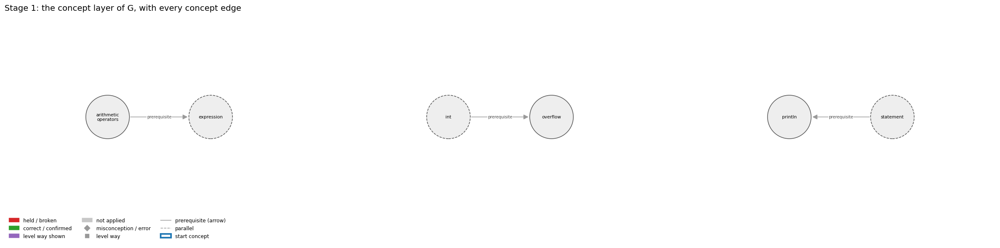
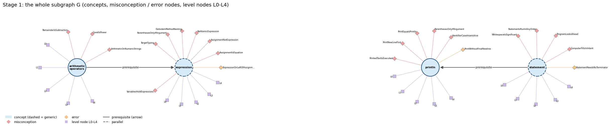
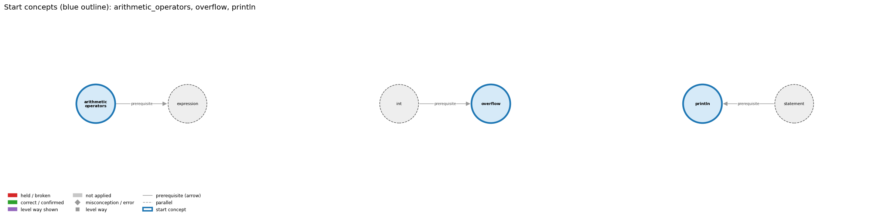
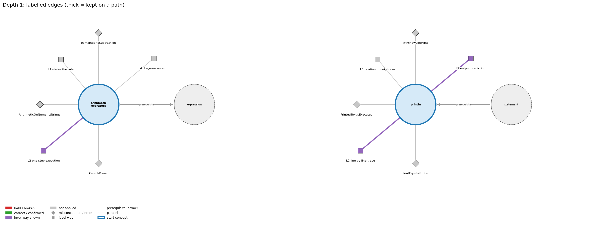
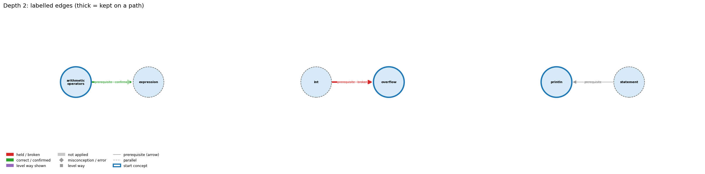
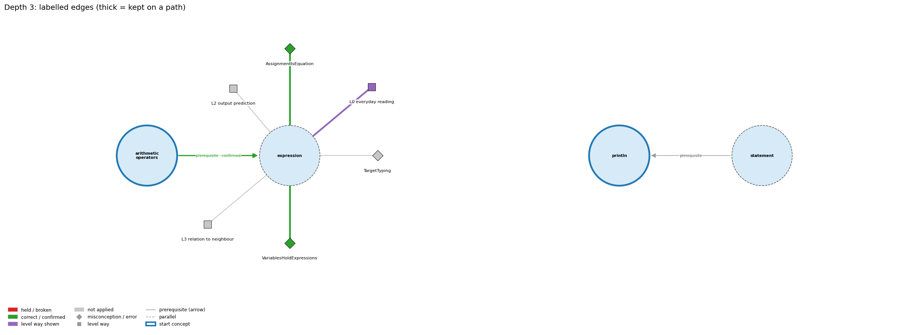
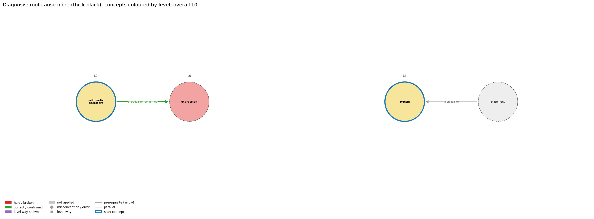

# Think on the Graph: every output of the run MY07

Files of this scenario: `input.json` (program, question, answer), `diagnosis.json`, `subgraph.json`, `traverse_log.txt`, `report.html` (this report as one full-page file, with the interactive graph `MY07_G.html`), `MY07.ipynb` (this report as a notebook).

## 0. Input
Program:
```java
int big = 2147483647;
big = big + 1;
System.out.println(big);
```
Question: What does this program print, and why?

Student's answer: It prints 2147483648. Adding 1 to 2147483647 gives 2147483648, and Java just stores the bigger number in big, because it makes room for it automatically.
Settings: width 3, depth 3, prune llm, backend claude-cli, model claude-opus-5-5
## 1. Stage 1: the subgraph G from the code (no model)
Masked code (string and char literals and comments blanked; this is what the patterns see):
```
int big = 2147483647;
big = big + 1;
System.out.println(big);
```
Which code text tagged which concept (a generic concept fires on almost any Java line; it starts the walk only if the answer repeats its tag):
| concept | generic | channel | matched text | line |
|---|---|---|---|---|
| arithmetic_operators | False | pattern | 'g + 1' | 2 |
| expression | True | pattern | 'g + 1' | 2 |
| expression | True | pattern | '= 2147483647;' | 1 |
| int | True | pattern | 'int' | 1 |
| int | True | type | 'int' | 1 |
| overflow | False | signal | 'big = 2147483647;\nbig = big +' | 1 |
| println | False | pattern | 'System.out.println(' | 3 |
| statement | True | pattern | ';' | 1 |

G: 6 concept nodes (3 generic), 3 concept edges, 26 misconception / error edges, 24 misconception / error nodes, 30 level nodes, 32 level-misconception links, 3 connected piece(s).
Note: concept nodes form 3 pieces (the KG has no edge between them): arithmetic_operators,expression | int,overflow | println,statement

Concept edges of G (the links the walk can read; `pre:` = prerequisite A -> B, `par:` = parallel):
| edge | type | rule (logic) |
|---|---|---|
| pre:arithmetic_operators->expression | prerequisite | An operator combines operand values a and b into a new value, so operators build larger expressions from smaller ones. |
| pre:int->overflow | prerequisite | Overflow happens because an int has a fixed 32-bit range. |
| pre:statement->println | prerequisite | System.out.println(s); is itself a statement, so its line of output appears at its own place in the sequence. |

Misconception / error edges per concept (count), and level ways per concept (count):
| concept | misconception / error edges | level ways (L1-L4 + L0 non-misconception) |
|---|---|---|
| arithmetic_operators | 3 | 18 |
| expression | 8 | 19 |
| int | 2 | 20 |
| overflow | 2 | 15 |
| println | 6 | 17 |
| statement | 5 | 19 |

**Figure 1**


**Figure 2**


## 2. Clauses and start concepts (no model)
The answer split into clauses (at sentence ends, ';', and before 'because' / 'so'; quotes removed):
| clause | text |
|---|---|
| c1 | It prints 2147483648 |
| c2 | Adding 1 to 2147483647 gives 2147483648, and Java just stores the bigger number in big |
| c3 | because it makes room for it automatically |

start: 3 tagged concepts, all used

start concepts (3): arithmetic_operators, overflow, println

Start concepts: arithmetic_operators, overflow, println

**Figure 3**


## 3. The walk, depth by depth
At each depth, for each current concept: the edges offered (a concept entering as a start concept offers its misconception / error edges and its level ways, as two families; otherwise it offers its concept edges), the prune prompt and the model's reply, then the label prompt(s) and the model's reply, parsed into label / clauses / confidence. Score = prune score x confidence.

### Depth 1: current concepts 'arithmetic_operators', 'overflow', 'println'

#### arithmetic_operators, misconceptions: 3 edges offered
Edges offered:
| edge |
|---|
| mis:arithmetic_operators->ArithmeticOnNumericStrings \| wrong rule: "10" - 1 or "6" * "2" works because the strings look like numbers. \| right rule: Arithmetic operators other than + are not defined for Strings; a String of digits must first be converted to a number, e.g. with Integer.parseInt. |
| mis:arithmetic_operators->CaretIsPower \| wrong rule: a^2 computes a squared. \| right rule: Java has no exponent operator; ^ is exclusive or, and a * a or Math.pow(a, 2) computes a squared. |
| mis:arithmetic_operators->RemainderIsSubtraction \| wrong rule: 9 % 5 means 9 minus 5 (a % b subtracts b from a). \| right rule: % gives the remainder after integer division: 9 % 5 is 4 because 9 = 1 * 5 + 4, and 17 % 5 is 2, not 12. |

Prune: the model's reply (edge id and score; the kept edges sum to 1):
```
mis:arithmetic_operators->ArithmeticOnNumericStrings (0.34), mis:arithmetic_operators->RemainderIsSubtraction (0.33), mis:arithmetic_operators->CaretIsPower (0.33)
```
Kept by pruning: mis:arithmetic_operators->ArithmeticOnNumericStrings (0.34), mis:arithmetic_operators->RemainderIsSubtraction (0.33), mis:arithmetic_operators->CaretIsPower (0.33)

Label prompt for the misconception / error edges (judged together). The model saw the program, the question, the numbered clauses, and these edges with their wrong rule and right rule:
| edge |
|---|
| mis:arithmetic_operators->ArithmeticOnNumericStrings \| wrong rule: "10" - 1 or "6" * "2" works because the strings look like numbers. \| right rule: Arithmetic operators other than + are not defined for Strings; a String of digits must first be converted to a number, e.g. with Integer.parseInt. |
| mis:arithmetic_operators->RemainderIsSubtraction \| wrong rule: 9 % 5 means 9 minus 5 (a % b subtracts b from a). \| right rule: % gives the remainder after integer division: 9 % 5 is 4 because 9 = 1 * 5 + 4, and 17 % 5 is 2, not 12. |
| mis:arithmetic_operators->CaretIsPower \| wrong rule: a^2 computes a squared. \| right rule: Java has no exponent operator; ^ is exclusive or, and a * a or Math.pow(a, 2) computes a squared. |
Model's reply:
```
mis:arithmetic_operators->ArithmeticOnNumericStrings | not applied | clauses: none | confidence: 0.95
mis:arithmetic_operators->RemainderIsSubtraction | not applied | clauses: none | confidence: 0.97
mis:arithmetic_operators->CaretIsPower | not applied | clauses: none | confidence: 0.97
```

Parsed labels:
| edge | label | prune score | confidence | score | clauses | words |
|---|---|---|---|---|---|---|
| mis:arithmetic_operators->ArithmeticOnNumericStrings | not applied |  |  | 0.0 |  |  |
| mis:arithmetic_operators->RemainderIsSubtraction | not applied |  |  | 0.0 |  |  |
| mis:arithmetic_operators->CaretIsPower | not applied |  |  | 0.0 |  |  |

#### arithmetic_operators, level ways: 18 edges offered
Edges offered:
| edge |
|---|
| lvl:arithmetic_operators@L0#0 \| level L0 way everyday_reading: In maths notation, multiplication can be implicit (2x), ^ or a superscript means a power, ÷ is exact division, and % means percent. In Java * must be written, / depends on the operand types, % is the remainder, and there is no power operator (^ is exclusive or). |
| lvl:arithmetic_operators@L0#2 \| level L0 way inconsistent_trace: Points to LT (evaluate operands, then apply the operator in the promoted type). Applied unevenly, a student uses integer division for one / and real division for another / in the same int expression. (here mixing in: "a^2 computes a squared") |
| lvl:arithmetic_operators@L1#0 \| level L1 way names_the_element: Arithmetic operators: the binary operators + - * / % that combine two numeric operands into a numeric result. |
| lvl:arithmetic_operators@L1#1 \| level L1 way states_the_rule: Both operands must be numeric, and the result has the promoted type (int, long or double). * / % bind tighter than + -, all group left to right, and int / or % by zero throws ArithmeticException. Unary minus negates its operand (-x) and unary plus leaves it unchanged; they bind more tightly than * and /, so -a * b is (-a) * b. |
| lvl:arithmetic_operators@L2#0 \| level L2 way line_by_line_trace: The left operand is evaluated fully, then the right operand, and then the operator is applied in the promoted type. |
| lvl:arithmetic_operators@L2#1 \| level L2 way output_prediction: With ints, 17 / 3 is 5 and 17 % 3 is 2. With doubles, 5.0 / 3.0 is 1.6666666666666667. With mixed operands, the int is promoted first (10 / 3.0 is 3.333...). |
| lvl:arithmetic_operators@L2#2 \| level L2 way one_step_execution: An arithmetic operator never changes its operands. Each variable is replaced by its value, and only an assignment (or ++ or op=) stores the result. |
| lvl:arithmetic_operators@L3#0 \| level L3 way relation_to_neighbour: Operators build larger expressions from smaller ones, and each operand can itself be any expression. |
| lvl:arithmetic_operators@L3#1 \| level L3 way relation_to_neighbour: For ints, / gives the truncated quotient and % the remainder, so (a / b) * b + a % b == a. |
| lvl:arithmetic_operators@L3#2 \| level L3 way relation_to_neighbour: int / or % by zero throws a run-time exception, while floating-point division by zero gives Infinity or NaN. |
| lvl:arithmetic_operators@L3#3 \| level L3 way relation_to_neighbour: + adds when both operands are numbers and concatenates when either operand is a String, converting the other operand to a String. It is left-associative, so 1 + 2 + "3" is "33" but "1" + 2 + 3 is "123". |
| lvl:arithmetic_operators@L3#4 \| level L3 way purpose_of_the_whole: Arithmetic operators turn formulas into code: totals, averages, unit conversions (inch * CM_PER_INCH), and digit extraction (n % 10, n / 10). |
| lvl:arithmetic_operators@L4#0 \| level L4 way predict_a_change: Changing an operand's type changes the operator's meaning (int / versus double /). Reordering * and / changes integer results (59 * 100 / 60 is 98, 59 / 60 * 100 is 0). Replacing ^ with Math.pow gives a real power. |
| lvl:arithmetic_operators@L4#1 \| level L4 way transfer_to_a_new_program: Use the operators for arithmetic on numeric types. Use the Math library for powers, roots and absolute values, and parse numeric Strings before computing with them. |
| lvl:arithmetic_operators@L4#2 \| level L4 way diagnose_an_error: rule broken: int / and % by zero are undefined. Kind: run-time exception. Trigger class: A divisor that evaluates to 0 (empty count, zero input): ArithmeticException: / by zero. |
| lvl:arithmetic_operators@L4#3 \| level L4 way diagnose_an_error: rule broken: Arithmetic operators other than + are not defined for Strings. Kind: compile-time. Trigger class: "10" - 1 or "6" * "2": 'bad operand types for binary operator'. |
| lvl:arithmetic_operators@L4#4 \| level L4 way diagnose_an_error: rule broken: ^ is not exponentiation. Kind: silent logic error. Trigger class: Writing x^2 or 10^6 for a power (10^6 is 12). |
| lvl:arithmetic_operators@L4#5 \| level L4 way diagnose_an_error: rule broken: int arithmetic wraps silently on overflow. Kind: silent logic error. Trigger class: Results outside the int range. |

Prune: the model's reply (edge id and score; the kept edges sum to 1):
```
{lvl:arithmetic_operators@L4#5 (Score: 0.6)}
{lvl:arithmetic_operators@L1#1 (Score: 0.25)}
{lvl:arithmetic_operators@L2#2 (Score: 0.15)}
```
Kept by pruning: lvl:arithmetic_operators@L4#5 (0.60), lvl:arithmetic_operators@L1#1 (0.25), lvl:arithmetic_operators@L2#2 (0.15)

Label prompt for level way lvl:arithmetic_operators@L4#5 (the model saw only the concept, the way's name 'diagnose an error' and its text; no level):
> rule broken: int arithmetic wraps silently on overflow. Kind: silent logic error. Trigger class: Results outside the int range.

Model's reply:
```
Label: not shown
Clauses: none
Confidence: 0.95
```

Label prompt for level way lvl:arithmetic_operators@L1#1 (the model saw only the concept, the way's name 'states the rule' and its text; no level):
> Both operands must be numeric, and the result has the promoted type (int, long or double). * / % bind tighter than + -, all group left to right, and int / or % by zero throws ArithmeticException. Unary minus negates its operand (-x) and unary plus leaves it unchanged; they bind more tightly than * and /, so -a * b is (-a) * b.

Model's reply:
```
Label: not shown
Clauses: none
Confidence: 0.9
```

Label prompt for level way lvl:arithmetic_operators@L2#2 (the model saw only the concept, the way's name 'one step execution' and its text; no level):
> An arithmetic operator never changes its operands. Each variable is replaced by its value, and only an assignment (or ++ or op=) stores the result.

Model's reply:
```
Label: shown
Clauses: 2
Confidence: 0.6
```

Parsed labels:
| edge | label | prune score | confidence | score | clauses | words |
|---|---|---|---|---|---|---|
| lvl:arithmetic_operators@L4#5 | not applied |  |  | 0.0 |  |  |
| lvl:arithmetic_operators@L1#1 | not applied |  |  | 0.0 |  |  |
| lvl:arithmetic_operators@L2#2 | shown | 0.15 | 0.6 | 0.09 | c2 | Adding 1 to 2147483647 gives 2147483648, and Java just stores the bigger number in big |

#### overflow, misconceptions: 2 edges offered
Edges offered:
| edge |
|---|
| mis:overflow->AbsAlwaysNonNegative \| wrong rule: Math.abs always returns a non-negative number. \| right rule: Math.abs(Integer.MIN_VALUE) returns Integer.MIN_VALUE, which is negative. |
| mis:overflow->IntOverflowWidensAutomatically \| wrong rule: An int result that is too large is automatically stored as a bigger number. \| right rule: int arithmetic is 32-bit; a result outside the range wraps around. |

Prune: the model's reply (edge id and score; the kept edges sum to 1):
```
mis:overflow->IntOverflowWidensAutomatically (0.95), mis:overflow->AbsAlwaysNonNegative (0.05)
```
Kept by pruning: mis:overflow->IntOverflowWidensAutomatically (0.95), mis:overflow->AbsAlwaysNonNegative (0.05)

Label prompt for the misconception / error edges (judged together). The model saw the program, the question, the numbered clauses, and these edges with their wrong rule and right rule:
| edge |
|---|
| mis:overflow->IntOverflowWidensAutomatically \| wrong rule: An int result that is too large is automatically stored as a bigger number. \| right rule: int arithmetic is 32-bit; a result outside the range wraps around. |
| mis:overflow->AbsAlwaysNonNegative \| wrong rule: Math.abs always returns a non-negative number. \| right rule: Math.abs(Integer.MIN_VALUE) returns Integer.MIN_VALUE, which is negative. |
Model's reply:
```
mis:overflow->IntOverflowWidensAutomatically | held | clauses: 1, 2, 3 | confidence: 0.97
mis:overflow->AbsAlwaysNonNegative | not applied | clauses: none | confidence: 0.95
```

Parsed labels:
| edge | label | prune score | confidence | score | clauses | words |
|---|---|---|---|---|---|---|
| mis:overflow->IntOverflowWidensAutomatically | held | 0.95 | 0.97 | 0.92 | c1, c2, c3 | It prints 2147483648; Adding 1 to 2147483647 gives 2147483648, and Java just stores the bigger number in big; because it makes room for it automatically |
| mis:overflow->AbsAlwaysNonNegative | not applied |  |  | 0.0 |  |  |

#### overflow, level ways: 15 edges offered
Edges offered:
| edge |
|---|
| lvl:overflow@L0#0 \| level L0 way everyday_reading: Everyday arithmetic assumes a bigger result just takes more digits. A Java int keeps only 32 bits, so a result that is too large wraps silently to a wrong (often negative) value. |
| lvl:overflow@L0#2 \| level L0 way inconsistent_trace: Points to LT (each int operation wraps as soon as it leaves the range). Applied unevenly, a student wraps one step but writes a + 1 for a = Integer.MAX_VALUE as 2147483648. (here mixing in: "An int result that is too large is automatically stored as a bigger number") |
| lvl:overflow@L1#0 \| level L1 way names_the_element: Overflow: the situation where an integer result is too large or too small for its type's fixed bits and is truncated, wrapping around. |
| lvl:overflow@L1#1 \| level L1 way states_the_rule: int and long arithmetic is done in 32-bit and 64-bit two's complement. An out-of-range result keeps only its low-order bits, and no error or exception is raised. |
| lvl:overflow@L2#0 \| level L2 way line_by_line_trace: Overflow happens in the single operation whose result leaves the range, before any later widening. With int a and b, long x = a * b; overflows in 32-bit int arithmetic before the result is converted to long. |
| lvl:overflow@L2#1 \| level L2 way output_prediction: Integer.MAX_VALUE + 1 is -2147483648, 2 * Integer.MAX_VALUE is -2, and Math.abs(-2147483648) is -2147483648. |
| lvl:overflow@L2#2 \| level L2 way one_step_execution: The variable receives the wrapped value and nothing signals the error, so later statements carry on with it. |
| lvl:overflow@L3#0 \| level L3 way relation_to_neighbour: Overflow is possible because int has a fixed 32-bit range, -2^31 to 2^31 - 1. |
| lvl:overflow@L3#1 \| level L3 way relation_to_neighbour: Integer.MAX_VALUE and Integer.MIN_VALUE mark the edges of the range. Testing a > Integer.MAX_VALUE - b before computing a + b avoids overflow. |
| lvl:overflow@L3#2 \| level L3 way relation_to_neighbour: Both come from finite representations: an int result too large for 32 bits wraps around silently (overflow), while a double keeps about 15 significant digits so most results are approximations (5.0/3.0 is 1.6666666666666667). Neither raises an error. |
| lvl:overflow@L3#3 \| level L3 way purpose_of_the_whole: Knowing about overflow lets you guard against it: use long for products, factorials and large sums, or check against MAX_VALUE before computing. |
| lvl:overflow@L4#0 \| level L4 way predict_a_change: Changing int to long moves the overflow point (to about 9.2e18) but does not remove it. Dividing before multiplying can avoid overflow at the cost of truncation. Casting a result that has already overflowed does not repair it. |
| lvl:overflow@L4#1 \| level L4 way transfer_to_a_new_program: Think about overflow whenever values can reach the billions. Use long (or a long operand, such as 1000L) for those, BigInteger for unbounded integers, and plain int for small counts and indices. |
| lvl:overflow@L4#2 \| level L4 way diagnose_an_error: rule broken: int results are limited to 32 bits, and overflow is not reported. Kind: silent logic error. Trigger class: Values that reach into the billions: factorials above 12!, large products or powers, sums of many large values, Math.abs(Integer.MIN_VALUE). |
| lvl:overflow@L4#3 \| level L4 way diagnose_an_error: rule broken: An all-int expression is computed in int even when its result is stored in a long. Kind: silent logic error. Trigger class: long total = a * b; or long ms = days * 24 * 60 * 60 * 1000; with int operands. |

Prune: the model's reply (edge id and score; the kept edges sum to 1):
```
{lvl:overflow@L0#0 (Score: 0.6)}
{lvl:overflow@L2#1 (Score: 0.25)}
{lvl:overflow@L0#2 (Score: 0.15)}
```
Kept by pruning: lvl:overflow@L0#0 (0.60), lvl:overflow@L2#1 (0.25), lvl:overflow@L0#2 (0.15)

Label prompt for level way lvl:overflow@L0#0 (the model saw only the concept, the way's name 'everyday reading' and its text; no level):
> Everyday arithmetic assumes a bigger result just takes more digits. A Java int keeps only 32 bits, so a result that is too large wraps silently to a wrong (often negative) value.

Model's reply:
```
Label: shown
Clauses: 1, 2, 3
Confidence: 0.9
```

Label prompt for level way lvl:overflow@L2#1 (the model saw only the concept, the way's name 'output prediction' and its text; no level):
> Integer.MAX_VALUE + 1 is -2147483648, 2 * Integer.MAX_VALUE is -2, and Math.abs(-2147483648) is -2147483648.

Model's reply:
```
Label: not shown
Clauses: none
Confidence: 0.97
```

Label prompt for level way lvl:overflow@L0#2 (the model saw only the concept, the way's name 'inconsistent trace' and its text; no level):
> Points to LT (each int operation wraps as soon as it leaves the range). Applied unevenly, a student wraps one step but writes a + 1 for a = Integer.MAX_VALUE as 2147483648. (here mixing in: "An int result that is too large is automatically stored as a bigger number")

Model's reply:
```
Label: not shown
Clauses: none
Confidence: 0.7
```

Parsed labels:
| edge | label | prune score | confidence | score | clauses | words |
|---|---|---|---|---|---|---|
| lvl:overflow@L0#0 | shown | 0.6 | 0.9 | 0.54 | c1, c2, c3 | It prints 2147483648; Adding 1 to 2147483647 gives 2147483648, and Java just stores the bigger number in big; because it makes room for it automatically |
| lvl:overflow@L2#1 | not applied |  |  | 0.0 |  |  |
| lvl:overflow@L0#2 | not applied |  |  | 0.0 |  |  |

#### println, misconceptions: 6 edges offered
Edges offered:
| edge |
|---|
| err:println->PrintWithoutFinalNewline \| wrong rule: Ends the output with print and expects it to appear right away. \| right rule: Finish a line of print calls with println; some systems hold print output until a newline is printed. |
| mis:println->IdentifierCaseInsensitive \| wrong rule: System.out.Println and System.out.println name the same method. \| right rule: Java is case-sensitive: names of variables, methods and classes that differ only in capitalization are different names. |
| mis:println->ParenthesesOnlyIfArgument \| wrong rule: println with nothing to print can be written System.out.println; without the parentheses. \| right rule: A method call always needs parentheses, so an empty line is printed with System.out.println();. |
| mis:println->PrintEqualsPrintln \| wrong rule: print and println do the same thing, so print(s1); print(s2); puts s1 and s2 on separate lines. \| right rule: println ends the line after printing and print does not, so print(s1); print(s2); puts s1 and s2 on the same line. |
| mis:println->PrintNewLineFirst \| wrong rule: println(s) prints a newline and then s. \| right rule: println(s) prints s and then the newline. |
| mis:println->PrintedTextIsExecuted \| wrong rule: System.out.println("x is 5"); sets x to 5 (text inside the quotes is run as code). \| right rule: Characters inside double quotes are printed literally; println only displays them and changes no variable. Only an assignment such as x = 5; sets x. |

Prune: the model's reply (edge id and score; the kept edges sum to 1):
```
mis:println->PrintedTextIsExecuted (0.50), mis:println->PrintNewLineFirst (0.30), mis:println->PrintEqualsPrintln (0.20)
```
Kept by pruning: mis:println->PrintedTextIsExecuted (0.50), mis:println->PrintNewLineFirst (0.30), mis:println->PrintEqualsPrintln (0.20)

Label prompt for the misconception / error edges (judged together). The model saw the program, the question, the numbered clauses, and these edges with their wrong rule and right rule:
| edge |
|---|
| mis:println->PrintedTextIsExecuted \| wrong rule: System.out.println("x is 5"); sets x to 5 (text inside the quotes is run as code). \| right rule: Characters inside double quotes are printed literally; println only displays them and changes no variable. Only an assignment such as x = 5; sets x. |
| mis:println->PrintNewLineFirst \| wrong rule: println(s) prints a newline and then s. \| right rule: println(s) prints s and then the newline. |
| mis:println->PrintEqualsPrintln \| wrong rule: print and println do the same thing, so print(s1); print(s2); puts s1 and s2 on separate lines. \| right rule: println ends the line after printing and print does not, so print(s1); print(s2); puts s1 and s2 on the same line. |
Model's reply:
```
mis:println->PrintedTextIsExecuted | not applied | clauses: none | confidence: 0.95
mis:println->PrintNewLineFirst | not applied | clauses: none | confidence: 0.95
mis:println->PrintEqualsPrintln | not applied | clauses: none | confidence: 0.95
```

Parsed labels:
| edge | label | prune score | confidence | score | clauses | words |
|---|---|---|---|---|---|---|
| mis:println->PrintedTextIsExecuted | not applied |  |  | 0.0 |  |  |
| mis:println->PrintNewLineFirst | not applied |  |  | 0.0 |  |  |
| mis:println->PrintEqualsPrintln | not applied |  |  | 0.0 |  |  |

#### println, level ways: 17 edges offered
Edges offered:
| edge |
|---|
| lvl:println@L0#0 \| level L0 way everyday_reading: Everyday reading: 'println' is just 'print', and 'new line' is something you do before writing. Java rule: println(x) prints x and then ends the line; println() alone just ends the line. |
| lvl:println@L0#3 \| level L0 way inconsistent_trace: Applies the println rule (print, then end line) unevenly: puts the newline before the text on one call and after it on another, or forgets that the next output starts on a new line. (here mixing in: "print and println behave the same (no newline difference)") |
| lvl:println@L1#0 \| level L1 way names_the_element: System.out.println is a library method that prints its argument followed by a line terminator ('print line'). |
| lvl:println@L1#1 \| level L1 way states_the_rule: println(String x) behaves as though it calls print(x) and then println(); println() terminates the current line by writing the line separator string. |
| lvl:println@L2#0 \| level L2 way line_by_line_trace: Evaluate the argument, print its characters at the current position, then write the line separator so the cursor moves to the beginning of the next line. |
| lvl:println@L2#1 \| level L2 way output_prediction: Output is the value's characters followed by a line break: println("Hello, "); println("World!"); prints two lines. |
| lvl:println@L2#2 \| level L2 way one_step_execution: One call appends the text and a line separator to the output; the cursor ends at the start of the next line; no variable changes and nothing is returned. |
| lvl:println@L3#0 \| level L3 way relation_to_neighbour: System.out.println(s); is a statement, so its line of output appears at its own place in the sequence. |
| lvl:println@L3#1 \| level L3 way relation_to_neighbour: println("s") outputs exactly the characters between the quotes and then ends the line. |
| lvl:println@L3#2 \| level L3 way relation_to_neighbour: print leaves the cursor on the line; println ends it; several prints followed by one println make one line. |
| lvl:println@L3#3 \| level L3 way relation_to_neighbour: println prints numbers with all their digits and always ends the line; printf formats each value by its conversion code and ends the line only where the format has %n or \n. |
| lvl:println@L3#4 \| level L3 way purpose_of_the_whole: Purpose: produce one complete line of output, e.g. each result on its own line, or end a line built with print. |
| lvl:println@L4#0 \| level L4 way predict_a_change: Replacing println with print joins the next output onto the same line (a typical logic error); the characters printed stay the same. |
| lvl:println@L4#1 \| level L4 way transfer_to_a_new_program: Use println when each output item belongs on its own line or to end a line; use print to continue a line and printf to control number formatting. |
| lvl:println@L4#2 \| level L4 way diagnose_an_error: rule broken: Finish a line of print calls with println. Kind: silent logic error. Trigger class: output ends with print, so the last line may not be shown or runs into the shell prompt |
| lvl:println@L4#3 \| level L4 way diagnose_an_error: rule broken: Method names are case-sensitive. Kind: compile-time. Trigger class: System.out.Println or system.out.println: cannot find symbol |
| lvl:println@L4#4 \| level L4 way diagnose_an_error: rule broken: Calls need parentheses. Kind: compile-time. Trigger class: System.out.println; without () |

Prune: the model's reply (edge id and score; the kept edges sum to 1):
```
{lvl:println@L2#1 (Score: 0.45)}
{lvl:println@L3#3 (Score: 0.35)}
{lvl:println@L2#0 (Score: 0.2)}
```
Kept by pruning: lvl:println@L2#1 (0.45), lvl:println@L3#3 (0.35), lvl:println@L2#0 (0.20)

Label prompt for level way lvl:println@L2#1 (the model saw only the concept, the way's name 'output prediction' and its text; no level):
> Output is the value's characters followed by a line break: println("Hello, "); println("World!"); prints two lines.

Model's reply:
```
Label: shown
Clauses: 1
Confidence: 0.6
```

Label prompt for level way lvl:println@L3#3 (the model saw only the concept, the way's name 'relation to neighbour' and its text; no level):
> println prints numbers with all their digits and always ends the line; printf formats each value by its conversion code and ends the line only where the format has %n or \n.

Model's reply:
```
Label: not shown
Clauses: none
Confidence: 0.9
```

Label prompt for level way lvl:println@L2#0 (the model saw only the concept, the way's name 'line by line trace' and its text; no level):
> Evaluate the argument, print its characters at the current position, then write the line separator so the cursor moves to the beginning of the next line.

Model's reply:
```
Label: shown
Clauses: 1
Confidence: 0.6
```

Parsed labels:
| edge | label | prune score | confidence | score | clauses | words |
|---|---|---|---|---|---|---|
| lvl:println@L2#1 | shown | 0.45 | 0.6 | 0.27 | c1 | It prints 2147483648 |
| lvl:println@L3#3 | not applied |  |  | 0.0 |  |  |
| lvl:println@L2#0 | shown | 0.2 | 0.6 | 0.12 | c1 | It prints 2147483648 |

**Kept on a path at this depth** (best N in tiers: held misconception / broken edge, then held error, then correct / confirmed / shown):

mis:overflow->IntOverflowWidensAutomatically [held, tier 0, 0.92], lvl:overflow@L0#0 [shown, tier 2, 0.54], lvl:println@L2#1 [shown, tier 2, 0.27]

**Clause coverage after this depth:**
| clause | text | covered by |
|---|---|---|
| c1 | It prints 2147483648 | mis:overflow->IntOverflowWidensAutomatically |
| c2 | Adding 1 to 2147483647 gives 2147483648, and Java just stores the bigger number in big | mis:overflow->IntOverflowWidensAutomatically |
| c3 | because it makes room for it automatically | mis:overflow->IntOverflowWidensAutomatically |

**Graph check, not yet read (the walk may not stop while these remain):** pre:arithmetic_operators->expression, pre:int->overflow, pre:statement->println

**Figure 4 (the graph after depth 1)**


### Depth 2: current concepts 'overflow', 'arithmetic_operators', 'println'

#### overflow, concept edges: 1 edges offered
Edges offered:
| edge |
|---|
| pre:int->overflow \| rule: Overflow happens because an int has a fixed 32-bit range. |

Prune: the model's reply (edge id and score; the kept edges sum to 1):
```
{pre:int->overflow (Score: 1.0)}
```
Kept by pruning: pre:int->overflow (1.00)

Label prompt for concept edge pre:int->overflow (int -> overflow, prerequisite):
> Overflow happens because an int has a fixed 32-bit range.

Model's reply:
```
Label: broken
Clauses: 2, 3
Confidence: 0.93
```

Parsed labels:
| edge | label | prune score | confidence | score | clauses | words |
|---|---|---|---|---|---|---|
| pre:int->overflow | broken | 1.0 | 0.93 | 0.93 | c2, c3 | Adding 1 to 2147483647 gives 2147483648, and Java just stores the bigger number in big; because it makes room for it automatically |

#### arithmetic_operators, concept edges: 1 edges offered
Edges offered:
| edge |
|---|
| pre:arithmetic_operators->expression \| rule: An operator combines operand values a and b into a new value, so operators build larger expressions from smaller ones. |

Prune: the model's reply (edge id and score; the kept edges sum to 1):
```
{pre:arithmetic_operators->expression (Score: 1.0)}
```
Kept by pruning: pre:arithmetic_operators->expression (1.00)

Label prompt for concept edge pre:arithmetic_operators->expression (arithmetic_operators -> expression, prerequisite):
> An operator combines operand values a and b into a new value, so operators build larger expressions from smaller ones.

Model's reply:
```
Label: confirmed
Clauses: 2
Confidence: 0.6
```

Parsed labels:
| edge | label | prune score | confidence | score | clauses | words |
|---|---|---|---|---|---|---|
| pre:arithmetic_operators->expression | confirmed | 1.0 | 0.6 | 0.6 | c2 | Adding 1 to 2147483647 gives 2147483648, and Java just stores the bigger number in big |

#### println, concept edges: 1 edges offered
Edges offered:
| edge |
|---|
| pre:statement->println \| rule: System.out.println(s); is itself a statement, so its line of output appears at its own place in the sequence. |

Prune: the model's reply (edge id and score; the kept edges sum to 1):
```
{pre:statement->println (Score: 1.0)}
```
Kept by pruning: pre:statement->println (1.00)

Label prompt for concept edge pre:statement->println (statement -> println, prerequisite):
> System.out.println(s); is itself a statement, so its line of output appears at its own place in the sequence.

Model's reply:
```
Label: not applied
Clauses: none
Confidence: 0.7
```

Parsed labels:
| edge | label | prune score | confidence | score | clauses | words |
|---|---|---|---|---|---|---|
| pre:statement->println | not applied |  |  | 0.0 |  |  |

**Kept on a path at this depth** (best N in tiers: held misconception / broken edge, then held error, then correct / confirmed / shown):

pre:int->overflow [broken, tier 0, 0.93], pre:arithmetic_operators->expression [confirmed, tier 2, 0.60]

reached across pre:int->overflow, entered next: int

reached across pre:arithmetic_operators->expression, entered next: expression

**Clause coverage after this depth:**
| clause | text | covered by |
|---|---|---|
| c1 | It prints 2147483648 | mis:overflow->IntOverflowWidensAutomatically |
| c2 | Adding 1 to 2147483647 gives 2147483648, and Java just stores the bigger number in big | mis:overflow->IntOverflowWidensAutomatically |
| c3 | because it makes room for it automatically | mis:overflow->IntOverflowWidensAutomatically |

**Graph check, not yet read (the walk may not stop while these remain):** own edges of expression, own edges of int

**Figure 5 (the graph after depth 2)**


### Depth 3: current concepts 'int', 'overflow', 'expression', 'arithmetic_operators'

#### int, misconceptions: 2 edges offered
Edges offered:
| edge |
|---|
| mis:int->IntOverflowWidensAutomatically \| wrong rule: An int result that is too large is automatically stored as a bigger number. \| right rule: int arithmetic is 32-bit; a result outside the range wraps around. |
| mis:int->IntegerDivisionGivesFraction \| wrong rule: 10 / 3 evaluates to 3.333.... \| right rule: Dividing two ints gives an int: the fractional part is discarded. |

Prune: the model's reply (edge id and score; the kept edges sum to 1):
```
{mis:int->IntOverflowWidensAutomatically (Score: 0.95)}
{mis:int->IntegerDivisionGivesFraction (Score: 0.05)}
```
Kept by pruning: mis:int->IntOverflowWidensAutomatically (0.95), mis:int->IntegerDivisionGivesFraction (0.05)

Label prompt for the misconception / error edges (judged together). The model saw the program, the question, the numbered clauses, and these edges with their wrong rule and right rule:
| edge |
|---|
| mis:int->IntOverflowWidensAutomatically \| wrong rule: An int result that is too large is automatically stored as a bigger number. \| right rule: int arithmetic is 32-bit; a result outside the range wraps around. |
| mis:int->IntegerDivisionGivesFraction \| wrong rule: 10 / 3 evaluates to 3.333.... \| right rule: Dividing two ints gives an int: the fractional part is discarded. |
Model's reply:
```
mis:int->IntOverflowWidensAutomatically | held | clauses: 1, 2, 3 | confidence: 0.97
mis:int->IntegerDivisionGivesFraction | not applied | clauses: none | confidence: 0.95
```

Parsed labels:
| edge | label | prune score | confidence | score | clauses | words |
|---|---|---|---|---|---|---|
| mis:int->IntOverflowWidensAutomatically | held | 0.95 | 0.97 | 0.92 | c1, c2, c3 | It prints 2147483648; Adding 1 to 2147483647 gives 2147483648, and Java just stores the bigger number in big; because it makes room for it automatically |
| mis:int->IntegerDivisionGivesFraction | not applied |  |  | 0.0 |  |  |

#### int, level ways: 20 edges offered
Edges offered:
| edge |
|---|
| lvl:int@L0#0 \| level L0 way everyday_reading: In maths integers are unbounded, and dividing two integers can give a fraction (10 / 3 = 3.33...). A Java int has a fixed 32-bit range, its / discards the fraction, and results outside the range wrap around. |
| lvl:int@L0#3 \| level L0 way inconsistent_trace: Points to LT (each int operation is done immediately in 32-bit integer arithmetic). Applied unevenly, a student truncates 10 / 3 to 3 in one step but computes 10 / 3 * 3 as 10, or wraps on one overflow but not another. (here mixing in: "10 / 3 evaluates to 3.333") |
| lvl:int@L1#0 \| level L1 way names_the_element: int: Java's 32-bit signed integer primitive type. |
| lvl:int@L1#1 \| level L1 way states_the_rule: int values run from -2147483648 to 2147483647. + - * / % take two ints and produce an int. / discards the fraction, and division or remainder by zero is not allowed. |
| lvl:int@L2#0 \| level L2 way line_by_line_trace: An int expression evaluates its operands left to right and applies * / % before + -. Each operation is done at once in 32-bit precision, so every intermediate result is already truncated or wrapped. |
| lvl:int@L2#1 \| level L2 way output_prediction: The result is an int: 5 + 3 is 8, 5 / 3 is 1, 5 % 3 is 2, 3 * 5 - 2 is 13, and 1 / 0 is a run-time error. |
| lvl:int@L2#2 \| level L2 way one_step_execution: An assignment like n = n + 1 changes n by exactly 1, with no rounding. A result outside the range is stored wrapped around. |
| lvl:int@L3#0 \| level L3 way relation_to_neighbour: int op double promotes the int and gives a double. A double becomes an int only through a cast, which truncates toward zero. |
| lvl:int@L3#1 \| level L3 way relation_to_neighbour: int and boolean do not convert into each other. Comparing ints gives a boolean (x > 0), and an int cannot itself be used as a condition. |
| lvl:int@L3#2 \| level L3 way relation_to_neighbour: In arithmetic a char is promoted to its int code. An int becomes a char only through a cast. |
| lvl:int@L3#3 \| level L3 way relation_to_neighbour: Because int has a fixed 32-bit range, results outside it wrap around silently. |
| lvl:int@L3#4 \| level L3 way relation_to_neighbour: If either operand is long, the operation is 64-bit and the result is long. Storing a long into an int needs a cast. |
| lvl:int@L3#5 \| level L3 way relation_to_neighbour: An int literal must lie in int's range, so larger digit strings need an L (long) literal. |
| lvl:int@L3#6 \| level L3 way relation_to_neighbour: int is the 32-bit integral primitive type, and the default type for integer literals and arithmetic. |
| lvl:int@L3#7 \| level L3 way purpose_of_the_whole: int is used for counting and indexing: counters, loop steppers, array indices, sizes, and exact whole quantities (cents). |
| lvl:int@L4#0 \| level L4 way predict_a_change: Changing a variable from int to double changes / from truncating to fractional, and output from 3 to 3.0. Multiplying before dividing keeps precision (59 * 100 / 60 is 98, but 59 / 60 * 100 is 0). |
| lvl:int@L4#1 \| level L4 way transfer_to_a_new_program: Use int for whole quantities that stay under about 2 billion (counts, indices, cents). Use long beyond that, BigInteger when values are unbounded, and double for measurements or fractions. |
| lvl:int@L4#2 \| level L4 way diagnose_an_error: rule broken: int division and remainder by zero are undefined. Kind: run-time exception. Trigger class: Any int / or % whose divisor evaluates to 0: ArithmeticException: / by zero. |
| lvl:int@L4#3 \| level L4 way diagnose_an_error: rule broken: int results are only 32 bits and overflow is not reported. Kind: silent logic error. Trigger class: Results beyond about plus or minus 2.1 billion (big products, factorials above 12!, sums of large values): a wrapped, often negative, value. |
| lvl:int@L4#4 \| level L4 way diagnose_an_error: rule broken: A double cannot be stored in an int without a cast. Kind: compile-time. Trigger class: int x = 1.1; or int avg = sum / 2.0;: 'possible lossy conversion from double to int'. |

Prune: the model's reply (edge id and score; the kept edges sum to 1):
```
{lvl:int@L0#0 (Score: 0.5)}
{lvl:int@L2#2 (Score: 0.25)}
{lvl:int@L3#3 (Score: 0.25)}
```
Kept by pruning: lvl:int@L0#0 (0.50), lvl:int@L2#2 (0.25), lvl:int@L3#3 (0.25)

Label prompt for level way lvl:int@L0#0 (the model saw only the concept, the way's name 'everyday reading' and its text; no level):
> In maths integers are unbounded, and dividing two integers can give a fraction (10 / 3 = 3.33...). A Java int has a fixed 32-bit range, its / discards the fraction, and results outside the range wrap around.

Model's reply:
```
Label: shown
Clauses: 1, 2, 3
Confidence: 0.85
```

Label prompt for level way lvl:int@L2#2 (the model saw only the concept, the way's name 'one step execution' and its text; no level):
> An assignment like n = n + 1 changes n by exactly 1, with no rounding. A result outside the range is stored wrapped around.

Model's reply:
```
Label: not shown
Clauses: none
Confidence: 0.9
```

Label prompt for level way lvl:int@L3#3 (the model saw only the concept, the way's name 'relation to neighbour' and its text; no level):
> Because int has a fixed 32-bit range, results outside it wrap around silently.

Model's reply:
```
Label: not shown
Clauses: none
Confidence: 0.97
```

Parsed labels:
| edge | label | prune score | confidence | score | clauses | words |
|---|---|---|---|---|---|---|
| lvl:int@L0#0 | shown | 0.5 | 0.85 | 0.42 | c1, c2, c3 | It prints 2147483648; Adding 1 to 2147483647 gives 2147483648, and Java just stores the bigger number in big; because it makes room for it automatically |
| lvl:int@L2#2 | not applied |  |  | 0.0 |  |  |
| lvl:int@L3#3 | not applied |  |  | 0.0 |  |  |

#### expression, misconceptions: 8 edges offered
Edges offered:
| edge |
|---|
| err:expression->ExpressionOnLeftOfAssignment \| wrong rule: Writes a + b = c; or 7 = a; as if = were a math equation. \| right rule: The left side of an assignment must be a single variable; only the right side can be an expression. |
| mis:expression->AssignmentIsEquation \| wrong rule: An assignment states a lasting equality between its two sides, so y = x - y can be solved like the equation x = 2y and x = x + 5 relates two equal quantities. \| right rule: An assignment is a one-time action: evaluate the right side with current values, then store the result in the left variable. |
| mis:expression->AssignmentNotExpression \| wrong rule: An assignment cannot be used inside a larger expression, so a condition like (x = read()) != v is not allowed. \| right rule: An assignment is an expression whose value is the value assigned, so (x = v) both stores v in x and gives v. |
| mis:expression->NoAtomicExpression \| wrong rule: A single variable x or a literal on its own is not an expression. \| right rule: A single variable or literal is an expression whose value is just that value. |
| mis:expression->OutsideInMethodNesting \| wrong rule: In f(g(x)), f runs first and then g runs. \| right rule: In f(g(x)), g(x) is evaluated first and its result is passed to f. |
| mis:expression->ParenthesesOnlyIfArgument \| wrong rule: () are optional on a no-argument call like println \| right rule: A method call always needs parentheses, so an empty line is printed with System.out.println();. |
| mis:expression->TargetTyping \| wrong rule: The type of a numerical expression depends on the type expected by the surrounding context, so double d = a / b; keeps the fraction. \| right rule: The type of a numerical expression is determined by the expression, so double d = a / b; with int a and b still divides as ints. |
| mis:expression->VariablesHoldExpressions \| wrong rule: = stores the expression itself, not its computed value \| right rule: y = x + k; stores the value that x + k has at that moment, so later changes to x do not change y. |

Prune: the model's reply (edge id and score; the kept edges sum to 1):
```
mis:expression->TargetTyping (0.60), mis:expression->AssignmentIsEquation (0.20), mis:expression->VariablesHoldExpressions (0.20)
```
Kept by pruning: mis:expression->TargetTyping (0.60), mis:expression->AssignmentIsEquation (0.20), mis:expression->VariablesHoldExpressions (0.20)

Label prompt for the misconception / error edges (judged together). The model saw the program, the question, the numbered clauses, and these edges with their wrong rule and right rule:
| edge |
|---|
| mis:expression->TargetTyping \| wrong rule: The type of a numerical expression depends on the type expected by the surrounding context, so double d = a / b; keeps the fraction. \| right rule: The type of a numerical expression is determined by the expression, so double d = a / b; with int a and b still divides as ints. |
| mis:expression->AssignmentIsEquation \| wrong rule: An assignment states a lasting equality between its two sides, so y = x - y can be solved like the equation x = 2y and x = x + 5 relates two equal quantities. \| right rule: An assignment is a one-time action: evaluate the right side with current values, then store the result in the left variable. |
| mis:expression->VariablesHoldExpressions \| wrong rule: = stores the expression itself, not its computed value \| right rule: y = x + k; stores the value that x + k has at that moment, so later changes to x do not change y. |
Model's reply:
```
mis:expression->TargetTyping | not applied | clauses: none | confidence: 0.7
mis:expression->AssignmentIsEquation | correct | clauses: 2 | confidence: 0.6
mis:expression->VariablesHoldExpressions | correct | clauses: 2 | confidence: 0.6
```

Parsed labels:
| edge | label | prune score | confidence | score | clauses | words |
|---|---|---|---|---|---|---|
| mis:expression->TargetTyping | not applied |  |  | 0.0 |  |  |
| mis:expression->AssignmentIsEquation | correct | 0.2 | 0.6 | 0.12 | c2 | Adding 1 to 2147483647 gives 2147483648, and Java just stores the bigger number in big |
| mis:expression->VariablesHoldExpressions | correct | 0.2 | 0.6 | 0.12 | c2 | Adding 1 to 2147483647 gives 2147483648, and Java just stores the bigger number in big |

#### expression, level ways: 19 edges offered
Edges offered:
| edge |
|---|
| lvl:expression@L0#0 \| level L0 way everyday_reading: In maths an expression such as 7/2 or x + y names an exact number, and 'expression' means a formula with operators. In Java, any code that evaluates to a typed value is an expression, including a lone literal or variable, and with ints 7/2 evaluates to 3. |
| lvl:expression@L0#2 \| level L0 way inconsistent_trace: Points to LT (replace each variable with its current value, then apply operators in precedence order). Applied unevenly, a student substitutes current values for some variables and old or future values for others, or respects precedence in one subexpression only. (here mixing in: "a single literal or variable "isn't an expression"") |
| lvl:expression@L1#0 \| level L1 way names_the_element: Expression: a literal, a variable, or a sequence of operations (operators, method calls) on them that produces one value. |
| lvl:expression@L1#1 \| level L1 way states_the_rule: Each operand of an operator can itself be any expression, and a parenthesized expression has the same value as the expression inside. Every expression has a type, determined by its operators and operands. |
| lvl:expression@L2#0 \| level L2 way line_by_line_trace: Operands are evaluated left to right, each fully before its operator is applied. Precedence and parentheses decide the grouping, and a method's arguments are all evaluated before the method is called. |
| lvl:expression@L2#1 \| level L2 way output_prediction: An expression produces one value of a type fixed by its operands: hour * 60 + minute with hour = 11 and minute = 59 is the int 719. |
| lvl:expression@L2#2 \| level L2 way one_step_execution: Evaluating an expression changes no variable unless it contains an assignment, ++/-- or a method with side effects. The value goes to the enclosing statement, and an expression statement discards it. |
| lvl:expression@L3#0 \| level L3 way relation_to_neighbour: A variable name inside an expression contributes the variable's value at the moment of evaluation. |
| lvl:expression@L3#1 \| level L3 way relation_to_neighbour: Operators combine operand values into a new value, and the operand types choose the operation (int / truncates, double / does not). |
| lvl:expression@L3#2 \| level L3 way relation_to_neighbour: With several operators, precedence and left associativity decide the grouping, and parentheses override both. |
| lvl:expression@L3#3 \| level L3 way relation_to_neighbour: A comparison takes numeric expressions and yields a boolean expression, and it has lower precedence than arithmetic, so a + b < c compares the sum. |
| lvl:expression@L3#4 \| level L3 way relation_to_neighbour: A method call is an expression usable wherever a value of its return type is, and its arguments are expressions evaluated before the call. |
| lvl:expression@L3#5 \| level L3 way purpose_of_the_whole: Expressions compute new values from existing ones. They form the right side of every assignment, every condition, every method argument and every printed value. |
| lvl:expression@L4#0 \| level L4 way predict_a_change: Adding parentheses that match the default grouping keeps the value, and rewriting with an equivalent formula (4 * (x - 3) as 4*x - 12) keeps it for ints. Changing one operand's type (3 to 3.0) can change both the result's type and its value. |
| lvl:expression@L4#1 \| level L4 way transfer_to_a_new_program: Use an expression wherever a value is needed. Split a long or unclear expression into named intermediate variables, and add parentheses wherever the grouping is not obvious. |
| lvl:expression@L4#2 \| level L4 way diagnose_an_error: rule broken: The left-hand side of = must be a single variable; only the right-hand side may be an arbitrary expression. Kind: compile-time. Trigger class: Any assignment whose left side is a literal or compound expression (7 = a; a + b = c;): 'unexpected type, required: variable'. |
| lvl:expression@L4#3 \| level L4 way diagnose_an_error: rule broken: Only assignments, increments, method calls and object creation can stand alone as statements. Kind: compile-time. Trigger class: A bare expression line such as x + 1; or a == b;: 'not a statement'. |
| lvl:expression@L4#4 \| level L4 way diagnose_an_error: rule broken: Operators accept only operands of suitable types. Kind: compile-time. Trigger class: Applying arithmetic to Strings ("Hello" - 1) or comparing booleans with <: 'bad operand types'. |
| lvl:expression@L4#5 \| level L4 way diagnose_an_error: rule broken: An int division or remainder by zero cannot be evaluated. Kind: run-time exception. Trigger class: Any int / or % whose right operand evaluates to 0: ArithmeticException. |

Prune: the model's reply (edge id and score; the kept edges sum to 1):
```
{lvl:expression@L0#0 (Score: 0.5)}
{lvl:expression@L2#1 (Score: 0.3)}
{lvl:expression@L3#1 (Score: 0.2)}
```
Kept by pruning: lvl:expression@L0#0 (0.50), lvl:expression@L2#1 (0.30), lvl:expression@L3#1 (0.20)

Label prompt for level way lvl:expression@L0#0 (the model saw only the concept, the way's name 'everyday reading' and its text; no level):
> In maths an expression such as 7/2 or x + y names an exact number, and 'expression' means a formula with operators. In Java, any code that evaluates to a typed value is an expression, including a lone literal or variable, and with ints 7/2 evaluates to 3.

Model's reply:
```
Label: shown
Clauses: 1, 2, 3
Confidence: 0.85
```

Label prompt for level way lvl:expression@L2#1 (the model saw only the concept, the way's name 'output prediction' and its text; no level):
> An expression produces one value of a type fixed by its operands: hour * 60 + minute with hour = 11 and minute = 59 is the int 719.

Model's reply:
```
Label: not shown
Clauses: none
Confidence: 0.85
```

Label prompt for level way lvl:expression@L3#1 (the model saw only the concept, the way's name 'relation to neighbour' and its text; no level):
> Operators combine operand values into a new value, and the operand types choose the operation (int / truncates, double / does not).

Model's reply:
```
Label: not shown
Clauses: none
Confidence: 0.7
```

Parsed labels:
| edge | label | prune score | confidence | score | clauses | words |
|---|---|---|---|---|---|---|
| lvl:expression@L0#0 | shown | 0.5 | 0.85 | 0.42 | c1, c2, c3 | It prints 2147483648; Adding 1 to 2147483647 gives 2147483648, and Java just stores the bigger number in big; because it makes room for it automatically |
| lvl:expression@L2#1 | not applied |  |  | 0.0 |  |  |
| lvl:expression@L3#1 | not applied |  |  | 0.0 |  |  |

**Kept on a path at this depth** (best N in tiers: held misconception / broken edge, then held error, then correct / confirmed / shown):

mis:int->IntOverflowWidensAutomatically [held, tier 0, 0.92], lvl:int@L0#0 [shown, tier 2, 0.42], lvl:expression@L0#0 [shown, tier 2, 0.42]

**Clause coverage after this depth:**
| clause | text | covered by |
|---|---|---|
| c1 | It prints 2147483648 | mis:overflow->IntOverflowWidensAutomatically |
| c2 | Adding 1 to 2147483647 gives 2147483648, and Java just stores the bigger number in big | mis:overflow->IntOverflowWidensAutomatically |
| c3 | because it makes room for it automatically | mis:overflow->IntOverflowWidensAutomatically |

**Figure 6 (the graph after depth 3)**


Held set after the one-fault rules: mis:overflow->IntOverflowWidensAutomatically; filed at the dependent concept: mis:int->IntOverflowWidensAutomatically

Shadows (a held label on a prerequisite or a generic concept that rests on the words of a stronger label at the specific concept is one wrong sentence read twice; it marks no root cause and sets no level): mis:int->IntOverflowWidensAutomatically (shadow of mis:overflow->IntOverflowWidensAutomatically)

## 4. Diagnosis (rules over the labelled graph, no model)
Root-cause walk: held on ['overflow'], broken at [] (consequences: pre:int->overflow), prerequisites {'expression': ['arithmetic_operators'], 'overflow': ['int'], 'println': ['statement']}
- arithmetic_operators: L2 via one_step_execution "Adding 1 to 2147483647 gives 2147483648, and Java just stores the bigger number in big"
- expression: L0 via everyday_reading "It prints 2147483648; Adding 1 to 2147483647 gives 2147483648, and Java just stores the bigger number in big; because it makes room for it automatically"
- int: L0 via everyday_reading "It prints 2147483648; Adding 1 to 2147483647 gives 2147483648, and Java just stores the bigger number in big; because it makes room for it automatically"
- overflow: L0 via misconception "It prints 2147483648; Adding 1 to 2147483647 gives 2147483648, and Java just stores the bigger number in big; because it makes room for it automatically"
- println: L2 via output_prediction "It prints 2147483648"

**Stop:** sufficient at depth 3; prompts {'prune': 13, 'label': 23}, fresh model calls 0, cache hits 36

### Held misconceptions
| concept | misconception | kind | quote | score | shares_evidence_with |
|---|---|---|---|---|---|
| overflow | IntOverflowWidensAutomatically | misconception | It prints 2147483648; Adding 1 to 2147483647 gives 2147483648, and Java just stores the bigger number in big; because it makes room for it automatically | 0.9215 |  |

### Shadowed labels (held in the reading, folded into the label they shadow; not faults of their own)
| concept | misconception | shadow_of | quote | score |
|---|---|---|---|---|
| int | IntOverflowWidensAutomatically | mis:overflow->IntOverflowWidensAutomatically | It prints 2147483648; Adding 1 to 2147483647 gives 2147483648, and Java just stores the bigger number in big; because it makes room for it automatically | 0.9215 |

### Broken concept edges
| edge | quote | score | consequence_of |
|---|---|---|---|
| pre:int->overflow | Adding 1 to 2147483647 gives 2147483648, and Java just stores the bigger number in big; because it makes room for it automatically | 0.93 | mis:overflow->IntOverflowWidensAutomatically |

### Root cause: overflow / IntOverflowWidensAutomatically

### Level per concept
| concept | level | way | misconception | source | quote | rule | also | note |
|---|---|---|---|---|---|---|---|---|
| arithmetic_operators | L2 | one_step_execution |  | level_way | Adding 1 to 2147483647 gives 2147483648, and Java just stores the bigger number in big |  |  |  |
| expression | L0 | everyday_reading |  | level_way | It prints 2147483648; Adding 1 to 2147483647 gives 2147483648, and Java just stores the bigger number in big; because it makes room for it automatically |  |  |  |
| int | L0 | everyday_reading |  | level_way | It prints 2147483648; Adding 1 to 2147483647 gives 2147483648, and Java just stores the bigger number in big; because it makes room for it automatically |  |  |  |
| overflow | L0 | misconception | IntOverflowWidensAutomatically | level_mis_links | It prints 2147483648; Adding 1 to 2147483647 gives 2147483648, and Java just stores the bigger number in big; because it makes room for it automatically | wrong rule: An int result that is too large is automatically stored as a bigger number. Right rule: int arithmetic is 32-bit; a result outside the range wraps around. |  |  |
| println | L2 | output_prediction |  | level_way | It prints 2147483648 |  | L2 line_by_line_trace |  |

### Overall level: L0

Clause coverage (final):
| clause | covered by |
|---|---|
| It prints 2147483648 | mis:overflow->IntOverflowWidensAutomatically |
| Adding 1 to 2147483647 gives 2147483648, and Java just stores the bigger number in big | lvl:arithmetic_operators@L2#2 |
| because it makes room for it automatically | mis:overflow->IntOverflowWidensAutomatically |

**Figure 7 (final picture)**


## 5. Every labelled edge (the evidence list, kept or not)
| depth | source | edge | kind | label | prune_score | confidence | score | clauses | quote |
|---|---|---|---|---|---|---|---|---|---|
| 1 | arithmetic_operators | lvl:arithmetic_operators@L2#2 | level | shown | 0.15 | 0.6 | 0.09 | [2] | Adding 1 to 2147483647 gives 2147483648, and Java just stores the bigger number in big |
| 1 | overflow | mis:overflow->IntOverflowWidensAutomatically | misconception | held | 0.95 | 0.97 | 0.9215 | [1, 2, 3] | It prints 2147483648; Adding 1 to 2147483647 gives 2147483648, and Java just stores the bigger number in big; because it makes room for it automatically |
| 1 | overflow | lvl:overflow@L0#0 | level | shown | 0.6 | 0.9 | 0.54 | [1, 2, 3] | It prints 2147483648; Adding 1 to 2147483647 gives 2147483648, and Java just stores the bigger number in big; because it makes room for it automatically |
| 1 | println | lvl:println@L2#1 | level | shown | 0.45 | 0.6 | 0.27 | [1] | It prints 2147483648 |
| 1 | println | lvl:println@L2#0 | level | shown | 0.2 | 0.6 | 0.12 | [1] | It prints 2147483648 |
| 2 | overflow | pre:int->overflow | prerequisite | broken | 1.0 | 0.93 | 0.93 | [2, 3] | Adding 1 to 2147483647 gives 2147483648, and Java just stores the bigger number in big; because it makes room for it automatically |
| 2 | arithmetic_operators | pre:arithmetic_operators->expression | prerequisite | confirmed | 1.0 | 0.6 | 0.6 | [2] | Adding 1 to 2147483647 gives 2147483648, and Java just stores the bigger number in big |
| 3 | int | mis:int->IntOverflowWidensAutomatically | misconception | held | 0.95 | 0.97 | 0.9215 | [1, 2, 3] | It prints 2147483648; Adding 1 to 2147483647 gives 2147483648, and Java just stores the bigger number in big; because it makes room for it automatically |
| 3 | int | lvl:int@L0#0 | level | shown | 0.5 | 0.85 | 0.425 | [1, 2, 3] | It prints 2147483648; Adding 1 to 2147483647 gives 2147483648, and Java just stores the bigger number in big; because it makes room for it automatically |
| 3 | expression | mis:expression->AssignmentIsEquation | misconception | correct | 0.2 | 0.6 | 0.12 | [2] | Adding 1 to 2147483647 gives 2147483648, and Java just stores the bigger number in big |
| 3 | expression | mis:expression->VariablesHoldExpressions | misconception | correct | 0.2 | 0.6 | 0.12 | [2] | Adding 1 to 2147483647 gives 2147483648, and Java just stores the bigger number in big |
| 3 | expression | lvl:expression@L0#0 | level | shown | 0.5 | 0.85 | 0.425 | [1, 2, 3] | It prints 2147483648; Adding 1 to 2147483647 gives 2147483648, and Java just stores the bigger number in big; because it makes room for it automatically |

## 6. The paths (what the keep step kept, depth by depth)
| depth | source | edge | kind | label | score | clauses |
|---|---|---|---|---|---|---|
| 1 | overflow | mis:overflow->IntOverflowWidensAutomatically | misconception | held | 0.9215 | [1, 2, 3] |
| 1 | overflow | lvl:overflow@L0#0 | level | shown | 0.54 | [1, 2, 3] |
| 1 | println | lvl:println@L2#1 | level | shown | 0.27 | [1] |
| 2 | overflow | pre:int->overflow | prerequisite | broken | 0.93 | [2, 3] |
| 2 | arithmetic_operators | pre:arithmetic_operators->expression | prerequisite | confirmed | 0.6 | [2] |
| 3 | int | mis:int->IntOverflowWidensAutomatically | misconception | held | 0.9215 | [1, 2, 3] |
| 3 | int | lvl:int@L0#0 | level | shown | 0.425 | [1, 2, 3] |
| 3 | expression | lvl:expression@L0#0 | level | shown | 0.425 | [1, 2, 3] |

## 7. Raw traversal log
```
clauses: It prints 2147483648 | Adding 1 to 2147483647 gives 2147483648, and Java just stores the bigger number in big | because it makes room for it automatically
start: 3 tagged concepts, all used
start concepts (3): arithmetic_operators, overflow, println
--- depth 1: current concepts ['arithmetic_operators', 'overflow', 'println']
  arithmetic_operators (misconceptions): 3 candidates -> kept mis:arithmetic_operators->ArithmeticOnNumericStrings (0.34), mis:arithmetic_operators->RemainderIsSubtraction (0.33), mis:arithmetic_operators->CaretIsPower (0.33)
    mis:arithmetic_operators->ArithmeticOnNumericStrings -> not applied (0.00) ""
    mis:arithmetic_operators->RemainderIsSubtraction -> not applied (0.00) ""
    mis:arithmetic_operators->CaretIsPower -> not applied (0.00) ""
  arithmetic_operators (level ways): 18 candidates -> kept lvl:arithmetic_operators@L4#5 (0.60), lvl:arithmetic_operators@L1#1 (0.25), lvl:arithmetic_operators@L2#2 (0.15)
    lvl:arithmetic_operators@L4#5 -> not applied (0.00) ""
    lvl:arithmetic_operators@L1#1 -> not applied (0.00) ""
    lvl:arithmetic_operators@L2#2 -> shown (0.09) "Adding 1 to 2147483647 gives 2147483648, and Java just stores the bigger number in big"
  overflow (misconceptions): 2 candidates -> kept mis:overflow->IntOverflowWidensAutomatically (0.95), mis:overflow->AbsAlwaysNonNegative (0.05)
    mis:overflow->IntOverflowWidensAutomatically -> held (0.92) "It prints 2147483648; Adding 1 to 2147483647 gives 2147483648, and Java just stores the bigger number in big; because it makes room for it automatically"
    mis:overflow->AbsAlwaysNonNegative -> not applied (0.00) ""
  overflow (level ways): 15 candidates -> kept lvl:overflow@L0#0 (0.60), lvl:overflow@L2#1 (0.25), lvl:overflow@L0#2 (0.15)
    lvl:overflow@L0#0 -> shown (0.54) "It prints 2147483648; Adding 1 to 2147483647 gives 2147483648, and Java just stores the bigger number in big; because it makes room for it automatically"
    lvl:overflow@L2#1 -> not applied (0.00) ""
    lvl:overflow@L0#2 -> not applied (0.00) ""
  println (misconceptions): 6 candidates -> kept mis:println->PrintedTextIsExecuted (0.50), mis:println->PrintNewLineFirst (0.30), mis:println->PrintEqualsPrintln (0.20)
    mis:println->PrintedTextIsExecuted -> not applied (0.00) ""
    mis:println->PrintNewLineFirst -> not applied (0.00) ""
    mis:println->PrintEqualsPrintln -> not applied (0.00) ""
  println (level ways): 17 candidates -> kept lvl:println@L2#1 (0.45), lvl:println@L3#3 (0.35), lvl:println@L2#0 (0.20)
    lvl:println@L2#1 -> shown (0.27) "It prints 2147483648"
    lvl:println@L3#3 -> not applied (0.00) ""
    lvl:println@L2#0 -> shown (0.12) "It prints 2147483648"
  kept: mis:overflow->IntOverflowWidensAutomatically [held, tier 0, 0.92], lvl:overflow@L0#0 [shown, tier 2, 0.54], lvl:println@L2#1 [shown, tier 2, 0.27]
  clause coverage: c1 <- mis:overflow->IntOverflowWidensAutomatically; c2 <- mis:overflow->IntOverflowWidensAutomatically; c3 <- mis:overflow->IntOverflowWidensAutomatically
  not yet read: pre:arithmetic_operators->expression, pre:int->overflow, pre:statement->println
--- depth 2: current concepts ['overflow', 'arithmetic_operators', 'println']
  overflow (concept edges): 1 candidates -> kept pre:int->overflow (1.00)
    pre:int->overflow -> broken (0.93) "Adding 1 to 2147483647 gives 2147483648, and Java just stores the bigger number in big; because it makes room for it automatically"
  arithmetic_operators (concept edges): 1 candidates -> kept pre:arithmetic_operators->expression (1.00)
    pre:arithmetic_operators->expression -> confirmed (0.60) "Adding 1 to 2147483647 gives 2147483648, and Java just stores the bigger number in big"
  println (concept edges): 1 candidates -> kept pre:statement->println (1.00)
    pre:statement->println -> not applied (0.00) ""
  kept: pre:int->overflow [broken, tier 0, 0.93], pre:arithmetic_operators->expression [confirmed, tier 2, 0.60]
  reached across pre:int->overflow, entered next: int
  reached across pre:arithmetic_operators->expression, entered next: expression
  clause coverage: c1 <- mis:overflow->IntOverflowWidensAutomatically; c2 <- mis:overflow->IntOverflowWidensAutomatically; c3 <- mis:overflow->IntOverflowWidensAutomatically
  not yet read: own edges of expression, own edges of int
--- depth 3: current concepts ['int', 'overflow', 'expression', 'arithmetic_operators']
  int (misconceptions): 2 candidates -> kept mis:int->IntOverflowWidensAutomatically (0.95), mis:int->IntegerDivisionGivesFraction (0.05)
    mis:int->IntOverflowWidensAutomatically -> held (0.92) "It prints 2147483648; Adding 1 to 2147483647 gives 2147483648, and Java just stores the bigger number in big; because it makes room for it automatically"
    mis:int->IntegerDivisionGivesFraction -> not applied (0.00) ""
  int (level ways): 20 candidates -> kept lvl:int@L0#0 (0.50), lvl:int@L2#2 (0.25), lvl:int@L3#3 (0.25)
    lvl:int@L0#0 -> shown (0.42) "It prints 2147483648; Adding 1 to 2147483647 gives 2147483648, and Java just stores the bigger number in big; because it makes room for it automatically"
    lvl:int@L2#2 -> not applied (0.00) ""
    lvl:int@L3#3 -> not applied (0.00) ""
  expression (misconceptions): 8 candidates -> kept mis:expression->TargetTyping (0.60), mis:expression->AssignmentIsEquation (0.20), mis:expression->VariablesHoldExpressions (0.20)
    mis:expression->TargetTyping -> not applied (0.00) ""
    mis:expression->AssignmentIsEquation -> correct (0.12) "Adding 1 to 2147483647 gives 2147483648, and Java just stores the bigger number in big"
    mis:expression->VariablesHoldExpressions -> correct (0.12) "Adding 1 to 2147483647 gives 2147483648, and Java just stores the bigger number in big"
  expression (level ways): 19 candidates -> kept lvl:expression@L0#0 (0.50), lvl:expression@L2#1 (0.30), lvl:expression@L3#1 (0.20)
    lvl:expression@L0#0 -> shown (0.42) "It prints 2147483648; Adding 1 to 2147483647 gives 2147483648, and Java just stores the bigger number in big; because it makes room for it automatically"
    lvl:expression@L2#1 -> not applied (0.00) ""
    lvl:expression@L3#1 -> not applied (0.00) ""
  kept: mis:int->IntOverflowWidensAutomatically [held, tier 0, 0.92], lvl:int@L0#0 [shown, tier 2, 0.42], lvl:expression@L0#0 [shown, tier 2, 0.42]
  clause coverage: c1 <- mis:overflow->IntOverflowWidensAutomatically; c2 <- mis:overflow->IntOverflowWidensAutomatically; c3 <- mis:overflow->IntOverflowWidensAutomatically
  held: mis:overflow->IntOverflowWidensAutomatically; filed at the dependent concept: mis:int->IntOverflowWidensAutomatically
  shadows: mis:int->IntOverflowWidensAutomatically (shadow of mis:overflow->IntOverflowWidensAutomatically)
  root-cause walk: held on ['overflow'], broken at [] (consequences: pre:int->overflow), prerequisites {'expression': ['arithmetic_operators'], 'overflow': ['int'], 'println': ['statement']}
  level arithmetic_operators: L2 via one_step_execution "Adding 1 to 2147483647 gives 2147483648, and Java just stores the bigger number in big"
  level expression: L0 via everyday_reading "It prints 2147483648; Adding 1 to 2147483647 gives 2147483648, and Java just stores the bigger number in big; because it makes room for it automatically"
  level int: L0 via everyday_reading "It prints 2147483648; Adding 1 to 2147483647 gives 2147483648, and Java just stores the bigger number in big; because it makes room for it automatically"
  level overflow: L0 via misconception "It prints 2147483648; Adding 1 to 2147483647 gives 2147483648, and Java just stores the bigger number in big; because it makes room for it automatically"
  level println: L2 via output_prediction "It prints 2147483648"
```

## 8. Full diagnosis JSON
```json
{
 "scenario": "MY07",
 "settings": {
  "width": 3,
  "depth": 3,
  "prune_tools": "llm",
  "model": "claude-opus-5-5",
  "backend": "claude-cli"
 },
 "clauses": [
  "It prints 2147483648",
  "Adding 1 to 2147483647 gives 2147483648, and Java just stores the bigger number in big",
  "because it makes room for it automatically"
 ],
 "start_concepts": [
  "arithmetic_operators",
  "overflow",
  "println"
 ],
 "held_misconceptions": [
  {
   "concept": "overflow",
   "misconception": "IntOverflowWidensAutomatically",
   "kind": "misconception",
   "quote": "It prints 2147483648; Adding 1 to 2147483647 gives 2147483648, and Java just stores the bigger number in big; because it makes room for it automatically",
   "score": 0.9215
  }
 ],
 "error_evidence": [],
 "shadowed": [
  {
   "concept": "int",
   "misconception": "IntOverflowWidensAutomatically",
   "shadow_of": "mis:overflow->IntOverflowWidensAutomatically",
   "quote": "It prints 2147483648; Adding 1 to 2147483647 gives 2147483648, and Java just stores the bigger number in big; because it makes room for it automatically",
   "score": 0.9215
  }
 ],
 "broken_edges": [
  {
   "edge": "pre:int->overflow",
   "quote": "Adding 1 to 2147483647 gives 2147483648, and Java just stores the bigger number in big; because it makes room for it automatically",
   "score": 0.93,
   "consequence_of": "mis:overflow->IntOverflowWidensAutomatically"
  }
 ],
 "root_cause": {
  "concept": "overflow",
  "misconception": "IntOverflowWidensAutomatically"
 },
 "levels": {
  "arithmetic_operators": {
   "level": "L2",
   "way": "one_step_execution",
   "quote": "Adding 1 to 2147483647 gives 2147483648, and Java just stores the bigger number in big",
   "edge": "lvl:arithmetic_operators@L2#2",
   "source": "level_way",
   "also_shown": []
  },
  "expression": {
   "level": "L0",
   "way": "everyday_reading",
   "quote": "It prints 2147483648; Adding 1 to 2147483647 gives 2147483648, and Java just stores the bigger number in big; because it makes room for it automatically",
   "edge": "lvl:expression@L0#0",
   "source": "level_way",
   "also_shown": []
  },
  "int": {
   "level": "L0",
   "way": "everyday_reading",
   "quote": "It prints 2147483648; Adding 1 to 2147483647 gives 2147483648, and Java just stores the bigger number in big; because it makes room for it automatically",
   "edge": "lvl:int@L0#0",
   "source": "level_way",
   "also_shown": []
  },
  "overflow": {
   "level": "L0",
   "way": "misconception",
   "misconception": "IntOverflowWidensAutomatically",
   "quote": "It prints 2147483648; Adding 1 to 2147483647 gives 2147483648, and Java just stores the bigger number in big; because it makes room for it automatically",
   "edge": "mis:overflow->IntOverflowWidensAutomatically",
   "rule": "wrong rule: An int result that is too large is automatically stored as a bigger number. Right rule: int arithmetic is 32-bit; a result outside the range wraps around.",
   "source": "level_mis_links"
  },
  "println": {
   "level": "L2",
   "way": "output_prediction",
   "quote": "It prints 2147483648",
   "edge": "lvl:println@L2#1",
   "source": "level_way",
   "also_shown": [
    "L2 line_by_line_trace"
   ]
  }
 },
 "overall_level": "L0",
 "paths": [
  {
   "depth": 1,
   "source": "overflow",
   "edge": "mis:overflow->IntOverflowWidensAutomatically",
   "target": "IntOverflowWidensAutomatically",
   "kind": "misconception",
   "label": "held",
   "clauses": [
    1,
    2,
    3
   ],
   "quote": "It prints 2147483648; Adding 1 to 2147483647 gives 2147483648, and Java just stores the bigger number in big; because it makes room for it automatically",
   "confidence": 0.97,
   "prune_score": 0.95,
   "score": 0.9215,
   "logic": "An int result that is too large is automatically stored as a bigger number.",
   "twin_logic": "int arithmetic is 32-bit; a result outside the range wraps around."
  },
  {
   "depth": 1,
   "source": "overflow",
   "edge": "lvl:overflow@L0#0",
   "target": "overflow@L0",
   "kind": "level",
   "label": "shown",
   "clauses": [
    1,
    2,
    3
   ],
   "quote": "It prints 2147483648; Adding 1 to 2147483647 gives 2147483648, and Java just stores the bigger number in big; because it makes room for it automatically",
   "confidence": 0.9,
   "prune_score": 0.6,
   "score": 0.54,
   "logic": "Everyday arithmetic assumes a bigger result just takes more digits. A Java int keeps only 32 bits, so a result that is too large wraps silently to a wrong (often negative) value.",
   "twin_logic": null,
   "level": "L0",
   "way": "everyday_reading"
  },
  {
   "depth": 1,
   "source": "println",
   "edge": "lvl:println@L2#1",
   "target": "println@L2",
   "kind": "level",
   "label": "shown",
   "clauses": [
    1
   ],
   "quote": "It prints 2147483648",
   "confidence": 0.6,
   "prune_score": 0.45,
   "score": 0.27,
   "logic": "Output is the value's characters followed by a line break: println(\"Hello, \"); println(\"World!\"); prints two lines.",
   "twin_logic": null,
   "level": "L2",
   "way": "output_prediction"
  },
  {
   "depth": 2,
   "source": "overflow",
   "edge": "pre:int->overflow",
   "target": "int",
   "kind": "prerequisite",
   "label": "broken",
   "clauses": [
    2,
    3
   ],
   "quote": "Adding 1 to 2147483647 gives 2147483648, and Java just stores the bigger number in big; because it makes room for it automatically",
   "confidence": 0.93,
   "prune_score": 1.0,
   "score": 0.93,
   "logic": "Overflow happens because an int has a fixed 32-bit range.",
   "twin_logic": null,
   "consequence_of": "mis:overflow->IntOverflowWidensAutomatically"
  },
  {
   "depth": 2,
   "source": "arithmetic_operators",
   "edge": "pre:arithmetic_operators->expression",
   "target": "expression",
   "kind": "prerequisite",
   "label": "confirmed",
   "clauses": [
    2
   ],
   "quote": "Adding 1 to 2147483647 gives 2147483648, and Java just stores the bigger number in big",
   "confidence": 0.6,
   "prune_score": 1.0,
   "score": 0.6,
   "logic": "An operator combines operand values a and b into a new value, so operators build larger expressions from smaller ones.",
   "twin_logic": null
  },
  {
   "depth": 3,
   "source": "int",
   "edge": "mis:int->IntOverflowWidensAutomatically",
   "target": "IntOverflowWidensAutomatically",
   "kind": "misconception",
   "label": "held",
   "clauses": [
    1,
    2,
    3
   ],
   "quote": "It prints 2147483648; Adding 1 to 2147483647 gives 2147483648, and Java just stores the bigger number in big; because it makes room for it automatically",
   "confidence": 0.97,
   "prune_score": 0.95,
   "score": 0.9215,
   "logic": "An int result that is too large is automatically stored as a bigger number.",
   "twin_logic": "int arithmetic is 32-bit; a result outside the range wraps around."
  },
  {
   "depth": 3,
   "source": "int",
   "edge": "lvl:int@L0#0",
   "target": "int@L0",
   "kind": "level",
   "label": "shown",
   "clauses": [
    1,
    2,
    3
   ],
   "quote": "It prints 2147483648; Adding 1 to 2147483647 gives 2147483648, and Java just stores the bigger number in big; because it makes room for it automatically",
   "confidence": 0.85,
   "prune_score": 0.5,
   "score": 0.425,
   "logic": "In maths integers are unbounded, and dividing two integers can give a fraction (10 / 3 = 3.33...). A Java int has a fixed 32-bit range, its / discards the fraction, and results outside the range wrap around.",
   "twin_logic": null,
   "level": "L0",
   "way": "everyday_reading"
  },
  {
   "depth": 3,
   "source": "expression",
   "edge": "lvl:expression@L0#0",
   "target": "expression@L0",
   "kind": "level",
   "label": "shown",
   "clauses": [
    1,
    2,
    3
   ],
   "quote": "It prints 2147483648; Adding 1 to 2147483647 gives 2147483648, and Java just stores the bigger number in big; because it makes room for it automatically",
   "confidence": 0.85,
   "prune_score": 0.5,
   "score": 0.425,
   "logic": "In maths an expression such as 7/2 or x + y names an exact number, and 'expression' means a formula with operators. In Java, any code that evaluates to a typed value is an expression, including a lone literal or variable, and with ints 7/2 evaluates to 3.",
   "twin_logic": null,
   "level": "L0",
   "way": "everyday_reading"
  }
 ],
 "evidence": [
  {
   "depth": 1,
   "source": "arithmetic_operators",
   "edge": "lvl:arithmetic_operators@L2#2",
   "target": "arithmetic_operators@L2",
   "kind": "level",
   "label": "shown",
   "clauses": [
    2
   ],
   "quote": "Adding 1 to 2147483647 gives 2147483648, and Java just stores the bigger number in big",
   "confidence": 0.6,
   "prune_score": 0.15,
   "score": 0.09,
   "logic": "An arithmetic operator never changes its operands. Each variable is replaced by its value, and only an assignment (or ++ or op=) stores the result.",
   "twin_logic": null,
   "level": "L2",
   "way": "one_step_execution"
  },
  {
   "depth": 1,
   "source": "overflow",
   "edge": "mis:overflow->IntOverflowWidensAutomatically",
   "target": "IntOverflowWidensAutomatically",
   "kind": "misconception",
   "label": "held",
   "clauses": [
    1,
    2,
    3
   ],
   "quote": "It prints 2147483648; Adding 1 to 2147483647 gives 2147483648, and Java just stores the bigger number in big; because it makes room for it automatically",
   "confidence": 0.97,
   "prune_score": 0.95,
   "score": 0.9215,
   "logic": "An int result that is too large is automatically stored as a bigger number.",
   "twin_logic": "int arithmetic is 32-bit; a result outside the range wraps around."
  },
  {
   "depth": 1,
   "source": "overflow",
   "edge": "lvl:overflow@L0#0",
   "target": "overflow@L0",
   "kind": "level",
   "label": "shown",
   "clauses": [
    1,
    2,
    3
   ],
   "quote": "It prints 2147483648; Adding 1 to 2147483647 gives 2147483648, and Java just stores the bigger number in big; because it makes room for it automatically",
   "confidence": 0.9,
   "prune_score": 0.6,
   "score": 0.54,
   "logic": "Everyday arithmetic assumes a bigger result just takes more digits. A Java int keeps only 32 bits, so a result that is too large wraps silently to a wrong (often negative) value.",
   "twin_logic": null,
   "level": "L0",
   "way": "everyday_reading"
  },
  {
   "depth": 1,
   "source": "println",
   "edge": "lvl:println@L2#1",
   "target": "println@L2",
   "kind": "level",
   "label": "shown",
   "clauses": [
    1
   ],
   "quote": "It prints 2147483648",
   "confidence": 0.6,
   "prune_score": 0.45,
   "score": 0.27,
   "logic": "Output is the value's characters followed by a line break: println(\"Hello, \"); println(\"World!\"); prints two lines.",
   "twin_logic": null,
   "level": "L2",
   "way": "output_prediction"
  },
  {
   "depth": 1,
   "source": "println",
   "edge": "lvl:println@L2#0",
   "target": "println@L2",
   "kind": "level",
   "label": "shown",
   "clauses": [
    1
   ],
   "quote": "It prints 2147483648",
   "confidence": 0.6,
   "prune_score": 0.2,
   "score": 0.12,
   "logic": "Evaluate the argument, print its characters at the current position, then write the line separator so the cursor moves to the beginning of the next line.",
   "twin_logic": null,
   "level": "L2",
   "way": "line_by_line_trace"
  },
  {
   "depth": 2,
   "source": "overflow",
   "edge": "pre:int->overflow",
   "target": "int",
   "kind": "prerequisite",
   "label": "broken",
   "clauses": [
    2,
    3
   ],
   "quote": "Adding 1 to 2147483647 gives 2147483648, and Java just stores the bigger number in big; because it makes room for it automatically",
   "confidence": 0.93,
   "prune_score": 1.0,
   "score": 0.93,
   "logic": "Overflow happens because an int has a fixed 32-bit range.",
   "twin_logic": null,
   "consequence_of": "mis:overflow->IntOverflowWidensAutomatically"
  },
  {
   "depth": 2,
   "source": "arithmetic_operators",
   "edge": "pre:arithmetic_operators->expression",
   "target": "expression",
   "kind": "prerequisite",
   "label": "confirmed",
   "clauses": [
    2
   ],
   "quote": "Adding 1 to 2147483647 gives 2147483648, and Java just stores the bigger number in big",
   "confidence": 0.6,
   "prune_score": 1.0,
   "score": 0.6,
   "logic": "An operator combines operand values a and b into a new value, so operators build larger expressions from smaller ones.",
   "twin_logic": null
  },
  {
   "depth": 3,
   "source": "int",
   "edge": "mis:int->IntOverflowWidensAutomatically",
   "target": "IntOverflowWidensAutomatically",
   "kind": "misconception",
   "label": "held",
   "clauses": [
    1,
    2,
    3
   ],
   "quote": "It prints 2147483648; Adding 1 to 2147483647 gives 2147483648, and Java just stores the bigger number in big; because it makes room for it automatically",
   "confidence": 0.97,
   "prune_score": 0.95,
   "score": 0.9215,
   "logic": "An int result that is too large is automatically stored as a bigger number.",
   "twin_logic": "int arithmetic is 32-bit; a result outside the range wraps around."
  },
  {
   "depth": 3,
   "source": "int",
   "edge": "lvl:int@L0#0",
   "target": "int@L0",
   "kind": "level",
   "label": "shown",
   "clauses": [
    1,
    2,
    3
   ],
   "quote": "It prints 2147483648; Adding 1 to 2147483647 gives 2147483648, and Java just stores the bigger number in big; because it makes room for it automatically",
   "confidence": 0.85,
   "prune_score": 0.5,
   "score": 0.425,
   "logic": "In maths integers are unbounded, and dividing two integers can give a fraction (10 / 3 = 3.33...). A Java int has a fixed 32-bit range, its / discards the fraction, and results outside the range wrap around.",
   "twin_logic": null,
   "level": "L0",
   "way": "everyday_reading"
  },
  {
   "depth": 3,
   "source": "expression",
   "edge": "mis:expression->AssignmentIsEquation",
   "target": "AssignmentIsEquation",
   "kind": "misconception",
   "label": "correct",
   "clauses": [
    2
   ],
   "quote": "Adding 1 to 2147483647 gives 2147483648, and Java just stores the bigger number in big",
   "confidence": 0.6,
   "prune_score": 0.2,
   "score": 0.12,
   "logic": "An assignment states a lasting equality between its two sides, so y = x - y can be solved like the equation x = 2y and x = x + 5 relates two equal quantities.",
   "twin_logic": "An assignment is a one-time action: evaluate the right side with current values, then store the result in the left variable."
  },
  {
   "depth": 3,
   "source": "expression",
   "edge": "mis:expression->VariablesHoldExpressions",
   "target": "VariablesHoldExpressions",
   "kind": "misconception",
   "label": "correct",
   "clauses": [
    2
   ],
   "quote": "Adding 1 to 2147483647 gives 2147483648, and Java just stores the bigger number in big",
   "confidence": 0.6,
   "prune_score": 0.2,
   "score": 0.12,
   "logic": "= stores the expression itself, not its computed value",
   "twin_logic": "y = x + k; stores the value that x + k has at that moment, so later changes to x do not change y."
  },
  {
   "depth": 3,
   "source": "expression",
   "edge": "lvl:expression@L0#0",
   "target": "expression@L0",
   "kind": "level",
   "label": "shown",
   "clauses": [
    1,
    2,
    3
   ],
   "quote": "It prints 2147483648; Adding 1 to 2147483647 gives 2147483648, and Java just stores the bigger number in big; because it makes room for it automatically",
   "confidence": 0.85,
   "prune_score": 0.5,
   "score": 0.425,
   "logic": "In maths an expression such as 7/2 or x + y names an exact number, and 'expression' means a formula with operators. In Java, any code that evaluates to a typed value is an expression, including a lone literal or variable, and with ints 7/2 evaluates to 3.",
   "twin_logic": null,
   "level": "L0",
   "way": "everyday_reading"
  }
 ],
 "clause_coverage": {
  "It prints 2147483648": "mis:overflow->IntOverflowWidensAutomatically",
  "Adding 1 to 2147483647 gives 2147483648, and Java just stores the bigger number in big": "lvl:arithmetic_operators@L2#2",
  "because it makes room for it automatically": "mis:overflow->IntOverflowWidensAutomatically"
 },
 "unexplained_clauses": [],
 "stop_reason": "sufficient",
 "depth_reached": 3,
 "llm_calls": 0,
 "llm_cache_hits": 36,
 "llm_calls_by_step": {
  "prune": 13,
  "label": 23
 }
}
```
