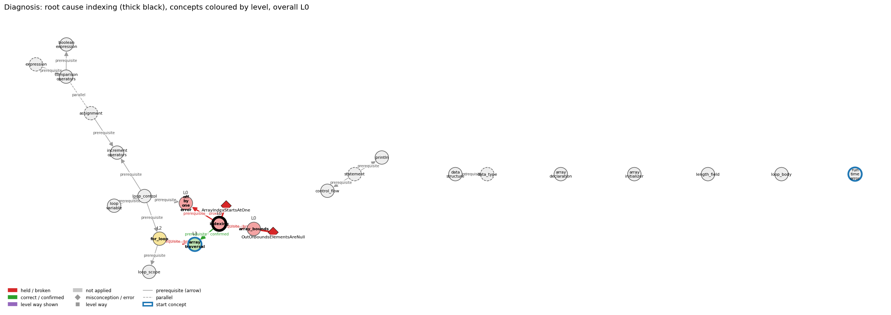

# Think on the Graph: run MY10

This page follows one answer through the algorithm and explains why it received this diagnosis. The method itself, with the meaning of every term (subgraph G, generic concept, clause, prune score, tier, shadow and so on), is explained once in [docs/ALGORITHM.md](../../../docs/ALGORITHM.md). Every output of every stage of this run is in `MY10.ipynb` and `report.html`; the interactive graph is `MY10_G.html`.

## Input

Program:
```java
int[] a = {5, 10, 15};
for (int i = 0; i <= a.length; i++) {
    System.out.println(a[i]);
}
```
**Question.** What does this program print, and why?

**Student's answer.** It prints 0, then 5, 10 and 15. Arrays start at a[1], so a[0] is before the first element and just gives 0. Then a[1], a[2] and a[3] are 5, 10 and 15.

**What the program really does.** Indexes start at 0, so a[0], a[1], a[2] are 5, 10, 15 and are printed. The condition `i <= a.length` lets i reach 3, and a[3] does not exist: the program stops with ArrayIndexOutOfBoundsException after printing three lines.

## Result

- **Wrong rules held:** ArrayIndexStartsAtOne at `indexing`, OutOfBoundsElementsAreNull at `array_bounds`
- **Root cause:** `indexing` / ArrayIndexStartsAtOne
- **Overall level:** L0
- **Level per concept:** `array_bounds` L0, `array_traversal` L3, `for_loop` L2, `indexing` L0, `length_field` L0, `off_by_one_error` L0

**In one sentence.** The student numbers the array from 1 instead of 0, and everything else in the answer follows from that one belief.

**Check of this result (read by hand, 2026-11-13).** The root cause matches the answer (ArrayIndexStartsAtOne). The second label, OutOfBoundsElementsAreNull, is only weakly supported: the student never talks about reading past the end.

## Following the sentence "Arrays start at a[1]" through the algorithm

The whole diagnosis hangs on this one sentence, so this section follows it from the code to the final level.

**Stage 1: the code makes the wrong rule available.** The student's answer is not read yet. The pattern `\w\s*\[[^\]]+\]` of the concept `indexing` matches `a[i]` on line 3, so `indexing` is tagged. In the same way `<= a.length` on line 2 tags `array_bounds`, and `= {` on line 1 tags `array_initializer`. In all 23 concepts are tagged, 4 of them generic (`assignment`, `data_type`, `expression`, `statement`). The subgraph G cut out for them has 23 concept edges and 159 misconception / error edges. Because `indexing` is in G, its 8 misconception edges are in G, and one of them is ArrayIndexStartsAtOne. Had the program contained no array access, this wrong rule could not have been named at all.

**Stage 2: the sentence becomes clause 2, and the walk starts at `indexing`.** The answer is cut into four clauses:

- c1: "It prints 0, then 5, 10 and 15"
- c2: "Arrays start at a[1]"
- c3: "so a[0] is before the first element and just gives 0"
- c4: "Then a[1], a[2] and a[3] are 5, 10 and 15"

c2 is the belief; c3 and c4 are what the student concludes from it. For the start, the 19 non-generic concepts are ranked by BM25 against the answer. `indexing` scores highest (32.62), then `array_traversal` (30.37) and `array_initializer` (26.80); `run_time_error` is fourth (26.08) and is left out. So the walk starts at the concept the sentence is about.

**Stage 3, depth 1: the sentence is matched to a wrong rule.** At `indexing`, 8 misconception edges and 21 level ways are offered. The prune question keeps three misconception edges: ArrayIndexStartsAtOne with a prune score of 0.65, ArrayRangeInclusive with 0.25 and ElementBoundToOldIndex with 0.10. The label question then reads them against the clauses:

- ArrayIndexStartsAtOne is labelled **held** on clauses 2, 3 and 4 with confidence 0.95. Its wrong rule in the graph is "The first element of a is a[1]." That is clause 2 almost word for word, and clauses 3 and 4 only make sense if it is believed (a[0] "before the first element", and 5, 10, 15 sitting at a[1], a[2], a[3]). Its score is 0.65 × 0.95 = 0.62. As a held misconception it is tier 0 and is always kept.
- On the same concept the level way L0 "everyday reading" is labelled **shown** on the same three clauses (0.60 × 0.90 = 0.54). Its rule describes exactly this habit: everyday counting starts at 1, while Java's `a[i]` starts at 0.

**Stage 3, depth 2: the belief breaks the links to neighbouring concepts.** `indexing` is now read outwards. Three of its prerequisite edges are labelled **broken**, all on clauses 2 to 4:

- `array_initializer → indexing`, whose rule is "The values listed in braces are stored at indices 0, 1, 2, …": the student puts 5 at a[1], not a[0] (score 0.38).
- `indexing → off_by_one_error`, whose rule is "Indices start at 0, so the last element is a[N-1]" (score 0.33).
- `indexing → array_bounds`, whose rule is "Valid indexes run from 0 to a.length - 1" (score 0.23).

Broken edges are tier 0, so all are kept, and the concepts at their far ends are entered: `off_by_one_error` and `array_bounds` (and, across two edges of `array_traversal`, `for_loop` and `length_field`).

**Stage 3, depth 3: a second wrong rule is found at `array_bounds`.** `array_bounds` is read inwards. OutOfBoundsElementsAreNull ("Reading a[a.length] just gives null or 0.") is labelled **held** on clauses 2 and 3 with confidence 0.70: score 0.60 × 0.70 = 0.42. The model connects it to "a[0] … just gives 0". The walk then stops because depth 3 is the limit; all four clauses are covered. In total the model answered 19 prune and 38 label questions.

**Stage 4: two faults, five consequences.** The two held edges are the faults. All five broken edges rest on the same clauses as ArrayIndexStartsAtOne, so each is marked as its consequence and none counts as a fault of its own. There are no shadows in this run.

**Stage 5: why `indexing` is the root and not `array_bounds`.** Both concepts carry a fault. In G, `array_bounds` has one prerequisite, `indexing`, and that prerequisite has a fault too, so the candidate moves back from `array_bounds` to `indexing`. The prerequisite of `indexing` is `array_initializer`, which has no fault, so the walk back ends there. The root cause is `indexing` with ArrayIndexStartsAtOne: teach where numbering starts first, because the bounds mistake depends on it.

**Stage 6: the levels.** `indexing` and `array_bounds` each keep a fault, so they are L0. On `off_by_one_error` and `length_field` the only way shown is L0 "everyday reading", so they are L0 as well. On `for_loop` two L2 ways are shown (the student does trace the loop and predicts an output for each pass), so it is L2. On `array_traversal` an L3 way, "relation to neighbour", is shown, so it is L3: the student does relate the loop to the elements it visits, only with the wrong numbering.

**Stage 7: the overall level.** There is a root cause, so the overall level is the level of the root concept `indexing`: **L0**.

## What was considered and rejected

These are the labels that came close. They show that the result is a choice between alternatives, not the only thing that was looked at.

- **ArrayRangeInclusive at `indexing`** (prune score 0.25, labelled *not applied*). Its wrong rule is "new int[n] has slots 0 to n, inclusive." It was relevant enough to survive pruning, because the student does use four slots for three values. But the student's reason is about where numbering *starts*, not about how many slots `new int[n]` makes, and the program has no `new int[n]`. Under the label question a result reached by a different reason does not count, so it is not held.
- **OffByOneBound at `array_traversal`** (prune score 0.60, labelled *correct* with confidence 0.75, score 0.45). Its wrong rule is "< vs <= … are interchangeable"; its right rule is that with `<=` the loop "runs n + 1 times and reaches i = n". The student lists four printed values and includes a[3], which is what the right rule predicts, so the answer is read as following the right rule here. The loop count is right; it is the numbering that is wrong.
- **ElementBoundToOldIndex at `indexing`** (prune score 0.10, labelled *correct*, score 0.06). The student reads `a[i]` with a new value of i on every pass, which is the right rule.

## Where the result is weak

OutOfBoundsElementsAreNull says that reading *past the end* gives null or 0. The student's "a[0] … just gives 0" is about an index *before* what they take to be the first element, and a[0] is in fact inside the array. The read that really goes out of bounds is a[3], and the student believes that one holds 15. So the label fits the words "just gives 0" but not the student's reasoning, which is why its confidence is the lowest of the held labels (0.70) and why it does not affect the root cause.

The diagnosis also does not say that the student missed the exception at a[3]. That follows from the same belief (if numbering started at 1, a[3] would exist), so the root cause covers it, but no label states it directly.

## The final picture


