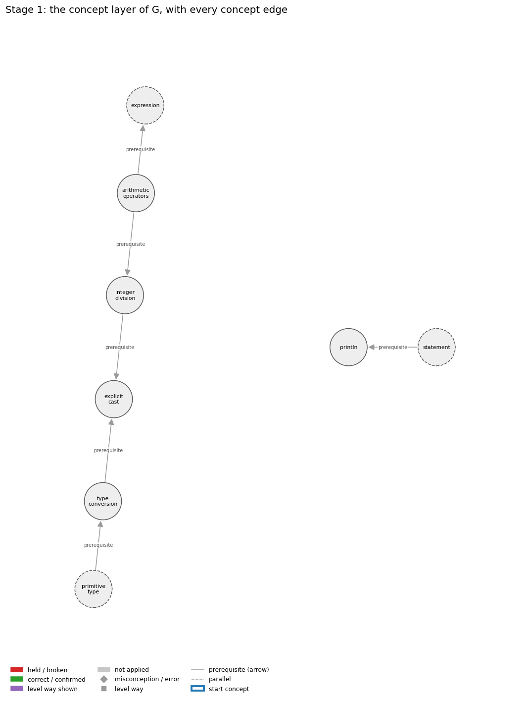
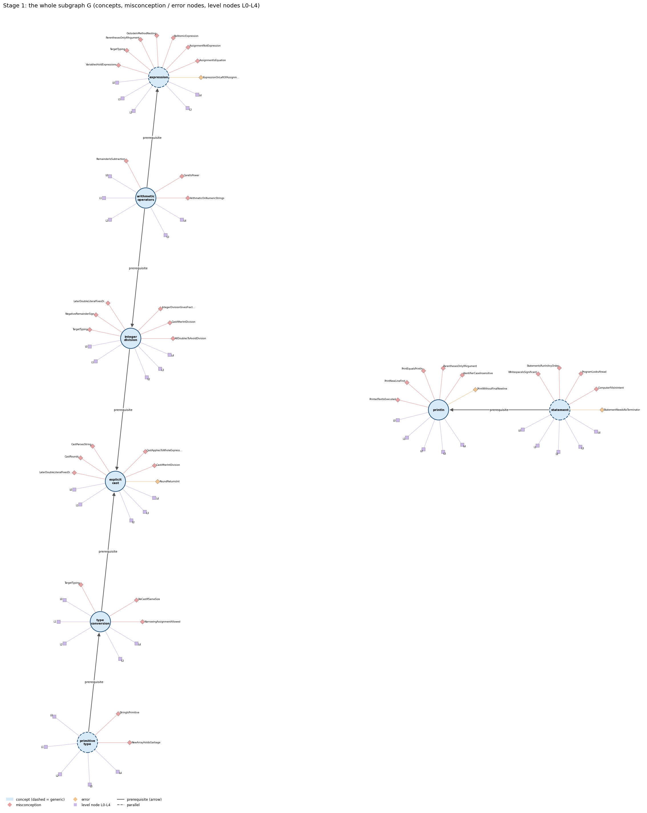
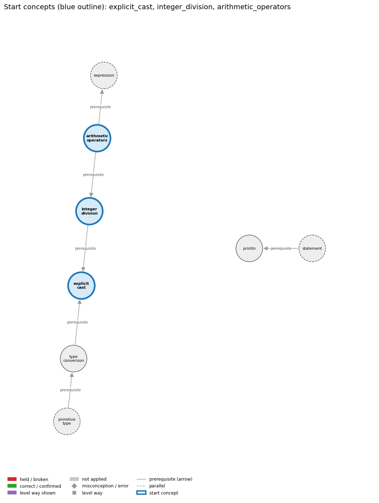
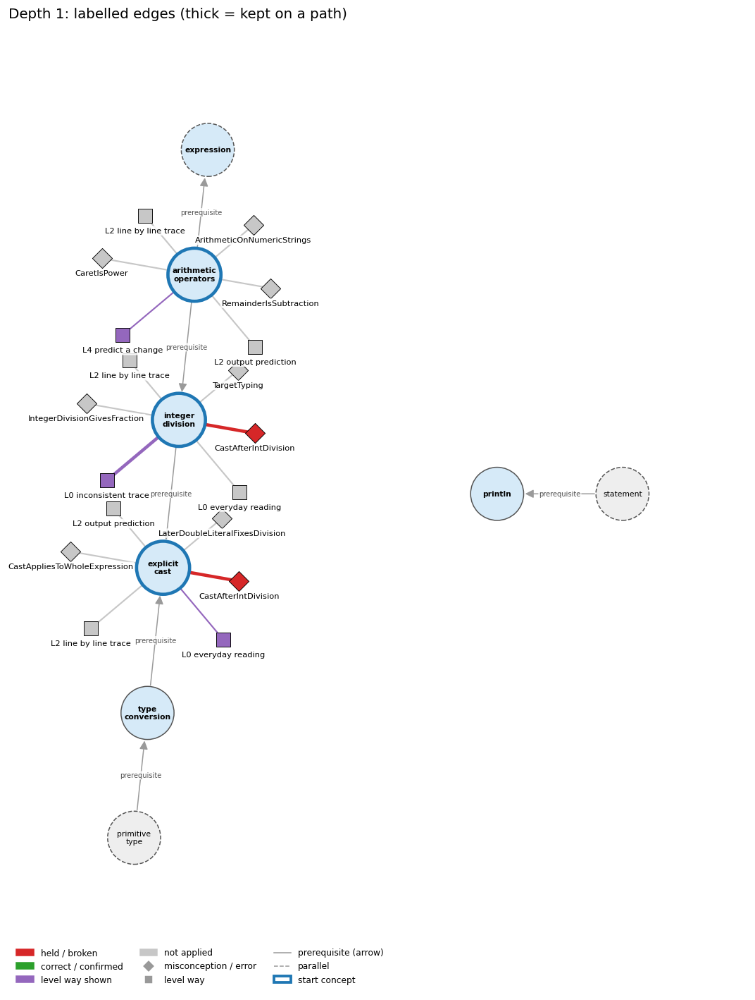
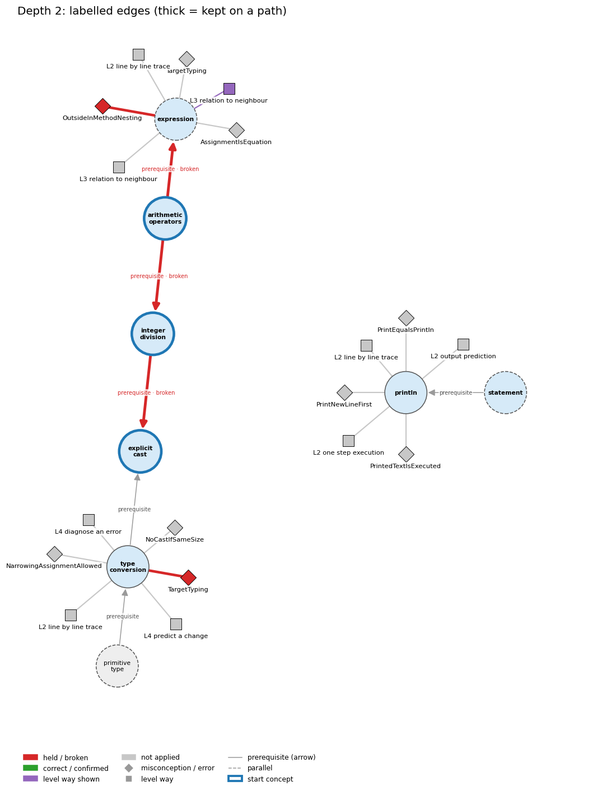
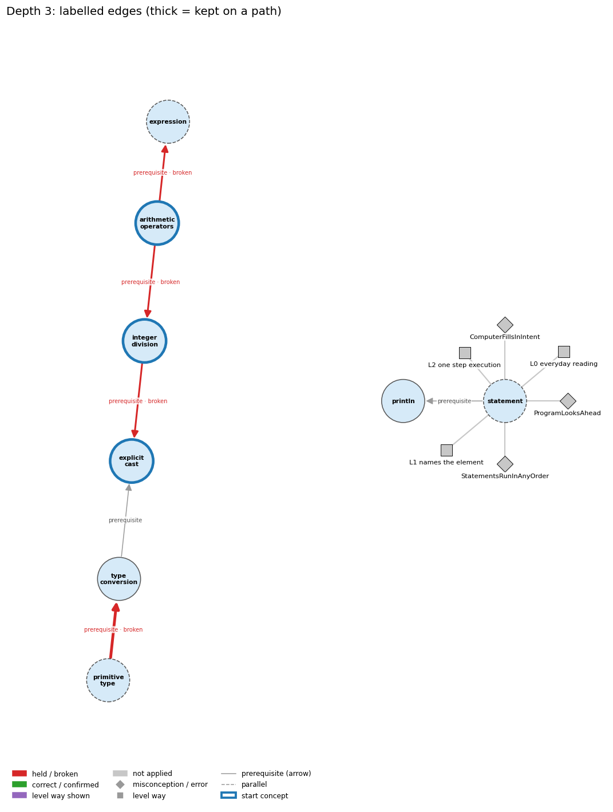
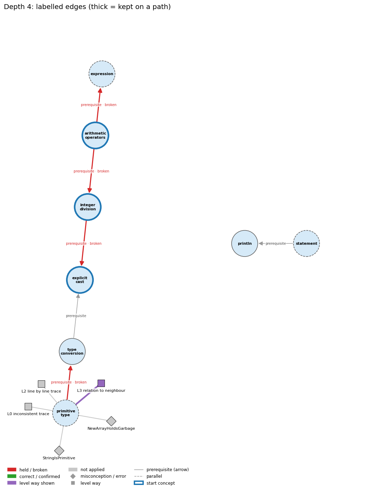
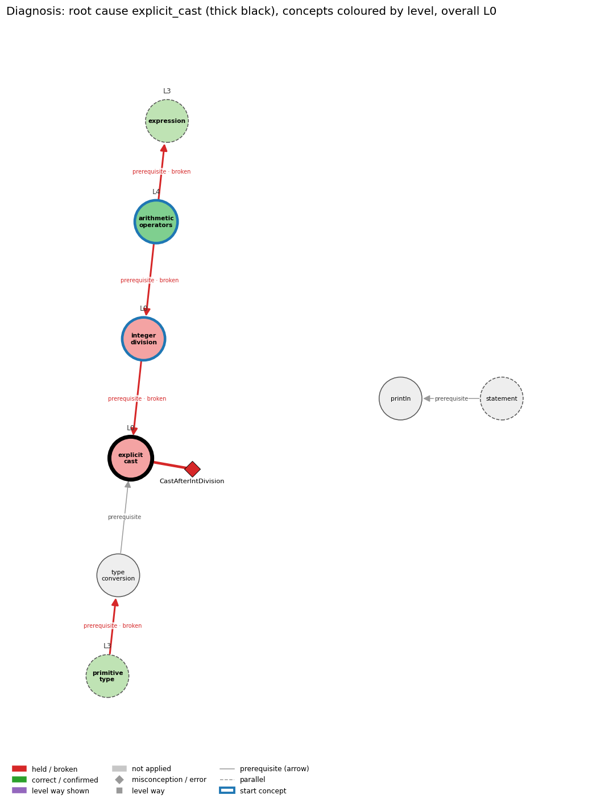

# Think on the Graph: every output of the run MY13

Files of this scenario: `input.json` (program, question, answer), `diagnosis.json`, `subgraph.json`, `traverse_log.txt`, `report.html` (this report as one full-page file, with the interactive graph `MY13_G.html`), `MY13.ipynb` (this report as a notebook).

## 0. Input
Program:
```java
int s = 7, c = 2;
double avg = (double) (s / c);
System.out.println(avg);
```
Question: Explain the order in which Java works out (double) (s / c).

Student's answer: In "double avg = (double) (s / c);" the cast comes first, so the division is a decimal one, so 7 / 2 is 3.5.
Settings: width 3, depth 3, prune llm, backend claude-cli, model claude-opus-5-5
## 1. Stage 1: the subgraph G from the code (no model)
Masked code (string and char literals and comments blanked; this is what the patterns see):
```
int s = 7, c = 2;
double avg = (double) (s / c);
System.out.println(avg);
```
Which code text tagged which concept (a generic concept fires on almost any Java line; it starts the walk only if the answer repeats its tag):
| concept | generic | channel | matched text | line |
|---|---|---|---|---|
| arithmetic_operators | False | pattern | 's / c' | 2 |
| explicit_cast | False | pattern | '(double)' | 2 |
| expression | True | pattern | 's /' | 2 |
| expression | True | pattern | '= 2;' | 1 |
| integer_division | False | signal | 'int s = 7, c = 2;\ndouble avg = (double) (s / c' | 1 |
| primitive_type | True | pattern | 'int' | 1 |
| println | False | pattern | 'System.out.println(' | 3 |
| statement | True | pattern | ';' | 1 |
| type_conversion | False | pattern | '(double)' | 2 |

G: 8 concept nodes (3 generic), 6 concept edges, 39 misconception / error edges, 34 misconception / error nodes, 40 level nodes, 49 level-misconception links, 2 connected piece(s).
Note: concept nodes form 2 pieces (the KG has no edge between them): arithmetic_operators,explicit_cast,expression,integer_division,primitive_type,type_conversion | println,statement

Concept edges of G (the links the walk can read; `pre:` = prerequisite A -> B, `par:` = parallel):
| edge | type | rule (logic) |
|---|---|---|
| pre:arithmetic_operators->expression | prerequisite | An operator combines operand values a and b into a new value, so operators build larger expressions from smaller ones. |
| pre:arithmetic_operators->integer_division | prerequisite | For ints a and b, / gives the whole quotient q and % gives the remainder r, so that a = b * q + r. |
| pre:integer_division->explicit_cast | prerequisite | To divide two ints and keep the fraction, one operand is cast to double before the division, as in (double) freq[i] / T; casting the finished quotient comes too late. |
| pre:primitive_type->type_conversion | prerequisite | Conversion moves a value between primitive types: int to double happens automatically, while double to int needs a cast that drops the fraction. |
| pre:statement->println | prerequisite | System.out.println(s); is itself a statement, so its line of output appears at its own place in the sequence. |
| pre:type_conversion->explicit_cast | prerequisite | A cast is the explicit form of type conversion between primitive types, required when the conversion may lose information (e.g. (int) 2.71828 is 2). |

Misconception / error edges per concept (count), and level ways per concept (count):
| concept | misconception / error edges | level ways (L1-L4 + L0 non-misconception) |
|---|---|---|
| arithmetic_operators | 3 | 18 |
| explicit_cast | 6 | 19 |
| expression | 8 | 19 |
| integer_division | 6 | 16 |
| primitive_type | 2 | 21 |
| println | 6 | 17 |
| statement | 5 | 19 |
| type_conversion | 3 | 18 |

**Figure 1**


**Figure 2**


## 2. Clauses and start concepts (no model)
The answer split into clauses (at sentence ends, ';', and before 'because' / 'so'; quotes removed):
| clause | text |
|---|---|
| c1 | In double avg = (double) |
| c2 | s / c |
| c3 | the cast comes first |
| c4 | so the division is a decimal one |
| c5 | so 7 / 2 is 3.5 |

start: generic concepts whose tagging text occurs in the answer: expression, statement

start: BM25 of the answer against each tagged concept: explicit_cast 18.91 (hits 1), integer_division 14.90 (hits 1), arithmetic_operators 9.72 (hits 1), expression 8.95 (hits 2), println 8.59 (hits 1), type_conversion 7.72 (hits 1), statement 4.86 (hits 1)

start: chosen explicit_cast, integer_division, arithmetic_operators

start concepts (3): explicit_cast, integer_division, arithmetic_operators

Start concepts: explicit_cast, integer_division, arithmetic_operators

**Figure 3**


## 3. The walk, depth by depth
At each depth, for each current concept: the edges offered (a concept entering as a start concept offers its misconception / error edges and its level ways, as two families; otherwise it offers its concept edges), the prune prompt and the model's reply, then the label prompt(s) and the model's reply, parsed into label / clauses / confidence. Score = prune score x confidence.

### Depth 1: current concepts 'explicit_cast', 'integer_division', 'arithmetic_operators'

#### explicit_cast, misconceptions: 6 edges offered
Edges offered:
| edge |
|---|
| err:explicit_cast->RoundReturnsInt \| wrong rule: Writes int n = Math.round(x); because Math.round gives an int. \| right rule: Math.round(double) returns a long, so storing it in an int needs a cast: int n = (int) Math.round(x); |
| mis:explicit_cast->CastAfterIntDivision \| wrong rule: (double) (3 / 5) is 0.6. \| right rule: The integer division 3 / 5 = 0 happens before the cast, so the result is 0.0. |
| mis:explicit_cast->CastAppliesToWholeExpression \| wrong rule: (int) 2.5 / 0.15 casts the whole quotient to int. \| right rule: The cast applies only to what comes right after it, here 2.5. |
| mis:explicit_cast->CastParsesString \| wrong rule: (int) args[0] converts the text "34" into the number 34. \| right rule: A String argument that represents a number must be converted with a method such as Integer.parseInt. |
| mis:explicit_cast->CastRounds \| wrong rule: (int) 2.7 evaluates to 3. \| right rule: A cast to int discards the fractional part (rounds toward zero, so (int) -2.7 is -2); Math.round rounds to the nearest integer. |
| mis:explicit_cast->LaterDoubleLiteralFixesDivision \| wrong rule: Changing a later literal to 100.0 fixes an earlier int division. \| right rule: The int division happens first; the double must be in the division itself. |

Prune: the model's reply (edge id and score; the kept edges sum to 1):
```
mis:explicit_cast->CastAfterIntDivision (0.75), mis:explicit_cast->CastAppliesToWholeExpression (0.15), mis:explicit_cast->LaterDoubleLiteralFixesDivision (0.10)
```
Kept by pruning: mis:explicit_cast->CastAfterIntDivision (0.75), mis:explicit_cast->CastAppliesToWholeExpression (0.15), mis:explicit_cast->LaterDoubleLiteralFixesDivision (0.10)

Label prompt for the misconception / error edges (judged together). The model saw the program, the question, the numbered clauses, and these edges with their wrong rule and right rule:
| edge |
|---|
| mis:explicit_cast->CastAfterIntDivision \| wrong rule: (double) (3 / 5) is 0.6. \| right rule: The integer division 3 / 5 = 0 happens before the cast, so the result is 0.0. |
| mis:explicit_cast->CastAppliesToWholeExpression \| wrong rule: (int) 2.5 / 0.15 casts the whole quotient to int. \| right rule: The cast applies only to what comes right after it, here 2.5. |
| mis:explicit_cast->LaterDoubleLiteralFixesDivision \| wrong rule: Changing a later literal to 100.0 fixes an earlier int division. \| right rule: The int division happens first; the double must be in the division itself. |
Model's reply:
```
mis:explicit_cast->CastAfterIntDivision | held | clauses: 3, 4, 5 | confidence: 0.92
mis:explicit_cast->CastAppliesToWholeExpression | not applied | clauses: none | confidence: 0.8
mis:explicit_cast->LaterDoubleLiteralFixesDivision | not applied | clauses: none | confidence: 0.93
```

Parsed labels:
| edge | label | prune score | confidence | score | clauses | words |
|---|---|---|---|---|---|---|
| mis:explicit_cast->CastAfterIntDivision | held | 0.75 | 0.92 | 0.69 | c3, c4, c5 | the cast comes first; so the division is a decimal one; so 7 / 2 is 3.5 |
| mis:explicit_cast->CastAppliesToWholeExpression | not applied |  |  | 0.0 |  |  |
| mis:explicit_cast->LaterDoubleLiteralFixesDivision | not applied |  |  | 0.0 |  |  |

#### explicit_cast, level ways: 19 edges offered
Edges offered:
| edge |
|---|
| lvl:explicit_cast@L0#0 \| level L0 way everyday_reading: Folk meaning: 'convert 2.7 to a whole number' means round it to 3, and (int) looks like a function label that applies to everything written after it. Java rule: a cast to int truncates toward zero ((int) 2.7 is 2) and, having higher precedence than arithmetic, applies only to the value immediately following it. |
| lvl:explicit_cast@L0#4 \| level L0 way inconsistent_trace: Points to LT (the cast is a unary operator applied to the operand right after it, before * and /). Applied unevenly: in one line the student casts only the first operand, and in another applies the same cast to the whole expression. (here mixing in: "(int) 2.7 evaluates to 3") |
| lvl:explicit_cast@L1#0 \| level L1 way names_the_element: A cast is a unary operator, written (type) expression, that converts a value of one primitive type to another, used when the conversion may lose information. |
| lvl:explicit_cast@L1#1 \| level L1 way states_the_rule: (T) e converts the value of e to type T; a double-to-int cast discards the fraction by rounding toward zero; a cast is required for narrowing conversions; it has higher precedence than arithmetic; casts between boolean and numbers, or from String to int, are not allowed. |
| lvl:explicit_cast@L2#0 \| level L2 way line_by_line_trace: Evaluate the operand immediately to the right of the cast (a parenthesized expression is evaluated completely first), convert that value, then continue with the remaining operators of the expression. |
| lvl:explicit_cast@L2#1 \| level L2 way output_prediction: (int) 2.71828 is int 2; (int) -2.7 is -2; (int) 11 * 0.3 is double 3.3; (int) (11 * 0.3) is int 3; (double) 3 / 5 is 0.6 but (double) (3 / 5) is 0.0; (char) ('a' + 4) is 'e'. |
| lvl:explicit_cast@L2#2 \| level L2 way one_step_execution: A cast yields a new value and changes nothing else: neither the type nor the value of the variable being cast changes (after int x = (int) pi; pi is still 3.14159). |
| lvl:explicit_cast@L3#0 \| level L3 way relation_to_neighbour: A cast is the explicit conversion between primitive types, needed exactly where automatic conversion is refused because information may be lost. |
| lvl:explicit_cast@L3#1 \| level L3 way relation_to_neighbour: To turn Math.random()'s double into a random int from 0 to N-1, the cast must enclose the product: (int) (Math.random() * N); casting first gives 0. |
| lvl:explicit_cast@L3#2 \| level L3 way relation_to_neighbour: x op= e contains an implicit cast back to the type of x, so with int x, x += 0.5 compiles (x = (int) (x + 0.5)) while x = x + 0.5 is a compile-time error. |
| lvl:explicit_cast@L3#3 \| level L3 way relation_to_neighbour: Widening (promotion) happens automatically when a value goes to a type with a larger range (int to double) and loses nothing; a narrowing conversion (double to int) is never automatic and needs an explicit cast, which truncates toward zero. |
| lvl:explicit_cast@L3#4 \| level L3 way relation_to_neighbour: (int) 2.71828 truncates toward zero and gives 2; Math.round(2.71828) rounds to the nearest integer and gives 3, as a long that needs (int) to become an int. |
| lvl:explicit_cast@L3#5 \| level L3 way purpose_of_the_whole: Used to discard information on purpose: truncating a scaled random number to an index, taking the integer part, converting between char and int codes ((char) ('a' + k)), or forcing real division with (double) sum / n. |
| lvl:explicit_cast@L4#0 \| level L4 way predict_a_change: Moving the parentheses changes when truncation happens ((int) (a * b) vs (int) a * b); removing a cast from a narrowing assignment turns it into a compile-time error; int to double to int restores the value, but double to int to double loses the fraction. |
| lvl:explicit_cast@L4#1 \| level L4 way transfer_to_a_new_program: Use a cast when you intend to truncate or narrow (random indices, integer parts, char codes); use Math.round to round, Integer.parseInt for Strings, and put a double into the division itself rather than casting its int result. |
| lvl:explicit_cast@L4#2 \| level L4 way diagnose_an_error: rule broken: Math.round(double) returns a long, so storing it in an int needs a cast: int n = (int) Math.round(x);. Kind: compile-time. Trigger class: int n = Math.round(x); with double x. |
| lvl:explicit_cast@L4#3 \| level L4 way diagnose_an_error: rule broken: A cast applies only to the value right after it. Kind: compile-time. Trigger class: int n = (int) 11 * 0.3; the product is still a double (possible loss of precision); in a double context the same mistake is a silent logic error ((int) pi * 20.0 gives 60.0). |
| lvl:explicit_cast@L4#4 \| level L4 way diagnose_an_error: rule broken: Casts require compatible types. Kind: compile-time. Trigger class: (int) "3" or (int) args[0] on a String, or a cast between boolean and a number. |
| lvl:explicit_cast@L4#5 \| level L4 way diagnose_an_error: rule broken: A narrowing cast may lose magnitude, not just the fraction. Kind: silent logic error. Trigger class: Casting a value outside the target range, e.g. (int) of a long above 2147483647 or of a huge double. |

Prune: the model's reply (edge id and score; the kept edges sum to 1):
```
{lvl:explicit_cast@L2#0 (Score: 0.45)}
{lvl:explicit_cast@L2#1 (Score: 0.35)}
{lvl:explicit_cast@L0#0 (Score: 0.2)}
```
Kept by pruning: lvl:explicit_cast@L2#0 (0.45), lvl:explicit_cast@L2#1 (0.35), lvl:explicit_cast@L0#0 (0.20)

Label prompt for level way lvl:explicit_cast@L2#0 (the model saw only the concept, the way's name 'line by line trace' and its text; no level):
> Evaluate the operand immediately to the right of the cast (a parenthesized expression is evaluated completely first), convert that value, then continue with the remaining operators of the expression.

Model's reply:
```
Label: not shown
Clauses: none
Confidence: 0.9
```

Label prompt for level way lvl:explicit_cast@L2#1 (the model saw only the concept, the way's name 'output prediction' and its text; no level):
> (int) 2.71828 is int 2; (int) -2.7 is -2; (int) 11 * 0.3 is double 3.3; (int) (11 * 0.3) is int 3; (double) 3 / 5 is 0.6 but (double) (3 / 5) is 0.0; (char) ('a' + 4) is 'e'.

Model's reply:
```
Label: not shown
Clauses: none
Confidence: 0.85
```

Label prompt for level way lvl:explicit_cast@L0#0 (the model saw only the concept, the way's name 'everyday reading' and its text; no level):
> Folk meaning: 'convert 2.7 to a whole number' means round it to 3, and (int) looks like a function label that applies to everything written after it. Java rule: a cast to int truncates toward zero ((int) 2.7 is 2) and, having higher precedence than arithmetic, applies only to the value immediately following it.

Model's reply:
```
Label: shown
Clauses: 3, 4, 5
Confidence: 0.7
```

Parsed labels:
| edge | label | prune score | confidence | score | clauses | words |
|---|---|---|---|---|---|---|
| lvl:explicit_cast@L2#0 | not applied |  |  | 0.0 |  |  |
| lvl:explicit_cast@L2#1 | not applied |  |  | 0.0 |  |  |
| lvl:explicit_cast@L0#0 | shown | 0.2 | 0.7 | 0.14 | c3, c4, c5 | the cast comes first; so the division is a decimal one; so 7 / 2 is 3.5 |

#### integer_division, misconceptions: 6 edges offered
Edges offered:
| edge |
|---|
| mis:integer_division->AllDoublesToAvoidDivision \| wrong rule: Making every variable a double is the right fix for integer division. \| right rule: Use int for countable things and double for measured ones; where a fraction is needed, make one operand of the division a double (or cast) instead of changing every type. |
| mis:integer_division->CastAfterIntDivision \| wrong rule: (double) (3 / 5) is 0.6. \| right rule: The integer division 3 / 5 = 0 happens before the cast, so the result is 0.0. |
| mis:integer_division->IntegerDivisionGivesFraction \| wrong rule: 10 / 3 evaluates to 3.333.... \| right rule: Dividing two ints gives an int: the fractional part is discarded. |
| mis:integer_division->LaterDoubleLiteralFixesDivision \| wrong rule: Changing a later literal to 100.0 fixes an earlier int division. \| right rule: The int division happens first; the double must be in the division itself. |
| mis:integer_division->NegativeRemainderSign \| wrong rule: a % b is never negative, and integer division of a negative number rounds down. \| right rule: a / b rounds toward 0 and a % b takes the sign of a: -14 / 3 is -4 and -14 % 3 is -2. |
| mis:integer_division->TargetTyping \| wrong rule: The type of a numerical expression depends on the type expected by the surrounding context, so double d = a / b; keeps the fraction. \| right rule: The type of a numerical expression is determined by the expression, so double d = a / b; with int a and b still divides as ints. |

Prune: the model's reply (edge id and score; the kept edges sum to 1):
```
mis:integer_division->CastAfterIntDivision (0.70), mis:integer_division->IntegerDivisionGivesFraction (0.20), mis:integer_division->TargetTyping (0.10)
```
Kept by pruning: mis:integer_division->CastAfterIntDivision (0.70), mis:integer_division->IntegerDivisionGivesFraction (0.20), mis:integer_division->TargetTyping (0.10)

Label prompt for the misconception / error edges (judged together). The model saw the program, the question, the numbered clauses, and these edges with their wrong rule and right rule:
| edge |
|---|
| mis:integer_division->CastAfterIntDivision \| wrong rule: (double) (3 / 5) is 0.6. \| right rule: The integer division 3 / 5 = 0 happens before the cast, so the result is 0.0. |
| mis:integer_division->IntegerDivisionGivesFraction \| wrong rule: 10 / 3 evaluates to 3.333.... \| right rule: Dividing two ints gives an int: the fractional part is discarded. |
| mis:integer_division->TargetTyping \| wrong rule: The type of a numerical expression depends on the type expected by the surrounding context, so double d = a / b; keeps the fraction. \| right rule: The type of a numerical expression is determined by the expression, so double d = a / b; with int a and b still divides as ints. |
Model's reply:
```
mis:integer_division->CastAfterIntDivision | held | clauses: 3, 4, 5 | confidence: 0.93
mis:integer_division->IntegerDivisionGivesFraction | not applied | clauses: none | confidence: 0.75
mis:integer_division->TargetTyping | not applied | clauses: none | confidence: 0.8
```

Parsed labels:
| edge | label | prune score | confidence | score | clauses | words |
|---|---|---|---|---|---|---|
| mis:integer_division->CastAfterIntDivision | held | 0.7000000000000001 | 0.93 | 0.65 | c3, c4, c5 | the cast comes first; so the division is a decimal one; so 7 / 2 is 3.5 |
| mis:integer_division->IntegerDivisionGivesFraction | not applied |  |  | 0.0 |  |  |
| mis:integer_division->TargetTyping | not applied |  |  | 0.0 |  |  |

#### integer_division, level ways: 16 edges offered
Edges offered:
| edge |
|---|
| lvl:integer_division@L0#0 \| level L0 way everyday_reading: In everyday and school arithmetic, 'divide' gives an exact answer or a fraction (10 ÷ 3 = 3 1/3), and rounding goes to the nearest whole number. In Java, / with two int operands discards the fraction, rounding toward zero (59 / 60 is 0). |
| lvl:integer_division@L0#4 \| level L0 way inconsistent_trace: Points to LT (each / looks at its own two operand types when it is evaluated). Applied unevenly, a student evaluates 9/5 as 1.8 in f = (9/5)*c + 32 but as 1 elsewhere, or assumes a later double operand rescues an earlier int division. (here mixing in: "The type of a numerical expression depends on the type expected by the surrounding context, so double d = a / b; keeps the fraction") |
| lvl:integer_division@L1#0 \| level L1 way names_the_element: Integer division: / applied to two integer operands, giving the whole-number quotient with the fractional part discarded. |
| lvl:integer_division@L1#1 \| level L1 way states_the_rule: If both operands of / are integral types, the result is an integer that rounds toward 0 (-14 / 3 is -4). If either operand is a double, the division is floating point. |
| lvl:integer_division@L2#0 \| level L2 way line_by_line_trace: Each / is evaluated when its turn comes (precedence, then left to right), using the types of its own two operands. Promoting the result to double, by a cast or by assignment, happens only afterwards and cannot restore the lost fraction. |
| lvl:integer_division@L2#1 \| level L2 way output_prediction: 10 / 3 is 3, 59 / 60 is 0, 1234 / 99 is 12, -14 / 3 is -4, and (double) (3 / 5) is 0.0. |
| lvl:integer_division@L2#2 \| level L2 way one_step_execution: q = a / b stores the truncated quotient in q and leaves a and b unchanged. If b is 0, an ArithmeticException stops execution before anything is stored. |
| lvl:integer_division@L3#0 \| level L3 way relation_to_neighbour: / and % on ints are paired: q = a / b and r = a % b always satisfy a = b * q + r. |
| lvl:integer_division@L3#1 \| level L3 way relation_to_neighbour: Normalizing counts must divide as doubles. With two ints, counts / total truncates to 0 whenever counts < total. |
| lvl:integer_division@L3#2 \| level L3 way relation_to_neighbour: % gives the remainder of the same truncating division: (a / b) * b + a % b == a. |
| lvl:integer_division@L3#3 \| level L3 way purpose_of_the_whole: Quotient plans: unit conversion (76 / 12 feet), dropping a digit (n / 10), finding a midpoint ((lo + hi) / 2), and computing a bucket or row index (i / cols). |
| lvl:integer_division@L4#0 \| level L4 way predict_a_change: Making one operand a double (10.0 / 3) keeps the fraction (3.333...). Casting after the division does not. Multiplying before dividing preserves precision (59 * 100 / 60 is 98). Changing an operand's sign changes only the quotient's sign, since rounding is toward zero. |
| lvl:integer_division@L4#1 \| level L4 way transfer_to_a_new_program: Use integer division when you want the whole quotient (units, digits, indices, half a size). When a fraction is needed, make one operand a double (10.0 / 3 or (double) a / b) rather than turning every variable into a double. |
| lvl:integer_division@L4#2 \| level L4 way diagnose_an_error: rule broken: With two int operands, / discards the fraction. Kind: silent logic error. Trigger class: Two int operands where a fraction is intended: 9/5 in a temperature formula, count / total, 1 / n, sum / n for an average. |
| lvl:integer_division@L4#3 \| level L4 way diagnose_an_error: rule broken: int division by zero is undefined. Kind: run-time exception. Trigger class: A divisor that evaluates to 0: ArithmeticException: / by zero. |
| lvl:integer_division@L4#4 \| level L4 way diagnose_an_error: rule broken: Integer division rounds toward zero, not down. Kind: silent logic error. Trigger class: Negative operands where floor was expected (-7 / 2 is -3, not -4). |

Prune: the model's reply (edge id and score; the kept edges sum to 1):
```
{lvl:integer_division@L0#4 (Score: 0.5)}
{lvl:integer_division@L2#0 (Score: 0.3)}
{lvl:integer_division@L0#0 (Score: 0.2)}
```
Kept by pruning: lvl:integer_division@L0#4 (0.50), lvl:integer_division@L2#0 (0.30), lvl:integer_division@L0#0 (0.20)

Label prompt for level way lvl:integer_division@L0#4 (the model saw only the concept, the way's name 'inconsistent trace' and its text; no level):
> Points to LT (each / looks at its own two operand types when it is evaluated). Applied unevenly, a student evaluates 9/5 as 1.8 in f = (9/5)*c + 32 but as 1 elsewhere, or assumes a later double operand rescues an earlier int division. (here mixing in: "The type of a numerical expression depends on the type expected by the surrounding context, so double d = a / b; keeps the fraction")

Model's reply:
```
Label: shown
Clauses: 3, 4, 5
Confidence: 0.6
```

Label prompt for level way lvl:integer_division@L2#0 (the model saw only the concept, the way's name 'line by line trace' and its text; no level):
> Each / is evaluated when its turn comes (precedence, then left to right), using the types of its own two operands. Promoting the result to double, by a cast or by assignment, happens only afterwards and cannot restore the lost fraction.

Model's reply:
```
Label: not shown
Clauses: none
Confidence: 0.95
```

Label prompt for level way lvl:integer_division@L0#0 (the model saw only the concept, the way's name 'everyday reading' and its text; no level):
> In everyday and school arithmetic, 'divide' gives an exact answer or a fraction (10 ÷ 3 = 3 1/3), and rounding goes to the nearest whole number. In Java, / with two int operands discards the fraction, rounding toward zero (59 / 60 is 0).

Model's reply:
```
Label: not shown
Clauses: none
Confidence: 0.65
```

Parsed labels:
| edge | label | prune score | confidence | score | clauses | words |
|---|---|---|---|---|---|---|
| lvl:integer_division@L0#4 | shown | 0.5 | 0.6 | 0.3 | c3, c4, c5 | the cast comes first; so the division is a decimal one; so 7 / 2 is 3.5 |
| lvl:integer_division@L2#0 | not applied |  |  | 0.0 |  |  |
| lvl:integer_division@L0#0 | not applied |  |  | 0.0 |  |  |

#### arithmetic_operators, misconceptions: 3 edges offered
Edges offered:
| edge |
|---|
| mis:arithmetic_operators->ArithmeticOnNumericStrings \| wrong rule: "10" - 1 or "6" * "2" works because the strings look like numbers. \| right rule: Arithmetic operators other than + are not defined for Strings; a String of digits must first be converted to a number, e.g. with Integer.parseInt. |
| mis:arithmetic_operators->CaretIsPower \| wrong rule: a^2 computes a squared. \| right rule: Java has no exponent operator; ^ is exclusive or, and a * a or Math.pow(a, 2) computes a squared. |
| mis:arithmetic_operators->RemainderIsSubtraction \| wrong rule: 9 % 5 means 9 minus 5 (a % b subtracts b from a). \| right rule: % gives the remainder after integer division: 9 % 5 is 4 because 9 = 1 * 5 + 4, and 17 % 5 is 2, not 12. |

Prune: the model's reply (edge id and score; the kept edges sum to 1):
```
mis:arithmetic_operators->RemainderIsSubtraction (0.60), mis:arithmetic_operators->CaretIsPower (0.20), mis:arithmetic_operators->ArithmeticOnNumericStrings (0.20)
```
Kept by pruning: mis:arithmetic_operators->RemainderIsSubtraction (0.60), mis:arithmetic_operators->CaretIsPower (0.20), mis:arithmetic_operators->ArithmeticOnNumericStrings (0.20)

Label prompt for the misconception / error edges (judged together). The model saw the program, the question, the numbered clauses, and these edges with their wrong rule and right rule:
| edge |
|---|
| mis:arithmetic_operators->RemainderIsSubtraction \| wrong rule: 9 % 5 means 9 minus 5 (a % b subtracts b from a). \| right rule: % gives the remainder after integer division: 9 % 5 is 4 because 9 = 1 * 5 + 4, and 17 % 5 is 2, not 12. |
| mis:arithmetic_operators->CaretIsPower \| wrong rule: a^2 computes a squared. \| right rule: Java has no exponent operator; ^ is exclusive or, and a * a or Math.pow(a, 2) computes a squared. |
| mis:arithmetic_operators->ArithmeticOnNumericStrings \| wrong rule: "10" - 1 or "6" * "2" works because the strings look like numbers. \| right rule: Arithmetic operators other than + are not defined for Strings; a String of digits must first be converted to a number, e.g. with Integer.parseInt. |
Model's reply:
```
mis:arithmetic_operators->RemainderIsSubtraction | not applied | clauses: none | confidence: 0.95
mis:arithmetic_operators->CaretIsPower | not applied | clauses: none | confidence: 0.97
mis:arithmetic_operators->ArithmeticOnNumericStrings | not applied | clauses: none | confidence: 0.97
```

Parsed labels:
| edge | label | prune score | confidence | score | clauses | words |
|---|---|---|---|---|---|---|
| mis:arithmetic_operators->RemainderIsSubtraction | not applied |  |  | 0.0 |  |  |
| mis:arithmetic_operators->CaretIsPower | not applied |  |  | 0.0 |  |  |
| mis:arithmetic_operators->ArithmeticOnNumericStrings | not applied |  |  | 0.0 |  |  |

#### arithmetic_operators, level ways: 18 edges offered
Edges offered:
| edge |
|---|
| lvl:arithmetic_operators@L0#0 \| level L0 way everyday_reading: In maths notation, multiplication can be implicit (2x), ^ or a superscript means a power, ÷ is exact division, and % means percent. In Java * must be written, / depends on the operand types, % is the remainder, and there is no power operator (^ is exclusive or). |
| lvl:arithmetic_operators@L0#2 \| level L0 way inconsistent_trace: Points to LT (evaluate operands, then apply the operator in the promoted type). Applied unevenly, a student uses integer division for one / and real division for another / in the same int expression. (here mixing in: "a^2 computes a squared") |
| lvl:arithmetic_operators@L1#0 \| level L1 way names_the_element: Arithmetic operators: the binary operators + - * / % that combine two numeric operands into a numeric result. |
| lvl:arithmetic_operators@L1#1 \| level L1 way states_the_rule: Both operands must be numeric, and the result has the promoted type (int, long or double). * / % bind tighter than + -, all group left to right, and int / or % by zero throws ArithmeticException. Unary minus negates its operand (-x) and unary plus leaves it unchanged; they bind more tightly than * and /, so -a * b is (-a) * b. |
| lvl:arithmetic_operators@L2#0 \| level L2 way line_by_line_trace: The left operand is evaluated fully, then the right operand, and then the operator is applied in the promoted type. |
| lvl:arithmetic_operators@L2#1 \| level L2 way output_prediction: With ints, 17 / 3 is 5 and 17 % 3 is 2. With doubles, 5.0 / 3.0 is 1.6666666666666667. With mixed operands, the int is promoted first (10 / 3.0 is 3.333...). |
| lvl:arithmetic_operators@L2#2 \| level L2 way one_step_execution: An arithmetic operator never changes its operands. Each variable is replaced by its value, and only an assignment (or ++ or op=) stores the result. |
| lvl:arithmetic_operators@L3#0 \| level L3 way relation_to_neighbour: Operators build larger expressions from smaller ones, and each operand can itself be any expression. |
| lvl:arithmetic_operators@L3#1 \| level L3 way relation_to_neighbour: For ints, / gives the truncated quotient and % the remainder, so (a / b) * b + a % b == a. |
| lvl:arithmetic_operators@L3#2 \| level L3 way relation_to_neighbour: int / or % by zero throws a run-time exception, while floating-point division by zero gives Infinity or NaN. |
| lvl:arithmetic_operators@L3#3 \| level L3 way relation_to_neighbour: + adds when both operands are numbers and concatenates when either operand is a String, converting the other operand to a String. It is left-associative, so 1 + 2 + "3" is "33" but "1" + 2 + 3 is "123". |
| lvl:arithmetic_operators@L3#4 \| level L3 way purpose_of_the_whole: Arithmetic operators turn formulas into code: totals, averages, unit conversions (inch * CM_PER_INCH), and digit extraction (n % 10, n / 10). |
| lvl:arithmetic_operators@L4#0 \| level L4 way predict_a_change: Changing an operand's type changes the operator's meaning (int / versus double /). Reordering * and / changes integer results (59 * 100 / 60 is 98, 59 / 60 * 100 is 0). Replacing ^ with Math.pow gives a real power. |
| lvl:arithmetic_operators@L4#1 \| level L4 way transfer_to_a_new_program: Use the operators for arithmetic on numeric types. Use the Math library for powers, roots and absolute values, and parse numeric Strings before computing with them. |
| lvl:arithmetic_operators@L4#2 \| level L4 way diagnose_an_error: rule broken: int / and % by zero are undefined. Kind: run-time exception. Trigger class: A divisor that evaluates to 0 (empty count, zero input): ArithmeticException: / by zero. |
| lvl:arithmetic_operators@L4#3 \| level L4 way diagnose_an_error: rule broken: Arithmetic operators other than + are not defined for Strings. Kind: compile-time. Trigger class: "10" - 1 or "6" * "2": 'bad operand types for binary operator'. |
| lvl:arithmetic_operators@L4#4 \| level L4 way diagnose_an_error: rule broken: ^ is not exponentiation. Kind: silent logic error. Trigger class: Writing x^2 or 10^6 for a power (10^6 is 12). |
| lvl:arithmetic_operators@L4#5 \| level L4 way diagnose_an_error: rule broken: int arithmetic wraps silently on overflow. Kind: silent logic error. Trigger class: Results outside the int range. |

Prune: the model's reply (edge id and score; the kept edges sum to 1):
```
{lvl:arithmetic_operators@L4#0 (Score: 0.45)}
{lvl:arithmetic_operators@L2#0 (Score: 0.3)}
{lvl:arithmetic_operators@L2#1 (Score: 0.25)}
```
Kept by pruning: lvl:arithmetic_operators@L4#0 (0.45), lvl:arithmetic_operators@L2#0 (0.30), lvl:arithmetic_operators@L2#1 (0.25)

Label prompt for level way lvl:arithmetic_operators@L4#0 (the model saw only the concept, the way's name 'predict a change' and its text; no level):
> Changing an operand's type changes the operator's meaning (int / versus double /). Reordering * and / changes integer results (59 * 100 / 60 is 98, 59 / 60 * 100 is 0). Replacing ^ with Math.pow gives a real power.

Model's reply:
```
Label: shown
Clauses: 3, 4, 5
Confidence: 0.6
```

Label prompt for level way lvl:arithmetic_operators@L2#0 (the model saw only the concept, the way's name 'line by line trace' and its text; no level):
> The left operand is evaluated fully, then the right operand, and then the operator is applied in the promoted type.

Model's reply:
```
Label: not shown
Clauses: none
Confidence: 0.85
```

Label prompt for level way lvl:arithmetic_operators@L2#1 (the model saw only the concept, the way's name 'output prediction' and its text; no level):
> With ints, 17 / 3 is 5 and 17 % 3 is 2. With doubles, 5.0 / 3.0 is 1.6666666666666667. With mixed operands, the int is promoted first (10 / 3.0 is 3.333...).

Model's reply:
```
Label: not shown
Clauses: none
Confidence: 0.85
```

Parsed labels:
| edge | label | prune score | confidence | score | clauses | words |
|---|---|---|---|---|---|---|
| lvl:arithmetic_operators@L4#0 | shown | 0.45 | 0.6 | 0.27 | c3, c4, c5 | the cast comes first; so the division is a decimal one; so 7 / 2 is 3.5 |
| lvl:arithmetic_operators@L2#0 | not applied |  |  | 0.0 |  |  |
| lvl:arithmetic_operators@L2#1 | not applied |  |  | 0.0 |  |  |

**Kept on a path at this depth** (best N in tiers: held misconception / broken edge, then held error, then correct / confirmed / shown):

mis:explicit_cast->CastAfterIntDivision [held, tier 0, 0.69], mis:integer_division->CastAfterIntDivision [held, tier 0, 0.65], lvl:integer_division@L0#4 [shown, tier 2, 0.30]

**Clause coverage after this depth:**
| clause | text | covered by |
|---|---|---|
| c1 | In double avg = (double) | not covered yet |
| c2 | s / c | not covered yet |
| c3 | the cast comes first | mis:explicit_cast->CastAfterIntDivision |
| c4 | so the division is a decimal one | mis:explicit_cast->CastAfterIntDivision |
| c5 | so 7 / 2 is 3.5 | mis:explicit_cast->CastAfterIntDivision |

**Uncovered clauses bring in (BM25 of the uncovered clauses against unvisited concepts):** expression (3.78), type_conversion (3.72), println (3.01)

**Graph check, not yet read (the walk may not stop while these remain):** own edges of expression, own edges of println, own edges of type_conversion, pre:arithmetic_operators->expression, pre:arithmetic_operators->integer_division, pre:integer_division->explicit_cast, pre:type_conversion->explicit_cast

**Figure 4 (the graph after depth 1)**


### Depth 2: current concepts 'explicit_cast', 'integer_division', 'arithmetic_operators', 'expression', 'type_conversion', 'println'

#### explicit_cast, concept edges: 2 edges offered
Edges offered:
| edge |
|---|
| pre:integer_division->explicit_cast \| rule: To divide two ints and keep the fraction, one operand is cast to double before the division, as in (double) freq[i] / T; casting the finished quotient comes too late. |
| pre:type_conversion->explicit_cast \| rule: A cast is the explicit form of type conversion between primitive types, required when the conversion may lose information (e.g. (int) 2.71828 is 2). |

Prune: the model's reply (edge id and score; the kept edges sum to 1):
```
{pre:integer_division->explicit_cast (Score: 0.8)}
{pre:type_conversion->explicit_cast (Score: 0.2)}
```
Kept by pruning: pre:integer_division->explicit_cast (0.80), pre:type_conversion->explicit_cast (0.20)

Label prompt for concept edge pre:integer_division->explicit_cast (integer_division -> explicit_cast, prerequisite):
> To divide two ints and keep the fraction, one operand is cast to double before the division, as in (double) freq[i] / T; casting the finished quotient comes too late.

Model's reply:
```
Label: broken
Clauses: 3, 4, 5
Confidence: 0.9
```

Label prompt for concept edge pre:type_conversion->explicit_cast (type_conversion -> explicit_cast, prerequisite):
> A cast is the explicit form of type conversion between primitive types, required when the conversion may lose information (e.g. (int) 2.71828 is 2).

Model's reply:
```
Label: not applied
Clauses: none
Confidence: 0.55
```

Parsed labels:
| edge | label | prune score | confidence | score | clauses | words |
|---|---|---|---|---|---|---|
| pre:integer_division->explicit_cast | broken | 0.8 | 0.9 | 0.72 | c3, c4, c5 | the cast comes first; so the division is a decimal one; so 7 / 2 is 3.5 |
| pre:type_conversion->explicit_cast | not applied |  |  | 0.0 |  |  |

#### integer_division, concept edges: 1 edges offered
Edges offered:
| edge |
|---|
| pre:arithmetic_operators->integer_division \| rule: For ints a and b, / gives the whole quotient q and % gives the remainder r, so that a = b * q + r. |
| pre:integer_division->explicit_cast \| rule: To divide two ints and keep the fraction, one operand is cast to double before the division, as in (double) freq[i] / T; casting the finished quotient comes too late. |

Prune: the model's reply (edge id and score; the kept edges sum to 1):
```
{pre:arithmetic_operators->integer_division (Score: 1.0)}
```
Kept by pruning: pre:arithmetic_operators->integer_division (1.00)

Label prompt for concept edge pre:arithmetic_operators->integer_division (arithmetic_operators -> integer_division, prerequisite):
> For ints a and b, / gives the whole quotient q and % gives the remainder r, so that a = b * q + r.

Model's reply:
```
Label: broken
Clauses: 4, 5
Confidence: 0.9
```

Parsed labels:
| edge | label | prune score | confidence | score | clauses | words |
|---|---|---|---|---|---|---|
| pre:arithmetic_operators->integer_division | broken | 1.0 | 0.9 | 0.9 | c4, c5 | so the division is a decimal one; so 7 / 2 is 3.5 |

#### arithmetic_operators, concept edges: 1 edges offered
Edges offered:
| edge |
|---|
| pre:arithmetic_operators->expression \| rule: An operator combines operand values a and b into a new value, so operators build larger expressions from smaller ones. |
| pre:arithmetic_operators->integer_division \| rule: For ints a and b, / gives the whole quotient q and % gives the remainder r, so that a = b * q + r. |

Prune: the model's reply (edge id and score; the kept edges sum to 1):
```
{pre:arithmetic_operators->expression (Score: 1.0)}
```
Kept by pruning: pre:arithmetic_operators->expression (1.00)

Label prompt for concept edge pre:arithmetic_operators->expression (arithmetic_operators -> expression, prerequisite):
> An operator combines operand values a and b into a new value, so operators build larger expressions from smaller ones.

Model's reply:
```
Label: broken
Clauses: 3, 4, 5
Confidence: 0.7
```

Parsed labels:
| edge | label | prune score | confidence | score | clauses | words |
|---|---|---|---|---|---|---|
| pre:arithmetic_operators->expression | broken | 1.0 | 0.7 | 0.7 | c3, c4, c5 | the cast comes first; so the division is a decimal one; so 7 / 2 is 3.5 |

#### expression, misconceptions: 8 edges offered
Edges offered:
| edge |
|---|
| err:expression->ExpressionOnLeftOfAssignment \| wrong rule: Writes a + b = c; or 7 = a; as if = were a math equation. \| right rule: The left side of an assignment must be a single variable; only the right side can be an expression. |
| mis:expression->AssignmentIsEquation \| wrong rule: An assignment states a lasting equality between its two sides, so y = x - y can be solved like the equation x = 2y and x = x + 5 relates two equal quantities. \| right rule: An assignment is a one-time action: evaluate the right side with current values, then store the result in the left variable. |
| mis:expression->AssignmentNotExpression \| wrong rule: An assignment cannot be used inside a larger expression, so a condition like (x = read()) != v is not allowed. \| right rule: An assignment is an expression whose value is the value assigned, so (x = v) both stores v in x and gives v. |
| mis:expression->NoAtomicExpression \| wrong rule: A single variable x or a literal on its own is not an expression. \| right rule: A single variable or literal is an expression whose value is just that value. |
| mis:expression->OutsideInMethodNesting \| wrong rule: In f(g(x)), f runs first and then g runs. \| right rule: In f(g(x)), g(x) is evaluated first and its result is passed to f. |
| mis:expression->ParenthesesOnlyIfArgument \| wrong rule: () are optional on a no-argument call like println \| right rule: A method call always needs parentheses, so an empty line is printed with System.out.println();. |
| mis:expression->TargetTyping \| wrong rule: The type of a numerical expression depends on the type expected by the surrounding context, so double d = a / b; keeps the fraction. \| right rule: The type of a numerical expression is determined by the expression, so double d = a / b; with int a and b still divides as ints. |
| mis:expression->VariablesHoldExpressions \| wrong rule: = stores the expression itself, not its computed value \| right rule: y = x + k; stores the value that x + k has at that moment, so later changes to x do not change y. |

Prune: the model's reply (edge id and score; the kept edges sum to 1):
```
mis:expression->TargetTyping (0.60), mis:expression->OutsideInMethodNesting (0.30), mis:expression->AssignmentIsEquation (0.10)
```
Kept by pruning: mis:expression->TargetTyping (0.60), mis:expression->OutsideInMethodNesting (0.30), mis:expression->AssignmentIsEquation (0.10)

Label prompt for the misconception / error edges (judged together). The model saw the program, the question, the numbered clauses, and these edges with their wrong rule and right rule:
| edge |
|---|
| mis:expression->TargetTyping \| wrong rule: The type of a numerical expression depends on the type expected by the surrounding context, so double d = a / b; keeps the fraction. \| right rule: The type of a numerical expression is determined by the expression, so double d = a / b; with int a and b still divides as ints. |
| mis:expression->OutsideInMethodNesting \| wrong rule: In f(g(x)), f runs first and then g runs. \| right rule: In f(g(x)), g(x) is evaluated first and its result is passed to f. |
| mis:expression->AssignmentIsEquation \| wrong rule: An assignment states a lasting equality between its two sides, so y = x - y can be solved like the equation x = 2y and x = x + 5 relates two equal quantities. \| right rule: An assignment is a one-time action: evaluate the right side with current values, then store the result in the left variable. |
Model's reply:
```
mis:expression->TargetTyping | not applied | clauses: none | confidence: 0.6
mis:expression->OutsideInMethodNesting | held | clauses: 3, 4, 5 | confidence: 0.8
mis:expression->AssignmentIsEquation | not applied | clauses: none | confidence: 0.95
```

Parsed labels:
| edge | label | prune score | confidence | score | clauses | words |
|---|---|---|---|---|---|---|
| mis:expression->TargetTyping | not applied |  |  | 0.0 |  |  |
| mis:expression->OutsideInMethodNesting | held | 0.30000000000000004 | 0.8 | 0.24 | c3, c4, c5 | the cast comes first; so the division is a decimal one; so 7 / 2 is 3.5 |
| mis:expression->AssignmentIsEquation | not applied |  |  | 0.0 |  |  |

#### expression, level ways: 19 edges offered
Edges offered:
| edge |
|---|
| lvl:expression@L0#0 \| level L0 way everyday_reading: In maths an expression such as 7/2 or x + y names an exact number, and 'expression' means a formula with operators. In Java, any code that evaluates to a typed value is an expression, including a lone literal or variable, and with ints 7/2 evaluates to 3. |
| lvl:expression@L0#2 \| level L0 way inconsistent_trace: Points to LT (replace each variable with its current value, then apply operators in precedence order). Applied unevenly, a student substitutes current values for some variables and old or future values for others, or respects precedence in one subexpression only. (here mixing in: "a single literal or variable "isn't an expression"") |
| lvl:expression@L1#0 \| level L1 way names_the_element: Expression: a literal, a variable, or a sequence of operations (operators, method calls) on them that produces one value. |
| lvl:expression@L1#1 \| level L1 way states_the_rule: Each operand of an operator can itself be any expression, and a parenthesized expression has the same value as the expression inside. Every expression has a type, determined by its operators and operands. |
| lvl:expression@L2#0 \| level L2 way line_by_line_trace: Operands are evaluated left to right, each fully before its operator is applied. Precedence and parentheses decide the grouping, and a method's arguments are all evaluated before the method is called. |
| lvl:expression@L2#1 \| level L2 way output_prediction: An expression produces one value of a type fixed by its operands: hour * 60 + minute with hour = 11 and minute = 59 is the int 719. |
| lvl:expression@L2#2 \| level L2 way one_step_execution: Evaluating an expression changes no variable unless it contains an assignment, ++/-- or a method with side effects. The value goes to the enclosing statement, and an expression statement discards it. |
| lvl:expression@L3#0 \| level L3 way relation_to_neighbour: A variable name inside an expression contributes the variable's value at the moment of evaluation. |
| lvl:expression@L3#1 \| level L3 way relation_to_neighbour: Operators combine operand values into a new value, and the operand types choose the operation (int / truncates, double / does not). |
| lvl:expression@L3#2 \| level L3 way relation_to_neighbour: With several operators, precedence and left associativity decide the grouping, and parentheses override both. |
| lvl:expression@L3#3 \| level L3 way relation_to_neighbour: A comparison takes numeric expressions and yields a boolean expression, and it has lower precedence than arithmetic, so a + b < c compares the sum. |
| lvl:expression@L3#4 \| level L3 way relation_to_neighbour: A method call is an expression usable wherever a value of its return type is, and its arguments are expressions evaluated before the call. |
| lvl:expression@L3#5 \| level L3 way purpose_of_the_whole: Expressions compute new values from existing ones. They form the right side of every assignment, every condition, every method argument and every printed value. |
| lvl:expression@L4#0 \| level L4 way predict_a_change: Adding parentheses that match the default grouping keeps the value, and rewriting with an equivalent formula (4 * (x - 3) as 4*x - 12) keeps it for ints. Changing one operand's type (3 to 3.0) can change both the result's type and its value. |
| lvl:expression@L4#1 \| level L4 way transfer_to_a_new_program: Use an expression wherever a value is needed. Split a long or unclear expression into named intermediate variables, and add parentheses wherever the grouping is not obvious. |
| lvl:expression@L4#2 \| level L4 way diagnose_an_error: rule broken: The left-hand side of = must be a single variable; only the right-hand side may be an arbitrary expression. Kind: compile-time. Trigger class: Any assignment whose left side is a literal or compound expression (7 = a; a + b = c;): 'unexpected type, required: variable'. |
| lvl:expression@L4#3 \| level L4 way diagnose_an_error: rule broken: Only assignments, increments, method calls and object creation can stand alone as statements. Kind: compile-time. Trigger class: A bare expression line such as x + 1; or a == b;: 'not a statement'. |
| lvl:expression@L4#4 \| level L4 way diagnose_an_error: rule broken: Operators accept only operands of suitable types. Kind: compile-time. Trigger class: Applying arithmetic to Strings ("Hello" - 1) or comparing booleans with <: 'bad operand types'. |
| lvl:expression@L4#5 \| level L4 way diagnose_an_error: rule broken: An int division or remainder by zero cannot be evaluated. Kind: run-time exception. Trigger class: Any int / or % whose right operand evaluates to 0: ArithmeticException. |

Prune: the model's reply (edge id and score; the kept edges sum to 1):
```
{lvl:expression@L3#2 (Score: 0.45)}
{lvl:expression@L3#1 (Score: 0.35)}
{lvl:expression@L2#0 (Score: 0.2)}
```
Kept by pruning: lvl:expression@L3#2 (0.45), lvl:expression@L3#1 (0.35), lvl:expression@L2#0 (0.20)

Label prompt for level way lvl:expression@L3#2 (the model saw only the concept, the way's name 'relation to neighbour' and its text; no level):
> With several operators, precedence and left associativity decide the grouping, and parentheses override both.

Model's reply:
```
Label: not shown
Clauses: none
Confidence: 0.75
```

Label prompt for level way lvl:expression@L3#1 (the model saw only the concept, the way's name 'relation to neighbour' and its text; no level):
> Operators combine operand values into a new value, and the operand types choose the operation (int / truncates, double / does not).

Model's reply:
```
Label: shown
Clauses: 4, 5
Confidence: 0.6
```

Label prompt for level way lvl:expression@L2#0 (the model saw only the concept, the way's name 'line by line trace' and its text; no level):
> Operands are evaluated left to right, each fully before its operator is applied. Precedence and parentheses decide the grouping, and a method's arguments are all evaluated before the method is called.

Model's reply:
```
Label: not shown
Clauses: none
Confidence: 0.85
```

Parsed labels:
| edge | label | prune score | confidence | score | clauses | words |
|---|---|---|---|---|---|---|
| lvl:expression@L3#2 | not applied |  |  | 0.0 |  |  |
| lvl:expression@L3#1 | shown | 0.35 | 0.6 | 0.21 | c4, c5 | so the division is a decimal one; so 7 / 2 is 3.5 |
| lvl:expression@L2#0 | not applied |  |  | 0.0 |  |  |

#### type_conversion, misconceptions: 3 edges offered
Edges offered:
| edge |
|---|
| mis:type_conversion->NarrowingAssignmentAllowed \| wrong rule: A double value can be stored in an int variable like an int in a double. \| right rule: int to double is automatic; double to int needs a cast. |
| mis:type_conversion->NoCastIfSameSize \| wrong rule: If a variable is at least as big as a value, no cast is needed to assign the value. \| right rule: Assigning a double to an int needs a cast even when the value would fit, because a conversion that might involve loss of information leads to a compile-time error. |
| mis:type_conversion->TargetTyping \| wrong rule: The type of a numerical expression depends on the type expected by the surrounding context, so double d = a / b; keeps the fraction. \| right rule: The type of a numerical expression is determined by the expression, so double d = a / b; with int a and b still divides as ints. |

Prune: the model's reply (edge id and score; the kept edges sum to 1):
```
{mis:type_conversion->TargetTyping (Score: 0.8)}
{mis:type_conversion->NarrowingAssignmentAllowed (Score: 0.12)}
{mis:type_conversion->NoCastIfSameSize (Score: 0.08)}
```
Kept by pruning: mis:type_conversion->TargetTyping (0.80), mis:type_conversion->NarrowingAssignmentAllowed (0.12), mis:type_conversion->NoCastIfSameSize (0.08)

Label prompt for the misconception / error edges (judged together). The model saw the program, the question, the numbered clauses, and these edges with their wrong rule and right rule:
| edge |
|---|
| mis:type_conversion->TargetTyping \| wrong rule: The type of a numerical expression depends on the type expected by the surrounding context, so double d = a / b; keeps the fraction. \| right rule: The type of a numerical expression is determined by the expression, so double d = a / b; with int a and b still divides as ints. |
| mis:type_conversion->NarrowingAssignmentAllowed \| wrong rule: A double value can be stored in an int variable like an int in a double. \| right rule: int to double is automatic; double to int needs a cast. |
| mis:type_conversion->NoCastIfSameSize \| wrong rule: If a variable is at least as big as a value, no cast is needed to assign the value. \| right rule: Assigning a double to an int needs a cast even when the value would fit, because a conversion that might involve loss of information leads to a compile-time error. |
Model's reply:
```
mis:type_conversion->TargetTyping | held | clauses: 3, 4, 5 | confidence: 0.6
mis:type_conversion->NarrowingAssignmentAllowed | not applied | clauses: none | confidence: 0.9
mis:type_conversion->NoCastIfSameSize | not applied | clauses: none | confidence: 0.9
```

Parsed labels:
| edge | label | prune score | confidence | score | clauses | words |
|---|---|---|---|---|---|---|
| mis:type_conversion->TargetTyping | held | 0.8 | 0.6 | 0.48 | c3, c4, c5 | the cast comes first; so the division is a decimal one; so 7 / 2 is 3.5 |
| mis:type_conversion->NarrowingAssignmentAllowed | not applied |  |  | 0.0 |  |  |
| mis:type_conversion->NoCastIfSameSize | not applied |  |  | 0.0 |  |  |

#### type_conversion, level ways: 18 edges offered
Edges offered:
| edge |
|---|
| lvl:type_conversion@L0#0 \| level L0 way everyday_reading: Folk meaning: a number is a number, so 3, 3.0 and "3" are the same value, and a variable will take whatever form the context needs (the result 'becomes' double when stored in a double). Java rule: every value has a fixed type; conversions happen only by automatic promotion to a wider type, by an explicit cast, by conversion methods (Integer.parseInt, Math.round), or by String conversion with +. |
| lvl:type_conversion@L0#3 \| level L0 way inconsistent_trace: Points to LT (each subexpression is computed in its own type, and conversion happens only where the types meet). Applied unevenly: the student promotes before an int division on one line (treating 9/5 as 1.8) but not on another, or casts the whole expression on one pass and only the first operand on the next. (here mixing in: "If a variable is at least as big as a value, no cast is needed to assign the value") |
| lvl:type_conversion@L1#0 \| level L1 way names_the_element: Type conversion is changing a value of one type into a value of another type: automatic promotion (widening), an explicit cast, an explicit conversion method (Integer.parseInt, Double.parseDouble, Math.round), or automatic conversion to String. |
| lvl:type_conversion@L1#1 \| level L1 way states_the_rule: Java converts automatically to a type with a larger range (promotion) because no information is lost; a conversion that might lose information (double to int) requires an explicit cast or is a compile-time error; Strings and numbers convert only via methods or string conversion. |
| lvl:type_conversion@L2#0 \| level L2 way line_by_line_trace: Innermost subexpressions are evaluated in their own types first; at each binary operator the narrower operand is promoted; a cast converts the single value right after it; at an assignment the final value is converted to the variable's type (widening allowed, narrowing rejected at compile time). |
| lvl:type_conversion@L2#1 \| level L2 way output_prediction: Typical results: "1234" + 99 is the String "123499"; Integer.parseInt("123") is int 123; (int) 2.71828 is int 2; Math.round(2.71828) is long 3; 11 * 0.3 is double 3.3; 11 * (int) 0.3 is int 0; (int) (11 * 0.3) is int 3. |
| lvl:type_conversion@L2#2 \| level L2 way one_step_execution: A conversion produces a new value and never changes the source variable or its declared type: after int x = (int) pi; x is 3 and pi still holds 3.14159. |
| lvl:type_conversion@L3#0 \| level L3 way relation_to_neighbour: Conversions between primitive types follow their ranges: int to double happens automatically, double to int needs a cast that drops the fraction, and boolean converts to no numeric type. |
| lvl:type_conversion@L3#1 \| level L3 way relation_to_neighbour: Parsing methods are explicit type conversion from String to a number: a method takes an argument of one type and produces a result of another. |
| lvl:type_conversion@L3#2 \| level L3 way relation_to_neighbour: A cast is the explicit conversion between primitive types, required when information may be lost: (int) 2.71828 is 2. |
| lvl:type_conversion@L3#3 \| level L3 way relation_to_neighbour: Widening (promotion) is the automatic kind of conversion, applied at operators and assignments when the target type has a larger range. |
| lvl:type_conversion@L3#4 \| level L3 way purpose_of_the_whole: Adapts data between parts of a program: command-line text to numbers, int counts to double for an average ((double) sum / n), doubles to int indices or counts. |
| lvl:type_conversion@L4#0 \| level L4 way predict_a_change: Moving the point of conversion changes the result: (double) (a / b) differs from (double) a / b, and (int) 11 * 0.3 differs from (int) (11 * 0.3). Widening int to double and back is reversible for int values; narrowing double to int loses the fraction irreversibly. |
| lvl:type_conversion@L4#1 \| level L4 way transfer_to_a_new_program: Rely on automatic promotion when mixing int with double; write a cast only when you intend to drop information; use parse methods for text input and string conversion for output; paying attention to types avoids subtle bugs. |
| lvl:type_conversion@L4#2 \| level L4 way diagnose_an_error: rule broken: A conversion that may lose information needs an explicit cast. Kind: compile-time. Trigger class: Assigning or passing a double (or long) expression to an int, e.g. int n = 11 * 0.3; (possible loss of precision). |
| lvl:type_conversion@L4#3 \| level L4 way diagnose_an_error: rule broken: Promotion happens per operator, after an int division has already truncated. Kind: silent logic error. Trigger class: All-int division inside a double formula, e.g. double y = 1 / 3; or (9/5) * c + 32. |
| lvl:type_conversion@L4#4 \| level L4 way diagnose_an_error: rule broken: Casts work only between compatible types; a String is converted with a parse method. Kind: compile-time. Trigger class: (int) str with a String str, or (int) flag with a boolean. |
| lvl:type_conversion@L4#5 \| level L4 way diagnose_an_error: rule broken: A parse method accepts only a valid textual representation of the number. Kind: run-time exception. Trigger class: Integer.parseInt of text that is not an integer in digits ("five", "12.2", ""). |

Prune: the model's reply (edge id and score; the kept edges sum to 1):
```
{lvl:type_conversion@L2#0 (Score: 0.4)}
{lvl:type_conversion@L4#3 (Score: 0.35)}
{lvl:type_conversion@L4#0 (Score: 0.25)}
```
Kept by pruning: lvl:type_conversion@L2#0 (0.40), lvl:type_conversion@L4#3 (0.35), lvl:type_conversion@L4#0 (0.25)

Label prompt for level way lvl:type_conversion@L2#0 (the model saw only the concept, the way's name 'line by line trace' and its text; no level):
> Innermost subexpressions are evaluated in their own types first; at each binary operator the narrower operand is promoted; a cast converts the single value right after it; at an assignment the final value is converted to the variable's type (widening allowed, narrowing rejected at compile time).

Model's reply:
```
Label: not shown
Clauses: none
Confidence: 0.85
```

Label prompt for level way lvl:type_conversion@L4#3 (the model saw only the concept, the way's name 'diagnose an error' and its text; no level):
> rule broken: Promotion happens per operator, after an int division has already truncated. Kind: silent logic error. Trigger class: All-int division inside a double formula, e.g. double y = 1 / 3; or (9/5) * c + 32.

Model's reply:
```
Label: not shown
Clauses: none
Confidence: 0.93
```

Label prompt for level way lvl:type_conversion@L4#0 (the model saw only the concept, the way's name 'predict a change' and its text; no level):
> Moving the point of conversion changes the result: (double) (a / b) differs from (double) a / b, and (int) 11 * 0.3 differs from (int) (11 * 0.3). Widening int to double and back is reversible for int values; narrowing double to int loses the fraction irreversibly.

Model's reply:
```
Label: not shown
Clauses: none
Confidence: 0.85
```

Parsed labels:
| edge | label | prune score | confidence | score | clauses | words |
|---|---|---|---|---|---|---|
| lvl:type_conversion@L2#0 | not applied |  |  | 0.0 |  |  |
| lvl:type_conversion@L4#3 | not applied |  |  | 0.0 |  |  |
| lvl:type_conversion@L4#0 | not applied |  |  | 0.0 |  |  |

#### println, misconceptions: 6 edges offered
Edges offered:
| edge |
|---|
| err:println->PrintWithoutFinalNewline \| wrong rule: Ends the output with print and expects it to appear right away. \| right rule: Finish a line of print calls with println; some systems hold print output until a newline is printed. |
| mis:println->IdentifierCaseInsensitive \| wrong rule: System.out.Println and System.out.println name the same method. \| right rule: Java is case-sensitive: names of variables, methods and classes that differ only in capitalization are different names. |
| mis:println->ParenthesesOnlyIfArgument \| wrong rule: println with nothing to print can be written System.out.println; without the parentheses. \| right rule: A method call always needs parentheses, so an empty line is printed with System.out.println();. |
| mis:println->PrintEqualsPrintln \| wrong rule: print and println do the same thing, so print(s1); print(s2); puts s1 and s2 on separate lines. \| right rule: println ends the line after printing and print does not, so print(s1); print(s2); puts s1 and s2 on the same line. |
| mis:println->PrintNewLineFirst \| wrong rule: println(s) prints a newline and then s. \| right rule: println(s) prints s and then the newline. |
| mis:println->PrintedTextIsExecuted \| wrong rule: System.out.println("x is 5"); sets x to 5 (text inside the quotes is run as code). \| right rule: Characters inside double quotes are printed literally; println only displays them and changes no variable. Only an assignment such as x = 5; sets x. |

Prune: the model's reply (edge id and score; the kept edges sum to 1):
```
mis:println->PrintNewLineFirst (0.40), mis:println->PrintEqualsPrintln (0.30), mis:println->PrintedTextIsExecuted (0.30)
```
Kept by pruning: mis:println->PrintNewLineFirst (0.40), mis:println->PrintEqualsPrintln (0.30), mis:println->PrintedTextIsExecuted (0.30)

Label prompt for the misconception / error edges (judged together). The model saw the program, the question, the numbered clauses, and these edges with their wrong rule and right rule:
| edge |
|---|
| mis:println->PrintNewLineFirst \| wrong rule: println(s) prints a newline and then s. \| right rule: println(s) prints s and then the newline. |
| mis:println->PrintEqualsPrintln \| wrong rule: print and println do the same thing, so print(s1); print(s2); puts s1 and s2 on separate lines. \| right rule: println ends the line after printing and print does not, so print(s1); print(s2); puts s1 and s2 on the same line. |
| mis:println->PrintedTextIsExecuted \| wrong rule: System.out.println("x is 5"); sets x to 5 (text inside the quotes is run as code). \| right rule: Characters inside double quotes are printed literally; println only displays them and changes no variable. Only an assignment such as x = 5; sets x. |
Model's reply:
```
mis:println->PrintNewLineFirst | not applied | clauses: none | confidence: 0.95
mis:println->PrintEqualsPrintln | not applied | clauses: none | confidence: 0.95
mis:println->PrintedTextIsExecuted | not applied | clauses: none | confidence: 0.95
```

Parsed labels:
| edge | label | prune score | confidence | score | clauses | words |
|---|---|---|---|---|---|---|
| mis:println->PrintNewLineFirst | not applied |  |  | 0.0 |  |  |
| mis:println->PrintEqualsPrintln | not applied |  |  | 0.0 |  |  |
| mis:println->PrintedTextIsExecuted | not applied |  |  | 0.0 |  |  |

#### println, level ways: 17 edges offered
Edges offered:
| edge |
|---|
| lvl:println@L0#0 \| level L0 way everyday_reading: Everyday reading: 'println' is just 'print', and 'new line' is something you do before writing. Java rule: println(x) prints x and then ends the line; println() alone just ends the line. |
| lvl:println@L0#3 \| level L0 way inconsistent_trace: Applies the println rule (print, then end line) unevenly: puts the newline before the text on one call and after it on another, or forgets that the next output starts on a new line. (here mixing in: "print and println behave the same (no newline difference)") |
| lvl:println@L1#0 \| level L1 way names_the_element: System.out.println is a library method that prints its argument followed by a line terminator ('print line'). |
| lvl:println@L1#1 \| level L1 way states_the_rule: println(String x) behaves as though it calls print(x) and then println(); println() terminates the current line by writing the line separator string. |
| lvl:println@L2#0 \| level L2 way line_by_line_trace: Evaluate the argument, print its characters at the current position, then write the line separator so the cursor moves to the beginning of the next line. |
| lvl:println@L2#1 \| level L2 way output_prediction: Output is the value's characters followed by a line break: println("Hello, "); println("World!"); prints two lines. |
| lvl:println@L2#2 \| level L2 way one_step_execution: One call appends the text and a line separator to the output; the cursor ends at the start of the next line; no variable changes and nothing is returned. |
| lvl:println@L3#0 \| level L3 way relation_to_neighbour: System.out.println(s); is a statement, so its line of output appears at its own place in the sequence. |
| lvl:println@L3#1 \| level L3 way relation_to_neighbour: println("s") outputs exactly the characters between the quotes and then ends the line. |
| lvl:println@L3#2 \| level L3 way relation_to_neighbour: print leaves the cursor on the line; println ends it; several prints followed by one println make one line. |
| lvl:println@L3#3 \| level L3 way relation_to_neighbour: println prints numbers with all their digits and always ends the line; printf formats each value by its conversion code and ends the line only where the format has %n or \n. |
| lvl:println@L3#4 \| level L3 way purpose_of_the_whole: Purpose: produce one complete line of output, e.g. each result on its own line, or end a line built with print. |
| lvl:println@L4#0 \| level L4 way predict_a_change: Replacing println with print joins the next output onto the same line (a typical logic error); the characters printed stay the same. |
| lvl:println@L4#1 \| level L4 way transfer_to_a_new_program: Use println when each output item belongs on its own line or to end a line; use print to continue a line and printf to control number formatting. |
| lvl:println@L4#2 \| level L4 way diagnose_an_error: rule broken: Finish a line of print calls with println. Kind: silent logic error. Trigger class: output ends with print, so the last line may not be shown or runs into the shell prompt |
| lvl:println@L4#3 \| level L4 way diagnose_an_error: rule broken: Method names are case-sensitive. Kind: compile-time. Trigger class: System.out.Println or system.out.println: cannot find symbol |
| lvl:println@L4#4 \| level L4 way diagnose_an_error: rule broken: Calls need parentheses. Kind: compile-time. Trigger class: System.out.println; without () |

Prune: the model's reply (edge id and score; the kept edges sum to 1):
```
{lvl:println@L2#1 (Score: 0.5)}
{lvl:println@L2#0 (Score: 0.3)}
{lvl:println@L2#2 (Score: 0.2)}
```
Kept by pruning: lvl:println@L2#1 (0.50), lvl:println@L2#0 (0.30), lvl:println@L2#2 (0.20)

Label prompt for level way lvl:println@L2#1 (the model saw only the concept, the way's name 'output prediction' and its text; no level):
> Output is the value's characters followed by a line break: println("Hello, "); println("World!"); prints two lines.

Model's reply:
```
Label: not shown
Clauses: none
Confidence: 0.9
```

Label prompt for level way lvl:println@L2#0 (the model saw only the concept, the way's name 'line by line trace' and its text; no level):
> Evaluate the argument, print its characters at the current position, then write the line separator so the cursor moves to the beginning of the next line.

Model's reply:
```
Label: not shown
Clauses: none
Confidence: 0.95
```

Label prompt for level way lvl:println@L2#2 (the model saw only the concept, the way's name 'one step execution' and its text; no level):
> One call appends the text and a line separator to the output; the cursor ends at the start of the next line; no variable changes and nothing is returned.

Model's reply:
```
Label: not shown
Clauses: none
Confidence: 0.97
```

Parsed labels:
| edge | label | prune score | confidence | score | clauses | words |
|---|---|---|---|---|---|---|
| lvl:println@L2#1 | not applied |  |  | 0.0 |  |  |
| lvl:println@L2#0 | not applied |  |  | 0.0 |  |  |
| lvl:println@L2#2 | not applied |  |  | 0.0 |  |  |

**Kept on a path at this depth** (best N in tiers: held misconception / broken edge, then held error, then correct / confirmed / shown):

pre:arithmetic_operators->integer_division [broken, tier 0, 0.90], pre:integer_division->explicit_cast [broken, tier 0, 0.72], pre:arithmetic_operators->expression [broken, tier 0, 0.70], mis:type_conversion->TargetTyping [held, tier 0, 0.48], mis:expression->OutsideInMethodNesting [held, tier 0, 0.24]

**Clause coverage after this depth:**
| clause | text | covered by |
|---|---|---|
| c1 | In double avg = (double) | not covered yet |
| c2 | s / c | not covered yet |
| c3 | the cast comes first | mis:explicit_cast->CastAfterIntDivision |
| c4 | so the division is a decimal one | mis:explicit_cast->CastAfterIntDivision |
| c5 | so 7 / 2 is 3.5 | mis:explicit_cast->CastAfterIntDivision |

**Uncovered clauses bring in (BM25 of the uncovered clauses against unvisited concepts):** statement (2.17)

**Graph check, not yet read (the walk may not stop while these remain):** own edges of statement, pre:primitive_type->type_conversion, pre:statement->println

**Figure 5 (the graph after depth 2)**


### Depth 3: current concepts 'arithmetic_operators', 'integer_division', 'explicit_cast', 'expression', 'type_conversion', 'println', 'statement'

#### explicit_cast, concept edges: 1 edges offered
Edges offered:
| edge |
|---|
| pre:integer_division->explicit_cast \| rule: To divide two ints and keep the fraction, one operand is cast to double before the division, as in (double) freq[i] / T; casting the finished quotient comes too late. |
| pre:type_conversion->explicit_cast \| rule: A cast is the explicit form of type conversion between primitive types, required when the conversion may lose information (e.g. (int) 2.71828 is 2). |

Prune: the model's reply (edge id and score; the kept edges sum to 1):
```
pre:type_conversion->explicit_cast (1.00)
```
Kept by pruning: pre:type_conversion->explicit_cast (1.00)

Label prompt for concept edge pre:type_conversion->explicit_cast (type_conversion -> explicit_cast, prerequisite):
> A cast is the explicit form of type conversion between primitive types, required when the conversion may lose information (e.g. (int) 2.71828 is 2).

Model's reply:
```
Label: not applied
Clauses: none
Confidence: 0.55
```

Parsed labels:
| edge | label | prune score | confidence | score | clauses | words |
|---|---|---|---|---|---|---|
| pre:type_conversion->explicit_cast | not applied |  |  | 0.0 |  |  |

#### type_conversion, concept edges: 1 edges offered
Edges offered:
| edge |
|---|
| pre:primitive_type->type_conversion \| rule: Conversion moves a value between primitive types: int to double happens automatically, while double to int needs a cast that drops the fraction. |
| pre:type_conversion->explicit_cast \| rule: A cast is the explicit form of type conversion between primitive types, required when the conversion may lose information (e.g. (int) 2.71828 is 2). |

Prune: the model's reply (edge id and score; the kept edges sum to 1):
```
{pre:primitive_type->type_conversion (Score: 1.0)}
```
Kept by pruning: pre:primitive_type->type_conversion (1.00)

Label prompt for concept edge pre:primitive_type->type_conversion (primitive_type -> type_conversion, prerequisite):
> Conversion moves a value between primitive types: int to double happens automatically, while double to int needs a cast that drops the fraction.

Model's reply:
```
Label: broken
Clauses: 3, 4, 5
Confidence: 0.6
```

Parsed labels:
| edge | label | prune score | confidence | score | clauses | words |
|---|---|---|---|---|---|---|
| pre:primitive_type->type_conversion | broken | 1.0 | 0.6 | 0.6 | c3, c4, c5 | the cast comes first; so the division is a decimal one; so 7 / 2 is 3.5 |

#### println, concept edges: 1 edges offered
Edges offered:
| edge |
|---|
| pre:statement->println \| rule: System.out.println(s); is itself a statement, so its line of output appears at its own place in the sequence. |

Prune: the model's reply (edge id and score; the kept edges sum to 1):
```
{pre:statement->println (Score: 1.0)}
```
Kept by pruning: pre:statement->println (1.00)

Label prompt for concept edge pre:statement->println (statement -> println, prerequisite):
> System.out.println(s); is itself a statement, so its line of output appears at its own place in the sequence.

Model's reply:
```
Label: not applied
Clauses: none
Confidence: 0.9
```

Parsed labels:
| edge | label | prune score | confidence | score | clauses | words |
|---|---|---|---|---|---|---|
| pre:statement->println | not applied |  |  | 0.0 |  |  |

#### statement, misconceptions: 5 edges offered
Edges offered:
| edge |
|---|
| err:statement->StatementNeedsNoTerminator \| wrong rule: A statement still compiles and runs if the semicolon at its end is left out, or if a stray ; is put right after if (c) or for (...). \| right rule: Each statement must end with ;, otherwise javac reports ';' expected. |
| mis:statement->ComputerFillsInIntent \| wrong rule: The computer fills in omitted steps or values that the programmer meant, e.g. REPEAT 4 [FORWARD 30] draws a square without a turn command. \| right rule: The computer executes only what the code states; every needed step and value must be written. |
| mis:statement->ProgramLooksAhead \| wrong rule: The program knows or sees what later lines will do and acts on those goals at the current line, e.g. it stops 'at ten' because it wants to draw a box. \| right rule: Each statement executes using only the current state; later lines have no effect until control reaches them. |
| mis:statement->StatementsRunInAnyOrder \| wrong rule: Statements in a program can run in any order. \| right rule: Without control statements, statements run once each, top to bottom. |
| mis:statement->WhitespaceIsSignificant \| wrong rule: Line breaks and indentation change what the program does, so each statement must be on its own line. \| right rule: Java compilers consider all whitespace in program text (outside quotation marks) to be equivalent; layout is for human readers. |

Prune: the model's reply (edge id and score; the kept edges sum to 1):
```
mis:statement->ProgramLooksAhead (0.45), mis:statement->ComputerFillsInIntent (0.35), mis:statement->StatementsRunInAnyOrder (0.20)
```
Kept by pruning: mis:statement->ProgramLooksAhead (0.45), mis:statement->ComputerFillsInIntent (0.35), mis:statement->StatementsRunInAnyOrder (0.20)

Label prompt for the misconception / error edges (judged together). The model saw the program, the question, the numbered clauses, and these edges with their wrong rule and right rule:
| edge |
|---|
| mis:statement->ProgramLooksAhead \| wrong rule: The program knows or sees what later lines will do and acts on those goals at the current line, e.g. it stops 'at ten' because it wants to draw a box. \| right rule: Each statement executes using only the current state; later lines have no effect until control reaches them. |
| mis:statement->ComputerFillsInIntent \| wrong rule: The computer fills in omitted steps or values that the programmer meant, e.g. REPEAT 4 [FORWARD 30] draws a square without a turn command. \| right rule: The computer executes only what the code states; every needed step and value must be written. |
| mis:statement->StatementsRunInAnyOrder \| wrong rule: Statements in a program can run in any order. \| right rule: Without control statements, statements run once each, top to bottom. |
Model's reply:
```
mis:statement->ProgramLooksAhead | not applied | clauses: none | confidence: 0.9
mis:statement->ComputerFillsInIntent | not applied | clauses: none | confidence: 0.8
mis:statement->StatementsRunInAnyOrder | not applied | clauses: none | confidence: 0.75
```

Parsed labels:
| edge | label | prune score | confidence | score | clauses | words |
|---|---|---|---|---|---|---|
| mis:statement->ProgramLooksAhead | not applied |  |  | 0.0 |  |  |
| mis:statement->ComputerFillsInIntent | not applied |  |  | 0.0 |  |  |
| mis:statement->StatementsRunInAnyOrder | not applied |  |  | 0.0 |  |  |

#### statement, level ways: 19 edges offered
Edges offered:
| edge |
|---|
| lvl:statement@L0#0 \| level L0 way everyday_reading: Everyday reading: a program is read like a text or a list of wishes that the computer takes in all at once, so line order, goals of later lines or what the writer meant can matter. Java rule: each statement is one step, ended by ;, executed once, in written order, using only the current state. |
| lvl:statement@L0#2 \| level L0 way inconsistent_trace: Applies the sequencing rule (LT) unevenly: executes the statements in order on some lines but lets a later statement's effect leak into an earlier one, or skips or repeats a statement on one pass. (here mixing in: "The computer fills in omitted steps or values that the programmer meant, e.g. REPEAT 4 [FORWARD 30] draws a square without a turn command") |
| lvl:statement@L1#0 \| level L1 way names_the_element: A statement is one step of a program (a declaration, assignment, method call such as System.out.println(...), or control statement), ended by a semicolon when it is a simple statement. |
| lvl:statement@L1#1 \| level L1 way states_the_rule: A method body is a sequence of statements enclosed in braces and each followed by a semicolon; statements are executed for their effect and have no value; an expression statement evaluates its expression and discards any value. |
| lvl:statement@L2#0 \| level L2 way line_by_line_trace: Statements run one at a time, from first to last; each completes (normally or abruptly) before the next starts. |
| lvl:statement@L2#1 \| level L2 way output_prediction: A statement has no value; its result is its effect: a changed variable, printed output, or a change of control flow. |
| lvl:statement@L2#2 \| level L2 way one_step_execution: Executing one statement applies its single effect to the current state (e.g. prints one string, or stores one value) and then control moves to the next statement. |
| lvl:statement@L3#0 \| level L3 way relation_to_neighbour: Statements live in main's body; running the program executes main's statements in order. |
| lvl:statement@L3#1 \| level L3 way relation_to_neighbour: A block groups a sequence of statements in braces; the body of main() is such a block. |
| lvl:statement@L3#2 \| level L3 way relation_to_neighbour: System.out.print(s); is a statement, so its output appears exactly at its place in the sequence, with no newline. |
| lvl:statement@L3#3 \| level L3 way relation_to_neighbour: System.out.println(s); is a statement, so its line of output appears at its place in the sequence; swapping two println statements swaps the output lines. |
| lvl:statement@L3#4 \| level L3 way relation_to_neighbour: Control flow is the order in which statements run; without control statements it is straight-line, each once in order. |
| lvl:statement@L3#5 \| level L3 way relation_to_neighbour: A lone ; is the empty statement, which does nothing; it can fill a for-loop part or, by accident, end an if or loop header. |
| lvl:statement@L3#6 \| level L3 way relation_to_neighbour: An algorithm becomes a program as a sequence of statements, executed once each in the order given. |
| lvl:statement@L3#7 \| level L3 way purpose_of_the_whole: Purpose: a statement is the unit of action; a program is characterized by its sequence of statements, each doing one step of the algorithm. |
| lvl:statement@L4#0 \| level L4 way predict_a_change: Swapping two statements that touch the same variable or the output generally changes the result; swapping independent statements, or changing only whitespace between them, keeps it. |
| lvl:statement@L4#1 \| level L4 way diagnose_an_error: rule broken: Each simple statement must end with ;. Kind: compile-time. Trigger class: omitting the ; at the end of a statement: javac reports ';' expected (often at the end of that line or the next) |
| lvl:statement@L4#2 \| level L4 way transfer_to_a_new_program: Write one statement per step and order them as the algorithm requires; straight-line sequence suffices when every step runs once, otherwise use conditionals or loops. |
| lvl:statement@L4#3 \| level L4 way diagnose_an_error: rule broken: A ; directly after an if/while/for header is an empty statement. Kind: silent logic error. Trigger class: if (x > 0); or while (cond); followed by the intended body |

Prune: the model's reply (edge id and score; the kept edges sum to 1):
```
{lvl:statement@L0#0 (Score: 0.45)}
{lvl:statement@L2#2 (Score: 0.35)}
{lvl:statement@L1#0 (Score: 0.2)}
```
Kept by pruning: lvl:statement@L0#0 (0.45), lvl:statement@L2#2 (0.35), lvl:statement@L1#0 (0.20)

Label prompt for level way lvl:statement@L0#0 (the model saw only the concept, the way's name 'everyday reading' and its text; no level):
> Everyday reading: a program is read like a text or a list of wishes that the computer takes in all at once, so line order, goals of later lines or what the writer meant can matter. Java rule: each statement is one step, ended by ;, executed once, in written order, using only the current state.

Model's reply:
```
Label: not shown
Clauses: none
Confidence: 0.8
```

Label prompt for level way lvl:statement@L2#2 (the model saw only the concept, the way's name 'one step execution' and its text; no level):
> Executing one statement applies its single effect to the current state (e.g. prints one string, or stores one value) and then control moves to the next statement.

Model's reply:
```
Label: not shown
Clauses: none
Confidence: 0.85
```

Label prompt for level way lvl:statement@L1#0 (the model saw only the concept, the way's name 'names the element' and its text; no level):
> A statement is one step of a program (a declaration, assignment, method call such as System.out.println(...), or control statement), ended by a semicolon when it is a simple statement.

Model's reply:
```
Label: not shown
Clauses: none
Confidence: 0.85
```

Parsed labels:
| edge | label | prune score | confidence | score | clauses | words |
|---|---|---|---|---|---|---|
| lvl:statement@L0#0 | not applied |  |  | 0.0 |  |  |
| lvl:statement@L2#2 | not applied |  |  | 0.0 |  |  |
| lvl:statement@L1#0 | not applied |  |  | 0.0 |  |  |

**Kept on a path at this depth** (best N in tiers: held misconception / broken edge, then held error, then correct / confirmed / shown):

pre:primitive_type->type_conversion [broken, tier 0, 0.60]

reached across pre:primitive_type->type_conversion, entered next: primitive_type

**Clause coverage after this depth:**
| clause | text | covered by |
|---|---|---|
| c1 | In double avg = (double) | not covered yet |
| c2 | s / c | not covered yet |
| c3 | the cast comes first | mis:explicit_cast->CastAfterIntDivision |
| c4 | so the division is a decimal one | mis:explicit_cast->CastAfterIntDivision |
| c5 | so 7 / 2 is 3.5 | mis:explicit_cast->CastAfterIntDivision |

**Graph check, not yet read (the walk may not stop while these remain):** own edges of primitive_type

**Figure 6 (the graph after depth 3)**


### Depth 4: current concepts 'primitive_type'

#### primitive_type, misconceptions: 2 edges offered
Edges offered:
| edge |
|---|
| mis:primitive_type->NewArrayHoldsGarbage \| wrong rule: The slots of a new int[n] hold unpredictable values until assigned. \| right rule: new fills every element with a default: 0 for numeric types, false for boolean, null for String and other non-primitive types. |
| mis:primitive_type->StringIsPrimitive \| wrong rule: String is a primitive type like int. \| right rule: String is not a primitive type; it is a class whose values are objects, although Java gives it some built-in support (literals, +). |

Prune: the model's reply (edge id and score; the kept edges sum to 1):
```
{mis:primitive_type->StringIsPrimitive (Score: 0.5)}
{mis:primitive_type->NewArrayHoldsGarbage (Score: 0.5)}
```
Kept by pruning: mis:primitive_type->StringIsPrimitive (0.50), mis:primitive_type->NewArrayHoldsGarbage (0.50)

Label prompt for the misconception / error edges (judged together). The model saw the program, the question, the numbered clauses, and these edges with their wrong rule and right rule:
| edge |
|---|
| mis:primitive_type->StringIsPrimitive \| wrong rule: String is a primitive type like int. \| right rule: String is not a primitive type; it is a class whose values are objects, although Java gives it some built-in support (literals, +). |
| mis:primitive_type->NewArrayHoldsGarbage \| wrong rule: The slots of a new int[n] hold unpredictable values until assigned. \| right rule: new fills every element with a default: 0 for numeric types, false for boolean, null for String and other non-primitive types. |
Model's reply:
```
mis:primitive_type->StringIsPrimitive | not applied | clauses: none | confidence: 0.95
mis:primitive_type->NewArrayHoldsGarbage | not applied | clauses: none | confidence: 0.95
```

Parsed labels:
| edge | label | prune score | confidence | score | clauses | words |
|---|---|---|---|---|---|---|
| mis:primitive_type->StringIsPrimitive | not applied |  |  | 0.0 |  |  |
| mis:primitive_type->NewArrayHoldsGarbage | not applied |  |  | 0.0 |  |  |

#### primitive_type, level ways: 21 edges offered
Edges offered:
| edge |
|---|
| lvl:primitive_type@L0#0 \| level L0 way everyday_reading: In English 'primitive' means crude or old-fashioned, which suggests these are a lesser type or that anything simple-looking (String) is primitive. In Java a primitive type is one of eight types predefined by the language and named by a keyword. It holds a plain value of fixed size, so it has no methods and no overflow checking. |
| lvl:primitive_type@L0#2 \| level L0 way inconsistent_trace: Points to LT (each operation is done in its type's fixed size). Applied unevenly, a student truncates and wraps int results on one line but treats another int intermediate as an unbounded real number, e.g. tracing 59 / 60 * 100 as 98. (here mixing in: "String is a primitive type like int") |
| lvl:primitive_type@L1#0 \| level L1 way names_the_element: Primitive type: one of Java's eight built-in data types (boolean, char, byte, short, int, long, float, double). Its values are simple values, not objects. |
| lvl:primitive_type@L1#1 \| level L1 way states_the_rule: byte, short, int and long are 8/16/32/64-bit signed two's-complement integers. char is 16-bit unsigned. float and double are IEEE 754 32-bit and 64-bit. boolean has exactly the values true and false. The other four primitive types are byte and short (smaller integers), long (64-bit integers) and float (32-bit floating point). |
| lvl:primitive_type@L2#0 \| level L2 way line_by_line_trace: In an expression over primitives, the left operand is evaluated, then the right one. Both are then promoted to a common type (at least int, or long or double if either operand has that type), and the operator is applied in that type. |
| lvl:primitive_type@L2#1 \| level L2 way output_prediction: The result is a primitive value whose type comes from promotion: byte, short, char and int combinations give int, any long operand gives long, and any double operand gives double (e.g. 'a' + 1 is int 98, 1 + 2L is long 3, 1 + 2.0 is double 3.0). |
| lvl:primitive_type@L2#2 \| level L2 way one_step_execution: Assigning to a primitive variable copies the value into it. After int b = a; a = 3;, b still holds the old value because nothing is shared (unlike array references). |
| lvl:primitive_type@L3#0 \| level L3 way relation_to_neighbour: How a literal is written fixes its primitive type (1234 int, 3.14 double, true boolean, 'c' char), and it must fit the primitive type of the variable it initializes. |
| lvl:primitive_type@L3#1 \| level L3 way relation_to_neighbour: Between numeric primitive types, widening (int to double) happens automatically, while narrowing (double to int) needs a cast that drops information. boolean converts to no numeric type. |
| lvl:primitive_type@L3#2 \| level L3 way relation_to_neighbour: Each primitive type is a data type: a fixed set of values plus the operators defined for them. |
| lvl:primitive_type@L3#3 \| level L3 way relation_to_neighbour: int is the 32-bit signed integral primitive. Arithmetic on byte, short and char is also carried out in int. |
| lvl:primitive_type@L3#4 \| level L3 way relation_to_neighbour: double is the 64-bit IEEE 754 primitive. Once a double meets an integral operand in a binary operator, the whole operation becomes floating point. |
| lvl:primitive_type@L3#5 \| level L3 way relation_to_neighbour: boolean is the primitive with only true and false. It does not mix with numeric primitives: it cannot be cast to them, and only booleans may be used as conditions. |
| lvl:primitive_type@L3#6 \| level L3 way relation_to_neighbour: char is an integral primitive (16-bit unsigned UTF-16 code unit), so a char takes part in arithmetic as its numeric code. |
| lvl:primitive_type@L3#7 \| level L3 way relation_to_neighbour: A variable of a primitive type stores the value itself in its own memory. |
| lvl:primitive_type@L3#8 \| level L3 way purpose_of_the_whole: Primitive types hold the single numbers, characters and truth values that every computation is built from. You pick the one that matches the quantity: int for counts, double for measurements, boolean for conditions, char for one character. |
| lvl:primitive_type@L4#0 \| level L4 way predict_a_change: Switching one primitive type for another changes range and precision. int to long removes overflow up to about 9.2e18. int to double keeps fractions but stops being exact for very large integers. Changing a type to boolean breaks every arithmetic use. |
| lvl:primitive_type@L4#1 \| level L4 way transfer_to_a_new_program: Use a primitive type for a single numeric, character or true/false value. Use String for text, arrays for collections, BigInteger for integers beyond long, and int cents rather than double when money must be exact. |
| lvl:primitive_type@L4#2 \| level L4 way diagnose_an_error: rule broken: A narrowing primitive conversion needs an explicit cast. Kind: compile-time. Trigger class: Storing a double or long value in an int (or an int in a char) without a cast: 'possible lossy conversion'. |
| lvl:primitive_type@L4#3 \| level L4 way diagnose_an_error: rule broken: Integer primitives have fixed ranges and integer operators do not report overflow. Kind: silent logic error. Trigger class: Any int or long result outside the type's range (large products, factorials): the stored value has wrapped around. |
| lvl:primitive_type@L4#4 \| level L4 way diagnose_an_error: rule broken: Primitive type names are lowercase keywords. Kind: compile-time. Trigger class: Writing Int, Double or Boolean where int, double or boolean was meant, or string for String: 'cannot find symbol' or a type mismatch. |

Prune: the model's reply (edge id and score; the kept edges sum to 1):
```
{lvl:primitive_type@L0#2 (Score: 0.45)}
{lvl:primitive_type@L3#4 (Score: 0.3)}
{lvl:primitive_type@L2#0 (Score: 0.25)}
```
Kept by pruning: lvl:primitive_type@L0#2 (0.45), lvl:primitive_type@L3#4 (0.30), lvl:primitive_type@L2#0 (0.25)

Label prompt for level way lvl:primitive_type@L0#2 (the model saw only the concept, the way's name 'inconsistent trace' and its text; no level):
> Points to LT (each operation is done in its type's fixed size). Applied unevenly, a student truncates and wraps int results on one line but treats another int intermediate as an unbounded real number, e.g. tracing 59 / 60 * 100 as 98. (here mixing in: "String is a primitive type like int")

Model's reply:
```
Label: not shown
Clauses: none
Confidence: 0.8
```

Label prompt for level way lvl:primitive_type@L3#4 (the model saw only the concept, the way's name 'relation to neighbour' and its text; no level):
> double is the 64-bit IEEE 754 primitive. Once a double meets an integral operand in a binary operator, the whole operation becomes floating point.

Model's reply:
```
Label: shown
Clauses: 4, 5
Confidence: 0.6
```

Label prompt for level way lvl:primitive_type@L2#0 (the model saw only the concept, the way's name 'line by line trace' and its text; no level):
> In an expression over primitives, the left operand is evaluated, then the right one. Both are then promoted to a common type (at least int, or long or double if either operand has that type), and the operator is applied in that type.

Model's reply:
```
Label: not shown
Clauses: none
Confidence: 0.9
```

Parsed labels:
| edge | label | prune score | confidence | score | clauses | words |
|---|---|---|---|---|---|---|
| lvl:primitive_type@L0#2 | not applied |  |  | 0.0 |  |  |
| lvl:primitive_type@L3#4 | shown | 0.3 | 0.6 | 0.18 | c4, c5 | so the division is a decimal one; so 7 / 2 is 3.5 |
| lvl:primitive_type@L2#0 | not applied |  |  | 0.0 |  |  |

**Kept on a path at this depth** (best N in tiers: held misconception / broken edge, then held error, then correct / confirmed / shown):

lvl:primitive_type@L3#4 [shown, tier 2, 0.18]

**Clause coverage after this depth:**
| clause | text | covered by |
|---|---|---|
| c1 | In double avg = (double) | not covered yet |
| c2 | s / c | not covered yet |
| c3 | the cast comes first | mis:explicit_cast->CastAfterIntDivision |
| c4 | so the division is a decimal one | mis:explicit_cast->CastAfterIntDivision |
| c5 | so 7 / 2 is 3.5 | mis:explicit_cast->CastAfterIntDivision |

**No next nodes -> half_stop**

**Figure 7 (the graph after depth 4)**


Held set after the one-fault rules: mis:explicit_cast->CastAfterIntDivision, mis:type_conversion->TargetTyping, mis:expression->OutsideInMethodNesting; filed at the dependent concept: mis:integer_division->CastAfterIntDivision

Shadows (a held label on a prerequisite, on a generic concept, or at a concept where the graph attaches the misconception as context, resting on the words of a stronger label at the specific or primary concept, is one wrong sentence read twice; it marks no root cause and sets no level): mis:expression->OutsideInMethodNesting (shadow of mis:type_conversion->TargetTyping), mis:type_conversion->TargetTyping (shadow of mis:explicit_cast->CastAfterIntDivision)

## 4. Diagnosis (rules over the labelled graph, no model)
Root-cause walk: held on ['explicit_cast'], broken at [] (consequences: pre:arithmetic_operators->integer_division, pre:integer_division->explicit_cast, pre:arithmetic_operators->expression, pre:primitive_type->type_conversion), prerequisites {'expression': ['arithmetic_operators'], 'integer_division': ['arithmetic_operators'], 'explicit_cast': ['integer_division', 'type_conversion'], 'type_conversion': ['primitive_type'], 'println': ['statement']}
- arithmetic_operators: L4 via predict_a_change "the cast comes first; so the division is a decimal one; so 7 / 2 is 3.5"
- explicit_cast: L0 via misconception "the cast comes first; so the division is a decimal one; so 7 / 2 is 3.5"
- expression: L3 via relation_to_neighbour "so the division is a decimal one; so 7 / 2 is 3.5"
- integer_division: L0 via misconception "the cast comes first; so the division is a decimal one; so 7 / 2 is 3.5"
- primitive_type: L3 via relation_to_neighbour "so the division is a decimal one; so 7 / 2 is 3.5"

**Stop:** half_stop at depth 4; prompts {'prune': 22, 'label': 39}, fresh model calls 9, cache hits 52

### Held misconceptions
| concept | misconception | kind | quote | score | shares_evidence_with |
|---|---|---|---|---|---|
| explicit_cast | CastAfterIntDivision | misconception | the cast comes first; so the division is a decimal one; so 7 / 2 is 3.5 | 0.69 |  |

### Shadowed labels (held in the reading, folded into the label they shadow; not faults of their own)
| concept | misconception | shadow_of | quote | score |
|---|---|---|---|---|
| expression | OutsideInMethodNesting | mis:type_conversion->TargetTyping | the cast comes first; so the division is a decimal one; so 7 / 2 is 3.5 | 0.24 |
| type_conversion | TargetTyping | mis:explicit_cast->CastAfterIntDivision | the cast comes first; so the division is a decimal one; so 7 / 2 is 3.5 | 0.48 |

### Broken concept edges
| edge | quote | score | consequence_of |
|---|---|---|---|
| pre:arithmetic_operators->integer_division | so the division is a decimal one; so 7 / 2 is 3.5 | 0.9 | mis:explicit_cast->CastAfterIntDivision |
| pre:integer_division->explicit_cast | the cast comes first; so the division is a decimal one; so 7 / 2 is 3.5 | 0.72 | mis:explicit_cast->CastAfterIntDivision |
| pre:arithmetic_operators->expression | the cast comes first; so the division is a decimal one; so 7 / 2 is 3.5 | 0.7 | mis:explicit_cast->CastAfterIntDivision |
| pre:primitive_type->type_conversion | the cast comes first; so the division is a decimal one; so 7 / 2 is 3.5 | 0.6 | mis:explicit_cast->CastAfterIntDivision |

### Root cause: explicit_cast / CastAfterIntDivision

### Level per concept
| concept | level | way | misconception | source | quote | rule | also | note |
|---|---|---|---|---|---|---|---|---|
| arithmetic_operators | L4 | predict_a_change |  | level_way | the cast comes first; so the division is a decimal one; so 7 / 2 is 3.5 |  |  |  |
| explicit_cast | L0 | misconception | CastAfterIntDivision | level_mis_links | the cast comes first; so the division is a decimal one; so 7 / 2 is 3.5 | wrong rule: (double) (3 / 5) is 0.6. Right rule: The integer division 3 / 5 = 0 happens inside the parentheses before the cast, so the result is 0.0; write (double) 3 / 5 to get 0.6. |  |  |
| expression | L3 | relation_to_neighbour |  | level_way | so the division is a decimal one; so 7 / 2 is 3.5 |  |  |  |
| integer_division | L0 | misconception | CastAfterIntDivision | level_mis_links | the cast comes first; so the division is a decimal one; so 7 / 2 is 3.5 | wrong rule: (double) (3 / 5) is 0.6. Right rule: The integer division 3 / 5 = 0 happens before the cast, so the result is 0.0. |  |  |
| primitive_type | L3 | relation_to_neighbour |  | level_way | so the division is a decimal one; so 7 / 2 is 3.5 |  |  |  |

### Overall level: L0

Clause coverage (final):
| clause | covered by |
|---|---|
| the cast comes first | mis:explicit_cast->CastAfterIntDivision |
| so the division is a decimal one | mis:explicit_cast->CastAfterIntDivision |
| so 7 / 2 is 3.5 | mis:explicit_cast->CastAfterIntDivision |

Clauses no evidence explains: In double avg = (double) | s / c

**Figure 8 (final picture)**


## 5. Every labelled edge (the evidence list, kept or not)
| depth | source | edge | kind | label | prune_score | confidence | score | clauses | quote |
|---|---|---|---|---|---|---|---|---|---|
| 1 | explicit_cast | mis:explicit_cast->CastAfterIntDivision | misconception | held | 0.75 | 0.92 | 0.69 | [3, 4, 5] | the cast comes first; so the division is a decimal one; so 7 / 2 is 3.5 |
| 1 | explicit_cast | lvl:explicit_cast@L0#0 | level | shown | 0.2 | 0.7 | 0.14 | [3, 4, 5] | the cast comes first; so the division is a decimal one; so 7 / 2 is 3.5 |
| 1 | integer_division | mis:integer_division->CastAfterIntDivision | misconception | held | 0.7000000000000001 | 0.93 | 0.651 | [3, 4, 5] | the cast comes first; so the division is a decimal one; so 7 / 2 is 3.5 |
| 1 | integer_division | lvl:integer_division@L0#4 | level | shown | 0.5 | 0.6 | 0.3 | [3, 4, 5] | the cast comes first; so the division is a decimal one; so 7 / 2 is 3.5 |
| 1 | arithmetic_operators | lvl:arithmetic_operators@L4#0 | level | shown | 0.45 | 0.6 | 0.27 | [3, 4, 5] | the cast comes first; so the division is a decimal one; so 7 / 2 is 3.5 |
| 2 | explicit_cast | pre:integer_division->explicit_cast | prerequisite | broken | 0.8 | 0.9 | 0.72 | [3, 4, 5] | the cast comes first; so the division is a decimal one; so 7 / 2 is 3.5 |
| 2 | integer_division | pre:arithmetic_operators->integer_division | prerequisite | broken | 1.0 | 0.9 | 0.9 | [4, 5] | so the division is a decimal one; so 7 / 2 is 3.5 |
| 2 | arithmetic_operators | pre:arithmetic_operators->expression | prerequisite | broken | 1.0 | 0.7 | 0.7 | [3, 4, 5] | the cast comes first; so the division is a decimal one; so 7 / 2 is 3.5 |
| 2 | expression | mis:expression->OutsideInMethodNesting | misconception | held | 0.30000000000000004 | 0.8 | 0.24 | [3, 4, 5] | the cast comes first; so the division is a decimal one; so 7 / 2 is 3.5 |
| 2 | expression | lvl:expression@L3#1 | level | shown | 0.35 | 0.6 | 0.21 | [4, 5] | so the division is a decimal one; so 7 / 2 is 3.5 |
| 2 | type_conversion | mis:type_conversion->TargetTyping | misconception | held | 0.8 | 0.6 | 0.48 | [3, 4, 5] | the cast comes first; so the division is a decimal one; so 7 / 2 is 3.5 |
| 3 | type_conversion | pre:primitive_type->type_conversion | prerequisite | broken | 1.0 | 0.6 | 0.6 | [3, 4, 5] | the cast comes first; so the division is a decimal one; so 7 / 2 is 3.5 |
| 4 | primitive_type | lvl:primitive_type@L3#4 | level | shown | 0.3 | 0.6 | 0.18 | [4, 5] | so the division is a decimal one; so 7 / 2 is 3.5 |

## 6. The paths (what the keep step kept, depth by depth)
| depth | source | edge | kind | label | score | clauses |
|---|---|---|---|---|---|---|
| 1 | explicit_cast | mis:explicit_cast->CastAfterIntDivision | misconception | held | 0.69 | [3, 4, 5] |
| 1 | integer_division | mis:integer_division->CastAfterIntDivision | misconception | held | 0.651 | [3, 4, 5] |
| 1 | integer_division | lvl:integer_division@L0#4 | level | shown | 0.3 | [3, 4, 5] |
| 2 | integer_division | pre:arithmetic_operators->integer_division | prerequisite | broken | 0.9 | [4, 5] |
| 2 | explicit_cast | pre:integer_division->explicit_cast | prerequisite | broken | 0.72 | [3, 4, 5] |
| 2 | arithmetic_operators | pre:arithmetic_operators->expression | prerequisite | broken | 0.7 | [3, 4, 5] |
| 2 | type_conversion | mis:type_conversion->TargetTyping | misconception | held | 0.48 | [3, 4, 5] |
| 2 | expression | mis:expression->OutsideInMethodNesting | misconception | held | 0.24 | [3, 4, 5] |
| 3 | type_conversion | pre:primitive_type->type_conversion | prerequisite | broken | 0.6 | [3, 4, 5] |
| 4 | primitive_type | lvl:primitive_type@L3#4 | level | shown | 0.18 | [4, 5] |

## 7. Raw traversal log
```
clauses: In double avg = (double) | s / c | the cast comes first | so the division is a decimal one | so 7 / 2 is 3.5
start: generic concepts whose tagging text occurs in the answer: expression, statement
start: BM25 of the answer against each tagged concept: explicit_cast 18.91 (hits 1), integer_division 14.90 (hits 1), arithmetic_operators 9.72 (hits 1), expression 8.95 (hits 2), println 8.59 (hits 1), type_conversion 7.72 (hits 1), statement 4.86 (hits 1)
start: chosen explicit_cast, integer_division, arithmetic_operators
start concepts (3): explicit_cast, integer_division, arithmetic_operators
--- depth 1: current concepts ['explicit_cast', 'integer_division', 'arithmetic_operators']
  explicit_cast (misconceptions): 6 candidates -> kept mis:explicit_cast->CastAfterIntDivision (0.75), mis:explicit_cast->CastAppliesToWholeExpression (0.15), mis:explicit_cast->LaterDoubleLiteralFixesDivision (0.10)
    mis:explicit_cast->CastAfterIntDivision -> held (0.69) "the cast comes first; so the division is a decimal one; so 7 / 2 is 3.5"
    mis:explicit_cast->CastAppliesToWholeExpression -> not applied (0.00) ""
    mis:explicit_cast->LaterDoubleLiteralFixesDivision -> not applied (0.00) ""
  explicit_cast (level ways): 19 candidates -> kept lvl:explicit_cast@L2#0 (0.45), lvl:explicit_cast@L2#1 (0.35), lvl:explicit_cast@L0#0 (0.20)
    lvl:explicit_cast@L2#0 -> not applied (0.00) ""
    lvl:explicit_cast@L2#1 -> not applied (0.00) ""
    lvl:explicit_cast@L0#0 -> shown (0.14) "the cast comes first; so the division is a decimal one; so 7 / 2 is 3.5"
  integer_division (misconceptions): 6 candidates -> kept mis:integer_division->CastAfterIntDivision (0.70), mis:integer_division->IntegerDivisionGivesFraction (0.20), mis:integer_division->TargetTyping (0.10)
    mis:integer_division->CastAfterIntDivision -> held (0.65) "the cast comes first; so the division is a decimal one; so 7 / 2 is 3.5"
    mis:integer_division->IntegerDivisionGivesFraction -> not applied (0.00) ""
    mis:integer_division->TargetTyping -> not applied (0.00) ""
  integer_division (level ways): 16 candidates -> kept lvl:integer_division@L0#4 (0.50), lvl:integer_division@L2#0 (0.30), lvl:integer_division@L0#0 (0.20)
    lvl:integer_division@L0#4 -> shown (0.30) "the cast comes first; so the division is a decimal one; so 7 / 2 is 3.5"
    lvl:integer_division@L2#0 -> not applied (0.00) ""
    lvl:integer_division@L0#0 -> not applied (0.00) ""
  arithmetic_operators (misconceptions): 3 candidates -> kept mis:arithmetic_operators->RemainderIsSubtraction (0.60), mis:arithmetic_operators->CaretIsPower (0.20), mis:arithmetic_operators->ArithmeticOnNumericStrings (0.20)
    mis:arithmetic_operators->RemainderIsSubtraction -> not applied (0.00) ""
    mis:arithmetic_operators->CaretIsPower -> not applied (0.00) ""
    mis:arithmetic_operators->ArithmeticOnNumericStrings -> not applied (0.00) ""
  arithmetic_operators (level ways): 18 candidates -> kept lvl:arithmetic_operators@L4#0 (0.45), lvl:arithmetic_operators@L2#0 (0.30), lvl:arithmetic_operators@L2#1 (0.25)
    lvl:arithmetic_operators@L4#0 -> shown (0.27) "the cast comes first; so the division is a decimal one; so 7 / 2 is 3.5"
    lvl:arithmetic_operators@L2#0 -> not applied (0.00) ""
    lvl:arithmetic_operators@L2#1 -> not applied (0.00) ""
  kept: mis:explicit_cast->CastAfterIntDivision [held, tier 0, 0.69], mis:integer_division->CastAfterIntDivision [held, tier 0, 0.65], lvl:integer_division@L0#4 [shown, tier 2, 0.30]
  clause coverage: c1 uncovered; c2 uncovered; c3 <- mis:explicit_cast->CastAfterIntDivision; c4 <- mis:explicit_cast->CastAfterIntDivision; c5 <- mis:explicit_cast->CastAfterIntDivision
  uncovered clauses bring in: expression (3.78), type_conversion (3.72), println (3.01)
  not yet read: own edges of expression, own edges of println, own edges of type_conversion, pre:arithmetic_operators->expression, pre:arithmetic_operators->integer_division, pre:integer_division->explicit_cast, pre:type_conversion->explicit_cast
--- depth 2: current concepts ['explicit_cast', 'integer_division', 'arithmetic_operators', 'expression', 'type_conversion', 'println']
  explicit_cast (concept edges): 2 candidates -> kept pre:integer_division->explicit_cast (0.80), pre:type_conversion->explicit_cast (0.20)
    pre:integer_division->explicit_cast -> broken (0.72) "the cast comes first; so the division is a decimal one; so 7 / 2 is 3.5"
    pre:type_conversion->explicit_cast -> not applied (0.00) ""
  integer_division (concept edges): 1 candidates -> kept pre:arithmetic_operators->integer_division (1.00)
    pre:arithmetic_operators->integer_division -> broken (0.90) "so the division is a decimal one; so 7 / 2 is 3.5"
  arithmetic_operators (concept edges): 1 candidates -> kept pre:arithmetic_operators->expression (1.00)
    pre:arithmetic_operators->expression -> broken (0.70) "the cast comes first; so the division is a decimal one; so 7 / 2 is 3.5"
  expression (misconceptions): 8 candidates -> kept mis:expression->TargetTyping (0.60), mis:expression->OutsideInMethodNesting (0.30), mis:expression->AssignmentIsEquation (0.10)
    mis:expression->TargetTyping -> not applied (0.00) ""
    mis:expression->OutsideInMethodNesting -> held (0.24) "the cast comes first; so the division is a decimal one; so 7 / 2 is 3.5"
    mis:expression->AssignmentIsEquation -> not applied (0.00) ""
  expression (level ways): 19 candidates -> kept lvl:expression@L3#2 (0.45), lvl:expression@L3#1 (0.35), lvl:expression@L2#0 (0.20)
    lvl:expression@L3#2 -> not applied (0.00) ""
    lvl:expression@L3#1 -> shown (0.21) "so the division is a decimal one; so 7 / 2 is 3.5"
    lvl:expression@L2#0 -> not applied (0.00) ""
  type_conversion (misconceptions): 3 candidates -> kept mis:type_conversion->TargetTyping (0.80), mis:type_conversion->NarrowingAssignmentAllowed (0.12), mis:type_conversion->NoCastIfSameSize (0.08)
    mis:type_conversion->TargetTyping -> held (0.48) "the cast comes first; so the division is a decimal one; so 7 / 2 is 3.5"
    mis:type_conversion->NarrowingAssignmentAllowed -> not applied (0.00) ""
    mis:type_conversion->NoCastIfSameSize -> not applied (0.00) ""
  type_conversion (level ways): 18 candidates -> kept lvl:type_conversion@L2#0 (0.40), lvl:type_conversion@L4#3 (0.35), lvl:type_conversion@L4#0 (0.25)
    lvl:type_conversion@L2#0 -> not applied (0.00) ""
    lvl:type_conversion@L4#3 -> not applied (0.00) ""
    lvl:type_conversion@L4#0 -> not applied (0.00) ""
  println (misconceptions): 6 candidates -> kept mis:println->PrintNewLineFirst (0.40), mis:println->PrintEqualsPrintln (0.30), mis:println->PrintedTextIsExecuted (0.30)
    mis:println->PrintNewLineFirst -> not applied (0.00) ""
    mis:println->PrintEqualsPrintln -> not applied (0.00) ""
    mis:println->PrintedTextIsExecuted -> not applied (0.00) ""
  println (level ways): 17 candidates -> kept lvl:println@L2#1 (0.50), lvl:println@L2#0 (0.30), lvl:println@L2#2 (0.20)
    lvl:println@L2#1 -> not applied (0.00) ""
    lvl:println@L2#0 -> not applied (0.00) ""
    lvl:println@L2#2 -> not applied (0.00) ""
  kept: pre:arithmetic_operators->integer_division [broken, tier 0, 0.90], pre:integer_division->explicit_cast [broken, tier 0, 0.72], pre:arithmetic_operators->expression [broken, tier 0, 0.70], mis:type_conversion->TargetTyping [held, tier 0, 0.48], mis:expression->OutsideInMethodNesting [held, tier 0, 0.24]
  clause coverage: c1 uncovered; c2 uncovered; c3 <- mis:explicit_cast->CastAfterIntDivision; c4 <- mis:explicit_cast->CastAfterIntDivision; c5 <- mis:explicit_cast->CastAfterIntDivision
  uncovered clauses bring in: statement (2.17)
  not yet read: own edges of statement, pre:primitive_type->type_conversion, pre:statement->println
--- depth 3: current concepts ['arithmetic_operators', 'integer_division', 'explicit_cast', 'expression', 'type_conversion', 'println', 'statement']
  explicit_cast (concept edges): 1 candidates -> kept pre:type_conversion->explicit_cast (1.00)
    pre:type_conversion->explicit_cast -> not applied (0.00) ""
  type_conversion (concept edges): 1 candidates -> kept pre:primitive_type->type_conversion (1.00)
    pre:primitive_type->type_conversion -> broken (0.60) "the cast comes first; so the division is a decimal one; so 7 / 2 is 3.5"
  println (concept edges): 1 candidates -> kept pre:statement->println (1.00)
    pre:statement->println -> not applied (0.00) ""
  statement (misconceptions): 5 candidates -> kept mis:statement->ProgramLooksAhead (0.45), mis:statement->ComputerFillsInIntent (0.35), mis:statement->StatementsRunInAnyOrder (0.20)
    mis:statement->ProgramLooksAhead -> not applied (0.00) ""
    mis:statement->ComputerFillsInIntent -> not applied (0.00) ""
    mis:statement->StatementsRunInAnyOrder -> not applied (0.00) ""
  statement (level ways): 19 candidates -> kept lvl:statement@L0#0 (0.45), lvl:statement@L2#2 (0.35), lvl:statement@L1#0 (0.20)
    lvl:statement@L0#0 -> not applied (0.00) ""
    lvl:statement@L2#2 -> not applied (0.00) ""
    lvl:statement@L1#0 -> not applied (0.00) ""
  kept: pre:primitive_type->type_conversion [broken, tier 0, 0.60]
  reached across pre:primitive_type->type_conversion, entered next: primitive_type
  clause coverage: c1 uncovered; c2 uncovered; c3 <- mis:explicit_cast->CastAfterIntDivision; c4 <- mis:explicit_cast->CastAfterIntDivision; c5 <- mis:explicit_cast->CastAfterIntDivision
  not yet read: own edges of primitive_type
--- depth 4: current concepts ['primitive_type'] (closing round: own edges only)
  primitive_type (misconceptions): 2 candidates -> kept mis:primitive_type->StringIsPrimitive (0.50), mis:primitive_type->NewArrayHoldsGarbage (0.50)
    mis:primitive_type->StringIsPrimitive -> not applied (0.00) ""
    mis:primitive_type->NewArrayHoldsGarbage -> not applied (0.00) ""
  primitive_type (level ways): 21 candidates -> kept lvl:primitive_type@L0#2 (0.45), lvl:primitive_type@L3#4 (0.30), lvl:primitive_type@L2#0 (0.25)
    lvl:primitive_type@L0#2 -> not applied (0.00) ""
    lvl:primitive_type@L3#4 -> shown (0.18) "so the division is a decimal one; so 7 / 2 is 3.5"
    lvl:primitive_type@L2#0 -> not applied (0.00) ""
  kept: lvl:primitive_type@L3#4 [shown, tier 2, 0.18]
  clause coverage: c1 uncovered; c2 uncovered; c3 <- mis:explicit_cast->CastAfterIntDivision; c4 <- mis:explicit_cast->CastAfterIntDivision; c5 <- mis:explicit_cast->CastAfterIntDivision
  no next nodes -> half_stop
  held: mis:explicit_cast->CastAfterIntDivision, mis:type_conversion->TargetTyping, mis:expression->OutsideInMethodNesting; filed at the dependent concept: mis:integer_division->CastAfterIntDivision
  shadows: mis:expression->OutsideInMethodNesting (shadow of mis:type_conversion->TargetTyping), mis:type_conversion->TargetTyping (shadow of mis:explicit_cast->CastAfterIntDivision)
  root-cause walk: held on ['explicit_cast'], broken at [] (consequences: pre:arithmetic_operators->integer_division, pre:integer_division->explicit_cast, pre:arithmetic_operators->expression, pre:primitive_type->type_conversion), prerequisites {'expression': ['arithmetic_operators'], 'integer_division': ['arithmetic_operators'], 'explicit_cast': ['integer_division', 'type_conversion'], 'type_conversion': ['primitive_type'], 'println': ['statement']}
  level arithmetic_operators: L4 via predict_a_change "the cast comes first; so the division is a decimal one; so 7 / 2 is 3.5"
  level explicit_cast: L0 via misconception "the cast comes first; so the division is a decimal one; so 7 / 2 is 3.5"
  level expression: L3 via relation_to_neighbour "so the division is a decimal one; so 7 / 2 is 3.5"
  level integer_division: L0 via misconception "the cast comes first; so the division is a decimal one; so 7 / 2 is 3.5"
  level primitive_type: L3 via relation_to_neighbour "so the division is a decimal one; so 7 / 2 is 3.5"
```

## 8. Full diagnosis JSON
```json
{
 "scenario": "MY13",
 "settings": {
  "width": 3,
  "depth": 3,
  "prune_tools": "llm",
  "model": "claude-opus-5-5",
  "backend": "claude-cli"
 },
 "clauses": [
  "In double avg = (double)",
  "s / c",
  "the cast comes first",
  "so the division is a decimal one",
  "so 7 / 2 is 3.5"
 ],
 "start_concepts": [
  "explicit_cast",
  "integer_division",
  "arithmetic_operators"
 ],
 "held_misconceptions": [
  {
   "concept": "explicit_cast",
   "misconception": "CastAfterIntDivision",
   "kind": "misconception",
   "quote": "the cast comes first; so the division is a decimal one; so 7 / 2 is 3.5",
   "score": 0.69
  }
 ],
 "error_evidence": [],
 "shadowed": [
  {
   "concept": "expression",
   "misconception": "OutsideInMethodNesting",
   "shadow_of": "mis:type_conversion->TargetTyping",
   "quote": "the cast comes first; so the division is a decimal one; so 7 / 2 is 3.5",
   "score": 0.24
  },
  {
   "concept": "type_conversion",
   "misconception": "TargetTyping",
   "shadow_of": "mis:explicit_cast->CastAfterIntDivision",
   "quote": "the cast comes first; so the division is a decimal one; so 7 / 2 is 3.5",
   "score": 0.48
  }
 ],
 "broken_edges": [
  {
   "edge": "pre:arithmetic_operators->integer_division",
   "quote": "so the division is a decimal one; so 7 / 2 is 3.5",
   "score": 0.9,
   "consequence_of": "mis:explicit_cast->CastAfterIntDivision"
  },
  {
   "edge": "pre:integer_division->explicit_cast",
   "quote": "the cast comes first; so the division is a decimal one; so 7 / 2 is 3.5",
   "score": 0.72,
   "consequence_of": "mis:explicit_cast->CastAfterIntDivision"
  },
  {
   "edge": "pre:arithmetic_operators->expression",
   "quote": "the cast comes first; so the division is a decimal one; so 7 / 2 is 3.5",
   "score": 0.7,
   "consequence_of": "mis:explicit_cast->CastAfterIntDivision"
  },
  {
   "edge": "pre:primitive_type->type_conversion",
   "quote": "the cast comes first; so the division is a decimal one; so 7 / 2 is 3.5",
   "score": 0.6,
   "consequence_of": "mis:explicit_cast->CastAfterIntDivision"
  }
 ],
 "root_cause": {
  "concept": "explicit_cast",
  "misconception": "CastAfterIntDivision"
 },
 "levels": {
  "arithmetic_operators": {
   "level": "L4",
   "way": "predict_a_change",
   "quote": "the cast comes first; so the division is a decimal one; so 7 / 2 is 3.5",
   "edge": "lvl:arithmetic_operators@L4#0",
   "source": "level_way",
   "also_shown": []
  },
  "explicit_cast": {
   "level": "L0",
   "way": "misconception",
   "misconception": "CastAfterIntDivision",
   "quote": "the cast comes first; so the division is a decimal one; so 7 / 2 is 3.5",
   "edge": "mis:explicit_cast->CastAfterIntDivision",
   "rule": "wrong rule: (double) (3 / 5) is 0.6. Right rule: The integer division 3 / 5 = 0 happens inside the parentheses before the cast, so the result is 0.0; write (double) 3 / 5 to get 0.6.",
   "source": "level_mis_links"
  },
  "expression": {
   "level": "L3",
   "way": "relation_to_neighbour",
   "quote": "so the division is a decimal one; so 7 / 2 is 3.5",
   "edge": "lvl:expression@L3#1",
   "source": "level_way",
   "also_shown": []
  },
  "integer_division": {
   "level": "L0",
   "way": "misconception",
   "misconception": "CastAfterIntDivision",
   "quote": "the cast comes first; so the division is a decimal one; so 7 / 2 is 3.5",
   "edge": "mis:integer_division->CastAfterIntDivision",
   "rule": "wrong rule: (double) (3 / 5) is 0.6. Right rule: The integer division 3 / 5 = 0 happens before the cast, so the result is 0.0.",
   "source": "level_mis_links"
  },
  "primitive_type": {
   "level": "L3",
   "way": "relation_to_neighbour",
   "quote": "so the division is a decimal one; so 7 / 2 is 3.5",
   "edge": "lvl:primitive_type@L3#4",
   "source": "level_way",
   "also_shown": []
  }
 },
 "overall_level": "L0",
 "paths": [
  {
   "depth": 1,
   "source": "explicit_cast",
   "edge": "mis:explicit_cast->CastAfterIntDivision",
   "target": "CastAfterIntDivision",
   "kind": "misconception",
   "label": "held",
   "clauses": [
    3,
    4,
    5
   ],
   "quote": "the cast comes first; so the division is a decimal one; so 7 / 2 is 3.5",
   "confidence": 0.92,
   "prune_score": 0.75,
   "score": 0.69,
   "logic": "(double) (3 / 5) is 0.6.",
   "twin_logic": "The integer division 3 / 5 = 0 happens before the cast, so the result is 0.0.",
   "role": "primary"
  },
  {
   "depth": 1,
   "source": "integer_division",
   "edge": "mis:integer_division->CastAfterIntDivision",
   "target": "CastAfterIntDivision",
   "kind": "misconception",
   "label": "held",
   "clauses": [
    3,
    4,
    5
   ],
   "quote": "the cast comes first; so the division is a decimal one; so 7 / 2 is 3.5",
   "confidence": 0.93,
   "prune_score": 0.7000000000000001,
   "score": 0.651,
   "logic": "(double) (3 / 5) is 0.6.",
   "twin_logic": "The integer division 3 / 5 = 0 happens before the cast, so the result is 0.0.",
   "role": "primary"
  },
  {
   "depth": 1,
   "source": "integer_division",
   "edge": "lvl:integer_division@L0#4",
   "target": "integer_division@L0",
   "kind": "level",
   "label": "shown",
   "clauses": [
    3,
    4,
    5
   ],
   "quote": "the cast comes first; so the division is a decimal one; so 7 / 2 is 3.5",
   "confidence": 0.6,
   "prune_score": 0.5,
   "score": 0.3,
   "logic": "Points to LT (each / looks at its own two operand types when it is evaluated). Applied unevenly, a student evaluates 9/5 as 1.8 in f = (9/5)*c + 32 but as 1 elsewhere, or assumes a later double operand rescues an earlier int division. (here mixing in: \"The type of a numerical expression depends on the type expected by the surrounding context, so double d = a / b; keeps the fraction\")",
   "twin_logic": null,
   "level": "L0",
   "way": "inconsistent_trace"
  },
  {
   "depth": 2,
   "source": "integer_division",
   "edge": "pre:arithmetic_operators->integer_division",
   "target": "arithmetic_operators",
   "kind": "prerequisite",
   "label": "broken",
   "clauses": [
    4,
    5
   ],
   "quote": "so the division is a decimal one; so 7 / 2 is 3.5",
   "confidence": 0.9,
   "prune_score": 1.0,
   "score": 0.9,
   "logic": "For ints a and b, / gives the whole quotient q and % gives the remainder r, so that a = b * q + r.",
   "twin_logic": null,
   "consequence_of": "mis:explicit_cast->CastAfterIntDivision"
  },
  {
   "depth": 2,
   "source": "explicit_cast",
   "edge": "pre:integer_division->explicit_cast",
   "target": "integer_division",
   "kind": "prerequisite",
   "label": "broken",
   "clauses": [
    3,
    4,
    5
   ],
   "quote": "the cast comes first; so the division is a decimal one; so 7 / 2 is 3.5",
   "confidence": 0.9,
   "prune_score": 0.8,
   "score": 0.72,
   "logic": "To divide two ints and keep the fraction, one operand is cast to double before the division, as in (double) freq[i] / T; casting the finished quotient comes too late.",
   "twin_logic": null,
   "consequence_of": "mis:explicit_cast->CastAfterIntDivision"
  },
  {
   "depth": 2,
   "source": "arithmetic_operators",
   "edge": "pre:arithmetic_operators->expression",
   "target": "expression",
   "kind": "prerequisite",
   "label": "broken",
   "clauses": [
    3,
    4,
    5
   ],
   "quote": "the cast comes first; so the division is a decimal one; so 7 / 2 is 3.5",
   "confidence": 0.7,
   "prune_score": 1.0,
   "score": 0.7,
   "logic": "An operator combines operand values a and b into a new value, so operators build larger expressions from smaller ones.",
   "twin_logic": null,
   "consequence_of": "mis:explicit_cast->CastAfterIntDivision"
  },
  {
   "depth": 2,
   "source": "type_conversion",
   "edge": "mis:type_conversion->TargetTyping",
   "target": "TargetTyping",
   "kind": "misconception",
   "label": "held",
   "clauses": [
    3,
    4,
    5
   ],
   "quote": "the cast comes first; so the division is a decimal one; so 7 / 2 is 3.5",
   "confidence": 0.6,
   "prune_score": 0.8,
   "score": 0.48,
   "logic": "The type of a numerical expression depends on the type expected by the surrounding context, so double d = a / b; keeps the fraction.",
   "twin_logic": "The type of a numerical expression is determined by the expression, so double d = a / b; with int a and b still divides as ints.",
   "role": "context"
  },
  {
   "depth": 2,
   "source": "expression",
   "edge": "mis:expression->OutsideInMethodNesting",
   "target": "OutsideInMethodNesting",
   "kind": "misconception",
   "label": "held",
   "clauses": [
    3,
    4,
    5
   ],
   "quote": "the cast comes first; so the division is a decimal one; so 7 / 2 is 3.5",
   "confidence": 0.8,
   "prune_score": 0.30000000000000004,
   "score": 0.24,
   "logic": "In f(g(x)), f runs first and then g runs.",
   "twin_logic": "In f(g(x)), g(x) is evaluated first and its result is passed to f.",
   "role": "context"
  },
  {
   "depth": 3,
   "source": "type_conversion",
   "edge": "pre:primitive_type->type_conversion",
   "target": "primitive_type",
   "kind": "prerequisite",
   "label": "broken",
   "clauses": [
    3,
    4,
    5
   ],
   "quote": "the cast comes first; so the division is a decimal one; so 7 / 2 is 3.5",
   "confidence": 0.6,
   "prune_score": 1.0,
   "score": 0.6,
   "logic": "Conversion moves a value between primitive types: int to double happens automatically, while double to int needs a cast that drops the fraction.",
   "twin_logic": null,
   "consequence_of": "mis:explicit_cast->CastAfterIntDivision"
  },
  {
   "depth": 4,
   "source": "primitive_type",
   "edge": "lvl:primitive_type@L3#4",
   "target": "primitive_type@L3",
   "kind": "level",
   "label": "shown",
   "clauses": [
    4,
    5
   ],
   "quote": "so the division is a decimal one; so 7 / 2 is 3.5",
   "confidence": 0.6,
   "prune_score": 0.3,
   "score": 0.18,
   "logic": "double is the 64-bit IEEE 754 primitive. Once a double meets an integral operand in a binary operator, the whole operation becomes floating point.",
   "twin_logic": null,
   "level": "L3",
   "way": "relation_to_neighbour"
  }
 ],
 "evidence": [
  {
   "depth": 1,
   "source": "explicit_cast",
   "edge": "mis:explicit_cast->CastAfterIntDivision",
   "target": "CastAfterIntDivision",
   "kind": "misconception",
   "label": "held",
   "clauses": [
    3,
    4,
    5
   ],
   "quote": "the cast comes first; so the division is a decimal one; so 7 / 2 is 3.5",
   "confidence": 0.92,
   "prune_score": 0.75,
   "score": 0.69,
   "logic": "(double) (3 / 5) is 0.6.",
   "twin_logic": "The integer division 3 / 5 = 0 happens before the cast, so the result is 0.0.",
   "role": "primary"
  },
  {
   "depth": 1,
   "source": "explicit_cast",
   "edge": "lvl:explicit_cast@L0#0",
   "target": "explicit_cast@L0",
   "kind": "level",
   "label": "shown",
   "clauses": [
    3,
    4,
    5
   ],
   "quote": "the cast comes first; so the division is a decimal one; so 7 / 2 is 3.5",
   "confidence": 0.7,
   "prune_score": 0.2,
   "score": 0.14,
   "logic": "Folk meaning: 'convert 2.7 to a whole number' means round it to 3, and (int) looks like a function label that applies to everything written after it. Java rule: a cast to int truncates toward zero ((int) 2.7 is 2) and, having higher precedence than arithmetic, applies only to the value immediately following it.",
   "twin_logic": null,
   "level": "L0",
   "way": "everyday_reading"
  },
  {
   "depth": 1,
   "source": "integer_division",
   "edge": "mis:integer_division->CastAfterIntDivision",
   "target": "CastAfterIntDivision",
   "kind": "misconception",
   "label": "held",
   "clauses": [
    3,
    4,
    5
   ],
   "quote": "the cast comes first; so the division is a decimal one; so 7 / 2 is 3.5",
   "confidence": 0.93,
   "prune_score": 0.7000000000000001,
   "score": 0.651,
   "logic": "(double) (3 / 5) is 0.6.",
   "twin_logic": "The integer division 3 / 5 = 0 happens before the cast, so the result is 0.0.",
   "role": "primary"
  },
  {
   "depth": 1,
   "source": "integer_division",
   "edge": "lvl:integer_division@L0#4",
   "target": "integer_division@L0",
   "kind": "level",
   "label": "shown",
   "clauses": [
    3,
    4,
    5
   ],
   "quote": "the cast comes first; so the division is a decimal one; so 7 / 2 is 3.5",
   "confidence": 0.6,
   "prune_score": 0.5,
   "score": 0.3,
   "logic": "Points to LT (each / looks at its own two operand types when it is evaluated). Applied unevenly, a student evaluates 9/5 as 1.8 in f = (9/5)*c + 32 but as 1 elsewhere, or assumes a later double operand rescues an earlier int division. (here mixing in: \"The type of a numerical expression depends on the type expected by the surrounding context, so double d = a / b; keeps the fraction\")",
   "twin_logic": null,
   "level": "L0",
   "way": "inconsistent_trace"
  },
  {
   "depth": 1,
   "source": "arithmetic_operators",
   "edge": "lvl:arithmetic_operators@L4#0",
   "target": "arithmetic_operators@L4",
   "kind": "level",
   "label": "shown",
   "clauses": [
    3,
    4,
    5
   ],
   "quote": "the cast comes first; so the division is a decimal one; so 7 / 2 is 3.5",
   "confidence": 0.6,
   "prune_score": 0.45,
   "score": 0.27,
   "logic": "Changing an operand's type changes the operator's meaning (int / versus double /). Reordering * and / changes integer results (59 * 100 / 60 is 98, 59 / 60 * 100 is 0). Replacing ^ with Math.pow gives a real power.",
   "twin_logic": null,
   "level": "L4",
   "way": "predict_a_change"
  },
  {
   "depth": 2,
   "source": "explicit_cast",
   "edge": "pre:integer_division->explicit_cast",
   "target": "integer_division",
   "kind": "prerequisite",
   "label": "broken",
   "clauses": [
    3,
    4,
    5
   ],
   "quote": "the cast comes first; so the division is a decimal one; so 7 / 2 is 3.5",
   "confidence": 0.9,
   "prune_score": 0.8,
   "score": 0.72,
   "logic": "To divide two ints and keep the fraction, one operand is cast to double before the division, as in (double) freq[i] / T; casting the finished quotient comes too late.",
   "twin_logic": null,
   "consequence_of": "mis:explicit_cast->CastAfterIntDivision"
  },
  {
   "depth": 2,
   "source": "integer_division",
   "edge": "pre:arithmetic_operators->integer_division",
   "target": "arithmetic_operators",
   "kind": "prerequisite",
   "label": "broken",
   "clauses": [
    4,
    5
   ],
   "quote": "so the division is a decimal one; so 7 / 2 is 3.5",
   "confidence": 0.9,
   "prune_score": 1.0,
   "score": 0.9,
   "logic": "For ints a and b, / gives the whole quotient q and % gives the remainder r, so that a = b * q + r.",
   "twin_logic": null,
   "consequence_of": "mis:explicit_cast->CastAfterIntDivision"
  },
  {
   "depth": 2,
   "source": "arithmetic_operators",
   "edge": "pre:arithmetic_operators->expression",
   "target": "expression",
   "kind": "prerequisite",
   "label": "broken",
   "clauses": [
    3,
    4,
    5
   ],
   "quote": "the cast comes first; so the division is a decimal one; so 7 / 2 is 3.5",
   "confidence": 0.7,
   "prune_score": 1.0,
   "score": 0.7,
   "logic": "An operator combines operand values a and b into a new value, so operators build larger expressions from smaller ones.",
   "twin_logic": null,
   "consequence_of": "mis:explicit_cast->CastAfterIntDivision"
  },
  {
   "depth": 2,
   "source": "expression",
   "edge": "mis:expression->OutsideInMethodNesting",
   "target": "OutsideInMethodNesting",
   "kind": "misconception",
   "label": "held",
   "clauses": [
    3,
    4,
    5
   ],
   "quote": "the cast comes first; so the division is a decimal one; so 7 / 2 is 3.5",
   "confidence": 0.8,
   "prune_score": 0.30000000000000004,
   "score": 0.24,
   "logic": "In f(g(x)), f runs first and then g runs.",
   "twin_logic": "In f(g(x)), g(x) is evaluated first and its result is passed to f.",
   "role": "context"
  },
  {
   "depth": 2,
   "source": "expression",
   "edge": "lvl:expression@L3#1",
   "target": "expression@L3",
   "kind": "level",
   "label": "shown",
   "clauses": [
    4,
    5
   ],
   "quote": "so the division is a decimal one; so 7 / 2 is 3.5",
   "confidence": 0.6,
   "prune_score": 0.35,
   "score": 0.21,
   "logic": "Operators combine operand values into a new value, and the operand types choose the operation (int / truncates, double / does not).",
   "twin_logic": null,
   "level": "L3",
   "way": "relation_to_neighbour"
  },
  {
   "depth": 2,
   "source": "type_conversion",
   "edge": "mis:type_conversion->TargetTyping",
   "target": "TargetTyping",
   "kind": "misconception",
   "label": "held",
   "clauses": [
    3,
    4,
    5
   ],
   "quote": "the cast comes first; so the division is a decimal one; so 7 / 2 is 3.5",
   "confidence": 0.6,
   "prune_score": 0.8,
   "score": 0.48,
   "logic": "The type of a numerical expression depends on the type expected by the surrounding context, so double d = a / b; keeps the fraction.",
   "twin_logic": "The type of a numerical expression is determined by the expression, so double d = a / b; with int a and b still divides as ints.",
   "role": "context"
  },
  {
   "depth": 3,
   "source": "type_conversion",
   "edge": "pre:primitive_type->type_conversion",
   "target": "primitive_type",
   "kind": "prerequisite",
   "label": "broken",
   "clauses": [
    3,
    4,
    5
   ],
   "quote": "the cast comes first; so the division is a decimal one; so 7 / 2 is 3.5",
   "confidence": 0.6,
   "prune_score": 1.0,
   "score": 0.6,
   "logic": "Conversion moves a value between primitive types: int to double happens automatically, while double to int needs a cast that drops the fraction.",
   "twin_logic": null,
   "consequence_of": "mis:explicit_cast->CastAfterIntDivision"
  },
  {
   "depth": 4,
   "source": "primitive_type",
   "edge": "lvl:primitive_type@L3#4",
   "target": "primitive_type@L3",
   "kind": "level",
   "label": "shown",
   "clauses": [
    4,
    5
   ],
   "quote": "so the division is a decimal one; so 7 / 2 is 3.5",
   "confidence": 0.6,
   "prune_score": 0.3,
   "score": 0.18,
   "logic": "double is the 64-bit IEEE 754 primitive. Once a double meets an integral operand in a binary operator, the whole operation becomes floating point.",
   "twin_logic": null,
   "level": "L3",
   "way": "relation_to_neighbour"
  }
 ],
 "clause_coverage": {
  "the cast comes first": "mis:explicit_cast->CastAfterIntDivision",
  "so the division is a decimal one": "mis:explicit_cast->CastAfterIntDivision",
  "so 7 / 2 is 3.5": "mis:explicit_cast->CastAfterIntDivision"
 },
 "unexplained_clauses": [
  "In double avg = (double)",
  "s / c"
 ],
 "stop_reason": "half_stop",
 "depth_reached": 4,
 "llm_calls": 9,
 "llm_cache_hits": 52,
 "llm_calls_by_step": {
  "prune": 22,
  "label": 39
 }
}
```
