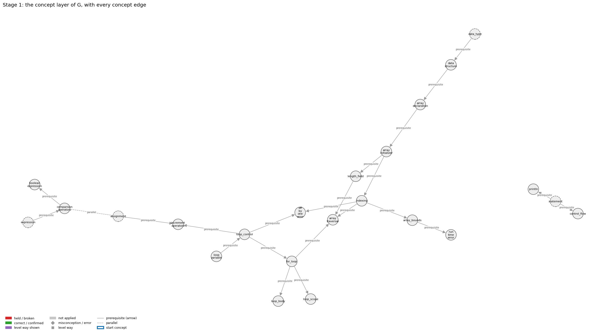
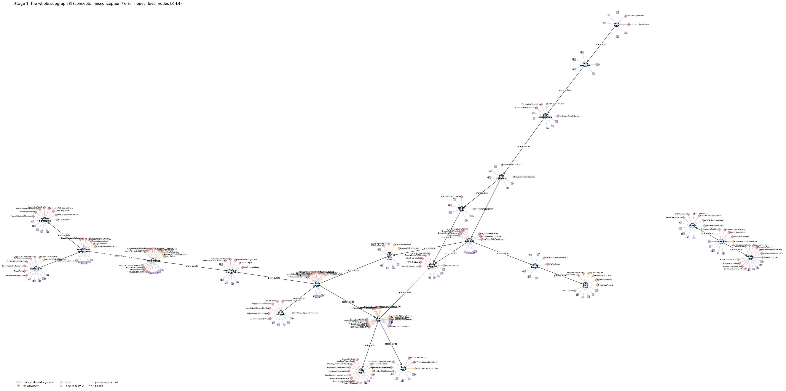
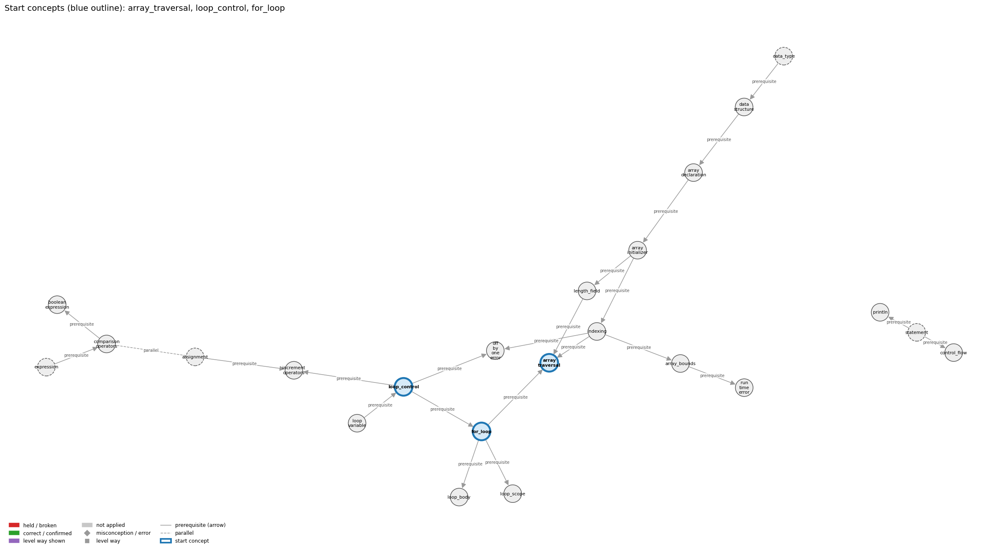
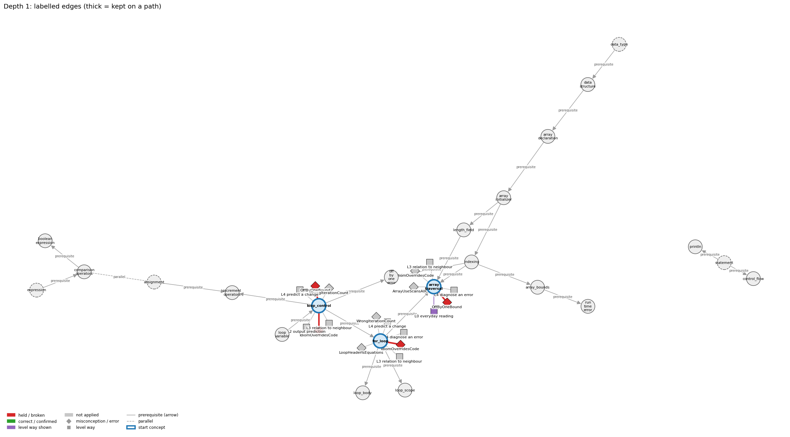
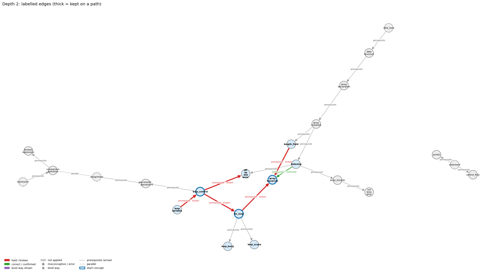
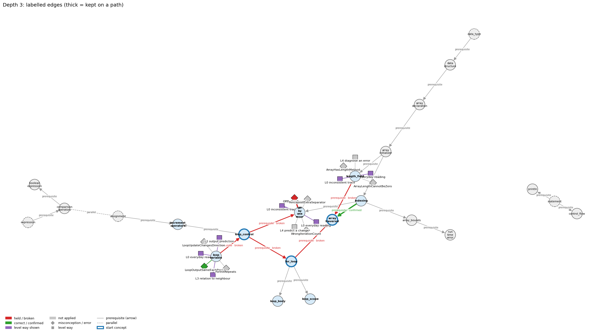
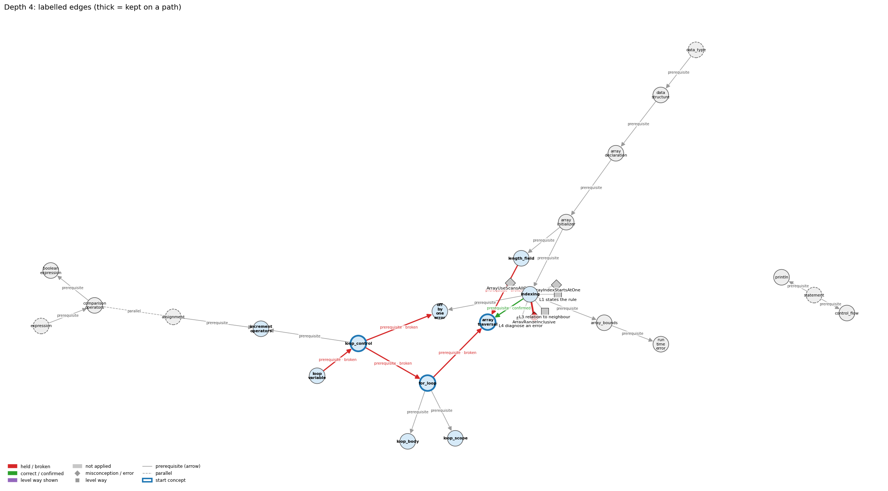
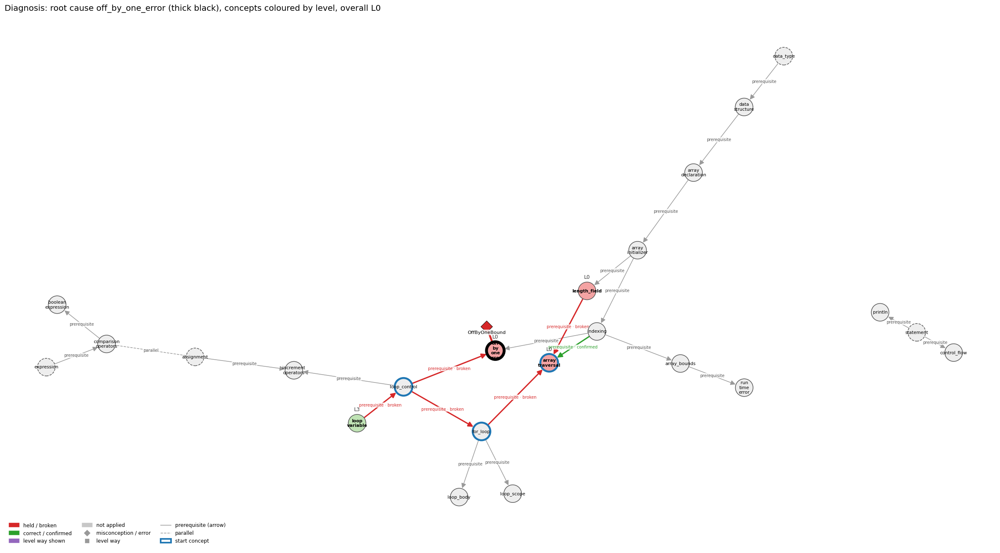

# Think on the Graph: every output of the run MY18

Files of this scenario: `input.json` (program, question, answer), `diagnosis.json`, `subgraph.json`, `traverse_log.txt`, `report.html` (this report as one full-page file, with the interactive graph `MY18_G.html`), `MY18.ipynb` (this report as a notebook).

## 0. Input
Program:
```java
int[] a = {5, 10, 15};
for (int i = 0; i <= a.length; i++) {
    System.out.println(a[i]);
}
```
Question: Explain which indexes the loop visits and why

Student's answer: i goes from 0 to a.length. Using <= or < makes no difference here, because both go through the whole array, so it visits each element once.
Settings: width 3, depth 3, prune llm, backend claude-cli, model claude-opus-5-5
## 1. Stage 1: the subgraph G from the code (no model)
Masked code (string and char literals and comments blanked; this is what the patterns see):
```
int[] a = {5, 10, 15};
for (int i = 0; i <= a.length; i++) {
    System.out.println(a[i]);
}
```
Which code text tagged which concept (a generic concept fires on almost any Java line; it starts the walk only if the answer repeats its tag):
| concept | generic | channel | matched text | line |
|---|---|---|---|---|
| array_bounds | False | pattern | '<= a.length' | 2 |
| array_declaration | False | pattern | 'int[] a' | 1 |
| array_initializer | False | pattern | '= {' | 1 |
| array_traversal | False | pattern | 'for (int i = 0; i <= a.length' | 2 |
| array_traversal | False | pattern | 'for (int i = 0; i <= a.length; i++) {\n    System.out.println(a[i]' | 2 |
| assignment | True | pattern | '=' | 1 |
| boolean_expression | False | pattern | 'for (int i = 0; i <= a.length;' | 2 |
| comparison_operators | False | pattern | 'for (int i = 0; i <=' | 2 |
| control_flow | False | pattern | 'for (' | 2 |
| data_structure | False | pattern | 'int[]' | 1 |
| data_type | True | pattern | 'int' | 1 |
| expression | True | pattern | 'i <=' | 2 |
| expression | True | pattern | '= {5, 10, 15};' | 1 |
| for_loop | False | pattern | 'for (' | 2 |
| increment_operators | False | pattern | '++' | 2 |
| indexing | False | pattern | 'a[i]' | 3 |
| length_field | False | pattern | '.length' | 2 |
| loop_body | False | pattern | 'for (' | 2 |
| loop_control | False | signal | 'for (int i = 0; i <= a.length; i++)' | 2 |
| loop_scope | False | pattern | 'for (int i' | 2 |
| loop_variable | False | pattern | 'for (int i =' | 2 |
| off_by_one_error | False | signal | 'for (int i = 0; i <= a.length' | 2 |
| println | False | pattern | 'System.out.println(' | 3 |
| run_time_error | False | pattern | '<= a.length' | 2 |
| statement | True | pattern | ';' | 1 |

G: 23 concept nodes (4 generic), 23 concept edges, 159 misconception / error edges, 116 misconception / error nodes, 115 level nodes, 173 level-misconception links, 2 connected piece(s).
Note: concept nodes form 2 pieces (the KG has no edge between them): array_bounds,array_declaration,array_initializer,array_traversal,assignment,boolean_expression,comparison_operators,data_structure,data_type,expression,for_loop,increment_operators,indexing,length_field,loop_body,loop_control,loop_scope,loop_variable,off_by_one_error,run_time_error | control_flow,println,statement

Concept edges of G (the links the walk can read; `pre:` = prerequisite A -> B, `par:` = parallel):
| edge | type | rule (logic) |
|---|---|---|
| par:assignment~comparison_operators | parallel | x = y stores the value of y in x (a statement with a side effect); x == y only tests whether the two values are equal and gives a boolean. Writing = where == is meant is a compile error with int operands and a silent bug with boolean operands. |
| pre:array_bounds->run_time_error | prerequisite | An index outside 0 .. length-1 is not caught by the compiler; the access is checked when the program runs and stops it with ArrayIndexOutOfBoundsException. |
| pre:array_declaration->array_initializer | prerequisite | int[] a = {1, 2, 3}; declares the array variable and creates and fills the array in one statement. |
| pre:array_initializer->indexing | prerequisite | The values listed in braces are stored at indices 0, 1, 2, ... in order, and a[i] reads the value at index i. |
| pre:array_initializer->length_field | prerequisite | An array made from a literal has as many elements as values listed, and a.length gives that number. |
| pre:assignment->increment_operators | prerequisite | i++ is shorthand for the assignment i = i + 1. |
| pre:comparison_operators->boolean_expression | prerequisite | A comparison such as x < y produces a boolean result; comparisons together with boolean logic provide the basis for decision-making. |
| pre:data_structure->array_declaration | prerequisite | An array is a data structure: one name for a sequence of values of the same type, organised by index. |
| pre:data_type->data_structure | prerequisite | A data structure organizes many values of a data type; the array holds a sequence of values of one type. |
| pre:expression->comparison_operators | prerequisite | Comparison operators build expressions whose value is a boolean, so one must already know what an expression is to understand a < b. |
| pre:for_loop->array_traversal | prerequisite | for (int i = 0; i < a.length; i++) gives i every valid index exactly once, in increasing order. |
| pre:for_loop->loop_body | prerequisite | The statements in braces after the for header are the loop body; they run once on every pass, between the test and the increment, exactly as in a while loop. |
| pre:for_loop->loop_scope | prerequisite | A variable declared in the for header exists only from its declaration to the end of the for statement's block. |
| pre:indexing->array_bounds | prerequisite | Valid indexes run from 0 to a.length - 1; any other index throws an exception when it is used. |
| pre:indexing->array_traversal | prerequisite | A traversal uses the loop variable i as the index, so a[i] reaches a different element on each pass. |
| pre:indexing->off_by_one_error | prerequisite | Indices start at 0, so the last element is a[N-1]; misreading this convention is the usual source of off-by-one errors. |
| pre:length_field->array_traversal | prerequisite | A traversal loop runs its index from 0 while it is below a.length, so it visits every element once. |
| pre:loop_control->for_loop | prerequisite | The for header is exactly the three control slots, and the body runs after the test and before the update on each pass. |
| pre:loop_control->increment_operators | prerequisite | The loop update i = i + 1 comes first; ++ (and +=) are then introduced as shorthand for that update. |
| pre:loop_control->off_by_one_error | prerequisite | The initialization and the condition of a loop fix how many times it runs; one wrong bound makes it run once too many or too few. |
| pre:loop_variable->loop_control | prerequisite | The init, condition and update all act on the loop variable: the init sets it, the condition tests it, the update changes it. |
| pre:statement->control_flow | prerequisite | Control flow is the order in which statements run. |
| pre:statement->println | prerequisite | System.out.println(s); is itself a statement, so its line of output appears at its own place in the sequence. |

Misconception / error edges per concept (count), and level ways per concept (count):
| concept | misconception / error edges | level ways (L1-L4 + L0 non-misconception) |
|---|---|---|
| array_bounds | 2 | 14 |
| array_declaration | 4 | 13 |
| array_initializer | 2 | 14 |
| array_traversal | 6 | 22 |
| assignment | 15 | 24 |
| boolean_expression | 8 | 19 |
| comparison_operators | 8 | 20 |
| control_flow | 11 | 15 |
| data_structure | 0 | 11 |
| data_type | 2 | 14 |
| expression | 8 | 19 |
| for_loop | 21 | 24 |
| increment_operators | 5 | 16 |
| indexing | 8 | 21 |
| length_field | 2 | 15 |
| loop_body | 12 | 14 |
| loop_control | 11 | 19 |
| loop_scope | 5 | 14 |
| loop_variable | 7 | 13 |
| off_by_one_error | 4 | 16 |
| println | 6 | 17 |
| run_time_error | 7 | 19 |
| statement | 5 | 19 |

**Figure 1**


**Figure 2**


## 2. Clauses and start concepts (no model)
The answer split into clauses (at sentence ends, ';', and before 'because' / 'so'; quotes removed):
| clause | text |
|---|---|
| c1 | i goes from 0 to a.length |
| c2 | Using <= or < makes no difference here |
| c3 | because both go through the whole array |
| c4 | so it visits each element once |

start: generic concepts whose tagging text occurs in the answer: assignment

start: BM25 of the answer against each tagged concept: array_traversal 22.33 (hits 2), loop_control 17.93 (hits 1), for_loop 15.39 (hits 1), indexing 14.08 (hits 1), off_by_one_error 13.89 (hits 1), increment_operators 12.70 (hits 1), control_flow 11.84 (hits 1), array_declaration 11.75 (hits 1), array_bounds 11.65 (hits 1), array_initializer 11.22 (hits 1), length_field 11.12 (hits 1), boolean_expression 10.87 (hits 1), loop_variable 9.71 (hits 1), assignment 9.31 (hits 1), loop_body 8.10 (hits 1), comparison_operators 7.00 (hits 1), loop_scope 5.79 (hits 1), run_time_error 4.52 (hits 1), println 3.84 (hits 1), data_structure 1.63 (hits 1)

start: chosen array_traversal, loop_control, for_loop

start concepts (3): array_traversal, loop_control, for_loop

Start concepts: array_traversal, loop_control, for_loop

**Figure 3**


## 3. The walk, depth by depth
At each depth, for each current concept: the edges offered (a concept entering as a start concept offers its misconception / error edges and its level ways, as two families; otherwise it offers its concept edges), the prune prompt and the model's reply, then the label prompt(s) and the model's reply, parsed into label / clauses / confidence. Score = prune score x confidence.

### Depth 1: current concepts 'array_traversal', 'loop_control', 'for_loop'

#### array_traversal, misconceptions: 6 edges offered
Edges offered:
| edge |
|---|
| err:array_traversal->EarlyReturnInLoop \| wrong rule: Leaves a traversal loop with return before every element has been processed. \| right rule: A result that depends on all elements is known only after the loop ends. |
| mis:array_traversal->ArrayUseScansAllCells \| wrong rule: Using an array means every cell must be scanned. \| right rule: Arrays allow random access: a[i] reaches one element directly, and a loop visits only the elements the task needs. |
| mis:array_traversal->ElementBoundToOldIndex \| wrong rule: After i changes, X[i] still refers to the element at the old value of i. \| right rule: a[i] is evaluated with the current value of i each time it is used. |
| mis:array_traversal->IdiomOverridesCode \| wrong rule: An array loop processes the whole array from index 0 to length-1 and increments its index at the end of the body, whatever the code says. \| right rule: The loop visits exactly the indices that its initialisation, guard and update produce, in the order in which its statements are written. |
| mis:array_traversal->OffByOneBound \| wrong rule: < vs <= and 0..n vs 0..n-1 are interchangeable \| right rule: for (i = 0; i < n; i++) runs n times with i going up to n - 1; with <= it runs n + 1 times and reaches i = n. |
| mis:array_traversal->WholeArrayArithmetic \| wrong rule: a = a + b adds the arrays element by element. \| right rule: Java has no arithmetic on whole arrays; write a loop that adds a[i] + b[i] for each i. |

Prune: the model's reply (edge id and score; the kept edges sum to 1):
```
mis:array_traversal->OffByOneBound (0.60), mis:array_traversal->IdiomOverridesCode (0.30), mis:array_traversal->ArrayUseScansAllCells (0.10)
```
Kept by pruning: mis:array_traversal->OffByOneBound (0.60), mis:array_traversal->IdiomOverridesCode (0.30), mis:array_traversal->ArrayUseScansAllCells (0.10)

Label prompt for the misconception / error edges (judged together). The model saw the program, the question, the numbered clauses, and these edges with their wrong rule and right rule:
| edge |
|---|
| mis:array_traversal->OffByOneBound \| wrong rule: < vs <= and 0..n vs 0..n-1 are interchangeable \| right rule: for (i = 0; i < n; i++) runs n times with i going up to n - 1; with <= it runs n + 1 times and reaches i = n. |
| mis:array_traversal->IdiomOverridesCode \| wrong rule: An array loop processes the whole array from index 0 to length-1 and increments its index at the end of the body, whatever the code says. \| right rule: The loop visits exactly the indices that its initialisation, guard and update produce, in the order in which its statements are written. |
| mis:array_traversal->ArrayUseScansAllCells \| wrong rule: Using an array means every cell must be scanned. \| right rule: Arrays allow random access: a[i] reaches one element directly, and a loop visits only the elements the task needs. |
Model's reply:
```
mis:array_traversal->OffByOneBound | held | clauses: 1, 2, 3, 4 | confidence: 0.95
mis:array_traversal->IdiomOverridesCode | not applied | clauses: none | confidence: 0.6
mis:array_traversal->ArrayUseScansAllCells | not applied | clauses: none | confidence: 0.85
```

Parsed labels:
| edge | label | prune score | confidence | score | clauses | words |
|---|---|---|---|---|---|---|
| mis:array_traversal->OffByOneBound | held | 0.6000000000000001 | 0.95 | 0.57 | c1, c2, c3, c4 | i goes from 0 to a.length; Using <= or < makes no difference here; because both go through the whole array; so it visits each element once |
| mis:array_traversal->IdiomOverridesCode | not applied |  |  | 0.0 |  |  |
| mis:array_traversal->ArrayUseScansAllCells | not applied |  |  | 0.0 |  |  |

#### array_traversal, level ways: 22 edges offered
Edges offered:
| edge |
|---|
| lvl:array_traversal@L0#0 \| level L0 way everyday_reading: Folk meaning: 'go through the list' in English means look at every item once, first to last, so an array loop is assumed to process the whole array whatever its code says. Java rule: the loop visits exactly the indices its initialization, guard and update generate, in that order. |
| lvl:array_traversal@L0#4 \| level L0 way inconsistent_trace: Points to LT: initialize i, test, run the body with the current i, update, test again. Inconsistent application: on some passes the update is applied before the body, or a[i] is traced with the previous i. (here mixing in: "a = a + b adds the arrays element by element") |
| lvl:array_traversal@L1#0 \| level L1 way names_the_element: Identity: a traversal is a loop that steps an index through the array and performs the same operation on each element it visits. |
| lvl:array_traversal@L1#1 \| level L1 way states_the_rule: Declarative: the canonical traversal is 'for (int i = 0; i < a.length; i++) { ... a[i] ... }', which gives i every valid index exactly once, in increasing order; the for loop is equivalent to initialize; while (test) { body; increment; }. |
| lvl:array_traversal@L2#0 \| level L2 way line_by_line_trace: Sequencing: i = 0; test i < a.length; body using a[i]; i++; test; ... When i == a.length the test fails and the body is not executed, so a[a.length] is never touched. |
| lvl:array_traversal@L2#1 \| level L2 way output_prediction: Result: the body runs a.length times, and the result depends on the body. Squaring each element of {1, 2, 3, 4, 5} leaves {1, 4, 9, 16, 25}; summing leaves the total in the accumulator. |
| lvl:array_traversal@L2#2 \| level L2 way one_step_execution: State transition: one pass applies the body to element i (reading or writing a[i] and possibly updating an accumulator), then i increases by 1; no other element is touched unless the body indexes it. |
| lvl:array_traversal@L3#0 \| level L3 way relation_to_neighbour: The loop variable is used as the index, so a[i] reaches a different element on each pass. |
| lvl:array_traversal@L3#1 \| level L3 way relation_to_neighbour: for (int x : a) is a traversal that hands the body each value a[i] and hides the index i. |
| lvl:array_traversal@L3#2 \| level L3 way relation_to_neighbour: for (int i = 0; i < a.length; i++) gives i every valid index exactly once, in increasing order; the bound must be < a.length, not <=. |
| lvl:array_traversal@L3#3 \| level L3 way relation_to_neighbour: The sieve traverses isPrime[] once to set every flag to true and again at the end to count the flags still true. |
| lvl:array_traversal@L3#4 \| level L3 way relation_to_neighbour: Reversal traverses only the first half (i < N/2), exchanging each a[i] with its mirror a[N-1-i]. |
| lvl:array_traversal@L3#5 \| level L3 way relation_to_neighbour: Sample points are computed into x[] and y[] by one traversal and drawn by another. |
| lvl:array_traversal@L3#6 \| level L3 way relation_to_neighbour: The running maximum is found in one traversal that keeps the largest value seen so far, starting from Double.NEGATIVE_INFINITY. |
| lvl:array_traversal@L3#7 \| level L3 way relation_to_neighbour: The elements are copied one at a time by a loop over every index. |
| lvl:array_traversal@L3#8 \| level L3 way purpose_of_the_whole: Plan/role: the index is a stepper, and the loop carries out a Soloway-style plan (accumulate/sum with a gatherer, count, search, find the extreme, copy) once for each element. |
| lvl:array_traversal@L4#0 \| level L4 way predict_a_change: Conservation: running the index downward (a.length-1 to 0) visits the same set of elements in reverse order, harmless for a sum but not for a shift. Starting at 1 or stopping at a.length-1 drops an element. Invariant: before pass i, elements 0..i-1 have been processed. |
| lvl:array_traversal@L4#1 \| level L4 way diagnose_an_error: rule broken: A result that depends on all elements is known only after the loop ends. Kind: silent logic error. Trigger class: a return (or break) placed inside the loop body fires on the first element, e.g. returning false/-1 in the else branch of a search, or returning the sum inside the loop |
| lvl:array_traversal@L4#2 \| level L4 way transfer_to_a_new_program: Applicability: use an index traversal when every element (or a contiguous range) must be processed and the index matters (writing a[i], comparing neighbours, reporting positions). Use enhanced for when only the values matter, and stop early when one element settles the answer (search). |
| lvl:array_traversal@L4#3 \| level L4 way diagnose_an_error: rule broken: The guard must be i < a.length. Kind: run-time exception. Trigger class: i <= a.length (or a body that reads a[i+1]) makes the last pass index a.length (ArrayIndexOutOfBoundsException) |
| lvl:array_traversal@L4#4 \| level L4 way diagnose_an_error: rule broken: The traversal must cover every element it is meant to process. Kind: silent logic error. Trigger class: the loop starts at 1 or stops at a.length-1, so an end element is skipped |
| lvl:array_traversal@L4#5 \| level L4 way diagnose_an_error: rule broken: Arithmetic operators do not apply to whole arrays. Kind: compile-time. Trigger class: a + b or a * 2 written for arrays (bad operand types for binary operator) |

Prune: the model's reply (edge id and score; the kept edges sum to 1):
```
{lvl:array_traversal@L0#0 (Score: 0.5)}
{lvl:array_traversal@L4#3 (Score: 0.3)}
{lvl:array_traversal@L3#2 (Score: 0.2)}
```
Kept by pruning: lvl:array_traversal@L0#0 (0.50), lvl:array_traversal@L4#3 (0.30), lvl:array_traversal@L3#2 (0.20)

Label prompt for level way lvl:array_traversal@L0#0 (the model saw only the concept, the way's name 'everyday reading' and its text; no level):
> Folk meaning: 'go through the list' in English means look at every item once, first to last, so an array loop is assumed to process the whole array whatever its code says. Java rule: the loop visits exactly the indices its initialization, guard and update generate, in that order.

Model's reply:
```
Label: shown
Clauses: 2, 3, 4
Confidence: 0.9
```

Label prompt for level way lvl:array_traversal@L4#3 (the model saw only the concept, the way's name 'diagnose an error' and its text; no level):
> rule broken: The guard must be i < a.length. Kind: run-time exception. Trigger class: i <= a.length (or a body that reads a[i+1]) makes the last pass index a.length (ArrayIndexOutOfBoundsException)

Model's reply:
```
Label: not shown
Clauses: none
Confidence: 0.95
```

Label prompt for level way lvl:array_traversal@L3#2 (the model saw only the concept, the way's name 'relation to neighbour' and its text; no level):
> for (int i = 0; i < a.length; i++) gives i every valid index exactly once, in increasing order; the bound must be < a.length, not <=.

Model's reply:
```
Label: not shown
Clauses: none
Confidence: 0.95
```

Parsed labels:
| edge | label | prune score | confidence | score | clauses | words |
|---|---|---|---|---|---|---|
| lvl:array_traversal@L0#0 | shown | 0.5 | 0.9 | 0.45 | c2, c3, c4 | Using <= or < makes no difference here; because both go through the whole array; so it visits each element once |
| lvl:array_traversal@L4#3 | not applied |  |  | 0.0 |  |  |
| lvl:array_traversal@L3#2 | not applied |  |  | 0.0 |  |  |

#### loop_control, misconceptions: 11 edges offered
Edges offered:
| edge |
|---|
| err:loop_control->WrongIterationCount \| wrong rule: Updates the loop counter so that the loop runs the wrong number of times. \| right rule: The init, test and update together decide the number of passes; trace them to check the count. |
| mis:loop_control->DoubleLoopIndexCount \| wrong rule: for (double x = 0.0; x <= 1.0; x += 0.1) runs exactly 11 times. \| right rule: Using a double as a for-loop index is legal but bad practice: the number of iterations depends on an equality test between double values, which may not give the result you expect. |
| mis:loop_control->ForLoopPartSkipped \| wrong rule: A pass of a loop may leave out one of its parts (the condition test, the body, the update, or the initialization). \| right rule: Each pass of a for loop runs test, then body, then update, every time; the initialization runs once, at the start. |
| mis:loop_control->ForUpdateBeforeBody \| wrong rule: The update part of a for header (e.g. i = i - 4) runs before the body on each pass, so the first pass already sees the updated value. \| right rule: The update runs after the body, before the next condition test; the first pass uses the initial value. |
| mis:loop_control->IdiomOverridesCode \| wrong rule: An array loop processes the whole array from index 0 to length-1 and increments its index at the end of the body, whatever the code says. \| right rule: The loop visits exactly the indices that its initialisation, guard and update produce, in the order in which its statements are written. |
| mis:loop_control->InfiniteLoopUnnoticed \| wrong rule: A while loop always stops on its own, even if nothing in its body can make the condition false. \| right rule: A while loop stops only when its condition is false at a check, so if no pass changes the variables in the condition, it never stops. |
| mis:loop_control->LoopHeaderIsEquations \| wrong rule: The initialization, condition and update of a for header are equations that all hold at the same time. \| right rule: The three header parts are statements run at different moments: init once, then condition test, body, update, repeated. |
| mis:loop_control->LoopStepAlwaysOne \| wrong rule: A loop variable always goes up or down by 1, whatever the update says (so i = i - 4 is read as i--). \| right rule: The loop variable changes exactly as the update expression says (i += 2, i = i - 4, i *= 2, ...). |
| mis:loop_control->LoopUpdateChangesDirection \| wrong rule: The update of the loop variable can change from pass to pass (e.g. switch direction) although the code is the same. \| right rule: The update expression is the same on every pass; the loop variable changes by the rule written in the update. |
| mis:loop_control->OffByOneBound \| wrong rule: i < n and i <= n mean the same, so the loop runs until i equals n and the last pass can use a[n]. \| right rule: for (i = 0; i < n; i++) runs n times with i going up to n - 1; with <= it runs n + 1 times and reaches i = n. |
| mis:loop_control->PreIncrementBeforeLoop \| wrong rule: With ++i in the update of for (int i = s; i < n; ++i), i is increased before the body runs, so the first pass uses s + 1. \| right rule: The update runs after each pass of the body, so with either ++i or i++ the first pass uses i = s. |

Prune: the model's reply (edge id and score; the kept edges sum to 1):
```
mis:loop_control->OffByOneBound (0.60), mis:loop_control->IdiomOverridesCode (0.25), err:loop_control->WrongIterationCount (0.15)
```
Kept by pruning: mis:loop_control->OffByOneBound (0.60), mis:loop_control->IdiomOverridesCode (0.25), err:loop_control->WrongIterationCount (0.15)

Label prompt for the misconception / error edges (judged together). The model saw the program, the question, the numbered clauses, and these edges with their wrong rule and right rule:
| edge |
|---|
| mis:loop_control->OffByOneBound \| wrong rule: i < n and i <= n mean the same, so the loop runs until i equals n and the last pass can use a[n]. \| right rule: for (i = 0; i < n; i++) runs n times with i going up to n - 1; with <= it runs n + 1 times and reaches i = n. |
| mis:loop_control->IdiomOverridesCode \| wrong rule: An array loop processes the whole array from index 0 to length-1 and increments its index at the end of the body, whatever the code says. \| right rule: The loop visits exactly the indices that its initialisation, guard and update produce, in the order in which its statements are written. |
| err:loop_control->WrongIterationCount \| wrong rule: Updates the loop counter so that the loop runs the wrong number of times. \| right rule: The init, test and update together decide the number of passes; trace them to check the count. |
Model's reply:
```
mis:loop_control->OffByOneBound | held | clauses: 1, 2, 3 | confidence: 0.92
mis:loop_control->IdiomOverridesCode | held | clauses: 3, 4 | confidence: 0.75
err:loop_control->WrongIterationCount | not applied | clauses: none | confidence: 0.6
```

Parsed labels:
| edge | label | prune score | confidence | score | clauses | words |
|---|---|---|---|---|---|---|
| mis:loop_control->OffByOneBound | held | 0.6 | 0.92 | 0.55 | c1, c2, c3 | i goes from 0 to a.length; Using <= or < makes no difference here; because both go through the whole array |
| mis:loop_control->IdiomOverridesCode | held | 0.25 | 0.75 | 0.19 | c3, c4 | because both go through the whole array; so it visits each element once |
| err:loop_control->WrongIterationCount | not applied |  |  | 0.0 |  |  |

#### loop_control, level ways: 19 edges offered
Edges offered:
| edge |
|---|
| lvl:loop_control@L0#0 \| level L0 way everyday_reading: Folk meaning: in mathematics i = 0, i < n and i = i + 1 are equations or constraints that hold at the same time (and i = i + 1 is nonsense). In Java they are three actions run at different moments: init once, test before each pass, update after each pass. |
| lvl:loop_control@L0#3 \| level L0 way inconsistent_trace: Applies the init-test-update rule (LT) unevenly: updates before the body on some passes, skips the test or the update on a pass, or re-runs the init. (here mixing in: "++i in the for-update runs before the body each pass") |
| lvl:loop_control@L1#0 \| level L1 way names_the_element: Loop control is the init / continuation condition / increment scheme on an index variable that decides how many passes a loop makes and with which values. |
| lvl:loop_control@L1#1 \| level L1 way states_the_rule: Initialize an index variable, test a loop-continuation condition on it before each pass, and increment it as the last action of each pass; for (<initialize>; <boolean expression>; <increment>) packages the three. Choosing the loop: for when the passes are counted by an index, while when the loop runs until a condition changes, do-while when the body must run at least once; any one can be rewritten as another, so choose the clearest. |
| lvl:loop_control@L2#0 \| level L2 way line_by_line_trace: init (once) -> test -> body -> update -> test -> body -> update ... -> test false -> exit. |
| lvl:loop_control@L2#1 \| level L2 way output_prediction: The number of passes and the values seen follow from the three parts: for (int i = 0; i <= N; i++) makes N+1 passes with i = 0..N; with i < N it makes N passes; i += 2 visits every second value. |
| lvl:loop_control@L2#2 \| level L2 way one_step_execution: One update changes only the loop variable, by exactly the rule written (i++ adds 1, i = i - 4 subtracts 4); one test reads it and returns true or false without changing it. |
| lvl:loop_control@L3#0 \| level L3 way relation_to_neighbour: All three control parts act on the loop variable: the init sets it, the condition tests it, the update changes it. |
| lvl:loop_control@L3#1 \| level L3 way relation_to_neighbour: The for header is exactly the three control slots, separated by semicolons; the body runs after the test and before the update. |
| lvl:loop_control@L3#2 \| level L3 way relation_to_neighbour: The update i = i + 1 is usually written i++ (or i += k for other steps); as a whole update statement ++i and i++ are equivalent. |
| lvl:loop_control@L3#3 \| level L3 way relation_to_neighbour: A loop is infinite when the update never moves the variable toward making the condition false (e.g. condition i > 3 with update i = i + 1). |
| lvl:loop_control@L3#4 \| level L3 way relation_to_neighbour: The continuation condition fixes the number of iterations, so a sharper bound (i <= n/i instead of i < n) can make a program dramatically faster. |
| lvl:loop_control@L3#5 \| level L3 way relation_to_neighbour: The initialization and the condition of a loop fix how many times it runs; one wrong bound makes it run once too many or too few. |
| lvl:loop_control@L3#6 \| level L3 way purpose_of_the_whole: Plan: counter-controlled loop - the loop variable is a stepper that walks a predictable sequence of values (0..N-1, 1..N, every 2nd value) and fixes the number of passes in advance. |
| lvl:loop_control@L4#0 \| level L4 way predict_a_change: Changing < to <= adds one pass; starting at 1 instead of 0 removes one; doubling the step halves the passes; reversing init and bound with i-- visits the same values in reverse order (and still processes the same set only if both ends are adjusted). |
| lvl:loop_control@L4#1 \| level L4 way diagnose_an_error: rule broken: The number of passes is fixed by the init, the test and the update together. Kind: silent logic error. Trigger class: Wrong start value, < vs <=, a wrong step, or an extra update of the counter in the body (or outside the loop): the loop runs too few or too many passes (off by one, or skips values). |
| lvl:loop_control@L4#2 \| level L4 way transfer_to_a_new_program: Use explicit init/test/update control when the passes are counted or follow a fixed step; when the number of passes depends on data computed in the body, control the loop by that data (a while condition) instead. |
| lvl:loop_control@L4#3 \| level L4 way diagnose_an_error: rule broken: The update must move the loop variable toward making the condition false. Kind: silent logic error. Trigger class: An update in the wrong direction or a condition that the update cannot falsify (e.g. i > 3 with i++, or i != 10 with i += 3): infinite loop. |
| lvl:loop_control@L4#4 \| level L4 way diagnose_an_error: rule broken: Do not control a loop by an equality test on double values. Kind: silent logic error. Trigger class: for (double x = 0.0; x < 1.0; x += 0.1): after ten additions x is 0.9999999999999999, so the loop makes 11 passes instead of the intended 10. |

Prune: the model's reply (edge id and score; the kept edges sum to 1):
```
{lvl:loop_control@L4#0 (Score: 0.45)}
{lvl:loop_control@L3#5 (Score: 0.3)}
{lvl:loop_control@L2#1 (Score: 0.25)}
```
Kept by pruning: lvl:loop_control@L4#0 (0.45), lvl:loop_control@L3#5 (0.30), lvl:loop_control@L2#1 (0.25)

Label prompt for level way lvl:loop_control@L4#0 (the model saw only the concept, the way's name 'predict a change' and its text; no level):
> Changing < to <= adds one pass; starting at 1 instead of 0 removes one; doubling the step halves the passes; reversing init and bound with i-- visits the same values in reverse order (and still processes the same set only if both ends are adjusted).

Model's reply:
```
Label: not shown
Clauses: none
Confidence: 0.93
```

Label prompt for level way lvl:loop_control@L3#5 (the model saw only the concept, the way's name 'relation to neighbour' and its text; no level):
> The initialization and the condition of a loop fix how many times it runs; one wrong bound makes it run once too many or too few.

Model's reply:
```
Label: not shown
Clauses: none
Confidence: 0.9
```

Label prompt for level way lvl:loop_control@L2#1 (the model saw only the concept, the way's name 'output prediction' and its text; no level):
> The number of passes and the values seen follow from the three parts: for (int i = 0; i <= N; i++) makes N+1 passes with i = 0..N; with i < N it makes N passes; i += 2 visits every second value.

Model's reply:
```
Label: not shown
Clauses: none
Confidence: 0.8
```

Parsed labels:
| edge | label | prune score | confidence | score | clauses | words |
|---|---|---|---|---|---|---|
| lvl:loop_control@L4#0 | not applied |  |  | 0.0 |  |  |
| lvl:loop_control@L3#5 | not applied |  |  | 0.0 |  |  |
| lvl:loop_control@L2#1 | not applied |  |  | 0.0 |  |  |

#### for_loop, misconceptions: 21 edges offered
Edges offered:
| edge |
|---|
| err:for_loop->BracelessMultiStatementBody \| wrong rule: Indenting several statements under an if or for makes them all part of its body, even without braces. \| right rule: Without braces only the first statement belongs to the if/for; the rest run once, after it. |
| err:for_loop->ForCommaSeparators \| wrong rule: Writes for (int i = 0, i < n, i++). \| right rule: The three parts of a for header are separated by semicolons; commas only separate several statements inside the init or the update part. |
| err:for_loop->SemicolonAfterIfHeader \| wrong rule: if (x > 0); System.out.println("positive"); prints only for positive x. \| right rule: The ; ends the if with an empty statement, so the next line always runs. |
| err:for_loop->SemicolonAfterLoopHeader \| wrong rule: Puts a ; right after for (...) or while (...). \| right rule: A ; right after the loop header is a null (empty) loop body, so the statements written after it are not repeated by the loop. |
| err:for_loop->WrongIterationCount \| wrong rule: Updates the loop counter so that the loop runs the wrong number of times. \| right rule: The init, test and update together decide the number of passes; trace them to check the count. |
| mis:for_loop->DoubleLoopIndexCount \| wrong rule: for (double x = 0.0; x <= 1.0; x += 0.1) runs exactly 11 times. \| right rule: Using a double as a for-loop index is legal but bad practice: the number of iterations depends on an equality test between double values, which may not give the result you expect. |
| mis:for_loop->FalseLoopRepeatsNextCode \| wrong rule: A loop is an iterative if-else: while the condition is true the body repeats, and when it is false the code after the loop repeats. \| right rule: Only the body is repeated; once the condition is false the code after the loop runs once. |
| mis:for_loop->ForInitRepeats \| wrong rule: The initialization of a for loop runs again after a pass of the body. \| right rule: The initialization runs exactly once, before the first condition test. |
| mis:for_loop->ForIsConditional \| wrong rule: The body of a for statement executes at most once. \| right rule: The body of a for statement runs once for every pass on which the condition is true, which can be many times. |
| mis:for_loop->ForLoopPartSkipped \| wrong rule: A pass of a loop may leave out one of its parts (the condition test, the body, the update, or the initialization). \| right rule: Each pass of a for loop runs test, then body, then update, every time; the initialization runs once, at the start. |
| mis:for_loop->ForUpdateBeforeBody \| wrong rule: The update part of a for header (e.g. i = i - 4) runs before the body on each pass, so the first pass already sees the updated value. \| right rule: The update runs after the body, before the next condition test; the first pass uses the initial value. |
| mis:for_loop->ForWhileNotInterchangeable \| wrong rule: Some loops can only be written with for, others only with while. \| right rule: Any for loop can be rewritten as a while loop and vice versa; for just packages init, test and update. |
| mis:for_loop->IdiomOverridesCode \| wrong rule: An array loop processes the whole array from index 0 to length-1 and increments its index at the end of the body, whatever the code says. \| right rule: The loop visits exactly the indices that its initialisation, guard and update produce, in the order in which its statements are written. |
| mis:for_loop->LoopCountIsStatementCount \| wrong rule: The repeat count of a counted loop says how many of the body statements are executed. \| right rule: The repeat count is how many times the whole body runs; every pass runs all body statements. |
| mis:for_loop->LoopHeaderIsEquations \| wrong rule: The initialization, condition and update of a for header are equations that all hold at the same time. \| right rule: The three header parts are statements run at different moments: init once, then condition test, body, update, repeated. |
| mis:for_loop->LoopImpliedByOneTest \| wrong rule: Testing one case is enough; Java will repeat the test for the other values by itself. \| right rule: A statement runs once each time control reaches it; repeating a test for many values needs a loop. |
| mis:for_loop->LoopStepAlwaysOne \| wrong rule: A loop variable always goes up or down by 1, whatever the update says (so i = i - 4 is read as i--). \| right rule: The loop variable changes exactly as the update expression says (i += 2, i = i - 4, i *= 2, ...). |
| mis:for_loop->MissingBraces \| wrong rule: Omits braces around a single-statement body of if, for or while. \| right rule: Braces are optional for a single-statement body, but using them anyway avoids bugs when statements are added later. |
| mis:for_loop->ProgramEndsAfterLoop \| wrong rule: When a loop finishes the program ends, so code after the loop never runs. \| right rule: When the loop condition becomes false, control continues with the first statement after the loop. |
| mis:for_loop->ReturnDoesNotExitLoop \| wrong rule: A return inside a loop does not end the loop; it sets a value each pass (the last one is returned) or returns several values. \| right rule: When return executes, the method ends at once, so the loop stops on that pass. |
| mis:for_loop->SingleIterationInsteadOfLoop \| wrong rule: A task that must be repeated is written once, without a loop, as if one pass were enough. \| right rule: A step that must happen several times (or an unknown number of times) needs a loop such as while or for; code without a loop runs once. |

Prune: the model's reply (edge id and score; the kept edges sum to 1):
```
mis:for_loop->IdiomOverridesCode (0.60), err:for_loop->WrongIterationCount (0.30), mis:for_loop->LoopHeaderIsEquations (0.10)
```
Kept by pruning: mis:for_loop->IdiomOverridesCode (0.60), err:for_loop->WrongIterationCount (0.30), mis:for_loop->LoopHeaderIsEquations (0.10)

Label prompt for the misconception / error edges (judged together). The model saw the program, the question, the numbered clauses, and these edges with their wrong rule and right rule:
| edge |
|---|
| mis:for_loop->IdiomOverridesCode \| wrong rule: An array loop processes the whole array from index 0 to length-1 and increments its index at the end of the body, whatever the code says. \| right rule: The loop visits exactly the indices that its initialisation, guard and update produce, in the order in which its statements are written. |
| err:for_loop->WrongIterationCount \| wrong rule: Updates the loop counter so that the loop runs the wrong number of times. \| right rule: The init, test and update together decide the number of passes; trace them to check the count. |
| mis:for_loop->LoopHeaderIsEquations \| wrong rule: The initialization, condition and update of a for header are equations that all hold at the same time. \| right rule: The three header parts are statements run at different moments: init once, then condition test, body, update, repeated. |
Model's reply:
```
mis:for_loop->IdiomOverridesCode | held | clauses: 2, 3, 4 | confidence: 0.9
err:for_loop->WrongIterationCount | not applied | clauses: none | confidence: 0.65
mis:for_loop->LoopHeaderIsEquations | not applied | clauses: none | confidence: 0.85
```

Parsed labels:
| edge | label | prune score | confidence | score | clauses | words |
|---|---|---|---|---|---|---|
| mis:for_loop->IdiomOverridesCode | held | 0.6000000000000001 | 0.9 | 0.54 | c2, c3, c4 | Using <= or < makes no difference here; because both go through the whole array; so it visits each element once |
| err:for_loop->WrongIterationCount | not applied |  |  | 0.0 |  |  |
| mis:for_loop->LoopHeaderIsEquations | not applied |  |  | 0.0 |  |  |

#### for_loop, level ways: 24 edges offered
Edges offered:
| edge |
|---|
| lvl:for_loop@L0#0 \| level L0 way everyday_reading: Folk meaning: English 'for each ...' or 'for 10 times' names a whole collection or a count to be handled at once, and a maths reading treats the header as simultaneous conditions. A Java for is a while loop in compact form: one init, then test-body-update repeated, one pass at a time. |
| lvl:for_loop@L0#11 \| level L0 way inconsistent_trace: Applies the for sequencing rule (LT) unevenly: updates before the body on the first pass only, re-runs the init after a pass, or skips the test on some passes. (here mixing in: "The body of a for statement executes at most once") |
| lvl:for_loop@L1#0 \| level L1 way names_the_element: The for statement is a loop that packages an initialization, a loop-continuation condition and an increment in its header around a body. |
| lvl:for_loop@L1#1 \| level L1 way states_the_rule: Syntax: for (<initialize>; <boolean expression>; <increment>) { <statements> }, with the three parts separated by semicolons; it is, with only a few exceptions, equivalent to <initialize>; while (<boolean expression>) { <statements> <increment>; }. |
| lvl:for_loop@L2#0 \| level L2 way line_by_line_trace: Run the initializer once; then repeatedly: test the condition (stop if false), execute the body, run the update. |
| lvl:for_loop@L2#1 \| level L2 way output_prediction: A for statement has no value; the passes it makes are fixed by its header: for (int i = 1; i <= N; i++) sum += i; leaves sum = N(N+1)/2, and for (int i = 2; i <= 8; i += 2) prints 2, 4, 6, 8,. |
| lvl:for_loop@L2#2 \| level L2 way one_step_execution: One pass: the test reads the loop variable; the body applies its changes once; the update then changes the loop variable by its rule; the initializer changes state only once, before the first test. |
| lvl:for_loop@L3#0 \| level L3 way relation_to_neighbour: The for header is exactly the three loop-control slots; the body runs after the test and before the update on each pass. |
| lvl:for_loop@L3#1 \| level L3 way relation_to_neighbour: A for may be the body of another for: the inner for runs its complete set of passes for every single pass of the outer one. |
| lvl:for_loop@L3#2 \| level L3 way relation_to_neighbour: for (int i = 0; i < N; i++) gives i each valid index 0..N-1 exactly once in increasing order, the standard way to process every array element. |
| lvl:for_loop@L3#3 \| level L3 way relation_to_neighbour: A simulation runs a fixed number of trials with an outer for loop (for (int t = 0; t < T; t++)), each trial simulated inside the body. |
| lvl:for_loop@L3#4 \| level L3 way relation_to_neighbour: In a for loop, continue skips the rest of the body and transfers control directly to the increment, then the next test; this is one of the few places where the for/while equivalence fails. |
| lvl:for_loop@L3#5 \| level L3 way relation_to_neighbour: A variable declared in the for header is in scope only in the header and the body, so it cannot be used after the loop. |
| lvl:for_loop@L3#6 \| level L3 way relation_to_neighbour: A fencepost loop is a for loop that handles one item (the first or last) outside the loop so that separators come out n-1 times for n items. |
| lvl:for_loop@L3#7 \| level L3 way relation_to_neighbour: A flag search loop is a for loop that sets a boolean flag when some pass finds the target and leaves it set afterwards; the flag must be declared before the loop. |
| lvl:for_loop@L3#8 \| level L3 way purpose_of_the_whole: Plan: counted loop / counter-controlled repetition - do the body a known number of times, with the loop variable as a stepper (index, term number, trial number). |
| lvl:for_loop@L4#0 \| level L4 way predict_a_change: Rewriting a for as the equivalent while (init before, update at the end of the body) keeps behaviour, except that continue then skips the update and the loop variable stays in scope after the loop. Changing the bound or the step changes the pass count predictably (< to <= adds one pass). |
| lvl:for_loop@L4#1 \| level L4 way diagnose_an_error: rule broken: The three parts of a for header are separated by semicolons; commas only separate several statements inside the init or the update. Kind: compile-time. Trigger class: Writing for (int i = 0, i < n, i++): the compiler parses the commas as more declarators in the init and reports a syntax error. |
| lvl:for_loop@L4#2 \| level L4 way diagnose_an_error: rule broken: A ; right after while (...) or for (...) is an empty statement that is the whole loop body; the block written next is not repeated. Kind: silent logic error. Trigger class: for (...); { body } runs the body once after the loop ends; while (cond); with a cond that the empty body cannot change hangs forever (infinite loop) when cond starts true. |
| lvl:for_loop@L4#3 \| level L4 way transfer_to_a_new_program: Use for when there is an initialization, an increment and a continuation test and the loop variable is not needed after the loop; use while when the loop variable is needed later or the number of passes depends on what happens in the body. |
| lvl:for_loop@L4#4 \| level L4 way diagnose_an_error: rule broken: A ; right after if (...) is an empty statement that forms the whole then branch; the following statement or block is no longer part of the if. Kind: silent logic error. Trigger class: Any if (cond); followed by a statement or block: that statement runs for every input, whatever cond is (it compiles without error). |
| lvl:for_loop@L4#5 \| level L4 way diagnose_an_error: rule broken: The number of passes is fixed by the init, the test and the update together. Kind: silent logic error. Trigger class: Wrong start value, < vs <=, a wrong step, or an extra update of the counter in the body (or outside the loop): the loop runs too few or too many passes (off by one, or skips values). |
| lvl:for_loop@L4#6 \| level L4 way diagnose_an_error: rule broken: Without braces, the body of an if, while or for is exactly one statement; indentation does not add statements to it. Kind: silent logic error. Trigger class: A braceless header followed by two or more indented statements: only the first is controlled, the others run once, after the if/loop, on every input. |
| lvl:for_loop@L4#7 \| level L4 way diagnose_an_error: rule broken: A variable declared in the for initializer exists only inside the for statement. Kind: compile-time. Trigger class: Reading i after for (int i = 0; ...) {...}: 'cannot find symbol'. |

Prune: the model's reply (edge id and score; the kept edges sum to 1):
```
{lvl:for_loop@L4#5 (Score: 0.4)}
{lvl:for_loop@L4#0 (Score: 0.35)}
{lvl:for_loop@L3#2 (Score: 0.25)}
```
Kept by pruning: lvl:for_loop@L4#5 (0.40), lvl:for_loop@L4#0 (0.35), lvl:for_loop@L3#2 (0.25)

Label prompt for level way lvl:for_loop@L4#5 (the model saw only the concept, the way's name 'diagnose an error' and its text; no level):
> rule broken: The number of passes is fixed by the init, the test and the update together. Kind: silent logic error. Trigger class: Wrong start value, < vs <=, a wrong step, or an extra update of the counter in the body (or outside the loop): the loop runs too few or too many passes (off by one, or skips values).

Model's reply:
```
Label: not shown
Clauses: none
Confidence: 0.92
```

Label prompt for level way lvl:for_loop@L4#0 (the model saw only the concept, the way's name 'predict a change' and its text; no level):
> Rewriting a for as the equivalent while (init before, update at the end of the body) keeps behaviour, except that continue then skips the update and the loop variable stays in scope after the loop. Changing the bound or the step changes the pass count predictably (< to <= adds one pass).

Model's reply:
```
Label: not shown
Clauses: none
Confidence: 0.93
```

Label prompt for level way lvl:for_loop@L3#2 (the model saw only the concept, the way's name 'relation to neighbour' and its text; no level):
> for (int i = 0; i < N; i++) gives i each valid index 0..N-1 exactly once in increasing order, the standard way to process every array element.

Model's reply:
```
Label: not shown
Clauses: none
Confidence: 0.85
```

Parsed labels:
| edge | label | prune score | confidence | score | clauses | words |
|---|---|---|---|---|---|---|
| lvl:for_loop@L4#5 | not applied |  |  | 0.0 |  |  |
| lvl:for_loop@L4#0 | not applied |  |  | 0.0 |  |  |
| lvl:for_loop@L3#2 | not applied |  |  | 0.0 |  |  |

**Kept on a path at this depth** (best N in tiers: held misconception / broken edge, then held error, then correct / confirmed / shown):

mis:array_traversal->OffByOneBound [held, tier 0, 0.57], mis:loop_control->OffByOneBound [held, tier 0, 0.55], mis:for_loop->IdiomOverridesCode [held, tier 0, 0.54], mis:loop_control->IdiomOverridesCode [held, tier 0, 0.19]

**Clause coverage after this depth:**
| clause | text | covered by |
|---|---|---|
| c1 | i goes from 0 to a.length | mis:array_traversal->OffByOneBound |
| c2 | Using <= or < makes no difference here | mis:array_traversal->OffByOneBound |
| c3 | because both go through the whole array | mis:array_traversal->OffByOneBound |
| c4 | so it visits each element once | mis:array_traversal->OffByOneBound |

**Graph check, not yet read (the walk may not stop while these remain):** pre:for_loop->array_traversal, pre:for_loop->loop_body, pre:for_loop->loop_scope, pre:indexing->array_traversal, pre:length_field->array_traversal, pre:loop_control->for_loop, pre:loop_control->increment_operators, pre:loop_control->off_by_one_error, pre:loop_variable->loop_control

**Figure 4 (the graph after depth 1)**


### Depth 2: current concepts 'array_traversal', 'loop_control', 'for_loop'

#### array_traversal, concept edges: 3 edges offered
Edges offered:
| edge |
|---|
| pre:for_loop->array_traversal \| rule: for (int i = 0; i < a.length; i++) gives i every valid index exactly once, in increasing order. |
| pre:indexing->array_traversal \| rule: A traversal uses the loop variable i as the index, so a[i] reaches a different element on each pass. |
| pre:length_field->array_traversal \| rule: A traversal loop runs its index from 0 while it is below a.length, so it visits every element once. |

Prune: the model's reply (edge id and score; the kept edges sum to 1):
```
{pre:length_field->array_traversal (Score: 0.5)}
{pre:for_loop->array_traversal (Score: 0.4)}
{pre:indexing->array_traversal (Score: 0.1)}
```
Kept by pruning: pre:length_field->array_traversal (0.50), pre:for_loop->array_traversal (0.40), pre:indexing->array_traversal (0.10)

Label prompt for concept edge pre:length_field->array_traversal (length_field -> array_traversal, prerequisite):
> A traversal loop runs its index from 0 while it is below a.length, so it visits every element once.

Model's reply:
```
Label: broken
Clauses: 1, 2, 3
Confidence: 0.93
```

Label prompt for concept edge pre:for_loop->array_traversal (for_loop -> array_traversal, prerequisite):
> for (int i = 0; i < a.length; i++) gives i every valid index exactly once, in increasing order.

Model's reply:
```
Label: broken
Clauses: 1, 2, 3
Confidence: 0.93
```

Label prompt for concept edge pre:indexing->array_traversal (indexing -> array_traversal, prerequisite):
> A traversal uses the loop variable i as the index, so a[i] reaches a different element on each pass.

Model's reply:
```
Label: confirmed
Clauses: 1, 4
Confidence: 0.6
```

Parsed labels:
| edge | label | prune score | confidence | score | clauses | words |
|---|---|---|---|---|---|---|
| pre:length_field->array_traversal | broken | 0.5 | 0.93 | 0.47 | c1, c2, c3 | i goes from 0 to a.length; Using <= or < makes no difference here; because both go through the whole array |
| pre:for_loop->array_traversal | broken | 0.4 | 0.93 | 0.37 | c1, c2, c3 | i goes from 0 to a.length; Using <= or < makes no difference here; because both go through the whole array |
| pre:indexing->array_traversal | confirmed | 0.1 | 0.6 | 0.06 | c1, c4 | i goes from 0 to a.length; so it visits each element once |

#### loop_control, concept edges: 4 edges offered
Edges offered:
| edge |
|---|
| pre:loop_control->for_loop \| rule: The for header is exactly the three control slots, and the body runs after the test and before the update on each pass. |
| pre:loop_control->increment_operators \| rule: The loop update i = i + 1 comes first; ++ (and +=) are then introduced as shorthand for that update. |
| pre:loop_control->off_by_one_error \| rule: The initialization and the condition of a loop fix how many times it runs; one wrong bound makes it run once too many or too few. |
| pre:loop_variable->loop_control \| rule: The init, condition and update all act on the loop variable: the init sets it, the condition tests it, the update changes it. |

Prune: the model's reply (edge id and score; the kept edges sum to 1):
```
{pre:loop_control->off_by_one_error (Score: 0.6)}
{pre:loop_variable->loop_control (Score: 0.25)}
{pre:loop_control->for_loop (Score: 0.15)}
```
Kept by pruning: pre:loop_control->off_by_one_error (0.60), pre:loop_variable->loop_control (0.25), pre:loop_control->for_loop (0.15)

Label prompt for concept edge pre:loop_control->off_by_one_error (loop_control -> off_by_one_error, prerequisite):
> The initialization and the condition of a loop fix how many times it runs; one wrong bound makes it run once too many or too few.

Model's reply:
```
Label: broken
Clauses: 2, 3, 4
Confidence: 0.92
```

Label prompt for concept edge pre:loop_variable->loop_control (loop_variable -> loop_control, prerequisite):
> The init, condition and update all act on the loop variable: the init sets it, the condition tests it, the update changes it.

Model's reply:
```
Label: broken
Clauses: 2, 3
Confidence: 0.75
```

Label prompt for concept edge pre:loop_control->for_loop (loop_control -> for_loop, prerequisite):
> The for header is exactly the three control slots, and the body runs after the test and before the update on each pass.

Model's reply:
```
Label: broken
Clauses: 2, 3, 4
Confidence: 0.75
```

Parsed labels:
| edge | label | prune score | confidence | score | clauses | words |
|---|---|---|---|---|---|---|
| pre:loop_control->off_by_one_error | broken | 0.6 | 0.92 | 0.55 | c2, c3, c4 | Using <= or < makes no difference here; because both go through the whole array; so it visits each element once |
| pre:loop_variable->loop_control | broken | 0.25 | 0.75 | 0.19 | c2, c3 | Using <= or < makes no difference here; because both go through the whole array |
| pre:loop_control->for_loop | broken | 0.15 | 0.75 | 0.11 | c2, c3, c4 | Using <= or < makes no difference here; because both go through the whole array; so it visits each element once |

#### for_loop, concept edges: 2 edges offered
Edges offered:
| edge |
|---|
| pre:for_loop->array_traversal \| rule: for (int i = 0; i < a.length; i++) gives i every valid index exactly once, in increasing order. |
| pre:for_loop->loop_body \| rule: The statements in braces after the for header are the loop body; they run once on every pass, between the test and the increment, exactly as in a while loop. |
| pre:for_loop->loop_scope \| rule: A variable declared in the for header exists only from its declaration to the end of the for statement's block. |
| pre:loop_control->for_loop \| rule: The for header is exactly the three control slots, and the body runs after the test and before the update on each pass. |

Prune: the model's reply (edge id and score; the kept edges sum to 1):
```
pre:for_loop->loop_body (0.80), pre:for_loop->loop_scope (0.20)
```
Kept by pruning: pre:for_loop->loop_body (0.80), pre:for_loop->loop_scope (0.20)

Label prompt for concept edge pre:for_loop->loop_body (for_loop -> loop_body, prerequisite):
> The statements in braces after the for header are the loop body; they run once on every pass, between the test and the increment, exactly as in a while loop.

Model's reply:
```
Label: not applied
Clauses: none
Confidence: 0.6
```

Label prompt for concept edge pre:for_loop->loop_scope (for_loop -> loop_scope, prerequisite):
> A variable declared in the for header exists only from its declaration to the end of the for statement's block.

Model's reply:
```
Label: not applied
Clauses: none
Confidence: 0.9
```

Parsed labels:
| edge | label | prune score | confidence | score | clauses | words |
|---|---|---|---|---|---|---|
| pre:for_loop->loop_body | not applied |  |  | 0.0 |  |  |
| pre:for_loop->loop_scope | not applied |  |  | 0.0 |  |  |

**Kept on a path at this depth** (best N in tiers: held misconception / broken edge, then held error, then correct / confirmed / shown):

pre:loop_control->off_by_one_error [broken, tier 0, 0.55], pre:length_field->array_traversal [broken, tier 0, 0.47], pre:for_loop->array_traversal [broken, tier 0, 0.37], pre:loop_variable->loop_control [broken, tier 0, 0.19], pre:loop_control->for_loop [broken, tier 0, 0.11]

reached across pre:loop_control->off_by_one_error, entered next: off_by_one_error

reached across pre:length_field->array_traversal, entered next: length_field

reached across pre:loop_variable->loop_control, entered next: loop_variable

**Clause coverage after this depth:**
| clause | text | covered by |
|---|---|---|
| c1 | i goes from 0 to a.length | mis:array_traversal->OffByOneBound |
| c2 | Using <= or < makes no difference here | mis:array_traversal->OffByOneBound |
| c3 | because both go through the whole array | mis:array_traversal->OffByOneBound |
| c4 | so it visits each element once | mis:array_traversal->OffByOneBound |

**Graph check, not yet read (the walk may not stop while these remain):** own edges of length_field, own edges of loop_variable, own edges of off_by_one_error

**Figure 5 (the graph after depth 2)**


### Depth 3: current concepts 'off_by_one_error', 'loop_control', 'length_field', 'array_traversal', 'for_loop', 'loop_variable'

#### off_by_one_error, misconceptions: 4 edges offered
Edges offered:
| edge |
|---|
| err:off_by_one_error->FencepostExtraSeparator \| wrong rule: Prints item and separator together in the loop, leaving an extra separator at the end. \| right rule: Handle one item outside the loop so n items get n - 1 separators. |
| err:off_by_one_error->WrongIterationCount \| wrong rule: Updates the loop counter so that the loop runs the wrong number of times. \| right rule: The init, test and update together decide the number of passes; trace them to check the count. |
| mis:off_by_one_error->DoubleLoopIndexCount \| wrong rule: for (double x = 0.0; x <= 1.0; x += 0.1) runs exactly 11 times. \| right rule: Using a double as a for-loop index is legal but bad practice: the number of iterations depends on an equality test between double values, which may not give the result you expect. |
| mis:off_by_one_error->OffByOneBound \| wrong rule: < vs <= and 0..n vs 0..n-1 are interchangeable \| right rule: for (i = 0; i < n; i++) runs n times with i going up to n - 1; with <= it runs n + 1 times and reaches i = n. |

Prune: the model's reply (edge id and score; the kept edges sum to 1):
```
mis:off_by_one_error->OffByOneBound (0.75), err:off_by_one_error->WrongIterationCount (0.20), err:off_by_one_error->FencepostExtraSeparator (0.05)
```
Kept by pruning: mis:off_by_one_error->OffByOneBound (0.75), err:off_by_one_error->WrongIterationCount (0.20), err:off_by_one_error->FencepostExtraSeparator (0.05)

Label prompt for the misconception / error edges (judged together). The model saw the program, the question, the numbered clauses, and these edges with their wrong rule and right rule:
| edge |
|---|
| mis:off_by_one_error->OffByOneBound \| wrong rule: < vs <= and 0..n vs 0..n-1 are interchangeable \| right rule: for (i = 0; i < n; i++) runs n times with i going up to n - 1; with <= it runs n + 1 times and reaches i = n. |
| err:off_by_one_error->WrongIterationCount \| wrong rule: Updates the loop counter so that the loop runs the wrong number of times. \| right rule: The init, test and update together decide the number of passes; trace them to check the count. |
| err:off_by_one_error->FencepostExtraSeparator \| wrong rule: Prints item and separator together in the loop, leaving an extra separator at the end. \| right rule: Handle one item outside the loop so n items get n - 1 separators. |
Model's reply:
```
mis:off_by_one_error->OffByOneBound | held | clauses: 1, 2, 3, 4 | confidence: 0.95
err:off_by_one_error->WrongIterationCount | not applied | clauses: none | confidence: 0.7
err:off_by_one_error->FencepostExtraSeparator | not applied | clauses: none | confidence: 0.95
```

Parsed labels:
| edge | label | prune score | confidence | score | clauses | words |
|---|---|---|---|---|---|---|
| mis:off_by_one_error->OffByOneBound | held | 0.75 | 0.95 | 0.71 | c1, c2, c3, c4 | i goes from 0 to a.length; Using <= or < makes no difference here; because both go through the whole array; so it visits each element once |
| err:off_by_one_error->WrongIterationCount | not applied |  |  | 0.0 |  |  |
| err:off_by_one_error->FencepostExtraSeparator | not applied |  |  | 0.0 |  |  |

#### off_by_one_error, level ways: 16 edges offered
Edges offered:
| edge |
|---|
| lvl:off_by_one_error@L0#0 \| level L0 way everyday_reading: Everyday counting starts at 1 and 'up to N' includes N. Java arrays start at index 0 and end at N-1, and a loop with i < N runs N times while i <= N runs N+1 times. |
| lvl:off_by_one_error@L0#2 \| level L0 way inconsistent_trace: Applies the bound rule unevenly: writes i < a.length in one loop and i <= a.length in the next one over the same array. (here mixing in: "< vs <= and 0..n vs 0..n-1 are interchangeable") |
| lvl:off_by_one_error@L1#0 \| level L1 way names_the_element: Off-by-one error: a loop or index that is one step too far or too short. |
| lvl:off_by_one_error@L1#1 \| level L1 way states_the_rule: Indices run from 0 to N-1; a loop for (int i = 0; i < N; i++) runs exactly N times. Misunderstanding the 0-based convention leads to off-by-one errors, which are hard to avoid and debug. |
| lvl:off_by_one_error@L2#0 \| level L2 way line_by_line_trace: Sequencing: to check a bound, trace the first pass (the start value) and the last pass (the value that makes the condition false), not only a middle pass. |
| lvl:off_by_one_error@L2#1 \| level L2 way output_prediction: Result: for (i = 0; i < 5; i++) gives i = 0..4, five passes; i <= 5 gives six passes, and a[5] on an array of length 5 throws ArrayIndexOutOfBoundsException. |
| lvl:off_by_one_error@L2#2 \| level L2 way one_step_execution: State transition: one extra pass reads or writes one element past the end (an exception) or adds one term too many; one missing pass leaves the last element unprocessed. |
| lvl:off_by_one_error@L3#0 \| level L3 way relation_to_neighbour: Because indexing starts at 0, the last valid index is length-1, and that is the bound most often missed by one. |
| lvl:off_by_one_error@L3#1 \| level L3 way relation_to_neighbour: The start value and the condition together fix the number of passes; changing either by one changes the count by one. |
| lvl:off_by_one_error@L3#2 \| level L3 way relation_to_neighbour: When one action must happen once more (or less) than the other, the fencepost plan handles the extra case explicitly instead of risking an off-by-one. |
| lvl:off_by_one_error@L3#3 \| level L3 way purpose_of_the_whole: Plan: choose the bounds from the meaning (count N things, valid indices 0..N-1) and check the first and last pass, rather than guessing. |
| lvl:off_by_one_error@L4#0 \| level L4 way predict_a_change: Conservation: changing < to <= adds exactly one pass; starting at 1 instead of 0 removes exactly one; both keep the loop otherwise the same. |
| lvl:off_by_one_error@L4#1 \| level L4 way diagnose_an_error: rule broken: The init, test and update together decide the number of passes; trace them to check the count. Kind: see node. Trigger class: see node |
| lvl:off_by_one_error@L4#2 \| level L4 way transfer_to_a_new_program: Whenever writing a loop over a range or an array, write the bound from the count (i < N for N passes from 0) and check the first and last values of the index by hand. |
| lvl:off_by_one_error@L4#3 \| level L4 way diagnose_an_error: rule broken: A traversal of an array of length N must use indices 0..N-1. Kind: run-time exception. Trigger class: i <= a.length, a[i+1] on the last pass, or a[i-1] at i = 0 (ArrayIndexOutOfBoundsException) |
| lvl:off_by_one_error@L4#4 \| level L4 way diagnose_an_error: rule broken: A loop meant to run N times must run exactly N times. Kind: silent logic error. Trigger class: the loop stops one short or goes one too far, so the last element is skipped or one term too many is added |

Prune: the model's reply (edge id and score; the kept edges sum to 1):
```
{lvl:off_by_one_error@L0#2 (Score: 0.5)}
{lvl:off_by_one_error@L4#0 (Score: 0.25)}
{lvl:off_by_one_error@L0#0 (Score: 0.25)}
```
Kept by pruning: lvl:off_by_one_error@L0#2 (0.50), lvl:off_by_one_error@L4#0 (0.25), lvl:off_by_one_error@L0#0 (0.25)

Label prompt for level way lvl:off_by_one_error@L0#2 (the model saw only the concept, the way's name 'inconsistent trace' and its text; no level):
> Applies the bound rule unevenly: writes i < a.length in one loop and i <= a.length in the next one over the same array. (here mixing in: "< vs <= and 0..n vs 0..n-1 are interchangeable")

Model's reply:
```
Label: shown
Clauses: 2, 3
Confidence: 0.7
```

Label prompt for level way lvl:off_by_one_error@L4#0 (the model saw only the concept, the way's name 'predict a change' and its text; no level):
> Conservation: changing < to <= adds exactly one pass; starting at 1 instead of 0 removes exactly one; both keep the loop otherwise the same.

Model's reply:
```
Label: not shown
Clauses: none
Confidence: 0.95
```

Label prompt for level way lvl:off_by_one_error@L0#0 (the model saw only the concept, the way's name 'everyday reading' and its text; no level):
> Everyday counting starts at 1 and 'up to N' includes N. Java arrays start at index 0 and end at N-1, and a loop with i < N runs N times while i <= N runs N+1 times.

Model's reply:
```
Label: shown
Clauses: 1, 2, 3
Confidence: 0.7
```

Parsed labels:
| edge | label | prune score | confidence | score | clauses | words |
|---|---|---|---|---|---|---|
| lvl:off_by_one_error@L0#2 | shown | 0.5 | 0.7 | 0.35 | c2, c3 | Using <= or < makes no difference here; because both go through the whole array |
| lvl:off_by_one_error@L4#0 | not applied |  |  | 0.0 |  |  |
| lvl:off_by_one_error@L0#0 | shown | 0.25 | 0.7 | 0.17 | c1, c2, c3 | i goes from 0 to a.length; Using <= or < makes no difference here; because both go through the whole array |

#### loop_control, concept edges: 1 edges offered
Edges offered:
| edge |
|---|
| pre:loop_control->for_loop \| rule: The for header is exactly the three control slots, and the body runs after the test and before the update on each pass. |
| pre:loop_control->increment_operators \| rule: The loop update i = i + 1 comes first; ++ (and +=) are then introduced as shorthand for that update. |
| pre:loop_control->off_by_one_error \| rule: The initialization and the condition of a loop fix how many times it runs; one wrong bound makes it run once too many or too few. |
| pre:loop_variable->loop_control \| rule: The init, condition and update all act on the loop variable: the init sets it, the condition tests it, the update changes it. |

Prune: the model's reply (edge id and score; the kept edges sum to 1):
```
pre:loop_control->increment_operators (1.00)
```
Kept by pruning: pre:loop_control->increment_operators (1.00)

Label prompt for concept edge pre:loop_control->increment_operators (loop_control -> increment_operators, prerequisite):
> The loop update i = i + 1 comes first; ++ (and +=) are then introduced as shorthand for that update.

Model's reply:
```
Label: not applied
Clauses: none
Confidence: 0.85
```

Parsed labels:
| edge | label | prune score | confidence | score | clauses | words |
|---|---|---|---|---|---|---|
| pre:loop_control->increment_operators | not applied |  |  | 0.0 |  |  |

#### length_field, misconceptions: 2 edges offered
Edges offered:
| edge |
|---|
| mis:length_field->ArrayHasLengthMethod \| wrong rule: The size of an array is found by calling a.length(). \| right rule: An array's size is the field a.length, written without parentheses. |
| mis:length_field->ArrayLengthCannotBeZero \| wrong rule: An array cannot have length 0. \| right rule: new int[0] is a legal array of length 0. |

Prune: the model's reply (edge id and score; the kept edges sum to 1):
```
{mis:length_field->ArrayHasLengthMethod (Score: 0.9)}
{mis:length_field->ArrayLengthCannotBeZero (Score: 0.1)}
```
Kept by pruning: mis:length_field->ArrayHasLengthMethod (0.90), mis:length_field->ArrayLengthCannotBeZero (0.10)

Label prompt for the misconception / error edges (judged together). The model saw the program, the question, the numbered clauses, and these edges with their wrong rule and right rule:
| edge |
|---|
| mis:length_field->ArrayHasLengthMethod \| wrong rule: The size of an array is found by calling a.length(). \| right rule: An array's size is the field a.length, written without parentheses. |
| mis:length_field->ArrayLengthCannotBeZero \| wrong rule: An array cannot have length 0. \| right rule: new int[0] is a legal array of length 0. |
Model's reply:
```
mis:length_field->ArrayHasLengthMethod | not applied | clauses: none | confidence: 0.7
mis:length_field->ArrayLengthCannotBeZero | not applied | clauses: none | confidence: 0.95
```

Parsed labels:
| edge | label | prune score | confidence | score | clauses | words |
|---|---|---|---|---|---|---|
| mis:length_field->ArrayHasLengthMethod | not applied |  |  | 0.0 |  |  |
| mis:length_field->ArrayLengthCannotBeZero | not applied |  |  | 0.0 |  |  |

#### length_field, level ways: 15 edges offered
Edges offered:
| edge |
|---|
| lvl:length_field@L0#0 \| level L0 way everyday_reading: Folk meaning: 'length' is something you ask for, like s.length() for a String, and in everyday counting 'length 10' suggests the last item is number 10. Java rule: a.length is a final field written without parentheses, equal to the number of elements, so the last index is a.length-1. |
| lvl:length_field@L0#2 \| level L0 way inconsistent_trace: Points to LT: a.length is read every time the loop test i < a.length runs. Inconsistent application: the trace uses a.length as the last valid index on some passes (as if the test were <=). (here mixing in: "you call length() instead of using the length field") |
| lvl:length_field@L1#0 \| level L1 way names_the_element: Identity: a.length is the public final instance field that every array has, holding its number of elements. |
| lvl:length_field@L1#1 \| level L1 way states_the_rule: Declarative: the length of array a is written a.length (no parentheses); it equals the size given at creation, may be zero, cannot be assigned, and the last element is a[a.length-1]. |
| lvl:length_field@L2#0 \| level L2 way line_by_line_trace: Sequencing: a is evaluated first (a null a throws NullPointerException), then the length field of the array a refers to now is read. In 'for (int i = 0; i < a.length; i++)' it is re-read at each test. |
| lvl:length_field@L2#1 \| level L2 way output_prediction: Result: an int >= 0 equal to the number of elements: new double[8].length is 8, {1, 2, 3}.length is 3, and the last element is a[a.length-1]. |
| lvl:length_field@L2#2 \| level L2 way one_step_execution: State transition: reading a.length changes nothing. Assigning 'a.length = 5' is impossible (a final field), so only making a refer to a different array changes the value later read as a.length. |
| lvl:length_field@L3#0 \| level L3 way relation_to_neighbour: The n given to new becomes a.length and stays fixed for that array object. |
| lvl:length_field@L3#1 \| level L3 way relation_to_neighbour: args is an ordinary String[], so args.length is its length field and counts the command-line arguments (0 when none are typed). |
| lvl:length_field@L3#2 \| level L3 way purpose_of_the_whole: Plan/role: a fixed value (Sajaniemi) that lets code adapt to any array size instead of a hard-coded magic number, e.g. loop bounds and the last element. |
| lvl:length_field@L4#0 \| level L4 way predict_a_change: Conservation: for a given array object a.length never changes, so loops bounded by a.length stay correct when the array is created with a different size. Reassigning a to another array changes a.length. |
| lvl:length_field@L4#1 \| level L4 way transfer_to_a_new_program: Applicability: use a.length wherever code must follow the array's real size (loop bounds, last element, copying); use a[i].length for each row of a possibly ragged 2-D array; use s.length() for Strings. |
| lvl:length_field@L4#2 \| level L4 way diagnose_an_error: rule broken: length is a field, not a method. Kind: compile-time. Trigger class: a.length() is written for an array (cannot find symbol: method length()) |
| lvl:length_field@L4#3 \| level L4 way diagnose_an_error: rule broken: length is final and cannot be assigned. Kind: compile-time. Trigger class: 'a.length = n;' (cannot assign a value to final variable length) |
| lvl:length_field@L4#4 \| level L4 way diagnose_an_error: rule broken: The last valid index is a.length-1. Kind: run-time exception. Trigger class: a[a.length] or a loop with i <= a.length (ArrayIndexOutOfBoundsException) |

Prune: the model's reply (edge id and score; the kept edges sum to 1):
```
{lvl:length_field@L0#2 (Score: 0.45)}
{lvl:length_field@L4#4 (Score: 0.35)}
{lvl:length_field@L0#0 (Score: 0.2)}
```
Kept by pruning: lvl:length_field@L0#2 (0.45), lvl:length_field@L4#4 (0.35), lvl:length_field@L0#0 (0.20)

Label prompt for level way lvl:length_field@L0#2 (the model saw only the concept, the way's name 'inconsistent trace' and its text; no level):
> Points to LT: a.length is read every time the loop test i < a.length runs. Inconsistent application: the trace uses a.length as the last valid index on some passes (as if the test were <=). (here mixing in: "you call length() instead of using the length field")

Model's reply:
```
Label: shown
Clauses: 1, 2, 3
Confidence: 0.7
```

Label prompt for level way lvl:length_field@L4#4 (the model saw only the concept, the way's name 'diagnose an error' and its text; no level):
> rule broken: The last valid index is a.length-1. Kind: run-time exception. Trigger class: a[a.length] or a loop with i <= a.length (ArrayIndexOutOfBoundsException)

Model's reply:
```
Label: not shown
Clauses: none
Confidence: 0.95
```

Label prompt for level way lvl:length_field@L0#0 (the model saw only the concept, the way's name 'everyday reading' and its text; no level):
> Folk meaning: 'length' is something you ask for, like s.length() for a String, and in everyday counting 'length 10' suggests the last item is number 10. Java rule: a.length is a final field written without parentheses, equal to the number of elements, so the last index is a.length-1.

Model's reply:
```
Label: shown
Clauses: 1, 2, 3
Confidence: 0.72
```

Parsed labels:
| edge | label | prune score | confidence | score | clauses | words |
|---|---|---|---|---|---|---|
| lvl:length_field@L0#2 | shown | 0.45 | 0.7 | 0.32 | c1, c2, c3 | i goes from 0 to a.length; Using <= or < makes no difference here; because both go through the whole array |
| lvl:length_field@L4#4 | not applied |  |  | 0.0 |  |  |
| lvl:length_field@L0#0 | shown | 0.2 | 0.72 | 0.14 | c1, c2, c3 | i goes from 0 to a.length; Using <= or < makes no difference here; because both go through the whole array |

#### array_traversal, concept edges: 1 edges offered
Edges offered:
| edge |
|---|
| pre:for_loop->array_traversal \| rule: for (int i = 0; i < a.length; i++) gives i every valid index exactly once, in increasing order. |
| pre:indexing->array_traversal \| rule: A traversal uses the loop variable i as the index, so a[i] reaches a different element on each pass. |
| pre:length_field->array_traversal \| rule: A traversal loop runs its index from 0 while it is below a.length, so it visits every element once. |

Prune: the model's reply (edge id and score; the kept edges sum to 1):
```
pre:indexing->array_traversal (1.00)
```
Kept by pruning: pre:indexing->array_traversal (1.00)

Label prompt for concept edge pre:indexing->array_traversal (indexing -> array_traversal, prerequisite):
> A traversal uses the loop variable i as the index, so a[i] reaches a different element on each pass.

Model's reply:
```
Label: confirmed
Clauses: 1, 4
Confidence: 0.6
```

Parsed labels:
| edge | label | prune score | confidence | score | clauses | words |
|---|---|---|---|---|---|---|
| pre:indexing->array_traversal | confirmed | 1.0 | 0.6 | 0.6 | c1, c4 | i goes from 0 to a.length; so it visits each element once |

#### for_loop, concept edges: 2 edges offered
Edges offered:
| edge |
|---|
| pre:for_loop->array_traversal \| rule: for (int i = 0; i < a.length; i++) gives i every valid index exactly once, in increasing order. |
| pre:for_loop->loop_body \| rule: The statements in braces after the for header are the loop body; they run once on every pass, between the test and the increment, exactly as in a while loop. |
| pre:for_loop->loop_scope \| rule: A variable declared in the for header exists only from its declaration to the end of the for statement's block. |
| pre:loop_control->for_loop \| rule: The for header is exactly the three control slots, and the body runs after the test and before the update on each pass. |

Prune: the model's reply (edge id and score; the kept edges sum to 1):
```
pre:for_loop->loop_body (0.80), pre:for_loop->loop_scope (0.20)
```
Kept by pruning: pre:for_loop->loop_body (0.80), pre:for_loop->loop_scope (0.20)

Label prompt for concept edge pre:for_loop->loop_body (for_loop -> loop_body, prerequisite):
> The statements in braces after the for header are the loop body; they run once on every pass, between the test and the increment, exactly as in a while loop.

Model's reply:
```
Label: not applied
Clauses: none
Confidence: 0.6
```

Label prompt for concept edge pre:for_loop->loop_scope (for_loop -> loop_scope, prerequisite):
> A variable declared in the for header exists only from its declaration to the end of the for statement's block.

Model's reply:
```
Label: not applied
Clauses: none
Confidence: 0.9
```

Parsed labels:
| edge | label | prune score | confidence | score | clauses | words |
|---|---|---|---|---|---|---|
| pre:for_loop->loop_body | not applied |  |  | 0.0 |  |  |
| pre:for_loop->loop_scope | not applied |  |  | 0.0 |  |  |

#### loop_variable, misconceptions: 7 edges offered
Edges offered:
| edge |
|---|
| mis:loop_variable->BodyChangeIgnoredByCondition \| wrong rule: Changing the loop variable inside the body does not affect the loop condition; the loop still runs its planned number of times. \| right rule: The condition is tested with the current value of the variable, including changes made in the body. |
| mis:loop_variable->DoubleLoopIndexCount \| wrong rule: for (double x = 0.0; x <= 1.0; x += 0.1) runs exactly 11 times. \| right rule: Using a double as a for-loop index is legal but bad practice: the number of iterations depends on an equality test between double values, which may not give the result you expect. |
| mis:loop_variable->ForInitRepeats \| wrong rule: The initialization of a for loop runs again after a pass of the body. \| right rule: The initialization runs exactly once, before the first condition test. |
| mis:loop_variable->LoopOutputSameEachPass \| wrong rule: A loop prints the same thing on every pass; the changing loop variable does not affect what the body does. \| right rule: The body uses the current value of the loop variable, so its output can differ on each pass. |
| mis:loop_variable->LoopUpdateChangesDirection \| wrong rule: The update of the loop variable can change from pass to pass (e.g. switch direction) although the code is the same. \| right rule: The update expression is the same on every pass; the loop variable changes by the rule written in the update. |
| mis:loop_variable->LoopVariableLifetimeScope \| wrong rule: The for variable i is a new variable on every pass rather than one variable changed by the update. \| right rule: The for variable i is created once by the init, and the update changes that same variable on every pass. |
| mis:loop_variable->LoopVariableLimitsValues \| wrong rule: The range of the loop variable limits the values that can be read or printed inside the loop. \| right rule: The loop variable only counts passes; other values read or printed in the body are not bounded by it. |

Prune: the model's reply (edge id and score; the kept edges sum to 1):
```
mis:loop_variable->LoopOutputSameEachPass (0.40), mis:loop_variable->LoopUpdateChangesDirection (0.35), mis:loop_variable->ForInitRepeats (0.25)
```
Kept by pruning: mis:loop_variable->LoopOutputSameEachPass (0.40), mis:loop_variable->LoopUpdateChangesDirection (0.35), mis:loop_variable->ForInitRepeats (0.25)

Label prompt for the misconception / error edges (judged together). The model saw the program, the question, the numbered clauses, and these edges with their wrong rule and right rule:
| edge |
|---|
| mis:loop_variable->LoopOutputSameEachPass \| wrong rule: A loop prints the same thing on every pass; the changing loop variable does not affect what the body does. \| right rule: The body uses the current value of the loop variable, so its output can differ on each pass. |
| mis:loop_variable->LoopUpdateChangesDirection \| wrong rule: The update of the loop variable can change from pass to pass (e.g. switch direction) although the code is the same. \| right rule: The update expression is the same on every pass; the loop variable changes by the rule written in the update. |
| mis:loop_variable->ForInitRepeats \| wrong rule: The initialization of a for loop runs again after a pass of the body. \| right rule: The initialization runs exactly once, before the first condition test. |
Model's reply:
```
mis:loop_variable->LoopOutputSameEachPass | correct | clauses: 1, 4 | confidence: 0.6
mis:loop_variable->LoopUpdateChangesDirection | not applied | clauses: none | confidence: 0.8
mis:loop_variable->ForInitRepeats | not applied | clauses: none | confidence: 0.65
```

Parsed labels:
| edge | label | prune score | confidence | score | clauses | words |
|---|---|---|---|---|---|---|
| mis:loop_variable->LoopOutputSameEachPass | correct | 0.4 | 0.6 | 0.24 | c1, c4 | i goes from 0 to a.length; so it visits each element once |
| mis:loop_variable->LoopUpdateChangesDirection | not applied |  |  | 0.0 |  |  |
| mis:loop_variable->ForInitRepeats | not applied |  |  | 0.0 |  |  |

#### loop_variable, level ways: 13 edges offered
Edges offered:
| edge |
|---|
| lvl:loop_variable@L0#0 \| level L0 way everyday_reading: Folk meaning: in maths a variable like the i in a sum ranges over all its values at once, and 'i from 1 to 10' is a set. A Java loop variable is one storage location holding one value at a time, changed step by step by the update. |
| lvl:loop_variable@L0#5 \| level L0 way inconsistent_trace: Applies the init-test-update rule (LT, loop_control) unevenly to the loop variable: forgets one update, applies a different step on some passes, or re-initializes it mid-loop. (here mixing in: "The update of the loop variable can change from pass to pass (e.g. switch direction) although the code is the same") |
| lvl:loop_variable@L1#0 \| level L1 way names_the_element: A loop variable (loop-control counter, index) is a variable that is initialized, tested and updated in order to control a loop. |
| lvl:loop_variable@L1#1 \| level L1 way states_the_rule: The loop variable is set once by the initialization, tested by the continuation condition before each pass and updated (usually incremented) at the end of each pass; declared in a for header, it is not available after the loop. |
| lvl:loop_variable@L2#0 \| level L2 way line_by_line_trace: Its value is set by the init, read by the test, read by the body, then changed by the update, and the cycle repeats; the body sees the value set by the previous update. |
| lvl:loop_variable@L2#1 \| level L2 way output_prediction: Across passes the loop variable takes a predictable sequence of values, e.g. 4, 5, ..., 10 in TenHellos, and after a while loop it holds the first value that failed the test (11). |
| lvl:loop_variable@L2#2 \| level L2 way one_step_execution: One update changes only the loop variable (i = i + 1 turns 4 into 5); one test reads it and yields true or false; an assignment to it in the body changes what the next test sees. |
| lvl:loop_variable@L3#0 \| level L3 way relation_to_neighbour: The init, condition and update all act on the loop variable: the init sets it, the condition tests it, the update changes it. |
| lvl:loop_variable@L3#1 \| level L3 way relation_to_neighbour: In a while loop the loop variable is declared and initialized before the loop and updated inside the body, so it remains available after the loop. |
| lvl:loop_variable@L3#2 \| level L3 way purpose_of_the_whole: Role: stepper - a variable stepping through a systematic, predictable succession of values; it counts passes and often serves as an index. |
| lvl:loop_variable@L4#0 \| level L4 way predict_a_change: Shifting the start and the bound by the same amount keeps the number of passes but changes the values the body sees; assigning to the loop variable inside the body changes the pass count. |
| lvl:loop_variable@L4#1 \| level L4 way transfer_to_a_new_program: Use a dedicated loop variable (int) when passes are counted or indexed; do not use a double loop variable, and do not reuse it for other roles inside the body. |
| lvl:loop_variable@L4#2 \| level L4 way diagnose_an_error: rule broken: Update the loop variable only in the update part (or in one place in a while body). Kind: silent logic error. Trigger class: An extra i++ in the body (or modifying i elsewhere): passes are skipped or repeated, and the loop may overshoot an != bound and never end. |

Prune: the model's reply (edge id and score; the kept edges sum to 1):
```
{lvl:loop_variable@L2#1 (Score: 0.45)}
{lvl:loop_variable@L0#0 (Score: 0.3)}
{lvl:loop_variable@L3#0 (Score: 0.25)}
```
Kept by pruning: lvl:loop_variable@L2#1 (0.45), lvl:loop_variable@L0#0 (0.30), lvl:loop_variable@L3#0 (0.25)

Label prompt for level way lvl:loop_variable@L2#1 (the model saw only the concept, the way's name 'output prediction' and its text; no level):
> Across passes the loop variable takes a predictable sequence of values, e.g. 4, 5, ..., 10 in TenHellos, and after a while loop it holds the first value that failed the test (11).

Model's reply:
```
Label: shown
Clauses: 1
Confidence: 0.6
```

Label prompt for level way lvl:loop_variable@L0#0 (the model saw only the concept, the way's name 'everyday reading' and its text; no level):
> Folk meaning: in maths a variable like the i in a sum ranges over all its values at once, and 'i from 1 to 10' is a set. A Java loop variable is one storage location holding one value at a time, changed step by step by the update.

Model's reply:
```
Label: shown
Clauses: 1, 2, 3
Confidence: 0.6
```

Label prompt for level way lvl:loop_variable@L3#0 (the model saw only the concept, the way's name 'relation to neighbour' and its text; no level):
> The init, condition and update all act on the loop variable: the init sets it, the condition tests it, the update changes it.

Model's reply:
```
Label: shown
Clauses: 1
Confidence: 0.55
```

Parsed labels:
| edge | label | prune score | confidence | score | clauses | words |
|---|---|---|---|---|---|---|
| lvl:loop_variable@L2#1 | shown | 0.45 | 0.6 | 0.27 | c1 | i goes from 0 to a.length |
| lvl:loop_variable@L0#0 | shown | 0.3 | 0.6 | 0.18 | c1, c2, c3 | i goes from 0 to a.length; Using <= or < makes no difference here; because both go through the whole array |
| lvl:loop_variable@L3#0 | shown | 0.25 | 0.55 | 0.14 | c1 | i goes from 0 to a.length |

**Kept on a path at this depth** (best N in tiers: held misconception / broken edge, then held error, then correct / confirmed / shown):

mis:off_by_one_error->OffByOneBound [held, tier 0, 0.71], pre:indexing->array_traversal [confirmed, tier 2, 0.60], lvl:off_by_one_error@L0#2 [shown, tier 2, 0.35]

reached across pre:indexing->array_traversal, entered next: indexing

**Clause coverage after this depth:**
| clause | text | covered by |
|---|---|---|
| c1 | i goes from 0 to a.length | mis:array_traversal->OffByOneBound |
| c2 | Using <= or < makes no difference here | mis:array_traversal->OffByOneBound |
| c3 | because both go through the whole array | mis:array_traversal->OffByOneBound |
| c4 | so it visits each element once | mis:array_traversal->OffByOneBound |

**Graph check, not yet read (the walk may not stop while these remain):** own edges of indexing, pre:array_initializer->length_field, pre:indexing->off_by_one_error

**Figure 6 (the graph after depth 3)**


### Depth 4: current concepts 'indexing'

#### indexing, misconceptions: 8 edges offered
Edges offered:
| edge |
|---|
| mis:indexing->ArrayAccessWithParentheses \| wrong rule: a(i) accesses element i of an array. \| right rule: Array elements are accessed with square brackets, a[i]. |
| mis:indexing->ArrayElementNotVariable \| wrong rule: An array element a[i] is not a variable, so it cannot be read into directly or used inside another index, as in a[a[i]]. \| right rule: Each element a[i] is a variable of the element type and can be used anywhere a variable of that type can, including as an index. |
| mis:indexing->ArrayIndexStartsAtOne \| wrong rule: The first element of a is a[1]. \| right rule: Numbering begins with 0; the first element is a[0]. |
| mis:indexing->ArrayRangeInclusive \| wrong rule: new int[n] has slots 0 to n, inclusive. \| right rule: The slots are 0 to n - 1. |
| mis:indexing->ArrayUseScansAllCells \| wrong rule: Using an array means every cell must be scanned. \| right rule: Arrays allow random access: a[i] reaches one element directly, and a loop visits only the elements the task needs. |
| mis:indexing->ElementBoundToOldIndex \| wrong rule: After i changes, X[i] still refers to the element at the old value of i. \| right rule: a[i] is evaluated with the current value of i each time it is used. |
| mis:indexing->ElementNameIsWholeArray \| wrong rule: X[i] names the whole array, not one element. \| right rule: The array is a; a[i] is the single element at index i. |
| mis:indexing->IndexIsValue \| wrong rule: i and a[i] are the same thing, so the position is the stored value. \| right rule: i is a position; a[i] is the value stored at that position. |

Prune: the model's reply (edge id and score; the kept edges sum to 1):
```
mis:indexing->ArrayRangeInclusive (0.70), mis:indexing->ArrayIndexStartsAtOne (0.15), mis:indexing->ArrayUseScansAllCells (0.15)
```
Kept by pruning: mis:indexing->ArrayRangeInclusive (0.70), mis:indexing->ArrayIndexStartsAtOne (0.15), mis:indexing->ArrayUseScansAllCells (0.15)

Label prompt for the misconception / error edges (judged together). The model saw the program, the question, the numbered clauses, and these edges with their wrong rule and right rule:
| edge |
|---|
| mis:indexing->ArrayRangeInclusive \| wrong rule: new int[n] has slots 0 to n, inclusive. \| right rule: The slots are 0 to n - 1. |
| mis:indexing->ArrayIndexStartsAtOne \| wrong rule: The first element of a is a[1]. \| right rule: Numbering begins with 0; the first element is a[0]. |
| mis:indexing->ArrayUseScansAllCells \| wrong rule: Using an array means every cell must be scanned. \| right rule: Arrays allow random access: a[i] reaches one element directly, and a loop visits only the elements the task needs. |
Model's reply:
```
mis:indexing->ArrayRangeInclusive | held | clauses: 1, 2, 3 | confidence: 0.9
mis:indexing->ArrayIndexStartsAtOne | not applied | clauses: none | confidence: 0.6
mis:indexing->ArrayUseScansAllCells | not applied | clauses: none | confidence: 0.75
```

Parsed labels:
| edge | label | prune score | confidence | score | clauses | words |
|---|---|---|---|---|---|---|
| mis:indexing->ArrayRangeInclusive | held | 0.7 | 0.9 | 0.63 | c1, c2, c3 | i goes from 0 to a.length; Using <= or < makes no difference here; because both go through the whole array |
| mis:indexing->ArrayIndexStartsAtOne | not applied |  |  | 0.0 |  |  |
| mis:indexing->ArrayUseScansAllCells | not applied |  |  | 0.0 |  |  |

#### indexing, level ways: 21 edges offered
Edges offered:
| edge |
|---|
| lvl:indexing@L0#0 \| level L0 way everyday_reading: Folk meaning: everyday counting starts at 1 (first = number 1), maths subscripts a_1..a_n run from 1, and f(i) with parentheses means 'apply to i'. Java rule: a[i] uses square brackets and is 0-origin, so the first element is a[0] and the last is a[a.length-1]. |
| lvl:indexing@L0#8 \| level L0 way inconsistent_trace: Points to LT: in a[i], a is evaluated, then i with its current value, then the bounds check, then the element is read or written. Inconsistent application: i is updated on one line, but a later a[i] is traced with the old i. (here mixing in: "i and a[i] are the same thing, so the position is the stored value") |
| lvl:indexing@L1#0 \| level L1 way names_the_element: Identity: an array access expression; a[i] names the single element variable at position i of the array a refers to. |
| lvl:indexing@L1#1 \| level L1 way states_the_rule: Declarative: the index is any int-valued expression in square brackets; the valid indices of an array of length n are 0 to n-1, and an access outside that range throws ArrayIndexOutOfBoundsException. |
| lvl:indexing@L2#0 \| level L2 way line_by_line_trace: Sequencing: the array reference is evaluated before the index; the index expression is fully evaluated with current variable values; the bounds are checked; then the element is fetched or, on the left of =, becomes the target. In a[i] = a[j], the target a[i] is located before a[j] is read. |
| lvl:indexing@L2#1 \| level L2 way output_prediction: Result: a[i] has the element type and the value currently stored at position i. For int[] a = {5, 7, 9}, a[1] is 7 and a[0] + a[2] is 14. |
| lvl:indexing@L2#2 \| level L2 way one_step_execution: State transition: reading a[i] changes nothing. a[i] = v changes only element i (i, a and all other elements are unchanged), and a[i]++ adds 1 to that one element. |
| lvl:indexing@L3#0 \| level L3 way relation_to_neighbour: An element can be indexed only after the array is created, and the n given to new sets the valid indices 0..n-1. |
| lvl:indexing@L3#1 \| level L3 way relation_to_neighbour: A traversal uses the loop variable as the index, so the same expression a[i] reaches a different element on each pass. |
| lvl:indexing@L3#2 \| level L3 way relation_to_neighbour: Every index value is checked against 0 and a.length at run time; any other value throws. |
| lvl:indexing@L3#3 \| level L3 way relation_to_neighbour: a[i] on a 2-D array yields row i (itself a 1-D array), and a[i][j] then indexes into that row. |
| lvl:indexing@L3#4 \| level L3 way relation_to_neighbour: The exchange reads and writes elements only through their indices: t = a[i]; a[i] = a[j]; a[j] = t. |
| lvl:indexing@L3#5 \| level L3 way relation_to_neighbour: A lookup table uses a data value as the index (months[m]), so the data must lie in 0..length-1. |
| lvl:indexing@L3#6 \| level L3 way relation_to_neighbour: Indices start at 0, so the last element is a[N-1]; misreading this convention is the usual source of off-by-one errors. |
| lvl:indexing@L3#7 \| level L3 way purpose_of_the_whole: Plan/role: random access, reaching any element directly by its position in constant time (address plus index), so code touches only the elements it needs. |
| lvl:indexing@L4#0 \| level L4 way predict_a_change: Conservation: changing the index expression (i to i+1 or i-1) shifts which element is touched and can leave the bounds at the ends. Writing a[a[i]] instead of a[i] uses an element value as the index, a different access entirely. Changing what is stored never changes the positions. |
| lvl:indexing@L4#1 \| level L4 way transfer_to_a_new_program: Applicability: index when you need a particular element by position, or when the position is computed from data (counts[score]++, months[m]). When every value is processed in order and the position is never needed, an enhanced for loop is simpler. |
| lvl:indexing@L4#2 \| level L4 way diagnose_an_error: rule broken: The index must be in 0..a.length-1. Kind: run-time exception. Trigger class: index < 0 or >= a.length, e.g. a[a.length], a[i+1] on the last pass, a[i-1] at i = 0, a[0] of an empty array (ArrayIndexOutOfBoundsException) |
| lvl:indexing@L4#3 \| level L4 way diagnose_an_error: rule broken: The index must have type int (after promotion); long or double indices are rejected. Kind: compile-time. Trigger class: a[1.5], a[x] with double x, or a[n] with long n (incompatible types: possible lossy conversion) |
| lvl:indexing@L4#4 \| level L4 way diagnose_an_error: rule broken: Elements are selected with brackets, not parentheses. Kind: compile-time. Trigger class: a(i) is written for a[i] (cannot find symbol: method a) |
| lvl:indexing@L4#5 \| level L4 way diagnose_an_error: rule broken: An index is a position, not the stored value. Kind: silent logic error. Trigger class: code uses i where a[i] is meant (or a[i] where i is meant), e.g. returning i as the maximum value or comparing positions instead of contents |

Prune: the model's reply (edge id and score; the kept edges sum to 1):
```
{lvl:indexing@L4#2 (Score: 0.4)}
{lvl:indexing@L3#6 (Score: 0.35)}
{lvl:indexing@L1#1 (Score: 0.25)}
```
Kept by pruning: lvl:indexing@L4#2 (0.40), lvl:indexing@L3#6 (0.35), lvl:indexing@L1#1 (0.25)

Label prompt for level way lvl:indexing@L4#2 (the model saw only the concept, the way's name 'diagnose an error' and its text; no level):
> rule broken: The index must be in 0..a.length-1. Kind: run-time exception. Trigger class: index < 0 or >= a.length, e.g. a[a.length], a[i+1] on the last pass, a[i-1] at i = 0, a[0] of an empty array (ArrayIndexOutOfBoundsException)

Model's reply:
```
Label: not shown
Clauses: none
Confidence: 0.95
```

Label prompt for level way lvl:indexing@L3#6 (the model saw only the concept, the way's name 'relation to neighbour' and its text; no level):
> Indices start at 0, so the last element is a[N-1]; misreading this convention is the usual source of off-by-one errors.

Model's reply:
```
Label: not shown
Clauses: none
Confidence: 0.9
```

Label prompt for level way lvl:indexing@L1#1 (the model saw only the concept, the way's name 'states the rule' and its text; no level):
> Declarative: the index is any int-valued expression in square brackets; the valid indices of an array of length n are 0 to n-1, and an access outside that range throws ArrayIndexOutOfBoundsException.

Model's reply:
```
Label: not shown
Clauses: none
Confidence: 0.93
```

Parsed labels:
| edge | label | prune score | confidence | score | clauses | words |
|---|---|---|---|---|---|---|
| lvl:indexing@L4#2 | not applied |  |  | 0.0 |  |  |
| lvl:indexing@L3#6 | not applied |  |  | 0.0 |  |  |
| lvl:indexing@L1#1 | not applied |  |  | 0.0 |  |  |

**Kept on a path at this depth** (best N in tiers: held misconception / broken edge, then held error, then correct / confirmed / shown):

mis:indexing->ArrayRangeInclusive [held, tier 0, 0.63]

**Clause coverage after this depth:**
| clause | text | covered by |
|---|---|---|
| c1 | i goes from 0 to a.length | mis:array_traversal->OffByOneBound |
| c2 | Using <= or < makes no difference here | mis:array_traversal->OffByOneBound |
| c3 | because both go through the whole array | mis:array_traversal->OffByOneBound |
| c4 | so it visits each element once | mis:array_traversal->OffByOneBound |

**Graph check, not yet read (the walk may not stop while these remain):** pre:array_initializer->indexing, pre:array_initializer->length_field, pre:indexing->array_bounds, pre:indexing->off_by_one_error

**Figure 7 (the graph after depth 4)**


Held set after the one-fault rules: mis:off_by_one_error->OffByOneBound, mis:indexing->ArrayRangeInclusive, mis:array_traversal->OffByOneBound, mis:for_loop->IdiomOverridesCode; filed at the dependent concept: mis:loop_control->OffByOneBound, mis:loop_control->IdiomOverridesCode

Shadows (a held label on a prerequisite, on a generic concept, or at a concept where the graph attaches the misconception as context, resting on the words of a stronger label at the specific or primary concept, is one wrong sentence read twice; it marks no root cause and sets no level): mis:for_loop->IdiomOverridesCode (shadow of mis:array_traversal->OffByOneBound), mis:array_traversal->OffByOneBound (shadow of mis:off_by_one_error->OffByOneBound), mis:indexing->ArrayRangeInclusive (shadow of mis:off_by_one_error->OffByOneBound), mis:loop_control->OffByOneBound (shadow of mis:off_by_one_error->OffByOneBound), mis:loop_control->IdiomOverridesCode (shadow of mis:off_by_one_error->OffByOneBound)

## 4. Diagnosis (rules over the labelled graph, no model)
Root-cause walk: held on ['off_by_one_error'], broken at [] (consequences: pre:loop_control->off_by_one_error, pre:length_field->array_traversal, pre:for_loop->array_traversal, pre:loop_variable->loop_control, pre:loop_control->for_loop), prerequisites {'run_time_error': ['array_bounds'], 'array_initializer': ['array_declaration'], 'indexing': ['array_initializer'], 'length_field': ['array_initializer'], 'increment_operators': ['assignment', 'loop_control'], 'boolean_expression': ['comparison_operators'], 'array_declaration': ['data_structure'], 'data_structure': ['data_type'], 'comparison_operators': ['expression'], 'array_traversal': ['for_loop', 'indexing', 'length_field'], 'loop_body': ['for_loop'], 'loop_scope': ['for_loop'], 'array_bounds': ['indexing'], 'off_by_one_error': ['indexing', 'loop_control'], 'for_loop': ['loop_control'], 'loop_control': ['loop_variable'], 'control_flow': ['statement'], 'println': ['statement']}
- array_traversal: L0 via everyday_reading "Using <= or < makes no difference here; because both go through the whole array; so it visits each element once"
- length_field: L0 via inconsistent_trace "i goes from 0 to a.length; Using <= or < makes no difference here; because both go through the whole array"
- loop_variable: L3 via relation_to_neighbour "i goes from 0 to a.length"
- off_by_one_error: L0 via misconception "i goes from 0 to a.length; Using <= or < makes no difference here; because both go through the whole array; so it visits each element once"

**Stop:** max depth at depth 4; prompts {'prune': 20, 'label': 40}, fresh model calls 0, cache hits 60

### Held misconceptions
| concept | misconception | kind | quote | score | shares_evidence_with |
|---|---|---|---|---|---|
| off_by_one_error | OffByOneBound | misconception | i goes from 0 to a.length; Using <= or < makes no difference here; because both go through the whole array; so it visits each element once | 0.7125 |  |

### Shadowed labels (held in the reading, folded into the label they shadow; not faults of their own)
| concept | misconception | shadow_of | quote | score |
|---|---|---|---|---|
| array_traversal | OffByOneBound | mis:off_by_one_error->OffByOneBound | i goes from 0 to a.length; Using <= or < makes no difference here; because both go through the whole array; so it visits each element once | 0.57 |
| loop_control | OffByOneBound | mis:off_by_one_error->OffByOneBound | i goes from 0 to a.length; Using <= or < makes no difference here; because both go through the whole array | 0.552 |
| loop_control | IdiomOverridesCode | mis:off_by_one_error->OffByOneBound | because both go through the whole array; so it visits each element once | 0.1875 |
| for_loop | IdiomOverridesCode | mis:array_traversal->OffByOneBound | Using <= or < makes no difference here; because both go through the whole array; so it visits each element once | 0.54 |
| indexing | ArrayRangeInclusive | mis:off_by_one_error->OffByOneBound | i goes from 0 to a.length; Using <= or < makes no difference here; because both go through the whole array | 0.63 |

### Broken concept edges
| edge | quote | score | consequence_of |
|---|---|---|---|
| pre:loop_control->off_by_one_error | Using <= or < makes no difference here; because both go through the whole array; so it visits each element once | 0.552 | mis:array_traversal->OffByOneBound |
| pre:length_field->array_traversal | i goes from 0 to a.length; Using <= or < makes no difference here; because both go through the whole array | 0.465 | mis:array_traversal->OffByOneBound |
| pre:for_loop->array_traversal | i goes from 0 to a.length; Using <= or < makes no difference here; because both go through the whole array | 0.372 | mis:array_traversal->OffByOneBound |
| pre:loop_variable->loop_control | Using <= or < makes no difference here; because both go through the whole array | 0.1875 | mis:array_traversal->OffByOneBound |
| pre:loop_control->for_loop | Using <= or < makes no difference here; because both go through the whole array; so it visits each element once | 0.1125 | mis:array_traversal->OffByOneBound |

### Root cause: off_by_one_error / OffByOneBound

### Level per concept
| concept | level | way | misconception | source | quote | rule | also | note |
|---|---|---|---|---|---|---|---|---|
| array_traversal | L0 | everyday_reading |  | level_way | Using <= or < makes no difference here; because both go through the whole array; so it visits each element once |  |  |  |
| length_field | L0 | inconsistent_trace |  | level_way | i goes from 0 to a.length; Using <= or < makes no difference here; because both go through the whole array |  | L0 everyday_reading |  |
| loop_variable | L3 | relation_to_neighbour |  | level_way | i goes from 0 to a.length |  | L2 output_prediction, L0 everyday_reading |  |
| off_by_one_error | L0 | misconception | OffByOneBound | level_mis_links | i goes from 0 to a.length; Using <= or < makes no difference here; because both go through the whole array; so it visits each element once | wrong rule: < and <= (and 0..n versus 0..n-1) are interchangeable in a loop bound. Right rule: i < N runs N times from 0 and i <= N runs N+1 times; with an array of length N only i < N stays inside the indices 0..N-1. |  |  |

### Overall level: L0

Clause coverage (final):
| clause | covered by |
|---|---|
| i goes from 0 to a.length | mis:array_traversal->OffByOneBound |
| Using <= or < makes no difference here | mis:array_traversal->OffByOneBound |
| because both go through the whole array | mis:array_traversal->OffByOneBound |
| so it visits each element once | mis:array_traversal->OffByOneBound |

**Figure 8 (final picture)**


## 5. Every labelled edge (the evidence list, kept or not)
| depth | source | edge | kind | label | prune_score | confidence | score | clauses | quote |
|---|---|---|---|---|---|---|---|---|---|
| 1 | array_traversal | mis:array_traversal->OffByOneBound | misconception | held | 0.6000000000000001 | 0.95 | 0.57 | [1, 2, 3, 4] | i goes from 0 to a.length; Using <= or < makes no difference here; because both go through the whole array; so it visits each element once |
| 1 | array_traversal | lvl:array_traversal@L0#0 | level | shown | 0.5 | 0.9 | 0.45 | [2, 3, 4] | Using <= or < makes no difference here; because both go through the whole array; so it visits each element once |
| 1 | loop_control | mis:loop_control->OffByOneBound | misconception | held | 0.6 | 0.92 | 0.552 | [1, 2, 3] | i goes from 0 to a.length; Using <= or < makes no difference here; because both go through the whole array |
| 1 | loop_control | mis:loop_control->IdiomOverridesCode | misconception | held | 0.25 | 0.75 | 0.1875 | [3, 4] | because both go through the whole array; so it visits each element once |
| 1 | for_loop | mis:for_loop->IdiomOverridesCode | misconception | held | 0.6000000000000001 | 0.9 | 0.54 | [2, 3, 4] | Using <= or < makes no difference here; because both go through the whole array; so it visits each element once |
| 2 | array_traversal | pre:length_field->array_traversal | prerequisite | broken | 0.5 | 0.93 | 0.465 | [1, 2, 3] | i goes from 0 to a.length; Using <= or < makes no difference here; because both go through the whole array |
| 2 | array_traversal | pre:for_loop->array_traversal | prerequisite | broken | 0.4 | 0.93 | 0.372 | [1, 2, 3] | i goes from 0 to a.length; Using <= or < makes no difference here; because both go through the whole array |
| 2 | array_traversal | pre:indexing->array_traversal | prerequisite | confirmed | 0.1 | 0.6 | 0.06 | [1, 4] | i goes from 0 to a.length; so it visits each element once |
| 2 | loop_control | pre:loop_control->off_by_one_error | prerequisite | broken | 0.6 | 0.92 | 0.552 | [2, 3, 4] | Using <= or < makes no difference here; because both go through the whole array; so it visits each element once |
| 2 | loop_control | pre:loop_variable->loop_control | prerequisite | broken | 0.25 | 0.75 | 0.1875 | [2, 3] | Using <= or < makes no difference here; because both go through the whole array |
| 2 | loop_control | pre:loop_control->for_loop | prerequisite | broken | 0.15 | 0.75 | 0.1125 | [2, 3, 4] | Using <= or < makes no difference here; because both go through the whole array; so it visits each element once |
| 3 | off_by_one_error | mis:off_by_one_error->OffByOneBound | misconception | held | 0.75 | 0.95 | 0.7125 | [1, 2, 3, 4] | i goes from 0 to a.length; Using <= or < makes no difference here; because both go through the whole array; so it visits each element once |
| 3 | off_by_one_error | lvl:off_by_one_error@L0#2 | level | shown | 0.5 | 0.7 | 0.35 | [2, 3] | Using <= or < makes no difference here; because both go through the whole array |
| 3 | off_by_one_error | lvl:off_by_one_error@L0#0 | level | shown | 0.25 | 0.7 | 0.175 | [1, 2, 3] | i goes from 0 to a.length; Using <= or < makes no difference here; because both go through the whole array |
| 3 | length_field | lvl:length_field@L0#2 | level | shown | 0.45 | 0.7 | 0.315 | [1, 2, 3] | i goes from 0 to a.length; Using <= or < makes no difference here; because both go through the whole array |
| 3 | length_field | lvl:length_field@L0#0 | level | shown | 0.2 | 0.72 | 0.144 | [1, 2, 3] | i goes from 0 to a.length; Using <= or < makes no difference here; because both go through the whole array |
| 3 | array_traversal | pre:indexing->array_traversal | prerequisite | confirmed | 1.0 | 0.6 | 0.6 | [1, 4] | i goes from 0 to a.length; so it visits each element once |
| 3 | loop_variable | mis:loop_variable->LoopOutputSameEachPass | misconception | correct | 0.4 | 0.6 | 0.24 | [1, 4] | i goes from 0 to a.length; so it visits each element once |
| 3 | loop_variable | lvl:loop_variable@L2#1 | level | shown | 0.45 | 0.6 | 0.27 | [1] | i goes from 0 to a.length |
| 3 | loop_variable | lvl:loop_variable@L0#0 | level | shown | 0.3 | 0.6 | 0.18 | [1, 2, 3] | i goes from 0 to a.length; Using <= or < makes no difference here; because both go through the whole array |
| 3 | loop_variable | lvl:loop_variable@L3#0 | level | shown | 0.25 | 0.55 | 0.1375 | [1] | i goes from 0 to a.length |
| 4 | indexing | mis:indexing->ArrayRangeInclusive | misconception | held | 0.7 | 0.9 | 0.63 | [1, 2, 3] | i goes from 0 to a.length; Using <= or < makes no difference here; because both go through the whole array |

## 6. The paths (what the keep step kept, depth by depth)
| depth | source | edge | kind | label | score | clauses |
|---|---|---|---|---|---|---|
| 1 | array_traversal | mis:array_traversal->OffByOneBound | misconception | held | 0.57 | [1, 2, 3, 4] |
| 1 | loop_control | mis:loop_control->OffByOneBound | misconception | held | 0.552 | [1, 2, 3] |
| 1 | for_loop | mis:for_loop->IdiomOverridesCode | misconception | held | 0.54 | [2, 3, 4] |
| 1 | loop_control | mis:loop_control->IdiomOverridesCode | misconception | held | 0.1875 | [3, 4] |
| 2 | loop_control | pre:loop_control->off_by_one_error | prerequisite | broken | 0.552 | [2, 3, 4] |
| 2 | array_traversal | pre:length_field->array_traversal | prerequisite | broken | 0.465 | [1, 2, 3] |
| 2 | array_traversal | pre:for_loop->array_traversal | prerequisite | broken | 0.372 | [1, 2, 3] |
| 2 | loop_control | pre:loop_variable->loop_control | prerequisite | broken | 0.1875 | [2, 3] |
| 2 | loop_control | pre:loop_control->for_loop | prerequisite | broken | 0.1125 | [2, 3, 4] |
| 3 | off_by_one_error | mis:off_by_one_error->OffByOneBound | misconception | held | 0.7125 | [1, 2, 3, 4] |
| 3 | array_traversal | pre:indexing->array_traversal | prerequisite | confirmed | 0.6 | [1, 4] |
| 3 | off_by_one_error | lvl:off_by_one_error@L0#2 | level | shown | 0.35 | [2, 3] |
| 4 | indexing | mis:indexing->ArrayRangeInclusive | misconception | held | 0.63 | [1, 2, 3] |

## 7. Raw traversal log
```
clauses: i goes from 0 to a.length | Using <= or < makes no difference here | because both go through the whole array | so it visits each element once
start: generic concepts whose tagging text occurs in the answer: assignment
start: BM25 of the answer against each tagged concept: array_traversal 22.33 (hits 2), loop_control 17.93 (hits 1), for_loop 15.39 (hits 1), indexing 14.08 (hits 1), off_by_one_error 13.89 (hits 1), increment_operators 12.70 (hits 1), control_flow 11.84 (hits 1), array_declaration 11.75 (hits 1), array_bounds 11.65 (hits 1), array_initializer 11.22 (hits 1), length_field 11.12 (hits 1), boolean_expression 10.87 (hits 1), loop_variable 9.71 (hits 1), assignment 9.31 (hits 1), loop_body 8.10 (hits 1), comparison_operators 7.00 (hits 1), loop_scope 5.79 (hits 1), run_time_error 4.52 (hits 1), println 3.84 (hits 1), data_structure 1.63 (hits 1)
start: chosen array_traversal, loop_control, for_loop
start concepts (3): array_traversal, loop_control, for_loop
--- depth 1: current concepts ['array_traversal', 'loop_control', 'for_loop']
  array_traversal (misconceptions): 6 candidates -> kept mis:array_traversal->OffByOneBound (0.60), mis:array_traversal->IdiomOverridesCode (0.30), mis:array_traversal->ArrayUseScansAllCells (0.10)
    mis:array_traversal->OffByOneBound -> held (0.57) "i goes from 0 to a.length; Using <= or < makes no difference here; because both go through the whole array; so it visits each element once"
    mis:array_traversal->IdiomOverridesCode -> not applied (0.00) ""
    mis:array_traversal->ArrayUseScansAllCells -> not applied (0.00) ""
  array_traversal (level ways): 22 candidates -> kept lvl:array_traversal@L0#0 (0.50), lvl:array_traversal@L4#3 (0.30), lvl:array_traversal@L3#2 (0.20)
    lvl:array_traversal@L0#0 -> shown (0.45) "Using <= or < makes no difference here; because both go through the whole array; so it visits each element once"
    lvl:array_traversal@L4#3 -> not applied (0.00) ""
    lvl:array_traversal@L3#2 -> not applied (0.00) ""
  loop_control (misconceptions): 11 candidates -> kept mis:loop_control->OffByOneBound (0.60), mis:loop_control->IdiomOverridesCode (0.25), err:loop_control->WrongIterationCount (0.15)
    mis:loop_control->OffByOneBound -> held (0.55) "i goes from 0 to a.length; Using <= or < makes no difference here; because both go through the whole array"
    mis:loop_control->IdiomOverridesCode -> held (0.19) "because both go through the whole array; so it visits each element once"
    err:loop_control->WrongIterationCount -> not applied (0.00) ""
  loop_control (level ways): 19 candidates -> kept lvl:loop_control@L4#0 (0.45), lvl:loop_control@L3#5 (0.30), lvl:loop_control@L2#1 (0.25)
    lvl:loop_control@L4#0 -> not applied (0.00) ""
    lvl:loop_control@L3#5 -> not applied (0.00) ""
    lvl:loop_control@L2#1 -> not applied (0.00) ""
  for_loop (misconceptions): 21 candidates -> kept mis:for_loop->IdiomOverridesCode (0.60), err:for_loop->WrongIterationCount (0.30), mis:for_loop->LoopHeaderIsEquations (0.10)
    mis:for_loop->IdiomOverridesCode -> held (0.54) "Using <= or < makes no difference here; because both go through the whole array; so it visits each element once"
    err:for_loop->WrongIterationCount -> not applied (0.00) ""
    mis:for_loop->LoopHeaderIsEquations -> not applied (0.00) ""
  for_loop (level ways): 24 candidates -> kept lvl:for_loop@L4#5 (0.40), lvl:for_loop@L4#0 (0.35), lvl:for_loop@L3#2 (0.25)
    lvl:for_loop@L4#5 -> not applied (0.00) ""
    lvl:for_loop@L4#0 -> not applied (0.00) ""
    lvl:for_loop@L3#2 -> not applied (0.00) ""
  kept: mis:array_traversal->OffByOneBound [held, tier 0, 0.57], mis:loop_control->OffByOneBound [held, tier 0, 0.55], mis:for_loop->IdiomOverridesCode [held, tier 0, 0.54], mis:loop_control->IdiomOverridesCode [held, tier 0, 0.19]
  clause coverage: c1 <- mis:array_traversal->OffByOneBound; c2 <- mis:array_traversal->OffByOneBound; c3 <- mis:array_traversal->OffByOneBound; c4 <- mis:array_traversal->OffByOneBound
  not yet read: pre:for_loop->array_traversal, pre:for_loop->loop_body, pre:for_loop->loop_scope, pre:indexing->array_traversal, pre:length_field->array_traversal, pre:loop_control->for_loop, pre:loop_control->increment_operators, pre:loop_control->off_by_one_error, pre:loop_variable->loop_control
--- depth 2: current concepts ['array_traversal', 'loop_control', 'for_loop']
  array_traversal (concept edges): 3 candidates -> kept pre:length_field->array_traversal (0.50), pre:for_loop->array_traversal (0.40), pre:indexing->array_traversal (0.10)
    pre:length_field->array_traversal -> broken (0.47) "i goes from 0 to a.length; Using <= or < makes no difference here; because both go through the whole array"
    pre:for_loop->array_traversal -> broken (0.37) "i goes from 0 to a.length; Using <= or < makes no difference here; because both go through the whole array"
    pre:indexing->array_traversal -> confirmed (0.06) "i goes from 0 to a.length; so it visits each element once"
  loop_control (concept edges): 4 candidates -> kept pre:loop_control->off_by_one_error (0.60), pre:loop_variable->loop_control (0.25), pre:loop_control->for_loop (0.15)
    pre:loop_control->off_by_one_error -> broken (0.55) "Using <= or < makes no difference here; because both go through the whole array; so it visits each element once"
    pre:loop_variable->loop_control -> broken (0.19) "Using <= or < makes no difference here; because both go through the whole array"
    pre:loop_control->for_loop -> broken (0.11) "Using <= or < makes no difference here; because both go through the whole array; so it visits each element once"
  for_loop (concept edges): 2 candidates -> kept pre:for_loop->loop_body (0.80), pre:for_loop->loop_scope (0.20)
    pre:for_loop->loop_body -> not applied (0.00) ""
    pre:for_loop->loop_scope -> not applied (0.00) ""
  kept: pre:loop_control->off_by_one_error [broken, tier 0, 0.55], pre:length_field->array_traversal [broken, tier 0, 0.47], pre:for_loop->array_traversal [broken, tier 0, 0.37], pre:loop_variable->loop_control [broken, tier 0, 0.19], pre:loop_control->for_loop [broken, tier 0, 0.11]
  reached across pre:loop_control->off_by_one_error, entered next: off_by_one_error
  reached across pre:length_field->array_traversal, entered next: length_field
  reached across pre:loop_variable->loop_control, entered next: loop_variable
  clause coverage: c1 <- mis:array_traversal->OffByOneBound; c2 <- mis:array_traversal->OffByOneBound; c3 <- mis:array_traversal->OffByOneBound; c4 <- mis:array_traversal->OffByOneBound
  not yet read: own edges of length_field, own edges of loop_variable, own edges of off_by_one_error
--- depth 3: current concepts ['off_by_one_error', 'loop_control', 'length_field', 'array_traversal', 'for_loop', 'loop_variable']
  off_by_one_error (misconceptions): 4 candidates -> kept mis:off_by_one_error->OffByOneBound (0.75), err:off_by_one_error->WrongIterationCount (0.20), err:off_by_one_error->FencepostExtraSeparator (0.05)
    mis:off_by_one_error->OffByOneBound -> held (0.71) "i goes from 0 to a.length; Using <= or < makes no difference here; because both go through the whole array; so it visits each element once"
    err:off_by_one_error->WrongIterationCount -> not applied (0.00) ""
    err:off_by_one_error->FencepostExtraSeparator -> not applied (0.00) ""
  off_by_one_error (level ways): 16 candidates -> kept lvl:off_by_one_error@L0#2 (0.50), lvl:off_by_one_error@L4#0 (0.25), lvl:off_by_one_error@L0#0 (0.25)
    lvl:off_by_one_error@L0#2 -> shown (0.35) "Using <= or < makes no difference here; because both go through the whole array"
    lvl:off_by_one_error@L4#0 -> not applied (0.00) ""
    lvl:off_by_one_error@L0#0 -> shown (0.17) "i goes from 0 to a.length; Using <= or < makes no difference here; because both go through the whole array"
  loop_control (concept edges): 1 candidates -> kept pre:loop_control->increment_operators (1.00)
    pre:loop_control->increment_operators -> not applied (0.00) ""
  length_field (misconceptions): 2 candidates -> kept mis:length_field->ArrayHasLengthMethod (0.90), mis:length_field->ArrayLengthCannotBeZero (0.10)
    mis:length_field->ArrayHasLengthMethod -> not applied (0.00) ""
    mis:length_field->ArrayLengthCannotBeZero -> not applied (0.00) ""
  length_field (level ways): 15 candidates -> kept lvl:length_field@L0#2 (0.45), lvl:length_field@L4#4 (0.35), lvl:length_field@L0#0 (0.20)
    lvl:length_field@L0#2 -> shown (0.32) "i goes from 0 to a.length; Using <= or < makes no difference here; because both go through the whole array"
    lvl:length_field@L4#4 -> not applied (0.00) ""
    lvl:length_field@L0#0 -> shown (0.14) "i goes from 0 to a.length; Using <= or < makes no difference here; because both go through the whole array"
  array_traversal (concept edges): 1 candidates -> kept pre:indexing->array_traversal (1.00)
    pre:indexing->array_traversal -> confirmed (0.60) "i goes from 0 to a.length; so it visits each element once"
  for_loop (concept edges): 2 candidates -> kept pre:for_loop->loop_body (0.80), pre:for_loop->loop_scope (0.20)
    pre:for_loop->loop_body -> not applied (0.00) ""
    pre:for_loop->loop_scope -> not applied (0.00) ""
  loop_variable (misconceptions): 7 candidates -> kept mis:loop_variable->LoopOutputSameEachPass (0.40), mis:loop_variable->LoopUpdateChangesDirection (0.35), mis:loop_variable->ForInitRepeats (0.25)
    mis:loop_variable->LoopOutputSameEachPass -> correct (0.24) "i goes from 0 to a.length; so it visits each element once"
    mis:loop_variable->LoopUpdateChangesDirection -> not applied (0.00) ""
    mis:loop_variable->ForInitRepeats -> not applied (0.00) ""
  loop_variable (level ways): 13 candidates -> kept lvl:loop_variable@L2#1 (0.45), lvl:loop_variable@L0#0 (0.30), lvl:loop_variable@L3#0 (0.25)
    lvl:loop_variable@L2#1 -> shown (0.27) "i goes from 0 to a.length"
    lvl:loop_variable@L0#0 -> shown (0.18) "i goes from 0 to a.length; Using <= or < makes no difference here; because both go through the whole array"
    lvl:loop_variable@L3#0 -> shown (0.14) "i goes from 0 to a.length"
  kept: mis:off_by_one_error->OffByOneBound [held, tier 0, 0.71], pre:indexing->array_traversal [confirmed, tier 2, 0.60], lvl:off_by_one_error@L0#2 [shown, tier 2, 0.35]
  reached across pre:indexing->array_traversal, entered next: indexing
  clause coverage: c1 <- mis:array_traversal->OffByOneBound; c2 <- mis:array_traversal->OffByOneBound; c3 <- mis:array_traversal->OffByOneBound; c4 <- mis:array_traversal->OffByOneBound
  not yet read: own edges of indexing, pre:array_initializer->length_field, pre:indexing->off_by_one_error
--- depth 4: current concepts ['indexing'] (closing round: own edges only)
  indexing (misconceptions): 8 candidates -> kept mis:indexing->ArrayRangeInclusive (0.70), mis:indexing->ArrayIndexStartsAtOne (0.15), mis:indexing->ArrayUseScansAllCells (0.15)
    mis:indexing->ArrayRangeInclusive -> held (0.63) "i goes from 0 to a.length; Using <= or < makes no difference here; because both go through the whole array"
    mis:indexing->ArrayIndexStartsAtOne -> not applied (0.00) ""
    mis:indexing->ArrayUseScansAllCells -> not applied (0.00) ""
  indexing (level ways): 21 candidates -> kept lvl:indexing@L4#2 (0.40), lvl:indexing@L3#6 (0.35), lvl:indexing@L1#1 (0.25)
    lvl:indexing@L4#2 -> not applied (0.00) ""
    lvl:indexing@L3#6 -> not applied (0.00) ""
    lvl:indexing@L1#1 -> not applied (0.00) ""
  kept: mis:indexing->ArrayRangeInclusive [held, tier 0, 0.63]
  clause coverage: c1 <- mis:array_traversal->OffByOneBound; c2 <- mis:array_traversal->OffByOneBound; c3 <- mis:array_traversal->OffByOneBound; c4 <- mis:array_traversal->OffByOneBound
  not yet read: pre:array_initializer->indexing, pre:array_initializer->length_field, pre:indexing->array_bounds, pre:indexing->off_by_one_error
  held: mis:off_by_one_error->OffByOneBound, mis:indexing->ArrayRangeInclusive, mis:array_traversal->OffByOneBound, mis:for_loop->IdiomOverridesCode; filed at the dependent concept: mis:loop_control->OffByOneBound, mis:loop_control->IdiomOverridesCode
  shadows: mis:for_loop->IdiomOverridesCode (shadow of mis:array_traversal->OffByOneBound), mis:array_traversal->OffByOneBound (shadow of mis:off_by_one_error->OffByOneBound), mis:indexing->ArrayRangeInclusive (shadow of mis:off_by_one_error->OffByOneBound), mis:loop_control->OffByOneBound (shadow of mis:off_by_one_error->OffByOneBound), mis:loop_control->IdiomOverridesCode (shadow of mis:off_by_one_error->OffByOneBound)
  root-cause walk: held on ['off_by_one_error'], broken at [] (consequences: pre:loop_control->off_by_one_error, pre:length_field->array_traversal, pre:for_loop->array_traversal, pre:loop_variable->loop_control, pre:loop_control->for_loop), prerequisites {'run_time_error': ['array_bounds'], 'array_initializer': ['array_declaration'], 'indexing': ['array_initializer'], 'length_field': ['array_initializer'], 'increment_operators': ['assignment', 'loop_control'], 'boolean_expression': ['comparison_operators'], 'array_declaration': ['data_structure'], 'data_structure': ['data_type'], 'comparison_operators': ['expression'], 'array_traversal': ['for_loop', 'indexing', 'length_field'], 'loop_body': ['for_loop'], 'loop_scope': ['for_loop'], 'array_bounds': ['indexing'], 'off_by_one_error': ['indexing', 'loop_control'], 'for_loop': ['loop_control'], 'loop_control': ['loop_variable'], 'control_flow': ['statement'], 'println': ['statement']}
  level array_traversal: L0 via everyday_reading "Using <= or < makes no difference here; because both go through the whole array; so it visits each element once"
  level length_field: L0 via inconsistent_trace "i goes from 0 to a.length; Using <= or < makes no difference here; because both go through the whole array"
  level loop_variable: L3 via relation_to_neighbour "i goes from 0 to a.length"
  level off_by_one_error: L0 via misconception "i goes from 0 to a.length; Using <= or < makes no difference here; because both go through the whole array; so it visits each element once"
```

## 8. Full diagnosis JSON
```json
{
 "scenario": "MY18",
 "settings": {
  "width": 3,
  "depth": 3,
  "prune_tools": "llm",
  "model": "claude-opus-5-5",
  "backend": "claude-cli"
 },
 "clauses": [
  "i goes from 0 to a.length",
  "Using <= or < makes no difference here",
  "because both go through the whole array",
  "so it visits each element once"
 ],
 "start_concepts": [
  "array_traversal",
  "loop_control",
  "for_loop"
 ],
 "held_misconceptions": [
  {
   "concept": "off_by_one_error",
   "misconception": "OffByOneBound",
   "kind": "misconception",
   "quote": "i goes from 0 to a.length; Using <= or < makes no difference here; because both go through the whole array; so it visits each element once",
   "score": 0.7125
  }
 ],
 "error_evidence": [],
 "shadowed": [
  {
   "concept": "array_traversal",
   "misconception": "OffByOneBound",
   "shadow_of": "mis:off_by_one_error->OffByOneBound",
   "quote": "i goes from 0 to a.length; Using <= or < makes no difference here; because both go through the whole array; so it visits each element once",
   "score": 0.57
  },
  {
   "concept": "loop_control",
   "misconception": "OffByOneBound",
   "shadow_of": "mis:off_by_one_error->OffByOneBound",
   "quote": "i goes from 0 to a.length; Using <= or < makes no difference here; because both go through the whole array",
   "score": 0.552
  },
  {
   "concept": "loop_control",
   "misconception": "IdiomOverridesCode",
   "shadow_of": "mis:off_by_one_error->OffByOneBound",
   "quote": "because both go through the whole array; so it visits each element once",
   "score": 0.1875
  },
  {
   "concept": "for_loop",
   "misconception": "IdiomOverridesCode",
   "shadow_of": "mis:array_traversal->OffByOneBound",
   "quote": "Using <= or < makes no difference here; because both go through the whole array; so it visits each element once",
   "score": 0.54
  },
  {
   "concept": "indexing",
   "misconception": "ArrayRangeInclusive",
   "shadow_of": "mis:off_by_one_error->OffByOneBound",
   "quote": "i goes from 0 to a.length; Using <= or < makes no difference here; because both go through the whole array",
   "score": 0.63
  }
 ],
 "broken_edges": [
  {
   "edge": "pre:loop_control->off_by_one_error",
   "quote": "Using <= or < makes no difference here; because both go through the whole array; so it visits each element once",
   "score": 0.552,
   "consequence_of": "mis:array_traversal->OffByOneBound"
  },
  {
   "edge": "pre:length_field->array_traversal",
   "quote": "i goes from 0 to a.length; Using <= or < makes no difference here; because both go through the whole array",
   "score": 0.465,
   "consequence_of": "mis:array_traversal->OffByOneBound"
  },
  {
   "edge": "pre:for_loop->array_traversal",
   "quote": "i goes from 0 to a.length; Using <= or < makes no difference here; because both go through the whole array",
   "score": 0.372,
   "consequence_of": "mis:array_traversal->OffByOneBound"
  },
  {
   "edge": "pre:loop_variable->loop_control",
   "quote": "Using <= or < makes no difference here; because both go through the whole array",
   "score": 0.1875,
   "consequence_of": "mis:array_traversal->OffByOneBound"
  },
  {
   "edge": "pre:loop_control->for_loop",
   "quote": "Using <= or < makes no difference here; because both go through the whole array; so it visits each element once",
   "score": 0.1125,
   "consequence_of": "mis:array_traversal->OffByOneBound"
  }
 ],
 "root_cause": {
  "concept": "off_by_one_error",
  "misconception": "OffByOneBound"
 },
 "levels": {
  "array_traversal": {
   "level": "L0",
   "way": "everyday_reading",
   "quote": "Using <= or < makes no difference here; because both go through the whole array; so it visits each element once",
   "edge": "lvl:array_traversal@L0#0",
   "source": "level_way",
   "also_shown": []
  },
  "length_field": {
   "level": "L0",
   "way": "inconsistent_trace",
   "quote": "i goes from 0 to a.length; Using <= or < makes no difference here; because both go through the whole array",
   "edge": "lvl:length_field@L0#2",
   "source": "level_way",
   "also_shown": [
    "L0 everyday_reading"
   ]
  },
  "loop_variable": {
   "level": "L3",
   "way": "relation_to_neighbour",
   "quote": "i goes from 0 to a.length",
   "edge": "lvl:loop_variable@L3#0",
   "source": "level_way",
   "also_shown": [
    "L2 output_prediction",
    "L0 everyday_reading"
   ]
  },
  "off_by_one_error": {
   "level": "L0",
   "way": "misconception",
   "misconception": "OffByOneBound",
   "quote": "i goes from 0 to a.length; Using <= or < makes no difference here; because both go through the whole array; so it visits each element once",
   "edge": "mis:off_by_one_error->OffByOneBound",
   "rule": "wrong rule: < and <= (and 0..n versus 0..n-1) are interchangeable in a loop bound. Right rule: i < N runs N times from 0 and i <= N runs N+1 times; with an array of length N only i < N stays inside the indices 0..N-1.",
   "source": "level_mis_links"
  }
 },
 "overall_level": "L0",
 "paths": [
  {
   "depth": 1,
   "source": "array_traversal",
   "edge": "mis:array_traversal->OffByOneBound",
   "target": "OffByOneBound",
   "kind": "misconception",
   "label": "held",
   "clauses": [
    1,
    2,
    3,
    4
   ],
   "quote": "i goes from 0 to a.length; Using <= or < makes no difference here; because both go through the whole array; so it visits each element once",
   "confidence": 0.95,
   "prune_score": 0.6000000000000001,
   "score": 0.57,
   "logic": "< vs <= and 0..n vs 0..n-1 are interchangeable",
   "twin_logic": "for (i = 0; i < n; i++) runs n times with i going up to n - 1; with <= it runs n + 1 times and reaches i = n.",
   "role": "context"
  },
  {
   "depth": 1,
   "source": "loop_control",
   "edge": "mis:loop_control->OffByOneBound",
   "target": "OffByOneBound",
   "kind": "misconception",
   "label": "held",
   "clauses": [
    1,
    2,
    3
   ],
   "quote": "i goes from 0 to a.length; Using <= or < makes no difference here; because both go through the whole array",
   "confidence": 0.92,
   "prune_score": 0.6,
   "score": 0.552,
   "logic": "i < n and i <= n mean the same, so the loop runs until i equals n and the last pass can use a[n].",
   "twin_logic": "for (i = 0; i < n; i++) runs n times with i going up to n - 1; with <= it runs n + 1 times and reaches i = n.",
   "role": "primary"
  },
  {
   "depth": 1,
   "source": "for_loop",
   "edge": "mis:for_loop->IdiomOverridesCode",
   "target": "IdiomOverridesCode",
   "kind": "misconception",
   "label": "held",
   "clauses": [
    2,
    3,
    4
   ],
   "quote": "Using <= or < makes no difference here; because both go through the whole array; so it visits each element once",
   "confidence": 0.9,
   "prune_score": 0.6000000000000001,
   "score": 0.54,
   "logic": "An array loop processes the whole array from index 0 to length-1 and increments its index at the end of the body, whatever the code says.",
   "twin_logic": "The loop visits exactly the indices that its initialisation, guard and update produce, in the order in which its statements are written.",
   "role": "context"
  },
  {
   "depth": 1,
   "source": "loop_control",
   "edge": "mis:loop_control->IdiomOverridesCode",
   "target": "IdiomOverridesCode",
   "kind": "misconception",
   "label": "held",
   "clauses": [
    3,
    4
   ],
   "quote": "because both go through the whole array; so it visits each element once",
   "confidence": 0.75,
   "prune_score": 0.25,
   "score": 0.1875,
   "logic": "An array loop processes the whole array from index 0 to length-1 and increments its index at the end of the body, whatever the code says.",
   "twin_logic": "The loop visits exactly the indices that its initialisation, guard and update produce, in the order in which its statements are written.",
   "role": "context",
   "shares_evidence_with": "mis:loop_control->OffByOneBound"
  },
  {
   "depth": 2,
   "source": "loop_control",
   "edge": "pre:loop_control->off_by_one_error",
   "target": "off_by_one_error",
   "kind": "prerequisite",
   "label": "broken",
   "clauses": [
    2,
    3,
    4
   ],
   "quote": "Using <= or < makes no difference here; because both go through the whole array; so it visits each element once",
   "confidence": 0.92,
   "prune_score": 0.6,
   "score": 0.552,
   "logic": "The initialization and the condition of a loop fix how many times it runs; one wrong bound makes it run once too many or too few.",
   "twin_logic": null,
   "consequence_of": "mis:array_traversal->OffByOneBound"
  },
  {
   "depth": 2,
   "source": "array_traversal",
   "edge": "pre:length_field->array_traversal",
   "target": "length_field",
   "kind": "prerequisite",
   "label": "broken",
   "clauses": [
    1,
    2,
    3
   ],
   "quote": "i goes from 0 to a.length; Using <= or < makes no difference here; because both go through the whole array",
   "confidence": 0.93,
   "prune_score": 0.5,
   "score": 0.465,
   "logic": "A traversal loop runs its index from 0 while it is below a.length, so it visits every element once.",
   "twin_logic": null,
   "consequence_of": "mis:array_traversal->OffByOneBound"
  },
  {
   "depth": 2,
   "source": "array_traversal",
   "edge": "pre:for_loop->array_traversal",
   "target": "for_loop",
   "kind": "prerequisite",
   "label": "broken",
   "clauses": [
    1,
    2,
    3
   ],
   "quote": "i goes from 0 to a.length; Using <= or < makes no difference here; because both go through the whole array",
   "confidence": 0.93,
   "prune_score": 0.4,
   "score": 0.372,
   "logic": "for (int i = 0; i < a.length; i++) gives i every valid index exactly once, in increasing order.",
   "twin_logic": null,
   "consequence_of": "mis:array_traversal->OffByOneBound"
  },
  {
   "depth": 2,
   "source": "loop_control",
   "edge": "pre:loop_variable->loop_control",
   "target": "loop_variable",
   "kind": "prerequisite",
   "label": "broken",
   "clauses": [
    2,
    3
   ],
   "quote": "Using <= or < makes no difference here; because both go through the whole array",
   "confidence": 0.75,
   "prune_score": 0.25,
   "score": 0.1875,
   "logic": "The init, condition and update all act on the loop variable: the init sets it, the condition tests it, the update changes it.",
   "twin_logic": null,
   "consequence_of": "mis:array_traversal->OffByOneBound"
  },
  {
   "depth": 2,
   "source": "loop_control",
   "edge": "pre:loop_control->for_loop",
   "target": "for_loop",
   "kind": "prerequisite",
   "label": "broken",
   "clauses": [
    2,
    3,
    4
   ],
   "quote": "Using <= or < makes no difference here; because both go through the whole array; so it visits each element once",
   "confidence": 0.75,
   "prune_score": 0.15,
   "score": 0.1125,
   "logic": "The for header is exactly the three control slots, and the body runs after the test and before the update on each pass.",
   "twin_logic": null,
   "consequence_of": "mis:array_traversal->OffByOneBound"
  },
  {
   "depth": 3,
   "source": "off_by_one_error",
   "edge": "mis:off_by_one_error->OffByOneBound",
   "target": "OffByOneBound",
   "kind": "misconception",
   "label": "held",
   "clauses": [
    1,
    2,
    3,
    4
   ],
   "quote": "i goes from 0 to a.length; Using <= or < makes no difference here; because both go through the whole array; so it visits each element once",
   "confidence": 0.95,
   "prune_score": 0.75,
   "score": 0.7125,
   "logic": "< vs <= and 0..n vs 0..n-1 are interchangeable",
   "twin_logic": "for (i = 0; i < n; i++) runs n times with i going up to n - 1; with <= it runs n + 1 times and reaches i = n.",
   "role": "primary"
  },
  {
   "depth": 3,
   "source": "array_traversal",
   "edge": "pre:indexing->array_traversal",
   "target": "indexing",
   "kind": "prerequisite",
   "label": "confirmed",
   "clauses": [
    1,
    4
   ],
   "quote": "i goes from 0 to a.length; so it visits each element once",
   "confidence": 0.6,
   "prune_score": 1.0,
   "score": 0.6,
   "logic": "A traversal uses the loop variable i as the index, so a[i] reaches a different element on each pass.",
   "twin_logic": null
  },
  {
   "depth": 3,
   "source": "off_by_one_error",
   "edge": "lvl:off_by_one_error@L0#2",
   "target": "off_by_one_error@L0",
   "kind": "level",
   "label": "shown",
   "clauses": [
    2,
    3
   ],
   "quote": "Using <= or < makes no difference here; because both go through the whole array",
   "confidence": 0.7,
   "prune_score": 0.5,
   "score": 0.35,
   "logic": "Applies the bound rule unevenly: writes i < a.length in one loop and i <= a.length in the next one over the same array. (here mixing in: \"< vs <= and 0..n vs 0..n-1 are interchangeable\")",
   "twin_logic": null,
   "level": "L0",
   "way": "inconsistent_trace"
  },
  {
   "depth": 4,
   "source": "indexing",
   "edge": "mis:indexing->ArrayRangeInclusive",
   "target": "ArrayRangeInclusive",
   "kind": "misconception",
   "label": "held",
   "clauses": [
    1,
    2,
    3
   ],
   "quote": "i goes from 0 to a.length; Using <= or < makes no difference here; because both go through the whole array",
   "confidence": 0.9,
   "prune_score": 0.7,
   "score": 0.63,
   "logic": "new int[n] has slots 0 to n, inclusive.",
   "twin_logic": "The slots are 0 to n - 1.",
   "role": "primary"
  }
 ],
 "evidence": [
  {
   "depth": 1,
   "source": "array_traversal",
   "edge": "mis:array_traversal->OffByOneBound",
   "target": "OffByOneBound",
   "kind": "misconception",
   "label": "held",
   "clauses": [
    1,
    2,
    3,
    4
   ],
   "quote": "i goes from 0 to a.length; Using <= or < makes no difference here; because both go through the whole array; so it visits each element once",
   "confidence": 0.95,
   "prune_score": 0.6000000000000001,
   "score": 0.57,
   "logic": "< vs <= and 0..n vs 0..n-1 are interchangeable",
   "twin_logic": "for (i = 0; i < n; i++) runs n times with i going up to n - 1; with <= it runs n + 1 times and reaches i = n.",
   "role": "context"
  },
  {
   "depth": 1,
   "source": "array_traversal",
   "edge": "lvl:array_traversal@L0#0",
   "target": "array_traversal@L0",
   "kind": "level",
   "label": "shown",
   "clauses": [
    2,
    3,
    4
   ],
   "quote": "Using <= or < makes no difference here; because both go through the whole array; so it visits each element once",
   "confidence": 0.9,
   "prune_score": 0.5,
   "score": 0.45,
   "logic": "Folk meaning: 'go through the list' in English means look at every item once, first to last, so an array loop is assumed to process the whole array whatever its code says. Java rule: the loop visits exactly the indices its initialization, guard and update generate, in that order.",
   "twin_logic": null,
   "level": "L0",
   "way": "everyday_reading"
  },
  {
   "depth": 1,
   "source": "loop_control",
   "edge": "mis:loop_control->OffByOneBound",
   "target": "OffByOneBound",
   "kind": "misconception",
   "label": "held",
   "clauses": [
    1,
    2,
    3
   ],
   "quote": "i goes from 0 to a.length; Using <= or < makes no difference here; because both go through the whole array",
   "confidence": 0.92,
   "prune_score": 0.6,
   "score": 0.552,
   "logic": "i < n and i <= n mean the same, so the loop runs until i equals n and the last pass can use a[n].",
   "twin_logic": "for (i = 0; i < n; i++) runs n times with i going up to n - 1; with <= it runs n + 1 times and reaches i = n.",
   "role": "primary"
  },
  {
   "depth": 1,
   "source": "loop_control",
   "edge": "mis:loop_control->IdiomOverridesCode",
   "target": "IdiomOverridesCode",
   "kind": "misconception",
   "label": "held",
   "clauses": [
    3,
    4
   ],
   "quote": "because both go through the whole array; so it visits each element once",
   "confidence": 0.75,
   "prune_score": 0.25,
   "score": 0.1875,
   "logic": "An array loop processes the whole array from index 0 to length-1 and increments its index at the end of the body, whatever the code says.",
   "twin_logic": "The loop visits exactly the indices that its initialisation, guard and update produce, in the order in which its statements are written.",
   "role": "context",
   "shares_evidence_with": "mis:loop_control->OffByOneBound"
  },
  {
   "depth": 1,
   "source": "for_loop",
   "edge": "mis:for_loop->IdiomOverridesCode",
   "target": "IdiomOverridesCode",
   "kind": "misconception",
   "label": "held",
   "clauses": [
    2,
    3,
    4
   ],
   "quote": "Using <= or < makes no difference here; because both go through the whole array; so it visits each element once",
   "confidence": 0.9,
   "prune_score": 0.6000000000000001,
   "score": 0.54,
   "logic": "An array loop processes the whole array from index 0 to length-1 and increments its index at the end of the body, whatever the code says.",
   "twin_logic": "The loop visits exactly the indices that its initialisation, guard and update produce, in the order in which its statements are written.",
   "role": "context"
  },
  {
   "depth": 2,
   "source": "array_traversal",
   "edge": "pre:length_field->array_traversal",
   "target": "length_field",
   "kind": "prerequisite",
   "label": "broken",
   "clauses": [
    1,
    2,
    3
   ],
   "quote": "i goes from 0 to a.length; Using <= or < makes no difference here; because both go through the whole array",
   "confidence": 0.93,
   "prune_score": 0.5,
   "score": 0.465,
   "logic": "A traversal loop runs its index from 0 while it is below a.length, so it visits every element once.",
   "twin_logic": null,
   "consequence_of": "mis:array_traversal->OffByOneBound"
  },
  {
   "depth": 2,
   "source": "array_traversal",
   "edge": "pre:for_loop->array_traversal",
   "target": "for_loop",
   "kind": "prerequisite",
   "label": "broken",
   "clauses": [
    1,
    2,
    3
   ],
   "quote": "i goes from 0 to a.length; Using <= or < makes no difference here; because both go through the whole array",
   "confidence": 0.93,
   "prune_score": 0.4,
   "score": 0.372,
   "logic": "for (int i = 0; i < a.length; i++) gives i every valid index exactly once, in increasing order.",
   "twin_logic": null,
   "consequence_of": "mis:array_traversal->OffByOneBound"
  },
  {
   "depth": 2,
   "source": "array_traversal",
   "edge": "pre:indexing->array_traversal",
   "target": "indexing",
   "kind": "prerequisite",
   "label": "confirmed",
   "clauses": [
    1,
    4
   ],
   "quote": "i goes from 0 to a.length; so it visits each element once",
   "confidence": 0.6,
   "prune_score": 0.1,
   "score": 0.06,
   "logic": "A traversal uses the loop variable i as the index, so a[i] reaches a different element on each pass.",
   "twin_logic": null
  },
  {
   "depth": 2,
   "source": "loop_control",
   "edge": "pre:loop_control->off_by_one_error",
   "target": "off_by_one_error",
   "kind": "prerequisite",
   "label": "broken",
   "clauses": [
    2,
    3,
    4
   ],
   "quote": "Using <= or < makes no difference here; because both go through the whole array; so it visits each element once",
   "confidence": 0.92,
   "prune_score": 0.6,
   "score": 0.552,
   "logic": "The initialization and the condition of a loop fix how many times it runs; one wrong bound makes it run once too many or too few.",
   "twin_logic": null,
   "consequence_of": "mis:array_traversal->OffByOneBound"
  },
  {
   "depth": 2,
   "source": "loop_control",
   "edge": "pre:loop_variable->loop_control",
   "target": "loop_variable",
   "kind": "prerequisite",
   "label": "broken",
   "clauses": [
    2,
    3
   ],
   "quote": "Using <= or < makes no difference here; because both go through the whole array",
   "confidence": 0.75,
   "prune_score": 0.25,
   "score": 0.1875,
   "logic": "The init, condition and update all act on the loop variable: the init sets it, the condition tests it, the update changes it.",
   "twin_logic": null,
   "consequence_of": "mis:array_traversal->OffByOneBound"
  },
  {
   "depth": 2,
   "source": "loop_control",
   "edge": "pre:loop_control->for_loop",
   "target": "for_loop",
   "kind": "prerequisite",
   "label": "broken",
   "clauses": [
    2,
    3,
    4
   ],
   "quote": "Using <= or < makes no difference here; because both go through the whole array; so it visits each element once",
   "confidence": 0.75,
   "prune_score": 0.15,
   "score": 0.1125,
   "logic": "The for header is exactly the three control slots, and the body runs after the test and before the update on each pass.",
   "twin_logic": null,
   "consequence_of": "mis:array_traversal->OffByOneBound"
  },
  {
   "depth": 3,
   "source": "off_by_one_error",
   "edge": "mis:off_by_one_error->OffByOneBound",
   "target": "OffByOneBound",
   "kind": "misconception",
   "label": "held",
   "clauses": [
    1,
    2,
    3,
    4
   ],
   "quote": "i goes from 0 to a.length; Using <= or < makes no difference here; because both go through the whole array; so it visits each element once",
   "confidence": 0.95,
   "prune_score": 0.75,
   "score": 0.7125,
   "logic": "< vs <= and 0..n vs 0..n-1 are interchangeable",
   "twin_logic": "for (i = 0; i < n; i++) runs n times with i going up to n - 1; with <= it runs n + 1 times and reaches i = n.",
   "role": "primary"
  },
  {
   "depth": 3,
   "source": "off_by_one_error",
   "edge": "lvl:off_by_one_error@L0#2",
   "target": "off_by_one_error@L0",
   "kind": "level",
   "label": "shown",
   "clauses": [
    2,
    3
   ],
   "quote": "Using <= or < makes no difference here; because both go through the whole array",
   "confidence": 0.7,
   "prune_score": 0.5,
   "score": 0.35,
   "logic": "Applies the bound rule unevenly: writes i < a.length in one loop and i <= a.length in the next one over the same array. (here mixing in: \"< vs <= and 0..n vs 0..n-1 are interchangeable\")",
   "twin_logic": null,
   "level": "L0",
   "way": "inconsistent_trace"
  },
  {
   "depth": 3,
   "source": "off_by_one_error",
   "edge": "lvl:off_by_one_error@L0#0",
   "target": "off_by_one_error@L0",
   "kind": "level",
   "label": "shown",
   "clauses": [
    1,
    2,
    3
   ],
   "quote": "i goes from 0 to a.length; Using <= or < makes no difference here; because both go through the whole array",
   "confidence": 0.7,
   "prune_score": 0.25,
   "score": 0.175,
   "logic": "Everyday counting starts at 1 and 'up to N' includes N. Java arrays start at index 0 and end at N-1, and a loop with i < N runs N times while i <= N runs N+1 times.",
   "twin_logic": null,
   "level": "L0",
   "way": "everyday_reading"
  },
  {
   "depth": 3,
   "source": "length_field",
   "edge": "lvl:length_field@L0#2",
   "target": "length_field@L0",
   "kind": "level",
   "label": "shown",
   "clauses": [
    1,
    2,
    3
   ],
   "quote": "i goes from 0 to a.length; Using <= or < makes no difference here; because both go through the whole array",
   "confidence": 0.7,
   "prune_score": 0.45,
   "score": 0.315,
   "logic": "Points to LT: a.length is read every time the loop test i < a.length runs. Inconsistent application: the trace uses a.length as the last valid index on some passes (as if the test were <=). (here mixing in: \"you call length() instead of using the length field\")",
   "twin_logic": null,
   "level": "L0",
   "way": "inconsistent_trace"
  },
  {
   "depth": 3,
   "source": "length_field",
   "edge": "lvl:length_field@L0#0",
   "target": "length_field@L0",
   "kind": "level",
   "label": "shown",
   "clauses": [
    1,
    2,
    3
   ],
   "quote": "i goes from 0 to a.length; Using <= or < makes no difference here; because both go through the whole array",
   "confidence": 0.72,
   "prune_score": 0.2,
   "score": 0.144,
   "logic": "Folk meaning: 'length' is something you ask for, like s.length() for a String, and in everyday counting 'length 10' suggests the last item is number 10. Java rule: a.length is a final field written without parentheses, equal to the number of elements, so the last index is a.length-1.",
   "twin_logic": null,
   "level": "L0",
   "way": "everyday_reading"
  },
  {
   "depth": 3,
   "source": "array_traversal",
   "edge": "pre:indexing->array_traversal",
   "target": "indexing",
   "kind": "prerequisite",
   "label": "confirmed",
   "clauses": [
    1,
    4
   ],
   "quote": "i goes from 0 to a.length; so it visits each element once",
   "confidence": 0.6,
   "prune_score": 1.0,
   "score": 0.6,
   "logic": "A traversal uses the loop variable i as the index, so a[i] reaches a different element on each pass.",
   "twin_logic": null
  },
  {
   "depth": 3,
   "source": "loop_variable",
   "edge": "mis:loop_variable->LoopOutputSameEachPass",
   "target": "LoopOutputSameEachPass",
   "kind": "misconception",
   "label": "correct",
   "clauses": [
    1,
    4
   ],
   "quote": "i goes from 0 to a.length; so it visits each element once",
   "confidence": 0.6,
   "prune_score": 0.4,
   "score": 0.24,
   "logic": "A loop prints the same thing on every pass; the changing loop variable does not affect what the body does.",
   "twin_logic": "The body uses the current value of the loop variable, so its output can differ on each pass.",
   "role": "primary"
  },
  {
   "depth": 3,
   "source": "loop_variable",
   "edge": "lvl:loop_variable@L2#1",
   "target": "loop_variable@L2",
   "kind": "level",
   "label": "shown",
   "clauses": [
    1
   ],
   "quote": "i goes from 0 to a.length",
   "confidence": 0.6,
   "prune_score": 0.45,
   "score": 0.27,
   "logic": "Across passes the loop variable takes a predictable sequence of values, e.g. 4, 5, ..., 10 in TenHellos, and after a while loop it holds the first value that failed the test (11).",
   "twin_logic": null,
   "level": "L2",
   "way": "output_prediction"
  },
  {
   "depth": 3,
   "source": "loop_variable",
   "edge": "lvl:loop_variable@L0#0",
   "target": "loop_variable@L0",
   "kind": "level",
   "label": "shown",
   "clauses": [
    1,
    2,
    3
   ],
   "quote": "i goes from 0 to a.length; Using <= or < makes no difference here; because both go through the whole array",
   "confidence": 0.6,
   "prune_score": 0.3,
   "score": 0.18,
   "logic": "Folk meaning: in maths a variable like the i in a sum ranges over all its values at once, and 'i from 1 to 10' is a set. A Java loop variable is one storage location holding one value at a time, changed step by step by the update.",
   "twin_logic": null,
   "level": "L0",
   "way": "everyday_reading"
  },
  {
   "depth": 3,
   "source": "loop_variable",
   "edge": "lvl:loop_variable@L3#0",
   "target": "loop_variable@L3",
   "kind": "level",
   "label": "shown",
   "clauses": [
    1
   ],
   "quote": "i goes from 0 to a.length",
   "confidence": 0.55,
   "prune_score": 0.25,
   "score": 0.1375,
   "logic": "The init, condition and update all act on the loop variable: the init sets it, the condition tests it, the update changes it.",
   "twin_logic": null,
   "level": "L3",
   "way": "relation_to_neighbour"
  },
  {
   "depth": 4,
   "source": "indexing",
   "edge": "mis:indexing->ArrayRangeInclusive",
   "target": "ArrayRangeInclusive",
   "kind": "misconception",
   "label": "held",
   "clauses": [
    1,
    2,
    3
   ],
   "quote": "i goes from 0 to a.length; Using <= or < makes no difference here; because both go through the whole array",
   "confidence": 0.9,
   "prune_score": 0.7,
   "score": 0.63,
   "logic": "new int[n] has slots 0 to n, inclusive.",
   "twin_logic": "The slots are 0 to n - 1.",
   "role": "primary"
  }
 ],
 "clause_coverage": {
  "i goes from 0 to a.length": "mis:array_traversal->OffByOneBound",
  "Using <= or < makes no difference here": "mis:array_traversal->OffByOneBound",
  "because both go through the whole array": "mis:array_traversal->OffByOneBound",
  "so it visits each element once": "mis:array_traversal->OffByOneBound"
 },
 "unexplained_clauses": [],
 "stop_reason": "max depth",
 "depth_reached": 4,
 "llm_calls": 0,
 "llm_cache_hits": 60,
 "llm_calls_by_step": {
  "prune": 20,
  "label": 40
 }
}
```
