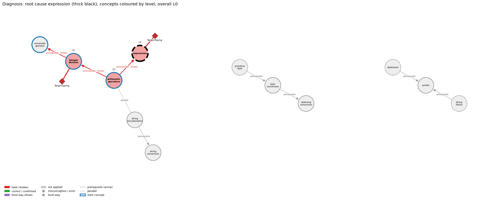

# Think on the Graph: run MY19

This page explains, stage by stage, how the algorithm reached its result for this scenario. Each stage says what it does, why, and what its terms mean, and then shows **one** output of that stage from this run. Every output of every stage (all edges offered, all scores and labels, the figures) is in `MY19.ipynb` and `report.html`; the interactive graph is `MY19_G.html`.

## Input

Program:
```java
int a = 7, b = 2;
double q = a / b;
int r = a % b;
System.out.println(q + " " + r);
```
**Question.** Explain how Java works out q and r.

**Student's answer.** q is a double, so 7 / 2 is done with decimals and gives 3.5, and 7 % 2 is the half that is left over, 0.5.

**What the program really does.** `a / b` is integer division of two ints, 7 / 2 = 3, widened to 3.0 when stored in q. `a % b` is the whole-number remainder, 1. The program prints `3.0 1`.

## Result

- **Wrong rules held:** TargetTyping at `integer_division`
- **Root cause:** `integer_division` / TargetTyping
- **Overall level:** L0
- **Level per concept:** `arithmetic_operators` L0, `expression` L0, `integer_division` L0

**Check of this result (read by hand, 2026-11-13).** Partly right. TargetTyping is the right label for q. The second wrong statement, that 7 % 2 is 0.5, is not picked up: the graph has no misconception for reading the remainder as the fractional part.

## The idea

The method is *Think on the Graph*. A language model is not asked "what is wrong with this answer?". Instead the program walks a **knowledge graph** of Java and asks the model only small questions about one edge at a time, each of which must be tied to the student's own words. The graph has three kinds of node: **concept** nodes (for example `integer_division`), **misconception** and **error** nodes (a wrong rule a student may believe, or a rule broken in a program), and five **level** nodes for every concept (L0 to L4). Its edges are: **prerequisite** (A must be understood before B), **parallel** (A and B are learned side by side), **misconception / error** (from a concept to a wrong rule; the edge stores the wrong rule and, as its *twin*, the right rule), and **has_level** (from a concept to one of its levels; the edge stores the *ways* a student can show that level, each with an exact rule).

Two numbers control the walk: the **width N = 3** (how many options survive each choice) and the **depth D = 3** (how many rounds the walk may take). The model here is `claude-opus-5-5`; it is used in stage 3 only.

## Stage 1. From the code to a subgraph G (no model)

This stage reads only the program, never the student's answer. Its job is to decide which part of the knowledge graph this scenario is allowed to use.

**1.1 Prepare the code.** Pasted code often carries look-alike characters (curly quotes, non-breaking spaces); these are mapped to the plain ones. Then the code is **masked**: the inside of every string literal and every comment is replaced by spaces of the same length. Masking matters because the next step matches patterns: the word `for` inside a printed sentence must not count as a for loop. Lengths and line numbers stay the same, so a match can still be reported by line.

*One output:* this program has no string literal or comment, so the masked code equals the original.

**1.2 Tag concepts.** Every concept node stores a *reader block*: regular expressions that describe how the concept looks in Java, in several *channels* (code patterns, signals, operator symbols, type names). All of them are run over the masked code. Each match is a **hit**: which channel and pattern, the matched text, and the line. A concept with at least one hit is **tagged**. There is nothing learned here; the patterns in the graph are the whole "model".

*One output:* `integer_division` is tagged: its signal `int_vars_one_decl_div` matches `int a = 7, b = 2; double q = a / b` on line 1.

**1.3 Handle generic concepts.** The graph marks some concepts **generic**: they are so basic (statement, expression, assignment, a literal, `int`) that their pattern fires on almost any line of Java. If all of them were kept, every program would seem to be "about" them and the diagnosis would drift to vague places. So a tagged generic concept is kept only when the code ties it to something specific: the graph has a prerequisite or parallel edge between it and a non-generic tagged concept, or one of its *decisive* signals fired (a pattern that by itself shows the concept is the point of the code). A kept generic concept stays marked generic: the walk can reach it and it can get a level, but it cannot be a starting point by itself, and a wrong-rule label on it is treated as a shadow of a more specific one (stage 4).

*One output:* 12 concepts are tagged and kept, 4 of them generic (`expression`, `primitive_type`, `statement`, `string_literal`).

**1.4 Cut out the subgraph G.** G consists of the kept concepts, the graph's prerequisite and parallel edges whose two ends are both kept, every misconception and error edge of those concepts, and their level nodes with all their ways. From here on the algorithm sees only G, so it can only name wrong rules that belong to concepts the code really contains. The concepts of G fall into **pieces** (groups joined by edges); the graph has no edge between two pieces, so the walk never crosses from one to another.

*One output:* G has 10 concept edges, 46 misconception / error edges and 60 level edges, in 3 pieces (sizes 6, 3, 3).

## Stage 2. Clauses and start concepts (no model)

**2.1 Split the answer into clauses.** A **clause** is one statement the student makes. The answer is cut at sentence ends, at ';', and before 'because' and 'so' (a reason and its conclusion are separate claims); a remark in parentheses becomes its own clause. The clauses are numbered c1, c2, … This numbering is what keeps the model honest later: every label it gives must name the clause numbers it rests on, so each finding points at words the student actually wrote.

*One output:* 2 clauses. c1: “q is a double” c2: “so 7 / 2 is done with decimals and gives 3.5, and 7 % 2 is the half that is lef…”

**2.2 Choose the start concepts.** The walk has to begin somewhere; these are the **start concepts** (in Think on the Graph, the *topic entities*). The candidates are the non-generic concepts of G, plus a generic one when the answer itself repeats the code text that tagged it (for example the student writes `=`). If there are more than N, they are ranked by **BM25**, the standard search-engine score: it compares the words of the answer with the words of a concept's text (its name and the texts of its edges), counting shared words, giving rare words more weight and long texts less. The top N = 3 are the start concepts. No model is used, so the same answer always starts at the same place.

*One output:* `integer_division` scores 16.07, the highest of 8 candidates; `string_concatenation` is 4th with 7.66 and is left out. Start concepts: `integer_division`, `arithmetic_operators`, `remainder_operator`.

## Stage 3. The traversal: walking G (the model is asked here)

The walk is a **beam search**. "Beam" means that at every choice only the best N = 3 options are followed, so the work stays small even when a concept has dozens of edges. It proceeds in rounds called **depths**, at most D = 3 of them plus one closing round. Throughout, the algorithm keeps four things: the **current concepts** (where it is now), the **paths** (the edges it has kept), the **evidence** (every edge that received a label, kept or not), and the set of edges it has already offered, so nothing is judged twice.

At each depth, for each current concept, the following happens.

**3.1 Edge search (no model).** The edges of the concept are collected as **candidates**. A concept that has just been entered is read *inwards*: its misconception and error edges (the wrong rules a student could hold about it) and its **level ways** (each way of each level is treated as an edge of its own, whose text is the way's exact rule). These are two separate *families*. A concept that has already been read inwards is read *outwards*: its prerequisite and parallel edges to other concepts in the same piece. So depth 1 asks "what does the answer show about these concepts?" and the later depths ask "which neighbouring concepts does that involve?".

*One output:* at `integer_division`, 6 misconception / error edges and 16 level ways are offered when it is entered, and 2 concept edges when it is read outwards.

**3.2 Prune (model, first question).** There are usually far more candidates than can be judged carefully, so they are first **pruned**. The model sees the program, the question, the answer and the text of each candidate edge of one family, and returns at most N of them with a relevance score. The scores are rescaled so they add up to 1: this is the **prune score**, the share of relevance the model gives to that edge. Each family is pruned separately, so a level way never pushes out a misconception or the other way round. Edge ids the model invents are ignored.

*One output:* at `integer_division` the misconception family is pruned to: TargetTyping 0.55, IntegerDivisionGivesFraction 0.35, NegativeRemainderSign 0.10.

**3.3 Label (model, second question).** Each edge that survived is now read against the numbered clauses and gets a **label**. For a misconception or error edge: **held** (the student's words state this wrong rule), **correct** (they state the right rule, its twin) or **not applied** (the answer says nothing about it). For a level way: **shown** or not applied. For a prerequisite or parallel edge: **confirmed** (the answer carries the rule from one concept into the other) or **broken** (it fails to). The misconception edges of one concept are judged together in a single question, because the same sentence can fit several wrong rules and the model should give *held* only to the one the student really claims. With the label the model must return the **clause numbers** it rests on and a **confidence** from 0 to 1. A label with no clause is discarded. This is the safeguard of the method: the model never diagnoses from its own knowledge; every label is attached to one edge of G and to the student's words.

*One output:* TargetTyping at `integer_division` is labelled **held** on clauses 1, 2 (“q is a double; so 7 / 2 is done with decimals and gives 3.5, and 7 % 2 is the half that i…”) with confidence 0.90. The rule on that edge: “The type of a numerical expression depends on the type expected by the surrounding context, so double d = a / b; keeps the fraction.”

**3.4 Score and keep.** The **score** of a labelled edge is prune score × confidence: an edge counts for much only if it was both relevant and confidently labelled. The edges are then ranked in **tiers**. Tier 0 is a held misconception or a broken edge: these are findings about a fault and are always kept. Tier 1 is a held error. Tier 2 is everything that only confirms understanding (correct, confirmed, shown); these fill whatever is left of the N = 3 places, best score first. Kept edges are added to the paths. Every labelled edge, kept or not, is added to the evidence, because the levels in stage 6 are read from all of it.

*One output:* the score of TargetTyping is 0.55 × 0.90 = 0.49. At depth 1 the kept edges are: TargetTyping (held, tier 0, 0.49); L0 way “inconsistent trace” (shown, tier 2, 0.35); L0 way “everyday reading” (shown, tier 2, 0.34).

**3.5 Move to the next concepts.** Three things decide where the walk goes next. A kept prerequisite or parallel edge leads to the concept at its other end; that concept is **entered** and will be read inwards at the next depth, so it gets misconceptions and a level of its own. A concept with a held misconception stays current, so that its prerequisites are examined: the fault may begin further back. And any entered concept whose outward edges have not been read yet stays current until they are.

*One output:* `reached across pre:arithmetic_operators->expression, entered next: expression`.

**3.6 Stop test (no model).** After each depth two checks are made. The **graph check**: has every entered concept had both its inward and its outward edges read? The **clause coverage** check: is every clause covered by at least one labelled rule edge (a level way does not count here, since it describes how the student reads the code, not which rule a clause applies)? If both hold, the walk stops as *sufficient*. If some clauses are still uncovered, they are matched by BM25 against the concepts not visited yet and the best N are entered. Otherwise the walk continues to depth D = 3, followed by one **closing round** in which the concepts entered last have their inward edges read, so that no concept is left half-read. The model's replies are cached by the exact text of the question, so running the same scenario again gives the same result without asking again.

*One output:* the walk stopped at depth 3 because every clause was covered and no entered concept had an unread edge. At the end 2 of 2 clauses were covered. The model was asked 11 prune questions and 22 label questions in all.

## Stage 4. From labels to faults (rules, no model)

The walk leaves a set of labelled edges. Each kept edge labelled *held* is a candidate **fault**, but one wrong sentence usually lights up several edges, so fixed rules remove the double counting. Nothing is deleted from the record; the rules only decide what counts as a fault.

- **Error beside a misconception.** An error node describes a consequence in a program; a misconception describes the belief behind it. A held error on a concept that also has a held misconception is therefore kept as evidence, not as a second fault.
- **One fault, one place.** The graph can attach the same misconception to two concepts joined by a prerequisite edge. On each such edge the graph gives the concept a **role**: *primary* (the concept whose rule the misconception violates) or *context* (a concept where it also shows up). If the misconception is held at both ends, it is filed once, at the primary concept, or at the dependent concept when the roles do not decide.
- **Shadows.** A held label is a **shadow** when it sits on a prerequisite or on a generic concept and rests only on clauses that a stronger, more specific label already rests on. It is the same wrong sentence read a second time at a vaguer place. A shadow is kept in the record but is not a fault, cannot be the root cause and does not set a level.
- **Broken edges.** A prerequisite edge A → B labelled *broken* says the student did not carry the rule of A into B, so the fault sits at B. If the broken edge rests on the same clauses as a held misconception, it is that misconception's **consequence**, not a separate fault.

*One output:* the fault is **TargetTyping** at `integer_division`. For TargetTyping the graph's wrong rule is “The type of a numerical expression depends on the type expected by the surrounding context, so double d = a / b; keeps the fraction.” and its twin, the right rule, is “The type of a numerical expression is determined by the expression, so double d = a / b; with int a and b still divides as ints.”. 1 shadow, e.g. TargetTyping at `expression` (shadow of TargetTyping). 4 broken edges, e.g. arithmetic_operators → integer_division; 4 of them are consequences of a held misconception.

## Stage 5. Root cause (rule, no model)

Several concepts may carry a fault, and the **root cause** is the one to teach first. The rule uses the prerequisite edges of G. From each faulty concept it walks backwards (from a concept to what it depends on). Whenever a concept reached that way also has a fault of its own, the candidate moves back to it, because a fault in what a concept depends on explains the fault in the concept. Among the candidates found, the root is the one with the fewest prerequisites of its own in G, that is, the one furthest back; at a tie, the one whose label the model gave the higher confidence. Alphabetical order never decides.

*One output:* only `integer_division` has a fault, and none of its prerequisites in G (`arithmetic_operators`) has one, so the root is `integer_division`.

## Stage 6. Level of each concept (rule, no model)

Every concept has five **levels**, taken from the SOLO taxonomy: **L0** prestructural (the answer holds a rule that contradicts Java, or reads the code in an everyday sense), **L1** unistructural (it states one correct rule without applying it), **L2** multistructural (it applies the rules to the code step by step), **L3** relational (it relates the parts to each other and to the purpose of the whole), **L4** extended abstract (it reasons beyond the given code: predicts a change, transfers, diagnoses). Each level has **ways**, concrete things a student does at that level, such as "output prediction" at L2 or "predict a change" at L4.

The model is never asked for a level. In stage 3 it only said whether a way was *shown*; the level is read from where that way sits in the graph. The rule: a concept is **L0** if a fault is kept on it, or if the only ways shown on it are L0 ways. Otherwise it gets the **highest** level among the ways shown, because the levels build on each other (an answer that relates the parts has also applied the rules). A concept with no fault and no way shown gets no level.

*One output:* `integer_division` keeps TargetTyping, so it is L0; on `expression` the ways shown are L0 “everyday reading”, so it is L0.

## Stage 7. Overall level (rule, no model)

One level is reported for the whole answer. If there is a root cause, it is the level of the root concept: the student stands where the fault begins, however well the rest is handled. If there is no fault, it is the level reached on at least half of the concepts the answer touched (the levels are sorted from high to low and the middle one is taken), so that a single weaker concept does not pull the whole answer down and a single strong one does not lift it.

*One output:* the root is `integer_division` and its level is L0, so the overall level is **L0**.

## The final picture


