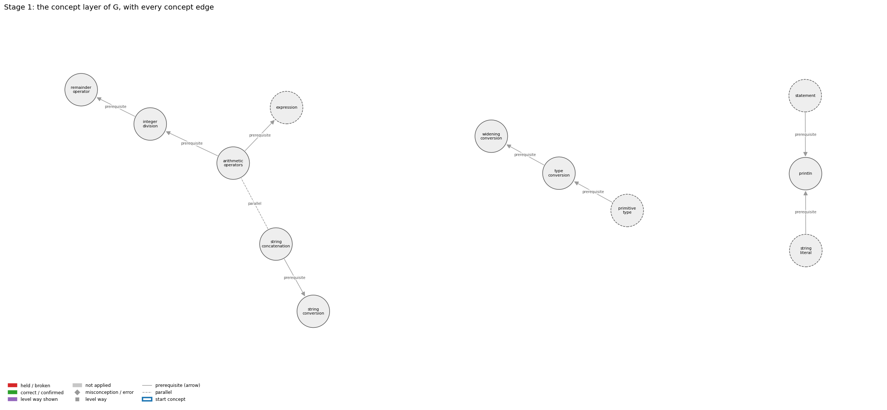
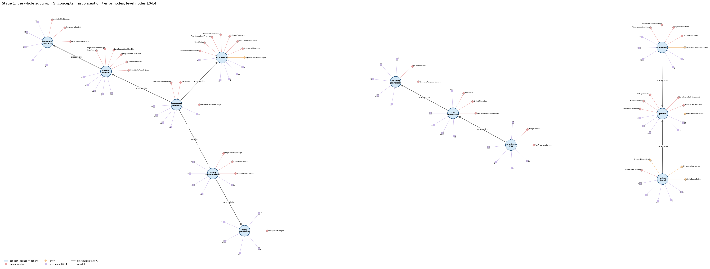
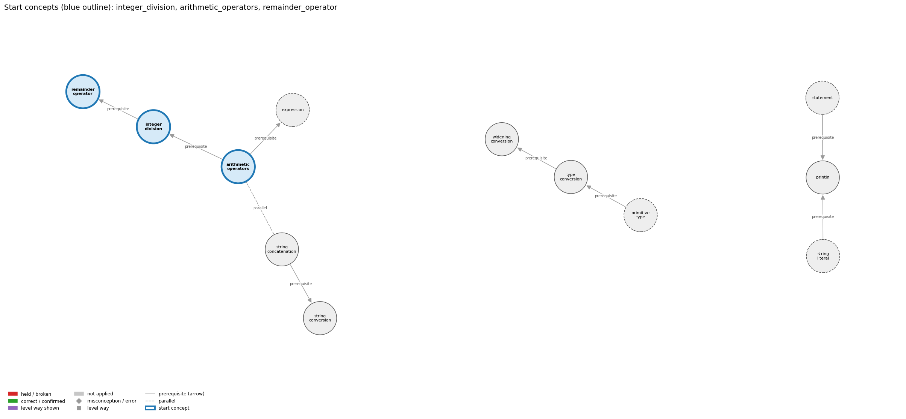
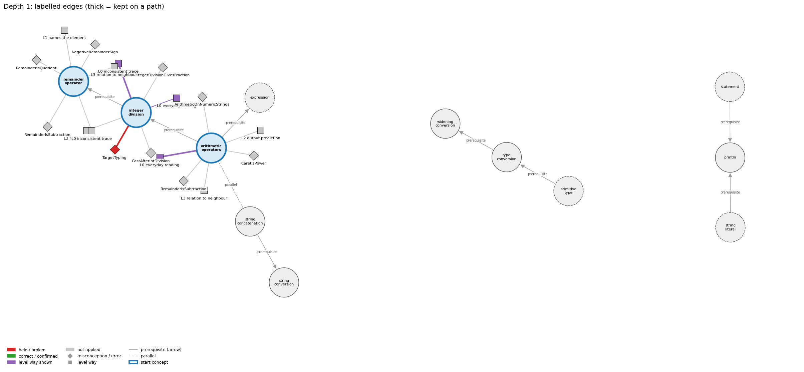
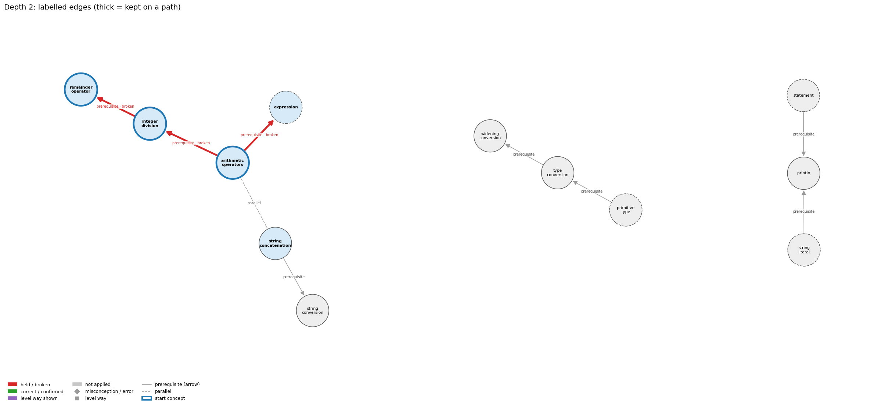
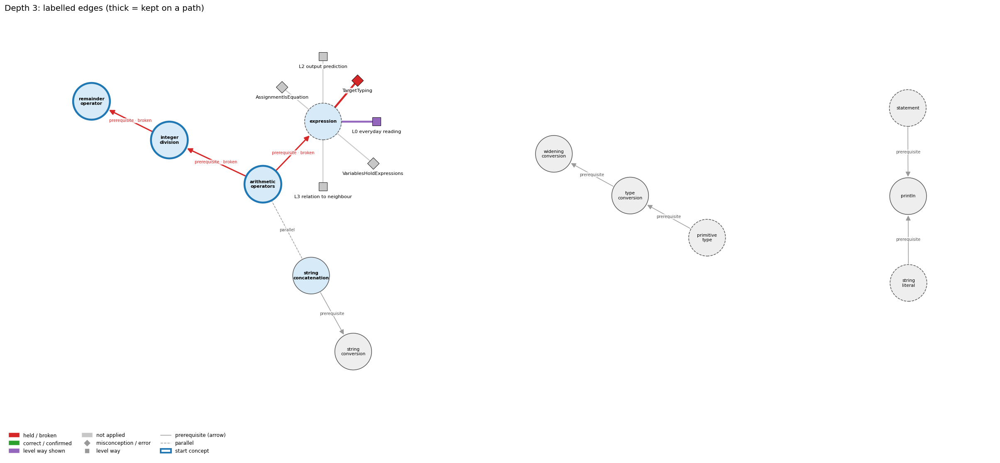

# Think on the Graph: every output of the run MY19

Files of this scenario: `input.json` (program, question, answer), `diagnosis.json`, `subgraph.json`, `traverse_log.txt`, `report.html` (this report as one full-page file, with the interactive graph `MY19_G.html`), `MY19.ipynb` (this report as a notebook).

## 0. Input
Program:
```java
int a = 7, b = 2;
double q = a / b;
int r = a % b;
System.out.println(q + " " + r);
```
Question: Explain how Java works out q and r.

Student's answer: q is a double, so 7 / 2 is done with decimals and gives 3.5, and 7 % 2 is the half that is left over, 0.5.
Settings: width 3, depth 3, prune llm, backend claude-cli, model claude-opus-5-5
## 1. Stage 1: the subgraph G from the code (no model)
Masked code (string and char literals and comments blanked; this is what the patterns see):
```
int a = 7, b = 2;
double q = a / b;
int r = a % b;
System.out.println(q + " " + r);
```
Which code text tagged which concept (a generic concept fires on almost any Java line; it starts the walk only if the answer repeats its tag):
| concept | generic | channel | matched text | line |
|---|---|---|---|---|
| arithmetic_operators | False | pattern | 'a / b' | 2 |
| expression | True | pattern | 'a / b' | 2 |
| expression | True | pattern | '= 2;' | 1 |
| integer_division | False | signal | 'int a = 7, b = 2;\ndouble q = a / b' | 1 |
| primitive_type | True | pattern | 'int' | 1 |
| println | False | pattern | 'System.out.println(' | 4 |
| remainder_operator | False | pattern | 'a % b' | 3 |
| remainder_operator | False | signal | '= a % b' | 3 |
| statement | True | pattern | ';' | 1 |
| string_concatenation | False | pattern | '+ " "' | 4 |
| string_conversion | False | pattern | '" + r' | 4 |
| string_conversion | False | pattern | 'q + "' | 4 |
| string_literal | True | pattern | '" "' | 4 |
| type_conversion | False | signal | 'int a = 7, b = 2;\ndouble q = a / b;' | 1 |
| widening_conversion | False | signal | 'int a = 7, b = 2;\ndouble q = a / b;' | 1 |

G: 12 concept nodes (4 generic), 9 concept edges, 46 misconception / error edges, 37 misconception / error nodes, 60 level nodes, 58 level-misconception links, 3 connected piece(s).
Note: concept nodes form 3 pieces (the KG has no edge between them): arithmetic_operators,expression,integer_division,remainder_operator,string_concatenation,string_conversion | primitive_type,type_conversion,widening_conversion | println,statement,string_literal

Concept edges of G (the links the walk can read; `pre:` = prerequisite A -> B, `par:` = parallel):
| edge | type | rule (logic) |
|---|---|---|
| par:string_concatenation~arithmetic_operators | parallel | + adds when both operands are numbers and concatenates when either operand is a String, converting the other operand to a String. It is left-associative, so 1 + 2 + "3" is "33" but "1" + 2 + 3 is "123". |
| pre:arithmetic_operators->expression | prerequisite | An operator combines operand values a and b into a new value, so operators build larger expressions from smaller ones. |
| pre:arithmetic_operators->integer_division | prerequisite | For ints a and b, / gives the whole quotient q and % gives the remainder r, so that a = b * q + r. |
| pre:integer_division->remainder_operator | prerequisite | % is the companion of integer division: a = (a / b) * b + a % b. |
| pre:primitive_type->type_conversion | prerequisite | Conversion moves a value between primitive types: int to double happens automatically, while double to int needs a cast that drops the fraction. |
| pre:statement->println | prerequisite | System.out.println(s); is itself a statement, so its line of output appears at its own place in the sequence. |
| pre:string_concatenation->string_conversion | prerequisite | When one operand of + is a String, Java converts the other operand to a String before concatenating. |
| pre:string_literal->println | prerequisite | println("s") outputs exactly the characters between the quotes and then ends the line. |
| pre:type_conversion->widening_conversion | prerequisite | Widening is the automatic kind of type conversion. |

Misconception / error edges per concept (count), and level ways per concept (count):
| concept | misconception / error edges | level ways (L1-L4 + L0 non-misconception) |
|---|---|---|
| arithmetic_operators | 3 | 18 |
| expression | 8 | 19 |
| integer_division | 6 | 16 |
| primitive_type | 2 | 21 |
| println | 6 | 17 |
| remainder_operator | 3 | 14 |
| statement | 5 | 19 |
| string_concatenation | 3 | 16 |
| string_conversion | 1 | 13 |
| string_literal | 4 | 16 |
| type_conversion | 3 | 18 |
| widening_conversion | 2 | 14 |

**Figure 1**


**Figure 2**


## 2. Clauses and start concepts (no model)
The answer split into clauses (at sentence ends, ';', and before 'because' / 'so'; quotes removed):
| clause | text |
|---|---|
| c1 | q is a double |
| c2 | so 7 / 2 is done with decimals and gives 3.5, and 7 % 2 is the half that is left over, 0.5 |

start: BM25 of the answer against each tagged concept: integer_division 15.96 (hits 1), arithmetic_operators 14.08 (hits 1), remainder_operator 12.41 (hits 2), string_concatenation 7.62 (hits 1), string_conversion 7.07 (hits 2), type_conversion 6.21 (hits 1), println 5.69 (hits 1), widening_conversion 3.44 (hits 1)

start: chosen integer_division, arithmetic_operators, remainder_operator

start concepts (3): integer_division, arithmetic_operators, remainder_operator

Start concepts: integer_division, arithmetic_operators, remainder_operator

**Figure 3**


## 3. The walk, depth by depth
At each depth, for each current concept: the edges offered (a concept entering as a start concept offers its misconception / error edges and its level ways, as two families; otherwise it offers its concept edges), the prune prompt and the model's reply, then the label prompt(s) and the model's reply, parsed into label / clauses / confidence. Score = prune score x confidence.

### Depth 1: current concepts 'integer_division', 'arithmetic_operators', 'remainder_operator'

#### integer_division, misconceptions: 6 edges offered
Edges offered:
| edge |
|---|
| mis:integer_division->AllDoublesToAvoidDivision \| wrong rule: Making every variable a double is the right fix for integer division. \| right rule: Use int for countable things and double for measured ones; where a fraction is needed, make one operand of the division a double (or cast) instead of changing every type. |
| mis:integer_division->CastAfterIntDivision \| wrong rule: (double) (3 / 5) is 0.6. \| right rule: The integer division 3 / 5 = 0 happens before the cast, so the result is 0.0. |
| mis:integer_division->IntegerDivisionGivesFraction \| wrong rule: 10 / 3 evaluates to 3.333.... \| right rule: Dividing two ints gives an int: the fractional part is discarded. |
| mis:integer_division->LaterDoubleLiteralFixesDivision \| wrong rule: Changing a later literal to 100.0 fixes an earlier int division. \| right rule: The int division happens first; the double must be in the division itself. |
| mis:integer_division->NegativeRemainderSign \| wrong rule: a % b is never negative, and integer division of a negative number rounds down. \| right rule: a / b rounds toward 0 and a % b takes the sign of a: -14 / 3 is -4 and -14 % 3 is -2. |
| mis:integer_division->TargetTyping \| wrong rule: The type of a numerical expression depends on the type expected by the surrounding context, so double d = a / b; keeps the fraction. \| right rule: The type of a numerical expression is determined by the expression, so double d = a / b; with int a and b still divides as ints. |

Prune: the model's reply (edge id and score; the kept edges sum to 1):
```
mis:integer_division->TargetTyping (0.60), mis:integer_division->IntegerDivisionGivesFraction (0.30), mis:integer_division->CastAfterIntDivision (0.10)
```
Kept by pruning: mis:integer_division->TargetTyping (0.60), mis:integer_division->IntegerDivisionGivesFraction (0.30), mis:integer_division->CastAfterIntDivision (0.10)

Label prompt for the misconception / error edges (judged together). The model saw the program, the question, the numbered clauses, and these edges with their wrong rule and right rule:
| edge |
|---|
| mis:integer_division->TargetTyping \| wrong rule: The type of a numerical expression depends on the type expected by the surrounding context, so double d = a / b; keeps the fraction. \| right rule: The type of a numerical expression is determined by the expression, so double d = a / b; with int a and b still divides as ints. |
| mis:integer_division->IntegerDivisionGivesFraction \| wrong rule: 10 / 3 evaluates to 3.333.... \| right rule: Dividing two ints gives an int: the fractional part is discarded. |
| mis:integer_division->CastAfterIntDivision \| wrong rule: (double) (3 / 5) is 0.6. \| right rule: The integer division 3 / 5 = 0 happens before the cast, so the result is 0.0. |
Model's reply:
```
mis:integer_division->TargetTyping | held | clauses: 1, 2 | confidence: 0.9
mis:integer_division->IntegerDivisionGivesFraction | not applied | clauses: none | confidence: 0.6
mis:integer_division->CastAfterIntDivision | not applied | clauses: none | confidence: 0.85
```

Parsed labels:
| edge | label | prune score | confidence | score | clauses | words |
|---|---|---|---|---|---|---|
| mis:integer_division->TargetTyping | held | 0.6000000000000001 | 0.9 | 0.54 | c1, c2 | q is a double; so 7 / 2 is done with decimals and gives 3.5, and 7 % 2 is the half that is left over, 0.5 |
| mis:integer_division->IntegerDivisionGivesFraction | not applied |  |  | 0.0 |  |  |
| mis:integer_division->CastAfterIntDivision | not applied |  |  | 0.0 |  |  |

#### integer_division, level ways: 16 edges offered
Edges offered:
| edge |
|---|
| lvl:integer_division@L0#0 \| level L0 way everyday_reading: In everyday and school arithmetic, 'divide' gives an exact answer or a fraction (10 ÷ 3 = 3 1/3), and rounding goes to the nearest whole number. In Java, / with two int operands discards the fraction, rounding toward zero (59 / 60 is 0). |
| lvl:integer_division@L0#4 \| level L0 way inconsistent_trace: Points to LT (each / looks at its own two operand types when it is evaluated). Applied unevenly, a student evaluates 9/5 as 1.8 in f = (9/5)*c + 32 but as 1 elsewhere, or assumes a later double operand rescues an earlier int division. (here mixing in: "The type of a numerical expression depends on the type expected by the surrounding context, so double d = a / b; keeps the fraction") |
| lvl:integer_division@L1#0 \| level L1 way names_the_element: Integer division: / applied to two integer operands, giving the whole-number quotient with the fractional part discarded. |
| lvl:integer_division@L1#1 \| level L1 way states_the_rule: If both operands of / are integral types, the result is an integer that rounds toward 0 (-14 / 3 is -4). If either operand is a double, the division is floating point. |
| lvl:integer_division@L2#0 \| level L2 way line_by_line_trace: Each / is evaluated when its turn comes (precedence, then left to right), using the types of its own two operands. Promoting the result to double, by a cast or by assignment, happens only afterwards and cannot restore the lost fraction. |
| lvl:integer_division@L2#1 \| level L2 way output_prediction: 10 / 3 is 3, 59 / 60 is 0, 1234 / 99 is 12, -14 / 3 is -4, and (double) (3 / 5) is 0.0. |
| lvl:integer_division@L2#2 \| level L2 way one_step_execution: q = a / b stores the truncated quotient in q and leaves a and b unchanged. If b is 0, an ArithmeticException stops execution before anything is stored. |
| lvl:integer_division@L3#0 \| level L3 way relation_to_neighbour: / and % on ints are paired: q = a / b and r = a % b always satisfy a = b * q + r. |
| lvl:integer_division@L3#1 \| level L3 way relation_to_neighbour: Normalizing counts must divide as doubles. With two ints, counts / total truncates to 0 whenever counts < total. |
| lvl:integer_division@L3#2 \| level L3 way relation_to_neighbour: % gives the remainder of the same truncating division: (a / b) * b + a % b == a. |
| lvl:integer_division@L3#3 \| level L3 way purpose_of_the_whole: Quotient plans: unit conversion (76 / 12 feet), dropping a digit (n / 10), finding a midpoint ((lo + hi) / 2), and computing a bucket or row index (i / cols). |
| lvl:integer_division@L4#0 \| level L4 way predict_a_change: Making one operand a double (10.0 / 3) keeps the fraction (3.333...). Casting after the division does not. Multiplying before dividing preserves precision (59 * 100 / 60 is 98). Changing an operand's sign changes only the quotient's sign, since rounding is toward zero. |
| lvl:integer_division@L4#1 \| level L4 way transfer_to_a_new_program: Use integer division when you want the whole quotient (units, digits, indices, half a size). When a fraction is needed, make one operand a double (10.0 / 3 or (double) a / b) rather than turning every variable into a double. |
| lvl:integer_division@L4#2 \| level L4 way diagnose_an_error: rule broken: With two int operands, / discards the fraction. Kind: silent logic error. Trigger class: Two int operands where a fraction is intended: 9/5 in a temperature formula, count / total, 1 / n, sum / n for an average. |
| lvl:integer_division@L4#3 \| level L4 way diagnose_an_error: rule broken: int division by zero is undefined. Kind: run-time exception. Trigger class: A divisor that evaluates to 0: ArithmeticException: / by zero. |
| lvl:integer_division@L4#4 \| level L4 way diagnose_an_error: rule broken: Integer division rounds toward zero, not down. Kind: silent logic error. Trigger class: Negative operands where floor was expected (-7 / 2 is -3, not -4). |

Prune: the model's reply (edge id and score; the kept edges sum to 1):
```
{lvl:integer_division@L0#4 (Score: 0.5)}
{lvl:integer_division@L0#0 (Score: 0.3)}
{lvl:integer_division@L3#2 (Score: 0.2)}
```
Kept by pruning: lvl:integer_division@L0#4 (0.50), lvl:integer_division@L0#0 (0.30), lvl:integer_division@L3#2 (0.20)

Label prompt for level way lvl:integer_division@L0#4 (the model saw only the concept, the way's name 'inconsistent trace' and its text; no level):
> Points to LT (each / looks at its own two operand types when it is evaluated). Applied unevenly, a student evaluates 9/5 as 1.8 in f = (9/5)*c + 32 but as 1 elsewhere, or assumes a later double operand rescues an earlier int division. (here mixing in: "The type of a numerical expression depends on the type expected by the surrounding context, so double d = a / b; keeps the fraction")

Model's reply:
```
Label: shown
Clauses: 1, 2
Confidence: 0.7
```

Label prompt for level way lvl:integer_division@L0#0 (the model saw only the concept, the way's name 'everyday reading' and its text; no level):
> In everyday and school arithmetic, 'divide' gives an exact answer or a fraction (10 ÷ 3 = 3 1/3), and rounding goes to the nearest whole number. In Java, / with two int operands discards the fraction, rounding toward zero (59 / 60 is 0).

Model's reply:
```
Label: shown
Clauses: 2
Confidence: 0.9
```

Label prompt for level way lvl:integer_division@L3#2 (the model saw only the concept, the way's name 'relation to neighbour' and its text; no level):
> % gives the remainder of the same truncating division: (a / b) * b + a % b == a.

Model's reply:
```
Label: not shown
Clauses: none
Confidence: 0.9
```

Parsed labels:
| edge | label | prune score | confidence | score | clauses | words |
|---|---|---|---|---|---|---|
| lvl:integer_division@L0#4 | shown | 0.5 | 0.7 | 0.35 | c1, c2 | q is a double; so 7 / 2 is done with decimals and gives 3.5, and 7 % 2 is the half that is left over, 0.5 |
| lvl:integer_division@L0#0 | shown | 0.3 | 0.9 | 0.27 | c2 | so 7 / 2 is done with decimals and gives 3.5, and 7 % 2 is the half that is left over, 0.5 |
| lvl:integer_division@L3#2 | not applied |  |  | 0.0 |  |  |

#### arithmetic_operators, misconceptions: 3 edges offered
Edges offered:
| edge |
|---|
| mis:arithmetic_operators->ArithmeticOnNumericStrings \| wrong rule: "10" - 1 or "6" * "2" works because the strings look like numbers. \| right rule: Arithmetic operators other than + are not defined for Strings; a String of digits must first be converted to a number, e.g. with Integer.parseInt. |
| mis:arithmetic_operators->CaretIsPower \| wrong rule: a^2 computes a squared. \| right rule: Java has no exponent operator; ^ is exclusive or, and a * a or Math.pow(a, 2) computes a squared. |
| mis:arithmetic_operators->RemainderIsSubtraction \| wrong rule: 9 % 5 means 9 minus 5 (a % b subtracts b from a). \| right rule: % gives the remainder after integer division: 9 % 5 is 4 because 9 = 1 * 5 + 4, and 17 % 5 is 2, not 12. |

Prune: the model's reply (edge id and score; the kept edges sum to 1):
```
mis:arithmetic_operators->RemainderIsSubtraction (0.90), mis:arithmetic_operators->ArithmeticOnNumericStrings (0.05), mis:arithmetic_operators->CaretIsPower (0.05)
```
Kept by pruning: mis:arithmetic_operators->RemainderIsSubtraction (0.90), mis:arithmetic_operators->ArithmeticOnNumericStrings (0.05), mis:arithmetic_operators->CaretIsPower (0.05)

Label prompt for the misconception / error edges (judged together). The model saw the program, the question, the numbered clauses, and these edges with their wrong rule and right rule:
| edge |
|---|
| mis:arithmetic_operators->RemainderIsSubtraction \| wrong rule: 9 % 5 means 9 minus 5 (a % b subtracts b from a). \| right rule: % gives the remainder after integer division: 9 % 5 is 4 because 9 = 1 * 5 + 4, and 17 % 5 is 2, not 12. |
| mis:arithmetic_operators->ArithmeticOnNumericStrings \| wrong rule: "10" - 1 or "6" * "2" works because the strings look like numbers. \| right rule: Arithmetic operators other than + are not defined for Strings; a String of digits must first be converted to a number, e.g. with Integer.parseInt. |
| mis:arithmetic_operators->CaretIsPower \| wrong rule: a^2 computes a squared. \| right rule: Java has no exponent operator; ^ is exclusive or, and a * a or Math.pow(a, 2) computes a squared. |
Model's reply:
```
mis:arithmetic_operators->RemainderIsSubtraction | not applied | clauses: none | confidence: 0.75
mis:arithmetic_operators->ArithmeticOnNumericStrings | not applied | clauses: none | confidence: 0.95
mis:arithmetic_operators->CaretIsPower | not applied | clauses: none | confidence: 0.97
```

Parsed labels:
| edge | label | prune score | confidence | score | clauses | words |
|---|---|---|---|---|---|---|
| mis:arithmetic_operators->RemainderIsSubtraction | not applied |  |  | 0.0 |  |  |
| mis:arithmetic_operators->ArithmeticOnNumericStrings | not applied |  |  | 0.0 |  |  |
| mis:arithmetic_operators->CaretIsPower | not applied |  |  | 0.0 |  |  |

#### arithmetic_operators, level ways: 18 edges offered
Edges offered:
| edge |
|---|
| lvl:arithmetic_operators@L0#0 \| level L0 way everyday_reading: In maths notation, multiplication can be implicit (2x), ^ or a superscript means a power, ÷ is exact division, and % means percent. In Java * must be written, / depends on the operand types, % is the remainder, and there is no power operator (^ is exclusive or). |
| lvl:arithmetic_operators@L0#2 \| level L0 way inconsistent_trace: Points to LT (evaluate operands, then apply the operator in the promoted type). Applied unevenly, a student uses integer division for one / and real division for another / in the same int expression. (here mixing in: "a^2 computes a squared") |
| lvl:arithmetic_operators@L1#0 \| level L1 way names_the_element: Arithmetic operators: the binary operators + - * / % that combine two numeric operands into a numeric result. |
| lvl:arithmetic_operators@L1#1 \| level L1 way states_the_rule: Both operands must be numeric, and the result has the promoted type (int, long or double). * / % bind tighter than + -, all group left to right, and int / or % by zero throws ArithmeticException. Unary minus negates its operand (-x) and unary plus leaves it unchanged; they bind more tightly than * and /, so -a * b is (-a) * b. |
| lvl:arithmetic_operators@L2#0 \| level L2 way line_by_line_trace: The left operand is evaluated fully, then the right operand, and then the operator is applied in the promoted type. |
| lvl:arithmetic_operators@L2#1 \| level L2 way output_prediction: With ints, 17 / 3 is 5 and 17 % 3 is 2. With doubles, 5.0 / 3.0 is 1.6666666666666667. With mixed operands, the int is promoted first (10 / 3.0 is 3.333...). |
| lvl:arithmetic_operators@L2#2 \| level L2 way one_step_execution: An arithmetic operator never changes its operands. Each variable is replaced by its value, and only an assignment (or ++ or op=) stores the result. |
| lvl:arithmetic_operators@L3#0 \| level L3 way relation_to_neighbour: Operators build larger expressions from smaller ones, and each operand can itself be any expression. |
| lvl:arithmetic_operators@L3#1 \| level L3 way relation_to_neighbour: For ints, / gives the truncated quotient and % the remainder, so (a / b) * b + a % b == a. |
| lvl:arithmetic_operators@L3#2 \| level L3 way relation_to_neighbour: int / or % by zero throws a run-time exception, while floating-point division by zero gives Infinity or NaN. |
| lvl:arithmetic_operators@L3#3 \| level L3 way relation_to_neighbour: + adds when both operands are numbers and concatenates when either operand is a String, converting the other operand to a String. It is left-associative, so 1 + 2 + "3" is "33" but "1" + 2 + 3 is "123". |
| lvl:arithmetic_operators@L3#4 \| level L3 way purpose_of_the_whole: Arithmetic operators turn formulas into code: totals, averages, unit conversions (inch * CM_PER_INCH), and digit extraction (n % 10, n / 10). |
| lvl:arithmetic_operators@L4#0 \| level L4 way predict_a_change: Changing an operand's type changes the operator's meaning (int / versus double /). Reordering * and / changes integer results (59 * 100 / 60 is 98, 59 / 60 * 100 is 0). Replacing ^ with Math.pow gives a real power. |
| lvl:arithmetic_operators@L4#1 \| level L4 way transfer_to_a_new_program: Use the operators for arithmetic on numeric types. Use the Math library for powers, roots and absolute values, and parse numeric Strings before computing with them. |
| lvl:arithmetic_operators@L4#2 \| level L4 way diagnose_an_error: rule broken: int / and % by zero are undefined. Kind: run-time exception. Trigger class: A divisor that evaluates to 0 (empty count, zero input): ArithmeticException: / by zero. |
| lvl:arithmetic_operators@L4#3 \| level L4 way diagnose_an_error: rule broken: Arithmetic operators other than + are not defined for Strings. Kind: compile-time. Trigger class: "10" - 1 or "6" * "2": 'bad operand types for binary operator'. |
| lvl:arithmetic_operators@L4#4 \| level L4 way diagnose_an_error: rule broken: ^ is not exponentiation. Kind: silent logic error. Trigger class: Writing x^2 or 10^6 for a power (10^6 is 12). |
| lvl:arithmetic_operators@L4#5 \| level L4 way diagnose_an_error: rule broken: int arithmetic wraps silently on overflow. Kind: silent logic error. Trigger class: Results outside the int range. |

Prune: the model's reply (edge id and score; the kept edges sum to 1):
```
{lvl:arithmetic_operators@L0#0 (Score: 0.45)}
{lvl:arithmetic_operators@L3#1 (Score: 0.3)}
{lvl:arithmetic_operators@L2#1 (Score: 0.25)}
```
Kept by pruning: lvl:arithmetic_operators@L0#0 (0.45), lvl:arithmetic_operators@L3#1 (0.30), lvl:arithmetic_operators@L2#1 (0.25)

Label prompt for level way lvl:arithmetic_operators@L0#0 (the model saw only the concept, the way's name 'everyday reading' and its text; no level):
> In maths notation, multiplication can be implicit (2x), ^ or a superscript means a power, ÷ is exact division, and % means percent. In Java * must be written, / depends on the operand types, % is the remainder, and there is no power operator (^ is exclusive or).

Model's reply:
```
Label: shown
Clauses: 2
Confidence: 0.75
```

Label prompt for level way lvl:arithmetic_operators@L3#1 (the model saw only the concept, the way's name 'relation to neighbour' and its text; no level):
> For ints, / gives the truncated quotient and % the remainder, so (a / b) * b + a % b == a.

Model's reply:
```
Label: not shown
Clauses: none
Confidence: 0.95
```

Label prompt for level way lvl:arithmetic_operators@L2#1 (the model saw only the concept, the way's name 'output prediction' and its text; no level):
> With ints, 17 / 3 is 5 and 17 % 3 is 2. With doubles, 5.0 / 3.0 is 1.6666666666666667. With mixed operands, the int is promoted first (10 / 3.0 is 3.333...).

Model's reply:
```
Label: not shown
Clauses: none
Confidence: 0.8
```

Parsed labels:
| edge | label | prune score | confidence | score | clauses | words |
|---|---|---|---|---|---|---|
| lvl:arithmetic_operators@L0#0 | shown | 0.45 | 0.75 | 0.34 | c2 | so 7 / 2 is done with decimals and gives 3.5, and 7 % 2 is the half that is left over, 0.5 |
| lvl:arithmetic_operators@L3#1 | not applied |  |  | 0.0 |  |  |
| lvl:arithmetic_operators@L2#1 | not applied |  |  | 0.0 |  |  |

#### remainder_operator, misconceptions: 3 edges offered
Edges offered:
| edge |
|---|
| mis:remainder_operator->NegativeRemainderSign \| wrong rule: a % b is never negative, and integer division of a negative number rounds down. \| right rule: a / b rounds toward 0 and a % b takes the sign of a: -14 / 3 is -4 and -14 % 3 is -2. |
| mis:remainder_operator->RemainderIsQuotient \| wrong rule: 17 % 5 is 3 (the quotient). \| right rule: % returns the remainder, so 17 % 5 is 2. |
| mis:remainder_operator->RemainderIsSubtraction \| wrong rule: 9 % 5 means 9 minus 5 (a % b subtracts b from a). \| right rule: % gives the remainder after integer division: 9 % 5 is 4 because 9 = 1 * 5 + 4, and 17 % 5 is 2, not 12. |

Prune: the model's reply (edge id and score; the kept edges sum to 1):
```
{mis:remainder_operator->RemainderIsQuotient (Score: 0.5)}
{mis:remainder_operator->RemainderIsSubtraction (Score: 0.4)}
{mis:remainder_operator->NegativeRemainderSign (Score: 0.1)}
```
Kept by pruning: mis:remainder_operator->RemainderIsQuotient (0.50), mis:remainder_operator->RemainderIsSubtraction (0.40), mis:remainder_operator->NegativeRemainderSign (0.10)

Label prompt for the misconception / error edges (judged together). The model saw the program, the question, the numbered clauses, and these edges with their wrong rule and right rule:
| edge |
|---|
| mis:remainder_operator->RemainderIsQuotient \| wrong rule: 17 % 5 is 3 (the quotient). \| right rule: % returns the remainder, so 17 % 5 is 2. |
| mis:remainder_operator->RemainderIsSubtraction \| wrong rule: 9 % 5 means 9 minus 5 (a % b subtracts b from a). \| right rule: % gives the remainder after integer division: 9 % 5 is 4 because 9 = 1 * 5 + 4, and 17 % 5 is 2, not 12. |
| mis:remainder_operator->NegativeRemainderSign \| wrong rule: a % b is never negative, and integer division of a negative number rounds down. \| right rule: a / b rounds toward 0 and a % b takes the sign of a: -14 / 3 is -4 and -14 % 3 is -2. |
Model's reply:
```
mis:remainder_operator->RemainderIsQuotient | not applied | clauses: none | confidence: 0.8
mis:remainder_operator->RemainderIsSubtraction | not applied | clauses: none | confidence: 0.85
mis:remainder_operator->NegativeRemainderSign | not applied | clauses: none | confidence: 0.95
```

Parsed labels:
| edge | label | prune score | confidence | score | clauses | words |
|---|---|---|---|---|---|---|
| mis:remainder_operator->RemainderIsQuotient | not applied |  |  | 0.0 |  |  |
| mis:remainder_operator->RemainderIsSubtraction | not applied |  |  | 0.0 |  |  |
| mis:remainder_operator->NegativeRemainderSign | not applied |  |  | 0.0 |  |  |

#### remainder_operator, level ways: 14 edges offered
Edges offered:
| edge |
|---|
| lvl:remainder_operator@L0#0 \| level L0 way everyday_reading: In everyday use % means percent (50% of x), and in maths 'mod' always gives a non-negative result. In Java % is the remainder of truncating division, and its sign follows the left operand (-14 % 3 is -2). |
| lvl:remainder_operator@L0#3 \| level L0 way inconsistent_trace: Points to LT (compute the truncated quotient, then the remainder). Applied unevenly, a student gives the remainder for positive operands but the mathematical mod for negatives, or swaps quotient and remainder (17 % 5 as 3). (here mixing in: "17 % 5 is 3 (the quotient)") |
| lvl:remainder_operator@L1#0 \| level L1 way names_the_element: Remainder operator %: the binary operator that gives the remainder after dividing a by b. |
| lvl:remainder_operator@L1#1 \| level L1 way states_the_rule: For ints, a % b is defined so that (a / b) * b + a % b equals a. The result takes the sign of a, % by zero throws ArithmeticException, and % also works on doubles. |
| lvl:remainder_operator@L2#0 \| level L2 way line_by_line_trace: Evaluate a, then b, take the quotient rounded toward 0, and give what is left over. % has the same precedence as * and /, and they group left to right. |
| lvl:remainder_operator@L2#1 \| level L2 way output_prediction: 17 % 3 is 2, 76 % 12 is 4, 1234 % 99 is 46, -14 % 3 is -2, and 14 % -3 is 2. |
| lvl:remainder_operator@L2#2 \| level L2 way one_step_execution: r = a % b stores a remainder smaller in size than b and leaves a and b unchanged. If b is 0, ArithmeticException is thrown before anything is stored. |
| lvl:remainder_operator@L3#0 \| level L3 way relation_to_neighbour: % is the companion of integer division, since a == (a / b) * b + a % b. Both use the same quotient rounded toward 0. |
| lvl:remainder_operator@L3#1 \| level L3 way purpose_of_the_whole: Plans: divisibility and parity tests (x % 2 == 0), digit extraction (x % 10), cyclic wrap-around ((i + 1) % n), leap-year rules, and splitting units (76 % 12 inches). |
| lvl:remainder_operator@L4#0 \| level L4 way predict_a_change: Negating a flips the remainder's sign, so n % 2 == 1 fails for negative odd n while n % 2 != 0 still works. Changing the divisor changes the cycle length. Swapping % with / swaps the remainder for the quotient. |
| lvl:remainder_operator@L4#1 \| level L4 way transfer_to_a_new_program: Use % for divisibility, parity, digits, cyclic indices and unit splitting. Do not use it for percentages (use * / 100.0), and do not use it where a non-negative mathematical mod is needed for negative values (adjust the result or use Math.floorMod). |
| lvl:remainder_operator@L4#2 \| level L4 way diagnose_an_error: rule broken: int remainder by zero is undefined. Kind: run-time exception. Trigger class: x % 0, or a divisor variable that is 0: ArithmeticException: / by zero. |
| lvl:remainder_operator@L4#3 \| level L4 way diagnose_an_error: rule broken: The remainder takes the sign of the dividend. Kind: silent logic error. Trigger class: Negative inputs in an odd test written as x % 2 == 1, or in a wrap-around index computed as (i - 1) % n. |
| lvl:remainder_operator@L4#4 \| level L4 way diagnose_an_error: rule broken: % is the remainder, not a percentage. Kind: silent logic error. Trigger class: Writing price % 15 for 15 percent of price. |

Prune: the model's reply (edge id and score; the kept edges sum to 1):
```
{lvl:remainder_operator@L0#3 (Score: 0.45)}
{lvl:remainder_operator@L3#0 (Score: 0.35)}
{lvl:remainder_operator@L1#0 (Score: 0.2)}
```
Kept by pruning: lvl:remainder_operator@L0#3 (0.45), lvl:remainder_operator@L3#0 (0.35), lvl:remainder_operator@L1#0 (0.20)

Label prompt for level way lvl:remainder_operator@L0#3 (the model saw only the concept, the way's name 'inconsistent trace' and its text; no level):
> Points to LT (compute the truncated quotient, then the remainder). Applied unevenly, a student gives the remainder for positive operands but the mathematical mod for negatives, or swaps quotient and remainder (17 % 5 as 3). (here mixing in: "17 % 5 is 3 (the quotient)")

Model's reply:
```
Label: not shown
Clauses: none
Confidence: 0.75
```

Label prompt for level way lvl:remainder_operator@L3#0 (the model saw only the concept, the way's name 'relation to neighbour' and its text; no level):
> % is the companion of integer division, since a == (a / b) * b + a % b. Both use the same quotient rounded toward 0.

Model's reply:
```
Label: not shown
Clauses: none
Confidence: 0.85
```

Label prompt for level way lvl:remainder_operator@L1#0 (the model saw only the concept, the way's name 'names the element' and its text; no level):
> Remainder operator %: the binary operator that gives the remainder after dividing a by b.

Model's reply:
```
Label: not shown
Clauses: none
Confidence: 0.7
```

Parsed labels:
| edge | label | prune score | confidence | score | clauses | words |
|---|---|---|---|---|---|---|
| lvl:remainder_operator@L0#3 | not applied |  |  | 0.0 |  |  |
| lvl:remainder_operator@L3#0 | not applied |  |  | 0.0 |  |  |
| lvl:remainder_operator@L1#0 | not applied |  |  | 0.0 |  |  |

**Kept on a path at this depth** (best N in tiers: held misconception / broken edge, then held error, then correct / confirmed / shown):

mis:integer_division->TargetTyping [held, tier 0, 0.54], lvl:integer_division@L0#4 [shown, tier 2, 0.35], lvl:arithmetic_operators@L0#0 [shown, tier 2, 0.34]

**Clause coverage after this depth:**
| clause | text | covered by |
|---|---|---|
| c1 | q is a double | mis:integer_division->TargetTyping |
| c2 | so 7 / 2 is done with decimals and gives 3.5, and 7 % 2 is the half that is left over, 0.5 | mis:integer_division->TargetTyping |

**Graph check, not yet read (the walk may not stop while these remain):** par:string_concatenation~arithmetic_operators, pre:arithmetic_operators->expression, pre:arithmetic_operators->integer_division, pre:integer_division->remainder_operator

**Figure 4 (the graph after depth 1)**


### Depth 2: current concepts 'integer_division', 'arithmetic_operators', 'remainder_operator'

#### integer_division, concept edges: 2 edges offered
Edges offered:
| edge |
|---|
| pre:arithmetic_operators->integer_division \| rule: For ints a and b, / gives the whole quotient q and % gives the remainder r, so that a = b * q + r. |
| pre:integer_division->remainder_operator \| rule: % is the companion of integer division: a = (a / b) * b + a % b. |

Prune: the model's reply (edge id and score; the kept edges sum to 1):
```
{pre:arithmetic_operators->integer_division (Score: 0.6)}
{pre:integer_division->remainder_operator (Score: 0.4)}
```
Kept by pruning: pre:arithmetic_operators->integer_division (0.60), pre:integer_division->remainder_operator (0.40)

Label prompt for concept edge pre:arithmetic_operators->integer_division (arithmetic_operators -> integer_division, prerequisite):
> For ints a and b, / gives the whole quotient q and % gives the remainder r, so that a = b * q + r.

Model's reply:
```
Label: broken
Clauses: 2
Confidence: 0.95
```

Label prompt for concept edge pre:integer_division->remainder_operator (integer_division -> remainder_operator, prerequisite):
> % is the companion of integer division: a = (a / b) * b + a % b.

Model's reply:
```
Label: broken
Clauses: 2
Confidence: 0.9
```

Parsed labels:
| edge | label | prune score | confidence | score | clauses | words |
|---|---|---|---|---|---|---|
| pre:arithmetic_operators->integer_division | broken | 0.6 | 0.95 | 0.57 | c2 | so 7 / 2 is done with decimals and gives 3.5, and 7 % 2 is the half that is left over, 0.5 |
| pre:integer_division->remainder_operator | broken | 0.4 | 0.9 | 0.36 | c2 | so 7 / 2 is done with decimals and gives 3.5, and 7 % 2 is the half that is left over, 0.5 |

#### arithmetic_operators, concept edges: 2 edges offered
Edges offered:
| edge |
|---|
| par:string_concatenation~arithmetic_operators \| rule: + adds when both operands are numbers and concatenates when either operand is a String, converting the other operand to a String. It is left-associative, so 1 + 2 + "3" is "33" but "1" + 2 + 3 is "123". |
| pre:arithmetic_operators->expression \| rule: An operator combines operand values a and b into a new value, so operators build larger expressions from smaller ones. |
| pre:arithmetic_operators->integer_division \| rule: For ints a and b, / gives the whole quotient q and % gives the remainder r, so that a = b * q + r. |

Prune: the model's reply (edge id and score; the kept edges sum to 1):
```
{pre:arithmetic_operators->expression (Score: 0.9)}
{par:string_concatenation~arithmetic_operators (Score: 0.1)}
```
Kept by pruning: pre:arithmetic_operators->expression (0.90), par:string_concatenation~arithmetic_operators (0.10)

Label prompt for concept edge pre:arithmetic_operators->expression (arithmetic_operators -> expression, prerequisite):
> An operator combines operand values a and b into a new value, so operators build larger expressions from smaller ones.

Model's reply:
```
Label: broken
Clauses: 1, 2
Confidence: 0.7
```

Label prompt for concept edge par:string_concatenation~arithmetic_operators (string_concatenation -> arithmetic_operators, parallel):
> + adds when both operands are numbers and concatenates when either operand is a String, converting the other operand to a String. It is left-associative, so 1 + 2 + "3" is "33" but "1" + 2 + 3 is "123".

Model's reply:
```
Label: not applied
Clauses: none
Confidence: 0.9
```

Parsed labels:
| edge | label | prune score | confidence | score | clauses | words |
|---|---|---|---|---|---|---|
| pre:arithmetic_operators->expression | broken | 0.9 | 0.7 | 0.63 | c1, c2 | q is a double; so 7 / 2 is done with decimals and gives 3.5, and 7 % 2 is the half that is left over, 0.5 |
| par:string_concatenation~arithmetic_operators | not applied |  |  | 0.0 |  |  |

**Kept on a path at this depth** (best N in tiers: held misconception / broken edge, then held error, then correct / confirmed / shown):

pre:arithmetic_operators->expression [broken, tier 0, 0.63], pre:arithmetic_operators->integer_division [broken, tier 0, 0.57], pre:integer_division->remainder_operator [broken, tier 0, 0.36]

reached across pre:arithmetic_operators->expression, entered next: expression

**Clause coverage after this depth:**
| clause | text | covered by |
|---|---|---|
| c1 | q is a double | mis:integer_division->TargetTyping |
| c2 | so 7 / 2 is done with decimals and gives 3.5, and 7 % 2 is the half that is left over, 0.5 | mis:integer_division->TargetTyping |

**Graph check, not yet read (the walk may not stop while these remain):** own edges of expression

**Figure 5 (the graph after depth 2)**


### Depth 3: current concepts 'expression', 'arithmetic_operators', 'integer_division', 'remainder_operator'

#### expression, misconceptions: 8 edges offered
Edges offered:
| edge |
|---|
| err:expression->ExpressionOnLeftOfAssignment \| wrong rule: Writes a + b = c; or 7 = a; as if = were a math equation. \| right rule: The left side of an assignment must be a single variable; only the right side can be an expression. |
| mis:expression->AssignmentIsEquation \| wrong rule: An assignment states a lasting equality between its two sides, so y = x - y can be solved like the equation x = 2y and x = x + 5 relates two equal quantities. \| right rule: An assignment is a one-time action: evaluate the right side with current values, then store the result in the left variable. |
| mis:expression->AssignmentNotExpression \| wrong rule: An assignment cannot be used inside a larger expression, so a condition like (x = read()) != v is not allowed. \| right rule: An assignment is an expression whose value is the value assigned, so (x = v) both stores v in x and gives v. |
| mis:expression->NoAtomicExpression \| wrong rule: A single variable x or a literal on its own is not an expression. \| right rule: A single variable or literal is an expression whose value is just that value. |
| mis:expression->OutsideInMethodNesting \| wrong rule: In f(g(x)), f runs first and then g runs. \| right rule: In f(g(x)), g(x) is evaluated first and its result is passed to f. |
| mis:expression->ParenthesesOnlyIfArgument \| wrong rule: () are optional on a no-argument call like println \| right rule: A method call always needs parentheses, so an empty line is printed with System.out.println();. |
| mis:expression->TargetTyping \| wrong rule: The type of a numerical expression depends on the type expected by the surrounding context, so double d = a / b; keeps the fraction. \| right rule: The type of a numerical expression is determined by the expression, so double d = a / b; with int a and b still divides as ints. |
| mis:expression->VariablesHoldExpressions \| wrong rule: = stores the expression itself, not its computed value \| right rule: y = x + k; stores the value that x + k has at that moment, so later changes to x do not change y. |

Prune: the model's reply (edge id and score; the kept edges sum to 1):
```
mis:expression->TargetTyping (0.80), mis:expression->VariablesHoldExpressions (0.10), mis:expression->AssignmentIsEquation (0.10)
```
Kept by pruning: mis:expression->TargetTyping (0.80), mis:expression->VariablesHoldExpressions (0.10), mis:expression->AssignmentIsEquation (0.10)

Label prompt for the misconception / error edges (judged together). The model saw the program, the question, the numbered clauses, and these edges with their wrong rule and right rule:
| edge |
|---|
| mis:expression->TargetTyping \| wrong rule: The type of a numerical expression depends on the type expected by the surrounding context, so double d = a / b; keeps the fraction. \| right rule: The type of a numerical expression is determined by the expression, so double d = a / b; with int a and b still divides as ints. |
| mis:expression->VariablesHoldExpressions \| wrong rule: = stores the expression itself, not its computed value \| right rule: y = x + k; stores the value that x + k has at that moment, so later changes to x do not change y. |
| mis:expression->AssignmentIsEquation \| wrong rule: An assignment states a lasting equality between its two sides, so y = x - y can be solved like the equation x = 2y and x = x + 5 relates two equal quantities. \| right rule: An assignment is a one-time action: evaluate the right side with current values, then store the result in the left variable. |
Model's reply:
```
mis:expression->TargetTyping | held | clauses: 1, 2 | confidence: 0.93
mis:expression->VariablesHoldExpressions | not applied | clauses: none | confidence: 0.88
mis:expression->AssignmentIsEquation | not applied | clauses: none | confidence: 0.88
```

Parsed labels:
| edge | label | prune score | confidence | score | clauses | words |
|---|---|---|---|---|---|---|
| mis:expression->TargetTyping | held | 0.8 | 0.93 | 0.74 | c1, c2 | q is a double; so 7 / 2 is done with decimals and gives 3.5, and 7 % 2 is the half that is left over, 0.5 |
| mis:expression->VariablesHoldExpressions | not applied |  |  | 0.0 |  |  |
| mis:expression->AssignmentIsEquation | not applied |  |  | 0.0 |  |  |

#### expression, level ways: 19 edges offered
Edges offered:
| edge |
|---|
| lvl:expression@L0#0 \| level L0 way everyday_reading: In maths an expression such as 7/2 or x + y names an exact number, and 'expression' means a formula with operators. In Java, any code that evaluates to a typed value is an expression, including a lone literal or variable, and with ints 7/2 evaluates to 3. |
| lvl:expression@L0#2 \| level L0 way inconsistent_trace: Points to LT (replace each variable with its current value, then apply operators in precedence order). Applied unevenly, a student substitutes current values for some variables and old or future values for others, or respects precedence in one subexpression only. (here mixing in: "a single literal or variable "isn't an expression"") |
| lvl:expression@L1#0 \| level L1 way names_the_element: Expression: a literal, a variable, or a sequence of operations (operators, method calls) on them that produces one value. |
| lvl:expression@L1#1 \| level L1 way states_the_rule: Each operand of an operator can itself be any expression, and a parenthesized expression has the same value as the expression inside. Every expression has a type, determined by its operators and operands. |
| lvl:expression@L2#0 \| level L2 way line_by_line_trace: Operands are evaluated left to right, each fully before its operator is applied. Precedence and parentheses decide the grouping, and a method's arguments are all evaluated before the method is called. |
| lvl:expression@L2#1 \| level L2 way output_prediction: An expression produces one value of a type fixed by its operands: hour * 60 + minute with hour = 11 and minute = 59 is the int 719. |
| lvl:expression@L2#2 \| level L2 way one_step_execution: Evaluating an expression changes no variable unless it contains an assignment, ++/-- or a method with side effects. The value goes to the enclosing statement, and an expression statement discards it. |
| lvl:expression@L3#0 \| level L3 way relation_to_neighbour: A variable name inside an expression contributes the variable's value at the moment of evaluation. |
| lvl:expression@L3#1 \| level L3 way relation_to_neighbour: Operators combine operand values into a new value, and the operand types choose the operation (int / truncates, double / does not). |
| lvl:expression@L3#2 \| level L3 way relation_to_neighbour: With several operators, precedence and left associativity decide the grouping, and parentheses override both. |
| lvl:expression@L3#3 \| level L3 way relation_to_neighbour: A comparison takes numeric expressions and yields a boolean expression, and it has lower precedence than arithmetic, so a + b < c compares the sum. |
| lvl:expression@L3#4 \| level L3 way relation_to_neighbour: A method call is an expression usable wherever a value of its return type is, and its arguments are expressions evaluated before the call. |
| lvl:expression@L3#5 \| level L3 way purpose_of_the_whole: Expressions compute new values from existing ones. They form the right side of every assignment, every condition, every method argument and every printed value. |
| lvl:expression@L4#0 \| level L4 way predict_a_change: Adding parentheses that match the default grouping keeps the value, and rewriting with an equivalent formula (4 * (x - 3) as 4*x - 12) keeps it for ints. Changing one operand's type (3 to 3.0) can change both the result's type and its value. |
| lvl:expression@L4#1 \| level L4 way transfer_to_a_new_program: Use an expression wherever a value is needed. Split a long or unclear expression into named intermediate variables, and add parentheses wherever the grouping is not obvious. |
| lvl:expression@L4#2 \| level L4 way diagnose_an_error: rule broken: The left-hand side of = must be a single variable; only the right-hand side may be an arbitrary expression. Kind: compile-time. Trigger class: Any assignment whose left side is a literal or compound expression (7 = a; a + b = c;): 'unexpected type, required: variable'. |
| lvl:expression@L4#3 \| level L4 way diagnose_an_error: rule broken: Only assignments, increments, method calls and object creation can stand alone as statements. Kind: compile-time. Trigger class: A bare expression line such as x + 1; or a == b;: 'not a statement'. |
| lvl:expression@L4#4 \| level L4 way diagnose_an_error: rule broken: Operators accept only operands of suitable types. Kind: compile-time. Trigger class: Applying arithmetic to Strings ("Hello" - 1) or comparing booleans with <: 'bad operand types'. |
| lvl:expression@L4#5 \| level L4 way diagnose_an_error: rule broken: An int division or remainder by zero cannot be evaluated. Kind: run-time exception. Trigger class: Any int / or % whose right operand evaluates to 0: ArithmeticException. |

Prune: the model's reply (edge id and score; the kept edges sum to 1):
```
{lvl:expression@L3#1 (Score: 0.5)}
{lvl:expression@L0#0 (Score: 0.3)}
{lvl:expression@L2#1 (Score: 0.2)}
```
Kept by pruning: lvl:expression@L3#1 (0.50), lvl:expression@L0#0 (0.30), lvl:expression@L2#1 (0.20)

Label prompt for level way lvl:expression@L3#1 (the model saw only the concept, the way's name 'relation to neighbour' and its text; no level):
> Operators combine operand values into a new value, and the operand types choose the operation (int / truncates, double / does not).

Model's reply:
```
Label: not shown
Clauses: none
Confidence: 0.7
```

Label prompt for level way lvl:expression@L0#0 (the model saw only the concept, the way's name 'everyday reading' and its text; no level):
> In maths an expression such as 7/2 or x + y names an exact number, and 'expression' means a formula with operators. In Java, any code that evaluates to a typed value is an expression, including a lone literal or variable, and with ints 7/2 evaluates to 3.

Model's reply:
```
Label: shown
Clauses: 2
Confidence: 0.8
```

Label prompt for level way lvl:expression@L2#1 (the model saw only the concept, the way's name 'output prediction' and its text; no level):
> An expression produces one value of a type fixed by its operands: hour * 60 + minute with hour = 11 and minute = 59 is the int 719.

Model's reply:
```
Label: not shown
Clauses: none
Confidence: 0.9
```

Parsed labels:
| edge | label | prune score | confidence | score | clauses | words |
|---|---|---|---|---|---|---|
| lvl:expression@L3#1 | not applied |  |  | 0.0 |  |  |
| lvl:expression@L0#0 | shown | 0.3 | 0.8 | 0.24 | c2 | so 7 / 2 is done with decimals and gives 3.5, and 7 % 2 is the half that is left over, 0.5 |
| lvl:expression@L2#1 | not applied |  |  | 0.0 |  |  |

#### arithmetic_operators, concept edges: 1 edges offered
Edges offered:
| edge |
|---|
| par:string_concatenation~arithmetic_operators \| rule: + adds when both operands are numbers and concatenates when either operand is a String, converting the other operand to a String. It is left-associative, so 1 + 2 + "3" is "33" but "1" + 2 + 3 is "123". |
| pre:arithmetic_operators->expression \| rule: An operator combines operand values a and b into a new value, so operators build larger expressions from smaller ones. |
| pre:arithmetic_operators->integer_division \| rule: For ints a and b, / gives the whole quotient q and % gives the remainder r, so that a = b * q + r. |

Prune: the model's reply (edge id and score; the kept edges sum to 1):
```
{par:string_concatenation~arithmetic_operators (Score: 1.0)}
```
Kept by pruning: par:string_concatenation~arithmetic_operators (1.00)

Label prompt for concept edge par:string_concatenation~arithmetic_operators (string_concatenation -> arithmetic_operators, parallel):
> + adds when both operands are numbers and concatenates when either operand is a String, converting the other operand to a String. It is left-associative, so 1 + 2 + "3" is "33" but "1" + 2 + 3 is "123".

Model's reply:
```
Label: not applied
Clauses: none
Confidence: 0.9
```

Parsed labels:
| edge | label | prune score | confidence | score | clauses | words |
|---|---|---|---|---|---|---|
| par:string_concatenation~arithmetic_operators | not applied |  |  | 0.0 |  |  |

**Kept on a path at this depth** (best N in tiers: held misconception / broken edge, then held error, then correct / confirmed / shown):

mis:expression->TargetTyping [held, tier 0, 0.74], lvl:expression@L0#0 [shown, tier 2, 0.24]

**Clause coverage after this depth:**
| clause | text | covered by |
|---|---|---|
| c1 | q is a double | mis:integer_division->TargetTyping |
| c2 | so 7 / 2 is done with decimals and gives 3.5, and 7 % 2 is the half that is left over, 0.5 | mis:integer_division->TargetTyping |

**Figure 6 (the graph after depth 3)**


Shadows (a held label on a prerequisite or a generic concept that rests on the words of a stronger label at the specific concept is one wrong sentence read twice; it marks no root cause and sets no level): mis:expression->TargetTyping (shadow of mis:integer_division->TargetTyping)

## 4. Diagnosis (rules over the labelled graph, no model)
Root-cause walk: held on ['integer_division'], broken at [] (consequences: pre:arithmetic_operators->expression, pre:arithmetic_operators->integer_division, pre:integer_division->remainder_operator), prerequisites {'expression': ['arithmetic_operators'], 'integer_division': ['arithmetic_operators'], 'remainder_operator': ['integer_division'], 'type_conversion': ['primitive_type'], 'println': ['statement', 'string_literal'], 'string_conversion': ['string_concatenation'], 'widening_conversion': ['type_conversion']}
- arithmetic_operators: L0 via everyday_reading "so 7 / 2 is done with decimals and gives 3.5, and 7 % 2 is the half that is left over, 0.5"
- expression: L0 via everyday_reading "so 7 / 2 is done with decimals and gives 3.5, and 7 % 2 is the half that is left over, 0.5"
- integer_division: L0 via misconception "q is a double; so 7 / 2 is done with decimals and gives 3.5, and 7 % 2 is the half that is left over, 0.5"

**Stop:** sufficient at depth 3; prompts {'prune': 11, 'label': 21}, fresh model calls 0, cache hits 32

### Held misconceptions
| concept | misconception | kind | quote | score | shares_evidence_with |
|---|---|---|---|---|---|
| integer_division | TargetTyping | misconception | q is a double; so 7 / 2 is done with decimals and gives 3.5, and 7 % 2 is the half that is left over, 0.5 | 0.54 |  |

### Shadowed labels (held in the reading, folded into the label they shadow; not faults of their own)
| concept | misconception | shadow_of | quote | score |
|---|---|---|---|---|
| expression | TargetTyping | mis:integer_division->TargetTyping | q is a double; so 7 / 2 is done with decimals and gives 3.5, and 7 % 2 is the half that is left over, 0.5 | 0.744 |

### Broken concept edges
| edge | quote | score | consequence_of |
|---|---|---|---|
| pre:arithmetic_operators->expression | q is a double; so 7 / 2 is done with decimals and gives 3.5, and 7 % 2 is the half that is left over, 0.5 | 0.63 | mis:integer_division->TargetTyping |
| pre:arithmetic_operators->integer_division | so 7 / 2 is done with decimals and gives 3.5, and 7 % 2 is the half that is left over, 0.5 | 0.57 | mis:integer_division->TargetTyping |
| pre:integer_division->remainder_operator | so 7 / 2 is done with decimals and gives 3.5, and 7 % 2 is the half that is left over, 0.5 | 0.36 | mis:integer_division->TargetTyping |

### Root cause: integer_division / TargetTyping

### Level per concept
| concept | level | way | misconception | source | quote | rule | also | note |
|---|---|---|---|---|---|---|---|---|
| arithmetic_operators | L0 | everyday_reading |  | level_way | so 7 / 2 is done with decimals and gives 3.5, and 7 % 2 is the half that is left over, 0.5 |  |  |  |
| expression | L0 | everyday_reading |  | level_way | so 7 / 2 is done with decimals and gives 3.5, and 7 % 2 is the half that is left over, 0.5 |  |  |  |
| integer_division | L0 | misconception | TargetTyping | level_mis_links | q is a double; so 7 / 2 is done with decimals and gives 3.5, and 7 % 2 is the half that is left over, 0.5 | wrong rule: The type of a numerical expression depends on the type expected by the surrounding context, so double d = a / b; keeps the fraction. Right rule: The type of a numerical expression is determined by the expression, so double d = a / b; with int a and b still divides as ints. |  |  |

### Overall level: L0

Clause coverage (final):
| clause | covered by |
|---|---|
| q is a double | mis:integer_division->TargetTyping |
| so 7 / 2 is done with decimals and gives 3.5, and 7 % 2 is the half that is left over, 0.5 | mis:integer_division->TargetTyping |

**Figure 7 (final picture)**


## 5. Every labelled edge (the evidence list, kept or not)
| depth | source | edge | kind | label | prune_score | confidence | score | clauses | quote |
|---|---|---|---|---|---|---|---|---|---|
| 1 | integer_division | mis:integer_division->TargetTyping | misconception | held | 0.6000000000000001 | 0.9 | 0.54 | [1, 2] | q is a double; so 7 / 2 is done with decimals and gives 3.5, and 7 % 2 is the half that is left over, 0.5 |
| 1 | integer_division | lvl:integer_division@L0#4 | level | shown | 0.5 | 0.7 | 0.35 | [1, 2] | q is a double; so 7 / 2 is done with decimals and gives 3.5, and 7 % 2 is the half that is left over, 0.5 |
| 1 | integer_division | lvl:integer_division@L0#0 | level | shown | 0.3 | 0.9 | 0.27 | [2] | so 7 / 2 is done with decimals and gives 3.5, and 7 % 2 is the half that is left over, 0.5 |
| 1 | arithmetic_operators | lvl:arithmetic_operators@L0#0 | level | shown | 0.45 | 0.75 | 0.3375 | [2] | so 7 / 2 is done with decimals and gives 3.5, and 7 % 2 is the half that is left over, 0.5 |
| 2 | integer_division | pre:arithmetic_operators->integer_division | prerequisite | broken | 0.6 | 0.95 | 0.57 | [2] | so 7 / 2 is done with decimals and gives 3.5, and 7 % 2 is the half that is left over, 0.5 |
| 2 | integer_division | pre:integer_division->remainder_operator | prerequisite | broken | 0.4 | 0.9 | 0.36 | [2] | so 7 / 2 is done with decimals and gives 3.5, and 7 % 2 is the half that is left over, 0.5 |
| 2 | arithmetic_operators | pre:arithmetic_operators->expression | prerequisite | broken | 0.9 | 0.7 | 0.63 | [1, 2] | q is a double; so 7 / 2 is done with decimals and gives 3.5, and 7 % 2 is the half that is left over, 0.5 |
| 3 | expression | mis:expression->TargetTyping | misconception | held | 0.8 | 0.93 | 0.744 | [1, 2] | q is a double; so 7 / 2 is done with decimals and gives 3.5, and 7 % 2 is the half that is left over, 0.5 |
| 3 | expression | lvl:expression@L0#0 | level | shown | 0.3 | 0.8 | 0.24 | [2] | so 7 / 2 is done with decimals and gives 3.5, and 7 % 2 is the half that is left over, 0.5 |

## 6. The paths (what the keep step kept, depth by depth)
| depth | source | edge | kind | label | score | clauses |
|---|---|---|---|---|---|---|
| 1 | integer_division | mis:integer_division->TargetTyping | misconception | held | 0.54 | [1, 2] |
| 1 | integer_division | lvl:integer_division@L0#4 | level | shown | 0.35 | [1, 2] |
| 1 | arithmetic_operators | lvl:arithmetic_operators@L0#0 | level | shown | 0.3375 | [2] |
| 2 | arithmetic_operators | pre:arithmetic_operators->expression | prerequisite | broken | 0.63 | [1, 2] |
| 2 | integer_division | pre:arithmetic_operators->integer_division | prerequisite | broken | 0.57 | [2] |
| 2 | integer_division | pre:integer_division->remainder_operator | prerequisite | broken | 0.36 | [2] |
| 3 | expression | mis:expression->TargetTyping | misconception | held | 0.744 | [1, 2] |
| 3 | expression | lvl:expression@L0#0 | level | shown | 0.24 | [2] |

## 7. Raw traversal log
```
clauses: q is a double | so 7 / 2 is done with decimals and gives 3.5, and 7 % 2 is the half that is left over, 0.5
start: BM25 of the answer against each tagged concept: integer_division 15.96 (hits 1), arithmetic_operators 14.08 (hits 1), remainder_operator 12.41 (hits 2), string_concatenation 7.62 (hits 1), string_conversion 7.07 (hits 2), type_conversion 6.21 (hits 1), println 5.69 (hits 1), widening_conversion 3.44 (hits 1)
start: chosen integer_division, arithmetic_operators, remainder_operator
start concepts (3): integer_division, arithmetic_operators, remainder_operator
--- depth 1: current concepts ['integer_division', 'arithmetic_operators', 'remainder_operator']
  integer_division (misconceptions): 6 candidates -> kept mis:integer_division->TargetTyping (0.60), mis:integer_division->IntegerDivisionGivesFraction (0.30), mis:integer_division->CastAfterIntDivision (0.10)
    mis:integer_division->TargetTyping -> held (0.54) "q is a double; so 7 / 2 is done with decimals and gives 3.5, and 7 % 2 is the half that is left over, 0.5"
    mis:integer_division->IntegerDivisionGivesFraction -> not applied (0.00) ""
    mis:integer_division->CastAfterIntDivision -> not applied (0.00) ""
  integer_division (level ways): 16 candidates -> kept lvl:integer_division@L0#4 (0.50), lvl:integer_division@L0#0 (0.30), lvl:integer_division@L3#2 (0.20)
    lvl:integer_division@L0#4 -> shown (0.35) "q is a double; so 7 / 2 is done with decimals and gives 3.5, and 7 % 2 is the half that is left over, 0.5"
    lvl:integer_division@L0#0 -> shown (0.27) "so 7 / 2 is done with decimals and gives 3.5, and 7 % 2 is the half that is left over, 0.5"
    lvl:integer_division@L3#2 -> not applied (0.00) ""
  arithmetic_operators (misconceptions): 3 candidates -> kept mis:arithmetic_operators->RemainderIsSubtraction (0.90), mis:arithmetic_operators->ArithmeticOnNumericStrings (0.05), mis:arithmetic_operators->CaretIsPower (0.05)
    mis:arithmetic_operators->RemainderIsSubtraction -> not applied (0.00) ""
    mis:arithmetic_operators->ArithmeticOnNumericStrings -> not applied (0.00) ""
    mis:arithmetic_operators->CaretIsPower -> not applied (0.00) ""
  arithmetic_operators (level ways): 18 candidates -> kept lvl:arithmetic_operators@L0#0 (0.45), lvl:arithmetic_operators@L3#1 (0.30), lvl:arithmetic_operators@L2#1 (0.25)
    lvl:arithmetic_operators@L0#0 -> shown (0.34) "so 7 / 2 is done with decimals and gives 3.5, and 7 % 2 is the half that is left over, 0.5"
    lvl:arithmetic_operators@L3#1 -> not applied (0.00) ""
    lvl:arithmetic_operators@L2#1 -> not applied (0.00) ""
  remainder_operator (misconceptions): 3 candidates -> kept mis:remainder_operator->RemainderIsQuotient (0.50), mis:remainder_operator->RemainderIsSubtraction (0.40), mis:remainder_operator->NegativeRemainderSign (0.10)
    mis:remainder_operator->RemainderIsQuotient -> not applied (0.00) ""
    mis:remainder_operator->RemainderIsSubtraction -> not applied (0.00) ""
    mis:remainder_operator->NegativeRemainderSign -> not applied (0.00) ""
  remainder_operator (level ways): 14 candidates -> kept lvl:remainder_operator@L0#3 (0.45), lvl:remainder_operator@L3#0 (0.35), lvl:remainder_operator@L1#0 (0.20)
    lvl:remainder_operator@L0#3 -> not applied (0.00) ""
    lvl:remainder_operator@L3#0 -> not applied (0.00) ""
    lvl:remainder_operator@L1#0 -> not applied (0.00) ""
  kept: mis:integer_division->TargetTyping [held, tier 0, 0.54], lvl:integer_division@L0#4 [shown, tier 2, 0.35], lvl:arithmetic_operators@L0#0 [shown, tier 2, 0.34]
  clause coverage: c1 <- mis:integer_division->TargetTyping; c2 <- mis:integer_division->TargetTyping
  not yet read: par:string_concatenation~arithmetic_operators, pre:arithmetic_operators->expression, pre:arithmetic_operators->integer_division, pre:integer_division->remainder_operator
--- depth 2: current concepts ['integer_division', 'arithmetic_operators', 'remainder_operator']
  integer_division (concept edges): 2 candidates -> kept pre:arithmetic_operators->integer_division (0.60), pre:integer_division->remainder_operator (0.40)
    pre:arithmetic_operators->integer_division -> broken (0.57) "so 7 / 2 is done with decimals and gives 3.5, and 7 % 2 is the half that is left over, 0.5"
    pre:integer_division->remainder_operator -> broken (0.36) "so 7 / 2 is done with decimals and gives 3.5, and 7 % 2 is the half that is left over, 0.5"
  arithmetic_operators (concept edges): 2 candidates -> kept pre:arithmetic_operators->expression (0.90), par:string_concatenation~arithmetic_operators (0.10)
    pre:arithmetic_operators->expression -> broken (0.63) "q is a double; so 7 / 2 is done with decimals and gives 3.5, and 7 % 2 is the half that is left over, 0.5"
    par:string_concatenation~arithmetic_operators -> not applied (0.00) ""
  kept: pre:arithmetic_operators->expression [broken, tier 0, 0.63], pre:arithmetic_operators->integer_division [broken, tier 0, 0.57], pre:integer_division->remainder_operator [broken, tier 0, 0.36]
  reached across pre:arithmetic_operators->expression, entered next: expression
  clause coverage: c1 <- mis:integer_division->TargetTyping; c2 <- mis:integer_division->TargetTyping
  not yet read: own edges of expression
--- depth 3: current concepts ['expression', 'arithmetic_operators', 'integer_division', 'remainder_operator']
  expression (misconceptions): 8 candidates -> kept mis:expression->TargetTyping (0.80), mis:expression->VariablesHoldExpressions (0.10), mis:expression->AssignmentIsEquation (0.10)
    mis:expression->TargetTyping -> held (0.74) "q is a double; so 7 / 2 is done with decimals and gives 3.5, and 7 % 2 is the half that is left over, 0.5"
    mis:expression->VariablesHoldExpressions -> not applied (0.00) ""
    mis:expression->AssignmentIsEquation -> not applied (0.00) ""
  expression (level ways): 19 candidates -> kept lvl:expression@L3#1 (0.50), lvl:expression@L0#0 (0.30), lvl:expression@L2#1 (0.20)
    lvl:expression@L3#1 -> not applied (0.00) ""
    lvl:expression@L0#0 -> shown (0.24) "so 7 / 2 is done with decimals and gives 3.5, and 7 % 2 is the half that is left over, 0.5"
    lvl:expression@L2#1 -> not applied (0.00) ""
  arithmetic_operators (concept edges): 1 candidates -> kept par:string_concatenation~arithmetic_operators (1.00)
    par:string_concatenation~arithmetic_operators -> not applied (0.00) ""
  kept: mis:expression->TargetTyping [held, tier 0, 0.74], lvl:expression@L0#0 [shown, tier 2, 0.24]
  clause coverage: c1 <- mis:integer_division->TargetTyping; c2 <- mis:integer_division->TargetTyping
  shadows: mis:expression->TargetTyping (shadow of mis:integer_division->TargetTyping)
  root-cause walk: held on ['integer_division'], broken at [] (consequences: pre:arithmetic_operators->expression, pre:arithmetic_operators->integer_division, pre:integer_division->remainder_operator), prerequisites {'expression': ['arithmetic_operators'], 'integer_division': ['arithmetic_operators'], 'remainder_operator': ['integer_division'], 'type_conversion': ['primitive_type'], 'println': ['statement', 'string_literal'], 'string_conversion': ['string_concatenation'], 'widening_conversion': ['type_conversion']}
  level arithmetic_operators: L0 via everyday_reading "so 7 / 2 is done with decimals and gives 3.5, and 7 % 2 is the half that is left over, 0.5"
  level expression: L0 via everyday_reading "so 7 / 2 is done with decimals and gives 3.5, and 7 % 2 is the half that is left over, 0.5"
  level integer_division: L0 via misconception "q is a double; so 7 / 2 is done with decimals and gives 3.5, and 7 % 2 is the half that is left over, 0.5"
```

## 8. Full diagnosis JSON
```json
{
 "scenario": "MY19",
 "settings": {
  "width": 3,
  "depth": 3,
  "prune_tools": "llm",
  "model": "claude-opus-5-5",
  "backend": "claude-cli"
 },
 "clauses": [
  "q is a double",
  "so 7 / 2 is done with decimals and gives 3.5, and 7 % 2 is the half that is left over, 0.5"
 ],
 "start_concepts": [
  "integer_division",
  "arithmetic_operators",
  "remainder_operator"
 ],
 "held_misconceptions": [
  {
   "concept": "integer_division",
   "misconception": "TargetTyping",
   "kind": "misconception",
   "quote": "q is a double; so 7 / 2 is done with decimals and gives 3.5, and 7 % 2 is the half that is left over, 0.5",
   "score": 0.54
  }
 ],
 "error_evidence": [],
 "shadowed": [
  {
   "concept": "expression",
   "misconception": "TargetTyping",
   "shadow_of": "mis:integer_division->TargetTyping",
   "quote": "q is a double; so 7 / 2 is done with decimals and gives 3.5, and 7 % 2 is the half that is left over, 0.5",
   "score": 0.744
  }
 ],
 "broken_edges": [
  {
   "edge": "pre:arithmetic_operators->expression",
   "quote": "q is a double; so 7 / 2 is done with decimals and gives 3.5, and 7 % 2 is the half that is left over, 0.5",
   "score": 0.63,
   "consequence_of": "mis:integer_division->TargetTyping"
  },
  {
   "edge": "pre:arithmetic_operators->integer_division",
   "quote": "so 7 / 2 is done with decimals and gives 3.5, and 7 % 2 is the half that is left over, 0.5",
   "score": 0.57,
   "consequence_of": "mis:integer_division->TargetTyping"
  },
  {
   "edge": "pre:integer_division->remainder_operator",
   "quote": "so 7 / 2 is done with decimals and gives 3.5, and 7 % 2 is the half that is left over, 0.5",
   "score": 0.36,
   "consequence_of": "mis:integer_division->TargetTyping"
  }
 ],
 "root_cause": {
  "concept": "integer_division",
  "misconception": "TargetTyping"
 },
 "levels": {
  "arithmetic_operators": {
   "level": "L0",
   "way": "everyday_reading",
   "quote": "so 7 / 2 is done with decimals and gives 3.5, and 7 % 2 is the half that is left over, 0.5",
   "edge": "lvl:arithmetic_operators@L0#0",
   "source": "level_way",
   "also_shown": []
  },
  "expression": {
   "level": "L0",
   "way": "everyday_reading",
   "quote": "so 7 / 2 is done with decimals and gives 3.5, and 7 % 2 is the half that is left over, 0.5",
   "edge": "lvl:expression@L0#0",
   "source": "level_way",
   "also_shown": []
  },
  "integer_division": {
   "level": "L0",
   "way": "misconception",
   "misconception": "TargetTyping",
   "quote": "q is a double; so 7 / 2 is done with decimals and gives 3.5, and 7 % 2 is the half that is left over, 0.5",
   "edge": "mis:integer_division->TargetTyping",
   "rule": "wrong rule: The type of a numerical expression depends on the type expected by the surrounding context, so double d = a / b; keeps the fraction. Right rule: The type of a numerical expression is determined by the expression, so double d = a / b; with int a and b still divides as ints.",
   "source": "level_mis_links"
  }
 },
 "overall_level": "L0",
 "paths": [
  {
   "depth": 1,
   "source": "integer_division",
   "edge": "mis:integer_division->TargetTyping",
   "target": "TargetTyping",
   "kind": "misconception",
   "label": "held",
   "clauses": [
    1,
    2
   ],
   "quote": "q is a double; so 7 / 2 is done with decimals and gives 3.5, and 7 % 2 is the half that is left over, 0.5",
   "confidence": 0.9,
   "prune_score": 0.6000000000000001,
   "score": 0.54,
   "logic": "The type of a numerical expression depends on the type expected by the surrounding context, so double d = a / b; keeps the fraction.",
   "twin_logic": "The type of a numerical expression is determined by the expression, so double d = a / b; with int a and b still divides as ints."
  },
  {
   "depth": 1,
   "source": "integer_division",
   "edge": "lvl:integer_division@L0#4",
   "target": "integer_division@L0",
   "kind": "level",
   "label": "shown",
   "clauses": [
    1,
    2
   ],
   "quote": "q is a double; so 7 / 2 is done with decimals and gives 3.5, and 7 % 2 is the half that is left over, 0.5",
   "confidence": 0.7,
   "prune_score": 0.5,
   "score": 0.35,
   "logic": "Points to LT (each / looks at its own two operand types when it is evaluated). Applied unevenly, a student evaluates 9/5 as 1.8 in f = (9/5)*c + 32 but as 1 elsewhere, or assumes a later double operand rescues an earlier int division. (here mixing in: \"The type of a numerical expression depends on the type expected by the surrounding context, so double d = a / b; keeps the fraction\")",
   "twin_logic": null,
   "level": "L0",
   "way": "inconsistent_trace"
  },
  {
   "depth": 1,
   "source": "arithmetic_operators",
   "edge": "lvl:arithmetic_operators@L0#0",
   "target": "arithmetic_operators@L0",
   "kind": "level",
   "label": "shown",
   "clauses": [
    2
   ],
   "quote": "so 7 / 2 is done with decimals and gives 3.5, and 7 % 2 is the half that is left over, 0.5",
   "confidence": 0.75,
   "prune_score": 0.45,
   "score": 0.3375,
   "logic": "In maths notation, multiplication can be implicit (2x), ^ or a superscript means a power, ÷ is exact division, and % means percent. In Java * must be written, / depends on the operand types, % is the remainder, and there is no power operator (^ is exclusive or).",
   "twin_logic": null,
   "level": "L0",
   "way": "everyday_reading"
  },
  {
   "depth": 2,
   "source": "arithmetic_operators",
   "edge": "pre:arithmetic_operators->expression",
   "target": "expression",
   "kind": "prerequisite",
   "label": "broken",
   "clauses": [
    1,
    2
   ],
   "quote": "q is a double; so 7 / 2 is done with decimals and gives 3.5, and 7 % 2 is the half that is left over, 0.5",
   "confidence": 0.7,
   "prune_score": 0.9,
   "score": 0.63,
   "logic": "An operator combines operand values a and b into a new value, so operators build larger expressions from smaller ones.",
   "twin_logic": null,
   "consequence_of": "mis:integer_division->TargetTyping"
  },
  {
   "depth": 2,
   "source": "integer_division",
   "edge": "pre:arithmetic_operators->integer_division",
   "target": "arithmetic_operators",
   "kind": "prerequisite",
   "label": "broken",
   "clauses": [
    2
   ],
   "quote": "so 7 / 2 is done with decimals and gives 3.5, and 7 % 2 is the half that is left over, 0.5",
   "confidence": 0.95,
   "prune_score": 0.6,
   "score": 0.57,
   "logic": "For ints a and b, / gives the whole quotient q and % gives the remainder r, so that a = b * q + r.",
   "twin_logic": null,
   "consequence_of": "mis:integer_division->TargetTyping"
  },
  {
   "depth": 2,
   "source": "integer_division",
   "edge": "pre:integer_division->remainder_operator",
   "target": "remainder_operator",
   "kind": "prerequisite",
   "label": "broken",
   "clauses": [
    2
   ],
   "quote": "so 7 / 2 is done with decimals and gives 3.5, and 7 % 2 is the half that is left over, 0.5",
   "confidence": 0.9,
   "prune_score": 0.4,
   "score": 0.36,
   "logic": "% is the companion of integer division: a = (a / b) * b + a % b.",
   "twin_logic": null,
   "consequence_of": "mis:integer_division->TargetTyping"
  },
  {
   "depth": 3,
   "source": "expression",
   "edge": "mis:expression->TargetTyping",
   "target": "TargetTyping",
   "kind": "misconception",
   "label": "held",
   "clauses": [
    1,
    2
   ],
   "quote": "q is a double; so 7 / 2 is done with decimals and gives 3.5, and 7 % 2 is the half that is left over, 0.5",
   "confidence": 0.93,
   "prune_score": 0.8,
   "score": 0.744,
   "logic": "The type of a numerical expression depends on the type expected by the surrounding context, so double d = a / b; keeps the fraction.",
   "twin_logic": "The type of a numerical expression is determined by the expression, so double d = a / b; with int a and b still divides as ints."
  },
  {
   "depth": 3,
   "source": "expression",
   "edge": "lvl:expression@L0#0",
   "target": "expression@L0",
   "kind": "level",
   "label": "shown",
   "clauses": [
    2
   ],
   "quote": "so 7 / 2 is done with decimals and gives 3.5, and 7 % 2 is the half that is left over, 0.5",
   "confidence": 0.8,
   "prune_score": 0.3,
   "score": 0.24,
   "logic": "In maths an expression such as 7/2 or x + y names an exact number, and 'expression' means a formula with operators. In Java, any code that evaluates to a typed value is an expression, including a lone literal or variable, and with ints 7/2 evaluates to 3.",
   "twin_logic": null,
   "level": "L0",
   "way": "everyday_reading"
  }
 ],
 "evidence": [
  {
   "depth": 1,
   "source": "integer_division",
   "edge": "mis:integer_division->TargetTyping",
   "target": "TargetTyping",
   "kind": "misconception",
   "label": "held",
   "clauses": [
    1,
    2
   ],
   "quote": "q is a double; so 7 / 2 is done with decimals and gives 3.5, and 7 % 2 is the half that is left over, 0.5",
   "confidence": 0.9,
   "prune_score": 0.6000000000000001,
   "score": 0.54,
   "logic": "The type of a numerical expression depends on the type expected by the surrounding context, so double d = a / b; keeps the fraction.",
   "twin_logic": "The type of a numerical expression is determined by the expression, so double d = a / b; with int a and b still divides as ints."
  },
  {
   "depth": 1,
   "source": "integer_division",
   "edge": "lvl:integer_division@L0#4",
   "target": "integer_division@L0",
   "kind": "level",
   "label": "shown",
   "clauses": [
    1,
    2
   ],
   "quote": "q is a double; so 7 / 2 is done with decimals and gives 3.5, and 7 % 2 is the half that is left over, 0.5",
   "confidence": 0.7,
   "prune_score": 0.5,
   "score": 0.35,
   "logic": "Points to LT (each / looks at its own two operand types when it is evaluated). Applied unevenly, a student evaluates 9/5 as 1.8 in f = (9/5)*c + 32 but as 1 elsewhere, or assumes a later double operand rescues an earlier int division. (here mixing in: \"The type of a numerical expression depends on the type expected by the surrounding context, so double d = a / b; keeps the fraction\")",
   "twin_logic": null,
   "level": "L0",
   "way": "inconsistent_trace"
  },
  {
   "depth": 1,
   "source": "integer_division",
   "edge": "lvl:integer_division@L0#0",
   "target": "integer_division@L0",
   "kind": "level",
   "label": "shown",
   "clauses": [
    2
   ],
   "quote": "so 7 / 2 is done with decimals and gives 3.5, and 7 % 2 is the half that is left over, 0.5",
   "confidence": 0.9,
   "prune_score": 0.3,
   "score": 0.27,
   "logic": "In everyday and school arithmetic, 'divide' gives an exact answer or a fraction (10 ÷ 3 = 3 1/3), and rounding goes to the nearest whole number. In Java, / with two int operands discards the fraction, rounding toward zero (59 / 60 is 0).",
   "twin_logic": null,
   "level": "L0",
   "way": "everyday_reading"
  },
  {
   "depth": 1,
   "source": "arithmetic_operators",
   "edge": "lvl:arithmetic_operators@L0#0",
   "target": "arithmetic_operators@L0",
   "kind": "level",
   "label": "shown",
   "clauses": [
    2
   ],
   "quote": "so 7 / 2 is done with decimals and gives 3.5, and 7 % 2 is the half that is left over, 0.5",
   "confidence": 0.75,
   "prune_score": 0.45,
   "score": 0.3375,
   "logic": "In maths notation, multiplication can be implicit (2x), ^ or a superscript means a power, ÷ is exact division, and % means percent. In Java * must be written, / depends on the operand types, % is the remainder, and there is no power operator (^ is exclusive or).",
   "twin_logic": null,
   "level": "L0",
   "way": "everyday_reading"
  },
  {
   "depth": 2,
   "source": "integer_division",
   "edge": "pre:arithmetic_operators->integer_division",
   "target": "arithmetic_operators",
   "kind": "prerequisite",
   "label": "broken",
   "clauses": [
    2
   ],
   "quote": "so 7 / 2 is done with decimals and gives 3.5, and 7 % 2 is the half that is left over, 0.5",
   "confidence": 0.95,
   "prune_score": 0.6,
   "score": 0.57,
   "logic": "For ints a and b, / gives the whole quotient q and % gives the remainder r, so that a = b * q + r.",
   "twin_logic": null,
   "consequence_of": "mis:integer_division->TargetTyping"
  },
  {
   "depth": 2,
   "source": "integer_division",
   "edge": "pre:integer_division->remainder_operator",
   "target": "remainder_operator",
   "kind": "prerequisite",
   "label": "broken",
   "clauses": [
    2
   ],
   "quote": "so 7 / 2 is done with decimals and gives 3.5, and 7 % 2 is the half that is left over, 0.5",
   "confidence": 0.9,
   "prune_score": 0.4,
   "score": 0.36,
   "logic": "% is the companion of integer division: a = (a / b) * b + a % b.",
   "twin_logic": null,
   "consequence_of": "mis:integer_division->TargetTyping"
  },
  {
   "depth": 2,
   "source": "arithmetic_operators",
   "edge": "pre:arithmetic_operators->expression",
   "target": "expression",
   "kind": "prerequisite",
   "label": "broken",
   "clauses": [
    1,
    2
   ],
   "quote": "q is a double; so 7 / 2 is done with decimals and gives 3.5, and 7 % 2 is the half that is left over, 0.5",
   "confidence": 0.7,
   "prune_score": 0.9,
   "score": 0.63,
   "logic": "An operator combines operand values a and b into a new value, so operators build larger expressions from smaller ones.",
   "twin_logic": null,
   "consequence_of": "mis:integer_division->TargetTyping"
  },
  {
   "depth": 3,
   "source": "expression",
   "edge": "mis:expression->TargetTyping",
   "target": "TargetTyping",
   "kind": "misconception",
   "label": "held",
   "clauses": [
    1,
    2
   ],
   "quote": "q is a double; so 7 / 2 is done with decimals and gives 3.5, and 7 % 2 is the half that is left over, 0.5",
   "confidence": 0.93,
   "prune_score": 0.8,
   "score": 0.744,
   "logic": "The type of a numerical expression depends on the type expected by the surrounding context, so double d = a / b; keeps the fraction.",
   "twin_logic": "The type of a numerical expression is determined by the expression, so double d = a / b; with int a and b still divides as ints."
  },
  {
   "depth": 3,
   "source": "expression",
   "edge": "lvl:expression@L0#0",
   "target": "expression@L0",
   "kind": "level",
   "label": "shown",
   "clauses": [
    2
   ],
   "quote": "so 7 / 2 is done with decimals and gives 3.5, and 7 % 2 is the half that is left over, 0.5",
   "confidence": 0.8,
   "prune_score": 0.3,
   "score": 0.24,
   "logic": "In maths an expression such as 7/2 or x + y names an exact number, and 'expression' means a formula with operators. In Java, any code that evaluates to a typed value is an expression, including a lone literal or variable, and with ints 7/2 evaluates to 3.",
   "twin_logic": null,
   "level": "L0",
   "way": "everyday_reading"
  }
 ],
 "clause_coverage": {
  "q is a double": "mis:integer_division->TargetTyping",
  "so 7 / 2 is done with decimals and gives 3.5, and 7 % 2 is the half that is left over, 0.5": "mis:integer_division->TargetTyping"
 },
 "unexplained_clauses": [],
 "stop_reason": "sufficient",
 "depth_reached": 3,
 "llm_calls": 0,
 "llm_cache_hits": 32,
 "llm_calls_by_step": {
  "prune": 11,
  "label": 21
 }
}
```
