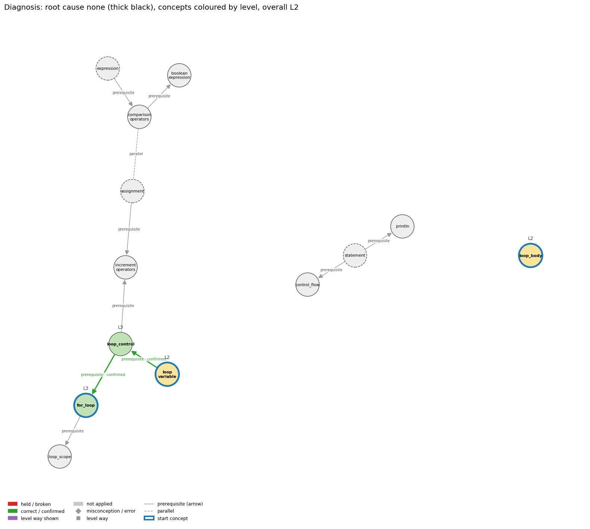

# Think on the Graph: run MY21

This page explains how the algorithm reached its result for this scenario: each step's method, with one example from this run. Every output of every step (all edges offered, every score and label, the figures) is in `MY21.ipynb` and in `report.html`; the interactive graph is `MY21_G.html`.

## Input

Program:
```java
for (int i = 0; i < 3; i++) {
    System.out.println(i);
}
```
**Question.** Explain what the loop prints on each pass.

**Student's answer.** The first pass prints 0, the second prints 1, the third prints 2, and then the loop ends.

**What the program really does.** The program prints `0`, `1`, `2`, one per pass, and the loop ends when i is 3. The student's answer is correct.

## Result

- **Wrong rules held:** none
- **Root cause:** none
- **Overall level:** L3
- **Level per concept:** `for_loop` L3, `loop_body` L2, `loop_control` L3, `loop_variable` L2

**Check of this result (read by hand, 2026-11-13).** The diagnosis matches the answer: nothing is held.

## How the algorithm reached this result

Settings of this run: width N = 3 (how many edges survive each choice), depth D = 3, model `claude-opus-5-5`. The model is asked in step 3 only; every other step is a fixed rule.

### Step 1. From the code to a subgraph G (no model)

Only the program is read here, not the student's answer.

- **Prepare the code.** Characters that a paste changes (curly quotes, odd spaces) are mapped back to plain ones, and the inside of string literals and comments is blanked, so text inside a string can never trigger a pattern.
- **Tag concepts.** Every concept node of the knowledge graph stores regular expressions for how the concept looks in Java (code patterns, signals, operator symbols, type names). All of them are run over the prepared code. A match is a *hit* (which pattern, which text, which line), and a concept with at least one hit is tagged.
- **Mark generic concepts.** Concepts that match nearly any program (statement, expression, assignment) are marked generic: they stay in G but cannot be a starting point by themselves.
- **Cut out G.** G is the tagged concepts, the graph's prerequisite and parallel edges between them, all their misconception and error edges, and their five level nodes (L0 to L4) with the ways of each level. Everything later is restricted to G, so the result can only name things the code actually contains.

*In this run:* `for_loop` is tagged because its pattern `\bfor\s*\(` matches `for (` on line 1. In all 13 concepts are tagged (3 generic). G has 11 concept edges, 122 misconception / error edges and 65 level edges, in 2 connected pieces.

### Step 2. Clauses and start concepts (no model)

- **Clauses.** The answer is cut at sentence ends, at ';' and before 'because' / 'so', and the pieces are numbered c1, c2, … Every label made later must name the clause numbers it rests on, so each finding is tied to the student's own words.
- **Start concepts.** The candidates are the tagged, non-generic concepts (plus a generic one when the answer repeats the code text that tagged it). If there are more than N, each is scored by BM25, a word-overlap score between the answer and the concept's text (its name and the texts of its edges), and the top N start the walk.

*In this run:* 1 clauses; c1 is “The first pass prints 0, the second prints 1, the third prints 2, and…”. For the start, `for_loop` scores 10.10, the highest of 10 candidates; `loop_control` is 4th with 8.31 and is left out. Start concepts: `for_loop`, `loop_body`, `loop_variable`.

### Step 3. The walk over G (the model is asked here, twice per choice)

The walk goes depth by depth. For each current concept:

1. **Edge search (no model).** A concept that has just been entered offers its misconception / error edges and its level ways (each way of a level is an edge of its own, whose text is the way's exact rule). A concept already read offers its prerequisite and parallel edges. An edge already kept is not offered again.
2. **Prune (model).** The model sees the code, the question, the answer and the offered edges, and returns at most 3 of them with a relevance score; the scores are rescaled to add up to 1. Misconception edges and level ways are pruned separately, so they never compete for the same place.
3. **Label (model).** Each surviving edge is read against the numbered clauses. A misconception or error edge is labelled *held* (the answer states this wrong rule), *correct* (it states the right rule) or *not applied*. A level way is *shown* or *not applied*. A concept edge is *confirmed* or *broken*. The reply must give the clause numbers and a confidence between 0 and 1; a label with no clause is thrown away. The model therefore never judges from its own knowledge: each label points at one edge of G and at the student's words.
4. **Score and keep.** Score = prune score × confidence. Held misconceptions and broken edges are always kept; held errors come next; correct, confirmed and shown labels fill what is left of the 3 places by score. Every labelled edge is recorded as evidence, kept or not.
5. **Move on.** The concept at the far end of a kept concept edge is entered and read at the next depth. A concept with a held misconception stays current, so that its prerequisites are examined (the fault may start further back).
6. **Stop test (no model).** The walk may stop when every clause is covered by a labelled rule edge and every entered concept has had its edges read. Clauses still uncovered pull in unvisited concepts by BM25. Otherwise it runs to depth 3, plus one closing round in which the last concepts entered get their own edges read.

*In this run:* at `for_loop` 24 level-way edges are offered; the L2 way “output prediction” gets prune score 0.50 and is labelled **shown** on clause 1 with confidence 0.95, so its score is 0.50 × 0.95 = 0.47. Concepts read at each depth: depth 1: `for_loop`, `loop_body`, `loop_variable`; depth 2: `for_loop`, `loop_body`, `loop_variable`; depth 3: `loop_control`, `loop_variable`, `loop_body`, `for_loop`. The model was asked 11 prune and 21 label questions. The walk stopped at depth 3: the depth limit was reached.

### Step 4. From labels to faults (rules, no model)

Every kept edge labelled *held* is a candidate fault. Rules then remove double counting:

- **Error beside a misconception.** A held error on a concept that also has a held misconception is evidence for it, not a second fault.
- **One fault, one place.** The same misconception held at both ends of a prerequisite edge is filed once: at the concept the graph marks as primary for it, otherwise at the dependent concept.
- **Shadows.** A held label on a prerequisite or generic concept that rests only on clauses a stronger, more specific label already rests on is a shadow of that label (one wrong sentence read twice). It stays in the record but is not a fault, cannot be the root and sets no level.
- **Broken edges.** A prerequisite edge A → B labelled *broken* means the rule of A was not carried into B, so the fault sits at B. If it rests on the same clauses as a held misconception it is that misconception's consequence, not a fault of its own.

*In this run:* no edge is held. The 12 misconception / error edges that were labelled all came back *correct*, so there is no fault.

### Step 5. Root cause (rule)

From each faulty concept the rule walks backwards over the prerequisite edges of G. Whenever a prerequisite also has a fault, the candidate moves back to it, because a fault in what a concept depends on explains the fault in the concept. Among the candidates, the root is the one with the fewest prerequisites of its own (the one furthest back); at a tie, the one whose label has the higher confidence.

*In this run:* there is no fault, so there is no root cause.

### Step 6. Level of each concept (rule, no model)

The model never names a level. It only says whether a *way* is shown, and the level is where that way sits in the graph (L0 contradicts Java, L1 states a rule, L2 applies the rules step by step, L3 relates the parts, L4 reasons beyond the given code). A concept is **L0** if a fault is kept on it, or if every way shown on it is an L0 way. Otherwise it gets the **highest** level among the ways shown, because the levels build on each other. A concept with no fault and no way shown gets no level.

*In this run:* on `loop_control` the ways shown are L2 “output prediction”, L2 “line by line trace”, L3 “purpose of the whole”, so it is L3.

### Step 7. Overall level (rule)

With a root cause, the overall level is the level of the root concept: the student stands where the fault starts. Without one, it is the level reached on at least half of the concepts the answer touched, so one weaker concept does not pull the whole answer down.

*In this run:* there is no root. The levels from high to low are L3, L3, L2, L2; the middle one (place 2 of 4) is L3. **Overall level: L3.**

## The final picture


