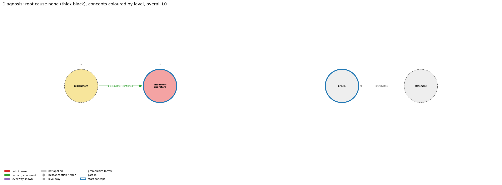

# Think on the Graph: run MY22

This page explains how the algorithm reached its result for this scenario. Every stage is explained in plain words, with the meaning of its terms, followed by one worked example with the real scores of this run. The examples follow the same thread through all stages: the concept `increment_operators`. Every output of every stage is in `MY22.ipynb` and `report.html`; the interactive graph is `MY22_G.html`.

## Input

Program:
```java
int i = 5;
i++;
System.out.println(i);
```
**Question.** Explain what i++ does to i.

**Student's answer.** I think i++ adds 1 to i, though it might add 2, I’m not sure. Probably it makes i 6.

**What the program really does.** `i++` adds exactly 1, so i becomes 6 and the program prints `6`.

## Result

- **Wrong rules held:** none
- **Root cause:** none
- **Overall level:** L2
- **Level per concept:** `assignment` L2, `increment_operators` L2

**Check of this result (read by hand, 2026-11-13).** Reasonable. The student's main answer is right but hedged ('it might add 2, I'm not sure'), so no misconception is held.

## The idea in short

The program does not ask a language model "what is wrong with this answer?". It walks a **knowledge graph** of Java and asks the model small questions about one edge at a time. Each answer of the model must point at the student's own words.

- A **concept** is a topic of Java, for example `integer_division`.
- A **misconception** is a wrong rule a student may believe. An **error** is a rule broken in a program.
- A **level** says how well a concept is understood, from L0 (wrong) to L4 (deep). Each concept has five.
- An **edge** joins two of these. A *prerequisite* edge says one concept must be understood before another. A *misconception* edge joins a concept to a wrong rule and also stores the right rule (its *twin*). A *level* edge joins a concept to a level and stores the **ways** a student can show that level.

Two settings control the walk: the **width N = 3** (how many options are followed at each choice) and the **depth D = 3** (how many rounds the walk takes). The model (`claude-opus-5-5`) is used only in stage 3. All other stages are fixed rules, so they always give the same result.

## Stage 1. From the code to a small graph G (no model)

This stage reads only the program, not the answer. It decides which part of the big knowledge graph this scenario may use.

**1.1 Clean the code.** Strange characters from copy and paste are replaced by normal ones. Then the text inside strings and comments is blanked out. This is called **masking**. It is needed because the next step searches the code for patterns, and a word like `for` inside a printed sentence must not be mistaken for a for loop.

**Worked example from this run.** This program has no string and no comment, so nothing is blanked.

**1.2 Find the concepts in the code.** Every concept in the graph comes with search patterns (regular expressions) that describe how it looks in Java. All patterns are tried on the code. A match is called a **hit**. A concept with at least one hit is **tagged**: the program contains it.

**Worked example from this run.** The concept `increment_operators` has the pattern `\+\+|--`. It matches `++` on line 2, so `increment_operators` is tagged. In total 4 concepts are tagged.

**1.3 Treat very common concepts with care.** Some concepts appear in almost every program: a statement, an expression, an assignment. The graph marks them **generic**. If they were treated like the others, every program would seem to be about them. So a generic concept is kept only when the code connects it to a specific concept, and it can never be a starting point of the walk by itself.

**Worked example from this run.** 2 of the 4 tagged concepts are generic: `assignment`, `statement`. The other 2 are specific and can start the walk.

**1.4 Cut out the small graph G.** G is made of the tagged concepts, the edges of the knowledge graph between them, all their misconception and error edges, and their levels. From now on the algorithm sees only G. This is a safeguard: it can only name a wrong rule that belongs to something the program really contains.

**Worked example from this run.** G has 2 edges between concepts, 31 misconception / error edges and 20 level edges. Of these, 5 misconception / error edges belong to `increment_operators`.

## Stage 2. Clauses and start concepts (no model)

**2.1 Cut the answer into clauses.** A **clause** is one thing the student claims. The answer is cut at the end of each sentence, at ';', and before 'because' and 'so'. The clauses get numbers: c1, c2, … The numbers matter later: whenever the model gives a label, it must say which clause numbers the label is based on. That way every finding can be traced back to the student's words.

**Worked example from this run.** The answer becomes 2 clauses: **c1** “I think i++ adds 1 to i, though it might add 2, Im not sure” **c2** “Probably it makes i 6”

**2.2 Choose where the walk starts.** The walk needs **start concepts**. The candidates are the specific concepts of G. If there are more than N = 3, each one gets a **BM25 score**. BM25 is the score search engines use: it counts the words that the answer shares with the text of a concept, and counts a rare word for more than a common one. The N concepts with the highest scores start the walk.

**Worked example from this run.** There were no more than 3 candidates, so no ranking was needed. All are taken: `increment_operators`, `println`.

## Stage 3. The walk over G (the model is asked here)

The walk moves through G in rounds called **depths**. It is a **beam search**: at every choice it follows only the best N = 3 options and drops the rest. This keeps the work small, because one concept can have twenty or more edges. At each depth, the six steps below are done for every concept the walk is currently at.

**3.1 Collect the edges of the concept.** When the walk first arrives at a concept, it looks *into* it: it collects the concept's misconception and error edges (what could be believed wrongly about it) and its level ways (how it could be understood rightly). These are two separate groups. At the next depth it looks *out of* the concept: it collects the edges that lead to neighbouring concepts. The collected edges are called **candidates**.

**Worked example from this run.** When the walk arrives at `increment_operators`, it collects 16 level ways and 5 misconception / error edges.

**3.2 Prune: keep only the relevant candidates (first question to the model).** There are too many candidates to judge each one carefully. So the model is first asked a quick question: *which 3 of these rules does the answer have anything to do with?* It returns up to N edges, each with a number. The numbers are scaled so that they add up to 1. This number is the **prune score**: the share of relevance the model gives to that edge.

**Worked example from this run.** Of the 16 level ways at `increment_operators`, the model keeps L0 way “everyday reading” (0.45) + L1 way “names the element” (0.30) + L2 way “output prediction” (0.25) = 1.00. The other 13 are dropped here and never judged.

**3.3 Label: judge each kept edge against the clauses (second question to the model).** Now the model reads each kept edge carefully and gives it a **label**:

- for a misconception or error edge: **held** (the student's words state this wrong rule), **correct** (they state the right rule instead) or **not applied** (the answer says nothing about it);
- for a level way: **shown** or not applied;
- for an edge between two concepts: **confirmed** (the student carries the rule from one concept to the other) or **broken** (the student fails to).

With each label the model must give the **clause numbers** it is based on and a **confidence** from 0 to 1 (how sure it is). A label with no clause number is thrown away. So the model cannot diagnose from its own knowledge: every label is tied to one edge of G and to words the student wrote.

**Worked example from this run.** L0 way “everyday reading”: **shown**, based on clause c1, confidence 0.55; L1 way “names the element”: **shown**, based on clauses c1, c2, confidence 0.60; L2 way “output prediction”: **shown**, based on clause c2, confidence 0.60. The rule on the shown edge is: “Folk meaning: '++' reads as 'plus plus' (add twice) or as a maths symbol with no effect, and i++ inside an expression is read as 'add 1 at some later…” Compare it with clause c1: “I think i++ adds 1 to i, though it might add 2, Im not sure”.

**3.4 Score and keep.** Each labelled edge gets a **score = prune score × confidence**. An edge scores high only if it was both relevant and judged with confidence. Then the edges are sorted into **tiers** (ranks):

- **tier 0**: a held misconception or a broken edge. These point at a fault and are always kept.
- **tier 1**: a held error.
- **tier 2**: correct, confirmed or shown. These show understanding. They fill the places that are left, up to N = 3, highest score first.

The kept edges form the **paths** of the walk. Every labelled edge, kept or not, is also stored as **evidence**; the levels in stage 6 are read from all the evidence.

**Worked example from this run.** L0 way “everyday reading”: 0.45 × 0.55 = 0.25; L1 way “names the element”: 0.30 × 0.60 = 0.18; L2 way “output prediction”: 0.25 × 0.60 = 0.15. Kept at depth 1: IncrementByTwo (correct, tier 2, score 0.48); L0 way “everyday reading” (shown, tier 2, score 0.25); L1 way “names the element” (shown, tier 2, score 0.18).

**3.5 Decide where to go next.** A kept edge between two concepts leads the walk to the concept at its other end; that concept is **entered** and is looked into at the next depth. A concept with a held misconception stays in the walk, so that the concepts it depends on are examined too: the mistake may begin earlier.

**Worked example from this run.** The edge assignment → increment_operators was kept (confirmed, score 0.60), so the walk enters `assignment` at the next depth.

**3.6 Decide whether to stop (no model).** After each depth two things are checked. First, **clause coverage**: is every clause explained by at least one labelled rule edge? Second, the **graph check**: has every entered concept been looked into and out of? If both are true, the walk stops. If not, it goes on, but never beyond depth D = 3 plus one closing round that finishes the concepts entered last.

**Worked example from this run.** c1 is covered by IncrementByTwo. c2 is covered by IncrementByTwo. In total 2 of 2 clauses are covered. The walk stopped at depth 3 because every clause was covered and no entered concept had an unread edge. The model was asked 8 prune questions and 14 label questions.

## Stage 4. From labels to faults (rules, no model)

A kept edge labelled *held* is a possible **fault**. But one wrong sentence often produces several labels, so four rules make sure each mistake is counted once.

- **An error next to a misconception.** A misconception is the belief; an error is what it causes in a program. If both are held on the same concept, the misconception is the fault and the error is only supporting evidence.
- **One fault, one place.** If the same misconception is held on two concepts joined by a prerequisite edge, it is counted once, at the concept the graph names as its main (*primary*) concept.
- **Shadows.** A held label on a more general concept, based only on clauses that a stronger label on a more specific concept already uses, is a **shadow**: the same sentence read a second time. A shadow is not a fault.
- **Broken edges.** A broken edge A → B means the student did not carry the rule of A into B. If it is based on the same clauses as a held misconception, it is a **consequence** of that misconception and not a separate fault.

**Worked example from this run.** No edge is held, so there is no fault. 2 misconception / error edges were labelled *correct*; the strongest is IncrementByTwo at `increment_operators` (0.80 × 0.60 = 0.48): the answer states its right rule, “i++ (and ++i) increases i by exactly 1.”

## Stage 5. Root cause (rule, no model)

If several concepts have a fault, the **root cause** is the one to teach first. The rule looks at what each faulty concept depends on (its **prerequisites** in G). If a prerequisite also has a fault, the root moves back to it, because a mistake in the basis explains the mistake in what is built on it. Among the concepts found this way, the root is the one with the fewest prerequisites of its own. If two are equal, the one with the higher confidence wins.

**Worked example from this run.** There is no fault, so there is no root cause.

## Stage 6. Level of each concept (rule, no model)

Each concept gets one of five **levels**:

- **L0**: the answer holds a rule that contradicts Java, or reads the code in an everyday sense;
- **L1**: it states one correct rule but does not use it;
- **L2**: it applies the rules to the code step by step;
- **L3**: it relates the parts to each other and to the purpose of the code;
- **L4**: it reasons beyond the given code (predicts what a change would do, finds a bug).

Every level has **ways**: things a student does at that level, such as "output prediction" at L2. The model is never asked for a level. In stage 3 it only said whether a way is *shown*. The level then follows by rule: a concept is **L0** if it has a fault, or if only L0 ways are shown on it. Otherwise it gets the **highest** level among the ways shown, because each level includes the ones below it.

**Worked example from this run.** On `increment_operators` the ways shown are L0 “everyday reading” (score 0.25), L1 “names the element” (score 0.18), L2 “output prediction” (score 0.15); the highest level among them is L2, so `increment_operators` is L2.

## Stage 7. Overall level (rule, no model)

One level is given for the whole answer. If there is a root cause, it is the level of the root concept: the student stands where the mistake begins. If there is no fault, the levels of all concepts are sorted from high to low and the middle one is taken, so that one weak or one strong concept does not decide alone.

**Worked example from this run.** There is no root cause. The levels, from high to low, are L2, L2. The middle one (number 1 of 2) is L2. Overall level: **L2**.

## The final picture


