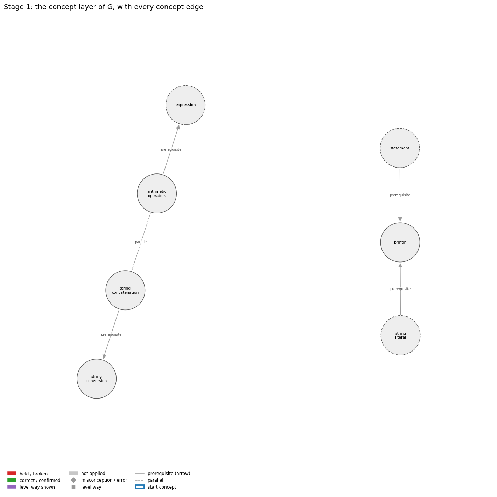
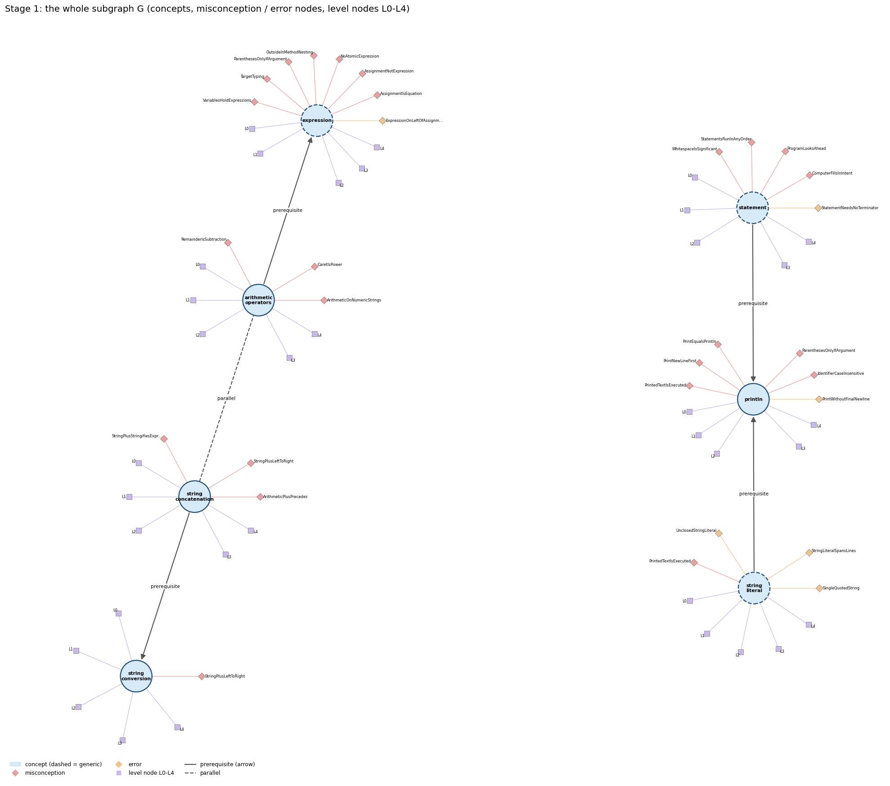
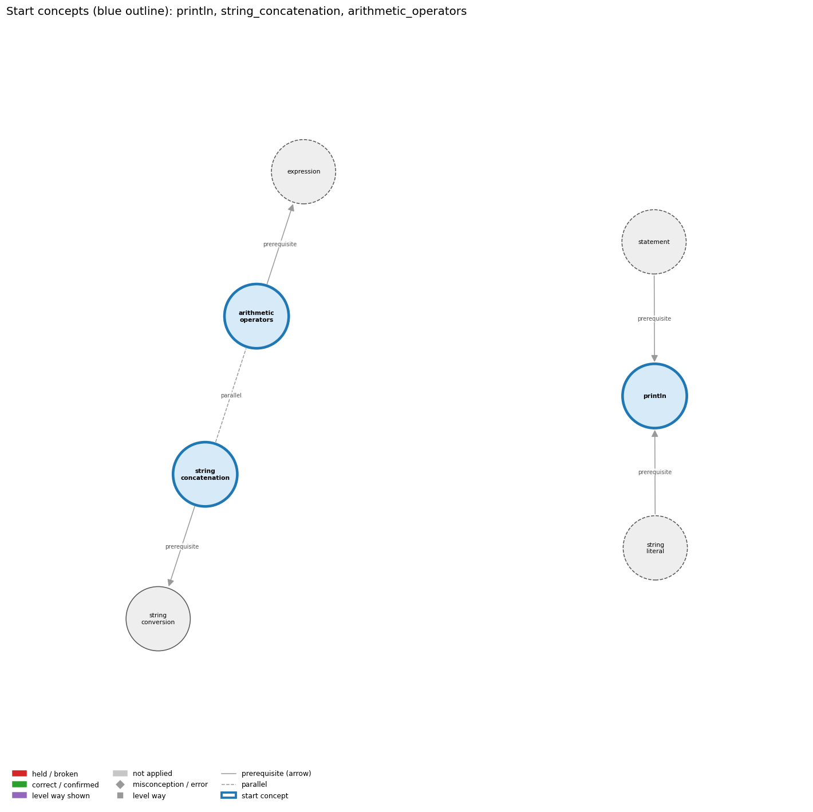
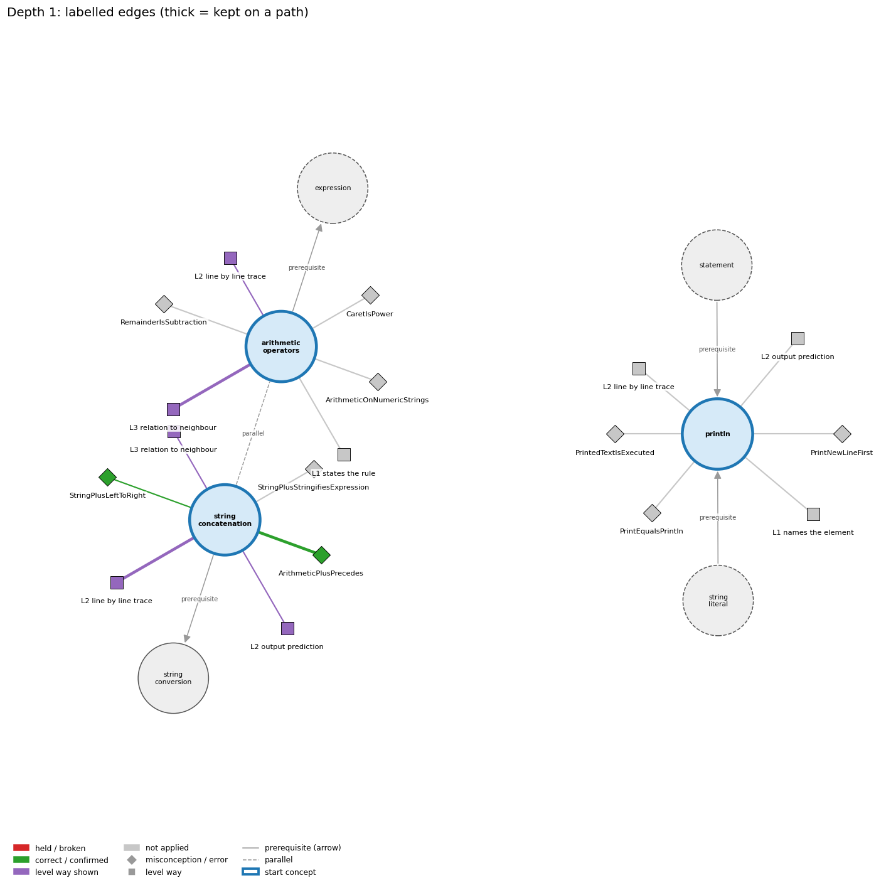
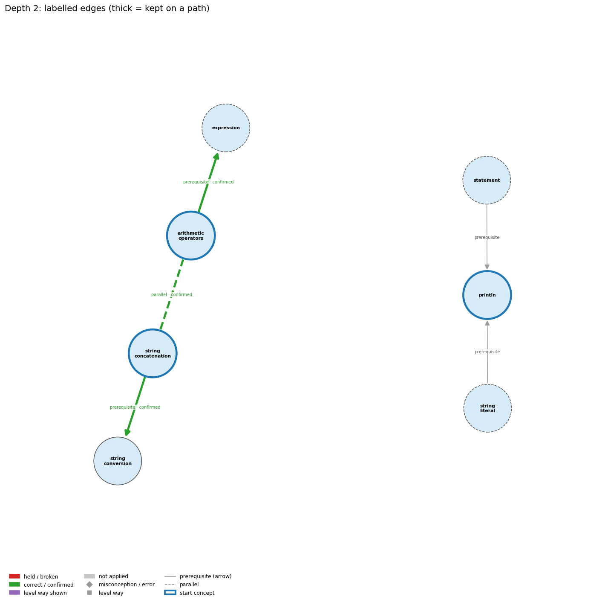
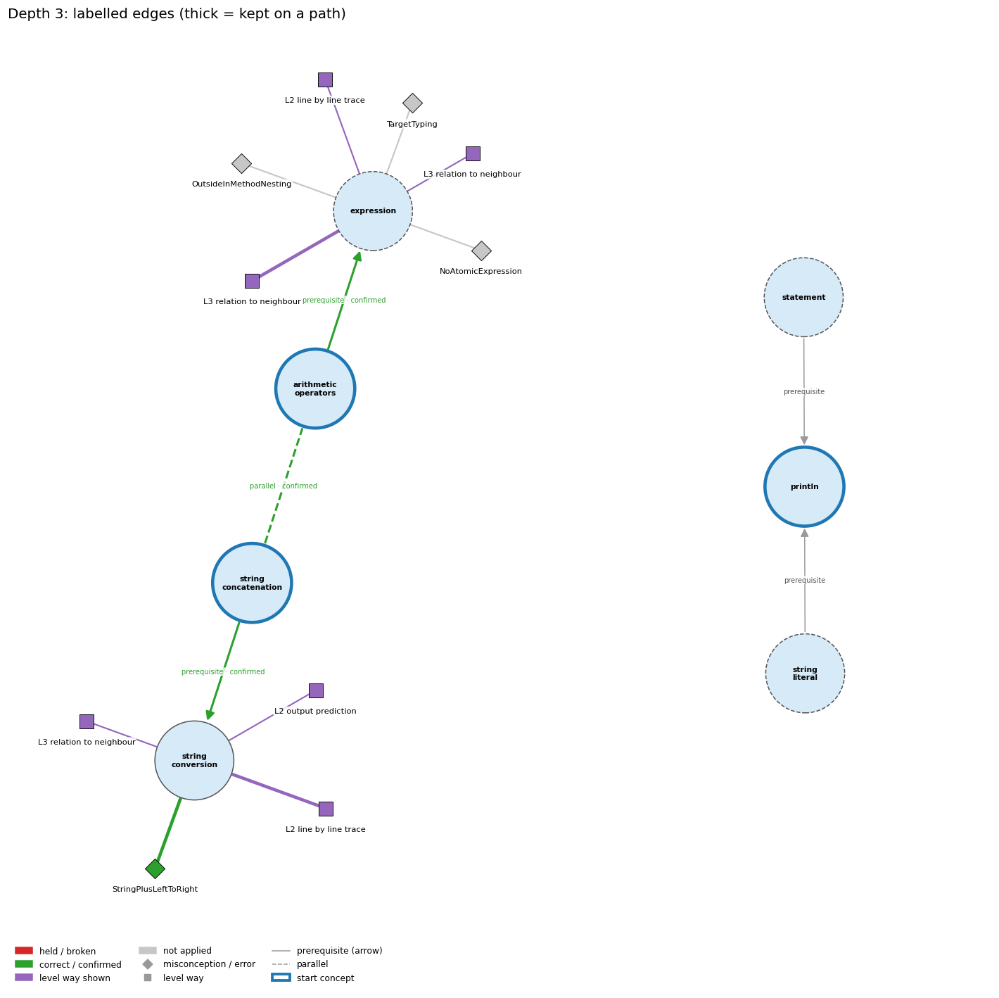
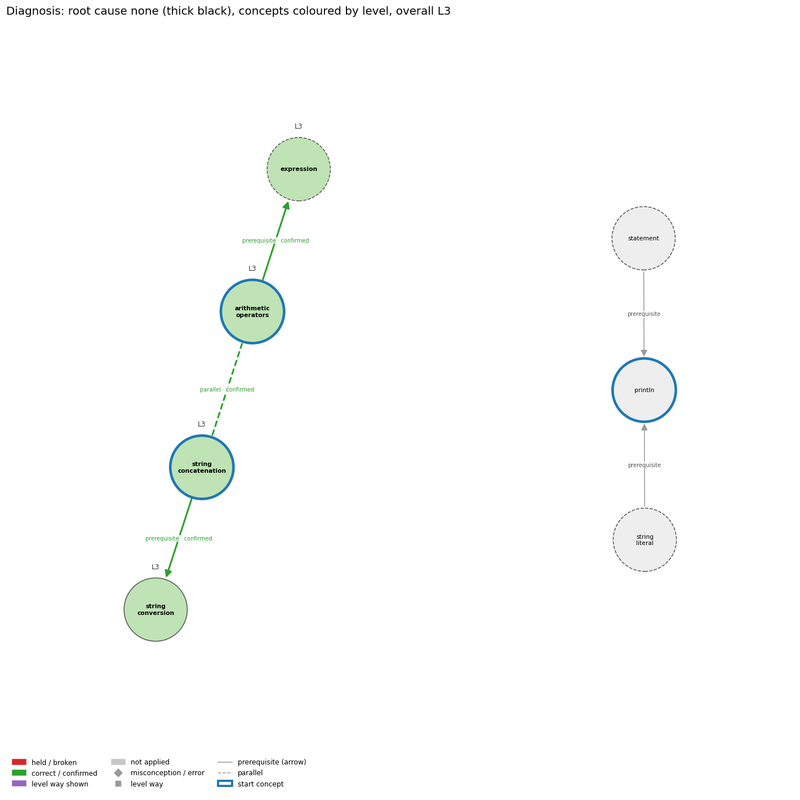

# Think on the Graph: every output of the run MY24

Files of this scenario: `input.json` (program, question, answer), `diagnosis.json`, `subgraph.json`, `traverse_log.txt`, `report.html` (this report as one full-page file, with the interactive graph `MY24_G.html`), `MY24.ipynb` (this report as a notebook).

## 0. Input
Program:
```java
System.out.println("Total: " + 5 + 3);
```
Question: Explain how Java decides what "Total: " + 5 + 3 becomes.

Student's answer: + is worked out left to right. Once there is text, it is like gluing words together, so 5 and then 3 are stuck on as characters, giving Total: 53
Settings: width 3, depth 3, prune llm, backend claude-cli, model claude-opus-5-5
## 1. Stage 1: the subgraph G from the code (no model)
Masked code (string and char literals and comments blanked; this is what the patterns see):
```
System.out.println("       " + 5 + 3);
```
Which code text tagged which concept (a generic concept fires on almost any Java line; it starts the walk only if the answer repeats its tag):
| concept | generic | channel | matched text | line |
|---|---|---|---|---|
| arithmetic_operators | False | pattern | '5 + 3' | 1 |
| expression | True | pattern | '5 + 3' | 1 |
| println | False | pattern | 'System.out.println(' | 1 |
| statement | True | pattern | ';' | 1 |
| string_concatenation | False | pattern | '"Total: " +' | 1 |
| string_conversion | False | pattern | '" + 5' | 1 |
| string_literal | True | pattern | '"Total: "' | 1 |

G: 7 concept nodes (3 generic), 5 concept edges, 30 misconception / error edges, 27 misconception / error nodes, 35 level nodes, 33 level-misconception links, 2 connected piece(s).
Note: concept nodes form 2 pieces (the KG has no edge between them): arithmetic_operators,expression,string_concatenation,string_conversion | println,statement,string_literal

Concept edges of G (the links the walk can read; `pre:` = prerequisite A -> B, `par:` = parallel):
| edge | type | rule (logic) |
|---|---|---|
| par:string_concatenation~arithmetic_operators | parallel | + adds when both operands are numbers and concatenates when either operand is a String, converting the other operand to a String. It is left-associative, so 1 + 2 + "3" is "33" but "1" + 2 + 3 is "123". |
| pre:arithmetic_operators->expression | prerequisite | An operator combines operand values a and b into a new value, so operators build larger expressions from smaller ones. |
| pre:statement->println | prerequisite | System.out.println(s); is itself a statement, so its line of output appears at its own place in the sequence. |
| pre:string_concatenation->string_conversion | prerequisite | When one operand of + is a String, Java converts the other operand to a String before concatenating. |
| pre:string_literal->println | prerequisite | println("s") outputs exactly the characters between the quotes and then ends the line. |

Misconception / error edges per concept (count), and level ways per concept (count):
| concept | misconception / error edges | level ways (L1-L4 + L0 non-misconception) |
|---|---|---|
| arithmetic_operators | 3 | 18 |
| expression | 8 | 19 |
| println | 6 | 17 |
| statement | 5 | 19 |
| string_concatenation | 3 | 16 |
| string_conversion | 1 | 13 |
| string_literal | 4 | 16 |

**Figure 1**


**Figure 2**


## 2. Clauses and start concepts (no model)
The answer split into clauses (at sentence ends, ';', and before 'because' / 'so'; quotes removed):
| clause | text |
|---|---|
| c1 | + is worked out left to right |
| c2 | Once there is text, it is like gluing words together |
| c3 | so 5 and then 3 are stuck on as characters, giving Total: 53 |

start: BM25 of the answer against each tagged concept: println 11.11 (hits 1), string_concatenation 8.26 (hits 1), arithmetic_operators 6.65 (hits 1), string_conversion 4.80 (hits 1)

start: chosen println, string_concatenation, arithmetic_operators

start concepts (3): println, string_concatenation, arithmetic_operators

Start concepts: println, string_concatenation, arithmetic_operators

**Figure 3**


## 3. The walk, depth by depth
At each depth, for each current concept: the edges offered (a concept entering as a start concept offers its misconception / error edges and its level ways, as two families; otherwise it offers its concept edges), the prune prompt and the model's reply, then the label prompt(s) and the model's reply, parsed into label / clauses / confidence. Score = prune score x confidence.

### Depth 1: current concepts 'println', 'string_concatenation', 'arithmetic_operators'

#### println, misconceptions: 6 edges offered
Edges offered:
| edge |
|---|
| err:println->PrintWithoutFinalNewline \| wrong rule: Ends the output with print and expects it to appear right away. \| right rule: Finish a line of print calls with println; some systems hold print output until a newline is printed. |
| mis:println->IdentifierCaseInsensitive \| wrong rule: System.out.Println and System.out.println name the same method. \| right rule: Java is case-sensitive: names of variables, methods and classes that differ only in capitalization are different names. |
| mis:println->ParenthesesOnlyIfArgument \| wrong rule: println with nothing to print can be written System.out.println; without the parentheses. \| right rule: A method call always needs parentheses, so an empty line is printed with System.out.println();. |
| mis:println->PrintEqualsPrintln \| wrong rule: print and println do the same thing, so print(s1); print(s2); puts s1 and s2 on separate lines. \| right rule: println ends the line after printing and print does not, so print(s1); print(s2); puts s1 and s2 on the same line. |
| mis:println->PrintNewLineFirst \| wrong rule: println(s) prints a newline and then s. \| right rule: println(s) prints s and then the newline. |
| mis:println->PrintedTextIsExecuted \| wrong rule: System.out.println("x is 5"); sets x to 5 (text inside the quotes is run as code). \| right rule: Characters inside double quotes are printed literally; println only displays them and changes no variable. Only an assignment such as x = 5; sets x. |

Prune: the model's reply (edge id and score; the kept edges sum to 1):
```
mis:println->PrintedTextIsExecuted (0.60), mis:println->PrintNewLineFirst (0.25), mis:println->PrintEqualsPrintln (0.15)
```
Kept by pruning: mis:println->PrintedTextIsExecuted (0.60), mis:println->PrintNewLineFirst (0.25), mis:println->PrintEqualsPrintln (0.15)

Label prompt for the misconception / error edges (judged together). The model saw the program, the question, the numbered clauses, and these edges with their wrong rule and right rule:
| edge |
|---|
| mis:println->PrintedTextIsExecuted \| wrong rule: System.out.println("x is 5"); sets x to 5 (text inside the quotes is run as code). \| right rule: Characters inside double quotes are printed literally; println only displays them and changes no variable. Only an assignment such as x = 5; sets x. |
| mis:println->PrintNewLineFirst \| wrong rule: println(s) prints a newline and then s. \| right rule: println(s) prints s and then the newline. |
| mis:println->PrintEqualsPrintln \| wrong rule: print and println do the same thing, so print(s1); print(s2); puts s1 and s2 on separate lines. \| right rule: println ends the line after printing and print does not, so print(s1); print(s2); puts s1 and s2 on the same line. |
Model's reply:
```
mis:println->PrintedTextIsExecuted | not applied | clauses: none | confidence: 0.85
mis:println->PrintNewLineFirst | not applied | clauses: none | confidence: 0.95
mis:println->PrintEqualsPrintln | not applied | clauses: none | confidence: 0.95
```

Parsed labels:
| edge | label | prune score | confidence | score | clauses | words |
|---|---|---|---|---|---|---|
| mis:println->PrintedTextIsExecuted | not applied |  |  | 0.0 |  |  |
| mis:println->PrintNewLineFirst | not applied |  |  | 0.0 |  |  |
| mis:println->PrintEqualsPrintln | not applied |  |  | 0.0 |  |  |

#### println, level ways: 17 edges offered
Edges offered:
| edge |
|---|
| lvl:println@L0#0 \| level L0 way everyday_reading: Everyday reading: 'println' is just 'print', and 'new line' is something you do before writing. Java rule: println(x) prints x and then ends the line; println() alone just ends the line. |
| lvl:println@L0#3 \| level L0 way inconsistent_trace: Applies the println rule (print, then end line) unevenly: puts the newline before the text on one call and after it on another, or forgets that the next output starts on a new line. (here mixing in: "print and println behave the same (no newline difference)") |
| lvl:println@L1#0 \| level L1 way names_the_element: System.out.println is a library method that prints its argument followed by a line terminator ('print line'). |
| lvl:println@L1#1 \| level L1 way states_the_rule: println(String x) behaves as though it calls print(x) and then println(); println() terminates the current line by writing the line separator string. |
| lvl:println@L2#0 \| level L2 way line_by_line_trace: Evaluate the argument, print its characters at the current position, then write the line separator so the cursor moves to the beginning of the next line. |
| lvl:println@L2#1 \| level L2 way output_prediction: Output is the value's characters followed by a line break: println("Hello, "); println("World!"); prints two lines. |
| lvl:println@L2#2 \| level L2 way one_step_execution: One call appends the text and a line separator to the output; the cursor ends at the start of the next line; no variable changes and nothing is returned. |
| lvl:println@L3#0 \| level L3 way relation_to_neighbour: System.out.println(s); is a statement, so its line of output appears at its own place in the sequence. |
| lvl:println@L3#1 \| level L3 way relation_to_neighbour: println("s") outputs exactly the characters between the quotes and then ends the line. |
| lvl:println@L3#2 \| level L3 way relation_to_neighbour: print leaves the cursor on the line; println ends it; several prints followed by one println make one line. |
| lvl:println@L3#3 \| level L3 way relation_to_neighbour: println prints numbers with all their digits and always ends the line; printf formats each value by its conversion code and ends the line only where the format has %n or \n. |
| lvl:println@L3#4 \| level L3 way purpose_of_the_whole: Purpose: produce one complete line of output, e.g. each result on its own line, or end a line built with print. |
| lvl:println@L4#0 \| level L4 way predict_a_change: Replacing println with print joins the next output onto the same line (a typical logic error); the characters printed stay the same. |
| lvl:println@L4#1 \| level L4 way transfer_to_a_new_program: Use println when each output item belongs on its own line or to end a line; use print to continue a line and printf to control number formatting. |
| lvl:println@L4#2 \| level L4 way diagnose_an_error: rule broken: Finish a line of print calls with println. Kind: silent logic error. Trigger class: output ends with print, so the last line may not be shown or runs into the shell prompt |
| lvl:println@L4#3 \| level L4 way diagnose_an_error: rule broken: Method names are case-sensitive. Kind: compile-time. Trigger class: System.out.Println or system.out.println: cannot find symbol |
| lvl:println@L4#4 \| level L4 way diagnose_an_error: rule broken: Calls need parentheses. Kind: compile-time. Trigger class: System.out.println; without () |

Prune: the model's reply (edge id and score; the kept edges sum to 1):
```
{lvl:println@L2#1 (Score: 0.45)}
{lvl:println@L2#0 (Score: 0.35)}
{lvl:println@L1#0 (Score: 0.2)}
```
Kept by pruning: lvl:println@L2#1 (0.45), lvl:println@L2#0 (0.35), lvl:println@L1#0 (0.20)

Label prompt for level way lvl:println@L2#1 (the model saw only the concept, the way's name 'output prediction' and its text; no level):
> Output is the value's characters followed by a line break: println("Hello, "); println("World!"); prints two lines.

Model's reply:
```
Label: not shown
Clauses: none
Confidence: 0.65
```

Label prompt for level way lvl:println@L2#0 (the model saw only the concept, the way's name 'line by line trace' and its text; no level):
> Evaluate the argument, print its characters at the current position, then write the line separator so the cursor moves to the beginning of the next line.

Model's reply:
```
Label: not shown
Clauses: none
Confidence: 0.85
```

Label prompt for level way lvl:println@L1#0 (the model saw only the concept, the way's name 'names the element' and its text; no level):
> System.out.println is a library method that prints its argument followed by a line terminator ('print line').

Model's reply:
```
Label: not shown
Clauses: none
Confidence: 0.95
```

Parsed labels:
| edge | label | prune score | confidence | score | clauses | words |
|---|---|---|---|---|---|---|
| lvl:println@L2#1 | not applied |  |  | 0.0 |  |  |
| lvl:println@L2#0 | not applied |  |  | 0.0 |  |  |
| lvl:println@L1#0 | not applied |  |  | 0.0 |  |  |

#### string_concatenation, misconceptions: 3 edges offered
Edges offered:
| edge |
|---|
| mis:string_concatenation->ArithmeticPlusPrecedes \| wrong rule: In "s" + a + b, the numbers a and b are added first and their sum is joined to s. \| right rule: Both uses of + have the same precedence and are evaluated left to right, so "s" + a + b joins a and then b as text; only "s" + (a + b) adds them first. |
| mis:string_concatenation->StringPlusLeftToRight \| wrong rule: 2 + 3 + "bc" and "bc" + 2 + 3 give the same text. \| right rule: + is evaluated left to right: 2 + 3 + "bc" is "5bc" but "bc" + 2 + 3 is "bc23". |
| mis:string_concatenation->StringPlusStringifiesExpression \| wrong rule: In "s" + (a + b), the text a + b is joined to s instead of its value. \| right rule: The expression (a + b) is evaluated first, and its value is then turned into text and joined to s. |

Prune: the model's reply (edge id and score; the kept edges sum to 1):
```
{mis:string_concatenation->ArithmeticPlusPrecedes (Score: 0.55)}
{mis:string_concatenation->StringPlusLeftToRight (Score: 0.35)}
{mis:string_concatenation->StringPlusStringifiesExpression (Score: 0.1)}
```
Kept by pruning: mis:string_concatenation->ArithmeticPlusPrecedes (0.55), mis:string_concatenation->StringPlusLeftToRight (0.35), mis:string_concatenation->StringPlusStringifiesExpression (0.10)

Label prompt for the misconception / error edges (judged together). The model saw the program, the question, the numbered clauses, and these edges with their wrong rule and right rule:
| edge |
|---|
| mis:string_concatenation->ArithmeticPlusPrecedes \| wrong rule: In "s" + a + b, the numbers a and b are added first and their sum is joined to s. \| right rule: Both uses of + have the same precedence and are evaluated left to right, so "s" + a + b joins a and then b as text; only "s" + (a + b) adds them first. |
| mis:string_concatenation->StringPlusLeftToRight \| wrong rule: 2 + 3 + "bc" and "bc" + 2 + 3 give the same text. \| right rule: + is evaluated left to right: 2 + 3 + "bc" is "5bc" but "bc" + 2 + 3 is "bc23". |
| mis:string_concatenation->StringPlusStringifiesExpression \| wrong rule: In "s" + (a + b), the text a + b is joined to s instead of its value. \| right rule: The expression (a + b) is evaluated first, and its value is then turned into text and joined to s. |
Model's reply:
```
mis:string_concatenation->ArithmeticPlusPrecedes | correct | clauses: 1, 2, 3 | confidence: 0.95
mis:string_concatenation->StringPlusLeftToRight | correct | clauses: 1 | confidence: 0.6
mis:string_concatenation->StringPlusStringifiesExpression | not applied | clauses: none | confidence: 0.9
```

Parsed labels:
| edge | label | prune score | confidence | score | clauses | words |
|---|---|---|---|---|---|---|
| mis:string_concatenation->ArithmeticPlusPrecedes | correct | 0.55 | 0.95 | 0.52 | c1, c2, c3 | + is worked out left to right; Once there is text, it is like gluing words together; so 5 and then 3 are stuck on as characters, giving Total: 53 |
| mis:string_concatenation->StringPlusLeftToRight | correct | 0.35 | 0.6 | 0.21 | c1 | + is worked out left to right |
| mis:string_concatenation->StringPlusStringifiesExpression | not applied |  |  | 0.0 |  |  |

#### string_concatenation, level ways: 16 edges offered
Edges offered:
| edge |
|---|
| lvl:string_concatenation@L0#0 \| level L0 way everyday_reading: In arithmetic, + always means 'add', and 'plus' combines quantities, so novices expect "1" + 2 to be 3. In Java, + with a String operand joins text end to end, and a chain of + is processed left to right, one operator at a time. |
| lvl:string_concatenation@L0#3 \| level L0 way inconsistent_trace: Points to LT (left to right, and each + adds or concatenates according to its operands at that moment). Applied unevenly, a student keeps adding numbers after a String has appeared, or concatenates before any String appears (1 + 2 + "x" as "12x"). (here mixing in: "+ with a String turns the whole other side into a string first") |
| lvl:string_concatenation@L1#0 \| level L1 way names_the_element: String concatenation: the + operator with a String operand, which joins two values end to end into a new String. |
| lvl:string_concatenation@L1#1 \| level L1 way states_the_rule: If either operand of + is a String, the other is converted to a String, and the result is a new String made of the first operand's characters followed by the second's. |
| lvl:string_concatenation@L2#0 \| level L2 way line_by_line_trace: A chain of + is evaluated left to right, after any parenthesized parts. At each + the current operand types decide: two numbers are added, otherwise the values are concatenated. |
| lvl:string_concatenation@L2#1 \| level L2 way output_prediction: The result is a String: 2 + "bc" is "2bc", 2 + 3 + "bc" is "5bc", "bc" + 2 + 3 is "bc23", and "bc" + (2+3) is "bc5". |
| lvl:string_concatenation@L2#2 \| level L2 way one_step_execution: Concatenation creates a new String and changes no operand. A variable changes only if the result is assigned, as in ruler = ruler + i + ruler;. |
| lvl:string_concatenation@L3#0 \| level L3 way relation_to_neighbour: Concatenation always yields a String, even when one operand is a number, so its result cannot be used in arithmetic without parsing. |
| lvl:string_concatenation@L3#1 \| level L3 way relation_to_neighbour: The non-String operand is converted to its printed form (int 99 to "99", double 1.0 to "1.0", char 'a' to "a") before joining. |
| lvl:string_concatenation@L3#2 \| level L3 way relation_to_neighbour: + adds when both operands are numbers and concatenates when either operand is a String, converting the other operand to a String. It is left-associative, so 1 + 2 + "3" is "33" but "1" + 2 + 3 is "123". |
| lvl:string_concatenation@L3#3 \| level L3 way purpose_of_the_whole: Concatenation builds output lines and labels from computed values (a + " + " + b + " = " + c). Repeated s = s + piece makes s a gatherer of text. |
| lvl:string_concatenation@L4#0 \| level L4 way predict_a_change: Parenthesizing numeric parts changes the result ("sum " + (a + b) adds before joining). Moving numbers before or after the first String changes whether they are added. Concatenating into a printf format string removes the separate argument printf needs. |
| lvl:string_concatenation@L4#1 \| level L4 way transfer_to_a_new_program: Use + concatenation for simple output and labels, putting parentheses around any arithmetic inside. Use printf when numbers need formatting, and parse Strings before using them as numbers. |
| lvl:string_concatenation@L4#2 \| level L4 way diagnose_an_error: rule broken: Once a String appears in a + chain, every later + concatenates. Kind: silent logic error. Trigger class: "Sum: " + a + b with numbers a and b prints both digit strings side by side (e.g. Sum: 23). |
| lvl:string_concatenation@L4#3 \| level L4 way diagnose_an_error: rule broken: char + char is numeric addition, not concatenation. Kind: silent logic error. Trigger class: Joining two chars with + when no String is involved ('b' + 'c' prints 197). |
| lvl:string_concatenation@L4#4 \| level L4 way diagnose_an_error: rule broken: printf needs its values as separate arguments matching the format specifiers. Kind: run-time exception. Trigger class: Concatenating the value into the format (printf("inches = %d" + inch)): MissingFormatArgumentException. |

Prune: the model's reply (edge id and score; the kept edges sum to 1):
```
{lvl:string_concatenation@L2#0 (Score: 0.45)}
{lvl:string_concatenation@L3#2 (Score: 0.3)}
{lvl:string_concatenation@L2#1 (Score: 0.25)}
```
Kept by pruning: lvl:string_concatenation@L2#0 (0.45), lvl:string_concatenation@L3#2 (0.30), lvl:string_concatenation@L2#1 (0.25)

Label prompt for level way lvl:string_concatenation@L2#0 (the model saw only the concept, the way's name 'line by line trace' and its text; no level):
> A chain of + is evaluated left to right, after any parenthesized parts. At each + the current operand types decide: two numbers are added, otherwise the values are concatenated.

Model's reply:
```
Label: shown
Clauses: 1, 2, 3
Confidence: 0.9
```

Label prompt for level way lvl:string_concatenation@L3#2 (the model saw only the concept, the way's name 'relation to neighbour' and its text; no level):
> + adds when both operands are numbers and concatenates when either operand is a String, converting the other operand to a String. It is left-associative, so 1 + 2 + "3" is "33" but "1" + 2 + 3 is "123".

Model's reply:
```
Label: shown
Clauses: 1, 2, 3
Confidence: 0.85
```

Label prompt for level way lvl:string_concatenation@L2#1 (the model saw only the concept, the way's name 'output prediction' and its text; no level):
> The result is a String: 2 + "bc" is "2bc", 2 + 3 + "bc" is "5bc", "bc" + 2 + 3 is "bc23", and "bc" + (2+3) is "bc5".

Model's reply:
```
Label: shown
Clauses: 1, 2, 3
Confidence: 0.9
```

Parsed labels:
| edge | label | prune score | confidence | score | clauses | words |
|---|---|---|---|---|---|---|
| lvl:string_concatenation@L2#0 | shown | 0.45 | 0.9 | 0.41 | c1, c2, c3 | + is worked out left to right; Once there is text, it is like gluing words together; so 5 and then 3 are stuck on as characters, giving Total: 53 |
| lvl:string_concatenation@L3#2 | shown | 0.3 | 0.85 | 0.26 | c1, c2, c3 | + is worked out left to right; Once there is text, it is like gluing words together; so 5 and then 3 are stuck on as characters, giving Total: 53 |
| lvl:string_concatenation@L2#1 | shown | 0.25 | 0.9 | 0.23 | c1, c2, c3 | + is worked out left to right; Once there is text, it is like gluing words together; so 5 and then 3 are stuck on as characters, giving Total: 53 |

#### arithmetic_operators, misconceptions: 3 edges offered
Edges offered:
| edge |
|---|
| mis:arithmetic_operators->ArithmeticOnNumericStrings \| wrong rule: "10" - 1 or "6" * "2" works because the strings look like numbers. \| right rule: Arithmetic operators other than + are not defined for Strings; a String of digits must first be converted to a number, e.g. with Integer.parseInt. |
| mis:arithmetic_operators->CaretIsPower \| wrong rule: a^2 computes a squared. \| right rule: Java has no exponent operator; ^ is exclusive or, and a * a or Math.pow(a, 2) computes a squared. |
| mis:arithmetic_operators->RemainderIsSubtraction \| wrong rule: 9 % 5 means 9 minus 5 (a % b subtracts b from a). \| right rule: % gives the remainder after integer division: 9 % 5 is 4 because 9 = 1 * 5 + 4, and 17 % 5 is 2, not 12. |

Prune: the model's reply (edge id and score; the kept edges sum to 1):
```
mis:arithmetic_operators->ArithmeticOnNumericStrings (0.80), mis:arithmetic_operators->RemainderIsSubtraction (0.10), mis:arithmetic_operators->CaretIsPower (0.10)
```
Kept by pruning: mis:arithmetic_operators->ArithmeticOnNumericStrings (0.80), mis:arithmetic_operators->RemainderIsSubtraction (0.10), mis:arithmetic_operators->CaretIsPower (0.10)

Label prompt for the misconception / error edges (judged together). The model saw the program, the question, the numbered clauses, and these edges with their wrong rule and right rule:
| edge |
|---|
| mis:arithmetic_operators->ArithmeticOnNumericStrings \| wrong rule: "10" - 1 or "6" * "2" works because the strings look like numbers. \| right rule: Arithmetic operators other than + are not defined for Strings; a String of digits must first be converted to a number, e.g. with Integer.parseInt. |
| mis:arithmetic_operators->RemainderIsSubtraction \| wrong rule: 9 % 5 means 9 minus 5 (a % b subtracts b from a). \| right rule: % gives the remainder after integer division: 9 % 5 is 4 because 9 = 1 * 5 + 4, and 17 % 5 is 2, not 12. |
| mis:arithmetic_operators->CaretIsPower \| wrong rule: a^2 computes a squared. \| right rule: Java has no exponent operator; ^ is exclusive or, and a * a or Math.pow(a, 2) computes a squared. |
Model's reply:
```
mis:arithmetic_operators->ArithmeticOnNumericStrings | not applied | clauses: none | confidence: 0.85
mis:arithmetic_operators->RemainderIsSubtraction | not applied | clauses: none | confidence: 0.97
mis:arithmetic_operators->CaretIsPower | not applied | clauses: none | confidence: 0.97
```

Parsed labels:
| edge | label | prune score | confidence | score | clauses | words |
|---|---|---|---|---|---|---|
| mis:arithmetic_operators->ArithmeticOnNumericStrings | not applied |  |  | 0.0 |  |  |
| mis:arithmetic_operators->RemainderIsSubtraction | not applied |  |  | 0.0 |  |  |
| mis:arithmetic_operators->CaretIsPower | not applied |  |  | 0.0 |  |  |

#### arithmetic_operators, level ways: 18 edges offered
Edges offered:
| edge |
|---|
| lvl:arithmetic_operators@L0#0 \| level L0 way everyday_reading: In maths notation, multiplication can be implicit (2x), ^ or a superscript means a power, ÷ is exact division, and % means percent. In Java * must be written, / depends on the operand types, % is the remainder, and there is no power operator (^ is exclusive or). |
| lvl:arithmetic_operators@L0#2 \| level L0 way inconsistent_trace: Points to LT (evaluate operands, then apply the operator in the promoted type). Applied unevenly, a student uses integer division for one / and real division for another / in the same int expression. (here mixing in: "a^2 computes a squared") |
| lvl:arithmetic_operators@L1#0 \| level L1 way names_the_element: Arithmetic operators: the binary operators + - * / % that combine two numeric operands into a numeric result. |
| lvl:arithmetic_operators@L1#1 \| level L1 way states_the_rule: Both operands must be numeric, and the result has the promoted type (int, long or double). * / % bind tighter than + -, all group left to right, and int / or % by zero throws ArithmeticException. Unary minus negates its operand (-x) and unary plus leaves it unchanged; they bind more tightly than * and /, so -a * b is (-a) * b. |
| lvl:arithmetic_operators@L2#0 \| level L2 way line_by_line_trace: The left operand is evaluated fully, then the right operand, and then the operator is applied in the promoted type. |
| lvl:arithmetic_operators@L2#1 \| level L2 way output_prediction: With ints, 17 / 3 is 5 and 17 % 3 is 2. With doubles, 5.0 / 3.0 is 1.6666666666666667. With mixed operands, the int is promoted first (10 / 3.0 is 3.333...). |
| lvl:arithmetic_operators@L2#2 \| level L2 way one_step_execution: An arithmetic operator never changes its operands. Each variable is replaced by its value, and only an assignment (or ++ or op=) stores the result. |
| lvl:arithmetic_operators@L3#0 \| level L3 way relation_to_neighbour: Operators build larger expressions from smaller ones, and each operand can itself be any expression. |
| lvl:arithmetic_operators@L3#1 \| level L3 way relation_to_neighbour: For ints, / gives the truncated quotient and % the remainder, so (a / b) * b + a % b == a. |
| lvl:arithmetic_operators@L3#2 \| level L3 way relation_to_neighbour: int / or % by zero throws a run-time exception, while floating-point division by zero gives Infinity or NaN. |
| lvl:arithmetic_operators@L3#3 \| level L3 way relation_to_neighbour: + adds when both operands are numbers and concatenates when either operand is a String, converting the other operand to a String. It is left-associative, so 1 + 2 + "3" is "33" but "1" + 2 + 3 is "123". |
| lvl:arithmetic_operators@L3#4 \| level L3 way purpose_of_the_whole: Arithmetic operators turn formulas into code: totals, averages, unit conversions (inch * CM_PER_INCH), and digit extraction (n % 10, n / 10). |
| lvl:arithmetic_operators@L4#0 \| level L4 way predict_a_change: Changing an operand's type changes the operator's meaning (int / versus double /). Reordering * and / changes integer results (59 * 100 / 60 is 98, 59 / 60 * 100 is 0). Replacing ^ with Math.pow gives a real power. |
| lvl:arithmetic_operators@L4#1 \| level L4 way transfer_to_a_new_program: Use the operators for arithmetic on numeric types. Use the Math library for powers, roots and absolute values, and parse numeric Strings before computing with them. |
| lvl:arithmetic_operators@L4#2 \| level L4 way diagnose_an_error: rule broken: int / and % by zero are undefined. Kind: run-time exception. Trigger class: A divisor that evaluates to 0 (empty count, zero input): ArithmeticException: / by zero. |
| lvl:arithmetic_operators@L4#3 \| level L4 way diagnose_an_error: rule broken: Arithmetic operators other than + are not defined for Strings. Kind: compile-time. Trigger class: "10" - 1 or "6" * "2": 'bad operand types for binary operator'. |
| lvl:arithmetic_operators@L4#4 \| level L4 way diagnose_an_error: rule broken: ^ is not exponentiation. Kind: silent logic error. Trigger class: Writing x^2 or 10^6 for a power (10^6 is 12). |
| lvl:arithmetic_operators@L4#5 \| level L4 way diagnose_an_error: rule broken: int arithmetic wraps silently on overflow. Kind: silent logic error. Trigger class: Results outside the int range. |

Prune: the model's reply (edge id and score; the kept edges sum to 1):
```
{lvl:arithmetic_operators@L3#3 (Score: 0.65)}
{lvl:arithmetic_operators@L2#0 (Score: 0.2)}
{lvl:arithmetic_operators@L1#1 (Score: 0.15)}
```
Kept by pruning: lvl:arithmetic_operators@L3#3 (0.65), lvl:arithmetic_operators@L2#0 (0.20), lvl:arithmetic_operators@L1#1 (0.15)

Label prompt for level way lvl:arithmetic_operators@L3#3 (the model saw only the concept, the way's name 'relation to neighbour' and its text; no level):
> + adds when both operands are numbers and concatenates when either operand is a String, converting the other operand to a String. It is left-associative, so 1 + 2 + "3" is "33" but "1" + 2 + 3 is "123".

Model's reply:
```
Label: shown
Clauses: 1, 2, 3
Confidence: 0.85
```

Label prompt for level way lvl:arithmetic_operators@L2#0 (the model saw only the concept, the way's name 'line by line trace' and its text; no level):
> The left operand is evaluated fully, then the right operand, and then the operator is applied in the promoted type.

Model's reply:
```
Label: shown
Clauses: 1, 2, 3
Confidence: 0.75
```

Label prompt for level way lvl:arithmetic_operators@L1#1 (the model saw only the concept, the way's name 'states the rule' and its text; no level):
> Both operands must be numeric, and the result has the promoted type (int, long or double). * / % bind tighter than + -, all group left to right, and int / or % by zero throws ArithmeticException. Unary minus negates its operand (-x) and unary plus leaves it unchanged; they bind more tightly than * and /, so -a * b is (-a) * b.

Model's reply:
```
Label: not shown
Clauses: none
Confidence: 0.7
```

Parsed labels:
| edge | label | prune score | confidence | score | clauses | words |
|---|---|---|---|---|---|---|
| lvl:arithmetic_operators@L3#3 | shown | 0.65 | 0.85 | 0.55 | c1, c2, c3 | + is worked out left to right; Once there is text, it is like gluing words together; so 5 and then 3 are stuck on as characters, giving Total: 53 |
| lvl:arithmetic_operators@L2#0 | shown | 0.2 | 0.75 | 0.15 | c1, c2, c3 | + is worked out left to right; Once there is text, it is like gluing words together; so 5 and then 3 are stuck on as characters, giving Total: 53 |
| lvl:arithmetic_operators@L1#1 | not applied |  |  | 0.0 |  |  |

**Kept on a path at this depth** (best N in tiers: held misconception / broken edge, then held error, then correct / confirmed / shown):

lvl:arithmetic_operators@L3#3 [shown, tier 2, 0.55], mis:string_concatenation->ArithmeticPlusPrecedes [correct, tier 2, 0.52], lvl:string_concatenation@L2#0 [shown, tier 2, 0.41]

**Clause coverage after this depth:**
| clause | text | covered by |
|---|---|---|
| c1 | + is worked out left to right | mis:string_concatenation->ArithmeticPlusPrecedes |
| c2 | Once there is text, it is like gluing words together | mis:string_concatenation->ArithmeticPlusPrecedes |
| c3 | so 5 and then 3 are stuck on as characters, giving Total: 53 | mis:string_concatenation->ArithmeticPlusPrecedes |

**Graph check, not yet read (the walk may not stop while these remain):** par:string_concatenation~arithmetic_operators, pre:arithmetic_operators->expression, pre:statement->println, pre:string_concatenation->string_conversion, pre:string_literal->println

**Figure 4 (the graph after depth 1)**


### Depth 2: current concepts 'println', 'string_concatenation', 'arithmetic_operators'

#### println, concept edges: 2 edges offered
Edges offered:
| edge |
|---|
| pre:statement->println \| rule: System.out.println(s); is itself a statement, so its line of output appears at its own place in the sequence. |
| pre:string_literal->println \| rule: println("s") outputs exactly the characters between the quotes and then ends the line. |

Prune: the model's reply (edge id and score; the kept edges sum to 1):
```
{pre:string_literal->println (Score: 0.8)}
{pre:statement->println (Score: 0.2)}
```
Kept by pruning: pre:string_literal->println (0.80), pre:statement->println (0.20)

Label prompt for concept edge pre:string_literal->println (string_literal -> println, prerequisite):
> println("s") outputs exactly the characters between the quotes and then ends the line.

Model's reply:
```
Label: not applied
Clauses: none
Confidence: 0.6
```

Label prompt for concept edge pre:statement->println (statement -> println, prerequisite):
> System.out.println(s); is itself a statement, so its line of output appears at its own place in the sequence.

Model's reply:
```
Label: not applied
Clauses: none
Confidence: 0.9
```

Parsed labels:
| edge | label | prune score | confidence | score | clauses | words |
|---|---|---|---|---|---|---|
| pre:string_literal->println | not applied |  |  | 0.0 |  |  |
| pre:statement->println | not applied |  |  | 0.0 |  |  |

#### string_concatenation, concept edges: 2 edges offered
Edges offered:
| edge |
|---|
| par:string_concatenation~arithmetic_operators \| rule: + adds when both operands are numbers and concatenates when either operand is a String, converting the other operand to a String. It is left-associative, so 1 + 2 + "3" is "33" but "1" + 2 + 3 is "123". |
| pre:string_concatenation->string_conversion \| rule: When one operand of + is a String, Java converts the other operand to a String before concatenating. |

Prune: the model's reply (edge id and score; the kept edges sum to 1):
```
{par:string_concatenation~arithmetic_operators (Score: 0.6)}
{pre:string_concatenation->string_conversion (Score: 0.4)}
```
Kept by pruning: par:string_concatenation~arithmetic_operators (0.60), pre:string_concatenation->string_conversion (0.40)

Label prompt for concept edge par:string_concatenation~arithmetic_operators (string_concatenation -> arithmetic_operators, parallel):
> + adds when both operands are numbers and concatenates when either operand is a String, converting the other operand to a String. It is left-associative, so 1 + 2 + "3" is "33" but "1" + 2 + 3 is "123".

Model's reply:
```
Label: confirmed
Clauses: 1, 2, 3
Confidence: 0.9
```

Label prompt for concept edge pre:string_concatenation->string_conversion (string_concatenation -> string_conversion, prerequisite):
> When one operand of + is a String, Java converts the other operand to a String before concatenating.

Model's reply:
```
Label: confirmed
Clauses: 2, 3
Confidence: 0.85
```

Parsed labels:
| edge | label | prune score | confidence | score | clauses | words |
|---|---|---|---|---|---|---|
| par:string_concatenation~arithmetic_operators | confirmed | 0.6 | 0.9 | 0.54 | c1, c2, c3 | + is worked out left to right; Once there is text, it is like gluing words together; so 5 and then 3 are stuck on as characters, giving Total: 53 |
| pre:string_concatenation->string_conversion | confirmed | 0.4 | 0.85 | 0.34 | c2, c3 | Once there is text, it is like gluing words together; so 5 and then 3 are stuck on as characters, giving Total: 53 |

#### arithmetic_operators, concept edges: 1 edges offered
Edges offered:
| edge |
|---|
| par:string_concatenation~arithmetic_operators \| rule: + adds when both operands are numbers and concatenates when either operand is a String, converting the other operand to a String. It is left-associative, so 1 + 2 + "3" is "33" but "1" + 2 + 3 is "123". |
| pre:arithmetic_operators->expression \| rule: An operator combines operand values a and b into a new value, so operators build larger expressions from smaller ones. |

Prune: the model's reply (edge id and score; the kept edges sum to 1):
```
pre:arithmetic_operators->expression (1.00)
```
Kept by pruning: pre:arithmetic_operators->expression (1.00)

Label prompt for concept edge pre:arithmetic_operators->expression (arithmetic_operators -> expression, prerequisite):
> An operator combines operand values a and b into a new value, so operators build larger expressions from smaller ones.

Model's reply:
```
Label: confirmed
Clauses: 1, 3
Confidence: 0.8
```

Parsed labels:
| edge | label | prune score | confidence | score | clauses | words |
|---|---|---|---|---|---|---|
| pre:arithmetic_operators->expression | confirmed | 1.0 | 0.8 | 0.8 | c1, c3 | + is worked out left to right; so 5 and then 3 are stuck on as characters, giving Total: 53 |

**Kept on a path at this depth** (best N in tiers: held misconception / broken edge, then held error, then correct / confirmed / shown):

pre:arithmetic_operators->expression [confirmed, tier 2, 0.80], par:string_concatenation~arithmetic_operators [confirmed, tier 2, 0.54], pre:string_concatenation->string_conversion [confirmed, tier 2, 0.34]

reached across pre:arithmetic_operators->expression, entered next: expression

reached across pre:string_concatenation->string_conversion, entered next: string_conversion

**Clause coverage after this depth:**
| clause | text | covered by |
|---|---|---|
| c1 | + is worked out left to right | mis:string_concatenation->ArithmeticPlusPrecedes |
| c2 | Once there is text, it is like gluing words together | mis:string_concatenation->ArithmeticPlusPrecedes |
| c3 | so 5 and then 3 are stuck on as characters, giving Total: 53 | mis:string_concatenation->ArithmeticPlusPrecedes |

**Graph check, not yet read (the walk may not stop while these remain):** own edges of expression, own edges of string_conversion

**Figure 5 (the graph after depth 2)**


### Depth 3: current concepts 'expression', 'arithmetic_operators', 'string_concatenation', 'string_conversion'

#### expression, misconceptions: 8 edges offered
Edges offered:
| edge |
|---|
| err:expression->ExpressionOnLeftOfAssignment \| wrong rule: Writes a + b = c; or 7 = a; as if = were a math equation. \| right rule: The left side of an assignment must be a single variable; only the right side can be an expression. |
| mis:expression->AssignmentIsEquation \| wrong rule: An assignment states a lasting equality between its two sides, so y = x - y can be solved like the equation x = 2y and x = x + 5 relates two equal quantities. \| right rule: An assignment is a one-time action: evaluate the right side with current values, then store the result in the left variable. |
| mis:expression->AssignmentNotExpression \| wrong rule: An assignment cannot be used inside a larger expression, so a condition like (x = read()) != v is not allowed. \| right rule: An assignment is an expression whose value is the value assigned, so (x = v) both stores v in x and gives v. |
| mis:expression->NoAtomicExpression \| wrong rule: A single variable x or a literal on its own is not an expression. \| right rule: A single variable or literal is an expression whose value is just that value. |
| mis:expression->OutsideInMethodNesting \| wrong rule: In f(g(x)), f runs first and then g runs. \| right rule: In f(g(x)), g(x) is evaluated first and its result is passed to f. |
| mis:expression->ParenthesesOnlyIfArgument \| wrong rule: () are optional on a no-argument call like println \| right rule: A method call always needs parentheses, so an empty line is printed with System.out.println();. |
| mis:expression->TargetTyping \| wrong rule: The type of a numerical expression depends on the type expected by the surrounding context, so double d = a / b; keeps the fraction. \| right rule: The type of a numerical expression is determined by the expression, so double d = a / b; with int a and b still divides as ints. |
| mis:expression->VariablesHoldExpressions \| wrong rule: = stores the expression itself, not its computed value \| right rule: y = x + k; stores the value that x + k has at that moment, so later changes to x do not change y. |

Prune: the model's reply (edge id and score; the kept edges sum to 1):
```
mis:expression->TargetTyping (0.60), mis:expression->OutsideInMethodNesting (0.20), mis:expression->NoAtomicExpression (0.20)
```
Kept by pruning: mis:expression->TargetTyping (0.60), mis:expression->OutsideInMethodNesting (0.20), mis:expression->NoAtomicExpression (0.20)

Label prompt for the misconception / error edges (judged together). The model saw the program, the question, the numbered clauses, and these edges with their wrong rule and right rule:
| edge |
|---|
| mis:expression->TargetTyping \| wrong rule: The type of a numerical expression depends on the type expected by the surrounding context, so double d = a / b; keeps the fraction. \| right rule: The type of a numerical expression is determined by the expression, so double d = a / b; with int a and b still divides as ints. |
| mis:expression->OutsideInMethodNesting \| wrong rule: In f(g(x)), f runs first and then g runs. \| right rule: In f(g(x)), g(x) is evaluated first and its result is passed to f. |
| mis:expression->NoAtomicExpression \| wrong rule: A single variable x or a literal on its own is not an expression. \| right rule: A single variable or literal is an expression whose value is just that value. |
Model's reply:
```
mis:expression->TargetTyping | not applied | clauses: none | confidence: 0.7
mis:expression->OutsideInMethodNesting | not applied | clauses: none | confidence: 0.9
mis:expression->NoAtomicExpression | not applied | clauses: none | confidence: 0.9
```

Parsed labels:
| edge | label | prune score | confidence | score | clauses | words |
|---|---|---|---|---|---|---|
| mis:expression->TargetTyping | not applied |  |  | 0.0 |  |  |
| mis:expression->OutsideInMethodNesting | not applied |  |  | 0.0 |  |  |
| mis:expression->NoAtomicExpression | not applied |  |  | 0.0 |  |  |

#### expression, level ways: 19 edges offered
Edges offered:
| edge |
|---|
| lvl:expression@L0#0 \| level L0 way everyday_reading: In maths an expression such as 7/2 or x + y names an exact number, and 'expression' means a formula with operators. In Java, any code that evaluates to a typed value is an expression, including a lone literal or variable, and with ints 7/2 evaluates to 3. |
| lvl:expression@L0#2 \| level L0 way inconsistent_trace: Points to LT (replace each variable with its current value, then apply operators in precedence order). Applied unevenly, a student substitutes current values for some variables and old or future values for others, or respects precedence in one subexpression only. (here mixing in: "a single literal or variable "isn't an expression"") |
| lvl:expression@L1#0 \| level L1 way names_the_element: Expression: a literal, a variable, or a sequence of operations (operators, method calls) on them that produces one value. |
| lvl:expression@L1#1 \| level L1 way states_the_rule: Each operand of an operator can itself be any expression, and a parenthesized expression has the same value as the expression inside. Every expression has a type, determined by its operators and operands. |
| lvl:expression@L2#0 \| level L2 way line_by_line_trace: Operands are evaluated left to right, each fully before its operator is applied. Precedence and parentheses decide the grouping, and a method's arguments are all evaluated before the method is called. |
| lvl:expression@L2#1 \| level L2 way output_prediction: An expression produces one value of a type fixed by its operands: hour * 60 + minute with hour = 11 and minute = 59 is the int 719. |
| lvl:expression@L2#2 \| level L2 way one_step_execution: Evaluating an expression changes no variable unless it contains an assignment, ++/-- or a method with side effects. The value goes to the enclosing statement, and an expression statement discards it. |
| lvl:expression@L3#0 \| level L3 way relation_to_neighbour: A variable name inside an expression contributes the variable's value at the moment of evaluation. |
| lvl:expression@L3#1 \| level L3 way relation_to_neighbour: Operators combine operand values into a new value, and the operand types choose the operation (int / truncates, double / does not). |
| lvl:expression@L3#2 \| level L3 way relation_to_neighbour: With several operators, precedence and left associativity decide the grouping, and parentheses override both. |
| lvl:expression@L3#3 \| level L3 way relation_to_neighbour: A comparison takes numeric expressions and yields a boolean expression, and it has lower precedence than arithmetic, so a + b < c compares the sum. |
| lvl:expression@L3#4 \| level L3 way relation_to_neighbour: A method call is an expression usable wherever a value of its return type is, and its arguments are expressions evaluated before the call. |
| lvl:expression@L3#5 \| level L3 way purpose_of_the_whole: Expressions compute new values from existing ones. They form the right side of every assignment, every condition, every method argument and every printed value. |
| lvl:expression@L4#0 \| level L4 way predict_a_change: Adding parentheses that match the default grouping keeps the value, and rewriting with an equivalent formula (4 * (x - 3) as 4*x - 12) keeps it for ints. Changing one operand's type (3 to 3.0) can change both the result's type and its value. |
| lvl:expression@L4#1 \| level L4 way transfer_to_a_new_program: Use an expression wherever a value is needed. Split a long or unclear expression into named intermediate variables, and add parentheses wherever the grouping is not obvious. |
| lvl:expression@L4#2 \| level L4 way diagnose_an_error: rule broken: The left-hand side of = must be a single variable; only the right-hand side may be an arbitrary expression. Kind: compile-time. Trigger class: Any assignment whose left side is a literal or compound expression (7 = a; a + b = c;): 'unexpected type, required: variable'. |
| lvl:expression@L4#3 \| level L4 way diagnose_an_error: rule broken: Only assignments, increments, method calls and object creation can stand alone as statements. Kind: compile-time. Trigger class: A bare expression line such as x + 1; or a == b;: 'not a statement'. |
| lvl:expression@L4#4 \| level L4 way diagnose_an_error: rule broken: Operators accept only operands of suitable types. Kind: compile-time. Trigger class: Applying arithmetic to Strings ("Hello" - 1) or comparing booleans with <: 'bad operand types'. |
| lvl:expression@L4#5 \| level L4 way diagnose_an_error: rule broken: An int division or remainder by zero cannot be evaluated. Kind: run-time exception. Trigger class: Any int / or % whose right operand evaluates to 0: ArithmeticException. |

Prune: the model's reply (edge id and score; the kept edges sum to 1):
```
{lvl:expression@L3#2 (Score: 0.4)}
{lvl:expression@L3#1 (Score: 0.35)}
{lvl:expression@L2#0 (Score: 0.25)}
```
Kept by pruning: lvl:expression@L3#2 (0.40), lvl:expression@L3#1 (0.35), lvl:expression@L2#0 (0.25)

Label prompt for level way lvl:expression@L3#2 (the model saw only the concept, the way's name 'relation to neighbour' and its text; no level):
> With several operators, precedence and left associativity decide the grouping, and parentheses override both.

Model's reply:
```
Label: shown
Clauses: 1, 3
Confidence: 0.8
```

Label prompt for level way lvl:expression@L3#1 (the model saw only the concept, the way's name 'relation to neighbour' and its text; no level):
> Operators combine operand values into a new value, and the operand types choose the operation (int / truncates, double / does not).

Model's reply:
```
Label: shown
Clauses: 2, 3
Confidence: 0.8
```

Label prompt for level way lvl:expression@L2#0 (the model saw only the concept, the way's name 'line by line trace' and its text; no level):
> Operands are evaluated left to right, each fully before its operator is applied. Precedence and parentheses decide the grouping, and a method's arguments are all evaluated before the method is called.

Model's reply:
```
Label: shown
Clauses: 1, 3
Confidence: 0.85
```

Parsed labels:
| edge | label | prune score | confidence | score | clauses | words |
|---|---|---|---|---|---|---|
| lvl:expression@L3#2 | shown | 0.4 | 0.8 | 0.32 | c1, c3 | + is worked out left to right; so 5 and then 3 are stuck on as characters, giving Total: 53 |
| lvl:expression@L3#1 | shown | 0.35 | 0.8 | 0.28 | c2, c3 | Once there is text, it is like gluing words together; so 5 and then 3 are stuck on as characters, giving Total: 53 |
| lvl:expression@L2#0 | shown | 0.25 | 0.85 | 0.21 | c1, c3 | + is worked out left to right; so 5 and then 3 are stuck on as characters, giving Total: 53 |

#### string_conversion, misconceptions: 1 edges offered
Edges offered:
| edge |
|---|
| mis:string_conversion->StringPlusLeftToRight \| wrong rule: 2 + 3 + "bc" and "bc" + 2 + 3 give the same text. \| right rule: + is evaluated left to right: 2 + 3 + "bc" is "5bc" but "bc" + 2 + 3 is "bc23". |

Prune: the model's reply (edge id and score; the kept edges sum to 1):
```
{mis:string_conversion->StringPlusLeftToRight (Score: 1.0)}
```
Kept by pruning: mis:string_conversion->StringPlusLeftToRight (1.00)

Label prompt for the misconception / error edges (judged together). The model saw the program, the question, the numbered clauses, and these edges with their wrong rule and right rule:
| edge |
|---|
| mis:string_conversion->StringPlusLeftToRight \| wrong rule: 2 + 3 + "bc" and "bc" + 2 + 3 give the same text. \| right rule: + is evaluated left to right: 2 + 3 + "bc" is "5bc" but "bc" + 2 + 3 is "bc23". |
Model's reply:
```
mis:string_conversion->StringPlusLeftToRight | correct | clauses: 1, 2, 3 | confidence: 0.9
```

Parsed labels:
| edge | label | prune score | confidence | score | clauses | words |
|---|---|---|---|---|---|---|
| mis:string_conversion->StringPlusLeftToRight | correct | 1.0 | 0.9 | 0.9 | c1, c2, c3 | + is worked out left to right; Once there is text, it is like gluing words together; so 5 and then 3 are stuck on as characters, giving Total: 53 |

#### string_conversion, level ways: 13 edges offered
Edges offered:
| edge |
|---|
| lvl:string_conversion@L0#0 \| level L0 way everyday_reading: Folk meaning: + is addition, which is commutative and associative, so 2 + 3 + "bc" and "bc" + 2 + 3 must give the same thing. Java rule: when one operand of + is a String the other is converted to a String and concatenated, and + is evaluated left to right, so 2 + 3 + "bc" is "5bc" but "bc" + 2 + 3 is "bc23". |
| lvl:string_conversion@L0#2 \| level L0 way inconsistent_trace: Points to LT (+ is applied left to right, each + deciding between addition and concatenation from its two operands at that moment). Applied unevenly: once a String has appeared the student goes back to numeric addition for later terms, or concatenates two numbers that come before any String. (here mixing in: "2 + 3 + "bc" and "bc" + 2 + 3 give the same text") |
| lvl:string_conversion@L1#0 \| level L1 way names_the_element: String conversion is the automatic conversion of a non-String operand of + into its String form when the other operand is a String (also done for print/println arguments). |
| lvl:string_conversion@L1#1 \| level L1 way states_the_rule: When either operand of + is a String, the other operand is converted to a String and the result is the characters of the first followed by those of the second; System.out.print and println also convert any argument to a String. |
| lvl:string_conversion@L2#0 \| level L2 way line_by_line_trace: Evaluate + operators left to right (same precedence, left-associative): at each +, if either current operand is a String, convert the other and concatenate; otherwise add numerically. Parenthesized parts are evaluated first. |
| lvl:string_conversion@L2#1 \| level L2 way output_prediction: A String: 2 + "bc" is "2bc", 2 + 3 + "bc" is "5bc", "bc" + (2+3) is "bc5", "bc" + 2 + 3 is "bc23", "1234" + 99 is "123499". |
| lvl:string_conversion@L2#2 \| level L2 way one_step_execution: Concatenation creates a new String and changes no variable; state changes only by assignment, e.g. String c = a + b; with a = "1234" and int b = 99 gives c the value "123499". |
| lvl:string_conversion@L3#0 \| level L3 way relation_to_neighbour: Conversion happens first, then concatenation: the non-String operand is turned into its characters before the two Strings are joined. |
| lvl:string_conversion@L3#1 \| level L3 way purpose_of_the_whole: Used to build output messages and labels from computed values, e.g. System.out.println(a + " + " + b + " = " + c);. |
| lvl:string_conversion@L4#0 \| level L4 way predict_a_change: Adding parentheses around the numeric part changes "bc23" into "bc5"; moving a String operand earlier turns every later + into concatenation; the order of operands matters, unlike numeric addition. |
| lvl:string_conversion@L4#1 \| level L4 way transfer_to_a_new_program: Use string conversion with + to produce output and labels; do not use it to do arithmetic on numeric text (parse first), and parenthesize numeric parts that must be added before concatenation. |
| lvl:string_conversion@L4#2 \| level L4 way diagnose_an_error: rule broken: + is left-associative, so terms after a String are concatenated, not added. Kind: silent logic error. Trigger class: A numeric sum written after a String without parentheses, e.g. "Sum: " + a + b printing "Sum: 34" for a = 3, b = 4. |
| lvl:string_conversion@L4#3 \| level L4 way diagnose_an_error: rule broken: Only + converts to String; other arithmetic operators are not defined on Strings. Kind: compile-time. Trigger class: Using -, *, / with a String operand, e.g. "Hello" - 1 or "12" * 2. |

Prune: the model's reply (edge id and score; the kept edges sum to 1):
```
{lvl:string_conversion@L2#0 (Score: 0.5)}
{lvl:string_conversion@L3#0 (Score: 0.3)}
{lvl:string_conversion@L2#1 (Score: 0.2)}
```
Kept by pruning: lvl:string_conversion@L2#0 (0.50), lvl:string_conversion@L3#0 (0.30), lvl:string_conversion@L2#1 (0.20)

Label prompt for level way lvl:string_conversion@L2#0 (the model saw only the concept, the way's name 'line by line trace' and its text; no level):
> Evaluate + operators left to right (same precedence, left-associative): at each +, if either current operand is a String, convert the other and concatenate; otherwise add numerically. Parenthesized parts are evaluated first.

Model's reply:
```
Label: shown
Clauses: 1, 2, 3
Confidence: 0.85
```

Label prompt for level way lvl:string_conversion@L3#0 (the model saw only the concept, the way's name 'relation to neighbour' and its text; no level):
> Conversion happens first, then concatenation: the non-String operand is turned into its characters before the two Strings are joined.

Model's reply:
```
Label: shown
Clauses: 2, 3
Confidence: 0.65
```

Label prompt for level way lvl:string_conversion@L2#1 (the model saw only the concept, the way's name 'output prediction' and its text; no level):
> A String: 2 + "bc" is "2bc", 2 + 3 + "bc" is "5bc", "bc" + (2+3) is "bc5", "bc" + 2 + 3 is "bc23", "1234" + 99 is "123499".

Model's reply:
```
Label: shown
Clauses: 1, 2, 3
Confidence: 0.9
```

Parsed labels:
| edge | label | prune score | confidence | score | clauses | words |
|---|---|---|---|---|---|---|
| lvl:string_conversion@L2#0 | shown | 0.5 | 0.85 | 0.42 | c1, c2, c3 | + is worked out left to right; Once there is text, it is like gluing words together; so 5 and then 3 are stuck on as characters, giving Total: 53 |
| lvl:string_conversion@L3#0 | shown | 0.3 | 0.65 | 0.2 | c2, c3 | Once there is text, it is like gluing words together; so 5 and then 3 are stuck on as characters, giving Total: 53 |
| lvl:string_conversion@L2#1 | shown | 0.2 | 0.9 | 0.18 | c1, c2, c3 | + is worked out left to right; Once there is text, it is like gluing words together; so 5 and then 3 are stuck on as characters, giving Total: 53 |

**Kept on a path at this depth** (best N in tiers: held misconception / broken edge, then held error, then correct / confirmed / shown):

mis:string_conversion->StringPlusLeftToRight [correct, tier 2, 0.90], lvl:string_conversion@L2#0 [shown, tier 2, 0.42], lvl:expression@L3#2 [shown, tier 2, 0.32]

**Clause coverage after this depth:**
| clause | text | covered by |
|---|---|---|
| c1 | + is worked out left to right | mis:string_concatenation->ArithmeticPlusPrecedes |
| c2 | Once there is text, it is like gluing words together | mis:string_concatenation->ArithmeticPlusPrecedes |
| c3 | so 5 and then 3 are stuck on as characters, giving Total: 53 | mis:string_concatenation->ArithmeticPlusPrecedes |

**Figure 6 (the graph after depth 3)**


## 4. Diagnosis (rules over the labelled graph, no model)
Root-cause walk: held on [], broken at [], prerequisites {'expression': ['arithmetic_operators'], 'println': ['statement', 'string_literal'], 'string_conversion': ['string_concatenation']}
- arithmetic_operators: L3 via relation_to_neighbour "+ is worked out left to right; Once there is text, it is like gluing words together; so 5 and then 3 are stuck on as characters, giving Total: 53"
- expression: L3 via relation_to_neighbour "+ is worked out left to right; so 5 and then 3 are stuck on as characters, giving Total: 53"
- string_concatenation: L3 via relation_to_neighbour "+ is worked out left to right; Once there is text, it is like gluing words together; so 5 and then 3 are stuck on as characters, giving Total: 53"
- string_conversion: L3 via relation_to_neighbour "Once there is text, it is like gluing words together; so 5 and then 3 are stuck on as characters, giving Total: 53"

**Stop:** sufficient at depth 3; prompts {'prune': 13, 'label': 25}, fresh model calls 0, cache hits 38

### Held misconceptions
(none)

### Broken concept edges
(none)

### Root cause: none

### Level per concept
| concept | level | way | misconception | source | quote | rule | also | note |
|---|---|---|---|---|---|---|---|---|
| arithmetic_operators | L3 | relation_to_neighbour |  | level_way | + is worked out left to right; Once there is text, it is like gluing words together; so 5 and then 3 are stuck on as characters, giving Total: 53 |  | L2 line_by_line_trace |  |
| expression | L3 | relation_to_neighbour |  | level_way | + is worked out left to right; so 5 and then 3 are stuck on as characters, giving Total: 53 |  | L3 relation_to_neighbour, L2 line_by_line_trace |  |
| string_concatenation | L3 | relation_to_neighbour |  | level_way | + is worked out left to right; Once there is text, it is like gluing words together; so 5 and then 3 are stuck on as characters, giving Total: 53 |  | L2 line_by_line_trace, L2 output_prediction |  |
| string_conversion | L3 | relation_to_neighbour |  | level_way | Once there is text, it is like gluing words together; so 5 and then 3 are stuck on as characters, giving Total: 53 |  | L2 line_by_line_trace, L2 output_prediction |  |

### Overall level: L3

Clause coverage (final):
| clause | covered by |
|---|---|
| + is worked out left to right | mis:string_concatenation->ArithmeticPlusPrecedes |
| Once there is text, it is like gluing words together | mis:string_concatenation->ArithmeticPlusPrecedes |
| so 5 and then 3 are stuck on as characters, giving Total: 53 | mis:string_concatenation->ArithmeticPlusPrecedes |

**Figure 7 (final picture)**


## 5. Every labelled edge (the evidence list, kept or not)
| depth | source | edge | kind | label | prune_score | confidence | score | clauses | quote |
|---|---|---|---|---|---|---|---|---|---|
| 1 | string_concatenation | mis:string_concatenation->ArithmeticPlusPrecedes | misconception | correct | 0.55 | 0.95 | 0.5225 | [1, 2, 3] | + is worked out left to right; Once there is text, it is like gluing words together; so 5 and then 3 are stuck on as characters, giving Total: 53 |
| 1 | string_concatenation | mis:string_concatenation->StringPlusLeftToRight | misconception | correct | 0.35 | 0.6 | 0.21 | [1] | + is worked out left to right |
| 1 | string_concatenation | lvl:string_concatenation@L2#0 | level | shown | 0.45 | 0.9 | 0.405 | [1, 2, 3] | + is worked out left to right; Once there is text, it is like gluing words together; so 5 and then 3 are stuck on as characters, giving Total: 53 |
| 1 | string_concatenation | lvl:string_concatenation@L3#2 | level | shown | 0.3 | 0.85 | 0.255 | [1, 2, 3] | + is worked out left to right; Once there is text, it is like gluing words together; so 5 and then 3 are stuck on as characters, giving Total: 53 |
| 1 | string_concatenation | lvl:string_concatenation@L2#1 | level | shown | 0.25 | 0.9 | 0.225 | [1, 2, 3] | + is worked out left to right; Once there is text, it is like gluing words together; so 5 and then 3 are stuck on as characters, giving Total: 53 |
| 1 | arithmetic_operators | lvl:arithmetic_operators@L3#3 | level | shown | 0.65 | 0.85 | 0.5525 | [1, 2, 3] | + is worked out left to right; Once there is text, it is like gluing words together; so 5 and then 3 are stuck on as characters, giving Total: 53 |
| 1 | arithmetic_operators | lvl:arithmetic_operators@L2#0 | level | shown | 0.2 | 0.75 | 0.15 | [1, 2, 3] | + is worked out left to right; Once there is text, it is like gluing words together; so 5 and then 3 are stuck on as characters, giving Total: 53 |
| 2 | string_concatenation | par:string_concatenation~arithmetic_operators | parallel | confirmed | 0.6 | 0.9 | 0.54 | [1, 2, 3] | + is worked out left to right; Once there is text, it is like gluing words together; so 5 and then 3 are stuck on as characters, giving Total: 53 |
| 2 | string_concatenation | pre:string_concatenation->string_conversion | prerequisite | confirmed | 0.4 | 0.85 | 0.34 | [2, 3] | Once there is text, it is like gluing words together; so 5 and then 3 are stuck on as characters, giving Total: 53 |
| 2 | arithmetic_operators | pre:arithmetic_operators->expression | prerequisite | confirmed | 1.0 | 0.8 | 0.8 | [1, 3] | + is worked out left to right; so 5 and then 3 are stuck on as characters, giving Total: 53 |
| 3 | expression | lvl:expression@L3#2 | level | shown | 0.4 | 0.8 | 0.32 | [1, 3] | + is worked out left to right; so 5 and then 3 are stuck on as characters, giving Total: 53 |
| 3 | expression | lvl:expression@L3#1 | level | shown | 0.35 | 0.8 | 0.28 | [2, 3] | Once there is text, it is like gluing words together; so 5 and then 3 are stuck on as characters, giving Total: 53 |
| 3 | expression | lvl:expression@L2#0 | level | shown | 0.25 | 0.85 | 0.2125 | [1, 3] | + is worked out left to right; so 5 and then 3 are stuck on as characters, giving Total: 53 |
| 3 | string_conversion | mis:string_conversion->StringPlusLeftToRight | misconception | correct | 1.0 | 0.9 | 0.9 | [1, 2, 3] | + is worked out left to right; Once there is text, it is like gluing words together; so 5 and then 3 are stuck on as characters, giving Total: 53 |
| 3 | string_conversion | lvl:string_conversion@L2#0 | level | shown | 0.5 | 0.85 | 0.425 | [1, 2, 3] | + is worked out left to right; Once there is text, it is like gluing words together; so 5 and then 3 are stuck on as characters, giving Total: 53 |
| 3 | string_conversion | lvl:string_conversion@L3#0 | level | shown | 0.3 | 0.65 | 0.195 | [2, 3] | Once there is text, it is like gluing words together; so 5 and then 3 are stuck on as characters, giving Total: 53 |
| 3 | string_conversion | lvl:string_conversion@L2#1 | level | shown | 0.2 | 0.9 | 0.18 | [1, 2, 3] | + is worked out left to right; Once there is text, it is like gluing words together; so 5 and then 3 are stuck on as characters, giving Total: 53 |

## 6. The paths (what the keep step kept, depth by depth)
| depth | source | edge | kind | label | score | clauses |
|---|---|---|---|---|---|---|
| 1 | arithmetic_operators | lvl:arithmetic_operators@L3#3 | level | shown | 0.5525 | [1, 2, 3] |
| 1 | string_concatenation | mis:string_concatenation->ArithmeticPlusPrecedes | misconception | correct | 0.5225 | [1, 2, 3] |
| 1 | string_concatenation | lvl:string_concatenation@L2#0 | level | shown | 0.405 | [1, 2, 3] |
| 2 | arithmetic_operators | pre:arithmetic_operators->expression | prerequisite | confirmed | 0.8 | [1, 3] |
| 2 | string_concatenation | par:string_concatenation~arithmetic_operators | parallel | confirmed | 0.54 | [1, 2, 3] |
| 2 | string_concatenation | pre:string_concatenation->string_conversion | prerequisite | confirmed | 0.34 | [2, 3] |
| 3 | string_conversion | mis:string_conversion->StringPlusLeftToRight | misconception | correct | 0.9 | [1, 2, 3] |
| 3 | string_conversion | lvl:string_conversion@L2#0 | level | shown | 0.425 | [1, 2, 3] |
| 3 | expression | lvl:expression@L3#2 | level | shown | 0.32 | [1, 3] |

## 7. Raw traversal log
```
clauses: + is worked out left to right | Once there is text, it is like gluing words together | so 5 and then 3 are stuck on as characters, giving Total: 53
start: BM25 of the answer against each tagged concept: println 11.11 (hits 1), string_concatenation 8.26 (hits 1), arithmetic_operators 6.65 (hits 1), string_conversion 4.80 (hits 1)
start: chosen println, string_concatenation, arithmetic_operators
start concepts (3): println, string_concatenation, arithmetic_operators
--- depth 1: current concepts ['println', 'string_concatenation', 'arithmetic_operators']
  println (misconceptions): 6 candidates -> kept mis:println->PrintedTextIsExecuted (0.60), mis:println->PrintNewLineFirst (0.25), mis:println->PrintEqualsPrintln (0.15)
    mis:println->PrintedTextIsExecuted -> not applied (0.00) ""
    mis:println->PrintNewLineFirst -> not applied (0.00) ""
    mis:println->PrintEqualsPrintln -> not applied (0.00) ""
  println (level ways): 17 candidates -> kept lvl:println@L2#1 (0.45), lvl:println@L2#0 (0.35), lvl:println@L1#0 (0.20)
    lvl:println@L2#1 -> not applied (0.00) ""
    lvl:println@L2#0 -> not applied (0.00) ""
    lvl:println@L1#0 -> not applied (0.00) ""
  string_concatenation (misconceptions): 3 candidates -> kept mis:string_concatenation->ArithmeticPlusPrecedes (0.55), mis:string_concatenation->StringPlusLeftToRight (0.35), mis:string_concatenation->StringPlusStringifiesExpression (0.10)
    mis:string_concatenation->ArithmeticPlusPrecedes -> correct (0.52) "+ is worked out left to right; Once there is text, it is like gluing words together; so 5 and then 3 are stuck on as characters, giving Total: 53"
    mis:string_concatenation->StringPlusLeftToRight -> correct (0.21) "+ is worked out left to right"
    mis:string_concatenation->StringPlusStringifiesExpression -> not applied (0.00) ""
  string_concatenation (level ways): 16 candidates -> kept lvl:string_concatenation@L2#0 (0.45), lvl:string_concatenation@L3#2 (0.30), lvl:string_concatenation@L2#1 (0.25)
    lvl:string_concatenation@L2#0 -> shown (0.41) "+ is worked out left to right; Once there is text, it is like gluing words together; so 5 and then 3 are stuck on as characters, giving Total: 53"
    lvl:string_concatenation@L3#2 -> shown (0.26) "+ is worked out left to right; Once there is text, it is like gluing words together; so 5 and then 3 are stuck on as characters, giving Total: 53"
    lvl:string_concatenation@L2#1 -> shown (0.23) "+ is worked out left to right; Once there is text, it is like gluing words together; so 5 and then 3 are stuck on as characters, giving Total: 53"
  arithmetic_operators (misconceptions): 3 candidates -> kept mis:arithmetic_operators->ArithmeticOnNumericStrings (0.80), mis:arithmetic_operators->RemainderIsSubtraction (0.10), mis:arithmetic_operators->CaretIsPower (0.10)
    mis:arithmetic_operators->ArithmeticOnNumericStrings -> not applied (0.00) ""
    mis:arithmetic_operators->RemainderIsSubtraction -> not applied (0.00) ""
    mis:arithmetic_operators->CaretIsPower -> not applied (0.00) ""
  arithmetic_operators (level ways): 18 candidates -> kept lvl:arithmetic_operators@L3#3 (0.65), lvl:arithmetic_operators@L2#0 (0.20), lvl:arithmetic_operators@L1#1 (0.15)
    lvl:arithmetic_operators@L3#3 -> shown (0.55) "+ is worked out left to right; Once there is text, it is like gluing words together; so 5 and then 3 are stuck on as characters, giving Total: 53"
    lvl:arithmetic_operators@L2#0 -> shown (0.15) "+ is worked out left to right; Once there is text, it is like gluing words together; so 5 and then 3 are stuck on as characters, giving Total: 53"
    lvl:arithmetic_operators@L1#1 -> not applied (0.00) ""
  kept: lvl:arithmetic_operators@L3#3 [shown, tier 2, 0.55], mis:string_concatenation->ArithmeticPlusPrecedes [correct, tier 2, 0.52], lvl:string_concatenation@L2#0 [shown, tier 2, 0.41]
  clause coverage: c1 <- mis:string_concatenation->ArithmeticPlusPrecedes; c2 <- mis:string_concatenation->ArithmeticPlusPrecedes; c3 <- mis:string_concatenation->ArithmeticPlusPrecedes
  not yet read: par:string_concatenation~arithmetic_operators, pre:arithmetic_operators->expression, pre:statement->println, pre:string_concatenation->string_conversion, pre:string_literal->println
--- depth 2: current concepts ['println', 'string_concatenation', 'arithmetic_operators']
  println (concept edges): 2 candidates -> kept pre:string_literal->println (0.80), pre:statement->println (0.20)
    pre:string_literal->println -> not applied (0.00) ""
    pre:statement->println -> not applied (0.00) ""
  string_concatenation (concept edges): 2 candidates -> kept par:string_concatenation~arithmetic_operators (0.60), pre:string_concatenation->string_conversion (0.40)
    par:string_concatenation~arithmetic_operators -> confirmed (0.54) "+ is worked out left to right; Once there is text, it is like gluing words together; so 5 and then 3 are stuck on as characters, giving Total: 53"
    pre:string_concatenation->string_conversion -> confirmed (0.34) "Once there is text, it is like gluing words together; so 5 and then 3 are stuck on as characters, giving Total: 53"
  arithmetic_operators (concept edges): 1 candidates -> kept pre:arithmetic_operators->expression (1.00)
    pre:arithmetic_operators->expression -> confirmed (0.80) "+ is worked out left to right; so 5 and then 3 are stuck on as characters, giving Total: 53"
  kept: pre:arithmetic_operators->expression [confirmed, tier 2, 0.80], par:string_concatenation~arithmetic_operators [confirmed, tier 2, 0.54], pre:string_concatenation->string_conversion [confirmed, tier 2, 0.34]
  reached across pre:arithmetic_operators->expression, entered next: expression
  reached across pre:string_concatenation->string_conversion, entered next: string_conversion
  clause coverage: c1 <- mis:string_concatenation->ArithmeticPlusPrecedes; c2 <- mis:string_concatenation->ArithmeticPlusPrecedes; c3 <- mis:string_concatenation->ArithmeticPlusPrecedes
  not yet read: own edges of expression, own edges of string_conversion
--- depth 3: current concepts ['expression', 'arithmetic_operators', 'string_concatenation', 'string_conversion']
  expression (misconceptions): 8 candidates -> kept mis:expression->TargetTyping (0.60), mis:expression->OutsideInMethodNesting (0.20), mis:expression->NoAtomicExpression (0.20)
    mis:expression->TargetTyping -> not applied (0.00) ""
    mis:expression->OutsideInMethodNesting -> not applied (0.00) ""
    mis:expression->NoAtomicExpression -> not applied (0.00) ""
  expression (level ways): 19 candidates -> kept lvl:expression@L3#2 (0.40), lvl:expression@L3#1 (0.35), lvl:expression@L2#0 (0.25)
    lvl:expression@L3#2 -> shown (0.32) "+ is worked out left to right; so 5 and then 3 are stuck on as characters, giving Total: 53"
    lvl:expression@L3#1 -> shown (0.28) "Once there is text, it is like gluing words together; so 5 and then 3 are stuck on as characters, giving Total: 53"
    lvl:expression@L2#0 -> shown (0.21) "+ is worked out left to right; so 5 and then 3 are stuck on as characters, giving Total: 53"
  string_conversion (misconceptions): 1 candidates -> kept mis:string_conversion->StringPlusLeftToRight (1.00)
    mis:string_conversion->StringPlusLeftToRight -> correct (0.90) "+ is worked out left to right; Once there is text, it is like gluing words together; so 5 and then 3 are stuck on as characters, giving Total: 53"
  string_conversion (level ways): 13 candidates -> kept lvl:string_conversion@L2#0 (0.50), lvl:string_conversion@L3#0 (0.30), lvl:string_conversion@L2#1 (0.20)
    lvl:string_conversion@L2#0 -> shown (0.42) "+ is worked out left to right; Once there is text, it is like gluing words together; so 5 and then 3 are stuck on as characters, giving Total: 53"
    lvl:string_conversion@L3#0 -> shown (0.20) "Once there is text, it is like gluing words together; so 5 and then 3 are stuck on as characters, giving Total: 53"
    lvl:string_conversion@L2#1 -> shown (0.18) "+ is worked out left to right; Once there is text, it is like gluing words together; so 5 and then 3 are stuck on as characters, giving Total: 53"
  kept: mis:string_conversion->StringPlusLeftToRight [correct, tier 2, 0.90], lvl:string_conversion@L2#0 [shown, tier 2, 0.42], lvl:expression@L3#2 [shown, tier 2, 0.32]
  clause coverage: c1 <- mis:string_concatenation->ArithmeticPlusPrecedes; c2 <- mis:string_concatenation->ArithmeticPlusPrecedes; c3 <- mis:string_concatenation->ArithmeticPlusPrecedes
  root-cause walk: held on [], broken at [], prerequisites {'expression': ['arithmetic_operators'], 'println': ['statement', 'string_literal'], 'string_conversion': ['string_concatenation']}
  level arithmetic_operators: L3 via relation_to_neighbour "+ is worked out left to right; Once there is text, it is like gluing words together; so 5 and then 3 are stuck on as characters, giving Total: 53"
  level expression: L3 via relation_to_neighbour "+ is worked out left to right; so 5 and then 3 are stuck on as characters, giving Total: 53"
  level string_concatenation: L3 via relation_to_neighbour "+ is worked out left to right; Once there is text, it is like gluing words together; so 5 and then 3 are stuck on as characters, giving Total: 53"
  level string_conversion: L3 via relation_to_neighbour "Once there is text, it is like gluing words together; so 5 and then 3 are stuck on as characters, giving Total: 53"
```

## 8. Full diagnosis JSON
```json
{
 "scenario": "MY24",
 "settings": {
  "width": 3,
  "depth": 3,
  "prune_tools": "llm",
  "model": "claude-opus-5-5",
  "backend": "claude-cli"
 },
 "clauses": [
  "+ is worked out left to right",
  "Once there is text, it is like gluing words together",
  "so 5 and then 3 are stuck on as characters, giving Total: 53"
 ],
 "start_concepts": [
  "println",
  "string_concatenation",
  "arithmetic_operators"
 ],
 "held_misconceptions": [],
 "error_evidence": [],
 "shadowed": [],
 "broken_edges": [],
 "root_cause": null,
 "levels": {
  "arithmetic_operators": {
   "level": "L3",
   "way": "relation_to_neighbour",
   "quote": "+ is worked out left to right; Once there is text, it is like gluing words together; so 5 and then 3 are stuck on as characters, giving Total: 53",
   "edge": "lvl:arithmetic_operators@L3#3",
   "source": "level_way",
   "also_shown": [
    "L2 line_by_line_trace"
   ]
  },
  "expression": {
   "level": "L3",
   "way": "relation_to_neighbour",
   "quote": "+ is worked out left to right; so 5 and then 3 are stuck on as characters, giving Total: 53",
   "edge": "lvl:expression@L3#2",
   "source": "level_way",
   "also_shown": [
    "L3 relation_to_neighbour",
    "L2 line_by_line_trace"
   ]
  },
  "string_concatenation": {
   "level": "L3",
   "way": "relation_to_neighbour",
   "quote": "+ is worked out left to right; Once there is text, it is like gluing words together; so 5 and then 3 are stuck on as characters, giving Total: 53",
   "edge": "lvl:string_concatenation@L3#2",
   "source": "level_way",
   "also_shown": [
    "L2 line_by_line_trace",
    "L2 output_prediction"
   ]
  },
  "string_conversion": {
   "level": "L3",
   "way": "relation_to_neighbour",
   "quote": "Once there is text, it is like gluing words together; so 5 and then 3 are stuck on as characters, giving Total: 53",
   "edge": "lvl:string_conversion@L3#0",
   "source": "level_way",
   "also_shown": [
    "L2 line_by_line_trace",
    "L2 output_prediction"
   ]
  }
 },
 "overall_level": "L3",
 "paths": [
  {
   "depth": 1,
   "source": "arithmetic_operators",
   "edge": "lvl:arithmetic_operators@L3#3",
   "target": "arithmetic_operators@L3",
   "kind": "level",
   "label": "shown",
   "clauses": [
    1,
    2,
    3
   ],
   "quote": "+ is worked out left to right; Once there is text, it is like gluing words together; so 5 and then 3 are stuck on as characters, giving Total: 53",
   "confidence": 0.85,
   "prune_score": 0.65,
   "score": 0.5525,
   "logic": "+ adds when both operands are numbers and concatenates when either operand is a String, converting the other operand to a String. It is left-associative, so 1 + 2 + \"3\" is \"33\" but \"1\" + 2 + 3 is \"123\".",
   "twin_logic": null,
   "level": "L3",
   "way": "relation_to_neighbour"
  },
  {
   "depth": 1,
   "source": "string_concatenation",
   "edge": "mis:string_concatenation->ArithmeticPlusPrecedes",
   "target": "ArithmeticPlusPrecedes",
   "kind": "misconception",
   "label": "correct",
   "clauses": [
    1,
    2,
    3
   ],
   "quote": "+ is worked out left to right; Once there is text, it is like gluing words together; so 5 and then 3 are stuck on as characters, giving Total: 53",
   "confidence": 0.95,
   "prune_score": 0.55,
   "score": 0.5225,
   "logic": "In \"s\" + a + b, the numbers a and b are added first and their sum is joined to s.",
   "twin_logic": "Both uses of + have the same precedence and are evaluated left to right, so \"s\" + a + b joins a and then b as text; only \"s\" + (a + b) adds them first."
  },
  {
   "depth": 1,
   "source": "string_concatenation",
   "edge": "lvl:string_concatenation@L2#0",
   "target": "string_concatenation@L2",
   "kind": "level",
   "label": "shown",
   "clauses": [
    1,
    2,
    3
   ],
   "quote": "+ is worked out left to right; Once there is text, it is like gluing words together; so 5 and then 3 are stuck on as characters, giving Total: 53",
   "confidence": 0.9,
   "prune_score": 0.45,
   "score": 0.405,
   "logic": "A chain of + is evaluated left to right, after any parenthesized parts. At each + the current operand types decide: two numbers are added, otherwise the values are concatenated.",
   "twin_logic": null,
   "level": "L2",
   "way": "line_by_line_trace"
  },
  {
   "depth": 2,
   "source": "arithmetic_operators",
   "edge": "pre:arithmetic_operators->expression",
   "target": "expression",
   "kind": "prerequisite",
   "label": "confirmed",
   "clauses": [
    1,
    3
   ],
   "quote": "+ is worked out left to right; so 5 and then 3 are stuck on as characters, giving Total: 53",
   "confidence": 0.8,
   "prune_score": 1.0,
   "score": 0.8,
   "logic": "An operator combines operand values a and b into a new value, so operators build larger expressions from smaller ones.",
   "twin_logic": null
  },
  {
   "depth": 2,
   "source": "string_concatenation",
   "edge": "par:string_concatenation~arithmetic_operators",
   "target": "arithmetic_operators",
   "kind": "parallel",
   "label": "confirmed",
   "clauses": [
    1,
    2,
    3
   ],
   "quote": "+ is worked out left to right; Once there is text, it is like gluing words together; so 5 and then 3 are stuck on as characters, giving Total: 53",
   "confidence": 0.9,
   "prune_score": 0.6,
   "score": 0.54,
   "logic": "+ adds when both operands are numbers and concatenates when either operand is a String, converting the other operand to a String. It is left-associative, so 1 + 2 + \"3\" is \"33\" but \"1\" + 2 + 3 is \"123\".",
   "twin_logic": null
  },
  {
   "depth": 2,
   "source": "string_concatenation",
   "edge": "pre:string_concatenation->string_conversion",
   "target": "string_conversion",
   "kind": "prerequisite",
   "label": "confirmed",
   "clauses": [
    2,
    3
   ],
   "quote": "Once there is text, it is like gluing words together; so 5 and then 3 are stuck on as characters, giving Total: 53",
   "confidence": 0.85,
   "prune_score": 0.4,
   "score": 0.34,
   "logic": "When one operand of + is a String, Java converts the other operand to a String before concatenating.",
   "twin_logic": null
  },
  {
   "depth": 3,
   "source": "string_conversion",
   "edge": "mis:string_conversion->StringPlusLeftToRight",
   "target": "StringPlusLeftToRight",
   "kind": "misconception",
   "label": "correct",
   "clauses": [
    1,
    2,
    3
   ],
   "quote": "+ is worked out left to right; Once there is text, it is like gluing words together; so 5 and then 3 are stuck on as characters, giving Total: 53",
   "confidence": 0.9,
   "prune_score": 1.0,
   "score": 0.9,
   "logic": "2 + 3 + \"bc\" and \"bc\" + 2 + 3 give the same text.",
   "twin_logic": "+ is evaluated left to right: 2 + 3 + \"bc\" is \"5bc\" but \"bc\" + 2 + 3 is \"bc23\"."
  },
  {
   "depth": 3,
   "source": "string_conversion",
   "edge": "lvl:string_conversion@L2#0",
   "target": "string_conversion@L2",
   "kind": "level",
   "label": "shown",
   "clauses": [
    1,
    2,
    3
   ],
   "quote": "+ is worked out left to right; Once there is text, it is like gluing words together; so 5 and then 3 are stuck on as characters, giving Total: 53",
   "confidence": 0.85,
   "prune_score": 0.5,
   "score": 0.425,
   "logic": "Evaluate + operators left to right (same precedence, left-associative): at each +, if either current operand is a String, convert the other and concatenate; otherwise add numerically. Parenthesized parts are evaluated first.",
   "twin_logic": null,
   "level": "L2",
   "way": "line_by_line_trace"
  },
  {
   "depth": 3,
   "source": "expression",
   "edge": "lvl:expression@L3#2",
   "target": "expression@L3",
   "kind": "level",
   "label": "shown",
   "clauses": [
    1,
    3
   ],
   "quote": "+ is worked out left to right; so 5 and then 3 are stuck on as characters, giving Total: 53",
   "confidence": 0.8,
   "prune_score": 0.4,
   "score": 0.32,
   "logic": "With several operators, precedence and left associativity decide the grouping, and parentheses override both.",
   "twin_logic": null,
   "level": "L3",
   "way": "relation_to_neighbour"
  }
 ],
 "evidence": [
  {
   "depth": 1,
   "source": "string_concatenation",
   "edge": "mis:string_concatenation->ArithmeticPlusPrecedes",
   "target": "ArithmeticPlusPrecedes",
   "kind": "misconception",
   "label": "correct",
   "clauses": [
    1,
    2,
    3
   ],
   "quote": "+ is worked out left to right; Once there is text, it is like gluing words together; so 5 and then 3 are stuck on as characters, giving Total: 53",
   "confidence": 0.95,
   "prune_score": 0.55,
   "score": 0.5225,
   "logic": "In \"s\" + a + b, the numbers a and b are added first and their sum is joined to s.",
   "twin_logic": "Both uses of + have the same precedence and are evaluated left to right, so \"s\" + a + b joins a and then b as text; only \"s\" + (a + b) adds them first."
  },
  {
   "depth": 1,
   "source": "string_concatenation",
   "edge": "mis:string_concatenation->StringPlusLeftToRight",
   "target": "StringPlusLeftToRight",
   "kind": "misconception",
   "label": "correct",
   "clauses": [
    1
   ],
   "quote": "+ is worked out left to right",
   "confidence": 0.6,
   "prune_score": 0.35,
   "score": 0.21,
   "logic": "2 + 3 + \"bc\" and \"bc\" + 2 + 3 give the same text.",
   "twin_logic": "+ is evaluated left to right: 2 + 3 + \"bc\" is \"5bc\" but \"bc\" + 2 + 3 is \"bc23\"."
  },
  {
   "depth": 1,
   "source": "string_concatenation",
   "edge": "lvl:string_concatenation@L2#0",
   "target": "string_concatenation@L2",
   "kind": "level",
   "label": "shown",
   "clauses": [
    1,
    2,
    3
   ],
   "quote": "+ is worked out left to right; Once there is text, it is like gluing words together; so 5 and then 3 are stuck on as characters, giving Total: 53",
   "confidence": 0.9,
   "prune_score": 0.45,
   "score": 0.405,
   "logic": "A chain of + is evaluated left to right, after any parenthesized parts. At each + the current operand types decide: two numbers are added, otherwise the values are concatenated.",
   "twin_logic": null,
   "level": "L2",
   "way": "line_by_line_trace"
  },
  {
   "depth": 1,
   "source": "string_concatenation",
   "edge": "lvl:string_concatenation@L3#2",
   "target": "string_concatenation@L3",
   "kind": "level",
   "label": "shown",
   "clauses": [
    1,
    2,
    3
   ],
   "quote": "+ is worked out left to right; Once there is text, it is like gluing words together; so 5 and then 3 are stuck on as characters, giving Total: 53",
   "confidence": 0.85,
   "prune_score": 0.3,
   "score": 0.255,
   "logic": "+ adds when both operands are numbers and concatenates when either operand is a String, converting the other operand to a String. It is left-associative, so 1 + 2 + \"3\" is \"33\" but \"1\" + 2 + 3 is \"123\".",
   "twin_logic": null,
   "level": "L3",
   "way": "relation_to_neighbour"
  },
  {
   "depth": 1,
   "source": "string_concatenation",
   "edge": "lvl:string_concatenation@L2#1",
   "target": "string_concatenation@L2",
   "kind": "level",
   "label": "shown",
   "clauses": [
    1,
    2,
    3
   ],
   "quote": "+ is worked out left to right; Once there is text, it is like gluing words together; so 5 and then 3 are stuck on as characters, giving Total: 53",
   "confidence": 0.9,
   "prune_score": 0.25,
   "score": 0.225,
   "logic": "The result is a String: 2 + \"bc\" is \"2bc\", 2 + 3 + \"bc\" is \"5bc\", \"bc\" + 2 + 3 is \"bc23\", and \"bc\" + (2+3) is \"bc5\".",
   "twin_logic": null,
   "level": "L2",
   "way": "output_prediction"
  },
  {
   "depth": 1,
   "source": "arithmetic_operators",
   "edge": "lvl:arithmetic_operators@L3#3",
   "target": "arithmetic_operators@L3",
   "kind": "level",
   "label": "shown",
   "clauses": [
    1,
    2,
    3
   ],
   "quote": "+ is worked out left to right; Once there is text, it is like gluing words together; so 5 and then 3 are stuck on as characters, giving Total: 53",
   "confidence": 0.85,
   "prune_score": 0.65,
   "score": 0.5525,
   "logic": "+ adds when both operands are numbers and concatenates when either operand is a String, converting the other operand to a String. It is left-associative, so 1 + 2 + \"3\" is \"33\" but \"1\" + 2 + 3 is \"123\".",
   "twin_logic": null,
   "level": "L3",
   "way": "relation_to_neighbour"
  },
  {
   "depth": 1,
   "source": "arithmetic_operators",
   "edge": "lvl:arithmetic_operators@L2#0",
   "target": "arithmetic_operators@L2",
   "kind": "level",
   "label": "shown",
   "clauses": [
    1,
    2,
    3
   ],
   "quote": "+ is worked out left to right; Once there is text, it is like gluing words together; so 5 and then 3 are stuck on as characters, giving Total: 53",
   "confidence": 0.75,
   "prune_score": 0.2,
   "score": 0.15,
   "logic": "The left operand is evaluated fully, then the right operand, and then the operator is applied in the promoted type.",
   "twin_logic": null,
   "level": "L2",
   "way": "line_by_line_trace"
  },
  {
   "depth": 2,
   "source": "string_concatenation",
   "edge": "par:string_concatenation~arithmetic_operators",
   "target": "arithmetic_operators",
   "kind": "parallel",
   "label": "confirmed",
   "clauses": [
    1,
    2,
    3
   ],
   "quote": "+ is worked out left to right; Once there is text, it is like gluing words together; so 5 and then 3 are stuck on as characters, giving Total: 53",
   "confidence": 0.9,
   "prune_score": 0.6,
   "score": 0.54,
   "logic": "+ adds when both operands are numbers and concatenates when either operand is a String, converting the other operand to a String. It is left-associative, so 1 + 2 + \"3\" is \"33\" but \"1\" + 2 + 3 is \"123\".",
   "twin_logic": null
  },
  {
   "depth": 2,
   "source": "string_concatenation",
   "edge": "pre:string_concatenation->string_conversion",
   "target": "string_conversion",
   "kind": "prerequisite",
   "label": "confirmed",
   "clauses": [
    2,
    3
   ],
   "quote": "Once there is text, it is like gluing words together; so 5 and then 3 are stuck on as characters, giving Total: 53",
   "confidence": 0.85,
   "prune_score": 0.4,
   "score": 0.34,
   "logic": "When one operand of + is a String, Java converts the other operand to a String before concatenating.",
   "twin_logic": null
  },
  {
   "depth": 2,
   "source": "arithmetic_operators",
   "edge": "pre:arithmetic_operators->expression",
   "target": "expression",
   "kind": "prerequisite",
   "label": "confirmed",
   "clauses": [
    1,
    3
   ],
   "quote": "+ is worked out left to right; so 5 and then 3 are stuck on as characters, giving Total: 53",
   "confidence": 0.8,
   "prune_score": 1.0,
   "score": 0.8,
   "logic": "An operator combines operand values a and b into a new value, so operators build larger expressions from smaller ones.",
   "twin_logic": null
  },
  {
   "depth": 3,
   "source": "expression",
   "edge": "lvl:expression@L3#2",
   "target": "expression@L3",
   "kind": "level",
   "label": "shown",
   "clauses": [
    1,
    3
   ],
   "quote": "+ is worked out left to right; so 5 and then 3 are stuck on as characters, giving Total: 53",
   "confidence": 0.8,
   "prune_score": 0.4,
   "score": 0.32,
   "logic": "With several operators, precedence and left associativity decide the grouping, and parentheses override both.",
   "twin_logic": null,
   "level": "L3",
   "way": "relation_to_neighbour"
  },
  {
   "depth": 3,
   "source": "expression",
   "edge": "lvl:expression@L3#1",
   "target": "expression@L3",
   "kind": "level",
   "label": "shown",
   "clauses": [
    2,
    3
   ],
   "quote": "Once there is text, it is like gluing words together; so 5 and then 3 are stuck on as characters, giving Total: 53",
   "confidence": 0.8,
   "prune_score": 0.35,
   "score": 0.28,
   "logic": "Operators combine operand values into a new value, and the operand types choose the operation (int / truncates, double / does not).",
   "twin_logic": null,
   "level": "L3",
   "way": "relation_to_neighbour"
  },
  {
   "depth": 3,
   "source": "expression",
   "edge": "lvl:expression@L2#0",
   "target": "expression@L2",
   "kind": "level",
   "label": "shown",
   "clauses": [
    1,
    3
   ],
   "quote": "+ is worked out left to right; so 5 and then 3 are stuck on as characters, giving Total: 53",
   "confidence": 0.85,
   "prune_score": 0.25,
   "score": 0.2125,
   "logic": "Operands are evaluated left to right, each fully before its operator is applied. Precedence and parentheses decide the grouping, and a method's arguments are all evaluated before the method is called.",
   "twin_logic": null,
   "level": "L2",
   "way": "line_by_line_trace"
  },
  {
   "depth": 3,
   "source": "string_conversion",
   "edge": "mis:string_conversion->StringPlusLeftToRight",
   "target": "StringPlusLeftToRight",
   "kind": "misconception",
   "label": "correct",
   "clauses": [
    1,
    2,
    3
   ],
   "quote": "+ is worked out left to right; Once there is text, it is like gluing words together; so 5 and then 3 are stuck on as characters, giving Total: 53",
   "confidence": 0.9,
   "prune_score": 1.0,
   "score": 0.9,
   "logic": "2 + 3 + \"bc\" and \"bc\" + 2 + 3 give the same text.",
   "twin_logic": "+ is evaluated left to right: 2 + 3 + \"bc\" is \"5bc\" but \"bc\" + 2 + 3 is \"bc23\"."
  },
  {
   "depth": 3,
   "source": "string_conversion",
   "edge": "lvl:string_conversion@L2#0",
   "target": "string_conversion@L2",
   "kind": "level",
   "label": "shown",
   "clauses": [
    1,
    2,
    3
   ],
   "quote": "+ is worked out left to right; Once there is text, it is like gluing words together; so 5 and then 3 are stuck on as characters, giving Total: 53",
   "confidence": 0.85,
   "prune_score": 0.5,
   "score": 0.425,
   "logic": "Evaluate + operators left to right (same precedence, left-associative): at each +, if either current operand is a String, convert the other and concatenate; otherwise add numerically. Parenthesized parts are evaluated first.",
   "twin_logic": null,
   "level": "L2",
   "way": "line_by_line_trace"
  },
  {
   "depth": 3,
   "source": "string_conversion",
   "edge": "lvl:string_conversion@L3#0",
   "target": "string_conversion@L3",
   "kind": "level",
   "label": "shown",
   "clauses": [
    2,
    3
   ],
   "quote": "Once there is text, it is like gluing words together; so 5 and then 3 are stuck on as characters, giving Total: 53",
   "confidence": 0.65,
   "prune_score": 0.3,
   "score": 0.195,
   "logic": "Conversion happens first, then concatenation: the non-String operand is turned into its characters before the two Strings are joined.",
   "twin_logic": null,
   "level": "L3",
   "way": "relation_to_neighbour"
  },
  {
   "depth": 3,
   "source": "string_conversion",
   "edge": "lvl:string_conversion@L2#1",
   "target": "string_conversion@L2",
   "kind": "level",
   "label": "shown",
   "clauses": [
    1,
    2,
    3
   ],
   "quote": "+ is worked out left to right; Once there is text, it is like gluing words together; so 5 and then 3 are stuck on as characters, giving Total: 53",
   "confidence": 0.9,
   "prune_score": 0.2,
   "score": 0.18,
   "logic": "A String: 2 + \"bc\" is \"2bc\", 2 + 3 + \"bc\" is \"5bc\", \"bc\" + (2+3) is \"bc5\", \"bc\" + 2 + 3 is \"bc23\", \"1234\" + 99 is \"123499\".",
   "twin_logic": null,
   "level": "L2",
   "way": "output_prediction"
  }
 ],
 "clause_coverage": {
  "+ is worked out left to right": "mis:string_concatenation->ArithmeticPlusPrecedes",
  "Once there is text, it is like gluing words together": "mis:string_concatenation->ArithmeticPlusPrecedes",
  "so 5 and then 3 are stuck on as characters, giving Total: 53": "mis:string_concatenation->ArithmeticPlusPrecedes"
 },
 "unexplained_clauses": [],
 "stop_reason": "sufficient",
 "depth_reached": 3,
 "llm_calls": 0,
 "llm_cache_hits": 38,
 "llm_calls_by_step": {
  "prune": 13,
  "label": 25
 }
}
```
