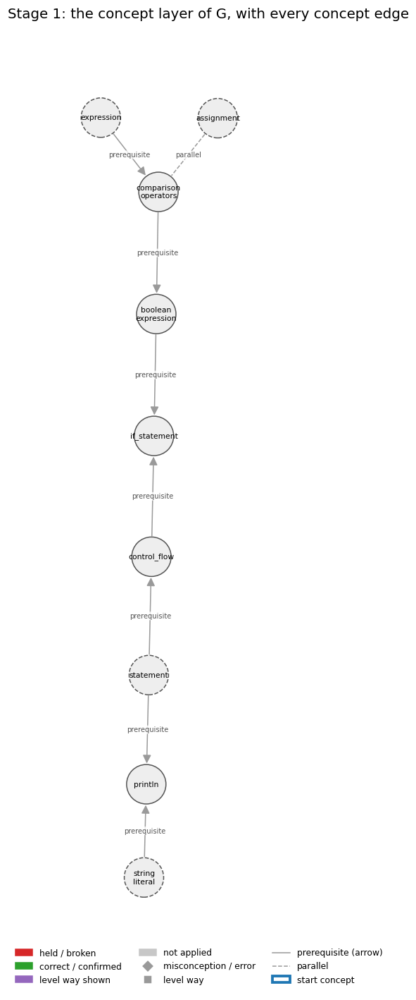
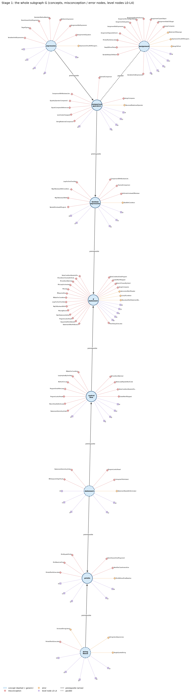
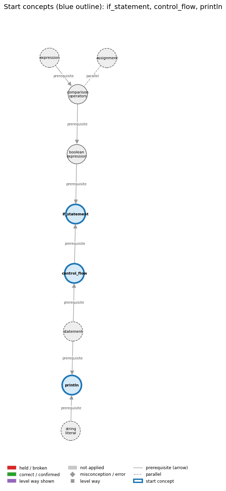
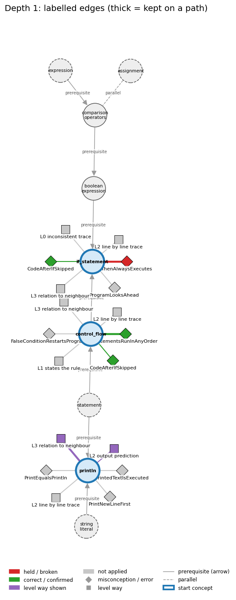
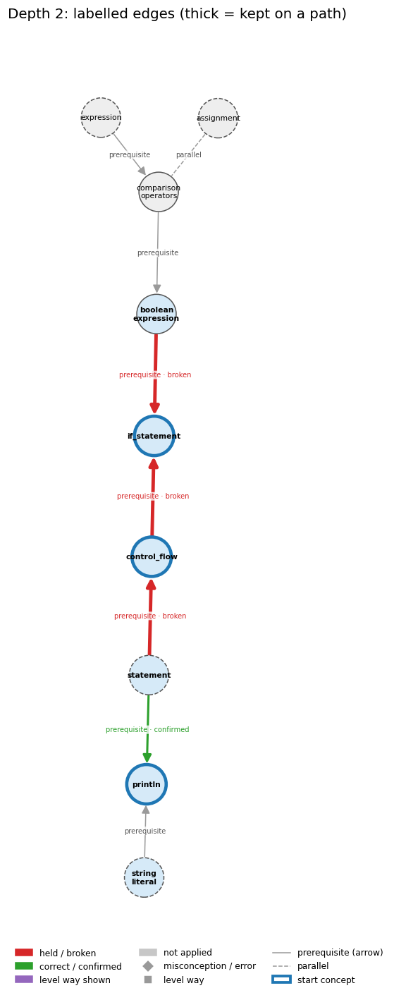
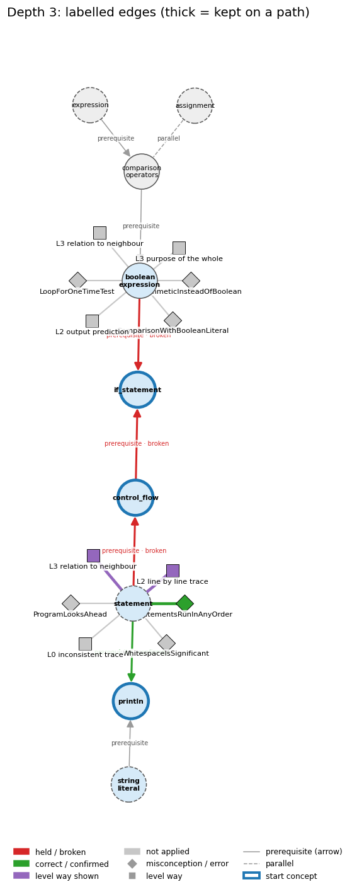
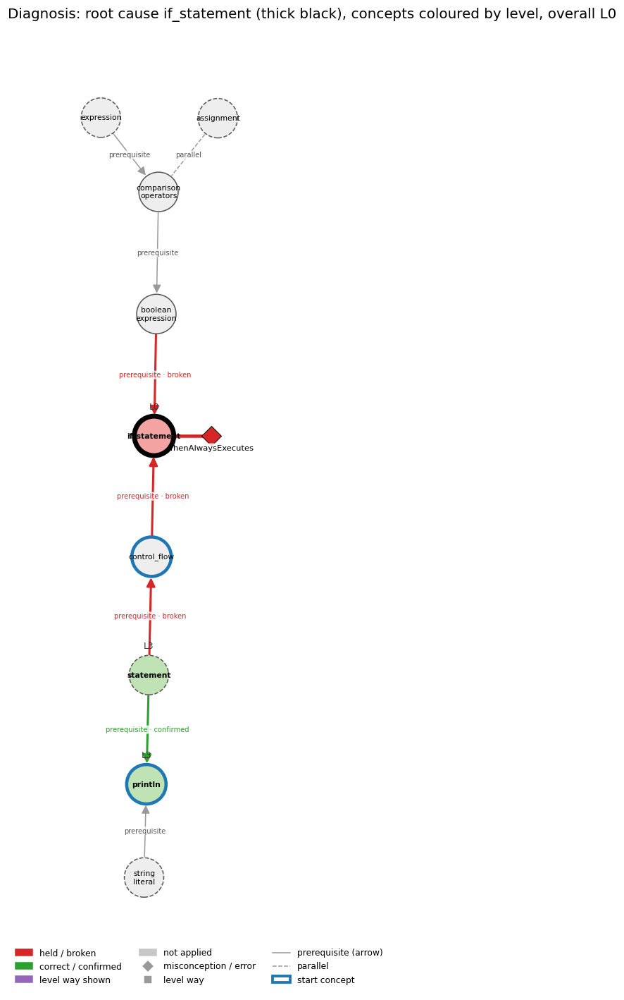

# Think on the Graph: every output of the run MY25

Files of this scenario: `input.json` (program, question, answer), `diagnosis.json`, `subgraph.json`, `traverse_log.txt`, `report.html` (this report as one full-page file, with the interactive graph `MY25_G.html`), `MY25.ipynb` (this report as a notebook).

## 0. Input
Program:
```java
int x = 4;
if (x > 5) {
    System.out.println("big");
}
System.out.println("done");
```
Question: Explain which lines run and why.

Student's answer: The program runs every line from top to bottom, so the println inside the if runs too, and then done is printed
Settings: width 3, depth 3, prune llm, backend claude-cli, model claude-opus-5-5
## 1. Stage 1: the subgraph G from the code (no model)
Masked code (string and char literals and comments blanked; this is what the patterns see):
```
int x = 4;
if (x > 5) {
    System.out.println("   ");
}
System.out.println("    ");
```
Which code text tagged which concept (a generic concept fires on almost any Java line; it starts the walk only if the answer repeats its tag):
| concept | generic | channel | matched text | line |
|---|---|---|---|---|
| assignment | True | pattern | '=' | 1 |
| boolean_expression | False | pattern | 'if (' | 2 |
| comparison_operators | False | pattern | 'if (x >' | 2 |
| control_flow | False | pattern | 'if (' | 2 |
| expression | True | pattern | 'x >' | 2 |
| expression | True | pattern | '= 4;' | 1 |
| if_statement | False | pattern | 'if (' | 2 |
| println | False | pattern | 'System.out.println(' | 3 |
| statement | True | pattern | ';' | 1 |
| string_literal | True | pattern | '"big"' | 3 |

G: 9 concept nodes (4 generic), 8 concept edges, 87 misconception / error edges, 67 misconception / error nodes, 45 level nodes, 84 level-misconception links, 1 connected piece(s).

Concept edges of G (the links the walk can read; `pre:` = prerequisite A -> B, `par:` = parallel):
| edge | type | rule (logic) |
|---|---|---|
| par:assignment~comparison_operators | parallel | x = y stores the value of y in x (a statement with a side effect); x == y only tests whether the two values are equal and gives a boolean. Writing = where == is meant is a compile error with int operands and a silent bug with boolean operands. |
| pre:boolean_expression->if_statement | prerequisite | An if runs its block only when its boolean expression evaluates to true. |
| pre:comparison_operators->boolean_expression | prerequisite | A comparison such as x < y produces a boolean result; comparisons together with boolean logic provide the basis for decision-making. |
| pre:control_flow->if_statement | prerequisite | An if changes the default top-to-bottom flow by running a block only when its condition is true. |
| pre:expression->comparison_operators | prerequisite | Comparison operators build expressions whose value is a boolean, so one must already know what an expression is to understand a < b. |
| pre:statement->control_flow | prerequisite | Control flow is the order in which statements run. |
| pre:statement->println | prerequisite | System.out.println(s); is itself a statement, so its line of output appears at its own place in the sequence. |
| pre:string_literal->println | prerequisite | println("s") outputs exactly the characters between the quotes and then ends the line. |

Misconception / error edges per concept (count), and level ways per concept (count):
| concept | misconception / error edges | level ways (L1-L4 + L0 non-misconception) |
|---|---|---|
| assignment | 15 | 24 |
| boolean_expression | 8 | 19 |
| comparison_operators | 8 | 20 |
| control_flow | 11 | 15 |
| expression | 8 | 19 |
| if_statement | 22 | 19 |
| println | 6 | 17 |
| statement | 5 | 19 |
| string_literal | 4 | 16 |

**Figure 1**


**Figure 2**


## 2. Clauses and start concepts (no model)
The answer split into clauses (at sentence ends, ';', and before 'because' / 'so'; quotes removed):
| clause | text |
|---|---|
| c1 | The program runs every line from top to bottom |
| c2 | so the println inside the if runs too, and then done is printed |

start: BM25 of the answer against each tagged concept: if_statement 13.31 (hits 1), control_flow 10.67 (hits 1), println 9.33 (hits 1), boolean_expression 4.36 (hits 1), comparison_operators 1.89 (hits 1)

start: chosen if_statement, control_flow, println

start concepts (3): if_statement, control_flow, println

Start concepts: if_statement, control_flow, println

**Figure 3**


## 3. The walk, depth by depth
At each depth, for each current concept: the edges offered (a concept entering as a start concept offers its misconception / error edges and its level ways, as two families; otherwise it offers its concept edges), the prune prompt and the model's reply, then the label prompt(s) and the model's reply, parsed into label / clauses / confidence. Score = prune score x confidence.

### Depth 1: current concepts 'if_statement', 'control_flow', 'println'

#### if_statement, misconceptions: 22 edges offered
Edges offered:
| edge |
|---|
| err:if_statement->BracelessMultiStatementBody \| wrong rule: Indenting several statements under an if or for makes them all part of its body, even without braces. \| right rule: Without braces only the first statement belongs to the if/for; the rest run once, after it. |
| err:if_statement->CurlyIfCondition \| wrong rule: Writes the if condition inside { } instead of ( ). \| right rule: The condition of an if is written in parentheses. |
| err:if_statement->SemicolonAfterIfHeader \| wrong rule: if (x > 0); System.out.println("positive"); prints only for positive x. \| right rule: The ; ends the if with an empty statement, so the next line always runs. |
| mis:if_statement->AssignCompares \| wrong rule: = compares two values instead of assigning \| right rule: x = y copies the value of y into x; x == y is what compares them. |
| mis:if_statement->BranchChosenByIntent \| wrong rule: Which branch runs is decided by what the programmer meant or by code outside the if, not by whether the condition is true. \| right rule: The then branch runs exactly when the condition evaluates to true at the moment it is tested; otherwise the else branch (if any) runs. |
| mis:if_statement->CodeAfterIfSkipped \| wrong rule: When the then branch runs, the code after the if is skipped. \| right rule: After the if finishes, execution continues with the next statement either way. |
| mis:if_statement->FalseConditionEndsProgram \| wrong rule: A false condition with no else ends the program. \| right rule: When an if condition is false and there is no else, execution continues with the statement after the if. |
| mis:if_statement->FalseConditionRestartsProgram \| wrong rule: When an if condition is false (and there is no else), control jumps back to the start of the program. \| right rule: A false condition skips the then branch and execution continues with the statement after the if statement. |
| mis:if_statement->IfConditionCheckedInHindsight \| wrong rule: Whether the branch runs is decided by the condition after the branch, or from the point inside the body where the condition becomes true. \| right rule: The condition is tested once, before the branch; the whole branch runs if it was true at that moment and none of it runs otherwise. |
| mis:if_statement->IfConditionWatched \| wrong rule: An if statement watches its condition while the program runs and fires as soon as the condition becomes true (if = whenever). \| right rule: An if condition is tested once, when control reaches the if statement; later changes to the variables do not trigger the branch. |
| mis:if_statement->IfInLoopUnchecked \| wrong rule: An if inside a loop body runs its branch on every pass without testing its condition. \| right rule: The if condition is tested again on every pass, with the current values, so the branch runs only on passes where it is true. |
| mis:if_statement->IfIsLoop \| wrong rule: The if body keeps repeating as long as its condition stays true. \| right rule: An if body runs at most once; only a loop repeats its body. |
| mis:if_statement->IfRequiresElse \| wrong rule: Every if statement requires an else. \| right rule: An if statement may stand alone; the else part is optional. |
| mis:if_statement->IfWaitsForCondition \| wrong rule: An IF statement earlier in the program stays active and fires later, e.g. inside a later loop, when its condition becomes true. \| right rule: An if is evaluated once when control reaches it; afterwards it is inactive unless control returns to it. |
| mis:if_statement->LoopForOneTimeTest \| wrong rule: Uses a loop where a condition needs to be tested only once. \| right rule: A test made once is an if; a loop repeats. |
| mis:if_statement->MapToBooleanWithIf \| wrong rule: you need an if to turn a boolean expression into a boolean \| right rule: ok = (x > y); stores the result of the comparison directly. |
| mis:if_statement->MissingBraces \| wrong rule: Omits braces around a single-statement body of if, for or while. \| right rule: Braces are optional for a single-statement body, but using them anyway avoids bugs when statements are added later. |
| mis:if_statement->NextStatementIsElse \| wrong rule: In if (c) A; B; the statement B runs only when c is false. \| right rule: B is not part of the if; it runs every time. |
| mis:if_statement->ProgramLooksAhead \| wrong rule: The program knows or sees what later lines will do and acts on those goals at the current line, e.g. it stops 'at ten' because it wants to draw a box. \| right rule: Each statement executes using only the current state; later lines have no effect until control reaches them. |
| mis:if_statement->SequentialIfsAreNested \| wrong rule: Of two if statements one after the other, the second runs its body only if both conditions are true. \| right rule: Two ifs in sequence are independent: each tests only its own condition. |
| mis:if_statement->StatementAfterIfInBranch \| wrong rule: A statement placed after the if statement belongs to its branch, so it runs only when the condition is true. \| right rule: The branch ends at its closing brace (or after its single statement); the next statement runs whatever the condition was. |
| mis:if_statement->ThenAlwaysExecutes \| wrong rule: The then branch always runs. \| right rule: The then branch runs only when the condition is true. |

Prune: the model's reply (edge id and score; the kept edges sum to 1):
```
mis:if_statement->ThenAlwaysExecutes (0.60), mis:if_statement->CodeAfterIfSkipped (0.20), mis:if_statement->ProgramLooksAhead (0.20)
```
Kept by pruning: mis:if_statement->ThenAlwaysExecutes (0.60), mis:if_statement->CodeAfterIfSkipped (0.20), mis:if_statement->ProgramLooksAhead (0.20)

Label prompt for the misconception / error edges (judged together). The model saw the program, the question, the numbered clauses, and these edges with their wrong rule and right rule:
| edge |
|---|
| mis:if_statement->ThenAlwaysExecutes \| wrong rule: The then branch always runs. \| right rule: The then branch runs only when the condition is true. |
| mis:if_statement->CodeAfterIfSkipped \| wrong rule: When the then branch runs, the code after the if is skipped. \| right rule: After the if finishes, execution continues with the next statement either way. |
| mis:if_statement->ProgramLooksAhead \| wrong rule: The program knows or sees what later lines will do and acts on those goals at the current line, e.g. it stops 'at ten' because it wants to draw a box. \| right rule: Each statement executes using only the current state; later lines have no effect until control reaches them. |
Model's reply:
```
mis:if_statement->ThenAlwaysExecutes | held | clauses: 1, 2 | confidence: 0.9
mis:if_statement->CodeAfterIfSkipped | correct | clauses: 2 | confidence: 0.8
mis:if_statement->ProgramLooksAhead | not applied | clauses: none | confidence: 0.9
```

Parsed labels:
| edge | label | prune score | confidence | score | clauses | words |
|---|---|---|---|---|---|---|
| mis:if_statement->ThenAlwaysExecutes | held | 0.6 | 0.9 | 0.54 | c1, c2 | The program runs every line from top to bottom; so the println inside the if runs too, and then done is printed |
| mis:if_statement->CodeAfterIfSkipped | correct | 0.2 | 0.8 | 0.16 | c2 | so the println inside the if runs too, and then done is printed |
| mis:if_statement->ProgramLooksAhead | not applied |  |  | 0.0 |  |  |

#### if_statement, level ways: 19 edges offered
Edges offered:
| edge |
|---|
| lvl:if_statement@L0#0 \| level L0 way everyday_reading: Folk meaning: English 'if' (and 'whenever') states a standing rule that stays in force and fires whenever its condition becomes true. A Java if is evaluated once, when control reaches it, and then is 'taken off the books'; changing the variables later does not re-trigger it. |
| lvl:if_statement@L0#14 \| level L0 way inconsistent_trace: Applies the if rule (LT) unevenly: tests the condition on some visits but not others (e.g. runs the branch on every loop pass without testing), runs the branch after a false test, or re-checks the condition after the branch has run. (here mixing in: "an if body repeats while its condition holds") |
| lvl:if_statement@L1#0 \| level L1 way names_the_element: The if statement is a conditional (selection) statement: it runs a statement or block only when a boolean condition is true. |
| lvl:if_statement@L1#1 \| level L1 way states_the_rule: Syntax: if (<boolean expression>) <statement or { block }>; the braces are optional when the body is a single statement. The expression must have type boolean (or Boolean), and the body is executed if and only if the expression is true. |
| lvl:if_statement@L2#0 \| level L2 way line_by_line_trace: Evaluate the condition once; if true, execute the body; then, in either case, continue with the statement after the if. |
| lvl:if_statement@L2#1 \| level L2 way output_prediction: An if produces no value; its observable result is that the body's effects (assignments, output) happen exactly once when the condition is true and not at all when it is false; e.g. if (x < 0) x = -x; leaves x = 5 for 5 and gives 5 for -5. |
| lvl:if_statement@L2#2 \| level L2 way one_step_execution: One execution reads the variables in the condition, changes nothing by the test itself (unless the condition has a side effect), and, when true, applies the body's changes once; control then moves to the next statement. |
| lvl:if_statement@L3#0 \| level L3 way relation_to_neighbour: The condition must be a boolean expression; a non-boolean condition such as if (t = goal) with int t is a compile-time error, while if (b = false) with boolean b compiles and assigns. |
| lvl:if_statement@L3#1 \| level L3 way relation_to_neighbour: if-else extends if with a second branch that runs exactly when the condition is false; a lone if has an implicit empty else-case. |
| lvl:if_statement@L3#2 \| level L3 way relation_to_neighbour: An if is a fork in the control flow: one path through the body, one around it, both rejoining at the next statement. |
| lvl:if_statement@L3#3 \| level L3 way relation_to_neighbour: if and while have the same form, but if tests its condition once and runs the block at most once, while while tests again after every pass and repeats the block as long as the condition is true. |
| lvl:if_statement@L3#4 \| level L3 way purpose_of_the_whole: Plan: guard / conditional action - do something only for the inputs that need it (absolute value, put two values in order, error check before dividing). |
| lvl:if_statement@L4#0 \| level L4 way predict_a_change: Negating the condition swaps which inputs run the body; changing < to <= changes only the boundary value. Adding a statement under a braceless if does not put it in the body. Whatever the condition, code after the if still runs exactly once. |
| lvl:if_statement@L4#1 \| level L4 way diagnose_an_error: rule broken: A ; right after if (...) is an empty statement that forms the whole then branch; the following statement or block is no longer part of the if. Kind: silent logic error. Trigger class: Any if (cond); followed by a statement or block: that statement runs for every input, whatever cond is (it compiles without error). |
| lvl:if_statement@L4#2 \| level L4 way diagnose_an_error: rule broken: The if template is if (<boolean expression>) <statement>: the condition must be enclosed in parentheses. Kind: compile-time. Trigger class: Any if whose condition is written in { } or without ( ), e.g. if {x > 0} ... or if a > b { c = 0; }. |
| lvl:if_statement@L4#3 \| level L4 way transfer_to_a_new_program: Use an if when an action is needed for some inputs only and the test happens once at that point; use a loop if the action must repeat while the condition holds, and assign a boolean directly (ok = x > y;) when you only need the truth value. |
| lvl:if_statement@L4#4 \| level L4 way diagnose_an_error: rule broken: Without braces, the body of an if, while or for is exactly one statement; indentation does not add statements to it. Kind: silent logic error. Trigger class: A braceless header followed by two or more indented statements: only the first is controlled, the others run once, after the if/loop, on every input. |
| lvl:if_statement@L4#5 \| level L4 way diagnose_an_error: rule broken: The condition of an if must have type boolean. Kind: compile-time. Trigger class: Using = instead of == with int operands, e.g. if (t = goal): 'incompatible types: int cannot be converted to boolean'. |
| lvl:if_statement@L4#6 \| level L4 way diagnose_an_error: rule broken: With boolean operands, = is assignment, not comparison. Kind: silent logic error. Trigger class: if (isPrime = false) with boolean isPrime: compiles, sets isPrime to false and the branch never runs. |

Prune: the model's reply (edge id and score; the kept edges sum to 1):
```
{lvl:if_statement@L0#14 (Score: 0.6)}
{lvl:if_statement@L2#0 (Score: 0.25)}
{lvl:if_statement@L3#2 (Score: 0.15)}
```
Kept by pruning: lvl:if_statement@L0#14 (0.60), lvl:if_statement@L2#0 (0.25), lvl:if_statement@L3#2 (0.15)

Label prompt for level way lvl:if_statement@L0#14 (the model saw only the concept, the way's name 'inconsistent trace' and its text; no level):
> Applies the if rule (LT) unevenly: tests the condition on some visits but not others (e.g. runs the branch on every loop pass without testing), runs the branch after a false test, or re-checks the condition after the branch has run. (here mixing in: "an if body repeats while its condition holds")

Model's reply:
```
Label: not shown
Clauses: none
Confidence: 0.7
```

Label prompt for level way lvl:if_statement@L2#0 (the model saw only the concept, the way's name 'line by line trace' and its text; no level):
> Evaluate the condition once; if true, execute the body; then, in either case, continue with the statement after the if.

Model's reply:
```
Label: not shown
Clauses: none
Confidence: 0.95
```

Label prompt for level way lvl:if_statement@L3#2 (the model saw only the concept, the way's name 'relation to neighbour' and its text; no level):
> An if is a fork in the control flow: one path through the body, one around it, both rejoining at the next statement.

Model's reply:
```
Label: not shown
Clauses: none
Confidence: 0.95
```

Parsed labels:
| edge | label | prune score | confidence | score | clauses | words |
|---|---|---|---|---|---|---|
| lvl:if_statement@L0#14 | not applied |  |  | 0.0 |  |  |
| lvl:if_statement@L2#0 | not applied |  |  | 0.0 |  |  |
| lvl:if_statement@L3#2 | not applied |  |  | 0.0 |  |  |

#### control_flow, misconceptions: 11 edges offered
Edges offered:
| edge |
|---|
| mis:control_flow->CodeAfterIfSkipped \| wrong rule: When the then branch runs, the code after the if is skipped. \| right rule: After the if finishes, execution continues with the next statement either way. |
| mis:control_flow->FalseConditionRestartsProgram \| wrong rule: When an if condition is false (and there is no else), control jumps back to the start of the program. \| right rule: A false condition skips the then branch and execution continues with the statement after the if statement. |
| mis:control_flow->FalseLoopRepeatsNextCode \| wrong rule: A loop is an iterative if-else: while the condition is true the body repeats, and when it is false the code after the loop repeats. \| right rule: Only the body is repeated; once the condition is false the code after the loop runs once. |
| mis:control_flow->IfConditionWatched \| wrong rule: An if statement watches its condition while the program runs and fires as soon as the condition becomes true (if = whenever). \| right rule: An if condition is tested once, when control reaches the if statement; later changes to the variables do not trigger the branch. |
| mis:control_flow->IfWaitsForCondition \| wrong rule: An IF statement earlier in the program stays active and fires later, e.g. inside a later loop, when its condition becomes true. \| right rule: An if is evaluated once when control reaches it; afterwards it is inactive unless control returns to it. |
| mis:control_flow->LoopImpliedByOneTest \| wrong rule: Testing one case is enough; Java will repeat the test for the other values by itself. \| right rule: A statement runs once each time control reaches it; repeating a test for many values needs a loop. |
| mis:control_flow->NoShortCircuit \| wrong rule: logical AND/OR always evaluate both sides (Java short-circuits them) \| right rule: In p && q, q is evaluated only when p is true; in p \|\| q, q is evaluated only when p is false. |
| mis:control_flow->ProgramEndsAfterLoop \| wrong rule: When a loop finishes the program ends, so code after the loop never runs. \| right rule: When the loop condition becomes false, control continues with the first statement after the loop. |
| mis:control_flow->ProgramLooksAhead \| wrong rule: The program knows or sees what later lines will do and acts on those goals at the current line, e.g. it stops 'at ten' because it wants to draw a box. \| right rule: Each statement executes using only the current state; later lines have no effect until control reaches them. |
| mis:control_flow->ReturnDoesNotExitLoop \| wrong rule: A return inside a loop does not end the loop; it sets a value each pass (the last one is returned) or returns several values. \| right rule: When return executes, the method ends at once, so the loop stops on that pass. |
| mis:control_flow->StatementsRunInAnyOrder \| wrong rule: Statements in a program can run in any order. \| right rule: Without control statements, statements run once each, top to bottom. |

Prune: the model's reply (edge id and score; the kept edges sum to 1):
```
mis:control_flow->StatementsRunInAnyOrder (0.45), mis:control_flow->FalseConditionRestartsProgram (0.35), mis:control_flow->CodeAfterIfSkipped (0.20)
```
Kept by pruning: mis:control_flow->StatementsRunInAnyOrder (0.45), mis:control_flow->FalseConditionRestartsProgram (0.35), mis:control_flow->CodeAfterIfSkipped (0.20)

Label prompt for the misconception / error edges (judged together). The model saw the program, the question, the numbered clauses, and these edges with their wrong rule and right rule:
| edge |
|---|
| mis:control_flow->StatementsRunInAnyOrder \| wrong rule: Statements in a program can run in any order. \| right rule: Without control statements, statements run once each, top to bottom. |
| mis:control_flow->FalseConditionRestartsProgram \| wrong rule: When an if condition is false (and there is no else), control jumps back to the start of the program. \| right rule: A false condition skips the then branch and execution continues with the statement after the if statement. |
| mis:control_flow->CodeAfterIfSkipped \| wrong rule: When the then branch runs, the code after the if is skipped. \| right rule: After the if finishes, execution continues with the next statement either way. |
Model's reply:
```
mis:control_flow->StatementsRunInAnyOrder | correct | clauses: 1 | confidence: 0.6
mis:control_flow->FalseConditionRestartsProgram | not applied | clauses: none | confidence: 0.75
mis:control_flow->CodeAfterIfSkipped | correct | clauses: 2 | confidence: 0.8
```

Parsed labels:
| edge | label | prune score | confidence | score | clauses | words |
|---|---|---|---|---|---|---|
| mis:control_flow->StatementsRunInAnyOrder | correct | 0.45 | 0.6 | 0.27 | c1 | The program runs every line from top to bottom |
| mis:control_flow->FalseConditionRestartsProgram | not applied |  |  | 0.0 |  |  |
| mis:control_flow->CodeAfterIfSkipped | correct | 0.2 | 0.8 | 0.16 | c2 | so the println inside the if runs too, and then done is printed |

#### control_flow, level ways: 15 edges offered
Edges offered:
| edge |
|---|
| lvl:control_flow@L0#0 \| level L0 way everyday_reading: Folk meaning: in everyday instructions a listener reads the whole list at once, does steps in a sensible order and infers what the writer wants. Java instead executes statements one at a time, top to bottom, each only when control reaches it, and nothing later in the program has any effect earlier. |
| lvl:control_flow@L0#3 \| level L0 way inconsistent_trace: Applies the sequencing rule (LT) unevenly: e.g. runs a later line before an earlier one, lets an if that was already passed fire again later, or ends the program when a loop or a false if ends instead of continuing with the next statement. (here mixing in: "Statements in a program can run in any order") |
| lvl:control_flow@L1#0 \| level L1 way names_the_element: Control flow is the order in which a program's statements are executed (statement sequencing); conditionals and loops are the statements that change it. |
| lvl:control_flow@L1#1 \| level L1 way states_the_rule: Without control statements every statement executes once, in the order given; a block executes its statements in order from first to last; if/if-else choose between one or two alternatives and loops repeat statements depending on a condition. |
| lvl:control_flow@L2#0 \| level L2 way line_by_line_trace: Execute the statement at the current point; when it completes normally, control passes to the next statement in the block. An if evaluates its condition once and then runs at most one branch; a loop evaluates its condition before each pass; after an if or a loop finishes, control continues with the statement after it. |
| lvl:control_flow@L2#1 \| level L2 way output_prediction: The output is the sequence of print statements that control actually reaches, in the order reached: e.g. TenHellos prints 1st, 2nd, 3rd Hello once each, then 4th to 10th Hello from the loop. |
| lvl:control_flow@L2#2 \| level L2 way one_step_execution: One step executes the single statement at the current control point using the current values, updates at most the variables it assigns, and moves the control point to the next statement (or, for an if/loop test, to the chosen branch, back to the test, or past the statement). |
| lvl:control_flow@L3#0 \| level L3 way relation_to_neighbour: Control flow is defined over statements: statements are executed for their effect, and if/while/for are themselves statements that may be used wherever a statement is allowed, so they can nest. |
| lvl:control_flow@L3#1 \| level L3 way relation_to_neighbour: An if changes the default top-to-bottom flow: its condition is tested once when control reaches it, its block runs only if true, and in both cases control then continues with the next statement. |
| lvl:control_flow@L3#2 \| level L3 way relation_to_neighbour: A flowchart draws control flow: each path through the diagram is a possible path of execution, with a decision box for each if or loop test. |
| lvl:control_flow@L3#3 \| level L3 way purpose_of_the_whole: Plan: control flow lets one program do different things for different inputs (selection) and do a thing many times (repetition), so a short program can specify a potentially unlimited number of executed statements. |
| lvl:control_flow@L4#0 \| level L4 way predict_a_change: Reordering two statements generally changes the result whenever one reads a variable that the other writes (e.g. swapping x = x + 1 and print(x)); reordering is safe only for statements that touch disjoint variables. Moving a statement into or out of a branch or loop body changes how many times it runs (0, 1 or n). |
| lvl:control_flow@L4#1 \| level L4 way transfer_to_a_new_program: Reason in terms of control flow whenever you must predict output or find why a statement did or did not run: trace which statement is reached next. Straight-line sequence suffices only when every input needs the same steps exactly once; otherwise add a conditional or a loop. |
| lvl:control_flow@L4#2 \| level L4 way diagnose_an_error: rule broken: A local variable must be definitely assigned on every control-flow path before it is read. Kind: compile-time. Trigger class: A variable assigned only inside an if branch (or only in a loop body) and read after it: the compiler reports 'variable might not have been initialized'. |
| lvl:control_flow@L4#3 \| level L4 way diagnose_an_error: rule broken: Statements run in the order written, so an update must come before the statement that needs the new value. Kind: silent logic error. Trigger class: Swapping two dependent statements (e.g. printing before updating, or incrementing the index before using it): output is shifted or off by one pass, with no error. |

Prune: the model's reply (edge id and score; the kept edges sum to 1):
```
{lvl:control_flow@L3#1 (Score: 0.45)}
{lvl:control_flow@L2#0 (Score: 0.3)}
{lvl:control_flow@L1#1 (Score: 0.25)}
```
Kept by pruning: lvl:control_flow@L3#1 (0.45), lvl:control_flow@L2#0 (0.30), lvl:control_flow@L1#1 (0.25)

Label prompt for level way lvl:control_flow@L3#1 (the model saw only the concept, the way's name 'relation to neighbour' and its text; no level):
> An if changes the default top-to-bottom flow: its condition is tested once when control reaches it, its block runs only if true, and in both cases control then continues with the next statement.

Model's reply:
```
Label: not shown
Clauses: none
Confidence: 0.95
```

Label prompt for level way lvl:control_flow@L2#0 (the model saw only the concept, the way's name 'line by line trace' and its text; no level):
> Execute the statement at the current point; when it completes normally, control passes to the next statement in the block. An if evaluates its condition once and then runs at most one branch; a loop evaluates its condition before each pass; after an if or a loop finishes, control continues with the statement after it.

Model's reply:
```
Label: not shown
Clauses: none
Confidence: 0.85
```

Label prompt for level way lvl:control_flow@L1#1 (the model saw only the concept, the way's name 'states the rule' and its text; no level):
> Without control statements every statement executes once, in the order given; a block executes its statements in order from first to last; if/if-else choose between one or two alternatives and loops repeat statements depending on a condition.

Model's reply:
```
Label: not shown
Clauses: none
Confidence: 0.85
```

Parsed labels:
| edge | label | prune score | confidence | score | clauses | words |
|---|---|---|---|---|---|---|
| lvl:control_flow@L3#1 | not applied |  |  | 0.0 |  |  |
| lvl:control_flow@L2#0 | not applied |  |  | 0.0 |  |  |
| lvl:control_flow@L1#1 | not applied |  |  | 0.0 |  |  |

#### println, misconceptions: 6 edges offered
Edges offered:
| edge |
|---|
| err:println->PrintWithoutFinalNewline \| wrong rule: Ends the output with print and expects it to appear right away. \| right rule: Finish a line of print calls with println; some systems hold print output until a newline is printed. |
| mis:println->IdentifierCaseInsensitive \| wrong rule: System.out.Println and System.out.println name the same method. \| right rule: Java is case-sensitive: names of variables, methods and classes that differ only in capitalization are different names. |
| mis:println->ParenthesesOnlyIfArgument \| wrong rule: println with nothing to print can be written System.out.println; without the parentheses. \| right rule: A method call always needs parentheses, so an empty line is printed with System.out.println();. |
| mis:println->PrintEqualsPrintln \| wrong rule: print and println do the same thing, so print(s1); print(s2); puts s1 and s2 on separate lines. \| right rule: println ends the line after printing and print does not, so print(s1); print(s2); puts s1 and s2 on the same line. |
| mis:println->PrintNewLineFirst \| wrong rule: println(s) prints a newline and then s. \| right rule: println(s) prints s and then the newline. |
| mis:println->PrintedTextIsExecuted \| wrong rule: System.out.println("x is 5"); sets x to 5 (text inside the quotes is run as code). \| right rule: Characters inside double quotes are printed literally; println only displays them and changes no variable. Only an assignment such as x = 5; sets x. |

Prune: the model's reply (edge id and score; the kept edges sum to 1):
```
mis:println->PrintedTextIsExecuted (0.50), mis:println->PrintEqualsPrintln (0.30), mis:println->PrintNewLineFirst (0.20)
```
Kept by pruning: mis:println->PrintedTextIsExecuted (0.50), mis:println->PrintEqualsPrintln (0.30), mis:println->PrintNewLineFirst (0.20)

Label prompt for the misconception / error edges (judged together). The model saw the program, the question, the numbered clauses, and these edges with their wrong rule and right rule:
| edge |
|---|
| mis:println->PrintedTextIsExecuted \| wrong rule: System.out.println("x is 5"); sets x to 5 (text inside the quotes is run as code). \| right rule: Characters inside double quotes are printed literally; println only displays them and changes no variable. Only an assignment such as x = 5; sets x. |
| mis:println->PrintEqualsPrintln \| wrong rule: print and println do the same thing, so print(s1); print(s2); puts s1 and s2 on separate lines. \| right rule: println ends the line after printing and print does not, so print(s1); print(s2); puts s1 and s2 on the same line. |
| mis:println->PrintNewLineFirst \| wrong rule: println(s) prints a newline and then s. \| right rule: println(s) prints s and then the newline. |
Model's reply:
```
mis:println->PrintedTextIsExecuted | not applied | clauses: none | confidence: 0.85
mis:println->PrintEqualsPrintln | not applied | clauses: none | confidence: 0.9
mis:println->PrintNewLineFirst | not applied | clauses: none | confidence: 0.9
```

Parsed labels:
| edge | label | prune score | confidence | score | clauses | words |
|---|---|---|---|---|---|---|
| mis:println->PrintedTextIsExecuted | not applied |  |  | 0.0 |  |  |
| mis:println->PrintEqualsPrintln | not applied |  |  | 0.0 |  |  |
| mis:println->PrintNewLineFirst | not applied |  |  | 0.0 |  |  |

#### println, level ways: 17 edges offered
Edges offered:
| edge |
|---|
| lvl:println@L0#0 \| level L0 way everyday_reading: Everyday reading: 'println' is just 'print', and 'new line' is something you do before writing. Java rule: println(x) prints x and then ends the line; println() alone just ends the line. |
| lvl:println@L0#3 \| level L0 way inconsistent_trace: Applies the println rule (print, then end line) unevenly: puts the newline before the text on one call and after it on another, or forgets that the next output starts on a new line. (here mixing in: "print and println behave the same (no newline difference)") |
| lvl:println@L1#0 \| level L1 way names_the_element: System.out.println is a library method that prints its argument followed by a line terminator ('print line'). |
| lvl:println@L1#1 \| level L1 way states_the_rule: println(String x) behaves as though it calls print(x) and then println(); println() terminates the current line by writing the line separator string. |
| lvl:println@L2#0 \| level L2 way line_by_line_trace: Evaluate the argument, print its characters at the current position, then write the line separator so the cursor moves to the beginning of the next line. |
| lvl:println@L2#1 \| level L2 way output_prediction: Output is the value's characters followed by a line break: println("Hello, "); println("World!"); prints two lines. |
| lvl:println@L2#2 \| level L2 way one_step_execution: One call appends the text and a line separator to the output; the cursor ends at the start of the next line; no variable changes and nothing is returned. |
| lvl:println@L3#0 \| level L3 way relation_to_neighbour: System.out.println(s); is a statement, so its line of output appears at its own place in the sequence. |
| lvl:println@L3#1 \| level L3 way relation_to_neighbour: println("s") outputs exactly the characters between the quotes and then ends the line. |
| lvl:println@L3#2 \| level L3 way relation_to_neighbour: print leaves the cursor on the line; println ends it; several prints followed by one println make one line. |
| lvl:println@L3#3 \| level L3 way relation_to_neighbour: println prints numbers with all their digits and always ends the line; printf formats each value by its conversion code and ends the line only where the format has %n or \n. |
| lvl:println@L3#4 \| level L3 way purpose_of_the_whole: Purpose: produce one complete line of output, e.g. each result on its own line, or end a line built with print. |
| lvl:println@L4#0 \| level L4 way predict_a_change: Replacing println with print joins the next output onto the same line (a typical logic error); the characters printed stay the same. |
| lvl:println@L4#1 \| level L4 way transfer_to_a_new_program: Use println when each output item belongs on its own line or to end a line; use print to continue a line and printf to control number formatting. |
| lvl:println@L4#2 \| level L4 way diagnose_an_error: rule broken: Finish a line of print calls with println. Kind: silent logic error. Trigger class: output ends with print, so the last line may not be shown or runs into the shell prompt |
| lvl:println@L4#3 \| level L4 way diagnose_an_error: rule broken: Method names are case-sensitive. Kind: compile-time. Trigger class: System.out.Println or system.out.println: cannot find symbol |
| lvl:println@L4#4 \| level L4 way diagnose_an_error: rule broken: Calls need parentheses. Kind: compile-time. Trigger class: System.out.println; without () |

Prune: the model's reply (edge id and score; the kept edges sum to 1):
```
{lvl:println@L3#0 (Score: 0.5)}
{lvl:println@L2#1 (Score: 0.3)}
{lvl:println@L2#0 (Score: 0.2)}
```
Kept by pruning: lvl:println@L3#0 (0.50), lvl:println@L2#1 (0.30), lvl:println@L2#0 (0.20)

Label prompt for level way lvl:println@L3#0 (the model saw only the concept, the way's name 'relation to neighbour' and its text; no level):
> System.out.println(s); is a statement, so its line of output appears at its own place in the sequence.

Model's reply:
```
Label: shown
Clauses: 2
Confidence: 0.65
```

Label prompt for level way lvl:println@L2#1 (the model saw only the concept, the way's name 'output prediction' and its text; no level):
> Output is the value's characters followed by a line break: println("Hello, "); println("World!"); prints two lines.

Model's reply:
```
Label: shown
Clauses: 2
Confidence: 0.6
```

Label prompt for level way lvl:println@L2#0 (the model saw only the concept, the way's name 'line by line trace' and its text; no level):
> Evaluate the argument, print its characters at the current position, then write the line separator so the cursor moves to the beginning of the next line.

Model's reply:
```
Label: not shown
Clauses: none
Confidence: 0.85
```

Parsed labels:
| edge | label | prune score | confidence | score | clauses | words |
|---|---|---|---|---|---|---|
| lvl:println@L3#0 | shown | 0.5 | 0.65 | 0.33 | c2 | so the println inside the if runs too, and then done is printed |
| lvl:println@L2#1 | shown | 0.3 | 0.6 | 0.18 | c2 | so the println inside the if runs too, and then done is printed |
| lvl:println@L2#0 | not applied |  |  | 0.0 |  |  |

**Kept on a path at this depth** (best N in tiers: held misconception / broken edge, then held error, then correct / confirmed / shown):

mis:if_statement->ThenAlwaysExecutes [held, tier 0, 0.54], lvl:println@L3#0 [shown, tier 2, 0.33], mis:control_flow->StatementsRunInAnyOrder [correct, tier 2, 0.27]

**Clause coverage after this depth:**
| clause | text | covered by |
|---|---|---|
| c1 | The program runs every line from top to bottom | mis:if_statement->ThenAlwaysExecutes |
| c2 | so the println inside the if runs too, and then done is printed | mis:if_statement->ThenAlwaysExecutes |

**Graph check, not yet read (the walk may not stop while these remain):** pre:boolean_expression->if_statement, pre:control_flow->if_statement, pre:statement->control_flow, pre:statement->println, pre:string_literal->println

**Figure 4 (the graph after depth 1)**


### Depth 2: current concepts 'if_statement', 'control_flow', 'println'

#### if_statement, concept edges: 2 edges offered
Edges offered:
| edge |
|---|
| pre:boolean_expression->if_statement \| rule: An if runs its block only when its boolean expression evaluates to true. |
| pre:control_flow->if_statement \| rule: An if changes the default top-to-bottom flow by running a block only when its condition is true. |

Prune: the model's reply (edge id and score; the kept edges sum to 1):
```
{pre:control_flow->if_statement (Score: 0.65)}
{pre:boolean_expression->if_statement (Score: 0.35)}
```
Kept by pruning: pre:control_flow->if_statement (0.65), pre:boolean_expression->if_statement (0.35)

Label prompt for concept edge pre:control_flow->if_statement (control_flow -> if_statement, prerequisite):
> An if changes the default top-to-bottom flow by running a block only when its condition is true.

Model's reply:
```
Label: broken
Clauses: 1, 2
Confidence: 0.95
```

Label prompt for concept edge pre:boolean_expression->if_statement (boolean_expression -> if_statement, prerequisite):
> An if runs its block only when its boolean expression evaluates to true.

Model's reply:
```
Label: broken
Clauses: 1, 2
Confidence: 0.95
```

Parsed labels:
| edge | label | prune score | confidence | score | clauses | words |
|---|---|---|---|---|---|---|
| pre:control_flow->if_statement | broken | 0.65 | 0.95 | 0.62 | c1, c2 | The program runs every line from top to bottom; so the println inside the if runs too, and then done is printed |
| pre:boolean_expression->if_statement | broken | 0.35 | 0.95 | 0.33 | c1, c2 | The program runs every line from top to bottom; so the println inside the if runs too, and then done is printed |

#### control_flow, concept edges: 1 edges offered
Edges offered:
| edge |
|---|
| pre:control_flow->if_statement \| rule: An if changes the default top-to-bottom flow by running a block only when its condition is true. |
| pre:statement->control_flow \| rule: Control flow is the order in which statements run. |

Prune: the model's reply (edge id and score; the kept edges sum to 1):
```
pre:statement->control_flow (1.00)
```
Kept by pruning: pre:statement->control_flow (1.00)

Label prompt for concept edge pre:statement->control_flow (statement -> control_flow, prerequisite):
> Control flow is the order in which statements run.

Model's reply:
```
Label: broken
Clauses: 1, 2
Confidence: 0.85
```

Parsed labels:
| edge | label | prune score | confidence | score | clauses | words |
|---|---|---|---|---|---|---|
| pre:statement->control_flow | broken | 1.0 | 0.85 | 0.85 | c1, c2 | The program runs every line from top to bottom; so the println inside the if runs too, and then done is printed |

#### println, concept edges: 2 edges offered
Edges offered:
| edge |
|---|
| pre:statement->println \| rule: System.out.println(s); is itself a statement, so its line of output appears at its own place in the sequence. |
| pre:string_literal->println \| rule: println("s") outputs exactly the characters between the quotes and then ends the line. |

Prune: the model's reply (edge id and score; the kept edges sum to 1):
```
{pre:statement->println (Score: 0.8)}
{pre:string_literal->println (Score: 0.2)}
```
Kept by pruning: pre:statement->println (0.80), pre:string_literal->println (0.20)

Label prompt for concept edge pre:statement->println (statement -> println, prerequisite):
> System.out.println(s); is itself a statement, so its line of output appears at its own place in the sequence.

Model's reply:
```
Label: confirmed
Clauses: 1, 2
Confidence: 0.55
```

Label prompt for concept edge pre:string_literal->println (string_literal -> println, prerequisite):
> println("s") outputs exactly the characters between the quotes and then ends the line.

Model's reply:
```
Label: not applied
Clauses: none
Confidence: 0.7
```

Parsed labels:
| edge | label | prune score | confidence | score | clauses | words |
|---|---|---|---|---|---|---|
| pre:statement->println | confirmed | 0.8 | 0.55 | 0.44 | c1, c2 | The program runs every line from top to bottom; so the println inside the if runs too, and then done is printed |
| pre:string_literal->println | not applied |  |  | 0.0 |  |  |

**Kept on a path at this depth** (best N in tiers: held misconception / broken edge, then held error, then correct / confirmed / shown):

pre:statement->control_flow [broken, tier 0, 0.85], pre:control_flow->if_statement [broken, tier 0, 0.62], pre:boolean_expression->if_statement [broken, tier 0, 0.33]

reached across pre:statement->control_flow, entered next: statement

reached across pre:boolean_expression->if_statement, entered next: boolean_expression

**Clause coverage after this depth:**
| clause | text | covered by |
|---|---|---|
| c1 | The program runs every line from top to bottom | mis:if_statement->ThenAlwaysExecutes |
| c2 | so the println inside the if runs too, and then done is printed | mis:if_statement->ThenAlwaysExecutes |

**Graph check, not yet read (the walk may not stop while these remain):** own edges of boolean_expression, own edges of statement

**Figure 5 (the graph after depth 2)**


### Depth 3: current concepts 'statement', 'control_flow', 'if_statement', 'boolean_expression'

#### statement, misconceptions: 5 edges offered
Edges offered:
| edge |
|---|
| err:statement->StatementNeedsNoTerminator \| wrong rule: A statement still compiles and runs if the semicolon at its end is left out, or if a stray ; is put right after if (c) or for (...). \| right rule: Each statement must end with ;, otherwise javac reports ';' expected. |
| mis:statement->ComputerFillsInIntent \| wrong rule: The computer fills in omitted steps or values that the programmer meant, e.g. REPEAT 4 [FORWARD 30] draws a square without a turn command. \| right rule: The computer executes only what the code states; every needed step and value must be written. |
| mis:statement->ProgramLooksAhead \| wrong rule: The program knows or sees what later lines will do and acts on those goals at the current line, e.g. it stops 'at ten' because it wants to draw a box. \| right rule: Each statement executes using only the current state; later lines have no effect until control reaches them. |
| mis:statement->StatementsRunInAnyOrder \| wrong rule: Statements in a program can run in any order. \| right rule: Without control statements, statements run once each, top to bottom. |
| mis:statement->WhitespaceIsSignificant \| wrong rule: Line breaks and indentation change what the program does, so each statement must be on its own line. \| right rule: Java compilers consider all whitespace in program text (outside quotation marks) to be equivalent; layout is for human readers. |

Prune: the model's reply (edge id and score; the kept edges sum to 1):
```
mis:statement->StatementsRunInAnyOrder (0.70), mis:statement->ProgramLooksAhead (0.20), mis:statement->WhitespaceIsSignificant (0.10)
```
Kept by pruning: mis:statement->StatementsRunInAnyOrder (0.70), mis:statement->ProgramLooksAhead (0.20), mis:statement->WhitespaceIsSignificant (0.10)

Label prompt for the misconception / error edges (judged together). The model saw the program, the question, the numbered clauses, and these edges with their wrong rule and right rule:
| edge |
|---|
| mis:statement->StatementsRunInAnyOrder \| wrong rule: Statements in a program can run in any order. \| right rule: Without control statements, statements run once each, top to bottom. |
| mis:statement->ProgramLooksAhead \| wrong rule: The program knows or sees what later lines will do and acts on those goals at the current line, e.g. it stops 'at ten' because it wants to draw a box. \| right rule: Each statement executes using only the current state; later lines have no effect until control reaches them. |
| mis:statement->WhitespaceIsSignificant \| wrong rule: Line breaks and indentation change what the program does, so each statement must be on its own line. \| right rule: Java compilers consider all whitespace in program text (outside quotation marks) to be equivalent; layout is for human readers. |
Model's reply:
```
mis:statement->StatementsRunInAnyOrder | correct | clauses: 1 | confidence: 0.55
mis:statement->ProgramLooksAhead | not applied | clauses: none | confidence: 0.9
mis:statement->WhitespaceIsSignificant | not applied | clauses: none | confidence: 0.9
```

Parsed labels:
| edge | label | prune score | confidence | score | clauses | words |
|---|---|---|---|---|---|---|
| mis:statement->StatementsRunInAnyOrder | correct | 0.7000000000000001 | 0.55 | 0.39 | c1 | The program runs every line from top to bottom |
| mis:statement->ProgramLooksAhead | not applied |  |  | 0.0 |  |  |
| mis:statement->WhitespaceIsSignificant | not applied |  |  | 0.0 |  |  |

#### statement, level ways: 19 edges offered
Edges offered:
| edge |
|---|
| lvl:statement@L0#0 \| level L0 way everyday_reading: Everyday reading: a program is read like a text or a list of wishes that the computer takes in all at once, so line order, goals of later lines or what the writer meant can matter. Java rule: each statement is one step, ended by ;, executed once, in written order, using only the current state. |
| lvl:statement@L0#2 \| level L0 way inconsistent_trace: Applies the sequencing rule (LT) unevenly: executes the statements in order on some lines but lets a later statement's effect leak into an earlier one, or skips or repeats a statement on one pass. (here mixing in: "The computer fills in omitted steps or values that the programmer meant, e.g. REPEAT 4 [FORWARD 30] draws a square without a turn command") |
| lvl:statement@L1#0 \| level L1 way names_the_element: A statement is one step of a program (a declaration, assignment, method call such as System.out.println(...), or control statement), ended by a semicolon when it is a simple statement. |
| lvl:statement@L1#1 \| level L1 way states_the_rule: A method body is a sequence of statements enclosed in braces and each followed by a semicolon; statements are executed for their effect and have no value; an expression statement evaluates its expression and discards any value. |
| lvl:statement@L2#0 \| level L2 way line_by_line_trace: Statements run one at a time, from first to last; each completes (normally or abruptly) before the next starts. |
| lvl:statement@L2#1 \| level L2 way output_prediction: A statement has no value; its result is its effect: a changed variable, printed output, or a change of control flow. |
| lvl:statement@L2#2 \| level L2 way one_step_execution: Executing one statement applies its single effect to the current state (e.g. prints one string, or stores one value) and then control moves to the next statement. |
| lvl:statement@L3#0 \| level L3 way relation_to_neighbour: Statements live in main's body; running the program executes main's statements in order. |
| lvl:statement@L3#1 \| level L3 way relation_to_neighbour: A block groups a sequence of statements in braces; the body of main() is such a block. |
| lvl:statement@L3#2 \| level L3 way relation_to_neighbour: System.out.print(s); is a statement, so its output appears exactly at its place in the sequence, with no newline. |
| lvl:statement@L3#3 \| level L3 way relation_to_neighbour: System.out.println(s); is a statement, so its line of output appears at its place in the sequence; swapping two println statements swaps the output lines. |
| lvl:statement@L3#4 \| level L3 way relation_to_neighbour: Control flow is the order in which statements run; without control statements it is straight-line, each once in order. |
| lvl:statement@L3#5 \| level L3 way relation_to_neighbour: A lone ; is the empty statement, which does nothing; it can fill a for-loop part or, by accident, end an if or loop header. |
| lvl:statement@L3#6 \| level L3 way relation_to_neighbour: An algorithm becomes a program as a sequence of statements, executed once each in the order given. |
| lvl:statement@L3#7 \| level L3 way purpose_of_the_whole: Purpose: a statement is the unit of action; a program is characterized by its sequence of statements, each doing one step of the algorithm. |
| lvl:statement@L4#0 \| level L4 way predict_a_change: Swapping two statements that touch the same variable or the output generally changes the result; swapping independent statements, or changing only whitespace between them, keeps it. |
| lvl:statement@L4#1 \| level L4 way diagnose_an_error: rule broken: Each simple statement must end with ;. Kind: compile-time. Trigger class: omitting the ; at the end of a statement: javac reports ';' expected (often at the end of that line or the next) |
| lvl:statement@L4#2 \| level L4 way transfer_to_a_new_program: Write one statement per step and order them as the algorithm requires; straight-line sequence suffices when every step runs once, otherwise use conditionals or loops. |
| lvl:statement@L4#3 \| level L4 way diagnose_an_error: rule broken: A ; directly after an if/while/for header is an empty statement. Kind: silent logic error. Trigger class: if (x > 0); or while (cond); followed by the intended body |

Prune: the model's reply (edge id and score; the kept edges sum to 1):
```
{lvl:statement@L3#4 (Score: 0.5)}
{lvl:statement@L2#0 (Score: 0.3)}
{lvl:statement@L0#2 (Score: 0.2)}
```
Kept by pruning: lvl:statement@L3#4 (0.50), lvl:statement@L2#0 (0.30), lvl:statement@L0#2 (0.20)

Label prompt for level way lvl:statement@L3#4 (the model saw only the concept, the way's name 'relation to neighbour' and its text; no level):
> Control flow is the order in which statements run; without control statements it is straight-line, each once in order.

Model's reply:
```
Label: shown
Clauses: 1
Confidence: 0.6
```

Label prompt for level way lvl:statement@L2#0 (the model saw only the concept, the way's name 'line by line trace' and its text; no level):
> Statements run one at a time, from first to last; each completes (normally or abruptly) before the next starts.

Model's reply:
```
Label: shown
Clauses: 1, 2
Confidence: 0.7
```

Label prompt for level way lvl:statement@L0#2 (the model saw only the concept, the way's name 'inconsistent trace' and its text; no level):
> Applies the sequencing rule (LT) unevenly: executes the statements in order on some lines but lets a later statement's effect leak into an earlier one, or skips or repeats a statement on one pass. (here mixing in: "The computer fills in omitted steps or values that the programmer meant, e.g. REPEAT 4 [FORWARD 30] draws a square without a turn command")

Model's reply:
```
Label: not shown
Clauses: none
Confidence: 0.72
```

Parsed labels:
| edge | label | prune score | confidence | score | clauses | words |
|---|---|---|---|---|---|---|
| lvl:statement@L3#4 | shown | 0.5 | 0.6 | 0.3 | c1 | The program runs every line from top to bottom |
| lvl:statement@L2#0 | shown | 0.3 | 0.7 | 0.21 | c1, c2 | The program runs every line from top to bottom; so the println inside the if runs too, and then done is printed |
| lvl:statement@L0#2 | not applied |  |  | 0.0 |  |  |

#### boolean_expression, misconceptions: 8 edges offered
Edges offered:
| edge |
|---|
| err:boolean_expression->ElseWithCondition \| wrong rule: Writes else (x > 0) with a condition but no if. \| right rule: else takes no condition; use else if (x > 0). |
| mis:boolean_expression->ArithmeticInsteadOfBoolean \| wrong rule: A true/false question is answered with arithmetic (e.g. 1 for true). \| right rule: A logic question is written as a boolean expression whose value is true or false. |
| mis:boolean_expression->ChainedComparison \| wrong rule: 90 <= grade <= 100 tests whether grade is between 90 and 100. \| right rule: a < b < c does not compile (a < b is a boolean); a range test is written 90 <= grade && grade <= 100. |
| mis:boolean_expression->ComparisonWithBooleanLiteral \| wrong rule: To test a boolean b you must write if (b == true). \| right rule: if (b) already tests b, so writing == true adds nothing. |
| mis:boolean_expression->LoopForOneTimeTest \| wrong rule: Uses a loop where a condition needs to be tested only once. \| right rule: A test made once is an if; a loop repeats. |
| mis:boolean_expression->MapToBooleanWithConditionalOperator \| wrong rule: To get a boolean from x > y you need ok = (x > y) ? true : false;. \| right rule: ok = (x > y); already gives the boolean, so the ? : is unnecessary. |
| mis:boolean_expression->MapToBooleanWithIf \| wrong rule: To store whether x > y in a boolean you need if (x > y) ok = true; else ok = false;. \| right rule: ok = (x > y); stores the result of the comparison directly. |
| mis:boolean_expression->NestedIfsInsteadOfLogicalOperators \| wrong rule: A condition on several values has to be written as nested if statements, one value per if. \| right rule: Several conditions combine into one boolean expression with && and \|\|, e.g. if (x == 0 && y == 0). |

Prune: the model's reply (edge id and score; the kept edges sum to 1):
```
{mis:boolean_expression->ArithmeticInsteadOfBoolean (Score: 0.4)}
{mis:boolean_expression->LoopForOneTimeTest (Score: 0.35)}
{mis:boolean_expression->ComparisonWithBooleanLiteral (Score: 0.25)}
```
Kept by pruning: mis:boolean_expression->ArithmeticInsteadOfBoolean (0.40), mis:boolean_expression->LoopForOneTimeTest (0.35), mis:boolean_expression->ComparisonWithBooleanLiteral (0.25)

Label prompt for the misconception / error edges (judged together). The model saw the program, the question, the numbered clauses, and these edges with their wrong rule and right rule:
| edge |
|---|
| mis:boolean_expression->ArithmeticInsteadOfBoolean \| wrong rule: A true/false question is answered with arithmetic (e.g. 1 for true). \| right rule: A logic question is written as a boolean expression whose value is true or false. |
| mis:boolean_expression->LoopForOneTimeTest \| wrong rule: Uses a loop where a condition needs to be tested only once. \| right rule: A test made once is an if; a loop repeats. |
| mis:boolean_expression->ComparisonWithBooleanLiteral \| wrong rule: To test a boolean b you must write if (b == true). \| right rule: if (b) already tests b, so writing == true adds nothing. |
Model's reply:
```
mis:boolean_expression->ArithmeticInsteadOfBoolean | not applied | clauses: none | confidence: 0.85
mis:boolean_expression->LoopForOneTimeTest | not applied | clauses: none | confidence: 0.9
mis:boolean_expression->ComparisonWithBooleanLiteral | not applied | clauses: none | confidence: 0.9
```

Parsed labels:
| edge | label | prune score | confidence | score | clauses | words |
|---|---|---|---|---|---|---|
| mis:boolean_expression->ArithmeticInsteadOfBoolean | not applied |  |  | 0.0 |  |  |
| mis:boolean_expression->LoopForOneTimeTest | not applied |  |  | 0.0 |  |  |
| mis:boolean_expression->ComparisonWithBooleanLiteral | not applied |  |  | 0.0 |  |  |

#### boolean_expression, level ways: 19 edges offered
Edges offered:
| edge |
|---|
| lvl:boolean_expression@L0#0 \| level L0 way everyday_reading: Folk meaning: maths writes a range as 90 <= grade <= 100 and English says 'if x is 1 or 2'. Java rule: each comparison is a separate boolean expression and they must be joined explicitly: 90 <= grade && grade <= 100, x == 1 \|\| x == 2; 90 <= grade <= 100 does not compile because 90 <= grade is already a boolean. |
| lvl:boolean_expression@L0#5 \| level L0 way inconsistent_trace: Points to LT (arithmetic first, then comparisons, then !, &&, \|\|, left to right, with short-circuit). Applied unevenly: the student evaluates && before a comparison in one sub-expression, or evaluates the right operand of && on a pass where the left was already false. (here mixing in: "you must write == true / == false to test a boolean") |
| lvl:boolean_expression@L1#0 \| level L1 way names_the_element: A boolean expression is any expression whose type is boolean: a boolean literal or variable, a comparison, or such parts combined with &&, \|\| and !. |
| lvl:boolean_expression@L1#1 \| level L1 way states_the_rule: A boolean expression has value true or false; it is built from comparisons (lower precedence than arithmetic, higher than boolean operators) and boolean operators; the condition of if, while and for must be one. |
| lvl:boolean_expression@L2#0 \| level L2 way line_by_line_trace: Operands are evaluated left to right; arithmetic sub-expressions first, then comparisons, then !, then &&, then \|\|; && and \|\| evaluate their right operand only when the left has not decided the result. |
| lvl:boolean_expression@L2#1 \| level L2 way output_prediction: The value is true or false: with year = 1900, (year % 4 == 0) && (year % 100 != 0) \|\| (year % 400 == 0) is false, so LeapYear prints false. |
| lvl:boolean_expression@L2#2 \| level L2 way one_step_execution: Evaluating a boolean expression changes no variable (unless it contains an assignment, ++ or a method with side effects); state changes only when its value is stored, as in isLeapYear = isLeapYear && (year % 100 != 0);. |
| lvl:boolean_expression@L3#0 \| level L3 way relation_to_neighbour: Comparisons are the atoms of boolean expressions; because they bind tighter than && and \|\|, month >= 1 && month <= 12 groups as (month >= 1) && (month <= 12) without parentheses. |
| lvl:boolean_expression@L3#1 \| level L3 way relation_to_neighbour: &&, \|\| and ! combine boolean sub-expressions into a larger one; ! binds tighter than comparisons, so negating a comparison needs parentheses: !(x > 0). |
| lvl:boolean_expression@L3#2 \| level L3 way relation_to_neighbour: The if statement evaluates its boolean expression once and runs its block only when the value is true; the expression must have type boolean, so if (x = 5) with int x does not compile. |
| lvl:boolean_expression@L3#3 \| level L3 way relation_to_neighbour: The while loop re-evaluates its boolean expression before every pass and stops the first time it is false, so some variable in the expression must change in the body or the loop never ends. |
| lvl:boolean_expression@L3#4 \| level L3 way relation_to_neighbour: In RandomSurfer the boolean expression r < sum is evaluated for each candidate page j in turn, as sum grows; the first j for which it is true is the chosen page. |
| lvl:boolean_expression@L3#5 \| level L3 way relation_to_neighbour: In the template if (<boolean expression>) { <statements> } the placeholder may be filled by any boolean-typed expression: a literal, a boolean variable, a comparison or a combination with logical operators. |
| lvl:boolean_expression@L3#6 \| level L3 way purpose_of_the_whole: Expresses a decision condition or guard (which branch runs, whether a loop continues) or computes a flag; common plans: range test lo <= x && x <= hi, divisibility test n % k == 0, combined rule as in LeapYear. |
| lvl:boolean_expression@L4#0 \| level L4 way predict_a_change: Rewriting with De Morgan (!(a && b) as !a \|\| !b) keeps the value for every input; swapping the operands of && keeps the truth value but can change whether the right operand is evaluated (and whether a guard still protects it); changing < to <= changes the result only at the boundary value. |
| lvl:boolean_expression@L4#1 \| level L4 way diagnose_an_error: rule broken: else takes no condition; a second condition needs else if (...). Kind: compile-time. Trigger class: Writing else (x > 0) { ... } after an if block (the compiler reports e.g. 'not a statement' or '; expected'). |
| lvl:boolean_expression@L4#2 \| level L4 way transfer_to_a_new_program: Use a boolean expression wherever code must decide or record a yes/no condition, and store it directly (ok = x > y) rather than via if or ? :; when different outcomes are needed for several cases use an if-else chain of such expressions. |
| lvl:boolean_expression@L4#3 \| level L4 way diagnose_an_error: rule broken: The condition must be a boolean expression; = assigns, == compares. Kind: compile-time. Trigger class: if (a = b) with int a and b (with boolean variables it compiles and silently assigns). |
| lvl:boolean_expression@L4#4 \| level L4 way diagnose_an_error: rule broken: Comparisons cannot be chained; each must be joined with && or \|\|. Kind: compile-time. Trigger class: Range written as a < b < c or 90 <= grade <= 100. |

Prune: the model's reply (edge id and score; the kept edges sum to 1):
```
{lvl:boolean_expression@L3#2 (Score: 0.6)}
{lvl:boolean_expression@L3#6 (Score: 0.2)}
{lvl:boolean_expression@L2#1 (Score: 0.2)}
```
Kept by pruning: lvl:boolean_expression@L3#2 (0.60), lvl:boolean_expression@L3#6 (0.20), lvl:boolean_expression@L2#1 (0.20)

Label prompt for level way lvl:boolean_expression@L3#2 (the model saw only the concept, the way's name 'relation to neighbour' and its text; no level):
> The if statement evaluates its boolean expression once and runs its block only when the value is true; the expression must have type boolean, so if (x = 5) with int x does not compile.

Model's reply:
```
Label: not shown
Clauses: none
Confidence: 0.95
```

Label prompt for level way lvl:boolean_expression@L3#6 (the model saw only the concept, the way's name 'purpose of the whole' and its text; no level):
> Expresses a decision condition or guard (which branch runs, whether a loop continues) or computes a flag; common plans: range test lo <= x && x <= hi, divisibility test n % k == 0, combined rule as in LeapYear.

Model's reply:
```
Label: not shown
Clauses: none
Confidence: 0.92
```

Label prompt for level way lvl:boolean_expression@L2#1 (the model saw only the concept, the way's name 'output prediction' and its text; no level):
> The value is true or false: with year = 1900, (year % 4 == 0) && (year % 100 != 0) || (year % 400 == 0) is false, so LeapYear prints false.

Model's reply:
```
Label: not shown
Clauses: none
Confidence: 0.85
```

Parsed labels:
| edge | label | prune score | confidence | score | clauses | words |
|---|---|---|---|---|---|---|
| lvl:boolean_expression@L3#2 | not applied |  |  | 0.0 |  |  |
| lvl:boolean_expression@L3#6 | not applied |  |  | 0.0 |  |  |
| lvl:boolean_expression@L2#1 | not applied |  |  | 0.0 |  |  |

**Kept on a path at this depth** (best N in tiers: held misconception / broken edge, then held error, then correct / confirmed / shown):

mis:statement->StatementsRunInAnyOrder [correct, tier 2, 0.39], lvl:statement@L3#4 [shown, tier 2, 0.30], lvl:statement@L2#0 [shown, tier 2, 0.21]

**Clause coverage after this depth:**
| clause | text | covered by |
|---|---|---|
| c1 | The program runs every line from top to bottom | mis:if_statement->ThenAlwaysExecutes |
| c2 | so the println inside the if runs too, and then done is printed | mis:if_statement->ThenAlwaysExecutes |

**Graph check, not yet read (the walk may not stop while these remain):** pre:comparison_operators->boolean_expression

**Figure 6 (the graph after depth 3)**


## 4. Diagnosis (rules over the labelled graph, no model)
Root-cause walk: held on ['if_statement'], broken at [] (consequences: pre:statement->control_flow, pre:control_flow->if_statement, pre:boolean_expression->if_statement), prerequisites {'if_statement': ['boolean_expression', 'control_flow'], 'boolean_expression': ['comparison_operators'], 'comparison_operators': ['expression'], 'control_flow': ['statement'], 'println': ['statement', 'string_literal']}
- if_statement: L0 via misconception "The program runs every line from top to bottom; so the println inside the if runs too, and then done is printed"
- println: L3 via relation_to_neighbour "so the println inside the if runs too, and then done is printed"
- statement: L3 via relation_to_neighbour "The program runs every line from top to bottom"

**Stop:** max depth at depth 3; prompts {'prune': 13, 'label': 25}, fresh model calls 5, cache hits 33

### Held misconceptions
| concept | misconception | kind | quote | score | shares_evidence_with |
|---|---|---|---|---|---|
| if_statement | ThenAlwaysExecutes | misconception | The program runs every line from top to bottom; so the println inside the if runs too, and then done is printed | 0.54 |  |

### Broken concept edges
| edge | quote | score | consequence_of |
|---|---|---|---|
| pre:statement->control_flow | The program runs every line from top to bottom; so the println inside the if runs too, and then done is printed | 0.85 | mis:if_statement->ThenAlwaysExecutes |
| pre:control_flow->if_statement | The program runs every line from top to bottom; so the println inside the if runs too, and then done is printed | 0.6175 | mis:if_statement->ThenAlwaysExecutes |
| pre:boolean_expression->if_statement | The program runs every line from top to bottom; so the println inside the if runs too, and then done is printed | 0.3325 | mis:if_statement->ThenAlwaysExecutes |

### Root cause: if_statement / ThenAlwaysExecutes

### Level per concept
| concept | level | way | misconception | source | quote | rule | also | note |
|---|---|---|---|---|---|---|---|---|
| if_statement | L0 | misconception | ThenAlwaysExecutes | level_mis_links | The program runs every line from top to bottom; so the println inside the if runs too, and then done is printed | wrong rule: The then branch always runs. Right rule: The then branch runs only when the condition is true. |  |  |
| println | L3 | relation_to_neighbour |  | level_way | so the println inside the if runs too, and then done is printed |  | L2 output_prediction |  |
| statement | L3 | relation_to_neighbour |  | level_way | The program runs every line from top to bottom |  | L2 line_by_line_trace |  |

### Overall level: L0

Clause coverage (final):
| clause | covered by |
|---|---|
| The program runs every line from top to bottom | mis:if_statement->ThenAlwaysExecutes |
| so the println inside the if runs too, and then done is printed | mis:if_statement->ThenAlwaysExecutes |

**Figure 7 (final picture)**


## 5. Every labelled edge (the evidence list, kept or not)
| depth | source | edge | kind | label | prune_score | confidence | score | clauses | quote |
|---|---|---|---|---|---|---|---|---|---|
| 1 | if_statement | mis:if_statement->ThenAlwaysExecutes | misconception | held | 0.6 | 0.9 | 0.54 | [1, 2] | The program runs every line from top to bottom; so the println inside the if runs too, and then done is printed |
| 1 | if_statement | mis:if_statement->CodeAfterIfSkipped | misconception | correct | 0.2 | 0.8 | 0.16 | [2] | so the println inside the if runs too, and then done is printed |
| 1 | control_flow | mis:control_flow->StatementsRunInAnyOrder | misconception | correct | 0.45 | 0.6 | 0.27 | [1] | The program runs every line from top to bottom |
| 1 | control_flow | mis:control_flow->CodeAfterIfSkipped | misconception | correct | 0.2 | 0.8 | 0.16 | [2] | so the println inside the if runs too, and then done is printed |
| 1 | println | lvl:println@L3#0 | level | shown | 0.5 | 0.65 | 0.325 | [2] | so the println inside the if runs too, and then done is printed |
| 1 | println | lvl:println@L2#1 | level | shown | 0.3 | 0.6 | 0.18 | [2] | so the println inside the if runs too, and then done is printed |
| 2 | if_statement | pre:control_flow->if_statement | prerequisite | broken | 0.65 | 0.95 | 0.6175 | [1, 2] | The program runs every line from top to bottom; so the println inside the if runs too, and then done is printed |
| 2 | if_statement | pre:boolean_expression->if_statement | prerequisite | broken | 0.35 | 0.95 | 0.3325 | [1, 2] | The program runs every line from top to bottom; so the println inside the if runs too, and then done is printed |
| 2 | control_flow | pre:statement->control_flow | prerequisite | broken | 1.0 | 0.85 | 0.85 | [1, 2] | The program runs every line from top to bottom; so the println inside the if runs too, and then done is printed |
| 2 | println | pre:statement->println | prerequisite | confirmed | 0.8 | 0.55 | 0.44 | [1, 2] | The program runs every line from top to bottom; so the println inside the if runs too, and then done is printed |
| 3 | statement | mis:statement->StatementsRunInAnyOrder | misconception | correct | 0.7000000000000001 | 0.55 | 0.385 | [1] | The program runs every line from top to bottom |
| 3 | statement | lvl:statement@L3#4 | level | shown | 0.5 | 0.6 | 0.3 | [1] | The program runs every line from top to bottom |
| 3 | statement | lvl:statement@L2#0 | level | shown | 0.3 | 0.7 | 0.21 | [1, 2] | The program runs every line from top to bottom; so the println inside the if runs too, and then done is printed |

## 6. The paths (what the keep step kept, depth by depth)
| depth | source | edge | kind | label | score | clauses |
|---|---|---|---|---|---|---|
| 1 | if_statement | mis:if_statement->ThenAlwaysExecutes | misconception | held | 0.54 | [1, 2] |
| 1 | println | lvl:println@L3#0 | level | shown | 0.325 | [2] |
| 1 | control_flow | mis:control_flow->StatementsRunInAnyOrder | misconception | correct | 0.27 | [1] |
| 2 | control_flow | pre:statement->control_flow | prerequisite | broken | 0.85 | [1, 2] |
| 2 | if_statement | pre:control_flow->if_statement | prerequisite | broken | 0.6175 | [1, 2] |
| 2 | if_statement | pre:boolean_expression->if_statement | prerequisite | broken | 0.3325 | [1, 2] |
| 3 | statement | mis:statement->StatementsRunInAnyOrder | misconception | correct | 0.385 | [1] |
| 3 | statement | lvl:statement@L3#4 | level | shown | 0.3 | [1] |
| 3 | statement | lvl:statement@L2#0 | level | shown | 0.21 | [1, 2] |

## 7. Raw traversal log
```
clauses: The program runs every line from top to bottom | so the println inside the if runs too, and then done is printed
start: BM25 of the answer against each tagged concept: if_statement 13.31 (hits 1), control_flow 10.67 (hits 1), println 9.33 (hits 1), boolean_expression 4.36 (hits 1), comparison_operators 1.89 (hits 1)
start: chosen if_statement, control_flow, println
start concepts (3): if_statement, control_flow, println
--- depth 1: current concepts ['if_statement', 'control_flow', 'println']
  if_statement (misconceptions): 22 candidates -> kept mis:if_statement->ThenAlwaysExecutes (0.60), mis:if_statement->CodeAfterIfSkipped (0.20), mis:if_statement->ProgramLooksAhead (0.20)
    mis:if_statement->ThenAlwaysExecutes -> held (0.54) "The program runs every line from top to bottom; so the println inside the if runs too, and then done is printed"
    mis:if_statement->CodeAfterIfSkipped -> correct (0.16) "so the println inside the if runs too, and then done is printed"
    mis:if_statement->ProgramLooksAhead -> not applied (0.00) ""
  if_statement (level ways): 19 candidates -> kept lvl:if_statement@L0#14 (0.60), lvl:if_statement@L2#0 (0.25), lvl:if_statement@L3#2 (0.15)
    lvl:if_statement@L0#14 -> not applied (0.00) ""
    lvl:if_statement@L2#0 -> not applied (0.00) ""
    lvl:if_statement@L3#2 -> not applied (0.00) ""
  control_flow (misconceptions): 11 candidates -> kept mis:control_flow->StatementsRunInAnyOrder (0.45), mis:control_flow->FalseConditionRestartsProgram (0.35), mis:control_flow->CodeAfterIfSkipped (0.20)
    mis:control_flow->StatementsRunInAnyOrder -> correct (0.27) "The program runs every line from top to bottom"
    mis:control_flow->FalseConditionRestartsProgram -> not applied (0.00) ""
    mis:control_flow->CodeAfterIfSkipped -> correct (0.16) "so the println inside the if runs too, and then done is printed"
  control_flow (level ways): 15 candidates -> kept lvl:control_flow@L3#1 (0.45), lvl:control_flow@L2#0 (0.30), lvl:control_flow@L1#1 (0.25)
    lvl:control_flow@L3#1 -> not applied (0.00) ""
    lvl:control_flow@L2#0 -> not applied (0.00) ""
    lvl:control_flow@L1#1 -> not applied (0.00) ""
  println (misconceptions): 6 candidates -> kept mis:println->PrintedTextIsExecuted (0.50), mis:println->PrintEqualsPrintln (0.30), mis:println->PrintNewLineFirst (0.20)
    mis:println->PrintedTextIsExecuted -> not applied (0.00) ""
    mis:println->PrintEqualsPrintln -> not applied (0.00) ""
    mis:println->PrintNewLineFirst -> not applied (0.00) ""
  println (level ways): 17 candidates -> kept lvl:println@L3#0 (0.50), lvl:println@L2#1 (0.30), lvl:println@L2#0 (0.20)
    lvl:println@L3#0 -> shown (0.33) "so the println inside the if runs too, and then done is printed"
    lvl:println@L2#1 -> shown (0.18) "so the println inside the if runs too, and then done is printed"
    lvl:println@L2#0 -> not applied (0.00) ""
  kept: mis:if_statement->ThenAlwaysExecutes [held, tier 0, 0.54], lvl:println@L3#0 [shown, tier 2, 0.33], mis:control_flow->StatementsRunInAnyOrder [correct, tier 2, 0.27]
  clause coverage: c1 <- mis:if_statement->ThenAlwaysExecutes; c2 <- mis:if_statement->ThenAlwaysExecutes
  not yet read: pre:boolean_expression->if_statement, pre:control_flow->if_statement, pre:statement->control_flow, pre:statement->println, pre:string_literal->println
--- depth 2: current concepts ['if_statement', 'control_flow', 'println']
  if_statement (concept edges): 2 candidates -> kept pre:control_flow->if_statement (0.65), pre:boolean_expression->if_statement (0.35)
    pre:control_flow->if_statement -> broken (0.62) "The program runs every line from top to bottom; so the println inside the if runs too, and then done is printed"
    pre:boolean_expression->if_statement -> broken (0.33) "The program runs every line from top to bottom; so the println inside the if runs too, and then done is printed"
  control_flow (concept edges): 1 candidates -> kept pre:statement->control_flow (1.00)
    pre:statement->control_flow -> broken (0.85) "The program runs every line from top to bottom; so the println inside the if runs too, and then done is printed"
  println (concept edges): 2 candidates -> kept pre:statement->println (0.80), pre:string_literal->println (0.20)
    pre:statement->println -> confirmed (0.44) "The program runs every line from top to bottom; so the println inside the if runs too, and then done is printed"
    pre:string_literal->println -> not applied (0.00) ""
  kept: pre:statement->control_flow [broken, tier 0, 0.85], pre:control_flow->if_statement [broken, tier 0, 0.62], pre:boolean_expression->if_statement [broken, tier 0, 0.33]
  reached across pre:statement->control_flow, entered next: statement
  reached across pre:boolean_expression->if_statement, entered next: boolean_expression
  clause coverage: c1 <- mis:if_statement->ThenAlwaysExecutes; c2 <- mis:if_statement->ThenAlwaysExecutes
  not yet read: own edges of boolean_expression, own edges of statement
--- depth 3: current concepts ['statement', 'control_flow', 'if_statement', 'boolean_expression']
  statement (misconceptions): 5 candidates -> kept mis:statement->StatementsRunInAnyOrder (0.70), mis:statement->ProgramLooksAhead (0.20), mis:statement->WhitespaceIsSignificant (0.10)
    mis:statement->StatementsRunInAnyOrder -> correct (0.39) "The program runs every line from top to bottom"
    mis:statement->ProgramLooksAhead -> not applied (0.00) ""
    mis:statement->WhitespaceIsSignificant -> not applied (0.00) ""
  statement (level ways): 19 candidates -> kept lvl:statement@L3#4 (0.50), lvl:statement@L2#0 (0.30), lvl:statement@L0#2 (0.20)
    lvl:statement@L3#4 -> shown (0.30) "The program runs every line from top to bottom"
    lvl:statement@L2#0 -> shown (0.21) "The program runs every line from top to bottom; so the println inside the if runs too, and then done is printed"
    lvl:statement@L0#2 -> not applied (0.00) ""
  boolean_expression (misconceptions): 8 candidates -> kept mis:boolean_expression->ArithmeticInsteadOfBoolean (0.40), mis:boolean_expression->LoopForOneTimeTest (0.35), mis:boolean_expression->ComparisonWithBooleanLiteral (0.25)
    mis:boolean_expression->ArithmeticInsteadOfBoolean -> not applied (0.00) ""
    mis:boolean_expression->LoopForOneTimeTest -> not applied (0.00) ""
    mis:boolean_expression->ComparisonWithBooleanLiteral -> not applied (0.00) ""
  boolean_expression (level ways): 19 candidates -> kept lvl:boolean_expression@L3#2 (0.60), lvl:boolean_expression@L3#6 (0.20), lvl:boolean_expression@L2#1 (0.20)
    lvl:boolean_expression@L3#2 -> not applied (0.00) ""
    lvl:boolean_expression@L3#6 -> not applied (0.00) ""
    lvl:boolean_expression@L2#1 -> not applied (0.00) ""
  kept: mis:statement->StatementsRunInAnyOrder [correct, tier 2, 0.39], lvl:statement@L3#4 [shown, tier 2, 0.30], lvl:statement@L2#0 [shown, tier 2, 0.21]
  clause coverage: c1 <- mis:if_statement->ThenAlwaysExecutes; c2 <- mis:if_statement->ThenAlwaysExecutes
  not yet read: pre:comparison_operators->boolean_expression
  root-cause walk: held on ['if_statement'], broken at [] (consequences: pre:statement->control_flow, pre:control_flow->if_statement, pre:boolean_expression->if_statement), prerequisites {'if_statement': ['boolean_expression', 'control_flow'], 'boolean_expression': ['comparison_operators'], 'comparison_operators': ['expression'], 'control_flow': ['statement'], 'println': ['statement', 'string_literal']}
  level if_statement: L0 via misconception "The program runs every line from top to bottom; so the println inside the if runs too, and then done is printed"
  level println: L3 via relation_to_neighbour "so the println inside the if runs too, and then done is printed"
  level statement: L3 via relation_to_neighbour "The program runs every line from top to bottom"
```

## 8. Full diagnosis JSON
```json
{
 "scenario": "MY25",
 "settings": {
  "width": 3,
  "depth": 3,
  "prune_tools": "llm",
  "model": "claude-opus-5-5",
  "backend": "claude-cli"
 },
 "clauses": [
  "The program runs every line from top to bottom",
  "so the println inside the if runs too, and then done is printed"
 ],
 "start_concepts": [
  "if_statement",
  "control_flow",
  "println"
 ],
 "held_misconceptions": [
  {
   "concept": "if_statement",
   "misconception": "ThenAlwaysExecutes",
   "kind": "misconception",
   "quote": "The program runs every line from top to bottom; so the println inside the if runs too, and then done is printed",
   "score": 0.54
  }
 ],
 "error_evidence": [],
 "shadowed": [],
 "broken_edges": [
  {
   "edge": "pre:statement->control_flow",
   "quote": "The program runs every line from top to bottom; so the println inside the if runs too, and then done is printed",
   "score": 0.85,
   "consequence_of": "mis:if_statement->ThenAlwaysExecutes"
  },
  {
   "edge": "pre:control_flow->if_statement",
   "quote": "The program runs every line from top to bottom; so the println inside the if runs too, and then done is printed",
   "score": 0.6175,
   "consequence_of": "mis:if_statement->ThenAlwaysExecutes"
  },
  {
   "edge": "pre:boolean_expression->if_statement",
   "quote": "The program runs every line from top to bottom; so the println inside the if runs too, and then done is printed",
   "score": 0.3325,
   "consequence_of": "mis:if_statement->ThenAlwaysExecutes"
  }
 ],
 "root_cause": {
  "concept": "if_statement",
  "misconception": "ThenAlwaysExecutes"
 },
 "levels": {
  "if_statement": {
   "level": "L0",
   "way": "misconception",
   "misconception": "ThenAlwaysExecutes",
   "quote": "The program runs every line from top to bottom; so the println inside the if runs too, and then done is printed",
   "edge": "mis:if_statement->ThenAlwaysExecutes",
   "rule": "wrong rule: The then branch always runs. Right rule: The then branch runs only when the condition is true.",
   "source": "level_mis_links"
  },
  "println": {
   "level": "L3",
   "way": "relation_to_neighbour",
   "quote": "so the println inside the if runs too, and then done is printed",
   "edge": "lvl:println@L3#0",
   "source": "level_way",
   "also_shown": [
    "L2 output_prediction"
   ]
  },
  "statement": {
   "level": "L3",
   "way": "relation_to_neighbour",
   "quote": "The program runs every line from top to bottom",
   "edge": "lvl:statement@L3#4",
   "source": "level_way",
   "also_shown": [
    "L2 line_by_line_trace"
   ]
  }
 },
 "overall_level": "L0",
 "paths": [
  {
   "depth": 1,
   "source": "if_statement",
   "edge": "mis:if_statement->ThenAlwaysExecutes",
   "target": "ThenAlwaysExecutes",
   "kind": "misconception",
   "label": "held",
   "clauses": [
    1,
    2
   ],
   "quote": "The program runs every line from top to bottom; so the println inside the if runs too, and then done is printed",
   "confidence": 0.9,
   "prune_score": 0.6,
   "score": 0.54,
   "logic": "The then branch always runs.",
   "twin_logic": "The then branch runs only when the condition is true.",
   "role": "primary"
  },
  {
   "depth": 1,
   "source": "println",
   "edge": "lvl:println@L3#0",
   "target": "println@L3",
   "kind": "level",
   "label": "shown",
   "clauses": [
    2
   ],
   "quote": "so the println inside the if runs too, and then done is printed",
   "confidence": 0.65,
   "prune_score": 0.5,
   "score": 0.325,
   "logic": "System.out.println(s); is a statement, so its line of output appears at its own place in the sequence.",
   "twin_logic": null,
   "level": "L3",
   "way": "relation_to_neighbour"
  },
  {
   "depth": 1,
   "source": "control_flow",
   "edge": "mis:control_flow->StatementsRunInAnyOrder",
   "target": "StatementsRunInAnyOrder",
   "kind": "misconception",
   "label": "correct",
   "clauses": [
    1
   ],
   "quote": "The program runs every line from top to bottom",
   "confidence": 0.6,
   "prune_score": 0.45,
   "score": 0.27,
   "logic": "Statements in a program can run in any order.",
   "twin_logic": "Without control statements, statements run once each, top to bottom.",
   "role": "primary"
  },
  {
   "depth": 2,
   "source": "control_flow",
   "edge": "pre:statement->control_flow",
   "target": "statement",
   "kind": "prerequisite",
   "label": "broken",
   "clauses": [
    1,
    2
   ],
   "quote": "The program runs every line from top to bottom; so the println inside the if runs too, and then done is printed",
   "confidence": 0.85,
   "prune_score": 1.0,
   "score": 0.85,
   "logic": "Control flow is the order in which statements run.",
   "twin_logic": null,
   "consequence_of": "mis:if_statement->ThenAlwaysExecutes"
  },
  {
   "depth": 2,
   "source": "if_statement",
   "edge": "pre:control_flow->if_statement",
   "target": "control_flow",
   "kind": "prerequisite",
   "label": "broken",
   "clauses": [
    1,
    2
   ],
   "quote": "The program runs every line from top to bottom; so the println inside the if runs too, and then done is printed",
   "confidence": 0.95,
   "prune_score": 0.65,
   "score": 0.6175,
   "logic": "An if changes the default top-to-bottom flow by running a block only when its condition is true.",
   "twin_logic": null,
   "consequence_of": "mis:if_statement->ThenAlwaysExecutes"
  },
  {
   "depth": 2,
   "source": "if_statement",
   "edge": "pre:boolean_expression->if_statement",
   "target": "boolean_expression",
   "kind": "prerequisite",
   "label": "broken",
   "clauses": [
    1,
    2
   ],
   "quote": "The program runs every line from top to bottom; so the println inside the if runs too, and then done is printed",
   "confidence": 0.95,
   "prune_score": 0.35,
   "score": 0.3325,
   "logic": "An if runs its block only when its boolean expression evaluates to true.",
   "twin_logic": null,
   "consequence_of": "mis:if_statement->ThenAlwaysExecutes"
  },
  {
   "depth": 3,
   "source": "statement",
   "edge": "mis:statement->StatementsRunInAnyOrder",
   "target": "StatementsRunInAnyOrder",
   "kind": "misconception",
   "label": "correct",
   "clauses": [
    1
   ],
   "quote": "The program runs every line from top to bottom",
   "confidence": 0.55,
   "prune_score": 0.7000000000000001,
   "score": 0.385,
   "logic": "Statements in a program can run in any order.",
   "twin_logic": "Without control statements, statements run once each, top to bottom.",
   "role": "primary"
  },
  {
   "depth": 3,
   "source": "statement",
   "edge": "lvl:statement@L3#4",
   "target": "statement@L3",
   "kind": "level",
   "label": "shown",
   "clauses": [
    1
   ],
   "quote": "The program runs every line from top to bottom",
   "confidence": 0.6,
   "prune_score": 0.5,
   "score": 0.3,
   "logic": "Control flow is the order in which statements run; without control statements it is straight-line, each once in order.",
   "twin_logic": null,
   "level": "L3",
   "way": "relation_to_neighbour"
  },
  {
   "depth": 3,
   "source": "statement",
   "edge": "lvl:statement@L2#0",
   "target": "statement@L2",
   "kind": "level",
   "label": "shown",
   "clauses": [
    1,
    2
   ],
   "quote": "The program runs every line from top to bottom; so the println inside the if runs too, and then done is printed",
   "confidence": 0.7,
   "prune_score": 0.3,
   "score": 0.21,
   "logic": "Statements run one at a time, from first to last; each completes (normally or abruptly) before the next starts.",
   "twin_logic": null,
   "level": "L2",
   "way": "line_by_line_trace"
  }
 ],
 "evidence": [
  {
   "depth": 1,
   "source": "if_statement",
   "edge": "mis:if_statement->ThenAlwaysExecutes",
   "target": "ThenAlwaysExecutes",
   "kind": "misconception",
   "label": "held",
   "clauses": [
    1,
    2
   ],
   "quote": "The program runs every line from top to bottom; so the println inside the if runs too, and then done is printed",
   "confidence": 0.9,
   "prune_score": 0.6,
   "score": 0.54,
   "logic": "The then branch always runs.",
   "twin_logic": "The then branch runs only when the condition is true.",
   "role": "primary"
  },
  {
   "depth": 1,
   "source": "if_statement",
   "edge": "mis:if_statement->CodeAfterIfSkipped",
   "target": "CodeAfterIfSkipped",
   "kind": "misconception",
   "label": "correct",
   "clauses": [
    2
   ],
   "quote": "so the println inside the if runs too, and then done is printed",
   "confidence": 0.8,
   "prune_score": 0.2,
   "score": 0.16,
   "logic": "When the then branch runs, the code after the if is skipped.",
   "twin_logic": "After the if finishes, execution continues with the next statement either way.",
   "role": "primary"
  },
  {
   "depth": 1,
   "source": "control_flow",
   "edge": "mis:control_flow->StatementsRunInAnyOrder",
   "target": "StatementsRunInAnyOrder",
   "kind": "misconception",
   "label": "correct",
   "clauses": [
    1
   ],
   "quote": "The program runs every line from top to bottom",
   "confidence": 0.6,
   "prune_score": 0.45,
   "score": 0.27,
   "logic": "Statements in a program can run in any order.",
   "twin_logic": "Without control statements, statements run once each, top to bottom.",
   "role": "primary"
  },
  {
   "depth": 1,
   "source": "control_flow",
   "edge": "mis:control_flow->CodeAfterIfSkipped",
   "target": "CodeAfterIfSkipped",
   "kind": "misconception",
   "label": "correct",
   "clauses": [
    2
   ],
   "quote": "so the println inside the if runs too, and then done is printed",
   "confidence": 0.8,
   "prune_score": 0.2,
   "score": 0.16,
   "logic": "When the then branch runs, the code after the if is skipped.",
   "twin_logic": "After the if finishes, execution continues with the next statement either way.",
   "role": "primary"
  },
  {
   "depth": 1,
   "source": "println",
   "edge": "lvl:println@L3#0",
   "target": "println@L3",
   "kind": "level",
   "label": "shown",
   "clauses": [
    2
   ],
   "quote": "so the println inside the if runs too, and then done is printed",
   "confidence": 0.65,
   "prune_score": 0.5,
   "score": 0.325,
   "logic": "System.out.println(s); is a statement, so its line of output appears at its own place in the sequence.",
   "twin_logic": null,
   "level": "L3",
   "way": "relation_to_neighbour"
  },
  {
   "depth": 1,
   "source": "println",
   "edge": "lvl:println@L2#1",
   "target": "println@L2",
   "kind": "level",
   "label": "shown",
   "clauses": [
    2
   ],
   "quote": "so the println inside the if runs too, and then done is printed",
   "confidence": 0.6,
   "prune_score": 0.3,
   "score": 0.18,
   "logic": "Output is the value's characters followed by a line break: println(\"Hello, \"); println(\"World!\"); prints two lines.",
   "twin_logic": null,
   "level": "L2",
   "way": "output_prediction"
  },
  {
   "depth": 2,
   "source": "if_statement",
   "edge": "pre:control_flow->if_statement",
   "target": "control_flow",
   "kind": "prerequisite",
   "label": "broken",
   "clauses": [
    1,
    2
   ],
   "quote": "The program runs every line from top to bottom; so the println inside the if runs too, and then done is printed",
   "confidence": 0.95,
   "prune_score": 0.65,
   "score": 0.6175,
   "logic": "An if changes the default top-to-bottom flow by running a block only when its condition is true.",
   "twin_logic": null,
   "consequence_of": "mis:if_statement->ThenAlwaysExecutes"
  },
  {
   "depth": 2,
   "source": "if_statement",
   "edge": "pre:boolean_expression->if_statement",
   "target": "boolean_expression",
   "kind": "prerequisite",
   "label": "broken",
   "clauses": [
    1,
    2
   ],
   "quote": "The program runs every line from top to bottom; so the println inside the if runs too, and then done is printed",
   "confidence": 0.95,
   "prune_score": 0.35,
   "score": 0.3325,
   "logic": "An if runs its block only when its boolean expression evaluates to true.",
   "twin_logic": null,
   "consequence_of": "mis:if_statement->ThenAlwaysExecutes"
  },
  {
   "depth": 2,
   "source": "control_flow",
   "edge": "pre:statement->control_flow",
   "target": "statement",
   "kind": "prerequisite",
   "label": "broken",
   "clauses": [
    1,
    2
   ],
   "quote": "The program runs every line from top to bottom; so the println inside the if runs too, and then done is printed",
   "confidence": 0.85,
   "prune_score": 1.0,
   "score": 0.85,
   "logic": "Control flow is the order in which statements run.",
   "twin_logic": null,
   "consequence_of": "mis:if_statement->ThenAlwaysExecutes"
  },
  {
   "depth": 2,
   "source": "println",
   "edge": "pre:statement->println",
   "target": "statement",
   "kind": "prerequisite",
   "label": "confirmed",
   "clauses": [
    1,
    2
   ],
   "quote": "The program runs every line from top to bottom; so the println inside the if runs too, and then done is printed",
   "confidence": 0.55,
   "prune_score": 0.8,
   "score": 0.44,
   "logic": "System.out.println(s); is itself a statement, so its line of output appears at its own place in the sequence.",
   "twin_logic": null
  },
  {
   "depth": 3,
   "source": "statement",
   "edge": "mis:statement->StatementsRunInAnyOrder",
   "target": "StatementsRunInAnyOrder",
   "kind": "misconception",
   "label": "correct",
   "clauses": [
    1
   ],
   "quote": "The program runs every line from top to bottom",
   "confidence": 0.55,
   "prune_score": 0.7000000000000001,
   "score": 0.385,
   "logic": "Statements in a program can run in any order.",
   "twin_logic": "Without control statements, statements run once each, top to bottom.",
   "role": "primary"
  },
  {
   "depth": 3,
   "source": "statement",
   "edge": "lvl:statement@L3#4",
   "target": "statement@L3",
   "kind": "level",
   "label": "shown",
   "clauses": [
    1
   ],
   "quote": "The program runs every line from top to bottom",
   "confidence": 0.6,
   "prune_score": 0.5,
   "score": 0.3,
   "logic": "Control flow is the order in which statements run; without control statements it is straight-line, each once in order.",
   "twin_logic": null,
   "level": "L3",
   "way": "relation_to_neighbour"
  },
  {
   "depth": 3,
   "source": "statement",
   "edge": "lvl:statement@L2#0",
   "target": "statement@L2",
   "kind": "level",
   "label": "shown",
   "clauses": [
    1,
    2
   ],
   "quote": "The program runs every line from top to bottom; so the println inside the if runs too, and then done is printed",
   "confidence": 0.7,
   "prune_score": 0.3,
   "score": 0.21,
   "logic": "Statements run one at a time, from first to last; each completes (normally or abruptly) before the next starts.",
   "twin_logic": null,
   "level": "L2",
   "way": "line_by_line_trace"
  }
 ],
 "clause_coverage": {
  "The program runs every line from top to bottom": "mis:if_statement->ThenAlwaysExecutes",
  "so the println inside the if runs too, and then done is printed": "mis:if_statement->ThenAlwaysExecutes"
 },
 "unexplained_clauses": [],
 "stop_reason": "max depth",
 "depth_reached": 3,
 "llm_calls": 5,
 "llm_cache_hits": 33,
 "llm_calls_by_step": {
  "prune": 13,
  "label": 25
 }
}
```
