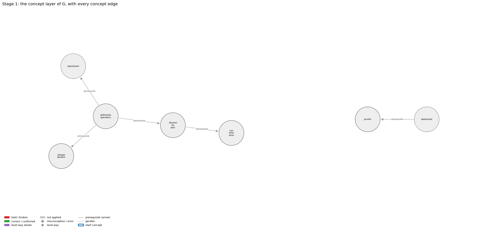
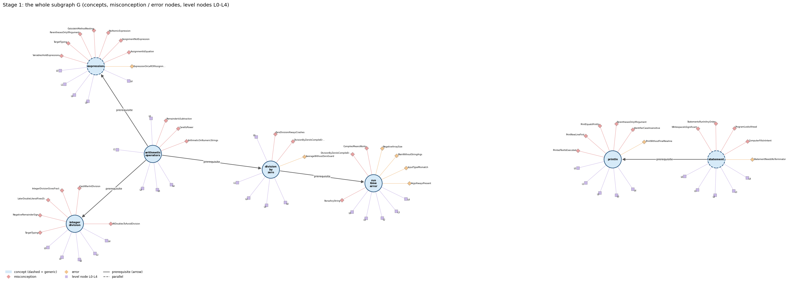
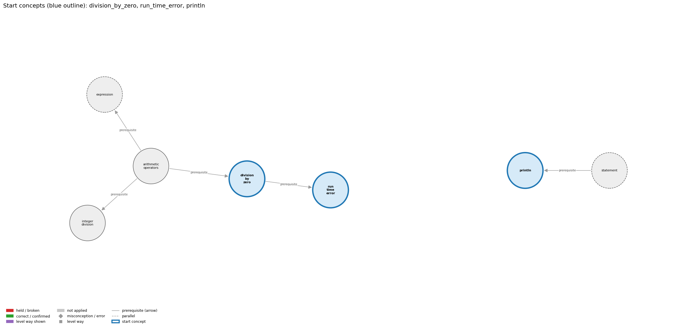
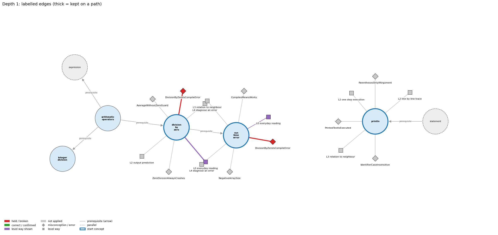
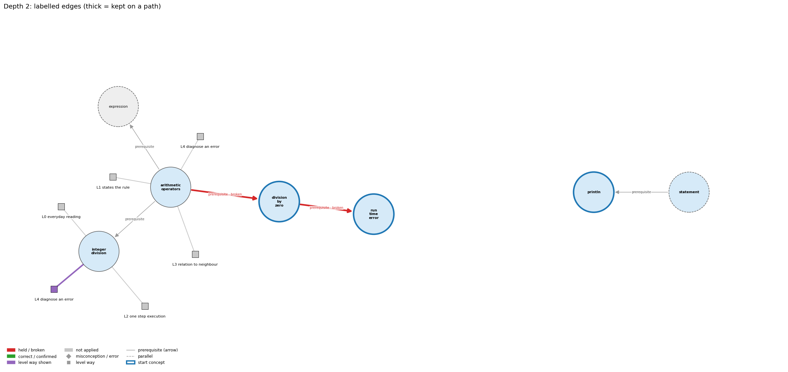
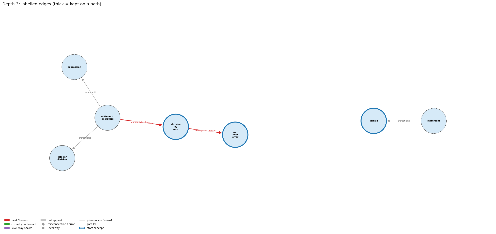
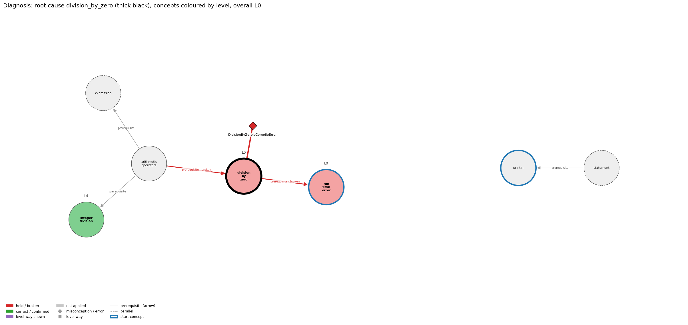

# Think on the Graph: every output of the run MY26

Files of this scenario: `input.json` (program, question, answer), `diagnosis.json`, `subgraph.json`, `traverse_log.txt`, `report.html` (this report as one full-page file, with the interactive graph `MY26_G.html`), `MY26.ipynb` (this report as a notebook).

## 0. Input
Program:
```java
int total = 50;
int count = 0;
System.out.println(total / count);
```
Question: Will this compile? What happens when you run it? Explain your reasoning

Student's answer: It won’t compile. Dividing by zero isn’t allowed, so the compiler stops you before it runs.”
Actual: it compiles, then crashes at run time with ArithmeticException: / by zero.
Settings: width 3, depth 3, prune llm, backend claude-cli, model claude-opus-5-5
## 1. Stage 1: the subgraph G from the code (no model)
Masked code (string and char literals and comments blanked; this is what the patterns see):
```
int total = 50;
int count = 0;
System.out.println(total / count);
```
Which code text tagged which concept (a generic concept fires on almost any Java line; it starts the walk only if the answer repeats its tag):
| concept | generic | channel | matched text | line |
|---|---|---|---|---|
| arithmetic_operators | False | pattern | 'l / c' | 3 |
| division_by_zero | False | signal | 'int count = 0;\nSystem.out.println(total / count' | 2 |
| expression | True | pattern | 'l /' | 3 |
| expression | True | pattern | '= 50;' | 1 |
| integer_division | False | signal | 'int total = 50;\nint count = 0;\nSystem.out.println(total / count' | 1 |
| println | False | pattern | 'System.out.println(' | 3 |
| run_time_error | False | signal | 'int count = 0;\nSystem.out.println(total / count' | 2 |
| statement | True | pattern | ';' | 1 |

G: 7 concept nodes (2 generic), 5 concept edges, 38 misconception / error edges, 35 misconception / error nodes, 35 level nodes, 42 level-misconception links, 2 connected piece(s).
Note: concept nodes form 2 pieces (the KG has no edge between them): arithmetic_operators,division_by_zero,expression,integer_division,run_time_error | println,statement

Concept edges of G (the links the walk can read; `pre:` = prerequisite A -> B, `par:` = parallel):
| edge | type | rule (logic) |
|---|---|---|
| pre:arithmetic_operators->division_by_zero | prerequisite | Integer division by zero (1/0) generates a run-time exception, while floating-point 1.0/0.0 is legal and has the value Infinity. |
| pre:arithmetic_operators->expression | prerequisite | An operator combines operand values a and b into a new value, so operators build larger expressions from smaller ones. |
| pre:arithmetic_operators->integer_division | prerequisite | For ints a and b, / gives the whole quotient q and % gives the remainder r, so that a = b * q + r. |
| pre:division_by_zero->run_time_error | prerequisite | Dividing an int by zero compiles but throws ArithmeticException when the program runs: a run-time error. |
| pre:statement->println | prerequisite | System.out.println(s); is itself a statement, so its line of output appears at its own place in the sequence. |

Misconception / error edges per concept (count), and level ways per concept (count):
| concept | misconception / error edges | level ways (L1-L4 + L0 non-misconception) |
|---|---|---|
| arithmetic_operators | 3 | 18 |
| division_by_zero | 3 | 15 |
| expression | 8 | 19 |
| integer_division | 6 | 16 |
| println | 6 | 17 |
| run_time_error | 7 | 19 |
| statement | 5 | 19 |

**Figure 1**


**Figure 2**


## 2. Clauses and start concepts (no model)
The answer split into clauses (at sentence ends, ';', and before 'because' / 'so'; quotes removed):
| clause | text |
|---|---|
| c1 | It wont compile |
| c2 | Dividing by zero isnt allowed |
| c3 | so the compiler stops you before it runs |
| c4 | Actual: it compiles, then crashes at run time with ArithmeticException: / by zero |

start: BM25 of the answer against each tagged concept: division_by_zero 17.10 (hits 1), run_time_error 15.59 (hits 1), println 7.20 (hits 1), integer_division 5.84 (hits 1), arithmetic_operators 5.55 (hits 1)

start: chosen division_by_zero, run_time_error, println

start concepts (3): division_by_zero, run_time_error, println

Start concepts: division_by_zero, run_time_error, println

**Figure 3**


## 3. The walk, depth by depth
At each depth, for each current concept: the edges offered (a concept entering as a start concept offers its misconception / error edges and its level ways, as two families; otherwise it offers its concept edges), the prune prompt and the model's reply, then the label prompt(s) and the model's reply, parsed into label / clauses / confidence. Score = prune score x confidence.

### Depth 1: current concepts 'division_by_zero', 'run_time_error', 'println'

#### division_by_zero, misconceptions: 3 edges offered
Edges offered:
| edge |
|---|
| err:division_by_zero->AverageWithoutZeroGuard \| wrong rule: Computes sum / count without checking that count is above 0. \| right rule: If no value was read (count is 0), do not compute the average: with int operands sum / count is a division by zero, a run-time exception that stops the program; with a double sum the division does not stop the program and gives a meaningless value instead of an average. |
| mis:division_by_zero->DivisionByZeroIsCompileError \| wrong rule: System.out.println(5 / 0); is rejected by the compiler. \| right rule: It compiles; the ArithmeticException happens when the program runs. |
| mis:division_by_zero->ZeroDivisionAlwaysCrashes \| wrong rule: Dividing by zero always stops the program with an error. \| right rule: Only integer division by zero generates a run-time exception; 1.0/0.0 is legal and has the value Infinity. |

Prune: the model's reply (edge id and score; the kept edges sum to 1):
```
mis:division_by_zero->DivisionByZeroIsCompileError (0.80), mis:division_by_zero->ZeroDivisionAlwaysCrashes (0.15), err:division_by_zero->AverageWithoutZeroGuard (0.05)
```
Kept by pruning: mis:division_by_zero->DivisionByZeroIsCompileError (0.80), mis:division_by_zero->ZeroDivisionAlwaysCrashes (0.15), err:division_by_zero->AverageWithoutZeroGuard (0.05)

Label prompt for the misconception / error edges (judged together). The model saw the program, the question, the numbered clauses, and these edges with their wrong rule and right rule:
| edge |
|---|
| mis:division_by_zero->DivisionByZeroIsCompileError \| wrong rule: System.out.println(5 / 0); is rejected by the compiler. \| right rule: It compiles; the ArithmeticException happens when the program runs. |
| mis:division_by_zero->ZeroDivisionAlwaysCrashes \| wrong rule: Dividing by zero always stops the program with an error. \| right rule: Only integer division by zero generates a run-time exception; 1.0/0.0 is legal and has the value Infinity. |
| err:division_by_zero->AverageWithoutZeroGuard \| wrong rule: Computes sum / count without checking that count is above 0. \| right rule: If no value was read (count is 0), do not compute the average: with int operands sum / count is a division by zero, a run-time exception that stops the program; with a double sum the division does not stop the program and gives a meaningless value instead of an average. |
Model's reply:
```
mis:division_by_zero->DivisionByZeroIsCompileError | held | clauses: 1, 2, 3 | confidence: 0.95
mis:division_by_zero->ZeroDivisionAlwaysCrashes | not applied | clauses: none | confidence: 0.7
err:division_by_zero->AverageWithoutZeroGuard | not applied | clauses: none | confidence: 0.85
```

Parsed labels:
| edge | label | prune score | confidence | score | clauses | words |
|---|---|---|---|---|---|---|
| mis:division_by_zero->DivisionByZeroIsCompileError | held | 0.8 | 0.95 | 0.76 | c1, c2, c3 | It wont compile; Dividing by zero isnt allowed; so the compiler stops you before it runs |
| mis:division_by_zero->ZeroDivisionAlwaysCrashes | not applied |  |  | 0.0 |  |  |
| err:division_by_zero->AverageWithoutZeroGuard | not applied |  |  | 0.0 |  |  |

#### division_by_zero, level ways: 15 edges offered
Edges offered:
| edge |
|---|
| lvl:division_by_zero@L0#0 \| level L0 way everyday_reading: Folk meaning: in maths division by zero is 'impossible', so every x / 0 must be rejected, ideally by the compiler. Java rule: the compiler accepts it; int or long / and % by zero throw ArithmeticException at run time, while double division by zero is legal and gives Infinity or NaN. |
| lvl:division_by_zero@L0#3 \| level L0 way inconsistent_trace: Points to LT (both operands are evaluated, promotion decides whether the division is int or double, and only then is the divisor checked). Applied unevenly: the student lets 1/0.0 crash because the 1 is an int, or lets 1/0 give Infinity on one line and an exception on another. (here mixing in: "Dividing by zero always stops the program with an error") |
| lvl:division_by_zero@L1#0 \| level L1 way names_the_element: Division by zero is the evaluation of x / 0 or x % 0: a run-time error for integer types and a special value (Infinity or NaN) for floating-point types. |
| lvl:division_by_zero@L1#1 \| level L1 way states_the_rule: An integer / or % throws ArithmeticException if the right operand is zero; floating-point arithmetic follows IEEE 754, so a nonzero double divided by zero is Infinity or -Infinity and 0.0/0.0 is NaN. With doubles, 1.0 / 0.0 is Infinity and 0.0 / 0.0 (or Math.sqrt(-1.0)) is NaN; NaN is not equal to anything, not even itself. |
| lvl:division_by_zero@L2#0 \| level L2 way line_by_line_trace: Left operand, then right operand are fully evaluated; then the division itself runs: for int it checks the divisor and throws at that moment, so the rest of the statement (the assignment or the println) never happens; for double it produces the special value and evaluation continues. |
| lvl:division_by_zero@L2#1 \| level L2 way output_prediction: 1/0 and 1%0 produce no value: the program stops with Exception in thread "main" java.lang.ArithmeticException: / by zero; 1.0/0.0 is Infinity, -1.0/0.0 is -Infinity, 0.0/0.0 is NaN, and 1/0.0 is Infinity (the 1 is promoted). |
| lvl:division_by_zero@L2#2 \| level L2 way one_step_execution: For int, no variable changes: the exception aborts the statement and (uncaught) ends the program. For double, the target gets Infinity or NaN; NaN then propagates through later arithmetic and every comparison with it (even ==) is false. |
| lvl:division_by_zero@L3#0 \| level L3 way relation_to_neighbour: The zero check belongs to the int / and % operators: they always produce an int except when the divisor is zero, in which case they throw; + - * never throw. |
| lvl:division_by_zero@L3#1 \| level L3 way relation_to_neighbour: Once either operand is a double the division follows IEEE 754 rules instead, so the same zero divisor gives Infinity or NaN rather than an exception. |
| lvl:division_by_zero@L3#2 \| level L3 way purpose_of_the_whole: Plan: guard the division (if (count > 0) average = sum / count;), a guard test placed before the risky operation; Infinity is used on purpose as an initial value for a minimum search (Double.POSITIVE_INFINITY). |
| lvl:division_by_zero@L4#0 \| level L4 way predict_a_change: Changing an operand from int to double turns a crash into a silent Infinity or NaN (and changing it back turns the silent value into a crash); adding a zero guard leaves results for nonzero divisors unchanged. |
| lvl:division_by_zero@L4#1 \| level L4 way diagnose_an_error: rule broken: A divisor must be checked to be nonzero before dividing; an average of zero values is undefined. Kind: run-time exception. Trigger class: count == 0 (empty input, no values read): with int sum / count an ArithmeticException stops the program; with a double sum the division gives NaN (0.0/0.0) and prints a meaningless average as a silent logic error. |
| lvl:division_by_zero@L4#2 \| level L4 way transfer_to_a_new_program: Guard every integer division whose divisor could be zero; rely on Infinity only when it is the intended value (e.g. as a sentinel for min); when the result is undefined (empty input) handle the case explicitly instead of printing NaN. |
| lvl:division_by_zero@L4#3 \| level L4 way diagnose_an_error: rule broken: Integer / and % require a nonzero right operand. Kind: run-time exception. Trigger class: Any int or long division or remainder whose right operand evaluates to 0, e.g. n % k with k = 0, or a loop dividing by a variable that reaches 0. |
| lvl:division_by_zero@L4#4 \| level L4 way diagnose_an_error: rule broken: A floating-point division by zero yields Infinity or NaN instead of a number. Kind: silent logic error. Trigger class: A double divisor that becomes 0.0 (or 0.0/0.0), whose Infinity/NaN result then flows into later computations and comparisons. |

Prune: the model's reply (edge id and score; the kept edges sum to 1):
```
{lvl:division_by_zero@L0#0 (Score: 0.7)}
{lvl:division_by_zero@L4#3 (Score: 0.15)}
{lvl:division_by_zero@L2#1 (Score: 0.15)}
```
Kept by pruning: lvl:division_by_zero@L0#0 (0.70), lvl:division_by_zero@L4#3 (0.15), lvl:division_by_zero@L2#1 (0.15)

Label prompt for level way lvl:division_by_zero@L0#0 (the model saw only the concept, the way's name 'everyday reading' and its text; no level):
> Folk meaning: in maths division by zero is 'impossible', so every x / 0 must be rejected, ideally by the compiler. Java rule: the compiler accepts it; int or long / and % by zero throw ArithmeticException at run time, while double division by zero is legal and gives Infinity or NaN.

Model's reply:
```
Label: shown
Clauses: 1, 2, 3
Confidence: 0.93
```

Label prompt for level way lvl:division_by_zero@L4#3 (the model saw only the concept, the way's name 'diagnose an error' and its text; no level):
> rule broken: Integer / and % require a nonzero right operand. Kind: run-time exception. Trigger class: Any int or long division or remainder whose right operand evaluates to 0, e.g. n % k with k = 0, or a loop dividing by a variable that reaches 0.

Model's reply:
```
Label: not shown
Clauses: none
Confidence: 0.75
```

Label prompt for level way lvl:division_by_zero@L2#1 (the model saw only the concept, the way's name 'output prediction' and its text; no level):
> 1/0 and 1%0 produce no value: the program stops with Exception in thread "main" java.lang.ArithmeticException: / by zero; 1.0/0.0 is Infinity, -1.0/0.0 is -Infinity, 0.0/0.0 is NaN, and 1/0.0 is Infinity (the 1 is promoted).

Model's reply:
```
Label: not shown
Clauses: none
Confidence: 0.85
```

Parsed labels:
| edge | label | prune score | confidence | score | clauses | words |
|---|---|---|---|---|---|---|
| lvl:division_by_zero@L0#0 | shown | 0.7 | 0.93 | 0.65 | c1, c2, c3 | It wont compile; Dividing by zero isnt allowed; so the compiler stops you before it runs |
| lvl:division_by_zero@L4#3 | not applied |  |  | 0.0 |  |  |
| lvl:division_by_zero@L2#1 | not applied |  |  | 0.0 |  |  |

#### run_time_error, misconceptions: 7 edges offered
Edges offered:
| edge |
|---|
| err:run_time_error->ArgsAlwaysPresent \| wrong rule: args[0] can always be read. \| right rule: If you run the program without typing the command-line argument it expects, reading args[0] fails with java.lang.ArrayIndexOutOfBoundsException: 0. |
| err:run_time_error->InputTypeMismatch \| wrong rule: StdIn.readInt() accepts any typed text such as abc or 12.2. \| right rule: If the next token is not an int (e.g. abc, 12.2, true), StdIn.readInt() throws a NumberFormatException at run time (Scanner.nextInt throws InputMismatchException). |
| err:run_time_error->MainWithoutStringArgs \| wrong rule: public static void main() is an acceptable entry point. \| right rule: main is written public static void main(String[] args); these keywords and the args parameter are required. |
| err:run_time_error->NegativeArraySize \| wrong rule: new int[n] with a negative n creates an empty array. \| right rule: Creating an array with a negative length throws NegativeArraySizeException at run time. |
| mis:run_time_error->CompilesMeansWorks \| wrong rule: Code that compiles is code that works. \| right rule: Code that compiles can still have run-time and logical errors. |
| mis:run_time_error->DivisionByZeroIsCompileError \| wrong rule: System.out.println(5 / 0); is rejected by the compiler. \| right rule: It compiles; the ArithmeticException happens when the program runs. |
| mis:run_time_error->ParseAnyString \| wrong rule: Integer.parseInt works on any text, e.g. "five" or "12.2". \| right rule: Integer.parseInt throws a NumberFormatException at run time when the string is not an integer written in digits. |

Prune: the model's reply (edge id and score; the kept edges sum to 1):
```
{mis:run_time_error->DivisionByZeroIsCompileError (Score: 0.8)}
{mis:run_time_error->CompilesMeansWorks (Score: 0.15)}
{err:run_time_error->NegativeArraySize (Score: 0.05)}
```
Kept by pruning: mis:run_time_error->DivisionByZeroIsCompileError (0.80), mis:run_time_error->CompilesMeansWorks (0.15), err:run_time_error->NegativeArraySize (0.05)

Label prompt for the misconception / error edges (judged together). The model saw the program, the question, the numbered clauses, and these edges with their wrong rule and right rule:
| edge |
|---|
| mis:run_time_error->DivisionByZeroIsCompileError \| wrong rule: System.out.println(5 / 0); is rejected by the compiler. \| right rule: It compiles; the ArithmeticException happens when the program runs. |
| mis:run_time_error->CompilesMeansWorks \| wrong rule: Code that compiles is code that works. \| right rule: Code that compiles can still have run-time and logical errors. |
| err:run_time_error->NegativeArraySize \| wrong rule: new int[n] with a negative n creates an empty array. \| right rule: Creating an array with a negative length throws NegativeArraySizeException at run time. |
Model's reply:
```
mis:run_time_error->DivisionByZeroIsCompileError | held | clauses: 1, 2, 3 | confidence: 0.95
mis:run_time_error->CompilesMeansWorks | not applied | clauses: none | confidence: 0.85
err:run_time_error->NegativeArraySize | not applied | clauses: none | confidence: 0.97
```

Parsed labels:
| edge | label | prune score | confidence | score | clauses | words |
|---|---|---|---|---|---|---|
| mis:run_time_error->DivisionByZeroIsCompileError | held | 0.8 | 0.95 | 0.76 | c1, c2, c3 | It wont compile; Dividing by zero isnt allowed; so the compiler stops you before it runs |
| mis:run_time_error->CompilesMeansWorks | not applied |  |  | 0.0 |  |  |
| err:run_time_error->NegativeArraySize | not applied |  |  | 0.0 |  |  |

#### run_time_error, level ways: 19 edges offered
Edges offered:
| edge |
|---|
| lvl:run_time_error@L0#0 \| level L0 way everyday_reading: Everyday reading: if the program compiled, the computer has accepted it, so any problem would have been reported then. Java rule: run-time errors are detected only while the program executes, on particular data (e.g. no argument, a divisor of 0), and stop it with an exception. |
| lvl:run_time_error@L0#3 \| level L0 way inconsistent_trace: Applies the exception rule (LT: execution stops at the faulty statement) unevenly: lets the program keep printing after the failing statement on one trace, or reports the error before any earlier output on another. (here mixing in: "Code that compiles is code that works") |
| lvl:run_time_error@L1#0 \| level L1 way names_the_element: A run-time error (exception) is an error that does not show up until the program is executed and makes it impossible to run to completion. |
| lvl:run_time_error@L1#1 \| level L1 way states_the_rule: When a run-time error occurs, the program 'crashes' (terminates) and the JVM prints the exception name, a message, and the method, file and line where it happened. |
| lvl:run_time_error@L2#0 \| level L2 way line_by_line_trace: Statements before the faulty one run normally (their output appears); the faulty statement throws; no later statement runs. |
| lvl:run_time_error@L2#1 \| level L2 way output_prediction: Output: any earlier output, then Exception in thread "main" java.lang.<Name>: <detail> at Class.main(Class.java:<line>). |
| lvl:run_time_error@L2#2 \| level L2 way one_step_execution: The throwing step changes no variable it was meant to set (the operation does not complete) and transfers control out of main, ending the program. |
| lvl:run_time_error@L3#0 \| level L3 way relation_to_neighbour: A run-time error appears only while java Name executes, after compiling has succeeded. |
| lvl:run_time_error@L3#1 \| level L3 way relation_to_neighbour: javac cannot detect it because it depends on run-time values (the argument typed, the divisor's value). |
| lvl:run_time_error@L3#2 \| level L3 way relation_to_neighbour: A run-time error stops the program with an exception message; a logic error lets it finish with wrong output and no message. |
| lvl:run_time_error@L3#3 \| level L3 way purpose_of_the_whole: Purpose (of exceptions): stop the program at the point where something impossible was asked, instead of continuing with an undefined value, and report what and where. |
| lvl:run_time_error@L4#0 \| level L4 way predict_a_change: The same compiled program may run fine on one input and throw on another (UseArgument with and without an argument); adding a guard such as checking args.length removes the trigger without changing correct runs. |
| lvl:run_time_error@L4#1 \| level L4 way diagnose_an_error: rule broken: main is written public static void main(String[] args). Kind: launch error. Trigger class: header public static void main(): compiles, but java Name cannot find the main method |
| lvl:run_time_error@L4#2 \| level L4 way diagnose_an_error: rule broken: Array length must be >= 0. Kind: run-time exception. Trigger class: new int[n] with n < 0: NegativeArraySizeException |
| lvl:run_time_error@L4#3 \| level L4 way diagnose_an_error: rule broken: args[k] exists only if at least k+1 arguments were typed. Kind: run-time exception. Trigger class: running without the expected argument: java.lang.ArrayIndexOutOfBoundsException: 0 |
| lvl:run_time_error@L4#4 \| level L4 way transfer_to_a_new_program: Expect a run-time error when correctness depends on data (array indices, divisors, parsed input, presence of arguments); validate such data before use. Errors that depend only on the text are compile-time; wrong-but-legal results are logic errors. |
| lvl:run_time_error@L4#5 \| level L4 way diagnose_an_error: rule broken: StdIn.readInt() needs the next token to be an int. Kind: run-time exception. Trigger class: next token abc, 12.2 or true (StdIn: InputMismatchException/NumberFormatException depending on version; Scanner.nextInt: InputMismatchException) |
| lvl:run_time_error@L4#6 \| level L4 way diagnose_an_error: rule broken: Integer division and remainder by zero are undefined. Kind: run-time exception. Trigger class: a / b or a % b with int b == 0: ArithmeticException: / by zero |
| lvl:run_time_error@L4#7 \| level L4 way diagnose_an_error: rule broken: Integer.parseInt needs an integer written in digits. Kind: run-time exception. Trigger class: parsing "five" or "12.2": NumberFormatException |

Prune: the model's reply (edge id and score; the kept edges sum to 1):
```
{lvl:run_time_error@L3#1 (Score: 0.45)}
{lvl:run_time_error@L0#0 (Score: 0.3)}
{lvl:run_time_error@L4#6 (Score: 0.25)}
```
Kept by pruning: lvl:run_time_error@L3#1 (0.45), lvl:run_time_error@L0#0 (0.30), lvl:run_time_error@L4#6 (0.25)

Label prompt for level way lvl:run_time_error@L3#1 (the model saw only the concept, the way's name 'relation to neighbour' and its text; no level):
> javac cannot detect it because it depends on run-time values (the argument typed, the divisor's value).

Model's reply:
```
Label: not shown
Clauses: none
Confidence: 0.92
```

Label prompt for level way lvl:run_time_error@L0#0 (the model saw only the concept, the way's name 'everyday reading' and its text; no level):
> Everyday reading: if the program compiled, the computer has accepted it, so any problem would have been reported then. Java rule: run-time errors are detected only while the program executes, on particular data (e.g. no argument, a divisor of 0), and stop it with an exception.

Model's reply:
```
Label: shown
Clauses: 1, 3
Confidence: 0.85
```

Label prompt for level way lvl:run_time_error@L4#6 (the model saw only the concept, the way's name 'diagnose an error' and its text; no level):
> rule broken: Integer division and remainder by zero are undefined. Kind: run-time exception. Trigger class: a / b or a % b with int b == 0: ArithmeticException: / by zero

Model's reply:
```
Label: not shown
Clauses: none
Confidence: 0.8
```

Parsed labels:
| edge | label | prune score | confidence | score | clauses | words |
|---|---|---|---|---|---|---|
| lvl:run_time_error@L3#1 | not applied |  |  | 0.0 |  |  |
| lvl:run_time_error@L0#0 | shown | 0.3 | 0.85 | 0.26 | c1, c3 | It wont compile; so the compiler stops you before it runs |
| lvl:run_time_error@L4#6 | not applied |  |  | 0.0 |  |  |

#### println, misconceptions: 6 edges offered
Edges offered:
| edge |
|---|
| err:println->PrintWithoutFinalNewline \| wrong rule: Ends the output with print and expects it to appear right away. \| right rule: Finish a line of print calls with println; some systems hold print output until a newline is printed. |
| mis:println->IdentifierCaseInsensitive \| wrong rule: System.out.Println and System.out.println name the same method. \| right rule: Java is case-sensitive: names of variables, methods and classes that differ only in capitalization are different names. |
| mis:println->ParenthesesOnlyIfArgument \| wrong rule: println with nothing to print can be written System.out.println; without the parentheses. \| right rule: A method call always needs parentheses, so an empty line is printed with System.out.println();. |
| mis:println->PrintEqualsPrintln \| wrong rule: print and println do the same thing, so print(s1); print(s2); puts s1 and s2 on separate lines. \| right rule: println ends the line after printing and print does not, so print(s1); print(s2); puts s1 and s2 on the same line. |
| mis:println->PrintNewLineFirst \| wrong rule: println(s) prints a newline and then s. \| right rule: println(s) prints s and then the newline. |
| mis:println->PrintedTextIsExecuted \| wrong rule: System.out.println("x is 5"); sets x to 5 (text inside the quotes is run as code). \| right rule: Characters inside double quotes are printed literally; println only displays them and changes no variable. Only an assignment such as x = 5; sets x. |

Prune: the model's reply (edge id and score; the kept edges sum to 1):
```
mis:println->PrintedTextIsExecuted (0.50), mis:println->ParenthesesOnlyIfArgument (0.25), mis:println->IdentifierCaseInsensitive (0.25)
```
Kept by pruning: mis:println->PrintedTextIsExecuted (0.50), mis:println->ParenthesesOnlyIfArgument (0.25), mis:println->IdentifierCaseInsensitive (0.25)

Label prompt for the misconception / error edges (judged together). The model saw the program, the question, the numbered clauses, and these edges with their wrong rule and right rule:
| edge |
|---|
| mis:println->PrintedTextIsExecuted \| wrong rule: System.out.println("x is 5"); sets x to 5 (text inside the quotes is run as code). \| right rule: Characters inside double quotes are printed literally; println only displays them and changes no variable. Only an assignment such as x = 5; sets x. |
| mis:println->ParenthesesOnlyIfArgument \| wrong rule: println with nothing to print can be written System.out.println; without the parentheses. \| right rule: A method call always needs parentheses, so an empty line is printed with System.out.println();. |
| mis:println->IdentifierCaseInsensitive \| wrong rule: System.out.Println and System.out.println name the same method. \| right rule: Java is case-sensitive: names of variables, methods and classes that differ only in capitalization are different names. |
Model's reply:
```
mis:println->PrintedTextIsExecuted | not applied | clauses: none | confidence: 0.95
mis:println->ParenthesesOnlyIfArgument | not applied | clauses: none | confidence: 0.95
mis:println->IdentifierCaseInsensitive | not applied | clauses: none | confidence: 0.95
```

Parsed labels:
| edge | label | prune score | confidence | score | clauses | words |
|---|---|---|---|---|---|---|
| mis:println->PrintedTextIsExecuted | not applied |  |  | 0.0 |  |  |
| mis:println->ParenthesesOnlyIfArgument | not applied |  |  | 0.0 |  |  |
| mis:println->IdentifierCaseInsensitive | not applied |  |  | 0.0 |  |  |

#### println, level ways: 17 edges offered
Edges offered:
| edge |
|---|
| lvl:println@L0#0 \| level L0 way everyday_reading: Everyday reading: 'println' is just 'print', and 'new line' is something you do before writing. Java rule: println(x) prints x and then ends the line; println() alone just ends the line. |
| lvl:println@L0#3 \| level L0 way inconsistent_trace: Applies the println rule (print, then end line) unevenly: puts the newline before the text on one call and after it on another, or forgets that the next output starts on a new line. (here mixing in: "print and println behave the same (no newline difference)") |
| lvl:println@L1#0 \| level L1 way names_the_element: System.out.println is a library method that prints its argument followed by a line terminator ('print line'). |
| lvl:println@L1#1 \| level L1 way states_the_rule: println(String x) behaves as though it calls print(x) and then println(); println() terminates the current line by writing the line separator string. |
| lvl:println@L2#0 \| level L2 way line_by_line_trace: Evaluate the argument, print its characters at the current position, then write the line separator so the cursor moves to the beginning of the next line. |
| lvl:println@L2#1 \| level L2 way output_prediction: Output is the value's characters followed by a line break: println("Hello, "); println("World!"); prints two lines. |
| lvl:println@L2#2 \| level L2 way one_step_execution: One call appends the text and a line separator to the output; the cursor ends at the start of the next line; no variable changes and nothing is returned. |
| lvl:println@L3#0 \| level L3 way relation_to_neighbour: System.out.println(s); is a statement, so its line of output appears at its own place in the sequence. |
| lvl:println@L3#1 \| level L3 way relation_to_neighbour: println("s") outputs exactly the characters between the quotes and then ends the line. |
| lvl:println@L3#2 \| level L3 way relation_to_neighbour: print leaves the cursor on the line; println ends it; several prints followed by one println make one line. |
| lvl:println@L3#3 \| level L3 way relation_to_neighbour: println prints numbers with all their digits and always ends the line; printf formats each value by its conversion code and ends the line only where the format has %n or \n. |
| lvl:println@L3#4 \| level L3 way purpose_of_the_whole: Purpose: produce one complete line of output, e.g. each result on its own line, or end a line built with print. |
| lvl:println@L4#0 \| level L4 way predict_a_change: Replacing println with print joins the next output onto the same line (a typical logic error); the characters printed stay the same. |
| lvl:println@L4#1 \| level L4 way transfer_to_a_new_program: Use println when each output item belongs on its own line or to end a line; use print to continue a line and printf to control number formatting. |
| lvl:println@L4#2 \| level L4 way diagnose_an_error: rule broken: Finish a line of print calls with println. Kind: silent logic error. Trigger class: output ends with print, so the last line may not be shown or runs into the shell prompt |
| lvl:println@L4#3 \| level L4 way diagnose_an_error: rule broken: Method names are case-sensitive. Kind: compile-time. Trigger class: System.out.Println or system.out.println: cannot find symbol |
| lvl:println@L4#4 \| level L4 way diagnose_an_error: rule broken: Calls need parentheses. Kind: compile-time. Trigger class: System.out.println; without () |

Prune: the model's reply (edge id and score; the kept edges sum to 1):
```
{lvl:println@L2#0 (Score: 0.5)}
{lvl:println@L2#2 (Score: 0.25)}
{lvl:println@L3#0 (Score: 0.25)}
```
Kept by pruning: lvl:println@L2#0 (0.50), lvl:println@L2#2 (0.25), lvl:println@L3#0 (0.25)

Label prompt for level way lvl:println@L2#0 (the model saw only the concept, the way's name 'line by line trace' and its text; no level):
> Evaluate the argument, print its characters at the current position, then write the line separator so the cursor moves to the beginning of the next line.

Model's reply:
```
Label: not shown
Clauses: none
Confidence: 0.92
```

Label prompt for level way lvl:println@L2#2 (the model saw only the concept, the way's name 'one step execution' and its text; no level):
> One call appends the text and a line separator to the output; the cursor ends at the start of the next line; no variable changes and nothing is returned.

Model's reply:
```
Label: not shown
Clauses: none
Confidence: 0.95
```

Label prompt for level way lvl:println@L3#0 (the model saw only the concept, the way's name 'relation to neighbour' and its text; no level):
> System.out.println(s); is a statement, so its line of output appears at its own place in the sequence.

Model's reply:
```
Label: not shown
Clauses: none
Confidence: 0.9
```

Parsed labels:
| edge | label | prune score | confidence | score | clauses | words |
|---|---|---|---|---|---|---|
| lvl:println@L2#0 | not applied |  |  | 0.0 |  |  |
| lvl:println@L2#2 | not applied |  |  | 0.0 |  |  |
| lvl:println@L3#0 | not applied |  |  | 0.0 |  |  |

**Kept on a path at this depth** (best N in tiers: held misconception / broken edge, then held error, then correct / confirmed / shown):

mis:division_by_zero->DivisionByZeroIsCompileError [held, tier 0, 0.76], mis:run_time_error->DivisionByZeroIsCompileError [held, tier 0, 0.76], lvl:division_by_zero@L0#0 [shown, tier 2, 0.65]

**Clause coverage after this depth:**
| clause | text | covered by |
|---|---|---|
| c1 | It wont compile | mis:division_by_zero->DivisionByZeroIsCompileError |
| c2 | Dividing by zero isnt allowed | mis:division_by_zero->DivisionByZeroIsCompileError |
| c3 | so the compiler stops you before it runs | mis:division_by_zero->DivisionByZeroIsCompileError |
| c4 | Actual: it compiles, then crashes at run time with ArithmeticException: / by zero | not covered yet |

**Uncovered clauses bring in (BM25 of the uncovered clauses against unvisited concepts):** arithmetic_operators (4.12), integer_division (2.02)

**Graph check, not yet read (the walk may not stop while these remain):** own edges of arithmetic_operators, own edges of integer_division, pre:arithmetic_operators->division_by_zero, pre:division_by_zero->run_time_error, pre:statement->println

**Figure 4 (the graph after depth 1)**


### Depth 2: current concepts 'division_by_zero', 'run_time_error', 'println', 'arithmetic_operators', 'integer_division'

#### division_by_zero, concept edges: 2 edges offered
Edges offered:
| edge |
|---|
| pre:arithmetic_operators->division_by_zero \| rule: Integer division by zero (1/0) generates a run-time exception, while floating-point 1.0/0.0 is legal and has the value Infinity. |
| pre:division_by_zero->run_time_error \| rule: Dividing an int by zero compiles but throws ArithmeticException when the program runs: a run-time error. |

Prune: the model's reply (edge id and score; the kept edges sum to 1):
```
{pre:division_by_zero->run_time_error (Score: 0.65)}
{pre:arithmetic_operators->division_by_zero (Score: 0.35)}
```
Kept by pruning: pre:division_by_zero->run_time_error (0.65), pre:arithmetic_operators->division_by_zero (0.35)

Label prompt for concept edge pre:division_by_zero->run_time_error (division_by_zero -> run_time_error, prerequisite):
> Dividing an int by zero compiles but throws ArithmeticException when the program runs: a run-time error.

Model's reply:
```
Label: broken
Clauses: 1, 3
Confidence: 0.95
```

Label prompt for concept edge pre:arithmetic_operators->division_by_zero (arithmetic_operators -> division_by_zero, prerequisite):
> Integer division by zero (1/0) generates a run-time exception, while floating-point 1.0/0.0 is legal and has the value Infinity.

Model's reply:
```
Label: broken
Clauses: 1, 3
Confidence: 0.9
```

Parsed labels:
| edge | label | prune score | confidence | score | clauses | words |
|---|---|---|---|---|---|---|
| pre:division_by_zero->run_time_error | broken | 0.65 | 0.95 | 0.62 | c1, c3 | It wont compile; so the compiler stops you before it runs |
| pre:arithmetic_operators->division_by_zero | broken | 0.35 | 0.9 | 0.32 | c1, c3 | It wont compile; so the compiler stops you before it runs |

#### println, concept edges: 1 edges offered
Edges offered:
| edge |
|---|
| pre:statement->println \| rule: System.out.println(s); is itself a statement, so its line of output appears at its own place in the sequence. |

Prune: the model's reply (edge id and score; the kept edges sum to 1):
```
{pre:statement->println (Score: 1.0)}
```
Kept by pruning: pre:statement->println (1.00)

Label prompt for concept edge pre:statement->println (statement -> println, prerequisite):
> System.out.println(s); is itself a statement, so its line of output appears at its own place in the sequence.

Model's reply:
```
Label: not applied
Clauses: none
Confidence: 0.85
```

Parsed labels:
| edge | label | prune score | confidence | score | clauses | words |
|---|---|---|---|---|---|---|
| pre:statement->println | not applied |  |  | 0.0 |  |  |

#### arithmetic_operators, misconceptions: 3 edges offered
Edges offered:
| edge |
|---|
| mis:arithmetic_operators->ArithmeticOnNumericStrings \| wrong rule: "10" - 1 or "6" * "2" works because the strings look like numbers. \| right rule: Arithmetic operators other than + are not defined for Strings; a String of digits must first be converted to a number, e.g. with Integer.parseInt. |
| mis:arithmetic_operators->CaretIsPower \| wrong rule: a^2 computes a squared. \| right rule: Java has no exponent operator; ^ is exclusive or, and a * a or Math.pow(a, 2) computes a squared. |
| mis:arithmetic_operators->RemainderIsSubtraction \| wrong rule: 9 % 5 means 9 minus 5 (a % b subtracts b from a). \| right rule: % gives the remainder after integer division: 9 % 5 is 4 because 9 = 1 * 5 + 4, and 17 % 5 is 2, not 12. |

Prune: the model's reply (edge id and score; the kept edges sum to 1):
```

```
Kept by pruning: 

Parsed labels:
(none)

#### arithmetic_operators, level ways: 18 edges offered
Edges offered:
| edge |
|---|
| lvl:arithmetic_operators@L0#0 \| level L0 way everyday_reading: In maths notation, multiplication can be implicit (2x), ^ or a superscript means a power, ÷ is exact division, and % means percent. In Java * must be written, / depends on the operand types, % is the remainder, and there is no power operator (^ is exclusive or). |
| lvl:arithmetic_operators@L0#2 \| level L0 way inconsistent_trace: Points to LT (evaluate operands, then apply the operator in the promoted type). Applied unevenly, a student uses integer division for one / and real division for another / in the same int expression. (here mixing in: "a^2 computes a squared") |
| lvl:arithmetic_operators@L1#0 \| level L1 way names_the_element: Arithmetic operators: the binary operators + - * / % that combine two numeric operands into a numeric result. |
| lvl:arithmetic_operators@L1#1 \| level L1 way states_the_rule: Both operands must be numeric, and the result has the promoted type (int, long or double). * / % bind tighter than + -, all group left to right, and int / or % by zero throws ArithmeticException. Unary minus negates its operand (-x) and unary plus leaves it unchanged; they bind more tightly than * and /, so -a * b is (-a) * b. |
| lvl:arithmetic_operators@L2#0 \| level L2 way line_by_line_trace: The left operand is evaluated fully, then the right operand, and then the operator is applied in the promoted type. |
| lvl:arithmetic_operators@L2#1 \| level L2 way output_prediction: With ints, 17 / 3 is 5 and 17 % 3 is 2. With doubles, 5.0 / 3.0 is 1.6666666666666667. With mixed operands, the int is promoted first (10 / 3.0 is 3.333...). |
| lvl:arithmetic_operators@L2#2 \| level L2 way one_step_execution: An arithmetic operator never changes its operands. Each variable is replaced by its value, and only an assignment (or ++ or op=) stores the result. |
| lvl:arithmetic_operators@L3#0 \| level L3 way relation_to_neighbour: Operators build larger expressions from smaller ones, and each operand can itself be any expression. |
| lvl:arithmetic_operators@L3#1 \| level L3 way relation_to_neighbour: For ints, / gives the truncated quotient and % the remainder, so (a / b) * b + a % b == a. |
| lvl:arithmetic_operators@L3#2 \| level L3 way relation_to_neighbour: int / or % by zero throws a run-time exception, while floating-point division by zero gives Infinity or NaN. |
| lvl:arithmetic_operators@L3#3 \| level L3 way relation_to_neighbour: + adds when both operands are numbers and concatenates when either operand is a String, converting the other operand to a String. It is left-associative, so 1 + 2 + "3" is "33" but "1" + 2 + 3 is "123". |
| lvl:arithmetic_operators@L3#4 \| level L3 way purpose_of_the_whole: Arithmetic operators turn formulas into code: totals, averages, unit conversions (inch * CM_PER_INCH), and digit extraction (n % 10, n / 10). |
| lvl:arithmetic_operators@L4#0 \| level L4 way predict_a_change: Changing an operand's type changes the operator's meaning (int / versus double /). Reordering * and / changes integer results (59 * 100 / 60 is 98, 59 / 60 * 100 is 0). Replacing ^ with Math.pow gives a real power. |
| lvl:arithmetic_operators@L4#1 \| level L4 way transfer_to_a_new_program: Use the operators for arithmetic on numeric types. Use the Math library for powers, roots and absolute values, and parse numeric Strings before computing with them. |
| lvl:arithmetic_operators@L4#2 \| level L4 way diagnose_an_error: rule broken: int / and % by zero are undefined. Kind: run-time exception. Trigger class: A divisor that evaluates to 0 (empty count, zero input): ArithmeticException: / by zero. |
| lvl:arithmetic_operators@L4#3 \| level L4 way diagnose_an_error: rule broken: Arithmetic operators other than + are not defined for Strings. Kind: compile-time. Trigger class: "10" - 1 or "6" * "2": 'bad operand types for binary operator'. |
| lvl:arithmetic_operators@L4#4 \| level L4 way diagnose_an_error: rule broken: ^ is not exponentiation. Kind: silent logic error. Trigger class: Writing x^2 or 10^6 for a power (10^6 is 12). |
| lvl:arithmetic_operators@L4#5 \| level L4 way diagnose_an_error: rule broken: int arithmetic wraps silently on overflow. Kind: silent logic error. Trigger class: Results outside the int range. |

Prune: the model's reply (edge id and score; the kept edges sum to 1):
```
{lvl:arithmetic_operators@L4#2 (Score: 0.5)}
{lvl:arithmetic_operators@L3#2 (Score: 0.3)}
{lvl:arithmetic_operators@L1#1 (Score: 0.2)}
```
Kept by pruning: lvl:arithmetic_operators@L4#2 (0.50), lvl:arithmetic_operators@L3#2 (0.30), lvl:arithmetic_operators@L1#1 (0.20)

Label prompt for level way lvl:arithmetic_operators@L4#2 (the model saw only the concept, the way's name 'diagnose an error' and its text; no level):
> rule broken: int / and % by zero are undefined. Kind: run-time exception. Trigger class: A divisor that evaluates to 0 (empty count, zero input): ArithmeticException: / by zero.

Model's reply:
```
Label: not shown
Clauses: none
Confidence: 0.7
```

Label prompt for level way lvl:arithmetic_operators@L3#2 (the model saw only the concept, the way's name 'relation to neighbour' and its text; no level):
> int / or % by zero throws a run-time exception, while floating-point division by zero gives Infinity or NaN.

Model's reply:
```
Label: not shown
Clauses: none
Confidence: 0.9
```

Label prompt for level way lvl:arithmetic_operators@L1#1 (the model saw only the concept, the way's name 'states the rule' and its text; no level):
> Both operands must be numeric, and the result has the promoted type (int, long or double). * / % bind tighter than + -, all group left to right, and int / or % by zero throws ArithmeticException. Unary minus negates its operand (-x) and unary plus leaves it unchanged; they bind more tightly than * and /, so -a * b is (-a) * b.

Model's reply:
```
Label: not shown
Clauses: none
Confidence: 0.75
```

Parsed labels:
| edge | label | prune score | confidence | score | clauses | words |
|---|---|---|---|---|---|---|
| lvl:arithmetic_operators@L4#2 | not applied |  |  | 0.0 |  |  |
| lvl:arithmetic_operators@L3#2 | not applied |  |  | 0.0 |  |  |
| lvl:arithmetic_operators@L1#1 | not applied |  |  | 0.0 |  |  |

#### integer_division, misconceptions: 6 edges offered
Edges offered:
| edge |
|---|
| mis:integer_division->AllDoublesToAvoidDivision \| wrong rule: Making every variable a double is the right fix for integer division. \| right rule: Use int for countable things and double for measured ones; where a fraction is needed, make one operand of the division a double (or cast) instead of changing every type. |
| mis:integer_division->CastAfterIntDivision \| wrong rule: (double) (3 / 5) is 0.6. \| right rule: The integer division 3 / 5 = 0 happens before the cast, so the result is 0.0. |
| mis:integer_division->IntegerDivisionGivesFraction \| wrong rule: 10 / 3 evaluates to 3.333.... \| right rule: Dividing two ints gives an int: the fractional part is discarded. |
| mis:integer_division->LaterDoubleLiteralFixesDivision \| wrong rule: Changing a later literal to 100.0 fixes an earlier int division. \| right rule: The int division happens first; the double must be in the division itself. |
| mis:integer_division->NegativeRemainderSign \| wrong rule: a % b is never negative, and integer division of a negative number rounds down. \| right rule: a / b rounds toward 0 and a % b takes the sign of a: -14 / 3 is -4 and -14 % 3 is -2. |
| mis:integer_division->TargetTyping \| wrong rule: The type of a numerical expression depends on the type expected by the surrounding context, so double d = a / b; keeps the fraction. \| right rule: The type of a numerical expression is determined by the expression, so double d = a / b; with int a and b still divides as ints. |

Prune: the model's reply (edge id and score; the kept edges sum to 1):
```

```
Kept by pruning: 

Parsed labels:
(none)

#### integer_division, level ways: 16 edges offered
Edges offered:
| edge |
|---|
| lvl:integer_division@L0#0 \| level L0 way everyday_reading: In everyday and school arithmetic, 'divide' gives an exact answer or a fraction (10 ÷ 3 = 3 1/3), and rounding goes to the nearest whole number. In Java, / with two int operands discards the fraction, rounding toward zero (59 / 60 is 0). |
| lvl:integer_division@L0#4 \| level L0 way inconsistent_trace: Points to LT (each / looks at its own two operand types when it is evaluated). Applied unevenly, a student evaluates 9/5 as 1.8 in f = (9/5)*c + 32 but as 1 elsewhere, or assumes a later double operand rescues an earlier int division. (here mixing in: "The type of a numerical expression depends on the type expected by the surrounding context, so double d = a / b; keeps the fraction") |
| lvl:integer_division@L1#0 \| level L1 way names_the_element: Integer division: / applied to two integer operands, giving the whole-number quotient with the fractional part discarded. |
| lvl:integer_division@L1#1 \| level L1 way states_the_rule: If both operands of / are integral types, the result is an integer that rounds toward 0 (-14 / 3 is -4). If either operand is a double, the division is floating point. |
| lvl:integer_division@L2#0 \| level L2 way line_by_line_trace: Each / is evaluated when its turn comes (precedence, then left to right), using the types of its own two operands. Promoting the result to double, by a cast or by assignment, happens only afterwards and cannot restore the lost fraction. |
| lvl:integer_division@L2#1 \| level L2 way output_prediction: 10 / 3 is 3, 59 / 60 is 0, 1234 / 99 is 12, -14 / 3 is -4, and (double) (3 / 5) is 0.0. |
| lvl:integer_division@L2#2 \| level L2 way one_step_execution: q = a / b stores the truncated quotient in q and leaves a and b unchanged. If b is 0, an ArithmeticException stops execution before anything is stored. |
| lvl:integer_division@L3#0 \| level L3 way relation_to_neighbour: / and % on ints are paired: q = a / b and r = a % b always satisfy a = b * q + r. |
| lvl:integer_division@L3#1 \| level L3 way relation_to_neighbour: Normalizing counts must divide as doubles. With two ints, counts / total truncates to 0 whenever counts < total. |
| lvl:integer_division@L3#2 \| level L3 way relation_to_neighbour: % gives the remainder of the same truncating division: (a / b) * b + a % b == a. |
| lvl:integer_division@L3#3 \| level L3 way purpose_of_the_whole: Quotient plans: unit conversion (76 / 12 feet), dropping a digit (n / 10), finding a midpoint ((lo + hi) / 2), and computing a bucket or row index (i / cols). |
| lvl:integer_division@L4#0 \| level L4 way predict_a_change: Making one operand a double (10.0 / 3) keeps the fraction (3.333...). Casting after the division does not. Multiplying before dividing preserves precision (59 * 100 / 60 is 98). Changing an operand's sign changes only the quotient's sign, since rounding is toward zero. |
| lvl:integer_division@L4#1 \| level L4 way transfer_to_a_new_program: Use integer division when you want the whole quotient (units, digits, indices, half a size). When a fraction is needed, make one operand a double (10.0 / 3 or (double) a / b) rather than turning every variable into a double. |
| lvl:integer_division@L4#2 \| level L4 way diagnose_an_error: rule broken: With two int operands, / discards the fraction. Kind: silent logic error. Trigger class: Two int operands where a fraction is intended: 9/5 in a temperature formula, count / total, 1 / n, sum / n for an average. |
| lvl:integer_division@L4#3 \| level L4 way diagnose_an_error: rule broken: int division by zero is undefined. Kind: run-time exception. Trigger class: A divisor that evaluates to 0: ArithmeticException: / by zero. |
| lvl:integer_division@L4#4 \| level L4 way diagnose_an_error: rule broken: Integer division rounds toward zero, not down. Kind: silent logic error. Trigger class: Negative operands where floor was expected (-7 / 2 is -3, not -4). |

Prune: the model's reply (edge id and score; the kept edges sum to 1):
```
{lvl:integer_division@L4#3 (Score: 0.6)}
{lvl:integer_division@L2#2 (Score: 0.25)}
{lvl:integer_division@L0#0 (Score: 0.15)}
```
Kept by pruning: lvl:integer_division@L4#3 (0.60), lvl:integer_division@L2#2 (0.25), lvl:integer_division@L0#0 (0.15)

Label prompt for level way lvl:integer_division@L4#3 (the model saw only the concept, the way's name 'diagnose an error' and its text; no level):
> rule broken: int division by zero is undefined. Kind: run-time exception. Trigger class: A divisor that evaluates to 0: ArithmeticException: / by zero.

Model's reply:
```
Label: shown
Clauses: 2
Confidence: 0.6
```

Label prompt for level way lvl:integer_division@L2#2 (the model saw only the concept, the way's name 'one step execution' and its text; no level):
> q = a / b stores the truncated quotient in q and leaves a and b unchanged. If b is 0, an ArithmeticException stops execution before anything is stored.

Model's reply:
```
Label: not shown
Clauses: none
Confidence: 0.7
```

Label prompt for level way lvl:integer_division@L0#0 (the model saw only the concept, the way's name 'everyday reading' and its text; no level):
> In everyday and school arithmetic, 'divide' gives an exact answer or a fraction (10 ÷ 3 = 3 1/3), and rounding goes to the nearest whole number. In Java, / with two int operands discards the fraction, rounding toward zero (59 / 60 is 0).

Model's reply:
```
Label: not shown
Clauses: none
Confidence: 0.85
```

Parsed labels:
| edge | label | prune score | confidence | score | clauses | words |
|---|---|---|---|---|---|---|
| lvl:integer_division@L4#3 | shown | 0.6 | 0.6 | 0.36 | c2 | Dividing by zero isnt allowed |
| lvl:integer_division@L2#2 | not applied |  |  | 0.0 |  |  |
| lvl:integer_division@L0#0 | not applied |  |  | 0.0 |  |  |

**Kept on a path at this depth** (best N in tiers: held misconception / broken edge, then held error, then correct / confirmed / shown):

pre:division_by_zero->run_time_error [broken, tier 0, 0.62], pre:arithmetic_operators->division_by_zero [broken, tier 0, 0.32], lvl:integer_division@L4#3 [shown, tier 2, 0.36]

**Clause coverage after this depth:**
| clause | text | covered by |
|---|---|---|
| c1 | It wont compile | mis:division_by_zero->DivisionByZeroIsCompileError |
| c2 | Dividing by zero isnt allowed | mis:division_by_zero->DivisionByZeroIsCompileError |
| c3 | so the compiler stops you before it runs | mis:division_by_zero->DivisionByZeroIsCompileError |
| c4 | Actual: it compiles, then crashes at run time with ArithmeticException: / by zero | not covered yet |

**Graph check, not yet read (the walk may not stop while these remain):** pre:arithmetic_operators->expression, pre:arithmetic_operators->integer_division

**Figure 5 (the graph after depth 2)**


### Depth 3: current concepts 'run_time_error', 'division_by_zero', 'arithmetic_operators', 'integer_division'

#### arithmetic_operators, concept edges: 2 edges offered
Edges offered:
| edge |
|---|
| pre:arithmetic_operators->division_by_zero \| rule: Integer division by zero (1/0) generates a run-time exception, while floating-point 1.0/0.0 is legal and has the value Infinity. |
| pre:arithmetic_operators->expression \| rule: An operator combines operand values a and b into a new value, so operators build larger expressions from smaller ones. |
| pre:arithmetic_operators->integer_division \| rule: For ints a and b, / gives the whole quotient q and % gives the remainder r, so that a = b * q + r. |

Prune: the model's reply (edge id and score; the kept edges sum to 1):
```
pre:arithmetic_operators->integer_division (0.70), pre:arithmetic_operators->expression (0.30)
```
Kept by pruning: pre:arithmetic_operators->integer_division (0.70), pre:arithmetic_operators->expression (0.30)

Label prompt for concept edge pre:arithmetic_operators->integer_division (arithmetic_operators -> integer_division, prerequisite):
> For ints a and b, / gives the whole quotient q and % gives the remainder r, so that a = b * q + r.

Model's reply:
```
Label: not applied
Clauses: none
Confidence: 0.7
```

Label prompt for concept edge pre:arithmetic_operators->expression (arithmetic_operators -> expression, prerequisite):
> An operator combines operand values a and b into a new value, so operators build larger expressions from smaller ones.

Model's reply:
```
Label: not applied
Clauses: none
Confidence: 0.6
```

Parsed labels:
| edge | label | prune score | confidence | score | clauses | words |
|---|---|---|---|---|---|---|
| pre:arithmetic_operators->integer_division | not applied |  |  | 0.0 |  |  |
| pre:arithmetic_operators->expression | not applied |  |  | 0.0 |  |  |

**Kept on a path at this depth:** nothing

**Clause coverage after this depth:**
| clause | text | covered by |
|---|---|---|
| c1 | It wont compile | mis:division_by_zero->DivisionByZeroIsCompileError |
| c2 | Dividing by zero isnt allowed | mis:division_by_zero->DivisionByZeroIsCompileError |
| c3 | so the compiler stops you before it runs | mis:division_by_zero->DivisionByZeroIsCompileError |
| c4 | Actual: it compiles, then crashes at run time with ArithmeticException: / by zero | not covered yet |

**No next nodes -> half_stop**

**Figure 6 (the graph after depth 3)**


Held set after the one-fault rules: mis:division_by_zero->DivisionByZeroIsCompileError; filed at the dependent concept: mis:run_time_error->DivisionByZeroIsCompileError

Shadows (a held label on a prerequisite, on a generic concept, or at a concept where the graph attaches the misconception as context, resting on the words of a stronger label at the specific or primary concept, is one wrong sentence read twice; it marks no root cause and sets no level): mis:run_time_error->DivisionByZeroIsCompileError (shadow of mis:division_by_zero->DivisionByZeroIsCompileError)

## 4. Diagnosis (rules over the labelled graph, no model)
Root-cause walk: held on ['division_by_zero'], broken at [] (consequences: pre:division_by_zero->run_time_error, pre:arithmetic_operators->division_by_zero), prerequisites {'division_by_zero': ['arithmetic_operators'], 'expression': ['arithmetic_operators'], 'integer_division': ['arithmetic_operators'], 'run_time_error': ['division_by_zero'], 'println': ['statement']}
- division_by_zero: L0 via misconception "It wont compile; Dividing by zero isnt allowed; so the compiler stops you before it runs"
- integer_division: L4 via diagnose_an_error "Dividing by zero isnt allowed"
- run_time_error: L0 via everyday_reading "It wont compile; so the compiler stops you before it runs"

**Stop:** half_stop at depth 3; prompts {'prune': 13, 'label': 23}, fresh model calls 0, cache hits 36

### Held misconceptions
| concept | misconception | kind | quote | score | shares_evidence_with |
|---|---|---|---|---|---|
| division_by_zero | DivisionByZeroIsCompileError | misconception | It wont compile; Dividing by zero isnt allowed; so the compiler stops you before it runs | 0.76 |  |

### Shadowed labels (held in the reading, folded into the label they shadow; not faults of their own)
| concept | misconception | shadow_of | quote | score |
|---|---|---|---|---|
| run_time_error | DivisionByZeroIsCompileError | mis:division_by_zero->DivisionByZeroIsCompileError | It wont compile; Dividing by zero isnt allowed; so the compiler stops you before it runs | 0.76 |

### Broken concept edges
| edge | quote | score | consequence_of |
|---|---|---|---|
| pre:division_by_zero->run_time_error | It wont compile; so the compiler stops you before it runs | 0.6175 | mis:division_by_zero->DivisionByZeroIsCompileError |
| pre:arithmetic_operators->division_by_zero | It wont compile; so the compiler stops you before it runs | 0.315 | mis:division_by_zero->DivisionByZeroIsCompileError |

### Root cause: division_by_zero / DivisionByZeroIsCompileError

### Level per concept
| concept | level | way | misconception | source | quote | rule | also | note |
|---|---|---|---|---|---|---|---|---|
| division_by_zero | L0 | misconception | DivisionByZeroIsCompileError | level_mis_links | It wont compile; Dividing by zero isnt allowed; so the compiler stops you before it runs | wrong rule: System.out.println(5 / 0); is rejected by the compiler. Right rule: It compiles; the ArithmeticException (/ by zero) is thrown when the program runs and reaches the division. |  |  |
| integer_division | L4 | diagnose_an_error |  | level_way | Dividing by zero isnt allowed |  |  |  |
| run_time_error | L0 | everyday_reading |  | level_way | It wont compile; so the compiler stops you before it runs |  |  |  |

### Overall level: L0

Clause coverage (final):
| clause | covered by |
|---|---|
| It wont compile | mis:division_by_zero->DivisionByZeroIsCompileError |
| Dividing by zero isnt allowed | mis:division_by_zero->DivisionByZeroIsCompileError |
| so the compiler stops you before it runs | mis:division_by_zero->DivisionByZeroIsCompileError |

Clauses no evidence explains: Actual: it compiles, then crashes at run time with ArithmeticException: / by zero

**Figure 7 (final picture)**


## 5. Every labelled edge (the evidence list, kept or not)
| depth | source | edge | kind | label | prune_score | confidence | score | clauses | quote |
|---|---|---|---|---|---|---|---|---|---|
| 1 | division_by_zero | mis:division_by_zero->DivisionByZeroIsCompileError | misconception | held | 0.8 | 0.95 | 0.76 | [1, 2, 3] | It wont compile; Dividing by zero isnt allowed; so the compiler stops you before it runs |
| 1 | division_by_zero | lvl:division_by_zero@L0#0 | level | shown | 0.7 | 0.93 | 0.651 | [1, 2, 3] | It wont compile; Dividing by zero isnt allowed; so the compiler stops you before it runs |
| 1 | run_time_error | mis:run_time_error->DivisionByZeroIsCompileError | misconception | held | 0.8 | 0.95 | 0.76 | [1, 2, 3] | It wont compile; Dividing by zero isnt allowed; so the compiler stops you before it runs |
| 1 | run_time_error | lvl:run_time_error@L0#0 | level | shown | 0.3 | 0.85 | 0.255 | [1, 3] | It wont compile; so the compiler stops you before it runs |
| 2 | division_by_zero | pre:division_by_zero->run_time_error | prerequisite | broken | 0.65 | 0.95 | 0.6175 | [1, 3] | It wont compile; so the compiler stops you before it runs |
| 2 | division_by_zero | pre:arithmetic_operators->division_by_zero | prerequisite | broken | 0.35 | 0.9 | 0.315 | [1, 3] | It wont compile; so the compiler stops you before it runs |
| 2 | integer_division | lvl:integer_division@L4#3 | level | shown | 0.6 | 0.6 | 0.36 | [2] | Dividing by zero isnt allowed |

## 6. The paths (what the keep step kept, depth by depth)
| depth | source | edge | kind | label | score | clauses |
|---|---|---|---|---|---|---|
| 1 | division_by_zero | mis:division_by_zero->DivisionByZeroIsCompileError | misconception | held | 0.76 | [1, 2, 3] |
| 1 | run_time_error | mis:run_time_error->DivisionByZeroIsCompileError | misconception | held | 0.76 | [1, 2, 3] |
| 1 | division_by_zero | lvl:division_by_zero@L0#0 | level | shown | 0.651 | [1, 2, 3] |
| 2 | division_by_zero | pre:division_by_zero->run_time_error | prerequisite | broken | 0.6175 | [1, 3] |
| 2 | division_by_zero | pre:arithmetic_operators->division_by_zero | prerequisite | broken | 0.315 | [1, 3] |
| 2 | integer_division | lvl:integer_division@L4#3 | level | shown | 0.36 | [2] |

## 7. Raw traversal log
```
clauses: It wont compile | Dividing by zero isnt allowed | so the compiler stops you before it runs | Actual: it compiles, then crashes at run time with ArithmeticException: / by zero
start: BM25 of the answer against each tagged concept: division_by_zero 17.10 (hits 1), run_time_error 15.59 (hits 1), println 7.20 (hits 1), integer_division 5.84 (hits 1), arithmetic_operators 5.55 (hits 1)
start: chosen division_by_zero, run_time_error, println
start concepts (3): division_by_zero, run_time_error, println
--- depth 1: current concepts ['division_by_zero', 'run_time_error', 'println']
  division_by_zero (misconceptions): 3 candidates -> kept mis:division_by_zero->DivisionByZeroIsCompileError (0.80), mis:division_by_zero->ZeroDivisionAlwaysCrashes (0.15), err:division_by_zero->AverageWithoutZeroGuard (0.05)
    mis:division_by_zero->DivisionByZeroIsCompileError -> held (0.76) "It wont compile; Dividing by zero isnt allowed; so the compiler stops you before it runs"
    mis:division_by_zero->ZeroDivisionAlwaysCrashes -> not applied (0.00) ""
    err:division_by_zero->AverageWithoutZeroGuard -> not applied (0.00) ""
  division_by_zero (level ways): 15 candidates -> kept lvl:division_by_zero@L0#0 (0.70), lvl:division_by_zero@L4#3 (0.15), lvl:division_by_zero@L2#1 (0.15)
    lvl:division_by_zero@L0#0 -> shown (0.65) "It wont compile; Dividing by zero isnt allowed; so the compiler stops you before it runs"
    lvl:division_by_zero@L4#3 -> not applied (0.00) ""
    lvl:division_by_zero@L2#1 -> not applied (0.00) ""
  run_time_error (misconceptions): 7 candidates -> kept mis:run_time_error->DivisionByZeroIsCompileError (0.80), mis:run_time_error->CompilesMeansWorks (0.15), err:run_time_error->NegativeArraySize (0.05)
    mis:run_time_error->DivisionByZeroIsCompileError -> held (0.76) "It wont compile; Dividing by zero isnt allowed; so the compiler stops you before it runs"
    mis:run_time_error->CompilesMeansWorks -> not applied (0.00) ""
    err:run_time_error->NegativeArraySize -> not applied (0.00) ""
  run_time_error (level ways): 19 candidates -> kept lvl:run_time_error@L3#1 (0.45), lvl:run_time_error@L0#0 (0.30), lvl:run_time_error@L4#6 (0.25)
    lvl:run_time_error@L3#1 -> not applied (0.00) ""
    lvl:run_time_error@L0#0 -> shown (0.26) "It wont compile; so the compiler stops you before it runs"
    lvl:run_time_error@L4#6 -> not applied (0.00) ""
  println (misconceptions): 6 candidates -> kept mis:println->PrintedTextIsExecuted (0.50), mis:println->ParenthesesOnlyIfArgument (0.25), mis:println->IdentifierCaseInsensitive (0.25)
    mis:println->PrintedTextIsExecuted -> not applied (0.00) ""
    mis:println->ParenthesesOnlyIfArgument -> not applied (0.00) ""
    mis:println->IdentifierCaseInsensitive -> not applied (0.00) ""
  println (level ways): 17 candidates -> kept lvl:println@L2#0 (0.50), lvl:println@L2#2 (0.25), lvl:println@L3#0 (0.25)
    lvl:println@L2#0 -> not applied (0.00) ""
    lvl:println@L2#2 -> not applied (0.00) ""
    lvl:println@L3#0 -> not applied (0.00) ""
  kept: mis:division_by_zero->DivisionByZeroIsCompileError [held, tier 0, 0.76], mis:run_time_error->DivisionByZeroIsCompileError [held, tier 0, 0.76], lvl:division_by_zero@L0#0 [shown, tier 2, 0.65]
  clause coverage: c1 <- mis:division_by_zero->DivisionByZeroIsCompileError; c2 <- mis:division_by_zero->DivisionByZeroIsCompileError; c3 <- mis:division_by_zero->DivisionByZeroIsCompileError; c4 uncovered
  uncovered clauses bring in: arithmetic_operators (4.12), integer_division (2.02)
  not yet read: own edges of arithmetic_operators, own edges of integer_division, pre:arithmetic_operators->division_by_zero, pre:division_by_zero->run_time_error, pre:statement->println
--- depth 2: current concepts ['division_by_zero', 'run_time_error', 'println', 'arithmetic_operators', 'integer_division']
  division_by_zero (concept edges): 2 candidates -> kept pre:division_by_zero->run_time_error (0.65), pre:arithmetic_operators->division_by_zero (0.35)
    pre:division_by_zero->run_time_error -> broken (0.62) "It wont compile; so the compiler stops you before it runs"
    pre:arithmetic_operators->division_by_zero -> broken (0.32) "It wont compile; so the compiler stops you before it runs"
  println (concept edges): 1 candidates -> kept pre:statement->println (1.00)
    pre:statement->println -> not applied (0.00) ""
  arithmetic_operators (misconceptions): 3 candidates -> kept 
  arithmetic_operators (level ways): 18 candidates -> kept lvl:arithmetic_operators@L4#2 (0.50), lvl:arithmetic_operators@L3#2 (0.30), lvl:arithmetic_operators@L1#1 (0.20)
    lvl:arithmetic_operators@L4#2 -> not applied (0.00) ""
    lvl:arithmetic_operators@L3#2 -> not applied (0.00) ""
    lvl:arithmetic_operators@L1#1 -> not applied (0.00) ""
  integer_division (misconceptions): 6 candidates -> kept 
  integer_division (level ways): 16 candidates -> kept lvl:integer_division@L4#3 (0.60), lvl:integer_division@L2#2 (0.25), lvl:integer_division@L0#0 (0.15)
    lvl:integer_division@L4#3 -> shown (0.36) "Dividing by zero isnt allowed"
    lvl:integer_division@L2#2 -> not applied (0.00) ""
    lvl:integer_division@L0#0 -> not applied (0.00) ""
  kept: pre:division_by_zero->run_time_error [broken, tier 0, 0.62], pre:arithmetic_operators->division_by_zero [broken, tier 0, 0.32], lvl:integer_division@L4#3 [shown, tier 2, 0.36]
  clause coverage: c1 <- mis:division_by_zero->DivisionByZeroIsCompileError; c2 <- mis:division_by_zero->DivisionByZeroIsCompileError; c3 <- mis:division_by_zero->DivisionByZeroIsCompileError; c4 uncovered
  not yet read: pre:arithmetic_operators->expression, pre:arithmetic_operators->integer_division
--- depth 3: current concepts ['run_time_error', 'division_by_zero', 'arithmetic_operators', 'integer_division']
  arithmetic_operators (concept edges): 2 candidates -> kept pre:arithmetic_operators->integer_division (0.70), pre:arithmetic_operators->expression (0.30)
    pre:arithmetic_operators->integer_division -> not applied (0.00) ""
    pre:arithmetic_operators->expression -> not applied (0.00) ""
  nothing kept at this depth
  clause coverage: c1 <- mis:division_by_zero->DivisionByZeroIsCompileError; c2 <- mis:division_by_zero->DivisionByZeroIsCompileError; c3 <- mis:division_by_zero->DivisionByZeroIsCompileError; c4 uncovered
  no next nodes -> half_stop
  held: mis:division_by_zero->DivisionByZeroIsCompileError; filed at the dependent concept: mis:run_time_error->DivisionByZeroIsCompileError
  shadows: mis:run_time_error->DivisionByZeroIsCompileError (shadow of mis:division_by_zero->DivisionByZeroIsCompileError)
  root-cause walk: held on ['division_by_zero'], broken at [] (consequences: pre:division_by_zero->run_time_error, pre:arithmetic_operators->division_by_zero), prerequisites {'division_by_zero': ['arithmetic_operators'], 'expression': ['arithmetic_operators'], 'integer_division': ['arithmetic_operators'], 'run_time_error': ['division_by_zero'], 'println': ['statement']}
  level division_by_zero: L0 via misconception "It wont compile; Dividing by zero isnt allowed; so the compiler stops you before it runs"
  level integer_division: L4 via diagnose_an_error "Dividing by zero isnt allowed"
  level run_time_error: L0 via everyday_reading "It wont compile; so the compiler stops you before it runs"
```

## 8. Full diagnosis JSON
```json
{
 "scenario": "MY26",
 "settings": {
  "width": 3,
  "depth": 3,
  "prune_tools": "llm",
  "model": "claude-opus-5-5",
  "backend": "claude-cli"
 },
 "clauses": [
  "It wont compile",
  "Dividing by zero isnt allowed",
  "so the compiler stops you before it runs",
  "Actual: it compiles, then crashes at run time with ArithmeticException: / by zero"
 ],
 "start_concepts": [
  "division_by_zero",
  "run_time_error",
  "println"
 ],
 "held_misconceptions": [
  {
   "concept": "division_by_zero",
   "misconception": "DivisionByZeroIsCompileError",
   "kind": "misconception",
   "quote": "It wont compile; Dividing by zero isnt allowed; so the compiler stops you before it runs",
   "score": 0.76
  }
 ],
 "error_evidence": [],
 "shadowed": [
  {
   "concept": "run_time_error",
   "misconception": "DivisionByZeroIsCompileError",
   "shadow_of": "mis:division_by_zero->DivisionByZeroIsCompileError",
   "quote": "It wont compile; Dividing by zero isnt allowed; so the compiler stops you before it runs",
   "score": 0.76
  }
 ],
 "broken_edges": [
  {
   "edge": "pre:division_by_zero->run_time_error",
   "quote": "It wont compile; so the compiler stops you before it runs",
   "score": 0.6175,
   "consequence_of": "mis:division_by_zero->DivisionByZeroIsCompileError"
  },
  {
   "edge": "pre:arithmetic_operators->division_by_zero",
   "quote": "It wont compile; so the compiler stops you before it runs",
   "score": 0.315,
   "consequence_of": "mis:division_by_zero->DivisionByZeroIsCompileError"
  }
 ],
 "root_cause": {
  "concept": "division_by_zero",
  "misconception": "DivisionByZeroIsCompileError"
 },
 "levels": {
  "division_by_zero": {
   "level": "L0",
   "way": "misconception",
   "misconception": "DivisionByZeroIsCompileError",
   "quote": "It wont compile; Dividing by zero isnt allowed; so the compiler stops you before it runs",
   "edge": "mis:division_by_zero->DivisionByZeroIsCompileError",
   "rule": "wrong rule: System.out.println(5 / 0); is rejected by the compiler. Right rule: It compiles; the ArithmeticException (/ by zero) is thrown when the program runs and reaches the division.",
   "source": "level_mis_links"
  },
  "integer_division": {
   "level": "L4",
   "way": "diagnose_an_error",
   "quote": "Dividing by zero isnt allowed",
   "edge": "lvl:integer_division@L4#3",
   "source": "level_way",
   "also_shown": []
  },
  "run_time_error": {
   "level": "L0",
   "way": "everyday_reading",
   "quote": "It wont compile; so the compiler stops you before it runs",
   "edge": "lvl:run_time_error@L0#0",
   "source": "level_way",
   "also_shown": []
  }
 },
 "overall_level": "L0",
 "paths": [
  {
   "depth": 1,
   "source": "division_by_zero",
   "edge": "mis:division_by_zero->DivisionByZeroIsCompileError",
   "target": "DivisionByZeroIsCompileError",
   "kind": "misconception",
   "label": "held",
   "clauses": [
    1,
    2,
    3
   ],
   "quote": "It wont compile; Dividing by zero isnt allowed; so the compiler stops you before it runs",
   "confidence": 0.95,
   "prune_score": 0.8,
   "score": 0.76,
   "logic": "System.out.println(5 / 0); is rejected by the compiler.",
   "twin_logic": "It compiles; the ArithmeticException happens when the program runs.",
   "role": "primary"
  },
  {
   "depth": 1,
   "source": "run_time_error",
   "edge": "mis:run_time_error->DivisionByZeroIsCompileError",
   "target": "DivisionByZeroIsCompileError",
   "kind": "misconception",
   "label": "held",
   "clauses": [
    1,
    2,
    3
   ],
   "quote": "It wont compile; Dividing by zero isnt allowed; so the compiler stops you before it runs",
   "confidence": 0.95,
   "prune_score": 0.8,
   "score": 0.76,
   "logic": "System.out.println(5 / 0); is rejected by the compiler.",
   "twin_logic": "It compiles; the ArithmeticException happens when the program runs.",
   "role": "context"
  },
  {
   "depth": 1,
   "source": "division_by_zero",
   "edge": "lvl:division_by_zero@L0#0",
   "target": "division_by_zero@L0",
   "kind": "level",
   "label": "shown",
   "clauses": [
    1,
    2,
    3
   ],
   "quote": "It wont compile; Dividing by zero isnt allowed; so the compiler stops you before it runs",
   "confidence": 0.93,
   "prune_score": 0.7,
   "score": 0.651,
   "logic": "Folk meaning: in maths division by zero is 'impossible', so every x / 0 must be rejected, ideally by the compiler. Java rule: the compiler accepts it; int or long / and % by zero throw ArithmeticException at run time, while double division by zero is legal and gives Infinity or NaN.",
   "twin_logic": null,
   "level": "L0",
   "way": "everyday_reading"
  },
  {
   "depth": 2,
   "source": "division_by_zero",
   "edge": "pre:division_by_zero->run_time_error",
   "target": "run_time_error",
   "kind": "prerequisite",
   "label": "broken",
   "clauses": [
    1,
    3
   ],
   "quote": "It wont compile; so the compiler stops you before it runs",
   "confidence": 0.95,
   "prune_score": 0.65,
   "score": 0.6175,
   "logic": "Dividing an int by zero compiles but throws ArithmeticException when the program runs: a run-time error.",
   "twin_logic": null,
   "consequence_of": "mis:division_by_zero->DivisionByZeroIsCompileError"
  },
  {
   "depth": 2,
   "source": "division_by_zero",
   "edge": "pre:arithmetic_operators->division_by_zero",
   "target": "arithmetic_operators",
   "kind": "prerequisite",
   "label": "broken",
   "clauses": [
    1,
    3
   ],
   "quote": "It wont compile; so the compiler stops you before it runs",
   "confidence": 0.9,
   "prune_score": 0.35,
   "score": 0.315,
   "logic": "Integer division by zero (1/0) generates a run-time exception, while floating-point 1.0/0.0 is legal and has the value Infinity.",
   "twin_logic": null,
   "consequence_of": "mis:division_by_zero->DivisionByZeroIsCompileError"
  },
  {
   "depth": 2,
   "source": "integer_division",
   "edge": "lvl:integer_division@L4#3",
   "target": "integer_division@L4",
   "kind": "level",
   "label": "shown",
   "clauses": [
    2
   ],
   "quote": "Dividing by zero isnt allowed",
   "confidence": 0.6,
   "prune_score": 0.6,
   "score": 0.36,
   "logic": "rule broken: int division by zero is undefined. Kind: run-time exception. Trigger class: A divisor that evaluates to 0: ArithmeticException: / by zero.",
   "twin_logic": null,
   "level": "L4",
   "way": "diagnose_an_error"
  }
 ],
 "evidence": [
  {
   "depth": 1,
   "source": "division_by_zero",
   "edge": "mis:division_by_zero->DivisionByZeroIsCompileError",
   "target": "DivisionByZeroIsCompileError",
   "kind": "misconception",
   "label": "held",
   "clauses": [
    1,
    2,
    3
   ],
   "quote": "It wont compile; Dividing by zero isnt allowed; so the compiler stops you before it runs",
   "confidence": 0.95,
   "prune_score": 0.8,
   "score": 0.76,
   "logic": "System.out.println(5 / 0); is rejected by the compiler.",
   "twin_logic": "It compiles; the ArithmeticException happens when the program runs.",
   "role": "primary"
  },
  {
   "depth": 1,
   "source": "division_by_zero",
   "edge": "lvl:division_by_zero@L0#0",
   "target": "division_by_zero@L0",
   "kind": "level",
   "label": "shown",
   "clauses": [
    1,
    2,
    3
   ],
   "quote": "It wont compile; Dividing by zero isnt allowed; so the compiler stops you before it runs",
   "confidence": 0.93,
   "prune_score": 0.7,
   "score": 0.651,
   "logic": "Folk meaning: in maths division by zero is 'impossible', so every x / 0 must be rejected, ideally by the compiler. Java rule: the compiler accepts it; int or long / and % by zero throw ArithmeticException at run time, while double division by zero is legal and gives Infinity or NaN.",
   "twin_logic": null,
   "level": "L0",
   "way": "everyday_reading"
  },
  {
   "depth": 1,
   "source": "run_time_error",
   "edge": "mis:run_time_error->DivisionByZeroIsCompileError",
   "target": "DivisionByZeroIsCompileError",
   "kind": "misconception",
   "label": "held",
   "clauses": [
    1,
    2,
    3
   ],
   "quote": "It wont compile; Dividing by zero isnt allowed; so the compiler stops you before it runs",
   "confidence": 0.95,
   "prune_score": 0.8,
   "score": 0.76,
   "logic": "System.out.println(5 / 0); is rejected by the compiler.",
   "twin_logic": "It compiles; the ArithmeticException happens when the program runs.",
   "role": "context"
  },
  {
   "depth": 1,
   "source": "run_time_error",
   "edge": "lvl:run_time_error@L0#0",
   "target": "run_time_error@L0",
   "kind": "level",
   "label": "shown",
   "clauses": [
    1,
    3
   ],
   "quote": "It wont compile; so the compiler stops you before it runs",
   "confidence": 0.85,
   "prune_score": 0.3,
   "score": 0.255,
   "logic": "Everyday reading: if the program compiled, the computer has accepted it, so any problem would have been reported then. Java rule: run-time errors are detected only while the program executes, on particular data (e.g. no argument, a divisor of 0), and stop it with an exception.",
   "twin_logic": null,
   "level": "L0",
   "way": "everyday_reading"
  },
  {
   "depth": 2,
   "source": "division_by_zero",
   "edge": "pre:division_by_zero->run_time_error",
   "target": "run_time_error",
   "kind": "prerequisite",
   "label": "broken",
   "clauses": [
    1,
    3
   ],
   "quote": "It wont compile; so the compiler stops you before it runs",
   "confidence": 0.95,
   "prune_score": 0.65,
   "score": 0.6175,
   "logic": "Dividing an int by zero compiles but throws ArithmeticException when the program runs: a run-time error.",
   "twin_logic": null,
   "consequence_of": "mis:division_by_zero->DivisionByZeroIsCompileError"
  },
  {
   "depth": 2,
   "source": "division_by_zero",
   "edge": "pre:arithmetic_operators->division_by_zero",
   "target": "arithmetic_operators",
   "kind": "prerequisite",
   "label": "broken",
   "clauses": [
    1,
    3
   ],
   "quote": "It wont compile; so the compiler stops you before it runs",
   "confidence": 0.9,
   "prune_score": 0.35,
   "score": 0.315,
   "logic": "Integer division by zero (1/0) generates a run-time exception, while floating-point 1.0/0.0 is legal and has the value Infinity.",
   "twin_logic": null,
   "consequence_of": "mis:division_by_zero->DivisionByZeroIsCompileError"
  },
  {
   "depth": 2,
   "source": "integer_division",
   "edge": "lvl:integer_division@L4#3",
   "target": "integer_division@L4",
   "kind": "level",
   "label": "shown",
   "clauses": [
    2
   ],
   "quote": "Dividing by zero isnt allowed",
   "confidence": 0.6,
   "prune_score": 0.6,
   "score": 0.36,
   "logic": "rule broken: int division by zero is undefined. Kind: run-time exception. Trigger class: A divisor that evaluates to 0: ArithmeticException: / by zero.",
   "twin_logic": null,
   "level": "L4",
   "way": "diagnose_an_error"
  }
 ],
 "clause_coverage": {
  "It wont compile": "mis:division_by_zero->DivisionByZeroIsCompileError",
  "Dividing by zero isnt allowed": "mis:division_by_zero->DivisionByZeroIsCompileError",
  "so the compiler stops you before it runs": "mis:division_by_zero->DivisionByZeroIsCompileError"
 },
 "unexplained_clauses": [
  "Actual: it compiles, then crashes at run time with ArithmeticException: / by zero"
 ],
 "stop_reason": "half_stop",
 "depth_reached": 3,
 "llm_calls": 0,
 "llm_cache_hits": 36,
 "llm_calls_by_step": {
  "prune": 13,
  "label": 23
 }
}
```
