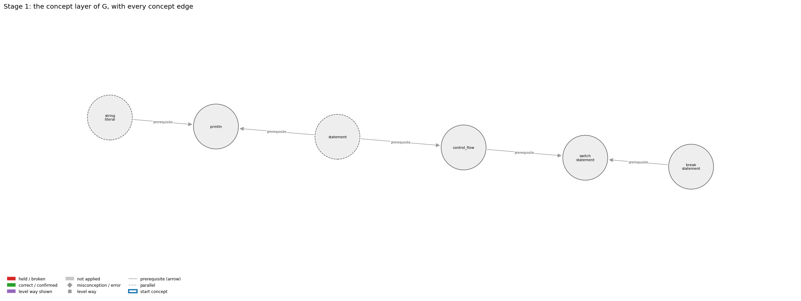
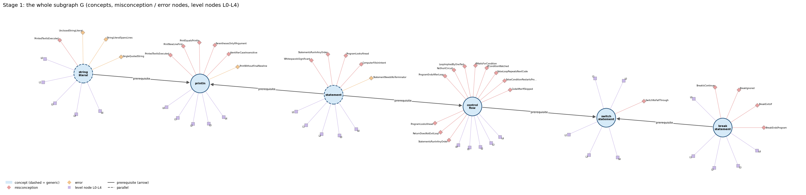
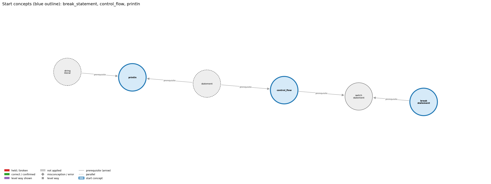
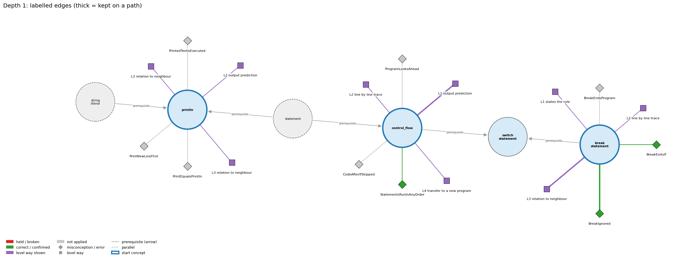
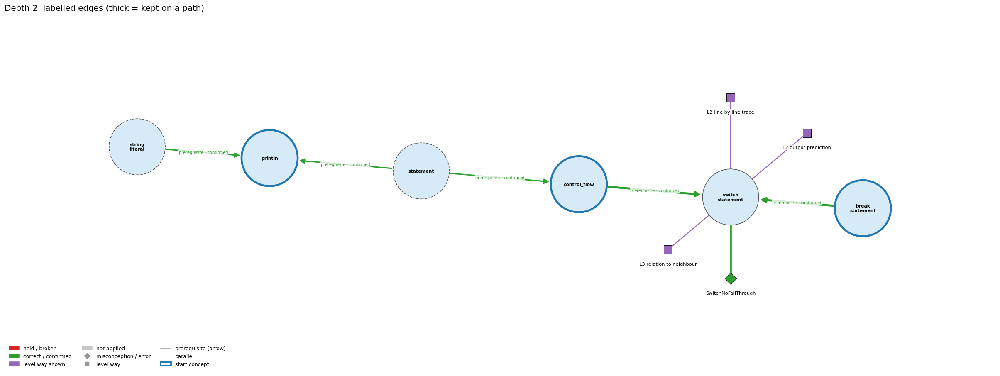
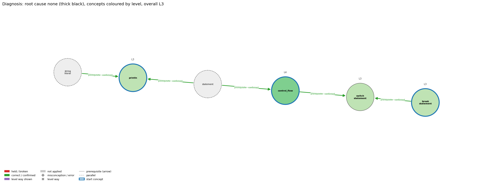

# Think on the Graph: every output of the run MY31

Files of this scenario: `input.json` (program, question, answer), `diagnosis.json`, `subgraph.json`, `traverse_log.txt`, `report.html` (this report as one full-page file, with the interactive graph `MY31_G.html`), `MY31.ipynb` (this report as a notebook).

## 0. Input
Program:
```java
int day = 2;
switch (day) {
    case 1: System.out.println("Mon");
    case 2: System.out.println("Tue");
    case 3: System.out.println("Wed");
            break;
    default: System.out.println("?");
}
```
Question: What is printed? Explain step by step what happens after case 2 matches.

Student's answer: Tue, then Wed. Case 2 has no break, so it carries on into case 3 and stops at the break there. Mon and ? are never reached.
Settings: width 3, depth 3, prune llm, backend claude-cli, model claude-opus-5-5
## 1. Stage 1: the subgraph G from the code (no model)
Masked code (string and char literals and comments blanked; this is what the patterns see):
```
int day = 2;
switch (day) {
    case 1: System.out.println("   ");
    case 2: System.out.println("   ");
    case 3: System.out.println("   ");
            break;
    default: System.out.println(" ");
}
```
Which code text tagged which concept (a generic concept fires on almost any Java line; it starts the walk only if the answer repeats its tag):
| concept | generic | channel | matched text | line |
|---|---|---|---|---|
| break_statement | False | pattern | 'break;' | 6 |
| control_flow | False | pattern | 'switch (' | 2 |
| control_flow | False | pattern | 'break;' | 6 |
| println | False | pattern | 'System.out.println(' | 3 |
| statement | True | pattern | ';' | 1 |
| string_literal | True | pattern | '"Mon"' | 3 |
| switch_statement | False | pattern | 'switch (' | 2 |
| switch_statement | False | pattern | 'case 1:' | 3 |
| switch_statement | False | pattern | 'default:' | 7 |
| switch_statement | False | signal | 'case 1: System.out.println("   ");\n    case' | 3 |

G: 6 concept nodes (2 generic), 5 concept edges, 31 misconception / error edges, 28 misconception / error nodes, 30 level nodes, 33 level-misconception links, 1 connected piece(s).

Concept edges of G (the links the walk can read; `pre:` = prerequisite A -> B, `par:` = parallel):
| edge | type | rule (logic) |
|---|---|---|
| pre:break_statement->switch_statement | prerequisite | Each case of a switch normally ends with break, which exits the switch body. |
| pre:control_flow->switch_statement | prerequisite | switch directs the flow of control to one of several case labels, depending on the value of one expression. |
| pre:statement->control_flow | prerequisite | Control flow is the order in which statements run. |
| pre:statement->println | prerequisite | System.out.println(s); is itself a statement, so its line of output appears at its own place in the sequence. |
| pre:string_literal->println | prerequisite | println("s") outputs exactly the characters between the quotes and then ends the line. |

Misconception / error edges per concept (count), and level ways per concept (count):
| concept | misconception / error edges | level ways (L1-L4 + L0 non-misconception) |
|---|---|---|
| break_statement | 4 | 19 |
| control_flow | 11 | 15 |
| println | 6 | 17 |
| statement | 5 | 19 |
| string_literal | 4 | 16 |
| switch_statement | 1 | 16 |

**Figure 1**


**Figure 2**


## 2. Clauses and start concepts (no model)
The answer split into clauses (at sentence ends, ';', and before 'because' / 'so'; quotes removed):
| clause | text |
|---|---|
| c1 | Tue, then Wed |
| c2 | Case 2 has no break |
| c3 | so it carries on into case 3 and stops at the break there |
| c4 | Mon and |
| c5 | are never reached |

start: BM25 of the answer against each tagged concept: break_statement 10.60 (hits 1), control_flow 9.15 (hits 2), println 8.19 (hits 1), switch_statement 6.52 (hits 4)

start: chosen break_statement, control_flow, println

start concepts (3): break_statement, control_flow, println

Start concepts: break_statement, control_flow, println

**Figure 3**


## 3. The walk, depth by depth
At each depth, for each current concept: the edges offered (a concept entering as a start concept offers its misconception / error edges and its level ways, as two families; otherwise it offers its concept edges), the prune prompt and the model's reply, then the label prompt(s) and the model's reply, parsed into label / clauses / confidence. Score = prune score x confidence.

### Depth 1: current concepts 'break_statement', 'control_flow', 'println'

#### break_statement, misconceptions: 4 edges offered
Edges offered:
| edge |
|---|
| mis:break_statement->BreakEndsProgram \| wrong rule: break ends the whole program. \| right rule: break ends only the innermost loop (or switch); execution continues after it. |
| mis:break_statement->BreakExitsIf \| wrong rule: break leaves the if statement it is written in. \| right rule: break immediately exits a loop without letting it run to completion, and in a switch it exits the switch body. |
| mis:break_statement->BreakIgnored \| wrong rule: break has no effect; the loop body just carries on. \| right rule: break leaves the innermost loop at once; the rest of the body and later passes do not run. |
| mis:break_statement->BreakIsContinue \| wrong rule: break starts the next iteration of the loop. \| right rule: break exits the loop immediately; continue skips to the next iteration of the loop. |

Prune: the model's reply (edge id and score; the kept edges sum to 1):
```
{mis:break_statement->BreakExitsIf (Score: 0.4)}
{mis:break_statement->BreakIgnored (Score: 0.4)}
{mis:break_statement->BreakEndsProgram (Score: 0.2)}
```
Kept by pruning: mis:break_statement->BreakExitsIf (0.40), mis:break_statement->BreakIgnored (0.40), mis:break_statement->BreakEndsProgram (0.20)

Label prompt for the misconception / error edges (judged together). The model saw the program, the question, the numbered clauses, and these edges with their wrong rule and right rule:
| edge |
|---|
| mis:break_statement->BreakExitsIf \| wrong rule: break leaves the if statement it is written in. \| right rule: break immediately exits a loop without letting it run to completion, and in a switch it exits the switch body. |
| mis:break_statement->BreakIgnored \| wrong rule: break has no effect; the loop body just carries on. \| right rule: break leaves the innermost loop at once; the rest of the body and later passes do not run. |
| mis:break_statement->BreakEndsProgram \| wrong rule: break ends the whole program. \| right rule: break ends only the innermost loop (or switch); execution continues after it. |
Model's reply:
```
mis:break_statement->BreakExitsIf | correct | clauses: 3, 5 | confidence: 0.6
mis:break_statement->BreakIgnored | correct | clauses: 1, 3, 5 | confidence: 0.9
mis:break_statement->BreakEndsProgram | not applied | clauses: none | confidence: 0.75
```

Parsed labels:
| edge | label | prune score | confidence | score | clauses | words |
|---|---|---|---|---|---|---|
| mis:break_statement->BreakExitsIf | correct | 0.4 | 0.6 | 0.24 | c3, c5 | so it carries on into case 3 and stops at the break there; are never reached |
| mis:break_statement->BreakIgnored | correct | 0.4 | 0.9 | 0.36 | c1, c3, c5 | Tue, then Wed; so it carries on into case 3 and stops at the break there; are never reached |
| mis:break_statement->BreakEndsProgram | not applied |  |  | 0.0 |  |  |

#### break_statement, level ways: 19 edges offered
Edges offered:
| edge |
|---|
| lvl:break_statement@L0#0 \| level L0 way everyday_reading: Folk meaning: in English 'break' means to pause, or to stop or break out of whatever you are in, so a novice reads it as leaving the enclosing if, as starting the next round, or as stopping the whole program. In Java, `break;` ends only the innermost enclosing loop or switch, and execution continues with the statement after it. |
| lvl:break_statement@L0#5 \| level L0 way inconsistent_trace: Applies the LT rule unevenly: on some passes the trace continues the body after break, or runs the increment and the test once more after break, so the final loop variable is one too large (e.g. i = 4 instead of 3 when 3 divides N). (here mixing in: "break leaves the if statement it is written in") |
| lvl:break_statement@L1#0 \| level L1 way names_the_element: Jump statement: `break;` immediately ends the innermost enclosing while, for, do or switch. |
| lvl:break_statement@L1#1 \| level L1 way states_the_rule: `break;` may appear only inside a loop or switch. When executed, it completes that innermost loop or switch at once, and control passes to the statement after it. (Spec: JLS §14.15.) |
| lvl:break_statement@L2#0 \| level L2 way line_by_line_trace: When `break` executes: the remaining statements of the body are skipped, the for-loop increment and the condition are not evaluated again, and control continues at the first statement after the loop. In `for (i = 2; i <= N/i; i++) if (N % i == 0) break;` it runs right after the test that found a divisor. |
| lvl:break_statement@L2#1 \| level L2 way output_prediction: break is a statement and produces no value. Its effect shows in the variables it leaves: after the primality loop for N = 15, i is 3 (the smallest divisor), so `i > N/i` is false and 'is prime' is not printed. |
| lvl:break_statement@L2#2 \| level L2 way one_step_execution: One execution of break changes no variable. It changes only the point of control (to after the loop), so every variable keeps its value at the moment of the break. |
| lvl:break_statement@L3#0 \| level L3 way relation_to_neighbour: break gives a while loop a second exit, in the middle of the body. After the loop, the program has to tell which exit was taken by re-testing the state (as in `if (i > N/i)`), so any variable used for that test must be declared before the loop. |
| lvl:break_statement@L3#1 \| level L3 way relation_to_neighbour: Plain break reaches only the innermost loop. In nested loops, ending the outer loop needs `break label;` on a labeled outer statement (or a flag tested by the outer loop). |
| lvl:break_statement@L3#2 \| level L3 way relation_to_neighbour: Both skip the rest of the current body. break then leaves the loop (no increment, no further test); continue goes on to the increment and the next test. |
| lvl:break_statement@L3#3 \| level L3 way relation_to_neighbour: In a switch, break ends the switch body; without it, execution falls through into the next case. A break inside a switch that is inside a loop exits only the switch, not the loop. |
| lvl:break_statement@L3#4 \| level L3 way relation_to_neighbour: Two ways to stop a search when the item is found: break leaves the loop at once, while a boolean flag is set and tested in the loop condition so the loop ends at its next test. After either, the code must tell the found case from the loop finishing normally. |
| lvl:break_statement@L3#5 \| level L3 way purpose_of_the_whole: Plan: early-exit search (Soloway 'loop-and-a-half' or exit-on-found). Stop scanning as soon as the answer is known, e.g. at the first divisor; the loop variable is a stepper whose value at exit reports the find. |
| lvl:break_statement@L4#0 \| level L4 way predict_a_change: Removing the break keeps the loop finite but lets it run to completion. In the prime test, i then ends above N/i for every N, so composites are reported as prime. Invariant kept with break: after the loop, `i <= N/i` holds exactly when the break was taken. |
| lvl:break_statement@L4#1 \| level L4 way transfer_to_a_new_program: Use break when the reason to stop is discovered in the middle of a pass (first divisor, sentinel found) and folding it into the loop condition would be awkward. Prefer a plain loop condition when the exit can be stated up front. In a method, `return` is often clearer. S&W use break rarely. |
| lvl:break_statement@L4#2 \| level L4 way diagnose_an_error: rule broken: break must be inside a loop or switch. Kind: compile-time. Trigger class: `break;` inside an if that is not inside any loop or switch (break outside switch or loop). |
| lvl:break_statement@L4#3 \| level L4 way diagnose_an_error: rule broken: Statements after break in the same block can never run. Kind: compile-time. Trigger class: Code written directly after `break;` in the same block (unreachable statement). |
| lvl:break_statement@L4#4 \| level L4 way diagnose_an_error: rule broken: break exits only the innermost loop or switch. Kind: silent logic error. Trigger class: A break in an inner loop (or in a switch inside a loop) that was meant to end the outer loop: the outer loop keeps going. |
| lvl:break_statement@L4#5 \| level L4 way diagnose_an_error: rule broken: A variable used after the loop to tell how it ended must be in scope. Kind: compile-time. Trigger class: Declaring the loop index in the for header (`for (int i = 2; ...)`) and then testing `i` after the loop (cannot find symbol). |

Prune: the model's reply (edge id and score; the kept edges sum to 1):
```
{lvl:break_statement@L3#3 (Score: 0.6)}
{lvl:break_statement@L2#0 (Score: 0.2)}
{lvl:break_statement@L1#1 (Score: 0.2)}
```
Kept by pruning: lvl:break_statement@L3#3 (0.60), lvl:break_statement@L2#0 (0.20), lvl:break_statement@L1#1 (0.20)

Label prompt for level way lvl:break_statement@L3#3 (the model saw only the concept, the way's name 'relation to neighbour' and its text; no level):
> In a switch, break ends the switch body; without it, execution falls through into the next case. A break inside a switch that is inside a loop exits only the switch, not the loop.

Model's reply:
```
Label: shown
Clauses: 2, 3
Confidence: 0.93
```

Label prompt for level way lvl:break_statement@L2#0 (the model saw only the concept, the way's name 'line by line trace' and its text; no level):
> When `break` executes: the remaining statements of the body are skipped, the for-loop increment and the condition are not evaluated again, and control continues at the first statement after the loop. In `for (i = 2; i <= N/i; i++) if (N % i == 0) break;` it runs right after the test that found a divisor.

Model's reply:
```
Label: shown
Clauses: 3, 5
Confidence: 0.7
```

Label prompt for level way lvl:break_statement@L1#1 (the model saw only the concept, the way's name 'states the rule' and its text; no level):
> `break;` may appear only inside a loop or switch. When executed, it completes that innermost loop or switch at once, and control passes to the statement after it. (Spec: JLS §14.15.)

Model's reply:
```
Label: shown
Clauses: 3, 5
Confidence: 0.8
```

Parsed labels:
| edge | label | prune score | confidence | score | clauses | words |
|---|---|---|---|---|---|---|
| lvl:break_statement@L3#3 | shown | 0.6 | 0.93 | 0.56 | c2, c3 | Case 2 has no break; so it carries on into case 3 and stops at the break there |
| lvl:break_statement@L2#0 | shown | 0.2 | 0.7 | 0.14 | c3, c5 | so it carries on into case 3 and stops at the break there; are never reached |
| lvl:break_statement@L1#1 | shown | 0.2 | 0.8 | 0.16 | c3, c5 | so it carries on into case 3 and stops at the break there; are never reached |

#### control_flow, misconceptions: 11 edges offered
Edges offered:
| edge |
|---|
| mis:control_flow->CodeAfterIfSkipped \| wrong rule: When the then branch runs, the code after the if is skipped. \| right rule: After the if finishes, execution continues with the next statement either way. |
| mis:control_flow->FalseConditionRestartsProgram \| wrong rule: When an if condition is false (and there is no else), control jumps back to the start of the program. \| right rule: A false condition skips the then branch and execution continues with the statement after the if statement. |
| mis:control_flow->FalseLoopRepeatsNextCode \| wrong rule: A loop is an iterative if-else: while the condition is true the body repeats, and when it is false the code after the loop repeats. \| right rule: Only the body is repeated; once the condition is false the code after the loop runs once. |
| mis:control_flow->IfConditionWatched \| wrong rule: An if statement watches its condition while the program runs and fires as soon as the condition becomes true (if = whenever). \| right rule: An if condition is tested once, when control reaches the if statement; later changes to the variables do not trigger the branch. |
| mis:control_flow->IfWaitsForCondition \| wrong rule: An IF statement earlier in the program stays active and fires later, e.g. inside a later loop, when its condition becomes true. \| right rule: An if is evaluated once when control reaches it; afterwards it is inactive unless control returns to it. |
| mis:control_flow->LoopImpliedByOneTest \| wrong rule: Testing one case is enough; Java will repeat the test for the other values by itself. \| right rule: A statement runs once each time control reaches it; repeating a test for many values needs a loop. |
| mis:control_flow->NoShortCircuit \| wrong rule: logical AND/OR always evaluate both sides (Java short-circuits them) \| right rule: In p && q, q is evaluated only when p is true; in p \|\| q, q is evaluated only when p is false. |
| mis:control_flow->ProgramEndsAfterLoop \| wrong rule: When a loop finishes the program ends, so code after the loop never runs. \| right rule: When the loop condition becomes false, control continues with the first statement after the loop. |
| mis:control_flow->ProgramLooksAhead \| wrong rule: The program knows or sees what later lines will do and acts on those goals at the current line, e.g. it stops 'at ten' because it wants to draw a box. \| right rule: Each statement executes using only the current state; later lines have no effect until control reaches them. |
| mis:control_flow->ReturnDoesNotExitLoop \| wrong rule: A return inside a loop does not end the loop; it sets a value each pass (the last one is returned) or returns several values. \| right rule: When return executes, the method ends at once, so the loop stops on that pass. |
| mis:control_flow->StatementsRunInAnyOrder \| wrong rule: Statements in a program can run in any order. \| right rule: Without control statements, statements run once each, top to bottom. |

Prune: the model's reply (edge id and score; the kept edges sum to 1):
```
mis:control_flow->StatementsRunInAnyOrder (0.45), mis:control_flow->ProgramLooksAhead (0.35), mis:control_flow->CodeAfterIfSkipped (0.20)
```
Kept by pruning: mis:control_flow->StatementsRunInAnyOrder (0.45), mis:control_flow->ProgramLooksAhead (0.35), mis:control_flow->CodeAfterIfSkipped (0.20)

Label prompt for the misconception / error edges (judged together). The model saw the program, the question, the numbered clauses, and these edges with their wrong rule and right rule:
| edge |
|---|
| mis:control_flow->StatementsRunInAnyOrder \| wrong rule: Statements in a program can run in any order. \| right rule: Without control statements, statements run once each, top to bottom. |
| mis:control_flow->ProgramLooksAhead \| wrong rule: The program knows or sees what later lines will do and acts on those goals at the current line, e.g. it stops 'at ten' because it wants to draw a box. \| right rule: Each statement executes using only the current state; later lines have no effect until control reaches them. |
| mis:control_flow->CodeAfterIfSkipped \| wrong rule: When the then branch runs, the code after the if is skipped. \| right rule: After the if finishes, execution continues with the next statement either way. |
Model's reply:
```
mis:control_flow->StatementsRunInAnyOrder | correct | clauses: 1, 3 | confidence: 0.75
mis:control_flow->ProgramLooksAhead | not applied | clauses: none | confidence: 0.8
mis:control_flow->CodeAfterIfSkipped | not applied | clauses: none | confidence: 0.9
```

Parsed labels:
| edge | label | prune score | confidence | score | clauses | words |
|---|---|---|---|---|---|---|
| mis:control_flow->StatementsRunInAnyOrder | correct | 0.45 | 0.75 | 0.34 | c1, c3 | Tue, then Wed; so it carries on into case 3 and stops at the break there |
| mis:control_flow->ProgramLooksAhead | not applied |  |  | 0.0 |  |  |
| mis:control_flow->CodeAfterIfSkipped | not applied |  |  | 0.0 |  |  |

#### control_flow, level ways: 15 edges offered
Edges offered:
| edge |
|---|
| lvl:control_flow@L0#0 \| level L0 way everyday_reading: Folk meaning: in everyday instructions a listener reads the whole list at once, does steps in a sensible order and infers what the writer wants. Java instead executes statements one at a time, top to bottom, each only when control reaches it, and nothing later in the program has any effect earlier. |
| lvl:control_flow@L0#3 \| level L0 way inconsistent_trace: Applies the sequencing rule (LT) unevenly: e.g. runs a later line before an earlier one, lets an if that was already passed fire again later, or ends the program when a loop or a false if ends instead of continuing with the next statement. (here mixing in: "Statements in a program can run in any order") |
| lvl:control_flow@L1#0 \| level L1 way names_the_element: Control flow is the order in which a program's statements are executed (statement sequencing); conditionals and loops are the statements that change it. |
| lvl:control_flow@L1#1 \| level L1 way states_the_rule: Without control statements every statement executes once, in the order given; a block executes its statements in order from first to last; if/if-else choose between one or two alternatives and loops repeat statements depending on a condition. |
| lvl:control_flow@L2#0 \| level L2 way line_by_line_trace: Execute the statement at the current point; when it completes normally, control passes to the next statement in the block. An if evaluates its condition once and then runs at most one branch; a loop evaluates its condition before each pass; after an if or a loop finishes, control continues with the statement after it. |
| lvl:control_flow@L2#1 \| level L2 way output_prediction: The output is the sequence of print statements that control actually reaches, in the order reached: e.g. TenHellos prints 1st, 2nd, 3rd Hello once each, then 4th to 10th Hello from the loop. |
| lvl:control_flow@L2#2 \| level L2 way one_step_execution: One step executes the single statement at the current control point using the current values, updates at most the variables it assigns, and moves the control point to the next statement (or, for an if/loop test, to the chosen branch, back to the test, or past the statement). |
| lvl:control_flow@L3#0 \| level L3 way relation_to_neighbour: Control flow is defined over statements: statements are executed for their effect, and if/while/for are themselves statements that may be used wherever a statement is allowed, so they can nest. |
| lvl:control_flow@L3#1 \| level L3 way relation_to_neighbour: An if changes the default top-to-bottom flow: its condition is tested once when control reaches it, its block runs only if true, and in both cases control then continues with the next statement. |
| lvl:control_flow@L3#2 \| level L3 way relation_to_neighbour: A flowchart draws control flow: each path through the diagram is a possible path of execution, with a decision box for each if or loop test. |
| lvl:control_flow@L3#3 \| level L3 way purpose_of_the_whole: Plan: control flow lets one program do different things for different inputs (selection) and do a thing many times (repetition), so a short program can specify a potentially unlimited number of executed statements. |
| lvl:control_flow@L4#0 \| level L4 way predict_a_change: Reordering two statements generally changes the result whenever one reads a variable that the other writes (e.g. swapping x = x + 1 and print(x)); reordering is safe only for statements that touch disjoint variables. Moving a statement into or out of a branch or loop body changes how many times it runs (0, 1 or n). |
| lvl:control_flow@L4#1 \| level L4 way transfer_to_a_new_program: Reason in terms of control flow whenever you must predict output or find why a statement did or did not run: trace which statement is reached next. Straight-line sequence suffices only when every input needs the same steps exactly once; otherwise add a conditional or a loop. |
| lvl:control_flow@L4#2 \| level L4 way diagnose_an_error: rule broken: A local variable must be definitely assigned on every control-flow path before it is read. Kind: compile-time. Trigger class: A variable assigned only inside an if branch (or only in a loop body) and read after it: the compiler reports 'variable might not have been initialized'. |
| lvl:control_flow@L4#3 \| level L4 way diagnose_an_error: rule broken: Statements run in the order written, so an update must come before the statement that needs the new value. Kind: silent logic error. Trigger class: Swapping two dependent statements (e.g. printing before updating, or incrementing the index before using it): output is shifted or off by one pass, with no error. |

Prune: the model's reply (edge id and score; the kept edges sum to 1):
```
{lvl:control_flow@L2#1 (Score: 0.4)}
{lvl:control_flow@L2#0 (Score: 0.35)}
{lvl:control_flow@L4#1 (Score: 0.25)}
```
Kept by pruning: lvl:control_flow@L2#1 (0.40), lvl:control_flow@L2#0 (0.35), lvl:control_flow@L4#1 (0.25)

Label prompt for level way lvl:control_flow@L2#1 (the model saw only the concept, the way's name 'output prediction' and its text; no level):
> The output is the sequence of print statements that control actually reaches, in the order reached: e.g. TenHellos prints 1st, 2nd, 3rd Hello once each, then 4th to 10th Hello from the loop.

Model's reply:
```
Label: shown
Clauses: 1, 3, 4, 5
Confidence: 0.9
```

Label prompt for level way lvl:control_flow@L2#0 (the model saw only the concept, the way's name 'line by line trace' and its text; no level):
> Execute the statement at the current point; when it completes normally, control passes to the next statement in the block. An if evaluates its condition once and then runs at most one branch; a loop evaluates its condition before each pass; after an if or a loop finishes, control continues with the statement after it.

Model's reply:
```
Label: shown
Clauses: 1, 2, 3
Confidence: 0.8
```

Label prompt for level way lvl:control_flow@L4#1 (the model saw only the concept, the way's name 'transfer to a new program' and its text; no level):
> Reason in terms of control flow whenever you must predict output or find why a statement did or did not run: trace which statement is reached next. Straight-line sequence suffices only when every input needs the same steps exactly once; otherwise add a conditional or a loop.

Model's reply:
```
Label: shown
Clauses: 1, 2, 3, 4, 5
Confidence: 0.85
```

Parsed labels:
| edge | label | prune score | confidence | score | clauses | words |
|---|---|---|---|---|---|---|
| lvl:control_flow@L2#1 | shown | 0.4 | 0.9 | 0.36 | c1, c3, c4, c5 | Tue, then Wed; so it carries on into case 3 and stops at the break there; Mon and; are never reached |
| lvl:control_flow@L2#0 | shown | 0.35 | 0.8 | 0.28 | c1, c2, c3 | Tue, then Wed; Case 2 has no break; so it carries on into case 3 and stops at the break there |
| lvl:control_flow@L4#1 | shown | 0.25 | 0.85 | 0.21 | c1, c2, c3, c4, c5 | Tue, then Wed; Case 2 has no break; so it carries on into case 3 and stops at the break there; Mon and; are never reached |

#### println, misconceptions: 6 edges offered
Edges offered:
| edge |
|---|
| err:println->PrintWithoutFinalNewline \| wrong rule: Ends the output with print and expects it to appear right away. \| right rule: Finish a line of print calls with println; some systems hold print output until a newline is printed. |
| mis:println->IdentifierCaseInsensitive \| wrong rule: System.out.Println and System.out.println name the same method. \| right rule: Java is case-sensitive: names of variables, methods and classes that differ only in capitalization are different names. |
| mis:println->ParenthesesOnlyIfArgument \| wrong rule: println with nothing to print can be written System.out.println; without the parentheses. \| right rule: A method call always needs parentheses, so an empty line is printed with System.out.println();. |
| mis:println->PrintEqualsPrintln \| wrong rule: print and println do the same thing, so print(s1); print(s2); puts s1 and s2 on separate lines. \| right rule: println ends the line after printing and print does not, so print(s1); print(s2); puts s1 and s2 on the same line. |
| mis:println->PrintNewLineFirst \| wrong rule: println(s) prints a newline and then s. \| right rule: println(s) prints s and then the newline. |
| mis:println->PrintedTextIsExecuted \| wrong rule: System.out.println("x is 5"); sets x to 5 (text inside the quotes is run as code). \| right rule: Characters inside double quotes are printed literally; println only displays them and changes no variable. Only an assignment such as x = 5; sets x. |

Prune: the model's reply (edge id and score; the kept edges sum to 1):
```
mis:println->PrintEqualsPrintln (0.50), mis:println->PrintedTextIsExecuted (0.30), mis:println->PrintNewLineFirst (0.20)
```
Kept by pruning: mis:println->PrintEqualsPrintln (0.50), mis:println->PrintedTextIsExecuted (0.30), mis:println->PrintNewLineFirst (0.20)

Label prompt for the misconception / error edges (judged together). The model saw the program, the question, the numbered clauses, and these edges with their wrong rule and right rule:
| edge |
|---|
| mis:println->PrintEqualsPrintln \| wrong rule: print and println do the same thing, so print(s1); print(s2); puts s1 and s2 on separate lines. \| right rule: println ends the line after printing and print does not, so print(s1); print(s2); puts s1 and s2 on the same line. |
| mis:println->PrintedTextIsExecuted \| wrong rule: System.out.println("x is 5"); sets x to 5 (text inside the quotes is run as code). \| right rule: Characters inside double quotes are printed literally; println only displays them and changes no variable. Only an assignment such as x = 5; sets x. |
| mis:println->PrintNewLineFirst \| wrong rule: println(s) prints a newline and then s. \| right rule: println(s) prints s and then the newline. |
Model's reply:
```
mis:println->PrintEqualsPrintln | not applied | clauses: none | confidence: 0.9
mis:println->PrintedTextIsExecuted | not applied | clauses: none | confidence: 0.9
mis:println->PrintNewLineFirst | not applied | clauses: none | confidence: 0.85
```

Parsed labels:
| edge | label | prune score | confidence | score | clauses | words |
|---|---|---|---|---|---|---|
| mis:println->PrintEqualsPrintln | not applied |  |  | 0.0 |  |  |
| mis:println->PrintedTextIsExecuted | not applied |  |  | 0.0 |  |  |
| mis:println->PrintNewLineFirst | not applied |  |  | 0.0 |  |  |

#### println, level ways: 17 edges offered
Edges offered:
| edge |
|---|
| lvl:println@L0#0 \| level L0 way everyday_reading: Everyday reading: 'println' is just 'print', and 'new line' is something you do before writing. Java rule: println(x) prints x and then ends the line; println() alone just ends the line. |
| lvl:println@L0#3 \| level L0 way inconsistent_trace: Applies the println rule (print, then end line) unevenly: puts the newline before the text on one call and after it on another, or forgets that the next output starts on a new line. (here mixing in: "print and println behave the same (no newline difference)") |
| lvl:println@L1#0 \| level L1 way names_the_element: System.out.println is a library method that prints its argument followed by a line terminator ('print line'). |
| lvl:println@L1#1 \| level L1 way states_the_rule: println(String x) behaves as though it calls print(x) and then println(); println() terminates the current line by writing the line separator string. |
| lvl:println@L2#0 \| level L2 way line_by_line_trace: Evaluate the argument, print its characters at the current position, then write the line separator so the cursor moves to the beginning of the next line. |
| lvl:println@L2#1 \| level L2 way output_prediction: Output is the value's characters followed by a line break: println("Hello, "); println("World!"); prints two lines. |
| lvl:println@L2#2 \| level L2 way one_step_execution: One call appends the text and a line separator to the output; the cursor ends at the start of the next line; no variable changes and nothing is returned. |
| lvl:println@L3#0 \| level L3 way relation_to_neighbour: System.out.println(s); is a statement, so its line of output appears at its own place in the sequence. |
| lvl:println@L3#1 \| level L3 way relation_to_neighbour: println("s") outputs exactly the characters between the quotes and then ends the line. |
| lvl:println@L3#2 \| level L3 way relation_to_neighbour: print leaves the cursor on the line; println ends it; several prints followed by one println make one line. |
| lvl:println@L3#3 \| level L3 way relation_to_neighbour: println prints numbers with all their digits and always ends the line; printf formats each value by its conversion code and ends the line only where the format has %n or \n. |
| lvl:println@L3#4 \| level L3 way purpose_of_the_whole: Purpose: produce one complete line of output, e.g. each result on its own line, or end a line built with print. |
| lvl:println@L4#0 \| level L4 way predict_a_change: Replacing println with print joins the next output onto the same line (a typical logic error); the characters printed stay the same. |
| lvl:println@L4#1 \| level L4 way transfer_to_a_new_program: Use println when each output item belongs on its own line or to end a line; use print to continue a line and printf to control number formatting. |
| lvl:println@L4#2 \| level L4 way diagnose_an_error: rule broken: Finish a line of print calls with println. Kind: silent logic error. Trigger class: output ends with print, so the last line may not be shown or runs into the shell prompt |
| lvl:println@L4#3 \| level L4 way diagnose_an_error: rule broken: Method names are case-sensitive. Kind: compile-time. Trigger class: System.out.Println or system.out.println: cannot find symbol |
| lvl:println@L4#4 \| level L4 way diagnose_an_error: rule broken: Calls need parentheses. Kind: compile-time. Trigger class: System.out.println; without () |

Prune: the model's reply (edge id and score; the kept edges sum to 1):
```
{lvl:println@L2#1 (Score: 0.4)}
{lvl:println@L3#0 (Score: 0.35)}
{lvl:println@L3#1 (Score: 0.25)}
```
Kept by pruning: lvl:println@L2#1 (0.40), lvl:println@L3#0 (0.35), lvl:println@L3#1 (0.25)

Label prompt for level way lvl:println@L2#1 (the model saw only the concept, the way's name 'output prediction' and its text; no level):
> Output is the value's characters followed by a line break: println("Hello, "); println("World!"); prints two lines.

Model's reply:
```
Label: shown
Clauses: 1
Confidence: 0.6
```

Label prompt for level way lvl:println@L3#0 (the model saw only the concept, the way's name 'relation to neighbour' and its text; no level):
> System.out.println(s); is a statement, so its line of output appears at its own place in the sequence.

Model's reply:
```
Label: shown
Clauses: 1
Confidence: 0.7
```

Label prompt for level way lvl:println@L3#1 (the model saw only the concept, the way's name 'relation to neighbour' and its text; no level):
> println("s") outputs exactly the characters between the quotes and then ends the line.

Model's reply:
```
Label: shown
Clauses: 1
Confidence: 0.55
```

Parsed labels:
| edge | label | prune score | confidence | score | clauses | words |
|---|---|---|---|---|---|---|
| lvl:println@L2#1 | shown | 0.4 | 0.6 | 0.24 | c1 | Tue, then Wed |
| lvl:println@L3#0 | shown | 0.35 | 0.7 | 0.24 | c1 | Tue, then Wed |
| lvl:println@L3#1 | shown | 0.25 | 0.55 | 0.14 | c1 | Tue, then Wed |

**Kept on a path at this depth** (best N in tiers: held misconception / broken edge, then held error, then correct / confirmed / shown):

lvl:break_statement@L3#3 [shown, tier 2, 0.56], mis:break_statement->BreakIgnored [correct, tier 2, 0.36], lvl:control_flow@L2#1 [shown, tier 2, 0.36]

**Clause coverage after this depth:**
| clause | text | covered by |
|---|---|---|
| c1 | Tue, then Wed | mis:break_statement->BreakIgnored |
| c2 | Case 2 has no break | not covered yet |
| c3 | so it carries on into case 3 and stops at the break there | mis:break_statement->BreakExitsIf |
| c4 | Mon and | not covered yet |
| c5 | are never reached | mis:break_statement->BreakExitsIf |

**Uncovered clauses bring in (BM25 of the uncovered clauses against unvisited concepts):** switch_statement (0.96)

**Graph check, not yet read (the walk may not stop while these remain):** own edges of switch_statement, pre:break_statement->switch_statement, pre:control_flow->switch_statement, pre:statement->control_flow, pre:statement->println, pre:string_literal->println

**Figure 4 (the graph after depth 1)**


### Depth 2: current concepts 'break_statement', 'control_flow', 'println', 'switch_statement'

#### break_statement, concept edges: 1 edges offered
Edges offered:
| edge |
|---|
| pre:break_statement->switch_statement \| rule: Each case of a switch normally ends with break, which exits the switch body. |

Prune: the model's reply (edge id and score; the kept edges sum to 1):
```
{pre:break_statement->switch_statement (Score: 1.0)}
```
Kept by pruning: pre:break_statement->switch_statement (1.00)

Label prompt for concept edge pre:break_statement->switch_statement (break_statement -> switch_statement, prerequisite):
> Each case of a switch normally ends with break, which exits the switch body.

Model's reply:
```
Label: confirmed
Clauses: 2, 3
Confidence: 0.9
```

Parsed labels:
| edge | label | prune score | confidence | score | clauses | words |
|---|---|---|---|---|---|---|
| pre:break_statement->switch_statement | confirmed | 1.0 | 0.9 | 0.9 | c2, c3 | Case 2 has no break; so it carries on into case 3 and stops at the break there |

#### control_flow, concept edges: 2 edges offered
Edges offered:
| edge |
|---|
| pre:control_flow->switch_statement \| rule: switch directs the flow of control to one of several case labels, depending on the value of one expression. |
| pre:statement->control_flow \| rule: Control flow is the order in which statements run. |

Prune: the model's reply (edge id and score; the kept edges sum to 1):
```
{pre:control_flow->switch_statement (Score: 0.7)}
{pre:statement->control_flow (Score: 0.3)}
```
Kept by pruning: pre:control_flow->switch_statement (0.70), pre:statement->control_flow (0.30)

Label prompt for concept edge pre:control_flow->switch_statement (control_flow -> switch_statement, prerequisite):
> switch directs the flow of control to one of several case labels, depending on the value of one expression.

Model's reply:
```
Label: confirmed
Clauses: 1, 4, 5
Confidence: 0.85
```

Label prompt for concept edge pre:statement->control_flow (statement -> control_flow, prerequisite):
> Control flow is the order in which statements run.

Model's reply:
```
Label: confirmed
Clauses: 1, 3, 4, 5
Confidence: 0.8
```

Parsed labels:
| edge | label | prune score | confidence | score | clauses | words |
|---|---|---|---|---|---|---|
| pre:control_flow->switch_statement | confirmed | 0.7 | 0.85 | 0.59 | c1, c4, c5 | Tue, then Wed; Mon and; are never reached |
| pre:statement->control_flow | confirmed | 0.3 | 0.8 | 0.24 | c1, c3, c4, c5 | Tue, then Wed; so it carries on into case 3 and stops at the break there; Mon and; are never reached |

#### println, concept edges: 2 edges offered
Edges offered:
| edge |
|---|
| pre:statement->println \| rule: System.out.println(s); is itself a statement, so its line of output appears at its own place in the sequence. |
| pre:string_literal->println \| rule: println("s") outputs exactly the characters between the quotes and then ends the line. |

Prune: the model's reply (edge id and score; the kept edges sum to 1):
```
{pre:statement->println (Score: 0.6)}
{pre:string_literal->println (Score: 0.4)}
```
Kept by pruning: pre:statement->println (0.60), pre:string_literal->println (0.40)

Label prompt for concept edge pre:statement->println (statement -> println, prerequisite):
> System.out.println(s); is itself a statement, so its line of output appears at its own place in the sequence.

Model's reply:
```
Label: confirmed
Clauses: 1, 3
Confidence: 0.7
```

Label prompt for concept edge pre:string_literal->println (string_literal -> println, prerequisite):
> println("s") outputs exactly the characters between the quotes and then ends the line.

Model's reply:
```
Label: confirmed
Clauses: 1
Confidence: 0.6
```

Parsed labels:
| edge | label | prune score | confidence | score | clauses | words |
|---|---|---|---|---|---|---|
| pre:statement->println | confirmed | 0.6 | 0.7 | 0.42 | c1, c3 | Tue, then Wed; so it carries on into case 3 and stops at the break there |
| pre:string_literal->println | confirmed | 0.4 | 0.6 | 0.24 | c1 | Tue, then Wed |

#### switch_statement, misconceptions: 1 edges offered
Edges offered:
| edge |
|---|
| mis:switch_statement->SwitchNoFallThrough \| wrong rule: After the matching case runs, the switch ends even without break. \| right rule: Without break, statements in switch blocks fall through into the following cases. |

Prune: the model's reply (edge id and score; the kept edges sum to 1):
```
{mis:switch_statement->SwitchNoFallThrough (Score: 1.0)}
```
Kept by pruning: mis:switch_statement->SwitchNoFallThrough (1.00)

Label prompt for the misconception / error edges (judged together). The model saw the program, the question, the numbered clauses, and these edges with their wrong rule and right rule:
| edge |
|---|
| mis:switch_statement->SwitchNoFallThrough \| wrong rule: After the matching case runs, the switch ends even without break. \| right rule: Without break, statements in switch blocks fall through into the following cases. |
Model's reply:
```
mis:switch_statement->SwitchNoFallThrough | correct | clauses: 1, 2, 3 | confidence: 0.95
```

Parsed labels:
| edge | label | prune score | confidence | score | clauses | words |
|---|---|---|---|---|---|---|
| mis:switch_statement->SwitchNoFallThrough | correct | 1.0 | 0.95 | 0.95 | c1, c2, c3 | Tue, then Wed; Case 2 has no break; so it carries on into case 3 and stops at the break there |

#### switch_statement, level ways: 16 edges offered
Edges offered:
| edge |
|---|
| lvl:switch_statement@L0#0 \| level L0 way everyday_reading: Folk meaning: everyday 'switch' means flip to one setting, and 'case' reads like 'in case of X do Y', a self-contained rule. Novices therefore expect only the matching case to run. In a Java switch statement, the case labels are only entry points: execution starts at the matching label and falls through the following cases until a break. |
| lvl:switch_statement@L0#2 \| level L0 way inconsistent_trace: Applies the LT rule unevenly: on a trace the selector is matched correctly but execution stops at the next case label on some runs and falls through on others, or default is run even though a case matched. (here mixing in: "After the matching case runs, the switch ends even without break") |
| lvl:switch_statement@L1#0 \| level L1 way names_the_element: Selection statement: `switch (expr) { case v1: ...; break; ... default: ... }` chooses among many alternatives by the value of one expression. |
| lvl:switch_statement@L1#1 \| level L1 way states_the_rule: The selector is an int-like (char, byte, short, int), String or enum expression. Case labels are distinct constants of that type, and default is optional. Control jumps to the matching label (or to default, or past the switch), and the case statements usually end with break. Without a break, execution falls through into the statements of the next case; default runs when no case matches. |
| lvl:switch_statement@L2#0 \| level L2 way line_by_line_trace: Order: evaluate the selector once; compare it with the case constants; jump to the matching label (else default, else skip the switch). Then execute the statements from there in order, through later labels, until a break or the closing brace. |
| lvl:switch_statement@L2#1 \| level L2 way output_prediction: A switch statement has no value. Its result is the effect of the case(s) run: with `day = 3`, the S&W day switch prints Wed. Without breaks, day = 5 would print Fri, then Sat. |
| lvl:switch_statement@L2#2 \| level L2 way one_step_execution: One execution evaluates the selector once (any side effect in it happens once) and runs the statements of one entry point and any cases it falls into. It changes only what those statements change. |
| lvl:switch_statement@L3#0 \| level L3 way relation_to_neighbour: A switch replaces an if-else chain only when every test is `expr == constant` on the same expression. Range tests such as the income-bracket chain (`income < 47450`) must stay an if-else chain. |
| lvl:switch_statement@L3#1 \| level L3 way relation_to_neighbour: Each case is normally ended by break, which exits the switch body. Leaving it out makes that case fall into the next. Inside a loop, that break exits the switch, not the loop. |
| lvl:switch_statement@L3#2 \| level L3 way purpose_of_the_whole: Plan: multiway dispatch or lookup. It maps one discrete value (day number, menu choice, character) to one of several actions or results. Grouped labels (`case "apple": case "banana":`) map several values to one action. |
| lvl:switch_statement@L4#0 \| level L4 way predict_a_change: When every case ends with break, reordering the cases does not change behaviour (labels are distinct constants). Removing one break changes behaviour for that value only. Adding a default changes only values with no matching label. |
| lvl:switch_statement@L4#1 \| level L4 way transfer_to_a_new_program: Use switch for more than two mutually exclusive alternatives decided by equality of one int, char, String or enum value. Use an if-else chain for ranges, doubles or unrelated conditions. Use an array lookup (S&W 1.4) when each case only selects a value. |
| lvl:switch_statement@L4#2 \| level L4 way diagnose_an_error: rule broken: Without break, execution falls through into the following cases. Kind: silent logic error. Trigger class: Any selector value whose case lacks a break: the following cases' statements also run (e.g. both Fri and Sat printed). |
| lvl:switch_statement@L4#3 \| level L4 way diagnose_an_error: rule broken: Values that match no case do nothing unless a default is present. Kind: silent logic error. Trigger class: An out-of-range selector (day = 7) with no default: nothing happens, and a variable assigned only in the cases may stay unassigned. |
| lvl:switch_statement@L4#4 \| level L4 way diagnose_an_error: rule broken: Case labels must be distinct compile-time constants of the selector type, and the selector may not be double, float, long or boolean. Kind: compile-time. Trigger class: Duplicate `case 1:` labels, a variable as a label, or `switch (x)` with x a double. |
| lvl:switch_statement@L4#5 \| level L4 way diagnose_an_error: rule broken: A String selector is dereferenced. Kind: run-time exception. Trigger class: Switching on a String variable that is null throws NullPointerException. |

Prune: the model's reply (edge id and score; the kept edges sum to 1):
```
{lvl:switch_statement@L2#0 (Score: 0.45)}
{lvl:switch_statement@L3#1 (Score: 0.3)}
{lvl:switch_statement@L2#1 (Score: 0.25)}
```
Kept by pruning: lvl:switch_statement@L2#0 (0.45), lvl:switch_statement@L3#1 (0.30), lvl:switch_statement@L2#1 (0.25)

Label prompt for level way lvl:switch_statement@L2#0 (the model saw only the concept, the way's name 'line by line trace' and its text; no level):
> Order: evaluate the selector once; compare it with the case constants; jump to the matching label (else default, else skip the switch). Then execute the statements from there in order, through later labels, until a break or the closing brace.

Model's reply:
```
Label: shown
Clauses: 1, 2, 3, 4, 5
Confidence: 0.85
```

Label prompt for level way lvl:switch_statement@L3#1 (the model saw only the concept, the way's name 'relation to neighbour' and its text; no level):
> Each case is normally ended by break, which exits the switch body. Leaving it out makes that case fall into the next. Inside a loop, that break exits the switch, not the loop.

Model's reply:
```
Label: shown
Clauses: 2, 3
Confidence: 0.92
```

Label prompt for level way lvl:switch_statement@L2#1 (the model saw only the concept, the way's name 'output prediction' and its text; no level):
> A switch statement has no value. Its result is the effect of the case(s) run: with `day = 3`, the S&W day switch prints Wed. Without breaks, day = 5 would print Fri, then Sat.

Model's reply:
```
Label: shown
Clauses: 1, 3
Confidence: 0.9
```

Parsed labels:
| edge | label | prune score | confidence | score | clauses | words |
|---|---|---|---|---|---|---|
| lvl:switch_statement@L2#0 | shown | 0.45 | 0.85 | 0.38 | c1, c2, c3, c4, c5 | Tue, then Wed; Case 2 has no break; so it carries on into case 3 and stops at the break there; Mon and; are never reached |
| lvl:switch_statement@L3#1 | shown | 0.3 | 0.92 | 0.28 | c2, c3 | Case 2 has no break; so it carries on into case 3 and stops at the break there |
| lvl:switch_statement@L2#1 | shown | 0.25 | 0.9 | 0.23 | c1, c3 | Tue, then Wed; so it carries on into case 3 and stops at the break there |

**Kept on a path at this depth** (best N in tiers: held misconception / broken edge, then held error, then correct / confirmed / shown):

mis:switch_statement->SwitchNoFallThrough [correct, tier 2, 0.95], pre:break_statement->switch_statement [confirmed, tier 2, 0.90], pre:control_flow->switch_statement [confirmed, tier 2, 0.59]

**Clause coverage after this depth:**
| clause | text | covered by |
|---|---|---|
| c1 | Tue, then Wed | mis:break_statement->BreakIgnored |
| c2 | Case 2 has no break | pre:break_statement->switch_statement |
| c3 | so it carries on into case 3 and stops at the break there | mis:break_statement->BreakExitsIf |
| c4 | Mon and | pre:control_flow->switch_statement |
| c5 | are never reached | mis:break_statement->BreakExitsIf |

**Figure 5 (the graph after depth 2)**


## 4. Diagnosis (rules over the labelled graph, no model)
Root-cause walk: held on [], broken at [], prerequisites {'switch_statement': ['break_statement', 'control_flow'], 'control_flow': ['statement'], 'println': ['statement', 'string_literal']}
- break_statement: L3 via relation_to_neighbour "Case 2 has no break; so it carries on into case 3 and stops at the break there"
- control_flow: L4 via transfer_to_a_new_program "Tue, then Wed; Case 2 has no break; so it carries on into case 3 and stops at the break there; Mon and; are never reached"
- println: L3 via relation_to_neighbour "Tue, then Wed"
- switch_statement: L3 via relation_to_neighbour "Case 2 has no break; so it carries on into case 3 and stops at the break there"

**Stop:** sufficient at depth 2; prompts {'prune': 11, 'label': 21}, fresh model calls 0, cache hits 32

### Held misconceptions
(none)

### Broken concept edges
(none)

### Root cause: none

### Level per concept
| concept | level | way | misconception | source | quote | rule | also | note |
|---|---|---|---|---|---|---|---|---|
| break_statement | L3 | relation_to_neighbour |  | level_way | Case 2 has no break; so it carries on into case 3 and stops at the break there |  | L2 line_by_line_trace, L1 states_the_rule |  |
| control_flow | L4 | transfer_to_a_new_program |  | level_way | Tue, then Wed; Case 2 has no break; so it carries on into case 3 and stops at the break there; Mon and; are never reached |  | L2 output_prediction, L2 line_by_line_trace |  |
| println | L3 | relation_to_neighbour |  | level_way | Tue, then Wed |  | L3 relation_to_neighbour, L2 output_prediction |  |
| switch_statement | L3 | relation_to_neighbour |  | level_way | Case 2 has no break; so it carries on into case 3 and stops at the break there |  | L2 line_by_line_trace, L2 output_prediction |  |

### Overall level: L3

Clause coverage (final):
| clause | covered by |
|---|---|
| Tue, then Wed | mis:break_statement->BreakIgnored |
| Case 2 has no break | lvl:break_statement@L3#3 |
| so it carries on into case 3 and stops at the break there | mis:break_statement->BreakExitsIf |
| Mon and | lvl:control_flow@L2#1 |
| are never reached | mis:break_statement->BreakExitsIf |

**Figure 6 (final picture)**


## 5. Every labelled edge (the evidence list, kept or not)
| depth | source | edge | kind | label | prune_score | confidence | score | clauses | quote |
|---|---|---|---|---|---|---|---|---|---|
| 1 | break_statement | mis:break_statement->BreakExitsIf | misconception | correct | 0.4 | 0.6 | 0.24 | [3, 5] | so it carries on into case 3 and stops at the break there; are never reached |
| 1 | break_statement | mis:break_statement->BreakIgnored | misconception | correct | 0.4 | 0.9 | 0.36 | [1, 3, 5] | Tue, then Wed; so it carries on into case 3 and stops at the break there; are never reached |
| 1 | break_statement | lvl:break_statement@L3#3 | level | shown | 0.6 | 0.93 | 0.558 | [2, 3] | Case 2 has no break; so it carries on into case 3 and stops at the break there |
| 1 | break_statement | lvl:break_statement@L2#0 | level | shown | 0.2 | 0.7 | 0.14 | [3, 5] | so it carries on into case 3 and stops at the break there; are never reached |
| 1 | break_statement | lvl:break_statement@L1#1 | level | shown | 0.2 | 0.8 | 0.16 | [3, 5] | so it carries on into case 3 and stops at the break there; are never reached |
| 1 | control_flow | mis:control_flow->StatementsRunInAnyOrder | misconception | correct | 0.45 | 0.75 | 0.3375 | [1, 3] | Tue, then Wed; so it carries on into case 3 and stops at the break there |
| 1 | control_flow | lvl:control_flow@L2#1 | level | shown | 0.4 | 0.9 | 0.36 | [1, 3, 4, 5] | Tue, then Wed; so it carries on into case 3 and stops at the break there; Mon and; are never reached |
| 1 | control_flow | lvl:control_flow@L2#0 | level | shown | 0.35 | 0.8 | 0.28 | [1, 2, 3] | Tue, then Wed; Case 2 has no break; so it carries on into case 3 and stops at the break there |
| 1 | control_flow | lvl:control_flow@L4#1 | level | shown | 0.25 | 0.85 | 0.2125 | [1, 2, 3, 4, 5] | Tue, then Wed; Case 2 has no break; so it carries on into case 3 and stops at the break there; Mon and; are never reached |
| 1 | println | lvl:println@L2#1 | level | shown | 0.4 | 0.6 | 0.24 | [1] | Tue, then Wed |
| 1 | println | lvl:println@L3#0 | level | shown | 0.35 | 0.7 | 0.245 | [1] | Tue, then Wed |
| 1 | println | lvl:println@L3#1 | level | shown | 0.25 | 0.55 | 0.1375 | [1] | Tue, then Wed |
| 2 | break_statement | pre:break_statement->switch_statement | prerequisite | confirmed | 1.0 | 0.9 | 0.9 | [2, 3] | Case 2 has no break; so it carries on into case 3 and stops at the break there |
| 2 | control_flow | pre:control_flow->switch_statement | prerequisite | confirmed | 0.7 | 0.85 | 0.595 | [1, 4, 5] | Tue, then Wed; Mon and; are never reached |
| 2 | control_flow | pre:statement->control_flow | prerequisite | confirmed | 0.3 | 0.8 | 0.24 | [1, 3, 4, 5] | Tue, then Wed; so it carries on into case 3 and stops at the break there; Mon and; are never reached |
| 2 | println | pre:statement->println | prerequisite | confirmed | 0.6 | 0.7 | 0.42 | [1, 3] | Tue, then Wed; so it carries on into case 3 and stops at the break there |
| 2 | println | pre:string_literal->println | prerequisite | confirmed | 0.4 | 0.6 | 0.24 | [1] | Tue, then Wed |
| 2 | switch_statement | mis:switch_statement->SwitchNoFallThrough | misconception | correct | 1.0 | 0.95 | 0.95 | [1, 2, 3] | Tue, then Wed; Case 2 has no break; so it carries on into case 3 and stops at the break there |
| 2 | switch_statement | lvl:switch_statement@L2#0 | level | shown | 0.45 | 0.85 | 0.3825 | [1, 2, 3, 4, 5] | Tue, then Wed; Case 2 has no break; so it carries on into case 3 and stops at the break there; Mon and; are never reached |
| 2 | switch_statement | lvl:switch_statement@L3#1 | level | shown | 0.3 | 0.92 | 0.276 | [2, 3] | Case 2 has no break; so it carries on into case 3 and stops at the break there |
| 2 | switch_statement | lvl:switch_statement@L2#1 | level | shown | 0.25 | 0.9 | 0.225 | [1, 3] | Tue, then Wed; so it carries on into case 3 and stops at the break there |

## 6. The paths (what the keep step kept, depth by depth)
| depth | source | edge | kind | label | score | clauses |
|---|---|---|---|---|---|---|
| 1 | break_statement | lvl:break_statement@L3#3 | level | shown | 0.558 | [2, 3] |
| 1 | break_statement | mis:break_statement->BreakIgnored | misconception | correct | 0.36 | [1, 3, 5] |
| 1 | control_flow | lvl:control_flow@L2#1 | level | shown | 0.36 | [1, 3, 4, 5] |
| 2 | switch_statement | mis:switch_statement->SwitchNoFallThrough | misconception | correct | 0.95 | [1, 2, 3] |
| 2 | break_statement | pre:break_statement->switch_statement | prerequisite | confirmed | 0.9 | [2, 3] |
| 2 | control_flow | pre:control_flow->switch_statement | prerequisite | confirmed | 0.595 | [1, 4, 5] |

## 7. Raw traversal log
```
clauses: Tue, then Wed | Case 2 has no break | so it carries on into case 3 and stops at the break there | Mon and | are never reached
start: BM25 of the answer against each tagged concept: break_statement 10.60 (hits 1), control_flow 9.15 (hits 2), println 8.19 (hits 1), switch_statement 6.52 (hits 4)
start: chosen break_statement, control_flow, println
start concepts (3): break_statement, control_flow, println
--- depth 1: current concepts ['break_statement', 'control_flow', 'println']
  break_statement (misconceptions): 4 candidates -> kept mis:break_statement->BreakExitsIf (0.40), mis:break_statement->BreakIgnored (0.40), mis:break_statement->BreakEndsProgram (0.20)
    mis:break_statement->BreakExitsIf -> correct (0.24) "so it carries on into case 3 and stops at the break there; are never reached"
    mis:break_statement->BreakIgnored -> correct (0.36) "Tue, then Wed; so it carries on into case 3 and stops at the break there; are never reached"
    mis:break_statement->BreakEndsProgram -> not applied (0.00) ""
  break_statement (level ways): 19 candidates -> kept lvl:break_statement@L3#3 (0.60), lvl:break_statement@L2#0 (0.20), lvl:break_statement@L1#1 (0.20)
    lvl:break_statement@L3#3 -> shown (0.56) "Case 2 has no break; so it carries on into case 3 and stops at the break there"
    lvl:break_statement@L2#0 -> shown (0.14) "so it carries on into case 3 and stops at the break there; are never reached"
    lvl:break_statement@L1#1 -> shown (0.16) "so it carries on into case 3 and stops at the break there; are never reached"
  control_flow (misconceptions): 11 candidates -> kept mis:control_flow->StatementsRunInAnyOrder (0.45), mis:control_flow->ProgramLooksAhead (0.35), mis:control_flow->CodeAfterIfSkipped (0.20)
    mis:control_flow->StatementsRunInAnyOrder -> correct (0.34) "Tue, then Wed; so it carries on into case 3 and stops at the break there"
    mis:control_flow->ProgramLooksAhead -> not applied (0.00) ""
    mis:control_flow->CodeAfterIfSkipped -> not applied (0.00) ""
  control_flow (level ways): 15 candidates -> kept lvl:control_flow@L2#1 (0.40), lvl:control_flow@L2#0 (0.35), lvl:control_flow@L4#1 (0.25)
    lvl:control_flow@L2#1 -> shown (0.36) "Tue, then Wed; so it carries on into case 3 and stops at the break there; Mon and; are never reached"
    lvl:control_flow@L2#0 -> shown (0.28) "Tue, then Wed; Case 2 has no break; so it carries on into case 3 and stops at the break there"
    lvl:control_flow@L4#1 -> shown (0.21) "Tue, then Wed; Case 2 has no break; so it carries on into case 3 and stops at the break there; Mon and; are never reached"
  println (misconceptions): 6 candidates -> kept mis:println->PrintEqualsPrintln (0.50), mis:println->PrintedTextIsExecuted (0.30), mis:println->PrintNewLineFirst (0.20)
    mis:println->PrintEqualsPrintln -> not applied (0.00) ""
    mis:println->PrintedTextIsExecuted -> not applied (0.00) ""
    mis:println->PrintNewLineFirst -> not applied (0.00) ""
  println (level ways): 17 candidates -> kept lvl:println@L2#1 (0.40), lvl:println@L3#0 (0.35), lvl:println@L3#1 (0.25)
    lvl:println@L2#1 -> shown (0.24) "Tue, then Wed"
    lvl:println@L3#0 -> shown (0.24) "Tue, then Wed"
    lvl:println@L3#1 -> shown (0.14) "Tue, then Wed"
  kept: lvl:break_statement@L3#3 [shown, tier 2, 0.56], mis:break_statement->BreakIgnored [correct, tier 2, 0.36], lvl:control_flow@L2#1 [shown, tier 2, 0.36]
  clause coverage: c1 <- mis:break_statement->BreakIgnored; c2 uncovered; c3 <- mis:break_statement->BreakExitsIf; c4 uncovered; c5 <- mis:break_statement->BreakExitsIf
  uncovered clauses bring in: switch_statement (0.96)
  not yet read: own edges of switch_statement, pre:break_statement->switch_statement, pre:control_flow->switch_statement, pre:statement->control_flow, pre:statement->println, pre:string_literal->println
--- depth 2: current concepts ['break_statement', 'control_flow', 'println', 'switch_statement']
  break_statement (concept edges): 1 candidates -> kept pre:break_statement->switch_statement (1.00)
    pre:break_statement->switch_statement -> confirmed (0.90) "Case 2 has no break; so it carries on into case 3 and stops at the break there"
  control_flow (concept edges): 2 candidates -> kept pre:control_flow->switch_statement (0.70), pre:statement->control_flow (0.30)
    pre:control_flow->switch_statement -> confirmed (0.59) "Tue, then Wed; Mon and; are never reached"
    pre:statement->control_flow -> confirmed (0.24) "Tue, then Wed; so it carries on into case 3 and stops at the break there; Mon and; are never reached"
  println (concept edges): 2 candidates -> kept pre:statement->println (0.60), pre:string_literal->println (0.40)
    pre:statement->println -> confirmed (0.42) "Tue, then Wed; so it carries on into case 3 and stops at the break there"
    pre:string_literal->println -> confirmed (0.24) "Tue, then Wed"
  switch_statement (misconceptions): 1 candidates -> kept mis:switch_statement->SwitchNoFallThrough (1.00)
    mis:switch_statement->SwitchNoFallThrough -> correct (0.95) "Tue, then Wed; Case 2 has no break; so it carries on into case 3 and stops at the break there"
  switch_statement (level ways): 16 candidates -> kept lvl:switch_statement@L2#0 (0.45), lvl:switch_statement@L3#1 (0.30), lvl:switch_statement@L2#1 (0.25)
    lvl:switch_statement@L2#0 -> shown (0.38) "Tue, then Wed; Case 2 has no break; so it carries on into case 3 and stops at the break there; Mon and; are never reached"
    lvl:switch_statement@L3#1 -> shown (0.28) "Case 2 has no break; so it carries on into case 3 and stops at the break there"
    lvl:switch_statement@L2#1 -> shown (0.23) "Tue, then Wed; so it carries on into case 3 and stops at the break there"
  kept: mis:switch_statement->SwitchNoFallThrough [correct, tier 2, 0.95], pre:break_statement->switch_statement [confirmed, tier 2, 0.90], pre:control_flow->switch_statement [confirmed, tier 2, 0.59]
  clause coverage: c1 <- mis:break_statement->BreakIgnored; c2 <- pre:break_statement->switch_statement; c3 <- mis:break_statement->BreakExitsIf; c4 <- pre:control_flow->switch_statement; c5 <- mis:break_statement->BreakExitsIf
  root-cause walk: held on [], broken at [], prerequisites {'switch_statement': ['break_statement', 'control_flow'], 'control_flow': ['statement'], 'println': ['statement', 'string_literal']}
  level break_statement: L3 via relation_to_neighbour "Case 2 has no break; so it carries on into case 3 and stops at the break there"
  level control_flow: L4 via transfer_to_a_new_program "Tue, then Wed; Case 2 has no break; so it carries on into case 3 and stops at the break there; Mon and; are never reached"
  level println: L3 via relation_to_neighbour "Tue, then Wed"
  level switch_statement: L3 via relation_to_neighbour "Case 2 has no break; so it carries on into case 3 and stops at the break there"
```

## 8. Full diagnosis JSON
```json
{
 "scenario": "MY31",
 "settings": {
  "width": 3,
  "depth": 3,
  "prune_tools": "llm",
  "model": "claude-opus-5-5",
  "backend": "claude-cli"
 },
 "clauses": [
  "Tue, then Wed",
  "Case 2 has no break",
  "so it carries on into case 3 and stops at the break there",
  "Mon and",
  "are never reached"
 ],
 "start_concepts": [
  "break_statement",
  "control_flow",
  "println"
 ],
 "held_misconceptions": [],
 "error_evidence": [],
 "shadowed": [],
 "broken_edges": [],
 "root_cause": null,
 "levels": {
  "break_statement": {
   "level": "L3",
   "way": "relation_to_neighbour",
   "quote": "Case 2 has no break; so it carries on into case 3 and stops at the break there",
   "edge": "lvl:break_statement@L3#3",
   "source": "level_way",
   "also_shown": [
    "L2 line_by_line_trace",
    "L1 states_the_rule"
   ]
  },
  "control_flow": {
   "level": "L4",
   "way": "transfer_to_a_new_program",
   "quote": "Tue, then Wed; Case 2 has no break; so it carries on into case 3 and stops at the break there; Mon and; are never reached",
   "edge": "lvl:control_flow@L4#1",
   "source": "level_way",
   "also_shown": [
    "L2 output_prediction",
    "L2 line_by_line_trace"
   ]
  },
  "println": {
   "level": "L3",
   "way": "relation_to_neighbour",
   "quote": "Tue, then Wed",
   "edge": "lvl:println@L3#0",
   "source": "level_way",
   "also_shown": [
    "L3 relation_to_neighbour",
    "L2 output_prediction"
   ]
  },
  "switch_statement": {
   "level": "L3",
   "way": "relation_to_neighbour",
   "quote": "Case 2 has no break; so it carries on into case 3 and stops at the break there",
   "edge": "lvl:switch_statement@L3#1",
   "source": "level_way",
   "also_shown": [
    "L2 line_by_line_trace",
    "L2 output_prediction"
   ]
  }
 },
 "overall_level": "L3",
 "paths": [
  {
   "depth": 1,
   "source": "break_statement",
   "edge": "lvl:break_statement@L3#3",
   "target": "break_statement@L3",
   "kind": "level",
   "label": "shown",
   "clauses": [
    2,
    3
   ],
   "quote": "Case 2 has no break; so it carries on into case 3 and stops at the break there",
   "confidence": 0.93,
   "prune_score": 0.6,
   "score": 0.558,
   "logic": "In a switch, break ends the switch body; without it, execution falls through into the next case. A break inside a switch that is inside a loop exits only the switch, not the loop.",
   "twin_logic": null,
   "level": "L3",
   "way": "relation_to_neighbour"
  },
  {
   "depth": 1,
   "source": "break_statement",
   "edge": "mis:break_statement->BreakIgnored",
   "target": "BreakIgnored",
   "kind": "misconception",
   "label": "correct",
   "clauses": [
    1,
    3,
    5
   ],
   "quote": "Tue, then Wed; so it carries on into case 3 and stops at the break there; are never reached",
   "confidence": 0.9,
   "prune_score": 0.4,
   "score": 0.36,
   "logic": "break has no effect; the loop body just carries on.",
   "twin_logic": "break leaves the innermost loop at once; the rest of the body and later passes do not run.",
   "role": "primary"
  },
  {
   "depth": 1,
   "source": "control_flow",
   "edge": "lvl:control_flow@L2#1",
   "target": "control_flow@L2",
   "kind": "level",
   "label": "shown",
   "clauses": [
    1,
    3,
    4,
    5
   ],
   "quote": "Tue, then Wed; so it carries on into case 3 and stops at the break there; Mon and; are never reached",
   "confidence": 0.9,
   "prune_score": 0.4,
   "score": 0.36,
   "logic": "The output is the sequence of print statements that control actually reaches, in the order reached: e.g. TenHellos prints 1st, 2nd, 3rd Hello once each, then 4th to 10th Hello from the loop.",
   "twin_logic": null,
   "level": "L2",
   "way": "output_prediction"
  },
  {
   "depth": 2,
   "source": "switch_statement",
   "edge": "mis:switch_statement->SwitchNoFallThrough",
   "target": "SwitchNoFallThrough",
   "kind": "misconception",
   "label": "correct",
   "clauses": [
    1,
    2,
    3
   ],
   "quote": "Tue, then Wed; Case 2 has no break; so it carries on into case 3 and stops at the break there",
   "confidence": 0.95,
   "prune_score": 1.0,
   "score": 0.95,
   "logic": "After the matching case runs, the switch ends even without break.",
   "twin_logic": "Without break, statements in switch blocks fall through into the following cases.",
   "role": "primary"
  },
  {
   "depth": 2,
   "source": "break_statement",
   "edge": "pre:break_statement->switch_statement",
   "target": "switch_statement",
   "kind": "prerequisite",
   "label": "confirmed",
   "clauses": [
    2,
    3
   ],
   "quote": "Case 2 has no break; so it carries on into case 3 and stops at the break there",
   "confidence": 0.9,
   "prune_score": 1.0,
   "score": 0.9,
   "logic": "Each case of a switch normally ends with break, which exits the switch body.",
   "twin_logic": null
  },
  {
   "depth": 2,
   "source": "control_flow",
   "edge": "pre:control_flow->switch_statement",
   "target": "switch_statement",
   "kind": "prerequisite",
   "label": "confirmed",
   "clauses": [
    1,
    4,
    5
   ],
   "quote": "Tue, then Wed; Mon and; are never reached",
   "confidence": 0.85,
   "prune_score": 0.7,
   "score": 0.595,
   "logic": "switch directs the flow of control to one of several case labels, depending on the value of one expression.",
   "twin_logic": null
  }
 ],
 "evidence": [
  {
   "depth": 1,
   "source": "break_statement",
   "edge": "mis:break_statement->BreakExitsIf",
   "target": "BreakExitsIf",
   "kind": "misconception",
   "label": "correct",
   "clauses": [
    3,
    5
   ],
   "quote": "so it carries on into case 3 and stops at the break there; are never reached",
   "confidence": 0.6,
   "prune_score": 0.4,
   "score": 0.24,
   "logic": "break leaves the if statement it is written in.",
   "twin_logic": "break immediately exits a loop without letting it run to completion, and in a switch it exits the switch body.",
   "role": "primary"
  },
  {
   "depth": 1,
   "source": "break_statement",
   "edge": "mis:break_statement->BreakIgnored",
   "target": "BreakIgnored",
   "kind": "misconception",
   "label": "correct",
   "clauses": [
    1,
    3,
    5
   ],
   "quote": "Tue, then Wed; so it carries on into case 3 and stops at the break there; are never reached",
   "confidence": 0.9,
   "prune_score": 0.4,
   "score": 0.36,
   "logic": "break has no effect; the loop body just carries on.",
   "twin_logic": "break leaves the innermost loop at once; the rest of the body and later passes do not run.",
   "role": "primary"
  },
  {
   "depth": 1,
   "source": "break_statement",
   "edge": "lvl:break_statement@L3#3",
   "target": "break_statement@L3",
   "kind": "level",
   "label": "shown",
   "clauses": [
    2,
    3
   ],
   "quote": "Case 2 has no break; so it carries on into case 3 and stops at the break there",
   "confidence": 0.93,
   "prune_score": 0.6,
   "score": 0.558,
   "logic": "In a switch, break ends the switch body; without it, execution falls through into the next case. A break inside a switch that is inside a loop exits only the switch, not the loop.",
   "twin_logic": null,
   "level": "L3",
   "way": "relation_to_neighbour"
  },
  {
   "depth": 1,
   "source": "break_statement",
   "edge": "lvl:break_statement@L2#0",
   "target": "break_statement@L2",
   "kind": "level",
   "label": "shown",
   "clauses": [
    3,
    5
   ],
   "quote": "so it carries on into case 3 and stops at the break there; are never reached",
   "confidence": 0.7,
   "prune_score": 0.2,
   "score": 0.14,
   "logic": "When `break` executes: the remaining statements of the body are skipped, the for-loop increment and the condition are not evaluated again, and control continues at the first statement after the loop. In `for (i = 2; i <= N/i; i++) if (N % i == 0) break;` it runs right after the test that found a divisor.",
   "twin_logic": null,
   "level": "L2",
   "way": "line_by_line_trace"
  },
  {
   "depth": 1,
   "source": "break_statement",
   "edge": "lvl:break_statement@L1#1",
   "target": "break_statement@L1",
   "kind": "level",
   "label": "shown",
   "clauses": [
    3,
    5
   ],
   "quote": "so it carries on into case 3 and stops at the break there; are never reached",
   "confidence": 0.8,
   "prune_score": 0.2,
   "score": 0.16,
   "logic": "`break;` may appear only inside a loop or switch. When executed, it completes that innermost loop or switch at once, and control passes to the statement after it. (Spec: JLS §14.15.)",
   "twin_logic": null,
   "level": "L1",
   "way": "states_the_rule"
  },
  {
   "depth": 1,
   "source": "control_flow",
   "edge": "mis:control_flow->StatementsRunInAnyOrder",
   "target": "StatementsRunInAnyOrder",
   "kind": "misconception",
   "label": "correct",
   "clauses": [
    1,
    3
   ],
   "quote": "Tue, then Wed; so it carries on into case 3 and stops at the break there",
   "confidence": 0.75,
   "prune_score": 0.45,
   "score": 0.3375,
   "logic": "Statements in a program can run in any order.",
   "twin_logic": "Without control statements, statements run once each, top to bottom.",
   "role": "primary"
  },
  {
   "depth": 1,
   "source": "control_flow",
   "edge": "lvl:control_flow@L2#1",
   "target": "control_flow@L2",
   "kind": "level",
   "label": "shown",
   "clauses": [
    1,
    3,
    4,
    5
   ],
   "quote": "Tue, then Wed; so it carries on into case 3 and stops at the break there; Mon and; are never reached",
   "confidence": 0.9,
   "prune_score": 0.4,
   "score": 0.36,
   "logic": "The output is the sequence of print statements that control actually reaches, in the order reached: e.g. TenHellos prints 1st, 2nd, 3rd Hello once each, then 4th to 10th Hello from the loop.",
   "twin_logic": null,
   "level": "L2",
   "way": "output_prediction"
  },
  {
   "depth": 1,
   "source": "control_flow",
   "edge": "lvl:control_flow@L2#0",
   "target": "control_flow@L2",
   "kind": "level",
   "label": "shown",
   "clauses": [
    1,
    2,
    3
   ],
   "quote": "Tue, then Wed; Case 2 has no break; so it carries on into case 3 and stops at the break there",
   "confidence": 0.8,
   "prune_score": 0.35,
   "score": 0.28,
   "logic": "Execute the statement at the current point; when it completes normally, control passes to the next statement in the block. An if evaluates its condition once and then runs at most one branch; a loop evaluates its condition before each pass; after an if or a loop finishes, control continues with the statement after it.",
   "twin_logic": null,
   "level": "L2",
   "way": "line_by_line_trace"
  },
  {
   "depth": 1,
   "source": "control_flow",
   "edge": "lvl:control_flow@L4#1",
   "target": "control_flow@L4",
   "kind": "level",
   "label": "shown",
   "clauses": [
    1,
    2,
    3,
    4,
    5
   ],
   "quote": "Tue, then Wed; Case 2 has no break; so it carries on into case 3 and stops at the break there; Mon and; are never reached",
   "confidence": 0.85,
   "prune_score": 0.25,
   "score": 0.2125,
   "logic": "Reason in terms of control flow whenever you must predict output or find why a statement did or did not run: trace which statement is reached next. Straight-line sequence suffices only when every input needs the same steps exactly once; otherwise add a conditional or a loop.",
   "twin_logic": null,
   "level": "L4",
   "way": "transfer_to_a_new_program"
  },
  {
   "depth": 1,
   "source": "println",
   "edge": "lvl:println@L2#1",
   "target": "println@L2",
   "kind": "level",
   "label": "shown",
   "clauses": [
    1
   ],
   "quote": "Tue, then Wed",
   "confidence": 0.6,
   "prune_score": 0.4,
   "score": 0.24,
   "logic": "Output is the value's characters followed by a line break: println(\"Hello, \"); println(\"World!\"); prints two lines.",
   "twin_logic": null,
   "level": "L2",
   "way": "output_prediction"
  },
  {
   "depth": 1,
   "source": "println",
   "edge": "lvl:println@L3#0",
   "target": "println@L3",
   "kind": "level",
   "label": "shown",
   "clauses": [
    1
   ],
   "quote": "Tue, then Wed",
   "confidence": 0.7,
   "prune_score": 0.35,
   "score": 0.245,
   "logic": "System.out.println(s); is a statement, so its line of output appears at its own place in the sequence.",
   "twin_logic": null,
   "level": "L3",
   "way": "relation_to_neighbour"
  },
  {
   "depth": 1,
   "source": "println",
   "edge": "lvl:println@L3#1",
   "target": "println@L3",
   "kind": "level",
   "label": "shown",
   "clauses": [
    1
   ],
   "quote": "Tue, then Wed",
   "confidence": 0.55,
   "prune_score": 0.25,
   "score": 0.1375,
   "logic": "println(\"s\") outputs exactly the characters between the quotes and then ends the line.",
   "twin_logic": null,
   "level": "L3",
   "way": "relation_to_neighbour"
  },
  {
   "depth": 2,
   "source": "break_statement",
   "edge": "pre:break_statement->switch_statement",
   "target": "switch_statement",
   "kind": "prerequisite",
   "label": "confirmed",
   "clauses": [
    2,
    3
   ],
   "quote": "Case 2 has no break; so it carries on into case 3 and stops at the break there",
   "confidence": 0.9,
   "prune_score": 1.0,
   "score": 0.9,
   "logic": "Each case of a switch normally ends with break, which exits the switch body.",
   "twin_logic": null
  },
  {
   "depth": 2,
   "source": "control_flow",
   "edge": "pre:control_flow->switch_statement",
   "target": "switch_statement",
   "kind": "prerequisite",
   "label": "confirmed",
   "clauses": [
    1,
    4,
    5
   ],
   "quote": "Tue, then Wed; Mon and; are never reached",
   "confidence": 0.85,
   "prune_score": 0.7,
   "score": 0.595,
   "logic": "switch directs the flow of control to one of several case labels, depending on the value of one expression.",
   "twin_logic": null
  },
  {
   "depth": 2,
   "source": "control_flow",
   "edge": "pre:statement->control_flow",
   "target": "statement",
   "kind": "prerequisite",
   "label": "confirmed",
   "clauses": [
    1,
    3,
    4,
    5
   ],
   "quote": "Tue, then Wed; so it carries on into case 3 and stops at the break there; Mon and; are never reached",
   "confidence": 0.8,
   "prune_score": 0.3,
   "score": 0.24,
   "logic": "Control flow is the order in which statements run.",
   "twin_logic": null
  },
  {
   "depth": 2,
   "source": "println",
   "edge": "pre:statement->println",
   "target": "statement",
   "kind": "prerequisite",
   "label": "confirmed",
   "clauses": [
    1,
    3
   ],
   "quote": "Tue, then Wed; so it carries on into case 3 and stops at the break there",
   "confidence": 0.7,
   "prune_score": 0.6,
   "score": 0.42,
   "logic": "System.out.println(s); is itself a statement, so its line of output appears at its own place in the sequence.",
   "twin_logic": null
  },
  {
   "depth": 2,
   "source": "println",
   "edge": "pre:string_literal->println",
   "target": "string_literal",
   "kind": "prerequisite",
   "label": "confirmed",
   "clauses": [
    1
   ],
   "quote": "Tue, then Wed",
   "confidence": 0.6,
   "prune_score": 0.4,
   "score": 0.24,
   "logic": "println(\"s\") outputs exactly the characters between the quotes and then ends the line.",
   "twin_logic": null
  },
  {
   "depth": 2,
   "source": "switch_statement",
   "edge": "mis:switch_statement->SwitchNoFallThrough",
   "target": "SwitchNoFallThrough",
   "kind": "misconception",
   "label": "correct",
   "clauses": [
    1,
    2,
    3
   ],
   "quote": "Tue, then Wed; Case 2 has no break; so it carries on into case 3 and stops at the break there",
   "confidence": 0.95,
   "prune_score": 1.0,
   "score": 0.95,
   "logic": "After the matching case runs, the switch ends even without break.",
   "twin_logic": "Without break, statements in switch blocks fall through into the following cases.",
   "role": "primary"
  },
  {
   "depth": 2,
   "source": "switch_statement",
   "edge": "lvl:switch_statement@L2#0",
   "target": "switch_statement@L2",
   "kind": "level",
   "label": "shown",
   "clauses": [
    1,
    2,
    3,
    4,
    5
   ],
   "quote": "Tue, then Wed; Case 2 has no break; so it carries on into case 3 and stops at the break there; Mon and; are never reached",
   "confidence": 0.85,
   "prune_score": 0.45,
   "score": 0.3825,
   "logic": "Order: evaluate the selector once; compare it with the case constants; jump to the matching label (else default, else skip the switch). Then execute the statements from there in order, through later labels, until a break or the closing brace.",
   "twin_logic": null,
   "level": "L2",
   "way": "line_by_line_trace"
  },
  {
   "depth": 2,
   "source": "switch_statement",
   "edge": "lvl:switch_statement@L3#1",
   "target": "switch_statement@L3",
   "kind": "level",
   "label": "shown",
   "clauses": [
    2,
    3
   ],
   "quote": "Case 2 has no break; so it carries on into case 3 and stops at the break there",
   "confidence": 0.92,
   "prune_score": 0.3,
   "score": 0.276,
   "logic": "Each case is normally ended by break, which exits the switch body. Leaving it out makes that case fall into the next. Inside a loop, that break exits the switch, not the loop.",
   "twin_logic": null,
   "level": "L3",
   "way": "relation_to_neighbour"
  },
  {
   "depth": 2,
   "source": "switch_statement",
   "edge": "lvl:switch_statement@L2#1",
   "target": "switch_statement@L2",
   "kind": "level",
   "label": "shown",
   "clauses": [
    1,
    3
   ],
   "quote": "Tue, then Wed; so it carries on into case 3 and stops at the break there",
   "confidence": 0.9,
   "prune_score": 0.25,
   "score": 0.225,
   "logic": "A switch statement has no value. Its result is the effect of the case(s) run: with `day = 3`, the S&W day switch prints Wed. Without breaks, day = 5 would print Fri, then Sat.",
   "twin_logic": null,
   "level": "L2",
   "way": "output_prediction"
  }
 ],
 "clause_coverage": {
  "Tue, then Wed": "mis:break_statement->BreakIgnored",
  "Case 2 has no break": "lvl:break_statement@L3#3",
  "so it carries on into case 3 and stops at the break there": "mis:break_statement->BreakExitsIf",
  "Mon and": "lvl:control_flow@L2#1",
  "are never reached": "mis:break_statement->BreakExitsIf"
 },
 "unexplained_clauses": [],
 "stop_reason": "sufficient",
 "depth_reached": 2,
 "llm_calls": 0,
 "llm_cache_hits": 32,
 "llm_calls_by_step": {
  "prune": 11,
  "label": 21
 }
}
```
