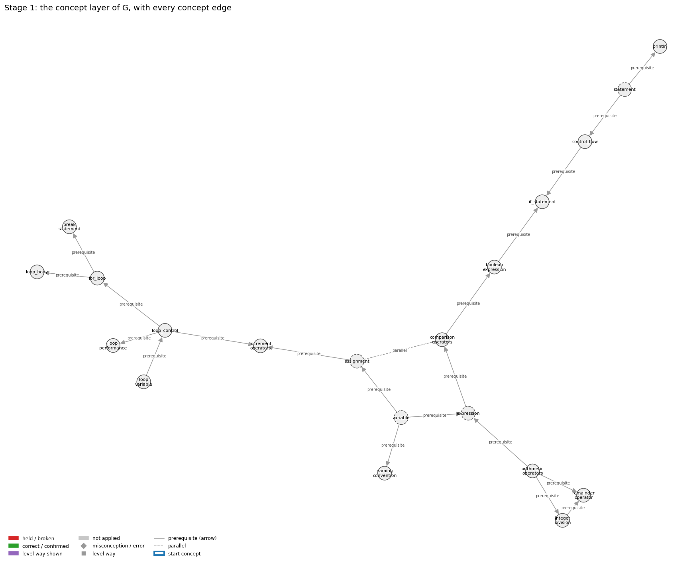
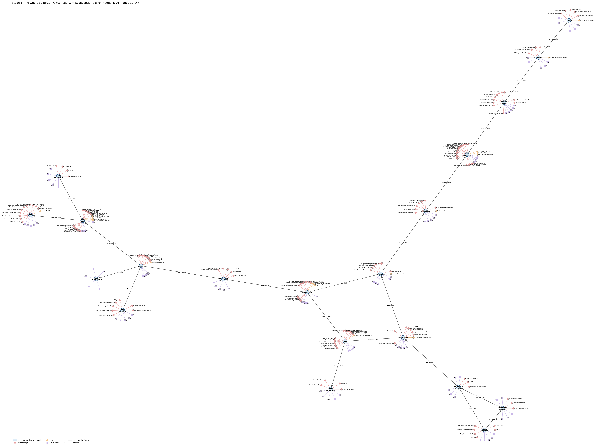
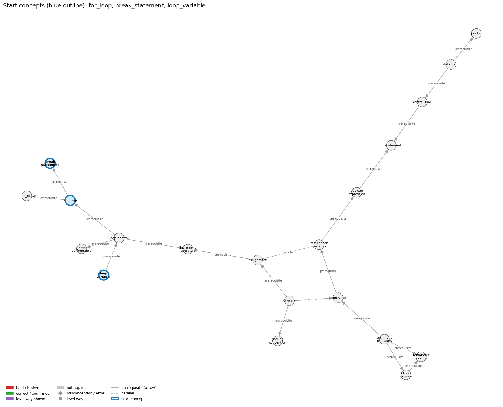
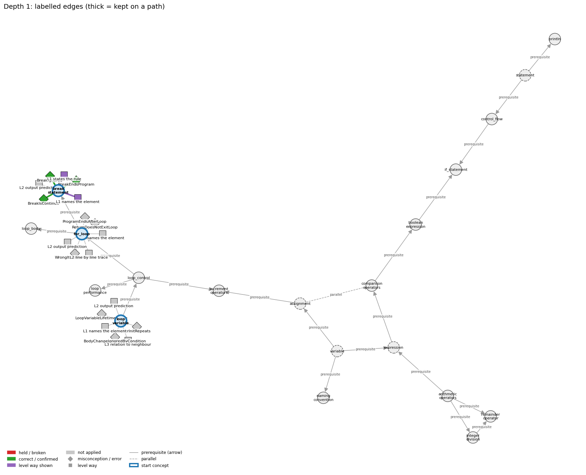
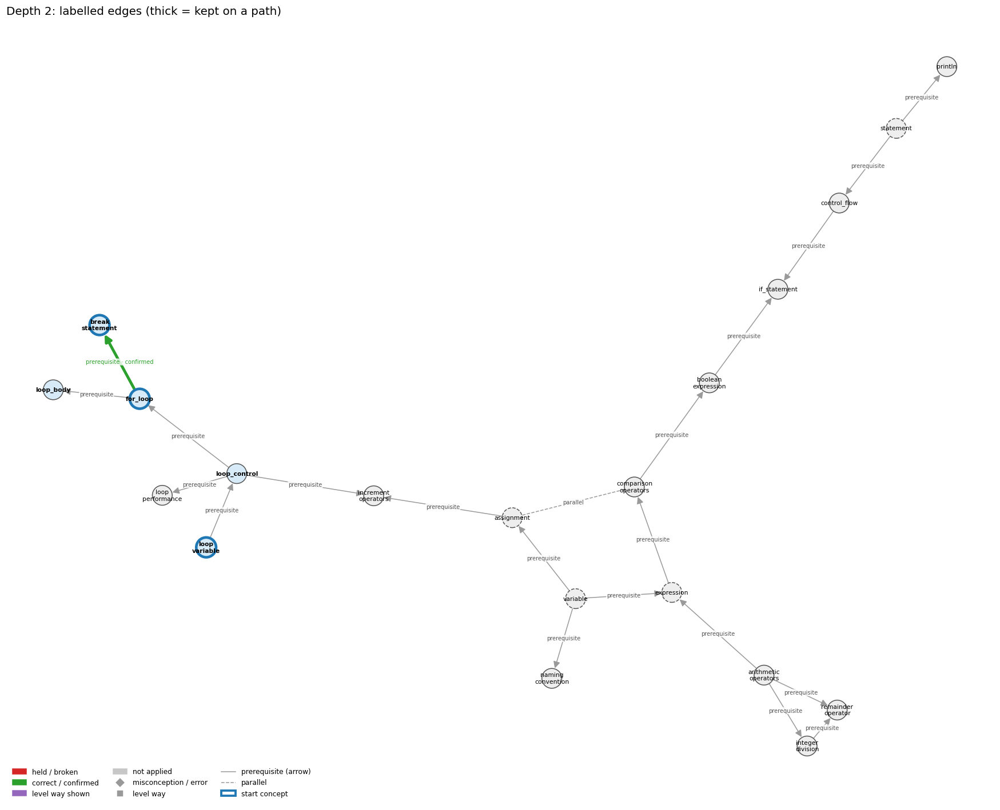
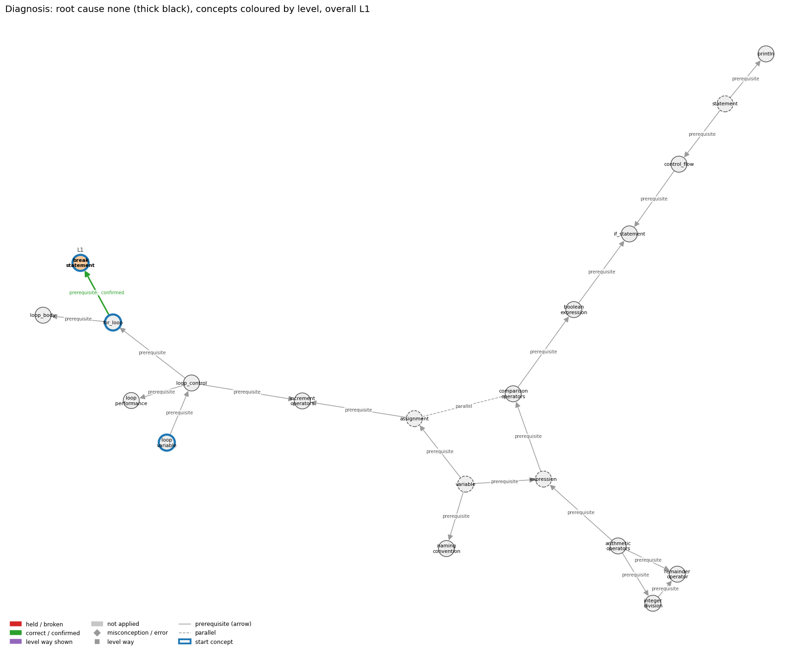

# Think on the Graph: every output of the run MY33

Files of this scenario: `input.json` (program, question, answer), `diagnosis.json`, `subgraph.json`, `traverse_log.txt`, `report.html` (this report as one full-page file, with the interactive graph `MY33_G.html`), `MY33.ipynb` (this report as a notebook).

## 0. Input
Program:
```java
int N = 91;
int i;
for (i = 2; i <= N / i; i++) {
    if (N % i == 0) break;
}
System.out.println(i);
```
Question: What is printed? Explain what the break does.

Student's answer: I’m not sure what number, but break is the statement that ends the loop early.
Settings: width 3, depth 3, prune llm, backend claude-cli, model claude-opus-5-5
## 1. Stage 1: the subgraph G from the code (no model)
Masked code (string and char literals and comments blanked; this is what the patterns see):
```
int N = 91;
int i;
for (i = 2; i <= N / i; i++) {
    if (N % i == 0) break;
}
System.out.println(i);
```
Which code text tagged which concept (a generic concept fires on almost any Java line; it starts the walk only if the answer repeats its tag):
| concept | generic | channel | matched text | line |
|---|---|---|---|---|
| arithmetic_operators | False | pattern | 'N / i' | 3 |
| assignment | True | pattern | '=' | 1 |
| boolean_expression | False | pattern | 'if (' | 4 |
| boolean_expression | False | pattern | 'for (i = 2; i <= N / i;' | 3 |
| break_statement | False | pattern | 'break;' | 4 |
| comparison_operators | False | pattern | 'for (i = 2; i <=' | 3 |
| control_flow | False | pattern | 'for (' | 3 |
| control_flow | False | pattern | 'break;' | 4 |
| expression | True | pattern | 'i <=' | 3 |
| expression | True | pattern | '= 91;' | 1 |
| for_loop | False | pattern | 'for (' | 3 |
| if_statement | False | pattern | 'if (' | 4 |
| increment_operators | False | pattern | '++' | 3 |
| integer_division | False | signal | 'int N = 91;\nint i;\nfor (i = 2; i <= N / i' | 1 |
| loop_body | False | pattern | 'for (' | 3 |
| loop_control | False | signal | 'for (i = 2; i <= N / i; i++)' | 3 |
| loop_performance | False | pattern | 'for (i = 2; i <= N / i;' | 3 |
| loop_variable | False | pattern | 'for (i =' | 3 |
| naming_convention | False | signal | 'int N' | 1 |
| println | False | pattern | 'System.out.println(' | 6 |
| remainder_operator | False | pattern | 'N %' | 4 |
| statement | True | pattern | ';' | 1 |
| variable | True | pattern | 'int N =' | 1 |

G: 20 concept nodes (4 generic), 21 concept edges, 174 misconception / error edges, 124 misconception / error nodes, 100 level nodes, 181 level-misconception links, 1 connected piece(s).

Concept edges of G (the links the walk can read; `pre:` = prerequisite A -> B, `par:` = parallel):
| edge | type | rule (logic) |
|---|---|---|
| par:assignment~comparison_operators | parallel | x = y stores the value of y in x (a statement with a side effect); x == y only tests whether the two values are equal and gives a boolean. Writing = where == is meant is a compile error with int operands and a silent bug with boolean operands. |
| pre:arithmetic_operators->expression | prerequisite | An operator combines operand values a and b into a new value, so operators build larger expressions from smaller ones. |
| pre:arithmetic_operators->integer_division | prerequisite | For ints a and b, / gives the whole quotient q and % gives the remainder r, so that a = b * q + r. |
| pre:arithmetic_operators->remainder_operator | prerequisite | % is one of the int arithmetic operators; it gives the remainder of the division. |
| pre:assignment->increment_operators | prerequisite | i++ is shorthand for the assignment i = i + 1. |
| pre:boolean_expression->if_statement | prerequisite | An if runs its block only when its boolean expression evaluates to true. |
| pre:comparison_operators->boolean_expression | prerequisite | A comparison such as x < y produces a boolean result; comparisons together with boolean logic provide the basis for decision-making. |
| pre:control_flow->if_statement | prerequisite | An if changes the default top-to-bottom flow by running a block only when its condition is true. |
| pre:expression->comparison_operators | prerequisite | Comparison operators build expressions whose value is a boolean, so one must already know what an expression is to understand a < b. |
| pre:for_loop->break_statement | prerequisite | break leaves the for loop at once, without running the rest of the body or the remaining passes. |
| pre:for_loop->loop_body | prerequisite | The statements in braces after the for header are the loop body; they run once on every pass, between the test and the increment, exactly as in a while loop. |
| pre:integer_division->remainder_operator | prerequisite | % is the companion of integer division: a = (a / b) * b + a % b. |
| pre:loop_control->for_loop | prerequisite | The for header is exactly the three control slots, and the body runs after the test and before the update on each pass. |
| pre:loop_control->increment_operators | prerequisite | The loop update i = i + 1 comes first; ++ (and +=) are then introduced as shorthand for that update. |
| pre:loop_control->loop_performance | prerequisite | The loop condition decides how many iterations run, so a better test (i <= n/i instead of i < n) makes the program much faster. |
| pre:loop_variable->loop_control | prerequisite | The init, condition and update all act on the loop variable: the init sets it, the condition tests it, the update changes it. |
| pre:statement->control_flow | prerequisite | Control flow is the order in which statements run. |
| pre:statement->println | prerequisite | System.out.println(s); is itself a statement, so its line of output appears at its own place in the sequence. |
| pre:variable->assignment | prerequisite | Assignment needs a declared variable on its left side to store the computed value into. |
| pre:variable->expression | prerequisite | An expression can be a literal, a variable, or operations on them; we compute with a variable by using its name in an expression. |
| pre:variable->naming_convention | prerequisite | Each variable gets a name; the convention says the name should describe what the variable holds. |

Misconception / error edges per concept (count), and level ways per concept (count):
| concept | misconception / error edges | level ways (L1-L4 + L0 non-misconception) |
|---|---|---|
| arithmetic_operators | 3 | 18 |
| assignment | 15 | 24 |
| boolean_expression | 8 | 19 |
| break_statement | 4 | 19 |
| comparison_operators | 8 | 20 |
| control_flow | 11 | 15 |
| expression | 8 | 19 |
| for_loop | 21 | 24 |
| if_statement | 22 | 19 |
| increment_operators | 5 | 16 |
| integer_division | 6 | 16 |
| loop_body | 12 | 14 |
| loop_control | 11 | 19 |
| loop_performance | 0 | 13 |
| loop_variable | 7 | 13 |
| naming_convention | 4 | 14 |
| println | 6 | 17 |
| remainder_operator | 3 | 14 |
| statement | 5 | 19 |
| variable | 15 | 20 |

**Figure 1**


**Figure 2**


## 2. Clauses and start concepts (no model)
The answer split into clauses (at sentence ends, ';', and before 'because' / 'so'; quotes removed):
| clause | text |
|---|---|
| c1 | Im not sure what number, but break is the statement that ends the loop early |

start: BM25 of the answer against each tagged concept: for_loop 10.44 (hits 1), break_statement 9.21 (hits 1), loop_variable 7.56 (hits 1), loop_control 6.78 (hits 1), if_statement 6.48 (hits 1), loop_body 6.03 (hits 1), control_flow 5.83 (hits 2), increment_operators 5.60 (hits 1), println 3.97 (hits 1), naming_convention 3.71 (hits 1), loop_performance 3.45 (hits 1), comparison_operators 3.05 (hits 1), arithmetic_operators 2.55 (hits 1), boolean_expression 2.25 (hits 2), remainder_operator 2.08 (hits 1), integer_division 1.99 (hits 1)

start: chosen for_loop, break_statement, loop_variable

start concepts (3): for_loop, break_statement, loop_variable

Start concepts: for_loop, break_statement, loop_variable

**Figure 3**


## 3. The walk, depth by depth
At each depth, for each current concept: the edges offered (a concept entering as a start concept offers its misconception / error edges and its level ways, as two families; otherwise it offers its concept edges), the prune prompt and the model's reply, then the label prompt(s) and the model's reply, parsed into label / clauses / confidence. Score = prune score x confidence.

### Depth 1: current concepts 'for_loop', 'break_statement', 'loop_variable'

#### for_loop, misconceptions: 21 edges offered
Edges offered:
| edge |
|---|
| err:for_loop->BracelessMultiStatementBody \| wrong rule: Indenting several statements under an if or for makes them all part of its body, even without braces. \| right rule: Without braces only the first statement belongs to the if/for; the rest run once, after it. |
| err:for_loop->ForCommaSeparators \| wrong rule: Writes for (int i = 0, i < n, i++). \| right rule: The three parts of a for header are separated by semicolons; commas only separate several statements inside the init or the update part. |
| err:for_loop->SemicolonAfterIfHeader \| wrong rule: if (x > 0); System.out.println("positive"); prints only for positive x. \| right rule: The ; ends the if with an empty statement, so the next line always runs. |
| err:for_loop->SemicolonAfterLoopHeader \| wrong rule: Puts a ; right after for (...) or while (...). \| right rule: A ; right after the loop header is a null (empty) loop body, so the statements written after it are not repeated by the loop. |
| err:for_loop->WrongIterationCount \| wrong rule: Updates the loop counter so that the loop runs the wrong number of times. \| right rule: The init, test and update together decide the number of passes; trace them to check the count. |
| mis:for_loop->DoubleLoopIndexCount \| wrong rule: for (double x = 0.0; x <= 1.0; x += 0.1) runs exactly 11 times. \| right rule: Using a double as a for-loop index is legal but bad practice: the number of iterations depends on an equality test between double values, which may not give the result you expect. |
| mis:for_loop->FalseLoopRepeatsNextCode \| wrong rule: A loop is an iterative if-else: while the condition is true the body repeats, and when it is false the code after the loop repeats. \| right rule: Only the body is repeated; once the condition is false the code after the loop runs once. |
| mis:for_loop->ForInitRepeats \| wrong rule: The initialization of a for loop runs again after a pass of the body. \| right rule: The initialization runs exactly once, before the first condition test. |
| mis:for_loop->ForIsConditional \| wrong rule: The body of a for statement executes at most once. \| right rule: The body of a for statement runs once for every pass on which the condition is true, which can be many times. |
| mis:for_loop->ForLoopPartSkipped \| wrong rule: A pass of a loop may leave out one of its parts (the condition test, the body, the update, or the initialization). \| right rule: Each pass of a for loop runs test, then body, then update, every time; the initialization runs once, at the start. |
| mis:for_loop->ForUpdateBeforeBody \| wrong rule: The update part of a for header (e.g. i = i - 4) runs before the body on each pass, so the first pass already sees the updated value. \| right rule: The update runs after the body, before the next condition test; the first pass uses the initial value. |
| mis:for_loop->ForWhileNotInterchangeable \| wrong rule: Some loops can only be written with for, others only with while. \| right rule: Any for loop can be rewritten as a while loop and vice versa; for just packages init, test and update. |
| mis:for_loop->IdiomOverridesCode \| wrong rule: An array loop processes the whole array from index 0 to length-1 and increments its index at the end of the body, whatever the code says. \| right rule: The loop visits exactly the indices that its initialisation, guard and update produce, in the order in which its statements are written. |
| mis:for_loop->LoopCountIsStatementCount \| wrong rule: The repeat count of a counted loop says how many of the body statements are executed. \| right rule: The repeat count is how many times the whole body runs; every pass runs all body statements. |
| mis:for_loop->LoopHeaderIsEquations \| wrong rule: The initialization, condition and update of a for header are equations that all hold at the same time. \| right rule: The three header parts are statements run at different moments: init once, then condition test, body, update, repeated. |
| mis:for_loop->LoopImpliedByOneTest \| wrong rule: Testing one case is enough; Java will repeat the test for the other values by itself. \| right rule: A statement runs once each time control reaches it; repeating a test for many values needs a loop. |
| mis:for_loop->LoopStepAlwaysOne \| wrong rule: A loop variable always goes up or down by 1, whatever the update says (so i = i - 4 is read as i--). \| right rule: The loop variable changes exactly as the update expression says (i += 2, i = i - 4, i *= 2, ...). |
| mis:for_loop->MissingBraces \| wrong rule: Omits braces around a single-statement body of if, for or while. \| right rule: Braces are optional for a single-statement body, but using them anyway avoids bugs when statements are added later. |
| mis:for_loop->ProgramEndsAfterLoop \| wrong rule: When a loop finishes the program ends, so code after the loop never runs. \| right rule: When the loop condition becomes false, control continues with the first statement after the loop. |
| mis:for_loop->ReturnDoesNotExitLoop \| wrong rule: A return inside a loop does not end the loop; it sets a value each pass (the last one is returned) or returns several values. \| right rule: When return executes, the method ends at once, so the loop stops on that pass. |
| mis:for_loop->SingleIterationInsteadOfLoop \| wrong rule: A task that must be repeated is written once, without a loop, as if one pass were enough. \| right rule: A step that must happen several times (or an unknown number of times) needs a loop such as while or for; code without a loop runs once. |

Prune: the model's reply (edge id and score; the kept edges sum to 1):
```
mis:for_loop->ReturnDoesNotExitLoop (0.50), err:for_loop->WrongIterationCount (0.30), mis:for_loop->ProgramEndsAfterLoop (0.20)
```
Kept by pruning: mis:for_loop->ReturnDoesNotExitLoop (0.50), err:for_loop->WrongIterationCount (0.30), mis:for_loop->ProgramEndsAfterLoop (0.20)

Label prompt for the misconception / error edges (judged together). The model saw the program, the question, the numbered clauses, and these edges with their wrong rule and right rule:
| edge |
|---|
| mis:for_loop->ReturnDoesNotExitLoop \| wrong rule: A return inside a loop does not end the loop; it sets a value each pass (the last one is returned) or returns several values. \| right rule: When return executes, the method ends at once, so the loop stops on that pass. |
| err:for_loop->WrongIterationCount \| wrong rule: Updates the loop counter so that the loop runs the wrong number of times. \| right rule: The init, test and update together decide the number of passes; trace them to check the count. |
| mis:for_loop->ProgramEndsAfterLoop \| wrong rule: When a loop finishes the program ends, so code after the loop never runs. \| right rule: When the loop condition becomes false, control continues with the first statement after the loop. |
Model's reply:
```
mis:for_loop->ReturnDoesNotExitLoop | not applied | clauses: none | confidence: 0.9
err:for_loop->WrongIterationCount | not applied | clauses: none | confidence: 0.85
mis:for_loop->ProgramEndsAfterLoop | not applied | clauses: none | confidence: 0.85
```

Parsed labels:
| edge | label | prune score | confidence | score | clauses | words |
|---|---|---|---|---|---|---|
| mis:for_loop->ReturnDoesNotExitLoop | not applied |  |  | 0.0 |  |  |
| err:for_loop->WrongIterationCount | not applied |  |  | 0.0 |  |  |
| mis:for_loop->ProgramEndsAfterLoop | not applied |  |  | 0.0 |  |  |

#### for_loop, level ways: 24 edges offered
Edges offered:
| edge |
|---|
| lvl:for_loop@L0#0 \| level L0 way everyday_reading: Folk meaning: English 'for each ...' or 'for 10 times' names a whole collection or a count to be handled at once, and a maths reading treats the header as simultaneous conditions. A Java for is a while loop in compact form: one init, then test-body-update repeated, one pass at a time. |
| lvl:for_loop@L0#11 \| level L0 way inconsistent_trace: Applies the for sequencing rule (LT) unevenly: updates before the body on the first pass only, re-runs the init after a pass, or skips the test on some passes. (here mixing in: "The body of a for statement executes at most once") |
| lvl:for_loop@L1#0 \| level L1 way names_the_element: The for statement is a loop that packages an initialization, a loop-continuation condition and an increment in its header around a body. |
| lvl:for_loop@L1#1 \| level L1 way states_the_rule: Syntax: for (<initialize>; <boolean expression>; <increment>) { <statements> }, with the three parts separated by semicolons; it is, with only a few exceptions, equivalent to <initialize>; while (<boolean expression>) { <statements> <increment>; }. |
| lvl:for_loop@L2#0 \| level L2 way line_by_line_trace: Run the initializer once; then repeatedly: test the condition (stop if false), execute the body, run the update. |
| lvl:for_loop@L2#1 \| level L2 way output_prediction: A for statement has no value; the passes it makes are fixed by its header: for (int i = 1; i <= N; i++) sum += i; leaves sum = N(N+1)/2, and for (int i = 2; i <= 8; i += 2) prints 2, 4, 6, 8,. |
| lvl:for_loop@L2#2 \| level L2 way one_step_execution: One pass: the test reads the loop variable; the body applies its changes once; the update then changes the loop variable by its rule; the initializer changes state only once, before the first test. |
| lvl:for_loop@L3#0 \| level L3 way relation_to_neighbour: The for header is exactly the three loop-control slots; the body runs after the test and before the update on each pass. |
| lvl:for_loop@L3#1 \| level L3 way relation_to_neighbour: A for may be the body of another for: the inner for runs its complete set of passes for every single pass of the outer one. |
| lvl:for_loop@L3#2 \| level L3 way relation_to_neighbour: for (int i = 0; i < N; i++) gives i each valid index 0..N-1 exactly once in increasing order, the standard way to process every array element. |
| lvl:for_loop@L3#3 \| level L3 way relation_to_neighbour: A simulation runs a fixed number of trials with an outer for loop (for (int t = 0; t < T; t++)), each trial simulated inside the body. |
| lvl:for_loop@L3#4 \| level L3 way relation_to_neighbour: In a for loop, continue skips the rest of the body and transfers control directly to the increment, then the next test; this is one of the few places where the for/while equivalence fails. |
| lvl:for_loop@L3#5 \| level L3 way relation_to_neighbour: A variable declared in the for header is in scope only in the header and the body, so it cannot be used after the loop. |
| lvl:for_loop@L3#6 \| level L3 way relation_to_neighbour: A fencepost loop is a for loop that handles one item (the first or last) outside the loop so that separators come out n-1 times for n items. |
| lvl:for_loop@L3#7 \| level L3 way relation_to_neighbour: A flag search loop is a for loop that sets a boolean flag when some pass finds the target and leaves it set afterwards; the flag must be declared before the loop. |
| lvl:for_loop@L3#8 \| level L3 way purpose_of_the_whole: Plan: counted loop / counter-controlled repetition - do the body a known number of times, with the loop variable as a stepper (index, term number, trial number). |
| lvl:for_loop@L4#0 \| level L4 way predict_a_change: Rewriting a for as the equivalent while (init before, update at the end of the body) keeps behaviour, except that continue then skips the update and the loop variable stays in scope after the loop. Changing the bound or the step changes the pass count predictably (< to <= adds one pass). |
| lvl:for_loop@L4#1 \| level L4 way diagnose_an_error: rule broken: The three parts of a for header are separated by semicolons; commas only separate several statements inside the init or the update. Kind: compile-time. Trigger class: Writing for (int i = 0, i < n, i++): the compiler parses the commas as more declarators in the init and reports a syntax error. |
| lvl:for_loop@L4#2 \| level L4 way diagnose_an_error: rule broken: A ; right after while (...) or for (...) is an empty statement that is the whole loop body; the block written next is not repeated. Kind: silent logic error. Trigger class: for (...); { body } runs the body once after the loop ends; while (cond); with a cond that the empty body cannot change hangs forever (infinite loop) when cond starts true. |
| lvl:for_loop@L4#3 \| level L4 way transfer_to_a_new_program: Use for when there is an initialization, an increment and a continuation test and the loop variable is not needed after the loop; use while when the loop variable is needed later or the number of passes depends on what happens in the body. |
| lvl:for_loop@L4#4 \| level L4 way diagnose_an_error: rule broken: A ; right after if (...) is an empty statement that forms the whole then branch; the following statement or block is no longer part of the if. Kind: silent logic error. Trigger class: Any if (cond); followed by a statement or block: that statement runs for every input, whatever cond is (it compiles without error). |
| lvl:for_loop@L4#5 \| level L4 way diagnose_an_error: rule broken: The number of passes is fixed by the init, the test and the update together. Kind: silent logic error. Trigger class: Wrong start value, < vs <=, a wrong step, or an extra update of the counter in the body (or outside the loop): the loop runs too few or too many passes (off by one, or skips values). |
| lvl:for_loop@L4#6 \| level L4 way diagnose_an_error: rule broken: Without braces, the body of an if, while or for is exactly one statement; indentation does not add statements to it. Kind: silent logic error. Trigger class: A braceless header followed by two or more indented statements: only the first is controlled, the others run once, after the if/loop, on every input. |
| lvl:for_loop@L4#7 \| level L4 way diagnose_an_error: rule broken: A variable declared in the for initializer exists only inside the for statement. Kind: compile-time. Trigger class: Reading i after for (int i = 0; ...) {...}: 'cannot find symbol'. |

Prune: the model's reply (edge id and score; the kept edges sum to 1):
```
{lvl:for_loop@L1#0 (Score: 0.5)}
{lvl:for_loop@L2#1 (Score: 0.3)}
{lvl:for_loop@L2#0 (Score: 0.2)}
```
Kept by pruning: lvl:for_loop@L1#0 (0.50), lvl:for_loop@L2#1 (0.30), lvl:for_loop@L2#0 (0.20)

Label prompt for level way lvl:for_loop@L1#0 (the model saw only the concept, the way's name 'names the element' and its text; no level):
> The for statement is a loop that packages an initialization, a loop-continuation condition and an increment in its header around a body.

Model's reply:
```
Label: not shown
Clauses: none
Confidence: 0.75
```

Label prompt for level way lvl:for_loop@L2#1 (the model saw only the concept, the way's name 'output prediction' and its text; no level):
> A for statement has no value; the passes it makes are fixed by its header: for (int i = 1; i <= N; i++) sum += i; leaves sum = N(N+1)/2, and for (int i = 2; i <= 8; i += 2) prints 2, 4, 6, 8,.

Model's reply:
```
Label: not shown
Clauses: none
Confidence: 0.9
```

Label prompt for level way lvl:for_loop@L2#0 (the model saw only the concept, the way's name 'line by line trace' and its text; no level):
> Run the initializer once; then repeatedly: test the condition (stop if false), execute the body, run the update.

Model's reply:
```
Label: not shown
Clauses: none
Confidence: 0.9
```

Parsed labels:
| edge | label | prune score | confidence | score | clauses | words |
|---|---|---|---|---|---|---|
| lvl:for_loop@L1#0 | not applied |  |  | 0.0 |  |  |
| lvl:for_loop@L2#1 | not applied |  |  | 0.0 |  |  |
| lvl:for_loop@L2#0 | not applied |  |  | 0.0 |  |  |

#### break_statement, misconceptions: 4 edges offered
Edges offered:
| edge |
|---|
| mis:break_statement->BreakEndsProgram \| wrong rule: break ends the whole program. \| right rule: break ends only the innermost loop (or switch); execution continues after it. |
| mis:break_statement->BreakExitsIf \| wrong rule: break leaves the if statement it is written in. \| right rule: break immediately exits a loop without letting it run to completion, and in a switch it exits the switch body. |
| mis:break_statement->BreakIgnored \| wrong rule: break has no effect; the loop body just carries on. \| right rule: break leaves the innermost loop at once; the rest of the body and later passes do not run. |
| mis:break_statement->BreakIsContinue \| wrong rule: break starts the next iteration of the loop. \| right rule: break exits the loop immediately; continue skips to the next iteration of the loop. |

Prune: the model's reply (edge id and score; the kept edges sum to 1):
```
{mis:break_statement->BreakIgnored (Score: 0.4)}
{mis:break_statement->BreakEndsProgram (Score: 0.3)}
{mis:break_statement->BreakIsContinue (Score: 0.3)}
```
Kept by pruning: mis:break_statement->BreakIgnored (0.40), mis:break_statement->BreakEndsProgram (0.30), mis:break_statement->BreakIsContinue (0.30)

Label prompt for the misconception / error edges (judged together). The model saw the program, the question, the numbered clauses, and these edges with their wrong rule and right rule:
| edge |
|---|
| mis:break_statement->BreakIgnored \| wrong rule: break has no effect; the loop body just carries on. \| right rule: break leaves the innermost loop at once; the rest of the body and later passes do not run. |
| mis:break_statement->BreakEndsProgram \| wrong rule: break ends the whole program. \| right rule: break ends only the innermost loop (or switch); execution continues after it. |
| mis:break_statement->BreakIsContinue \| wrong rule: break starts the next iteration of the loop. \| right rule: break exits the loop immediately; continue skips to the next iteration of the loop. |
Model's reply:
```
mis:break_statement->BreakIgnored | correct | clauses: 1 | confidence: 0.9
mis:break_statement->BreakEndsProgram | correct | clauses: 1 | confidence: 0.7
mis:break_statement->BreakIsContinue | correct | clauses: 1 | confidence: 0.85
```

Parsed labels:
| edge | label | prune score | confidence | score | clauses | words |
|---|---|---|---|---|---|---|
| mis:break_statement->BreakIgnored | correct | 0.4 | 0.9 | 0.36 | c1 | Im not sure what number, but break is the statement that ends the loop early |
| mis:break_statement->BreakEndsProgram | correct | 0.3 | 0.7 | 0.21 | c1 | Im not sure what number, but break is the statement that ends the loop early |
| mis:break_statement->BreakIsContinue | correct | 0.3 | 0.85 | 0.26 | c1 | Im not sure what number, but break is the statement that ends the loop early |

#### break_statement, level ways: 19 edges offered
Edges offered:
| edge |
|---|
| lvl:break_statement@L0#0 \| level L0 way everyday_reading: Folk meaning: in English 'break' means to pause, or to stop or break out of whatever you are in, so a novice reads it as leaving the enclosing if, as starting the next round, or as stopping the whole program. In Java, `break;` ends only the innermost enclosing loop or switch, and execution continues with the statement after it. |
| lvl:break_statement@L0#5 \| level L0 way inconsistent_trace: Applies the LT rule unevenly: on some passes the trace continues the body after break, or runs the increment and the test once more after break, so the final loop variable is one too large (e.g. i = 4 instead of 3 when 3 divides N). (here mixing in: "break leaves the if statement it is written in") |
| lvl:break_statement@L1#0 \| level L1 way names_the_element: Jump statement: `break;` immediately ends the innermost enclosing while, for, do or switch. |
| lvl:break_statement@L1#1 \| level L1 way states_the_rule: `break;` may appear only inside a loop or switch. When executed, it completes that innermost loop or switch at once, and control passes to the statement after it. (Spec: JLS §14.15.) |
| lvl:break_statement@L2#0 \| level L2 way line_by_line_trace: When `break` executes: the remaining statements of the body are skipped, the for-loop increment and the condition are not evaluated again, and control continues at the first statement after the loop. In `for (i = 2; i <= N/i; i++) if (N % i == 0) break;` it runs right after the test that found a divisor. |
| lvl:break_statement@L2#1 \| level L2 way output_prediction: break is a statement and produces no value. Its effect shows in the variables it leaves: after the primality loop for N = 15, i is 3 (the smallest divisor), so `i > N/i` is false and 'is prime' is not printed. |
| lvl:break_statement@L2#2 \| level L2 way one_step_execution: One execution of break changes no variable. It changes only the point of control (to after the loop), so every variable keeps its value at the moment of the break. |
| lvl:break_statement@L3#0 \| level L3 way relation_to_neighbour: break gives a while loop a second exit, in the middle of the body. After the loop, the program has to tell which exit was taken by re-testing the state (as in `if (i > N/i)`), so any variable used for that test must be declared before the loop. |
| lvl:break_statement@L3#1 \| level L3 way relation_to_neighbour: Plain break reaches only the innermost loop. In nested loops, ending the outer loop needs `break label;` on a labeled outer statement (or a flag tested by the outer loop). |
| lvl:break_statement@L3#2 \| level L3 way relation_to_neighbour: Both skip the rest of the current body. break then leaves the loop (no increment, no further test); continue goes on to the increment and the next test. |
| lvl:break_statement@L3#3 \| level L3 way relation_to_neighbour: In a switch, break ends the switch body; without it, execution falls through into the next case. A break inside a switch that is inside a loop exits only the switch, not the loop. |
| lvl:break_statement@L3#4 \| level L3 way relation_to_neighbour: Two ways to stop a search when the item is found: break leaves the loop at once, while a boolean flag is set and tested in the loop condition so the loop ends at its next test. After either, the code must tell the found case from the loop finishing normally. |
| lvl:break_statement@L3#5 \| level L3 way purpose_of_the_whole: Plan: early-exit search (Soloway 'loop-and-a-half' or exit-on-found). Stop scanning as soon as the answer is known, e.g. at the first divisor; the loop variable is a stepper whose value at exit reports the find. |
| lvl:break_statement@L4#0 \| level L4 way predict_a_change: Removing the break keeps the loop finite but lets it run to completion. In the prime test, i then ends above N/i for every N, so composites are reported as prime. Invariant kept with break: after the loop, `i <= N/i` holds exactly when the break was taken. |
| lvl:break_statement@L4#1 \| level L4 way transfer_to_a_new_program: Use break when the reason to stop is discovered in the middle of a pass (first divisor, sentinel found) and folding it into the loop condition would be awkward. Prefer a plain loop condition when the exit can be stated up front. In a method, `return` is often clearer. S&W use break rarely. |
| lvl:break_statement@L4#2 \| level L4 way diagnose_an_error: rule broken: break must be inside a loop or switch. Kind: compile-time. Trigger class: `break;` inside an if that is not inside any loop or switch (break outside switch or loop). |
| lvl:break_statement@L4#3 \| level L4 way diagnose_an_error: rule broken: Statements after break in the same block can never run. Kind: compile-time. Trigger class: Code written directly after `break;` in the same block (unreachable statement). |
| lvl:break_statement@L4#4 \| level L4 way diagnose_an_error: rule broken: break exits only the innermost loop or switch. Kind: silent logic error. Trigger class: A break in an inner loop (or in a switch inside a loop) that was meant to end the outer loop: the outer loop keeps going. |
| lvl:break_statement@L4#5 \| level L4 way diagnose_an_error: rule broken: A variable used after the loop to tell how it ended must be in scope. Kind: compile-time. Trigger class: Declaring the loop index in the for header (`for (int i = 2; ...)`) and then testing `i` after the loop (cannot find symbol). |

Prune: the model's reply (edge id and score; the kept edges sum to 1):
```
{lvl:break_statement@L1#0 (Score: 0.6)}
{lvl:break_statement@L1#1 (Score: 0.25)}
{lvl:break_statement@L2#1 (Score: 0.15)}
```
Kept by pruning: lvl:break_statement@L1#0 (0.60), lvl:break_statement@L1#1 (0.25), lvl:break_statement@L2#1 (0.15)

Label prompt for level way lvl:break_statement@L1#0 (the model saw only the concept, the way's name 'names the element' and its text; no level):
> Jump statement: `break;` immediately ends the innermost enclosing while, for, do or switch.

Model's reply:
```
Label: shown
Clauses: 1
Confidence: 0.85
```

Label prompt for level way lvl:break_statement@L1#1 (the model saw only the concept, the way's name 'states the rule' and its text; no level):
> `break;` may appear only inside a loop or switch. When executed, it completes that innermost loop or switch at once, and control passes to the statement after it. (Spec: JLS §14.15.)

Model's reply:
```
Label: shown
Clauses: 1
Confidence: 0.75
```

Label prompt for level way lvl:break_statement@L2#1 (the model saw only the concept, the way's name 'output prediction' and its text; no level):
> break is a statement and produces no value. Its effect shows in the variables it leaves: after the primality loop for N = 15, i is 3 (the smallest divisor), so `i > N/i` is false and 'is prime' is not printed.

Model's reply:
```
Label: not shown
Clauses: none
Confidence: 0.85
```

Parsed labels:
| edge | label | prune score | confidence | score | clauses | words |
|---|---|---|---|---|---|---|
| lvl:break_statement@L1#0 | shown | 0.6 | 0.85 | 0.51 | c1 | Im not sure what number, but break is the statement that ends the loop early |
| lvl:break_statement@L1#1 | shown | 0.25 | 0.75 | 0.19 | c1 | Im not sure what number, but break is the statement that ends the loop early |
| lvl:break_statement@L2#1 | not applied |  |  | 0.0 |  |  |

#### loop_variable, misconceptions: 7 edges offered
Edges offered:
| edge |
|---|
| mis:loop_variable->BodyChangeIgnoredByCondition \| wrong rule: Changing the loop variable inside the body does not affect the loop condition; the loop still runs its planned number of times. \| right rule: The condition is tested with the current value of the variable, including changes made in the body. |
| mis:loop_variable->DoubleLoopIndexCount \| wrong rule: for (double x = 0.0; x <= 1.0; x += 0.1) runs exactly 11 times. \| right rule: Using a double as a for-loop index is legal but bad practice: the number of iterations depends on an equality test between double values, which may not give the result you expect. |
| mis:loop_variable->ForInitRepeats \| wrong rule: The initialization of a for loop runs again after a pass of the body. \| right rule: The initialization runs exactly once, before the first condition test. |
| mis:loop_variable->LoopOutputSameEachPass \| wrong rule: A loop prints the same thing on every pass; the changing loop variable does not affect what the body does. \| right rule: The body uses the current value of the loop variable, so its output can differ on each pass. |
| mis:loop_variable->LoopUpdateChangesDirection \| wrong rule: The update of the loop variable can change from pass to pass (e.g. switch direction) although the code is the same. \| right rule: The update expression is the same on every pass; the loop variable changes by the rule written in the update. |
| mis:loop_variable->LoopVariableLifetimeScope \| wrong rule: The for variable i is a new variable on every pass rather than one variable changed by the update. \| right rule: The for variable i is created once by the init, and the update changes that same variable on every pass. |
| mis:loop_variable->LoopVariableLimitsValues \| wrong rule: The range of the loop variable limits the values that can be read or printed inside the loop. \| right rule: The loop variable only counts passes; other values read or printed in the body are not bounded by it. |

Prune: the model's reply (edge id and score; the kept edges sum to 1):
```
mis:loop_variable->BodyChangeIgnoredByCondition (0.50), mis:loop_variable->LoopVariableLifetimeScope (0.30), mis:loop_variable->ForInitRepeats (0.20)
```
Kept by pruning: mis:loop_variable->BodyChangeIgnoredByCondition (0.50), mis:loop_variable->LoopVariableLifetimeScope (0.30), mis:loop_variable->ForInitRepeats (0.20)

Label prompt for the misconception / error edges (judged together). The model saw the program, the question, the numbered clauses, and these edges with their wrong rule and right rule:
| edge |
|---|
| mis:loop_variable->BodyChangeIgnoredByCondition \| wrong rule: Changing the loop variable inside the body does not affect the loop condition; the loop still runs its planned number of times. \| right rule: The condition is tested with the current value of the variable, including changes made in the body. |
| mis:loop_variable->LoopVariableLifetimeScope \| wrong rule: The for variable i is a new variable on every pass rather than one variable changed by the update. \| right rule: The for variable i is created once by the init, and the update changes that same variable on every pass. |
| mis:loop_variable->ForInitRepeats \| wrong rule: The initialization of a for loop runs again after a pass of the body. \| right rule: The initialization runs exactly once, before the first condition test. |
Model's reply:
```
mis:loop_variable->BodyChangeIgnoredByCondition | not applied | clauses: none | confidence: 0.9
mis:loop_variable->LoopVariableLifetimeScope | not applied | clauses: none | confidence: 0.9
mis:loop_variable->ForInitRepeats | not applied | clauses: none | confidence: 0.9
```

Parsed labels:
| edge | label | prune score | confidence | score | clauses | words |
|---|---|---|---|---|---|---|
| mis:loop_variable->BodyChangeIgnoredByCondition | not applied |  |  | 0.0 |  |  |
| mis:loop_variable->LoopVariableLifetimeScope | not applied |  |  | 0.0 |  |  |
| mis:loop_variable->ForInitRepeats | not applied |  |  | 0.0 |  |  |

#### loop_variable, level ways: 13 edges offered
Edges offered:
| edge |
|---|
| lvl:loop_variable@L0#0 \| level L0 way everyday_reading: Folk meaning: in maths a variable like the i in a sum ranges over all its values at once, and 'i from 1 to 10' is a set. A Java loop variable is one storage location holding one value at a time, changed step by step by the update. |
| lvl:loop_variable@L0#5 \| level L0 way inconsistent_trace: Applies the init-test-update rule (LT, loop_control) unevenly to the loop variable: forgets one update, applies a different step on some passes, or re-initializes it mid-loop. (here mixing in: "The update of the loop variable can change from pass to pass (e.g. switch direction) although the code is the same") |
| lvl:loop_variable@L1#0 \| level L1 way names_the_element: A loop variable (loop-control counter, index) is a variable that is initialized, tested and updated in order to control a loop. |
| lvl:loop_variable@L1#1 \| level L1 way states_the_rule: The loop variable is set once by the initialization, tested by the continuation condition before each pass and updated (usually incremented) at the end of each pass; declared in a for header, it is not available after the loop. |
| lvl:loop_variable@L2#0 \| level L2 way line_by_line_trace: Its value is set by the init, read by the test, read by the body, then changed by the update, and the cycle repeats; the body sees the value set by the previous update. |
| lvl:loop_variable@L2#1 \| level L2 way output_prediction: Across passes the loop variable takes a predictable sequence of values, e.g. 4, 5, ..., 10 in TenHellos, and after a while loop it holds the first value that failed the test (11). |
| lvl:loop_variable@L2#2 \| level L2 way one_step_execution: One update changes only the loop variable (i = i + 1 turns 4 into 5); one test reads it and yields true or false; an assignment to it in the body changes what the next test sees. |
| lvl:loop_variable@L3#0 \| level L3 way relation_to_neighbour: The init, condition and update all act on the loop variable: the init sets it, the condition tests it, the update changes it. |
| lvl:loop_variable@L3#1 \| level L3 way relation_to_neighbour: In a while loop the loop variable is declared and initialized before the loop and updated inside the body, so it remains available after the loop. |
| lvl:loop_variable@L3#2 \| level L3 way purpose_of_the_whole: Role: stepper - a variable stepping through a systematic, predictable succession of values; it counts passes and often serves as an index. |
| lvl:loop_variable@L4#0 \| level L4 way predict_a_change: Shifting the start and the bound by the same amount keeps the number of passes but changes the values the body sees; assigning to the loop variable inside the body changes the pass count. |
| lvl:loop_variable@L4#1 \| level L4 way transfer_to_a_new_program: Use a dedicated loop variable (int) when passes are counted or indexed; do not use a double loop variable, and do not reuse it for other roles inside the body. |
| lvl:loop_variable@L4#2 \| level L4 way diagnose_an_error: rule broken: Update the loop variable only in the update part (or in one place in a while body). Kind: silent logic error. Trigger class: An extra i++ in the body (or modifying i elsewhere): passes are skipped or repeated, and the loop may overshoot an != bound and never end. |

Prune: the model's reply (edge id and score; the kept edges sum to 1):
```
{lvl:loop_variable@L2#1 (Score: 0.5)}
{lvl:loop_variable@L1#0 (Score: 0.3)}
{lvl:loop_variable@L3#1 (Score: 0.2)}
```
Kept by pruning: lvl:loop_variable@L2#1 (0.50), lvl:loop_variable@L1#0 (0.30), lvl:loop_variable@L3#1 (0.20)

Label prompt for level way lvl:loop_variable@L2#1 (the model saw only the concept, the way's name 'output prediction' and its text; no level):
> Across passes the loop variable takes a predictable sequence of values, e.g. 4, 5, ..., 10 in TenHellos, and after a while loop it holds the first value that failed the test (11).

Model's reply:
```
Label: not shown
Clauses: none
Confidence: 0.92
```

Label prompt for level way lvl:loop_variable@L1#0 (the model saw only the concept, the way's name 'names the element' and its text; no level):
> A loop variable (loop-control counter, index) is a variable that is initialized, tested and updated in order to control a loop.

Model's reply:
```
Label: not shown
Clauses: none
Confidence: 0.9
```

Label prompt for level way lvl:loop_variable@L3#1 (the model saw only the concept, the way's name 'relation to neighbour' and its text; no level):
> In a while loop the loop variable is declared and initialized before the loop and updated inside the body, so it remains available after the loop.

Model's reply:
```
Label: not shown
Clauses: none
Confidence: 0.92
```

Parsed labels:
| edge | label | prune score | confidence | score | clauses | words |
|---|---|---|---|---|---|---|
| lvl:loop_variable@L2#1 | not applied |  |  | 0.0 |  |  |
| lvl:loop_variable@L1#0 | not applied |  |  | 0.0 |  |  |
| lvl:loop_variable@L3#1 | not applied |  |  | 0.0 |  |  |

**Kept on a path at this depth** (best N in tiers: held misconception / broken edge, then held error, then correct / confirmed / shown):

lvl:break_statement@L1#0 [shown, tier 2, 0.51], mis:break_statement->BreakIgnored [correct, tier 2, 0.36], mis:break_statement->BreakIsContinue [correct, tier 2, 0.26]

**Clause coverage after this depth:**
| clause | text | covered by |
|---|---|---|
| c1 | Im not sure what number, but break is the statement that ends the loop early | mis:break_statement->BreakIgnored |

**Graph check, not yet read (the walk may not stop while these remain):** pre:for_loop->break_statement, pre:for_loop->loop_body, pre:loop_control->for_loop, pre:loop_variable->loop_control

**Figure 4 (the graph after depth 1)**


### Depth 2: current concepts 'for_loop', 'break_statement', 'loop_variable'

#### for_loop, concept edges: 3 edges offered
Edges offered:
| edge |
|---|
| pre:for_loop->break_statement \| rule: break leaves the for loop at once, without running the rest of the body or the remaining passes. |
| pre:for_loop->loop_body \| rule: The statements in braces after the for header are the loop body; they run once on every pass, between the test and the increment, exactly as in a while loop. |
| pre:loop_control->for_loop \| rule: The for header is exactly the three control slots, and the body runs after the test and before the update on each pass. |

Prune: the model's reply (edge id and score; the kept edges sum to 1):
```
{pre:for_loop->break_statement (Score: 0.8)}
{pre:for_loop->loop_body (Score: 0.1)}
{pre:loop_control->for_loop (Score: 0.1)}
```
Kept by pruning: pre:for_loop->break_statement (0.80), pre:for_loop->loop_body (0.10), pre:loop_control->for_loop (0.10)

Label prompt for concept edge pre:for_loop->break_statement (for_loop -> break_statement, prerequisite):
> break leaves the for loop at once, without running the rest of the body or the remaining passes.

Model's reply:
```
Label: confirmed
Clauses: 1
Confidence: 0.7
```

Label prompt for concept edge pre:for_loop->loop_body (for_loop -> loop_body, prerequisite):
> The statements in braces after the for header are the loop body; they run once on every pass, between the test and the increment, exactly as in a while loop.

Model's reply:
```
Label: not applied
Clauses: none
Confidence: 0.8
```

Label prompt for concept edge pre:loop_control->for_loop (loop_control -> for_loop, prerequisite):
> The for header is exactly the three control slots, and the body runs after the test and before the update on each pass.

Model's reply:
```
Label: not applied
Clauses: none
Confidence: 0.75
```

Parsed labels:
| edge | label | prune score | confidence | score | clauses | words |
|---|---|---|---|---|---|---|
| pre:for_loop->break_statement | confirmed | 0.8 | 0.7 | 0.56 | c1 | Im not sure what number, but break is the statement that ends the loop early |
| pre:for_loop->loop_body | not applied |  |  | 0.0 |  |  |
| pre:loop_control->for_loop | not applied |  |  | 0.0 |  |  |

#### loop_variable, concept edges: 1 edges offered
Edges offered:
| edge |
|---|
| pre:loop_variable->loop_control \| rule: The init, condition and update all act on the loop variable: the init sets it, the condition tests it, the update changes it. |

Prune: the model's reply (edge id and score; the kept edges sum to 1):
```
{pre:loop_variable->loop_control (Score: 1.0)}
```
Kept by pruning: pre:loop_variable->loop_control (1.00)

Label prompt for concept edge pre:loop_variable->loop_control (loop_variable -> loop_control, prerequisite):
> The init, condition and update all act on the loop variable: the init sets it, the condition tests it, the update changes it.

Model's reply:
```
Label: not applied
Clauses: none
Confidence: 0.85
```

Parsed labels:
| edge | label | prune score | confidence | score | clauses | words |
|---|---|---|---|---|---|---|
| pre:loop_variable->loop_control | not applied |  |  | 0.0 |  |  |

**Kept on a path at this depth** (best N in tiers: held misconception / broken edge, then held error, then correct / confirmed / shown):

pre:for_loop->break_statement [confirmed, tier 2, 0.56]

**Clause coverage after this depth:**
| clause | text | covered by |
|---|---|---|
| c1 | Im not sure what number, but break is the statement that ends the loop early | mis:break_statement->BreakIgnored |

**Figure 5 (the graph after depth 2)**


## 4. Diagnosis (rules over the labelled graph, no model)
Root-cause walk: held on [], broken at [], prerequisites {'expression': ['arithmetic_operators', 'variable'], 'integer_division': ['arithmetic_operators'], 'remainder_operator': ['arithmetic_operators', 'integer_division'], 'increment_operators': ['assignment', 'loop_control'], 'if_statement': ['boolean_expression', 'control_flow'], 'boolean_expression': ['comparison_operators'], 'comparison_operators': ['expression'], 'break_statement': ['for_loop'], 'loop_body': ['for_loop'], 'for_loop': ['loop_control'], 'loop_performance': ['loop_control'], 'loop_control': ['loop_variable'], 'control_flow': ['statement'], 'println': ['statement'], 'assignment': ['variable'], 'naming_convention': ['variable']}
- break_statement: L1 via names_the_element "Im not sure what number, but break is the statement that ends the loop early"

**Stop:** sufficient at depth 2; prompts {'prune': 8, 'label': 16}, fresh model calls 0, cache hits 24

### Held misconceptions
(none)

### Broken concept edges
(none)

### Root cause: none

### Level per concept
| concept | level | way | misconception | source | quote | rule | also | note |
|---|---|---|---|---|---|---|---|---|
| break_statement | L1 | names_the_element |  | level_way | Im not sure what number, but break is the statement that ends the loop early |  | L1 states_the_rule |  |

### Overall level: L1

Clause coverage (final):
| clause | covered by |
|---|---|
| Im not sure what number, but break is the statement that ends the loop early | mis:break_statement->BreakIgnored |

**Figure 6 (final picture)**


## 5. Every labelled edge (the evidence list, kept or not)
| depth | source | edge | kind | label | prune_score | confidence | score | clauses | quote |
|---|---|---|---|---|---|---|---|---|---|
| 1 | break_statement | mis:break_statement->BreakIgnored | misconception | correct | 0.4 | 0.9 | 0.36 | [1] | Im not sure what number, but break is the statement that ends the loop early |
| 1 | break_statement | mis:break_statement->BreakEndsProgram | misconception | correct | 0.3 | 0.7 | 0.21 | [1] | Im not sure what number, but break is the statement that ends the loop early |
| 1 | break_statement | mis:break_statement->BreakIsContinue | misconception | correct | 0.3 | 0.85 | 0.255 | [1] | Im not sure what number, but break is the statement that ends the loop early |
| 1 | break_statement | lvl:break_statement@L1#0 | level | shown | 0.6 | 0.85 | 0.51 | [1] | Im not sure what number, but break is the statement that ends the loop early |
| 1 | break_statement | lvl:break_statement@L1#1 | level | shown | 0.25 | 0.75 | 0.1875 | [1] | Im not sure what number, but break is the statement that ends the loop early |
| 2 | for_loop | pre:for_loop->break_statement | prerequisite | confirmed | 0.8 | 0.7 | 0.56 | [1] | Im not sure what number, but break is the statement that ends the loop early |

## 6. The paths (what the keep step kept, depth by depth)
| depth | source | edge | kind | label | score | clauses |
|---|---|---|---|---|---|---|
| 1 | break_statement | lvl:break_statement@L1#0 | level | shown | 0.51 | [1] |
| 1 | break_statement | mis:break_statement->BreakIgnored | misconception | correct | 0.36 | [1] |
| 1 | break_statement | mis:break_statement->BreakIsContinue | misconception | correct | 0.255 | [1] |
| 2 | for_loop | pre:for_loop->break_statement | prerequisite | confirmed | 0.56 | [1] |

## 7. Raw traversal log
```
clauses: Im not sure what number, but break is the statement that ends the loop early
start: BM25 of the answer against each tagged concept: for_loop 10.44 (hits 1), break_statement 9.21 (hits 1), loop_variable 7.56 (hits 1), loop_control 6.78 (hits 1), if_statement 6.48 (hits 1), loop_body 6.03 (hits 1), control_flow 5.83 (hits 2), increment_operators 5.60 (hits 1), println 3.97 (hits 1), naming_convention 3.71 (hits 1), loop_performance 3.45 (hits 1), comparison_operators 3.05 (hits 1), arithmetic_operators 2.55 (hits 1), boolean_expression 2.25 (hits 2), remainder_operator 2.08 (hits 1), integer_division 1.99 (hits 1)
start: chosen for_loop, break_statement, loop_variable
start concepts (3): for_loop, break_statement, loop_variable
--- depth 1: current concepts ['for_loop', 'break_statement', 'loop_variable']
  for_loop (misconceptions): 21 candidates -> kept mis:for_loop->ReturnDoesNotExitLoop (0.50), err:for_loop->WrongIterationCount (0.30), mis:for_loop->ProgramEndsAfterLoop (0.20)
    mis:for_loop->ReturnDoesNotExitLoop -> not applied (0.00) ""
    err:for_loop->WrongIterationCount -> not applied (0.00) ""
    mis:for_loop->ProgramEndsAfterLoop -> not applied (0.00) ""
  for_loop (level ways): 24 candidates -> kept lvl:for_loop@L1#0 (0.50), lvl:for_loop@L2#1 (0.30), lvl:for_loop@L2#0 (0.20)
    lvl:for_loop@L1#0 -> not applied (0.00) ""
    lvl:for_loop@L2#1 -> not applied (0.00) ""
    lvl:for_loop@L2#0 -> not applied (0.00) ""
  break_statement (misconceptions): 4 candidates -> kept mis:break_statement->BreakIgnored (0.40), mis:break_statement->BreakEndsProgram (0.30), mis:break_statement->BreakIsContinue (0.30)
    mis:break_statement->BreakIgnored -> correct (0.36) "Im not sure what number, but break is the statement that ends the loop early"
    mis:break_statement->BreakEndsProgram -> correct (0.21) "Im not sure what number, but break is the statement that ends the loop early"
    mis:break_statement->BreakIsContinue -> correct (0.26) "Im not sure what number, but break is the statement that ends the loop early"
  break_statement (level ways): 19 candidates -> kept lvl:break_statement@L1#0 (0.60), lvl:break_statement@L1#1 (0.25), lvl:break_statement@L2#1 (0.15)
    lvl:break_statement@L1#0 -> shown (0.51) "Im not sure what number, but break is the statement that ends the loop early"
    lvl:break_statement@L1#1 -> shown (0.19) "Im not sure what number, but break is the statement that ends the loop early"
    lvl:break_statement@L2#1 -> not applied (0.00) ""
  loop_variable (misconceptions): 7 candidates -> kept mis:loop_variable->BodyChangeIgnoredByCondition (0.50), mis:loop_variable->LoopVariableLifetimeScope (0.30), mis:loop_variable->ForInitRepeats (0.20)
    mis:loop_variable->BodyChangeIgnoredByCondition -> not applied (0.00) ""
    mis:loop_variable->LoopVariableLifetimeScope -> not applied (0.00) ""
    mis:loop_variable->ForInitRepeats -> not applied (0.00) ""
  loop_variable (level ways): 13 candidates -> kept lvl:loop_variable@L2#1 (0.50), lvl:loop_variable@L1#0 (0.30), lvl:loop_variable@L3#1 (0.20)
    lvl:loop_variable@L2#1 -> not applied (0.00) ""
    lvl:loop_variable@L1#0 -> not applied (0.00) ""
    lvl:loop_variable@L3#1 -> not applied (0.00) ""
  kept: lvl:break_statement@L1#0 [shown, tier 2, 0.51], mis:break_statement->BreakIgnored [correct, tier 2, 0.36], mis:break_statement->BreakIsContinue [correct, tier 2, 0.26]
  clause coverage: c1 <- mis:break_statement->BreakIgnored
  not yet read: pre:for_loop->break_statement, pre:for_loop->loop_body, pre:loop_control->for_loop, pre:loop_variable->loop_control
--- depth 2: current concepts ['for_loop', 'break_statement', 'loop_variable']
  for_loop (concept edges): 3 candidates -> kept pre:for_loop->break_statement (0.80), pre:for_loop->loop_body (0.10), pre:loop_control->for_loop (0.10)
    pre:for_loop->break_statement -> confirmed (0.56) "Im not sure what number, but break is the statement that ends the loop early"
    pre:for_loop->loop_body -> not applied (0.00) ""
    pre:loop_control->for_loop -> not applied (0.00) ""
  loop_variable (concept edges): 1 candidates -> kept pre:loop_variable->loop_control (1.00)
    pre:loop_variable->loop_control -> not applied (0.00) ""
  kept: pre:for_loop->break_statement [confirmed, tier 2, 0.56]
  clause coverage: c1 <- mis:break_statement->BreakIgnored
  root-cause walk: held on [], broken at [], prerequisites {'expression': ['arithmetic_operators', 'variable'], 'integer_division': ['arithmetic_operators'], 'remainder_operator': ['arithmetic_operators', 'integer_division'], 'increment_operators': ['assignment', 'loop_control'], 'if_statement': ['boolean_expression', 'control_flow'], 'boolean_expression': ['comparison_operators'], 'comparison_operators': ['expression'], 'break_statement': ['for_loop'], 'loop_body': ['for_loop'], 'for_loop': ['loop_control'], 'loop_performance': ['loop_control'], 'loop_control': ['loop_variable'], 'control_flow': ['statement'], 'println': ['statement'], 'assignment': ['variable'], 'naming_convention': ['variable']}
  level break_statement: L1 via names_the_element "Im not sure what number, but break is the statement that ends the loop early"
```

## 8. Full diagnosis JSON
```json
{
 "scenario": "MY33",
 "settings": {
  "width": 3,
  "depth": 3,
  "prune_tools": "llm",
  "model": "claude-opus-5-5",
  "backend": "claude-cli"
 },
 "clauses": [
  "Im not sure what number, but break is the statement that ends the loop early"
 ],
 "start_concepts": [
  "for_loop",
  "break_statement",
  "loop_variable"
 ],
 "held_misconceptions": [],
 "error_evidence": [],
 "shadowed": [],
 "broken_edges": [],
 "root_cause": null,
 "levels": {
  "break_statement": {
   "level": "L1",
   "way": "names_the_element",
   "quote": "Im not sure what number, but break is the statement that ends the loop early",
   "edge": "lvl:break_statement@L1#0",
   "source": "level_way",
   "also_shown": [
    "L1 states_the_rule"
   ]
  }
 },
 "overall_level": "L1",
 "paths": [
  {
   "depth": 1,
   "source": "break_statement",
   "edge": "lvl:break_statement@L1#0",
   "target": "break_statement@L1",
   "kind": "level",
   "label": "shown",
   "clauses": [
    1
   ],
   "quote": "Im not sure what number, but break is the statement that ends the loop early",
   "confidence": 0.85,
   "prune_score": 0.6,
   "score": 0.51,
   "logic": "Jump statement: `break;` immediately ends the innermost enclosing while, for, do or switch.",
   "twin_logic": null,
   "level": "L1",
   "way": "names_the_element"
  },
  {
   "depth": 1,
   "source": "break_statement",
   "edge": "mis:break_statement->BreakIgnored",
   "target": "BreakIgnored",
   "kind": "misconception",
   "label": "correct",
   "clauses": [
    1
   ],
   "quote": "Im not sure what number, but break is the statement that ends the loop early",
   "confidence": 0.9,
   "prune_score": 0.4,
   "score": 0.36,
   "logic": "break has no effect; the loop body just carries on.",
   "twin_logic": "break leaves the innermost loop at once; the rest of the body and later passes do not run.",
   "role": "primary"
  },
  {
   "depth": 1,
   "source": "break_statement",
   "edge": "mis:break_statement->BreakIsContinue",
   "target": "BreakIsContinue",
   "kind": "misconception",
   "label": "correct",
   "clauses": [
    1
   ],
   "quote": "Im not sure what number, but break is the statement that ends the loop early",
   "confidence": 0.85,
   "prune_score": 0.3,
   "score": 0.255,
   "logic": "break starts the next iteration of the loop.",
   "twin_logic": "break exits the loop immediately; continue skips to the next iteration of the loop.",
   "role": "primary"
  },
  {
   "depth": 2,
   "source": "for_loop",
   "edge": "pre:for_loop->break_statement",
   "target": "break_statement",
   "kind": "prerequisite",
   "label": "confirmed",
   "clauses": [
    1
   ],
   "quote": "Im not sure what number, but break is the statement that ends the loop early",
   "confidence": 0.7,
   "prune_score": 0.8,
   "score": 0.56,
   "logic": "break leaves the for loop at once, without running the rest of the body or the remaining passes.",
   "twin_logic": null
  }
 ],
 "evidence": [
  {
   "depth": 1,
   "source": "break_statement",
   "edge": "mis:break_statement->BreakIgnored",
   "target": "BreakIgnored",
   "kind": "misconception",
   "label": "correct",
   "clauses": [
    1
   ],
   "quote": "Im not sure what number, but break is the statement that ends the loop early",
   "confidence": 0.9,
   "prune_score": 0.4,
   "score": 0.36,
   "logic": "break has no effect; the loop body just carries on.",
   "twin_logic": "break leaves the innermost loop at once; the rest of the body and later passes do not run.",
   "role": "primary"
  },
  {
   "depth": 1,
   "source": "break_statement",
   "edge": "mis:break_statement->BreakEndsProgram",
   "target": "BreakEndsProgram",
   "kind": "misconception",
   "label": "correct",
   "clauses": [
    1
   ],
   "quote": "Im not sure what number, but break is the statement that ends the loop early",
   "confidence": 0.7,
   "prune_score": 0.3,
   "score": 0.21,
   "logic": "break ends the whole program.",
   "twin_logic": "break ends only the innermost loop (or switch); execution continues after it.",
   "role": "primary"
  },
  {
   "depth": 1,
   "source": "break_statement",
   "edge": "mis:break_statement->BreakIsContinue",
   "target": "BreakIsContinue",
   "kind": "misconception",
   "label": "correct",
   "clauses": [
    1
   ],
   "quote": "Im not sure what number, but break is the statement that ends the loop early",
   "confidence": 0.85,
   "prune_score": 0.3,
   "score": 0.255,
   "logic": "break starts the next iteration of the loop.",
   "twin_logic": "break exits the loop immediately; continue skips to the next iteration of the loop.",
   "role": "primary"
  },
  {
   "depth": 1,
   "source": "break_statement",
   "edge": "lvl:break_statement@L1#0",
   "target": "break_statement@L1",
   "kind": "level",
   "label": "shown",
   "clauses": [
    1
   ],
   "quote": "Im not sure what number, but break is the statement that ends the loop early",
   "confidence": 0.85,
   "prune_score": 0.6,
   "score": 0.51,
   "logic": "Jump statement: `break;` immediately ends the innermost enclosing while, for, do or switch.",
   "twin_logic": null,
   "level": "L1",
   "way": "names_the_element"
  },
  {
   "depth": 1,
   "source": "break_statement",
   "edge": "lvl:break_statement@L1#1",
   "target": "break_statement@L1",
   "kind": "level",
   "label": "shown",
   "clauses": [
    1
   ],
   "quote": "Im not sure what number, but break is the statement that ends the loop early",
   "confidence": 0.75,
   "prune_score": 0.25,
   "score": 0.1875,
   "logic": "`break;` may appear only inside a loop or switch. When executed, it completes that innermost loop or switch at once, and control passes to the statement after it. (Spec: JLS §14.15.)",
   "twin_logic": null,
   "level": "L1",
   "way": "states_the_rule"
  },
  {
   "depth": 2,
   "source": "for_loop",
   "edge": "pre:for_loop->break_statement",
   "target": "break_statement",
   "kind": "prerequisite",
   "label": "confirmed",
   "clauses": [
    1
   ],
   "quote": "Im not sure what number, but break is the statement that ends the loop early",
   "confidence": 0.7,
   "prune_score": 0.8,
   "score": 0.56,
   "logic": "break leaves the for loop at once, without running the rest of the body or the remaining passes.",
   "twin_logic": null
  }
 ],
 "clause_coverage": {
  "Im not sure what number, but break is the statement that ends the loop early": "mis:break_statement->BreakIgnored"
 },
 "unexplained_clauses": [],
 "stop_reason": "sufficient",
 "depth_reached": 2,
 "llm_calls": 0,
 "llm_cache_hits": 24,
 "llm_calls_by_step": {
  "prune": 8,
  "label": 16
 }
}
```
