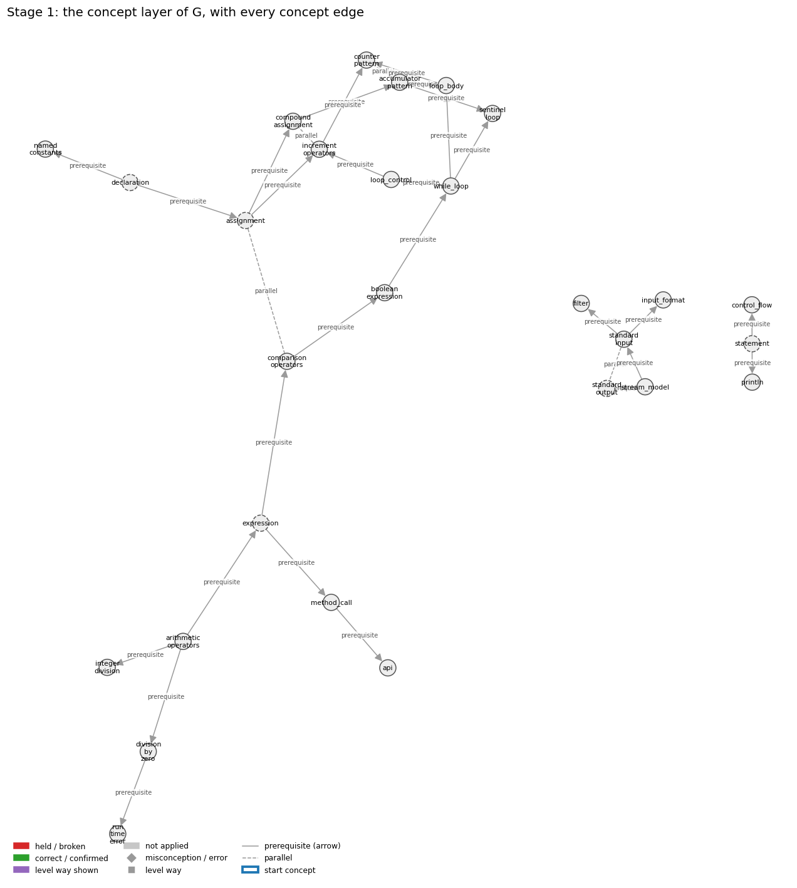
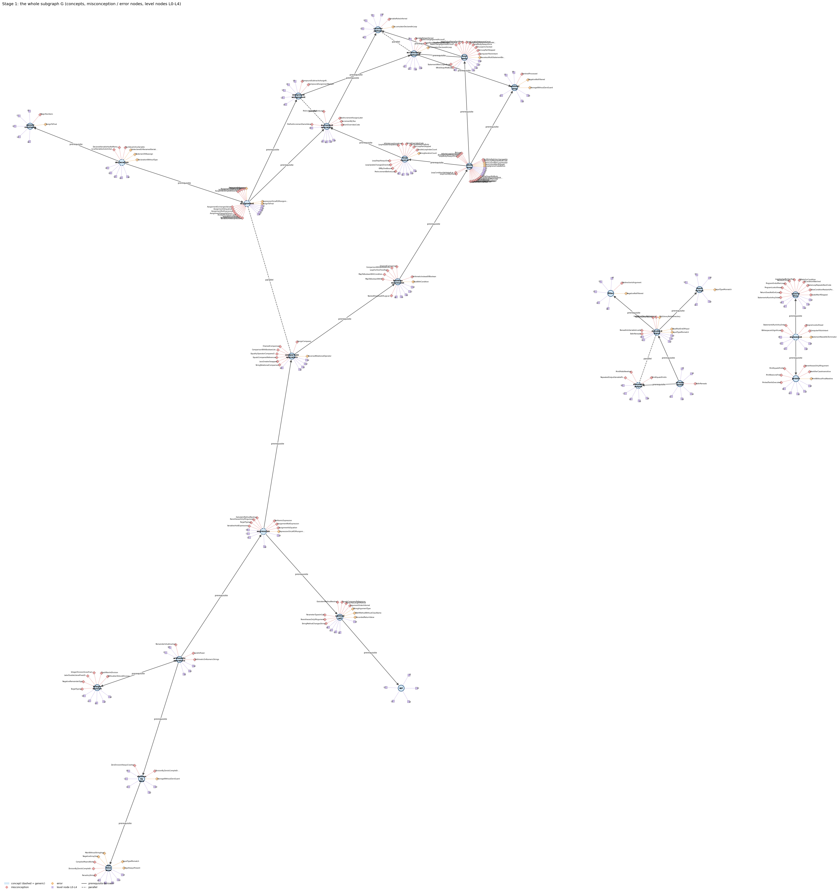
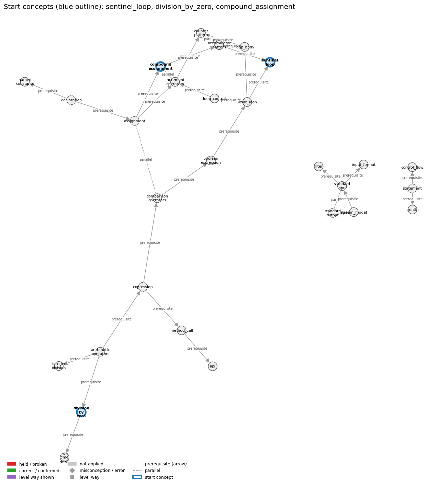
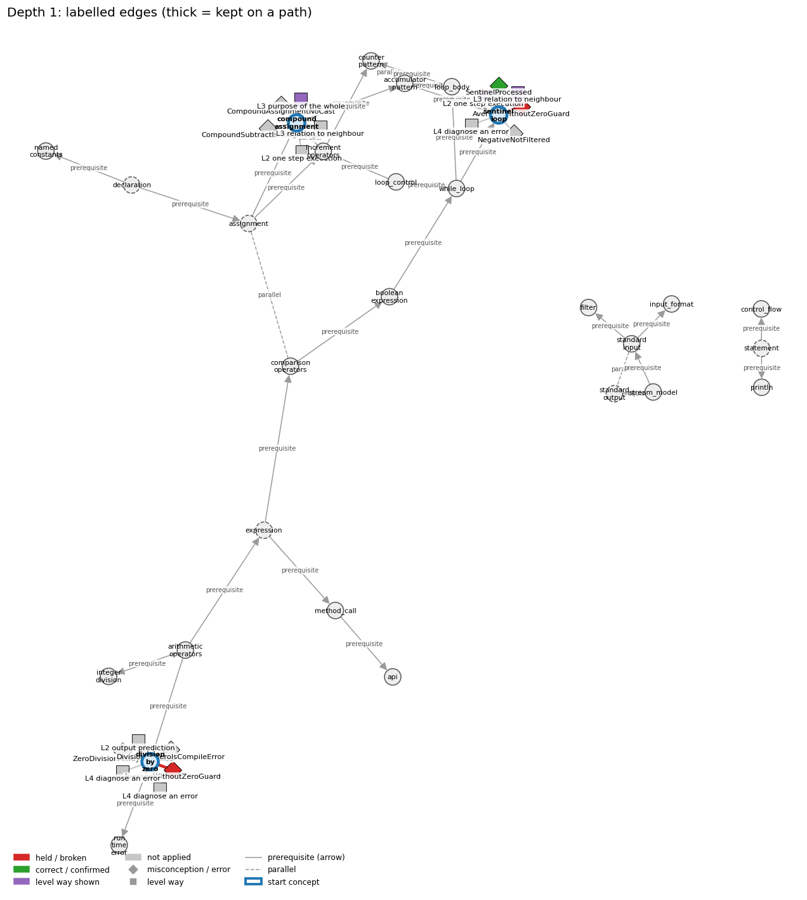
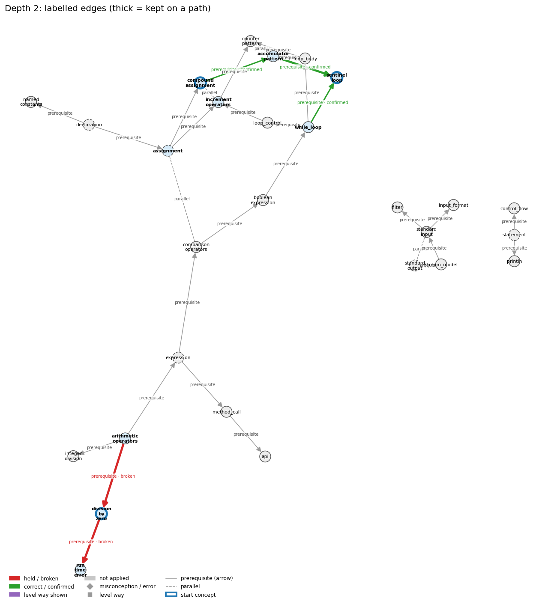
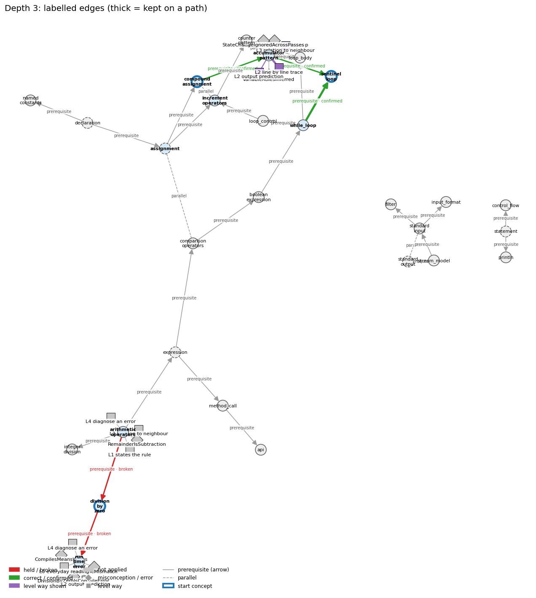
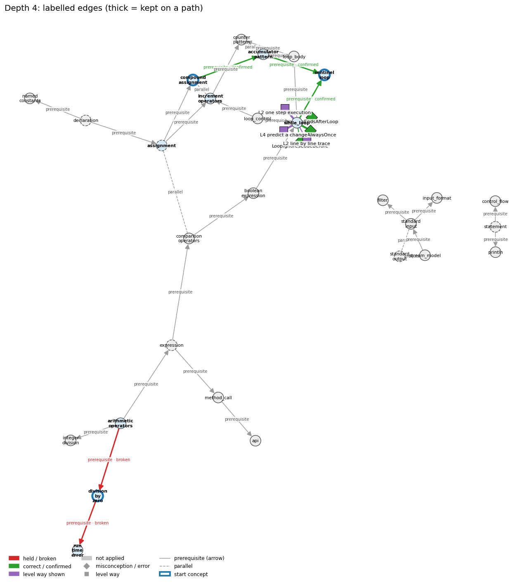
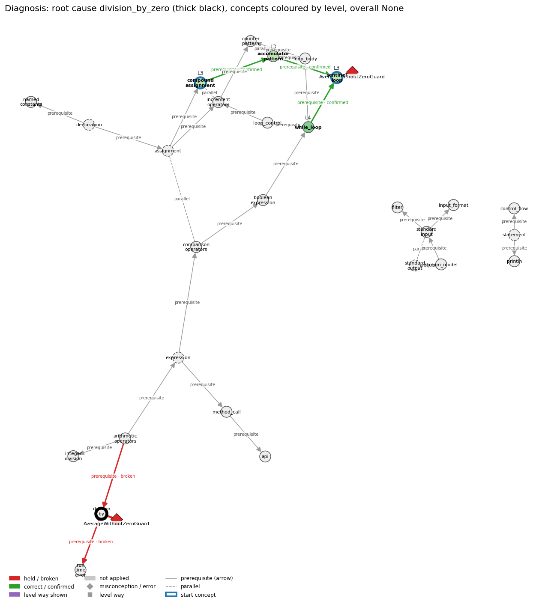

# Think on the Graph: every output of the run MY35

Files of this scenario: `input.json` (program, question, answer), `diagnosis.json`, `subgraph.json`, `traverse_log.txt`, `report.html` (this report as one full-page file, with the interactive graph `MY35_G.html`), `MY35.ipynb` (this report as a notebook).

## 0. Input
Program:
```java
final int STOP = -1;
int sum = 0, count = 0;
int x = StdIn.readInt();
while (x != STOP) {
    sum += x;
    count++;
    x = StdIn.readInt();
}
System.out.println(sum / count);
```
Question: Suppose the very first number typed is -1. What does the program print, and why?

Student's answer: 0. Nothing was added, so sum and count are both 0, and 0 divided by 0 is just 0.
Settings: width 3, depth 3, prune llm, backend claude-cli, model claude-opus-5-5
## 1. Stage 1: the subgraph G from the code (no model)
Masked code (string and char literals and comments blanked; this is what the patterns see):
```
final int STOP = -1;
int sum = 0, count = 0;
int x = StdIn.readInt();
while (x != STOP) {
    sum += x;
    count++;
    x = StdIn.readInt();
}
System.out.println(sum / count);
```
Which code text tagged which concept (a generic concept fires on almost any Java line; it starts the walk only if the answer repeats its tag):
| concept | generic | channel | matched text | line |
|---|---|---|---|---|
| accumulator_pattern | False | pattern | 'sum += x;' | 5 |
| api | False | pattern | 'StdIn.readInt(' | 3 |
| arithmetic_operators | False | pattern | 'm / c' | 9 |
| assignment | True | pattern | '=' | 1 |
| boolean_expression | False | pattern | 'while (' | 4 |
| comparison_operators | False | pattern | 'while (x !=' | 4 |
| compound_assignment | False | pattern | '+=' | 5 |
| control_flow | False | pattern | 'while (' | 4 |
| counter_pattern | False | pattern | 'count++' | 6 |
| declaration | True | pattern | 'final int STOP =' | 1 |
| division_by_zero | False | signal | 'int sum = 0, count = 0;\nint x = StdIn.readInt();\nwhile (x != STOP) {\n    sum += x;\n    count++;\n    x = StdIn.readInt();\n}\nSystem.out.println(sum / count' | 2 |
| expression | True | pattern | 'x !=' | 4 |
| expression | True | pattern | '= -1;' | 1 |
| filter | False | signal | 'StdIn.readInt();\nwhile (x != STOP) {\n    sum += x;\n    count++;\n    x = StdIn.readInt();\n}\nSystem.out.print' | 3 |
| increment_operators | False | pattern | '++' | 6 |
| input_format | False | pattern | 'StdIn.readInt(' | 3 |
| integer_division | False | signal | 'int sum = 0, count = 0;\nint x = StdIn.readInt();\nwhile (x != STOP) {\n    sum += x;\n    count++;\n    x = StdIn.readInt();\n}\nSystem.out.println(sum / count' | 2 |
| loop_body | False | pattern | 'while (' | 4 |
| loop_control | False | pattern | 'while (x !=' | 4 |
| method_call | False | pattern | 'StdIn.readInt(' | 3 |
| named_constants | False | pattern | 'final int STOP =' | 1 |
| println | False | pattern | 'System.out.println(' | 9 |
| run_time_error | False | signal | 'int sum = 0, count = 0;\nint x = StdIn.readInt();\nwhile (x != STOP) {\n    sum += x;\n    count++;\n    x = StdIn.readInt();\n}\nSystem.out.println(sum / count' | 2 |
| sentinel_loop | False | signal | 'while (x != STOP) {\n    sum += x;\n    count++;\n    x = StdIn.readInt(' | 4 |
| standard_input | False | pattern | 'StdIn.' | 3 |
| standard_output | True | pattern | 'System.out.' | 9 |
| statement | True | pattern | ';' | 1 |
| stream_model | False | pattern | 'StdIn.' | 3 |
| while_loop | False | pattern | 'while (' | 4 |

G: 28 concept nodes (5 generic), 32 concept edges, 170 misconception / error edges, 132 misconception / error nodes, 140 level nodes, 177 level-misconception links, 3 connected piece(s).
Note: concept nodes form 3 pieces (the KG has no edge between them): accumulator_pattern,api,arithmetic_operators,assignment,boolean_expression,comparison_operators,compound_assignment,counter_pattern,declaration,division_by_zero,expression,increment_operators,integer_division,loop_body,loop_control,method_call,named_constants,run_time_error,sentinel_loop,while_loop | control_flow,println,statement | filter,input_format,standard_input,standard_output,stream_model

Concept edges of G (the links the walk can read; `pre:` = prerequisite A -> B, `par:` = parallel):
| edge | type | rule (logic) |
|---|---|---|
| par:accumulator_pattern~counter_pattern | parallel | An accumulator adds the current value itself on each pass (sum += x); a counter adds 1 on each pass that matches (count++). |
| par:assignment~comparison_operators | parallel | x = y stores the value of y in x (a statement with a side effect); x == y only tests whether the two values are equal and gives a boolean. Writing = where == is meant is a compile error with int operands and a silent bug with boolean operands. |
| par:increment_operators~compound_assignment | parallel | i++, ++i and i += 1 all add 1 to i; ++ and -- change a variable only by one and are normally used for integers, while i += k works for any amount and with any arithmetic operator (-=, *=, /=, %=). |
| par:standard_input~standard_output | parallel | StdIn takes values in from the input stream; StdOut sends values out to the output stream. |
| pre:accumulator_pattern->sentinel_loop | prerequisite | Sum and count are accumulators. |
| pre:arithmetic_operators->division_by_zero | prerequisite | Integer division by zero (1/0) generates a run-time exception, while floating-point 1.0/0.0 is legal and has the value Infinity. |
| pre:arithmetic_operators->expression | prerequisite | An operator combines operand values a and b into a new value, so operators build larger expressions from smaller ones. |
| pre:arithmetic_operators->integer_division | prerequisite | For ints a and b, / gives the whole quotient q and % gives the remainder r, so that a = b * q + r. |
| pre:assignment->compound_assignment | prerequisite | x op= e is shorthand for the assignment x = x op e. |
| pre:assignment->increment_operators | prerequisite | i++ is shorthand for the assignment i = i + 1. |
| pre:boolean_expression->while_loop | prerequisite | A while tests its boolean condition before every pass and stops the first time it evaluates to false. |
| pre:comparison_operators->boolean_expression | prerequisite | A comparison such as x < y produces a boolean result; comparisons together with boolean logic provide the basis for decision-making. |
| pre:compound_assignment->accumulator_pattern | prerequisite | sum += x is the usual way a running total is updated on each pass. |
| pre:declaration->assignment | prerequisite | A variable must be declared before an assignment can store a value into it. |
| pre:declaration->named_constants | prerequisite | A constant is a declaration marked final. |
| pre:division_by_zero->run_time_error | prerequisite | Dividing an int by zero compiles but throws ArithmeticException when the program runs: a run-time error. |
| pre:expression->comparison_operators | prerequisite | Comparison operators build expressions whose value is a boolean, so one must already know what an expression is to understand a < b. |
| pre:expression->method_call | prerequisite | Method arguments may be expressions, and a method call can be used in expressions in the same way as variables and literals. |
| pre:increment_operators->counter_pattern | prerequisite | A counter is updated with count++, adding one on each pass that matches. |
| pre:loop_body->accumulator_pattern | prerequisite | The accumulator update sum += x sits inside the body, so it runs once on every pass. |
| pre:loop_body->counter_pattern | prerequisite | count++ sits inside the body, usually under an if, so it runs once on every pass that matches. |
| pre:loop_control->increment_operators | prerequisite | The loop update i = i + 1 comes first; ++ (and +=) are then introduced as shorthand for that update. |
| pre:method_call->api | prerequisite | An API lists, for each library method, the signature you need in order to call it: name, argument types and return type. |
| pre:standard_input->filter | prerequisite | A filter reads its data from standard input and writes what it keeps to standard output. |
| pre:standard_input->input_format | prerequisite | Input format rules apply to every StdIn read. |
| pre:statement->control_flow | prerequisite | Control flow is the order in which statements run. |
| pre:statement->println | prerequisite | System.out.println(s); is itself a statement, so its line of output appears at its own place in the sequence. |
| pre:stream_model->standard_input | prerequisite | StdIn reads a stream: values arrive in order and each value is consumed once. |
| pre:stream_model->standard_output | prerequisite | StdOut writes a stream: each print appends its text to the end of the output. |
| pre:while_loop->loop_body | prerequisite | The loop body is the block of statements that a while (or for) loop repeats on each pass. |
| pre:while_loop->loop_control | prerequisite | A while loop has the same three control parts as a for loop, written in other places: the index set before the loop, the loop-continuation condition in the header, and the update as the last statement of the body. |
| pre:while_loop->sentinel_loop | prerequisite | A sentinel loop is a while loop whose condition tests each value read against the stop value. |

Misconception / error edges per concept (count), and level ways per concept (count):
| concept | misconception / error edges | level ways (L1-L4 + L0 non-misconception) |
|---|---|---|
| accumulator_pattern | 4 | 17 |
| api | 0 | 12 |
| arithmetic_operators | 3 | 18 |
| assignment | 15 | 24 |
| boolean_expression | 8 | 19 |
| comparison_operators | 8 | 20 |
| compound_assignment | 2 | 15 |
| control_flow | 11 | 15 |
| counter_pattern | 2 | 16 |
| declaration | 6 | 18 |
| division_by_zero | 3 | 15 |
| expression | 8 | 19 |
| filter | 2 | 12 |
| increment_operators | 5 | 16 |
| input_format | 1 | 12 |
| integer_division | 6 | 16 |
| loop_body | 12 | 14 |
| loop_control | 11 | 19 |
| method_call | 10 | 17 |
| named_constants | 2 | 13 |
| println | 6 | 17 |
| run_time_error | 7 | 19 |
| sentinel_loop | 3 | 16 |
| standard_input | 7 | 23 |
| standard_output | 3 | 18 |
| statement | 5 | 19 |
| stream_model | 1 | 14 |
| while_loop | 19 | 24 |

**Figure 1**


**Figure 2**


## 2. Clauses and start concepts (no model)
The answer split into clauses (at sentence ends, ';', and before 'because' / 'so'; quotes removed):
| clause | text |
|---|---|
| c1 | 0 |
| c2 | Nothing was added |
| c3 | so sum and count are both 0, and 0 divided by 0 is just 0 |

start: BM25 of the answer against each tagged concept: sentinel_loop 18.56 (hits 1), division_by_zero 17.29 (hits 1), compound_assignment 10.91 (hits 1), loop_control 10.71 (hits 1), increment_operators 10.12 (hits 1), while_loop 10.09 (hits 1), integer_division 9.85 (hits 1), arithmetic_operators 9.73 (hits 1), run_time_error 8.85 (hits 1), boolean_expression 8.85 (hits 1), accumulator_pattern 7.23 (hits 1), named_constants 6.20 (hits 1), counter_pattern 5.94 (hits 1), loop_body 5.10 (hits 1), filter 5.02 (hits 1), println 3.63 (hits 1), control_flow 3.55 (hits 1), comparison_operators 3.23 (hits 1), method_call 3.12 (hits 1), standard_input 1.80 (hits 1), stream_model 1.22 (hits 1), api 0.57 (hits 1), input_format 0.53 (hits 1)

start: chosen sentinel_loop, division_by_zero, compound_assignment

start concepts (3): sentinel_loop, division_by_zero, compound_assignment

Start concepts: sentinel_loop, division_by_zero, compound_assignment

**Figure 3**


## 3. The walk, depth by depth
At each depth, for each current concept: the edges offered (a concept entering as a start concept offers its misconception / error edges and its level ways, as two families; otherwise it offers its concept edges), the prune prompt and the model's reply, then the label prompt(s) and the model's reply, parsed into label / clauses / confidence. Score = prune score x confidence.

### Depth 1: current concepts 'sentinel_loop', 'division_by_zero', 'compound_assignment'

#### sentinel_loop, misconceptions: 3 edges offered
Edges offered:
| edge |
|---|
| err:sentinel_loop->AverageWithoutZeroGuard \| wrong rule: Computes sum / count without checking that count is above 0. \| right rule: If no value was read (count is 0), do not compute the average: with int operands sum / count is a division by zero, a run-time exception that stops the program; with a double sum the division does not stop the program and gives a meaningless value instead of an average. |
| err:sentinel_loop->NegativeNotFiltered \| wrong rule: Adds negative rainfall values to the total. \| right rule: Values outside the range of interest must be filtered out (for example with if (t >= lo && t <= hi)) before they are processed. |
| mis:sentinel_loop->SentinelProcessed \| wrong rule: The sentinel value (e.g. 999999) is added to the total like the other values. \| right rule: The loop stops at the sentinel without processing it. |

Prune: the model's reply (edge id and score; the kept edges sum to 1):
```
{err:sentinel_loop->AverageWithoutZeroGuard (Score: 0.8)}
{mis:sentinel_loop->SentinelProcessed (Score: 0.15)}
{err:sentinel_loop->NegativeNotFiltered (Score: 0.05)}
```
Kept by pruning: err:sentinel_loop->AverageWithoutZeroGuard (0.80), mis:sentinel_loop->SentinelProcessed (0.15), err:sentinel_loop->NegativeNotFiltered (0.05)

Label prompt for the misconception / error edges (judged together). The model saw the program, the question, the numbered clauses, and these edges with their wrong rule and right rule:
| edge |
|---|
| err:sentinel_loop->AverageWithoutZeroGuard \| wrong rule: Computes sum / count without checking that count is above 0. \| right rule: If no value was read (count is 0), do not compute the average: with int operands sum / count is a division by zero, a run-time exception that stops the program; with a double sum the division does not stop the program and gives a meaningless value instead of an average. |
| mis:sentinel_loop->SentinelProcessed \| wrong rule: The sentinel value (e.g. 999999) is added to the total like the other values. \| right rule: The loop stops at the sentinel without processing it. |
| err:sentinel_loop->NegativeNotFiltered \| wrong rule: Adds negative rainfall values to the total. \| right rule: Values outside the range of interest must be filtered out (for example with if (t >= lo && t <= hi)) before they are processed. |
Model's reply:
```
err:sentinel_loop->AverageWithoutZeroGuard | held | clauses: 1, 3 | confidence: 0.93
mis:sentinel_loop->SentinelProcessed | correct | clauses: 2 | confidence: 0.85
err:sentinel_loop->NegativeNotFiltered | not applied | clauses: none | confidence: 0.92
```

Parsed labels:
| edge | label | prune score | confidence | score | clauses | words |
|---|---|---|---|---|---|---|
| err:sentinel_loop->AverageWithoutZeroGuard | held | 0.8 | 0.93 | 0.74 | c1, c3 | 0; so sum and count are both 0, and 0 divided by 0 is just 0 |
| mis:sentinel_loop->SentinelProcessed | correct | 0.15 | 0.85 | 0.13 | c2 | Nothing was added |
| err:sentinel_loop->NegativeNotFiltered | not applied |  |  | 0.0 |  |  |

#### sentinel_loop, level ways: 16 edges offered
Edges offered:
| edge |
|---|
| lvl:sentinel_loop@L0#0 \| level L0 way everyday_reading: In everyday lists the last number written is part of the data. A sentinel such as 99999 is a stop marker, not data, so it must not be summed or counted. |
| lvl:sentinel_loop@L0#2 \| level L0 way inconsistent_trace: Points to LT (read, test for the sentinel, then process). An uneven trace processes before testing on the last pass, so the sentinel is included that time. (here mixing in: "The sentinel value (e.g. 999999) is added to the total like the other values") |
| lvl:sentinel_loop@L1#0 \| level L1 way names_the_element: A sentinel loop is a read loop that stops when it reads a designated stop value that cannot occur as real data (the Rainfall problem). |
| lvl:sentinel_loop@L1#1 \| level L1 way states_the_rule: Read a value; while it is not the sentinel, process it and read the next one. The sentinel is never processed. |
| lvl:sentinel_loop@L2#0 \| level L2 way line_by_line_trace: A priming read comes before the loop, then each pass runs: test value != SENTINEL, process (sum += v; count++), then read the next value at the end of the body. An equivalent form is while (true) { v = read; if (v == SENTINEL) break; process; }. |
| lvl:sentinel_loop@L2#1 \| level L2 way output_prediction: With input 3 -1 5 99999 7, keeping only non-negative values, the Rainfall average is (3+5)/2 = 4.0. The 7 after the sentinel is never read. |
| lvl:sentinel_loop@L2#2 \| level L2 way one_step_execution: One pass reads one value. If it is the sentinel, the loop ends with sum and count unchanged; otherwise the (valid) value updates sum and count. |
| lvl:sentinel_loop@L3#0 \| level L3 way relation_to_neighbour: The sentinel test replaces, or is added to, the isEmpty() test. If the sentinel may be missing, keep !StdIn.isEmpty() in the condition so the program does not read past the end. |
| lvl:sentinel_loop@L3#1 \| level L3 way relation_to_neighbour: sum (a gatherer) and count must change only for values that are not the sentinel and pass the filter. The average is computed once, after the loop. |
| lvl:sentinel_loop@L3#2 \| level L3 way purpose_of_the_whole: Plan: Soloway's sentinel-controlled running-total loop (Rainfall). Roles: sum is a gatherer, count a stepper, and the value read a most-recent holder. |
| lvl:sentinel_loop@L4#0 \| level L4 way predict_a_change: Changing the sentinel keeps the behaviour only if the new value cannot occur in the data. Moving the test after the processing step breaks the invariant that the sentinel is never processed. |
| lvl:sentinel_loop@L4#1 \| level L4 way diagnose_an_error: rule broken: Check count > 0 before computing sum / count. Kind: run-time exception. Trigger class: The sentinel is the first value (count stays 0). With int operands this gives ArithmeticException (/ by zero); with a double sum it gives NaN silently. |
| lvl:sentinel_loop@L4#2 \| level L4 way diagnose_an_error: rule broken: Only values in the range of interest may be processed. Kind: silent logic error. Trigger class: Inputs below 0 (or outside lo..hi) are added to the total because no if (t >= lo && t <= hi) guard comes before the update. |
| lvl:sentinel_loop@L4#3 \| level L4 way transfer_to_a_new_program: Use a sentinel when the data stream marks its own end with a value outside the valid range (keyed entry with no end-of-file). If every value could be real data, use isEmpty() or a count instead. |
| lvl:sentinel_loop@L4#4 \| level L4 way diagnose_an_error: rule broken: The sentinel must appear, or the loop must also test isEmpty(). Kind: run-time exception. Trigger class: The input ends without the sentinel, so the next read happens after the input is exhausted. |
| lvl:sentinel_loop@L4#5 \| level L4 way diagnose_an_error: rule broken: The sentinel must not be included in the computation. Kind: silent logic error. Trigger class: A process-then-test ordering adds 99999 to sum and count once. |

Prune: the model's reply (edge id and score; the kept edges sum to 1):
```
{lvl:sentinel_loop@L4#1 (Score: 0.5)}
{lvl:sentinel_loop@L2#2 (Score: 0.3)}
{lvl:sentinel_loop@L3#1 (Score: 0.2)}
```
Kept by pruning: lvl:sentinel_loop@L4#1 (0.50), lvl:sentinel_loop@L2#2 (0.30), lvl:sentinel_loop@L3#1 (0.20)

Label prompt for level way lvl:sentinel_loop@L4#1 (the model saw only the concept, the way's name 'diagnose an error' and its text; no level):
> rule broken: Check count > 0 before computing sum / count. Kind: run-time exception. Trigger class: The sentinel is the first value (count stays 0). With int operands this gives ArithmeticException (/ by zero); with a double sum it gives NaN silently.

Model's reply:
```
Label: not shown
Clauses: none
Confidence: 0.85
```

Label prompt for level way lvl:sentinel_loop@L2#2 (the model saw only the concept, the way's name 'one step execution' and its text; no level):
> One pass reads one value. If it is the sentinel, the loop ends with sum and count unchanged; otherwise the (valid) value updates sum and count.

Model's reply:
```
Label: shown
Clauses: 2, 3
Confidence: 0.8
```

Label prompt for level way lvl:sentinel_loop@L3#1 (the model saw only the concept, the way's name 'relation to neighbour' and its text; no level):
> sum (a gatherer) and count must change only for values that are not the sentinel and pass the filter. The average is computed once, after the loop.

Model's reply:
```
Label: shown
Clauses: 2, 3
Confidence: 0.8
```

Parsed labels:
| edge | label | prune score | confidence | score | clauses | words |
|---|---|---|---|---|---|---|
| lvl:sentinel_loop@L4#1 | not applied |  |  | 0.0 |  |  |
| lvl:sentinel_loop@L2#2 | shown | 0.3 | 0.8 | 0.24 | c2, c3 | Nothing was added; so sum and count are both 0, and 0 divided by 0 is just 0 |
| lvl:sentinel_loop@L3#1 | shown | 0.2 | 0.8 | 0.16 | c2, c3 | Nothing was added; so sum and count are both 0, and 0 divided by 0 is just 0 |

#### division_by_zero, misconceptions: 3 edges offered
Edges offered:
| edge |
|---|
| err:division_by_zero->AverageWithoutZeroGuard \| wrong rule: Computes sum / count without checking that count is above 0. \| right rule: If no value was read (count is 0), do not compute the average: with int operands sum / count is a division by zero, a run-time exception that stops the program; with a double sum the division does not stop the program and gives a meaningless value instead of an average. |
| mis:division_by_zero->DivisionByZeroIsCompileError \| wrong rule: System.out.println(5 / 0); is rejected by the compiler. \| right rule: It compiles; the ArithmeticException happens when the program runs. |
| mis:division_by_zero->ZeroDivisionAlwaysCrashes \| wrong rule: Dividing by zero always stops the program with an error. \| right rule: Only integer division by zero generates a run-time exception; 1.0/0.0 is legal and has the value Infinity. |

Prune: the model's reply (edge id and score; the kept edges sum to 1):
```
err:division_by_zero->AverageWithoutZeroGuard (0.60), mis:division_by_zero->ZeroDivisionAlwaysCrashes (0.30), mis:division_by_zero->DivisionByZeroIsCompileError (0.10)
```
Kept by pruning: err:division_by_zero->AverageWithoutZeroGuard (0.60), mis:division_by_zero->ZeroDivisionAlwaysCrashes (0.30), mis:division_by_zero->DivisionByZeroIsCompileError (0.10)

Label prompt for the misconception / error edges (judged together). The model saw the program, the question, the numbered clauses, and these edges with their wrong rule and right rule:
| edge |
|---|
| err:division_by_zero->AverageWithoutZeroGuard \| wrong rule: Computes sum / count without checking that count is above 0. \| right rule: If no value was read (count is 0), do not compute the average: with int operands sum / count is a division by zero, a run-time exception that stops the program; with a double sum the division does not stop the program and gives a meaningless value instead of an average. |
| mis:division_by_zero->ZeroDivisionAlwaysCrashes \| wrong rule: Dividing by zero always stops the program with an error. \| right rule: Only integer division by zero generates a run-time exception; 1.0/0.0 is legal and has the value Infinity. |
| mis:division_by_zero->DivisionByZeroIsCompileError \| wrong rule: System.out.println(5 / 0); is rejected by the compiler. \| right rule: It compiles; the ArithmeticException happens when the program runs. |
Model's reply:
```
err:division_by_zero->AverageWithoutZeroGuard | held | clauses: 1, 3 | confidence: 0.85
mis:division_by_zero->ZeroDivisionAlwaysCrashes | not applied | clauses: none | confidence: 0.8
mis:division_by_zero->DivisionByZeroIsCompileError | not applied | clauses: none | confidence: 0.9
```

Parsed labels:
| edge | label | prune score | confidence | score | clauses | words |
|---|---|---|---|---|---|---|
| err:division_by_zero->AverageWithoutZeroGuard | held | 0.6000000000000001 | 0.85 | 0.51 | c1, c3 | 0; so sum and count are both 0, and 0 divided by 0 is just 0 |
| mis:division_by_zero->ZeroDivisionAlwaysCrashes | not applied |  |  | 0.0 |  |  |
| mis:division_by_zero->DivisionByZeroIsCompileError | not applied |  |  | 0.0 |  |  |

#### division_by_zero, level ways: 15 edges offered
Edges offered:
| edge |
|---|
| lvl:division_by_zero@L0#0 \| level L0 way everyday_reading: Folk meaning: in maths division by zero is 'impossible', so every x / 0 must be rejected, ideally by the compiler. Java rule: the compiler accepts it; int or long / and % by zero throw ArithmeticException at run time, while double division by zero is legal and gives Infinity or NaN. |
| lvl:division_by_zero@L0#3 \| level L0 way inconsistent_trace: Points to LT (both operands are evaluated, promotion decides whether the division is int or double, and only then is the divisor checked). Applied unevenly: the student lets 1/0.0 crash because the 1 is an int, or lets 1/0 give Infinity on one line and an exception on another. (here mixing in: "Dividing by zero always stops the program with an error") |
| lvl:division_by_zero@L1#0 \| level L1 way names_the_element: Division by zero is the evaluation of x / 0 or x % 0: a run-time error for integer types and a special value (Infinity or NaN) for floating-point types. |
| lvl:division_by_zero@L1#1 \| level L1 way states_the_rule: An integer / or % throws ArithmeticException if the right operand is zero; floating-point arithmetic follows IEEE 754, so a nonzero double divided by zero is Infinity or -Infinity and 0.0/0.0 is NaN. With doubles, 1.0 / 0.0 is Infinity and 0.0 / 0.0 (or Math.sqrt(-1.0)) is NaN; NaN is not equal to anything, not even itself. |
| lvl:division_by_zero@L2#0 \| level L2 way line_by_line_trace: Left operand, then right operand are fully evaluated; then the division itself runs: for int it checks the divisor and throws at that moment, so the rest of the statement (the assignment or the println) never happens; for double it produces the special value and evaluation continues. |
| lvl:division_by_zero@L2#1 \| level L2 way output_prediction: 1/0 and 1%0 produce no value: the program stops with Exception in thread "main" java.lang.ArithmeticException: / by zero; 1.0/0.0 is Infinity, -1.0/0.0 is -Infinity, 0.0/0.0 is NaN, and 1/0.0 is Infinity (the 1 is promoted). |
| lvl:division_by_zero@L2#2 \| level L2 way one_step_execution: For int, no variable changes: the exception aborts the statement and (uncaught) ends the program. For double, the target gets Infinity or NaN; NaN then propagates through later arithmetic and every comparison with it (even ==) is false. |
| lvl:division_by_zero@L3#0 \| level L3 way relation_to_neighbour: The zero check belongs to the int / and % operators: they always produce an int except when the divisor is zero, in which case they throw; + - * never throw. |
| lvl:division_by_zero@L3#1 \| level L3 way relation_to_neighbour: Once either operand is a double the division follows IEEE 754 rules instead, so the same zero divisor gives Infinity or NaN rather than an exception. |
| lvl:division_by_zero@L3#2 \| level L3 way purpose_of_the_whole: Plan: guard the division (if (count > 0) average = sum / count;), a guard test placed before the risky operation; Infinity is used on purpose as an initial value for a minimum search (Double.POSITIVE_INFINITY). |
| lvl:division_by_zero@L4#0 \| level L4 way predict_a_change: Changing an operand from int to double turns a crash into a silent Infinity or NaN (and changing it back turns the silent value into a crash); adding a zero guard leaves results for nonzero divisors unchanged. |
| lvl:division_by_zero@L4#1 \| level L4 way diagnose_an_error: rule broken: A divisor must be checked to be nonzero before dividing; an average of zero values is undefined. Kind: run-time exception. Trigger class: count == 0 (empty input, no values read): with int sum / count an ArithmeticException stops the program; with a double sum the division gives NaN (0.0/0.0) and prints a meaningless average as a silent logic error. |
| lvl:division_by_zero@L4#2 \| level L4 way transfer_to_a_new_program: Guard every integer division whose divisor could be zero; rely on Infinity only when it is the intended value (e.g. as a sentinel for min); when the result is undefined (empty input) handle the case explicitly instead of printing NaN. |
| lvl:division_by_zero@L4#3 \| level L4 way diagnose_an_error: rule broken: Integer / and % require a nonzero right operand. Kind: run-time exception. Trigger class: Any int or long division or remainder whose right operand evaluates to 0, e.g. n % k with k = 0, or a loop dividing by a variable that reaches 0. |
| lvl:division_by_zero@L4#4 \| level L4 way diagnose_an_error: rule broken: A floating-point division by zero yields Infinity or NaN instead of a number. Kind: silent logic error. Trigger class: A double divisor that becomes 0.0 (or 0.0/0.0), whose Infinity/NaN result then flows into later computations and comparisons. |

Prune: the model's reply (edge id and score; the kept edges sum to 1):
```
{lvl:division_by_zero@L4#1 (Score: 0.5)}
{lvl:division_by_zero@L2#1 (Score: 0.3)}
{lvl:division_by_zero@L4#3 (Score: 0.2)}
```
Kept by pruning: lvl:division_by_zero@L4#1 (0.50), lvl:division_by_zero@L2#1 (0.30), lvl:division_by_zero@L4#3 (0.20)

Label prompt for level way lvl:division_by_zero@L4#1 (the model saw only the concept, the way's name 'diagnose an error' and its text; no level):
> rule broken: A divisor must be checked to be nonzero before dividing; an average of zero values is undefined. Kind: run-time exception. Trigger class: count == 0 (empty input, no values read): with int sum / count an ArithmeticException stops the program; with a double sum the division gives NaN (0.0/0.0) and prints a meaningless average as a silent logic error.

Model's reply:
```
Label: not shown
Clauses: none
Confidence: 0.93
```

Label prompt for level way lvl:division_by_zero@L2#1 (the model saw only the concept, the way's name 'output prediction' and its text; no level):
> 1/0 and 1%0 produce no value: the program stops with Exception in thread "main" java.lang.ArithmeticException: / by zero; 1.0/0.0 is Infinity, -1.0/0.0 is -Infinity, 0.0/0.0 is NaN, and 1/0.0 is Infinity (the 1 is promoted).

Model's reply:
```
Label: not shown
Clauses: none
Confidence: 0.95
```

Label prompt for level way lvl:division_by_zero@L4#3 (the model saw only the concept, the way's name 'diagnose an error' and its text; no level):
> rule broken: Integer / and % require a nonzero right operand. Kind: run-time exception. Trigger class: Any int or long division or remainder whose right operand evaluates to 0, e.g. n % k with k = 0, or a loop dividing by a variable that reaches 0.

Model's reply:
```
Label: not shown
Clauses: none
Confidence: 0.93
```

Parsed labels:
| edge | label | prune score | confidence | score | clauses | words |
|---|---|---|---|---|---|---|
| lvl:division_by_zero@L4#1 | not applied |  |  | 0.0 |  |  |
| lvl:division_by_zero@L2#1 | not applied |  |  | 0.0 |  |  |
| lvl:division_by_zero@L4#3 | not applied |  |  | 0.0 |  |  |

#### compound_assignment, misconceptions: 2 edges offered
Edges offered:
| edge |
|---|
| mis:compound_assignment->CompoundAssignmentNoCast \| wrong rule: x += 0.5 adds one half to an int x. \| right rule: x += 0.5 is x = (int) (x + 0.5), so an int x does not change. |
| mis:compound_assignment->CompoundSubtractIsAssignNegative \| wrong rule: x[i] -= y sets x[i] to -y (reads -= as assignment of a negated value). \| right rule: x[i] -= y means x[i] = x[i] - y: it subtracts y from the current value. |

Prune: the model's reply (edge id and score; the kept edges sum to 1):
```
{mis:compound_assignment->CompoundAssignmentNoCast (Score: 0.6)}
{mis:compound_assignment->CompoundSubtractIsAssignNegative (Score: 0.4)}
```
Kept by pruning: mis:compound_assignment->CompoundAssignmentNoCast (0.60), mis:compound_assignment->CompoundSubtractIsAssignNegative (0.40)

Label prompt for the misconception / error edges (judged together). The model saw the program, the question, the numbered clauses, and these edges with their wrong rule and right rule:
| edge |
|---|
| mis:compound_assignment->CompoundAssignmentNoCast \| wrong rule: x += 0.5 adds one half to an int x. \| right rule: x += 0.5 is x = (int) (x + 0.5), so an int x does not change. |
| mis:compound_assignment->CompoundSubtractIsAssignNegative \| wrong rule: x[i] -= y sets x[i] to -y (reads -= as assignment of a negated value). \| right rule: x[i] -= y means x[i] = x[i] - y: it subtracts y from the current value. |
Model's reply:
```
mis:compound_assignment->CompoundAssignmentNoCast | not applied | clauses: none | confidence: 0.95
mis:compound_assignment->CompoundSubtractIsAssignNegative | not applied | clauses: none | confidence: 0.95
```

Parsed labels:
| edge | label | prune score | confidence | score | clauses | words |
|---|---|---|---|---|---|---|
| mis:compound_assignment->CompoundAssignmentNoCast | not applied |  |  | 0.0 |  |  |
| mis:compound_assignment->CompoundSubtractIsAssignNegative | not applied |  |  | 0.0 |  |  |

#### compound_assignment, level ways: 15 edges offered
Edges offered:
| edge |
|---|
| lvl:compound_assignment@L0#0 \| level L0 way everyday_reading: Folk meaning: x -= y reads as 'x equals minus y' and x += 0.5 as 'add a half' in arithmetic. In Java x op= e means x = (T) (x op e): it updates x from its current value and casts the result back to x's type. |
| lvl:compound_assignment@L0#3 \| level L0 way inconsistent_trace: Applies the compound-assignment rule (LT) unevenly: uses the current value of x on some passes but treats x -= y as x = -y on others, or forgets the implicit cast on some lines. (here mixing in: "x += 0.5 adds one half to an int x") |
| lvl:compound_assignment@L1#0 \| level L1 way names_the_element: A compound assignment operator (+=, -=, *=, /=, %=) is an assignment shorthand that combines a binary operation with storing the result back in the left-hand variable. |
| lvl:compound_assignment@L1#1 \| level L1 way states_the_rule: x op= e is equivalent to x = (T) ((x) op (e)) where T is the type of x, with x evaluated only once; it works for any arithmetic operator in any primitive numeric type. x op= e means x = (T)(x op e), with a hidden cast to the type T of x: with int x = 3, x += 0.5 compiles and leaves 3, while x = x + 0.5 does not compile. |
| lvl:compound_assignment@L2#0 \| level L2 way line_by_line_trace: Evaluate x and save its value, then evaluate e, then compute x op e, cast to x's type, and store into x. |
| lvl:compound_assignment@L2#1 \| level L2 way output_prediction: The new value of x is (T)(old x op e) and is also the expression's value: each starting from int x = 7: x += 3 gives 10, x /= 2 gives 3, and x += 0.5 gives 7 (7.5 truncated) instead of a compile error. |
| lvl:compound_assignment@L2#2 \| level L2 way one_step_execution: One execution changes exactly one variable, x, from its old value (sum += x[i] turns sum = 1 into 1 + 4 = 5). |
| lvl:compound_assignment@L3#0 \| level L3 way relation_to_neighbour: x op= e is shorthand for the assignment x = x op e, so the new value depends on the old one (x is read, then written). |
| lvl:compound_assignment@L3#1 \| level L3 way relation_to_neighbour: x op= e includes a hidden narrowing cast to the type of x: with int x = 1, x += 1.7 compiles (as x = (int)(x + 1.7), giving 2) while x = x + 1.7 does not. |
| lvl:compound_assignment@L3#2 \| level L3 way relation_to_neighbour: i++, ++i and i += 1 all add 1 to i; ++ and -- change a variable only by one and are normally used for integers, while i += k works for any amount and with any arithmetic operator (-=, *=, /=, %=). |
| lvl:compound_assignment@L3#3 \| level L3 way purpose_of_the_whole: Plan/role: the update step of a gatherer (sum += a[i], product *= i) or of a stepper with a step other than 1 (i += 2). |
| lvl:compound_assignment@L4#0 \| level L4 way predict_a_change: For a variable of the same type as the result, replacing x op= e by x = x op e preserves behaviour; when x is narrower (int x, double e), x = x op e no longer compiles, so the two are not always interchangeable. Swapping += and -= reverses the effect of each pass. |
| lvl:compound_assignment@L4#1 \| level L4 way transfer_to_a_new_program: Use op= for in-place updates of accumulators, products and counters with steps other than 1; avoid it when x is int and e is fractional (silent truncation), and use explicit x = x op e when the cast should be visible. |
| lvl:compound_assignment@L4#2 \| level L4 way diagnose_an_error: rule broken: x op= e silently casts the result to the type of x. Kind: silent logic error. Trigger class: int total = 0; total += 0.5 * k; or int avg = 7; avg /= 2.0;: fractional parts are discarded (avg becomes 3) without a compiler error. |
| lvl:compound_assignment@L4#3 \| level L4 way diagnose_an_error: rule broken: =- is assignment of a negated value, not -=. Kind: silent logic error. Trigger class: Typing x =- y for x -= y: compiles as x = -y. |

Prune: the model's reply (edge id and score; the kept edges sum to 1):
```
{lvl:compound_assignment@L3#3 (Score: 0.5)}
{lvl:compound_assignment@L2#2 (Score: 0.3)}
{lvl:compound_assignment@L3#0 (Score: 0.2)}
```
Kept by pruning: lvl:compound_assignment@L3#3 (0.50), lvl:compound_assignment@L2#2 (0.30), lvl:compound_assignment@L3#0 (0.20)

Label prompt for level way lvl:compound_assignment@L3#3 (the model saw only the concept, the way's name 'purpose of the whole' and its text; no level):
> Plan/role: the update step of a gatherer (sum += a[i], product *= i) or of a stepper with a step other than 1 (i += 2).

Model's reply:
```
Label: shown
Clauses: 2
Confidence: 0.55
```

Label prompt for level way lvl:compound_assignment@L2#2 (the model saw only the concept, the way's name 'one step execution' and its text; no level):
> One execution changes exactly one variable, x, from its old value (sum += x[i] turns sum = 1 into 1 + 4 = 5).

Model's reply:
```
Label: not shown
Clauses: none
Confidence: 0.75
```

Label prompt for level way lvl:compound_assignment@L3#0 (the model saw only the concept, the way's name 'relation to neighbour' and its text; no level):
> x op= e is shorthand for the assignment x = x op e, so the new value depends on the old one (x is read, then written).

Model's reply:
```
Label: not shown
Clauses: none
Confidence: 0.85
```

Parsed labels:
| edge | label | prune score | confidence | score | clauses | words |
|---|---|---|---|---|---|---|
| lvl:compound_assignment@L3#3 | shown | 0.5 | 0.55 | 0.28 | c2 | Nothing was added |
| lvl:compound_assignment@L2#2 | not applied |  |  | 0.0 |  |  |
| lvl:compound_assignment@L3#0 | not applied |  |  | 0.0 |  |  |

**Kept on a path at this depth** (best N in tiers: held misconception / broken edge, then held error, then correct / confirmed / shown):

err:sentinel_loop->AverageWithoutZeroGuard [held, tier 1, 0.74], err:division_by_zero->AverageWithoutZeroGuard [held, tier 1, 0.51], lvl:compound_assignment@L3#3 [shown, tier 2, 0.28]

**Clause coverage after this depth:**
| clause | text | covered by |
|---|---|---|
| c1 | 0 | err:sentinel_loop->AverageWithoutZeroGuard |
| c2 | Nothing was added | mis:sentinel_loop->SentinelProcessed |
| c3 | so sum and count are both 0, and 0 divided by 0 is just 0 | err:sentinel_loop->AverageWithoutZeroGuard |

**Graph check, not yet read (the walk may not stop while these remain):** par:increment_operators~compound_assignment, pre:accumulator_pattern->sentinel_loop, pre:arithmetic_operators->division_by_zero, pre:assignment->compound_assignment, pre:compound_assignment->accumulator_pattern, pre:division_by_zero->run_time_error, pre:while_loop->sentinel_loop

**Figure 4 (the graph after depth 1)**


### Depth 2: current concepts 'sentinel_loop', 'division_by_zero', 'compound_assignment'

#### sentinel_loop, concept edges: 2 edges offered
Edges offered:
| edge |
|---|
| pre:accumulator_pattern->sentinel_loop \| rule: Sum and count are accumulators. |
| pre:while_loop->sentinel_loop \| rule: A sentinel loop is a while loop whose condition tests each value read against the stop value. |

Prune: the model's reply (edge id and score; the kept edges sum to 1):
```
{pre:accumulator_pattern->sentinel_loop (Score: 0.6)}
{pre:while_loop->sentinel_loop (Score: 0.4)}
```
Kept by pruning: pre:accumulator_pattern->sentinel_loop (0.60), pre:while_loop->sentinel_loop (0.40)

Label prompt for concept edge pre:accumulator_pattern->sentinel_loop (accumulator_pattern -> sentinel_loop, prerequisite):
> Sum and count are accumulators.

Model's reply:
```
Label: confirmed
Clauses: 2, 3
Confidence: 0.8
```

Label prompt for concept edge pre:while_loop->sentinel_loop (while_loop -> sentinel_loop, prerequisite):
> A sentinel loop is a while loop whose condition tests each value read against the stop value.

Model's reply:
```
Label: confirmed
Clauses: 2
Confidence: 0.75
```

Parsed labels:
| edge | label | prune score | confidence | score | clauses | words |
|---|---|---|---|---|---|---|
| pre:accumulator_pattern->sentinel_loop | confirmed | 0.6 | 0.8 | 0.48 | c2, c3 | Nothing was added; so sum and count are both 0, and 0 divided by 0 is just 0 |
| pre:while_loop->sentinel_loop | confirmed | 0.4 | 0.75 | 0.3 | c2 | Nothing was added |

#### division_by_zero, concept edges: 2 edges offered
Edges offered:
| edge |
|---|
| pre:arithmetic_operators->division_by_zero \| rule: Integer division by zero (1/0) generates a run-time exception, while floating-point 1.0/0.0 is legal and has the value Infinity. |
| pre:division_by_zero->run_time_error \| rule: Dividing an int by zero compiles but throws ArithmeticException when the program runs: a run-time error. |

Prune: the model's reply (edge id and score; the kept edges sum to 1):
```
{pre:arithmetic_operators->division_by_zero (Score: 0.6)}
{pre:division_by_zero->run_time_error (Score: 0.4)}
```
Kept by pruning: pre:arithmetic_operators->division_by_zero (0.60), pre:division_by_zero->run_time_error (0.40)

Label prompt for concept edge pre:arithmetic_operators->division_by_zero (arithmetic_operators -> division_by_zero, prerequisite):
> Integer division by zero (1/0) generates a run-time exception, while floating-point 1.0/0.0 is legal and has the value Infinity.

Model's reply:
```
Label: broken
Clauses: 1, 3
Confidence: 0.95
```

Label prompt for concept edge pre:division_by_zero->run_time_error (division_by_zero -> run_time_error, prerequisite):
> Dividing an int by zero compiles but throws ArithmeticException when the program runs: a run-time error.

Model's reply:
```
Label: broken
Clauses: 1, 3
Confidence: 0.95
```

Parsed labels:
| edge | label | prune score | confidence | score | clauses | words |
|---|---|---|---|---|---|---|
| pre:arithmetic_operators->division_by_zero | broken | 0.6 | 0.95 | 0.57 | c1, c3 | 0; so sum and count are both 0, and 0 divided by 0 is just 0 |
| pre:division_by_zero->run_time_error | broken | 0.4 | 0.95 | 0.38 | c1, c3 | 0; so sum and count are both 0, and 0 divided by 0 is just 0 |

#### compound_assignment, concept edges: 3 edges offered
Edges offered:
| edge |
|---|
| par:increment_operators~compound_assignment \| rule: i++, ++i and i += 1 all add 1 to i; ++ and -- change a variable only by one and are normally used for integers, while i += k works for any amount and with any arithmetic operator (-=, *=, /=, %=). |
| pre:assignment->compound_assignment \| rule: x op= e is shorthand for the assignment x = x op e. |
| pre:compound_assignment->accumulator_pattern \| rule: sum += x is the usual way a running total is updated on each pass. |

Prune: the model's reply (edge id and score; the kept edges sum to 1):
```
{pre:compound_assignment->accumulator_pattern (Score: 0.5)}
{par:increment_operators~compound_assignment (Score: 0.3)}
{pre:assignment->compound_assignment (Score: 0.2)}
```
Kept by pruning: pre:compound_assignment->accumulator_pattern (0.50), par:increment_operators~compound_assignment (0.30), pre:assignment->compound_assignment (0.20)

Label prompt for concept edge pre:compound_assignment->accumulator_pattern (compound_assignment -> accumulator_pattern, prerequisite):
> sum += x is the usual way a running total is updated on each pass.

Model's reply:
```
Label: confirmed
Clauses: 2, 3
Confidence: 0.75
```

Label prompt for concept edge par:increment_operators~compound_assignment (increment_operators -> compound_assignment, parallel):
> i++, ++i and i += 1 all add 1 to i; ++ and -- change a variable only by one and are normally used for integers, while i += k works for any amount and with any arithmetic operator (-=, *=, /=, %=).

Model's reply:
```
Label: not applied
Clauses: none
Confidence: 0.85
```

Label prompt for concept edge pre:assignment->compound_assignment (assignment -> compound_assignment, prerequisite):
> x op= e is shorthand for the assignment x = x op e.

Model's reply:
```
Label: not applied
Clauses: none
Confidence: 0.65
```

Parsed labels:
| edge | label | prune score | confidence | score | clauses | words |
|---|---|---|---|---|---|---|
| pre:compound_assignment->accumulator_pattern | confirmed | 0.5 | 0.75 | 0.38 | c2, c3 | Nothing was added; so sum and count are both 0, and 0 divided by 0 is just 0 |
| par:increment_operators~compound_assignment | not applied |  |  | 0.0 |  |  |
| pre:assignment->compound_assignment | not applied |  |  | 0.0 |  |  |

**Kept on a path at this depth** (best N in tiers: held misconception / broken edge, then held error, then correct / confirmed / shown):

pre:arithmetic_operators->division_by_zero [broken, tier 0, 0.57], pre:division_by_zero->run_time_error [broken, tier 0, 0.38], pre:accumulator_pattern->sentinel_loop [confirmed, tier 2, 0.48]

reached across pre:arithmetic_operators->division_by_zero, entered next: arithmetic_operators

reached across pre:division_by_zero->run_time_error, entered next: run_time_error

reached across pre:accumulator_pattern->sentinel_loop, entered next: accumulator_pattern

**Clause coverage after this depth:**
| clause | text | covered by |
|---|---|---|
| c1 | 0 | err:sentinel_loop->AverageWithoutZeroGuard |
| c2 | Nothing was added | mis:sentinel_loop->SentinelProcessed |
| c3 | so sum and count are both 0, and 0 divided by 0 is just 0 | err:sentinel_loop->AverageWithoutZeroGuard |

**Graph check, not yet read (the walk may not stop while these remain):** own edges of accumulator_pattern, own edges of arithmetic_operators, own edges of run_time_error

**Figure 5 (the graph after depth 2)**


### Depth 3: current concepts 'arithmetic_operators', 'division_by_zero', 'run_time_error', 'accumulator_pattern', 'sentinel_loop'

#### arithmetic_operators, misconceptions: 3 edges offered
Edges offered:
| edge |
|---|
| mis:arithmetic_operators->ArithmeticOnNumericStrings \| wrong rule: "10" - 1 or "6" * "2" works because the strings look like numbers. \| right rule: Arithmetic operators other than + are not defined for Strings; a String of digits must first be converted to a number, e.g. with Integer.parseInt. |
| mis:arithmetic_operators->CaretIsPower \| wrong rule: a^2 computes a squared. \| right rule: Java has no exponent operator; ^ is exclusive or, and a * a or Math.pow(a, 2) computes a squared. |
| mis:arithmetic_operators->RemainderIsSubtraction \| wrong rule: 9 % 5 means 9 minus 5 (a % b subtracts b from a). \| right rule: % gives the remainder after integer division: 9 % 5 is 4 because 9 = 1 * 5 + 4, and 17 % 5 is 2, not 12. |

Prune: the model's reply (edge id and score; the kept edges sum to 1):
```
mis:arithmetic_operators->RemainderIsSubtraction (1.00)
```
Kept by pruning: mis:arithmetic_operators->RemainderIsSubtraction (1.00)

Label prompt for the misconception / error edges (judged together). The model saw the program, the question, the numbered clauses, and these edges with their wrong rule and right rule:
| edge |
|---|
| mis:arithmetic_operators->RemainderIsSubtraction \| wrong rule: 9 % 5 means 9 minus 5 (a % b subtracts b from a). \| right rule: % gives the remainder after integer division: 9 % 5 is 4 because 9 = 1 * 5 + 4, and 17 % 5 is 2, not 12. |
Model's reply:
```
mis:arithmetic_operators->RemainderIsSubtraction | not applied | clauses: none | confidence: 0.95
```

Parsed labels:
| edge | label | prune score | confidence | score | clauses | words |
|---|---|---|---|---|---|---|
| mis:arithmetic_operators->RemainderIsSubtraction | not applied |  |  | 0.0 |  |  |

#### arithmetic_operators, level ways: 18 edges offered
Edges offered:
| edge |
|---|
| lvl:arithmetic_operators@L0#0 \| level L0 way everyday_reading: In maths notation, multiplication can be implicit (2x), ^ or a superscript means a power, ÷ is exact division, and % means percent. In Java * must be written, / depends on the operand types, % is the remainder, and there is no power operator (^ is exclusive or). |
| lvl:arithmetic_operators@L0#2 \| level L0 way inconsistent_trace: Points to LT (evaluate operands, then apply the operator in the promoted type). Applied unevenly, a student uses integer division for one / and real division for another / in the same int expression. (here mixing in: "a^2 computes a squared") |
| lvl:arithmetic_operators@L1#0 \| level L1 way names_the_element: Arithmetic operators: the binary operators + - * / % that combine two numeric operands into a numeric result. |
| lvl:arithmetic_operators@L1#1 \| level L1 way states_the_rule: Both operands must be numeric, and the result has the promoted type (int, long or double). * / % bind tighter than + -, all group left to right, and int / or % by zero throws ArithmeticException. Unary minus negates its operand (-x) and unary plus leaves it unchanged; they bind more tightly than * and /, so -a * b is (-a) * b. |
| lvl:arithmetic_operators@L2#0 \| level L2 way line_by_line_trace: The left operand is evaluated fully, then the right operand, and then the operator is applied in the promoted type. |
| lvl:arithmetic_operators@L2#1 \| level L2 way output_prediction: With ints, 17 / 3 is 5 and 17 % 3 is 2. With doubles, 5.0 / 3.0 is 1.6666666666666667. With mixed operands, the int is promoted first (10 / 3.0 is 3.333...). |
| lvl:arithmetic_operators@L2#2 \| level L2 way one_step_execution: An arithmetic operator never changes its operands. Each variable is replaced by its value, and only an assignment (or ++ or op=) stores the result. |
| lvl:arithmetic_operators@L3#0 \| level L3 way relation_to_neighbour: Operators build larger expressions from smaller ones, and each operand can itself be any expression. |
| lvl:arithmetic_operators@L3#1 \| level L3 way relation_to_neighbour: For ints, / gives the truncated quotient and % the remainder, so (a / b) * b + a % b == a. |
| lvl:arithmetic_operators@L3#2 \| level L3 way relation_to_neighbour: int / or % by zero throws a run-time exception, while floating-point division by zero gives Infinity or NaN. |
| lvl:arithmetic_operators@L3#3 \| level L3 way relation_to_neighbour: + adds when both operands are numbers and concatenates when either operand is a String, converting the other operand to a String. It is left-associative, so 1 + 2 + "3" is "33" but "1" + 2 + 3 is "123". |
| lvl:arithmetic_operators@L3#4 \| level L3 way purpose_of_the_whole: Arithmetic operators turn formulas into code: totals, averages, unit conversions (inch * CM_PER_INCH), and digit extraction (n % 10, n / 10). |
| lvl:arithmetic_operators@L4#0 \| level L4 way predict_a_change: Changing an operand's type changes the operator's meaning (int / versus double /). Reordering * and / changes integer results (59 * 100 / 60 is 98, 59 / 60 * 100 is 0). Replacing ^ with Math.pow gives a real power. |
| lvl:arithmetic_operators@L4#1 \| level L4 way transfer_to_a_new_program: Use the operators for arithmetic on numeric types. Use the Math library for powers, roots and absolute values, and parse numeric Strings before computing with them. |
| lvl:arithmetic_operators@L4#2 \| level L4 way diagnose_an_error: rule broken: int / and % by zero are undefined. Kind: run-time exception. Trigger class: A divisor that evaluates to 0 (empty count, zero input): ArithmeticException: / by zero. |
| lvl:arithmetic_operators@L4#3 \| level L4 way diagnose_an_error: rule broken: Arithmetic operators other than + are not defined for Strings. Kind: compile-time. Trigger class: "10" - 1 or "6" * "2": 'bad operand types for binary operator'. |
| lvl:arithmetic_operators@L4#4 \| level L4 way diagnose_an_error: rule broken: ^ is not exponentiation. Kind: silent logic error. Trigger class: Writing x^2 or 10^6 for a power (10^6 is 12). |
| lvl:arithmetic_operators@L4#5 \| level L4 way diagnose_an_error: rule broken: int arithmetic wraps silently on overflow. Kind: silent logic error. Trigger class: Results outside the int range. |

Prune: the model's reply (edge id and score; the kept edges sum to 1):
```
{lvl:arithmetic_operators@L4#2 (Score: 0.5)}
{lvl:arithmetic_operators@L3#2 (Score: 0.3)}
{lvl:arithmetic_operators@L1#1 (Score: 0.2)}
```
Kept by pruning: lvl:arithmetic_operators@L4#2 (0.50), lvl:arithmetic_operators@L3#2 (0.30), lvl:arithmetic_operators@L1#1 (0.20)

Label prompt for level way lvl:arithmetic_operators@L4#2 (the model saw only the concept, the way's name 'diagnose an error' and its text; no level):
> rule broken: int / and % by zero are undefined. Kind: run-time exception. Trigger class: A divisor that evaluates to 0 (empty count, zero input): ArithmeticException: / by zero.

Model's reply:
```
Label: not shown
Clauses: none
Confidence: 0.95
```

Label prompt for level way lvl:arithmetic_operators@L3#2 (the model saw only the concept, the way's name 'relation to neighbour' and its text; no level):
> int / or % by zero throws a run-time exception, while floating-point division by zero gives Infinity or NaN.

Model's reply:
```
Label: not shown
Clauses: none
Confidence: 0.95
```

Label prompt for level way lvl:arithmetic_operators@L1#1 (the model saw only the concept, the way's name 'states the rule' and its text; no level):
> Both operands must be numeric, and the result has the promoted type (int, long or double). * / % bind tighter than + -, all group left to right, and int / or % by zero throws ArithmeticException. Unary minus negates its operand (-x) and unary plus leaves it unchanged; they bind more tightly than * and /, so -a * b is (-a) * b.

Model's reply:
```
Label: not shown
Clauses: none
Confidence: 0.93
```

Parsed labels:
| edge | label | prune score | confidence | score | clauses | words |
|---|---|---|---|---|---|---|
| lvl:arithmetic_operators@L4#2 | not applied |  |  | 0.0 |  |  |
| lvl:arithmetic_operators@L3#2 | not applied |  |  | 0.0 |  |  |
| lvl:arithmetic_operators@L1#1 | not applied |  |  | 0.0 |  |  |

#### run_time_error, misconceptions: 7 edges offered
Edges offered:
| edge |
|---|
| err:run_time_error->ArgsAlwaysPresent \| wrong rule: args[0] can always be read. \| right rule: If you run the program without typing the command-line argument it expects, reading args[0] fails with java.lang.ArrayIndexOutOfBoundsException: 0. |
| err:run_time_error->InputTypeMismatch \| wrong rule: StdIn.readInt() accepts any typed text such as abc or 12.2. \| right rule: If the next token is not an int (e.g. abc, 12.2, true), StdIn.readInt() throws a NumberFormatException at run time (Scanner.nextInt throws InputMismatchException). |
| err:run_time_error->MainWithoutStringArgs \| wrong rule: public static void main() is an acceptable entry point. \| right rule: main is written public static void main(String[] args); these keywords and the args parameter are required. |
| err:run_time_error->NegativeArraySize \| wrong rule: new int[n] with a negative n creates an empty array. \| right rule: Creating an array with a negative length throws NegativeArraySizeException at run time. |
| mis:run_time_error->CompilesMeansWorks \| wrong rule: Code that compiles is code that works. \| right rule: Code that compiles can still have run-time and logical errors. |
| mis:run_time_error->DivisionByZeroIsCompileError \| wrong rule: System.out.println(5 / 0); is rejected by the compiler. \| right rule: It compiles; the ArithmeticException happens when the program runs. |
| mis:run_time_error->ParseAnyString \| wrong rule: Integer.parseInt works on any text, e.g. "five" or "12.2". \| right rule: Integer.parseInt throws a NumberFormatException at run time when the string is not an integer written in digits. |

Prune: the model's reply (edge id and score; the kept edges sum to 1):
```
{mis:run_time_error->DivisionByZeroIsCompileError (Score: 0.6)}
{mis:run_time_error->CompilesMeansWorks (Score: 0.3)}
{err:run_time_error->InputTypeMismatch (Score: 0.1)}
```
Kept by pruning: mis:run_time_error->DivisionByZeroIsCompileError (0.60), mis:run_time_error->CompilesMeansWorks (0.30), err:run_time_error->InputTypeMismatch (0.10)

Label prompt for the misconception / error edges (judged together). The model saw the program, the question, the numbered clauses, and these edges with their wrong rule and right rule:
| edge |
|---|
| mis:run_time_error->DivisionByZeroIsCompileError \| wrong rule: System.out.println(5 / 0); is rejected by the compiler. \| right rule: It compiles; the ArithmeticException happens when the program runs. |
| mis:run_time_error->CompilesMeansWorks \| wrong rule: Code that compiles is code that works. \| right rule: Code that compiles can still have run-time and logical errors. |
| err:run_time_error->InputTypeMismatch \| wrong rule: StdIn.readInt() accepts any typed text such as abc or 12.2. \| right rule: If the next token is not an int (e.g. abc, 12.2, true), StdIn.readInt() throws a NumberFormatException at run time (Scanner.nextInt throws InputMismatchException). |
Model's reply:
```
mis:run_time_error->DivisionByZeroIsCompileError | not applied | clauses: none | confidence: 0.9
mis:run_time_error->CompilesMeansWorks | not applied | clauses: none | confidence: 0.6
err:run_time_error->InputTypeMismatch | not applied | clauses: none | confidence: 0.95
```

Parsed labels:
| edge | label | prune score | confidence | score | clauses | words |
|---|---|---|---|---|---|---|
| mis:run_time_error->DivisionByZeroIsCompileError | not applied |  |  | 0.0 |  |  |
| mis:run_time_error->CompilesMeansWorks | not applied |  |  | 0.0 |  |  |
| err:run_time_error->InputTypeMismatch | not applied |  |  | 0.0 |  |  |

#### run_time_error, level ways: 19 edges offered
Edges offered:
| edge |
|---|
| lvl:run_time_error@L0#0 \| level L0 way everyday_reading: Everyday reading: if the program compiled, the computer has accepted it, so any problem would have been reported then. Java rule: run-time errors are detected only while the program executes, on particular data (e.g. no argument, a divisor of 0), and stop it with an exception. |
| lvl:run_time_error@L0#3 \| level L0 way inconsistent_trace: Applies the exception rule (LT: execution stops at the faulty statement) unevenly: lets the program keep printing after the failing statement on one trace, or reports the error before any earlier output on another. (here mixing in: "Code that compiles is code that works") |
| lvl:run_time_error@L1#0 \| level L1 way names_the_element: A run-time error (exception) is an error that does not show up until the program is executed and makes it impossible to run to completion. |
| lvl:run_time_error@L1#1 \| level L1 way states_the_rule: When a run-time error occurs, the program 'crashes' (terminates) and the JVM prints the exception name, a message, and the method, file and line where it happened. |
| lvl:run_time_error@L2#0 \| level L2 way line_by_line_trace: Statements before the faulty one run normally (their output appears); the faulty statement throws; no later statement runs. |
| lvl:run_time_error@L2#1 \| level L2 way output_prediction: Output: any earlier output, then Exception in thread "main" java.lang.<Name>: <detail> at Class.main(Class.java:<line>). |
| lvl:run_time_error@L2#2 \| level L2 way one_step_execution: The throwing step changes no variable it was meant to set (the operation does not complete) and transfers control out of main, ending the program. |
| lvl:run_time_error@L3#0 \| level L3 way relation_to_neighbour: A run-time error appears only while java Name executes, after compiling has succeeded. |
| lvl:run_time_error@L3#1 \| level L3 way relation_to_neighbour: javac cannot detect it because it depends on run-time values (the argument typed, the divisor's value). |
| lvl:run_time_error@L3#2 \| level L3 way relation_to_neighbour: A run-time error stops the program with an exception message; a logic error lets it finish with wrong output and no message. |
| lvl:run_time_error@L3#3 \| level L3 way purpose_of_the_whole: Purpose (of exceptions): stop the program at the point where something impossible was asked, instead of continuing with an undefined value, and report what and where. |
| lvl:run_time_error@L4#0 \| level L4 way predict_a_change: The same compiled program may run fine on one input and throw on another (UseArgument with and without an argument); adding a guard such as checking args.length removes the trigger without changing correct runs. |
| lvl:run_time_error@L4#1 \| level L4 way diagnose_an_error: rule broken: main is written public static void main(String[] args). Kind: launch error. Trigger class: header public static void main(): compiles, but java Name cannot find the main method |
| lvl:run_time_error@L4#2 \| level L4 way diagnose_an_error: rule broken: Array length must be >= 0. Kind: run-time exception. Trigger class: new int[n] with n < 0: NegativeArraySizeException |
| lvl:run_time_error@L4#3 \| level L4 way diagnose_an_error: rule broken: args[k] exists only if at least k+1 arguments were typed. Kind: run-time exception. Trigger class: running without the expected argument: java.lang.ArrayIndexOutOfBoundsException: 0 |
| lvl:run_time_error@L4#4 \| level L4 way transfer_to_a_new_program: Expect a run-time error when correctness depends on data (array indices, divisors, parsed input, presence of arguments); validate such data before use. Errors that depend only on the text are compile-time; wrong-but-legal results are logic errors. |
| lvl:run_time_error@L4#5 \| level L4 way diagnose_an_error: rule broken: StdIn.readInt() needs the next token to be an int. Kind: run-time exception. Trigger class: next token abc, 12.2 or true (StdIn: InputMismatchException/NumberFormatException depending on version; Scanner.nextInt: InputMismatchException) |
| lvl:run_time_error@L4#6 \| level L4 way diagnose_an_error: rule broken: Integer division and remainder by zero are undefined. Kind: run-time exception. Trigger class: a / b or a % b with int b == 0: ArithmeticException: / by zero |
| lvl:run_time_error@L4#7 \| level L4 way diagnose_an_error: rule broken: Integer.parseInt needs an integer written in digits. Kind: run-time exception. Trigger class: parsing "five" or "12.2": NumberFormatException |

Prune: the model's reply (edge id and score; the kept edges sum to 1):
```
{lvl:run_time_error@L4#6 (Score: 0.6)}
{lvl:run_time_error@L0#0 (Score: 0.25)}
{lvl:run_time_error@L2#1 (Score: 0.15)}
```
Kept by pruning: lvl:run_time_error@L4#6 (0.60), lvl:run_time_error@L0#0 (0.25), lvl:run_time_error@L2#1 (0.15)

Label prompt for level way lvl:run_time_error@L4#6 (the model saw only the concept, the way's name 'diagnose an error' and its text; no level):
> rule broken: Integer division and remainder by zero are undefined. Kind: run-time exception. Trigger class: a / b or a % b with int b == 0: ArithmeticException: / by zero

Model's reply:
```
Label: not shown
Clauses: none
Confidence: 0.95
```

Label prompt for level way lvl:run_time_error@L0#0 (the model saw only the concept, the way's name 'everyday reading' and its text; no level):
> Everyday reading: if the program compiled, the computer has accepted it, so any problem would have been reported then. Java rule: run-time errors are detected only while the program executes, on particular data (e.g. no argument, a divisor of 0), and stop it with an exception.

Model's reply:
```
Label: not shown
Clauses: none
Confidence: 0.65
```

Label prompt for level way lvl:run_time_error@L2#1 (the model saw only the concept, the way's name 'output prediction' and its text; no level):
> Output: any earlier output, then Exception in thread "main" java.lang.<Name>: <detail> at Class.main(Class.java:<line>).

Model's reply:
```
Label: not shown
Clauses: none
Confidence: 0.95
```

Parsed labels:
| edge | label | prune score | confidence | score | clauses | words |
|---|---|---|---|---|---|---|
| lvl:run_time_error@L4#6 | not applied |  |  | 0.0 |  |  |
| lvl:run_time_error@L0#0 | not applied |  |  | 0.0 |  |  |
| lvl:run_time_error@L2#1 | not applied |  |  | 0.0 |  |  |

#### accumulator_pattern, misconceptions: 4 edges offered
Edges offered:
| edge |
|---|
| err:accumulator_pattern->AccumulatorDeclaredInLoop \| wrong rule: Declaring sum inside the loop body keeps a running total across passes. \| right rule: The accumulator must be declared and initialised before the loop. |
| mis:accumulator_pattern->LoopBodyScopeImpliesLoopLifetime \| wrong rule: a variable declared in the loop body lives across all iterations \| right rule: A variable declared inside the body is created anew on every pass and does not keep the previous pass's value. |
| mis:accumulator_pattern->StateChangeIgnoredAcrossPasses \| wrong rule: Values changed by one pass of a loop (other than the loop variable) do not affect later passes. \| right rule: Each pass starts from the state left by the previous pass, so a change in one pass carries into the next ones. |
| mis:accumulator_pattern->VariableRolesInferred \| wrong rule: The computer recognises that one variable plays two roles, e.g. input value and running total, and keeps the values apart; it knows which variable is the counter and which the sum. \| right rule: A variable holds one value at a time; each role (input, counter, running total) needs its own variable and explicit update. |

Prune: the model's reply (edge id and score; the kept edges sum to 1):
```
{err:accumulator_pattern->AccumulatorDeclaredInLoop (Score: 0.45)}
{mis:accumulator_pattern->VariableRolesInferred (Score: 0.3)}
{mis:accumulator_pattern->StateChangeIgnoredAcrossPasses (Score: 0.25)}
```
Kept by pruning: err:accumulator_pattern->AccumulatorDeclaredInLoop (0.45), mis:accumulator_pattern->VariableRolesInferred (0.30), mis:accumulator_pattern->StateChangeIgnoredAcrossPasses (0.25)

Label prompt for the misconception / error edges (judged together). The model saw the program, the question, the numbered clauses, and these edges with their wrong rule and right rule:
| edge |
|---|
| err:accumulator_pattern->AccumulatorDeclaredInLoop \| wrong rule: Declaring sum inside the loop body keeps a running total across passes. \| right rule: The accumulator must be declared and initialised before the loop. |
| mis:accumulator_pattern->VariableRolesInferred \| wrong rule: The computer recognises that one variable plays two roles, e.g. input value and running total, and keeps the values apart; it knows which variable is the counter and which the sum. \| right rule: A variable holds one value at a time; each role (input, counter, running total) needs its own variable and explicit update. |
| mis:accumulator_pattern->StateChangeIgnoredAcrossPasses \| wrong rule: Values changed by one pass of a loop (other than the loop variable) do not affect later passes. \| right rule: Each pass starts from the state left by the previous pass, so a change in one pass carries into the next ones. |
Model's reply:
```
err:accumulator_pattern->AccumulatorDeclaredInLoop | not applied | clauses: none | confidence: 0.8
mis:accumulator_pattern->VariableRolesInferred | not applied | clauses: none | confidence: 0.9
mis:accumulator_pattern->StateChangeIgnoredAcrossPasses | not applied | clauses: none | confidence: 0.85
```

Parsed labels:
| edge | label | prune score | confidence | score | clauses | words |
|---|---|---|---|---|---|---|
| err:accumulator_pattern->AccumulatorDeclaredInLoop | not applied |  |  | 0.0 |  |  |
| mis:accumulator_pattern->VariableRolesInferred | not applied |  |  | 0.0 |  |  |
| mis:accumulator_pattern->StateChangeIgnoredAcrossPasses | not applied |  |  | 0.0 |  |  |

#### accumulator_pattern, level ways: 17 edges offered
Edges offered:
| edge |
|---|
| lvl:accumulator_pattern@L0#0 \| level L0 way everyday_reading: Folk meaning: 'the sum' is a single mathematical quantity that simply exists, and a person adding numbers keeps the running total in mind automatically. In Java the total is a variable that must be declared and initialized before the loop and explicitly updated on every pass (sum += x). |
| lvl:accumulator_pattern@L0#2 \| level L0 way inconsistent_trace: Applies the update rule (LT) unevenly: adds the new value to the previous total on some passes but restarts from the initial value (or forgets to add) on others. (here mixing in: "a variable declared in the loop body lives across all iterations") |
| lvl:accumulator_pattern@L1#0 \| level L1 way names_the_element: An accumulator is a variable used to accumulate results during a traversal, e.g. the running total of a sum. |
| lvl:accumulator_pattern@L1#1 \| level L1 way states_the_rule: Initialize the accumulator before the loop (0 for a sum, 1 for a product), update it once per pass in the body (total += array[i]), and use it after the loop. |
| lvl:accumulator_pattern@L2#0 \| level L2 way line_by_line_trace: Before the loop: total = initial value. Each pass: read total, combine with the current item, store back. After the loop: total holds the combination of all items. |
| lvl:accumulator_pattern@L2#1 \| level L2 way output_prediction: After the loop the accumulator holds the reduce result: sum of 1..N is N(N+1)/2; Harmonic(2) = 1.5; the product loop gives N!. |
| lvl:accumulator_pattern@L2#2 \| level L2 way one_step_execution: One pass changes only the accumulator (and the loop variable): sum += x[i] turns sum = 1 into 5 when x[i] = 4. |
| lvl:accumulator_pattern@L3#0 \| level L3 way relation_to_neighbour: The update sum += x sits inside the body so it runs once per pass, while the declaration and initialization stay before the loop. |
| lvl:accumulator_pattern@L3#1 \| level L3 way relation_to_neighbour: A counter is an accumulator that adds 1 on each pass that matches (count++), whereas an accumulator adds the current value itself (sum += x). |
| lvl:accumulator_pattern@L3#2 \| level L3 way relation_to_neighbour: In a sentinel loop the sum and the count of the values read are both accumulators, updated only for values that are not the sentinel. |
| lvl:accumulator_pattern@L3#3 \| level L3 way relation_to_neighbour: Both make one pass over the values with one variable kept across passes. An accumulator (gatherer role) combines every value into it (sum += a[i]), so it starts at the identity 0.0; a running extreme (most-wanted holder) replaces it only when a better value is found (if (a[i] > max) max = a[i]), so it starts at Double.NEGATIVE_INFINITY or the first value. |
| lvl:accumulator_pattern@L3#4 \| level L3 way purpose_of_the_whole: Role: gatherer - a data item accumulating the effect of individual values (running total, product, concatenated string). |
| lvl:accumulator_pattern@L4#0 \| level L4 way predict_a_change: Changing the initial value shifts the result by that amount (sum starts at 1 gives sum + 1); a product starting at 0 stays 0; reordering the items does not change an integer sum (addition is commutative) but may change a floating-point sum slightly. |
| lvl:accumulator_pattern@L4#1 \| level L4 way diagnose_an_error: rule broken: A variable declared in the body is in scope only to the end of the body and is re-declared and re-initialized on every pass. Kind: silent logic error. Trigger class: for (...) { int sum = 0; sum += a[i]; }: sum restarts at 0 each pass, so only the last term survives; printing sum after the loop is a compile-time error (cannot find symbol) because sum is out of scope. |
| lvl:accumulator_pattern@L4#2 \| level L4 way transfer_to_a_new_program: Use an accumulator whenever many values must be reduced to one (sum, product, average, string); for a maximum or minimum use a most-wanted holder updated by an if instead. |
| lvl:accumulator_pattern@L4#3 \| level L4 way diagnose_an_error: rule broken: The accumulator must be initialized before the loop. Kind: compile-time. Trigger class: Declaring int sum; and then sum += x in the loop: 'variable sum might not have been initialized'. |
| lvl:accumulator_pattern@L4#4 \| level L4 way diagnose_an_error: rule broken: A sum must start at 0 and a product at 1. Kind: silent logic error. Trigger class: product initialized to 0 (result always 0) or sum initialized to the first element and then adding it again (first element counted twice). |

Prune: the model's reply (edge id and score; the kept edges sum to 1):
```
{lvl:accumulator_pattern@L3#2 (Score: 0.5)}
{lvl:accumulator_pattern@L2#0 (Score: 0.3)}
{lvl:accumulator_pattern@L2#1 (Score: 0.2)}
```
Kept by pruning: lvl:accumulator_pattern@L3#2 (0.50), lvl:accumulator_pattern@L2#0 (0.30), lvl:accumulator_pattern@L2#1 (0.20)

Label prompt for level way lvl:accumulator_pattern@L3#2 (the model saw only the concept, the way's name 'relation to neighbour' and its text; no level):
> In a sentinel loop the sum and the count of the values read are both accumulators, updated only for values that are not the sentinel.

Model's reply:
```
Label: shown
Clauses: 2, 3
Confidence: 0.8
```

Label prompt for level way lvl:accumulator_pattern@L2#0 (the model saw only the concept, the way's name 'line by line trace' and its text; no level):
> Before the loop: total = initial value. Each pass: read total, combine with the current item, store back. After the loop: total holds the combination of all items.

Model's reply:
```
Label: shown
Clauses: 2, 3
Confidence: 0.7
```

Label prompt for level way lvl:accumulator_pattern@L2#1 (the model saw only the concept, the way's name 'output prediction' and its text; no level):
> After the loop the accumulator holds the reduce result: sum of 1..N is N(N+1)/2; Harmonic(2) = 1.5; the product loop gives N!.

Model's reply:
```
Label: shown
Clauses: 2, 3
Confidence: 0.7
```

Parsed labels:
| edge | label | prune score | confidence | score | clauses | words |
|---|---|---|---|---|---|---|
| lvl:accumulator_pattern@L3#2 | shown | 0.5 | 0.8 | 0.4 | c2, c3 | Nothing was added; so sum and count are both 0, and 0 divided by 0 is just 0 |
| lvl:accumulator_pattern@L2#0 | shown | 0.3 | 0.7 | 0.21 | c2, c3 | Nothing was added; so sum and count are both 0, and 0 divided by 0 is just 0 |
| lvl:accumulator_pattern@L2#1 | shown | 0.2 | 0.7 | 0.14 | c2, c3 | Nothing was added; so sum and count are both 0, and 0 divided by 0 is just 0 |

#### sentinel_loop, concept edges: 1 edges offered
Edges offered:
| edge |
|---|
| pre:accumulator_pattern->sentinel_loop \| rule: Sum and count are accumulators. |
| pre:while_loop->sentinel_loop \| rule: A sentinel loop is a while loop whose condition tests each value read against the stop value. |

Prune: the model's reply (edge id and score; the kept edges sum to 1):
```
pre:while_loop->sentinel_loop (1.00)
```
Kept by pruning: pre:while_loop->sentinel_loop (1.00)

Label prompt for concept edge pre:while_loop->sentinel_loop (while_loop -> sentinel_loop, prerequisite):
> A sentinel loop is a while loop whose condition tests each value read against the stop value.

Model's reply:
```
Label: confirmed
Clauses: 2
Confidence: 0.75
```

Parsed labels:
| edge | label | prune score | confidence | score | clauses | words |
|---|---|---|---|---|---|---|
| pre:while_loop->sentinel_loop | confirmed | 1.0 | 0.75 | 0.75 | c2 | Nothing was added |

**Kept on a path at this depth** (best N in tiers: held misconception / broken edge, then held error, then correct / confirmed / shown):

pre:while_loop->sentinel_loop [confirmed, tier 2, 0.75], lvl:accumulator_pattern@L3#2 [shown, tier 2, 0.40], lvl:accumulator_pattern@L2#0 [shown, tier 2, 0.21]

reached across pre:while_loop->sentinel_loop, entered next: while_loop

**Clause coverage after this depth:**
| clause | text | covered by |
|---|---|---|
| c1 | 0 | err:sentinel_loop->AverageWithoutZeroGuard |
| c2 | Nothing was added | mis:sentinel_loop->SentinelProcessed |
| c3 | so sum and count are both 0, and 0 divided by 0 is just 0 | err:sentinel_loop->AverageWithoutZeroGuard |

**Graph check, not yet read (the walk may not stop while these remain):** own edges of while_loop, par:accumulator_pattern~counter_pattern, pre:arithmetic_operators->expression, pre:arithmetic_operators->integer_division, pre:loop_body->accumulator_pattern

**Figure 6 (the graph after depth 3)**


### Depth 4: current concepts 'while_loop'

#### while_loop, misconceptions: 19 edges offered
Edges offered:
| edge |
|---|
| err:while_loop->LoopIgnoresCodeBefore \| wrong rule: Initializes the flag before the loop so that the loop condition is already false, and the loop body never runs. \| right rule: A while loop tests its condition before the first pass: if the values set before the loop make the condition false, the body never runs. |
| err:while_loop->SemicolonAfterIfHeader \| wrong rule: if (x > 0); System.out.println("positive"); prints only for positive x. \| right rule: The ; ends the if with an empty statement, so the next line always runs. |
| err:while_loop->SemicolonAfterLoopHeader \| wrong rule: Puts a ; right after for (...) or while (...). \| right rule: A ; right after the loop header is a null (empty) loop body, so the statements written after it are not repeated by the loop. |
| mis:while_loop->FalseLoopRepeatsNextCode \| wrong rule: A loop is an iterative if-else: while the condition is true the body repeats, and when it is false the code after the loop repeats. \| right rule: Only the body is repeated; once the condition is false the code after the loop runs once. |
| mis:while_loop->ForWhileNotInterchangeable \| wrong rule: Some loops can only be written with for, others only with while. \| right rule: Any for loop can be rewritten as a while loop and vice versa; for just packages init, test and update. |
| mis:while_loop->IfIsLoop \| wrong rule: A while loop runs its body once when the condition is true, just like an if. \| right rule: A while tests its condition again after every pass and keeps repeating while the condition stays true. |
| mis:while_loop->InfiniteLoopUnnoticed \| wrong rule: a condition that never goes false still terminates \| right rule: A while loop stops only when its condition is false at a check, so if no pass changes the variables in the condition, it never stops. |
| mis:while_loop->JavaDetectsInfiniteLoops \| wrong rule: If my loop never ends, the compiler or Java will warn me. \| right rule: Java cannot detect infinite loops in general; you must check that the loop condition eventually becomes false. |
| mis:while_loop->LoopBodyAlwaysOnce \| wrong rule: The loop body always runs at least once, even if the condition is false at the start. \| right rule: A while or for body runs zero times when the condition is false at the start. |
| mis:while_loop->LoopConditionValidatedLater \| wrong rule: If a loop condition is false at first but would become true later, the loop still runs (it repeats or skips until the condition is true, then runs until it is false). \| right rule: A while loop whose condition is false at the first test runs zero times; nothing later revives it. |
| mis:while_loop->LoopCountByIntent \| wrong rule: How many times a loop runs is decided by what the program is meant to do, so it may go on after its condition is false. \| right rule: The loop runs only while its condition is true when tested; it stops at the first false test. |
| mis:while_loop->LoopForOneTimeTest \| wrong rule: Uses a loop where a condition needs to be tested only once. \| right rule: A test made once is an if; a loop repeats. |
| mis:while_loop->LoopImpliedByOneTest \| wrong rule: Testing one case is enough; Java will repeat the test for the other values by itself. \| right rule: A statement runs once each time control reaches it; repeating a test for many values needs a loop. |
| mis:while_loop->LoopTerminatingCondition \| wrong rule: For and while loops end when the condition becomes true. \| right rule: A for or while loop ends when its condition becomes false. |
| mis:while_loop->LoopVariableNotUpdated \| wrong rule: A while loop ends by itself even if nothing in the body changes the variable tested in the condition. \| right rule: If no statement in the body changes a variable in the condition, a condition that was true stays true and the loop never ends. |
| mis:while_loop->MissingBraces \| wrong rule: Omits braces around a single-statement body of if, for or while. \| right rule: Braces are optional for a single-statement body, but using them anyway avoids bugs when statements are added later. |
| mis:while_loop->ProgramEndsAfterLoop \| wrong rule: When a loop finishes the program ends, so code after the loop never runs. \| right rule: When the loop condition becomes false, control continues with the first statement after the loop. |
| mis:while_loop->SingleIterationInsteadOfLoop \| wrong rule: A task that must be repeated is written once, without a loop, as if one pass were enough. \| right rule: A step that must happen several times (or an unknown number of times) needs a loop such as while or for; code without a loop runs once. |
| mis:while_loop->WhileStopsMidBody \| wrong rule: The loop stops the moment the condition becomes false, even in the middle of the body. \| right rule: The condition is tested only before each pass, so the whole body finishes before the loop can stop. |

Prune: the model's reply (edge id and score; the kept edges sum to 1):
```
mis:while_loop->LoopBodyAlwaysOnce (0.45), err:while_loop->LoopIgnoresCodeBefore (0.30), mis:while_loop->ProgramEndsAfterLoop (0.25)
```
Kept by pruning: mis:while_loop->LoopBodyAlwaysOnce (0.45), err:while_loop->LoopIgnoresCodeBefore (0.30), mis:while_loop->ProgramEndsAfterLoop (0.25)

Label prompt for the misconception / error edges (judged together). The model saw the program, the question, the numbered clauses, and these edges with their wrong rule and right rule:
| edge |
|---|
| mis:while_loop->LoopBodyAlwaysOnce \| wrong rule: The loop body always runs at least once, even if the condition is false at the start. \| right rule: A while or for body runs zero times when the condition is false at the start. |
| err:while_loop->LoopIgnoresCodeBefore \| wrong rule: Initializes the flag before the loop so that the loop condition is already false, and the loop body never runs. \| right rule: A while loop tests its condition before the first pass: if the values set before the loop make the condition false, the body never runs. |
| mis:while_loop->ProgramEndsAfterLoop \| wrong rule: When a loop finishes the program ends, so code after the loop never runs. \| right rule: When the loop condition becomes false, control continues with the first statement after the loop. |
Model's reply:
```
mis:while_loop->LoopBodyAlwaysOnce | correct | clauses: 2, 3 | confidence: 0.9
err:while_loop->LoopIgnoresCodeBefore | correct | clauses: 2, 3 | confidence: 0.7
mis:while_loop->ProgramEndsAfterLoop | correct | clauses: 1, 3 | confidence: 0.8
```

Parsed labels:
| edge | label | prune score | confidence | score | clauses | words |
|---|---|---|---|---|---|---|
| mis:while_loop->LoopBodyAlwaysOnce | correct | 0.45 | 0.9 | 0.41 | c2, c3 | Nothing was added; so sum and count are both 0, and 0 divided by 0 is just 0 |
| err:while_loop->LoopIgnoresCodeBefore | correct | 0.3 | 0.7 | 0.21 | c2, c3 | Nothing was added; so sum and count are both 0, and 0 divided by 0 is just 0 |
| mis:while_loop->ProgramEndsAfterLoop | correct | 0.25 | 0.8 | 0.2 | c1, c3 | 0; so sum and count are both 0, and 0 divided by 0 is just 0 |

#### while_loop, level ways: 24 edges offered
Edges offered:
| edge |
|---|
| lvl:while_loop@L0#0 \| level L0 way everyday_reading: Folk meaning: English 'while' means 'during the time that', so the activity stops the instant the condition stops holding (the 'while demon'). A Java while tests its condition only before each pass; a pass that has started always finishes. |
| lvl:while_loop@L0#9 \| level L0 way inconsistent_trace: Applies the while rule (LT) unevenly: tests the condition before some passes but not others, stops in the middle of a body on one pass, or runs the first pass without testing. (here mixing in: "For and while loops end when the condition becomes true") |
| lvl:while_loop@L1#0 \| level L1 way names_the_element: The while statement is a loop (iteration statement): it repeats a body as long as a boolean condition is true. |
| lvl:while_loop@L1#1 \| level L1 way states_the_rule: Syntax: while (<boolean expression>) { <statements> } (braces optional for one statement). Meaning: if the expression is false do nothing; if true, execute the body, then check the expression again, and continue as long as it is true. |
| lvl:while_loop@L2#0 \| level L2 way line_by_line_trace: 1. Evaluate the condition. 2. If false, skip the body and continue after the loop. 3. If true, execute the whole body, then go back to step 1. |
| lvl:while_loop@L2#1 \| level L2 way output_prediction: A while statement has no value; its result is the state and output after the passes it made: e.g. TenHellos with i = 4 and i <= 10 prints 4th to 10th Hello (7 passes) and leaves i = 11. |
| lvl:while_loop@L2#2 \| level L2 way one_step_execution: One pass: test the condition with the current values, then (if true) apply every body statement once in order; the variables assigned in the body change and nothing else; a false test ends the loop with the state unchanged. |
| lvl:while_loop@L3#0 \| level L3 way relation_to_neighbour: The loop condition is a boolean expression evaluated before every pass; the loop stops the first time it is false, so the body must eventually make it false. |
| lvl:while_loop@L3#1 \| level L3 way relation_to_neighbour: do { body } while (c); means the same as while (c) { body } except that the first test is omitted, so the body runs at least once. |
| lvl:while_loop@L3#2 \| level L3 way relation_to_neighbour: break exits the loop immediately, so a while loop can end either by a false test or by a break; while (true) needs a break (or is infinite). |
| lvl:while_loop@L3#3 \| level L3 way relation_to_neighbour: An animation repeats clear/draw/show/pause steps inside a loop, typically one that runs indefinitely. |
| lvl:while_loop@L3#4 \| level L3 way relation_to_neighbour: A convergence test is the while condition that keeps refining an estimate until the error is within tolerance, e.g. while (Math.abs(t - c/t) > epsilon * t). |
| lvl:while_loop@L3#5 \| level L3 way relation_to_neighbour: The body is the block that the while repeats; it runs only after a true test and is completed before the next test. |
| lvl:while_loop@L3#6 \| level L3 way relation_to_neighbour: The while condition usually tests a loop variable that is initialized before the loop and updated in the body; if the body never changes it, the loop never ends. |
| lvl:while_loop@L3#7 \| level L3 way relation_to_neighbour: To trust a while loop, state what stays true on every pass and why the condition eventually becomes false (e.g. v is always a power of 2, v increases, so the loop terminates). |
| lvl:while_loop@L3#8 \| level L3 way relation_to_neighbour: Binary conversion uses while loops: one to find the largest power of 2 <= N, and one to cast out powers of 2 in decreasing order. |
| lvl:while_loop@L3#9 \| level L3 way relation_to_neighbour: if and while have the same form, but if tests its condition once and runs the block at most once, while while tests again after every pass and repeats the block as long as the condition is true. |
| lvl:while_loop@L3#10 \| level L3 way purpose_of_the_whole: Plan: indefinite (event-controlled) repetition - repeat until something happens whose number of passes is not known in advance (until convergence, until broke or goal); the condition variable is often a stepper or most-recent holder. |
| lvl:while_loop@L4#0 \| level L4 way predict_a_change: Changing < to <= adds exactly one pass at the boundary; removing the update from the body makes a loop that was entered never end; a condition that is false initially gives zero passes whatever the body does. Rewriting as for (init; cond; update) preserves behaviour if no continue is involved. |
| lvl:while_loop@L4#1 \| level L4 way diagnose_an_error: rule broken: A while loop tests its condition before the first pass, using the values set before the loop. Kind: silent logic error. Trigger class: Initializations before the loop that already make the condition false (e.g. boolean done = true; while (!done) ...): the body runs zero times and no error is reported. |
| lvl:while_loop@L4#2 \| level L4 way transfer_to_a_new_program: Use while when the number of passes depends on what happens during the loop (convergence, input, simulation) or the loop variable is needed after the loop; use for for counted loops, do-while when the body must run at least once, and if when the test is needed only once. |
| lvl:while_loop@L4#3 \| level L4 way diagnose_an_error: rule broken: A ; right after if (...) is an empty statement that forms the whole then branch; the following statement or block is no longer part of the if. Kind: silent logic error. Trigger class: Any if (cond); followed by a statement or block: that statement runs for every input, whatever cond is (it compiles without error). |
| lvl:while_loop@L4#4 \| level L4 way diagnose_an_error: rule broken: A ; right after while (...) or for (...) is an empty statement that is the whole loop body; the block written next is not repeated. Kind: silent logic error. Trigger class: for (...); { body } runs the body once after the loop ends; while (cond); with a cond that the empty body cannot change hangs forever (infinite loop) when cond starts true. |
| lvl:while_loop@L4#5 \| level L4 way diagnose_an_error: rule broken: The body must eventually make the condition false. Kind: silent logic error. Trigger class: No body statement changes a variable in the condition, or the update moves away from the bound (e.g. while (i > 3) i = i + 1;): infinite loop, endless output or a hang; Java cannot detect it in general. |

Prune: the model's reply (edge id and score; the kept edges sum to 1):
```
lvl:while_loop@L2#2 (0.40), lvl:while_loop@L4#0 (0.35), lvl:while_loop@L2#0 (0.25)
```
Kept by pruning: lvl:while_loop@L2#2 (0.40), lvl:while_loop@L4#0 (0.35), lvl:while_loop@L2#0 (0.25)

Label prompt for level way lvl:while_loop@L2#2 (the model saw only the concept, the way's name 'one step execution' and its text; no level):
> One pass: test the condition with the current values, then (if true) apply every body statement once in order; the variables assigned in the body change and nothing else; a false test ends the loop with the state unchanged.

Model's reply:
```
Label: shown
Clauses: 2, 3
Confidence: 0.75
```

Label prompt for level way lvl:while_loop@L4#0 (the model saw only the concept, the way's name 'predict a change' and its text; no level):
> Changing < to <= adds exactly one pass at the boundary; removing the update from the body makes a loop that was entered never end; a condition that is false initially gives zero passes whatever the body does. Rewriting as for (init; cond; update) preserves behaviour if no continue is involved.

Model's reply:
```
Label: shown
Clauses: 2, 3
Confidence: 0.7
```

Label prompt for level way lvl:while_loop@L2#0 (the model saw only the concept, the way's name 'line by line trace' and its text; no level):
> 1. Evaluate the condition. 2. If false, skip the body and continue after the loop. 3. If true, execute the whole body, then go back to step 1.

Model's reply:
```
Label: shown
Clauses: 2, 3
Confidence: 0.7
```

Parsed labels:
| edge | label | prune score | confidence | score | clauses | words |
|---|---|---|---|---|---|---|
| lvl:while_loop@L2#2 | shown | 0.4 | 0.75 | 0.3 | c2, c3 | Nothing was added; so sum and count are both 0, and 0 divided by 0 is just 0 |
| lvl:while_loop@L4#0 | shown | 0.35 | 0.7 | 0.24 | c2, c3 | Nothing was added; so sum and count are both 0, and 0 divided by 0 is just 0 |
| lvl:while_loop@L2#0 | shown | 0.25 | 0.7 | 0.17 | c2, c3 | Nothing was added; so sum and count are both 0, and 0 divided by 0 is just 0 |

**Kept on a path at this depth** (best N in tiers: held misconception / broken edge, then held error, then correct / confirmed / shown):

mis:while_loop->LoopBodyAlwaysOnce [correct, tier 2, 0.41], lvl:while_loop@L2#2 [shown, tier 2, 0.30], lvl:while_loop@L4#0 [shown, tier 2, 0.24]

**Clause coverage after this depth:**
| clause | text | covered by |
|---|---|---|
| c1 | 0 | err:sentinel_loop->AverageWithoutZeroGuard |
| c2 | Nothing was added | mis:sentinel_loop->SentinelProcessed |
| c3 | so sum and count are both 0, and 0 divided by 0 is just 0 | err:sentinel_loop->AverageWithoutZeroGuard |

**Graph check, not yet read (the walk may not stop while these remain):** par:accumulator_pattern~counter_pattern, pre:arithmetic_operators->expression, pre:arithmetic_operators->integer_division, pre:boolean_expression->while_loop, pre:loop_body->accumulator_pattern, pre:while_loop->loop_body, pre:while_loop->loop_control

**Figure 7 (the graph after depth 4)**


## 4. Diagnosis (rules over the labelled graph, no model)
Root-cause walk: held on ['division_by_zero', 'sentinel_loop'], broken at ['division_by_zero', 'run_time_error'], prerequisites {'sentinel_loop': ['accumulator_pattern', 'while_loop'], 'division_by_zero': ['arithmetic_operators'], 'expression': ['arithmetic_operators'], 'integer_division': ['arithmetic_operators'], 'compound_assignment': ['assignment'], 'increment_operators': ['assignment', 'loop_control'], 'while_loop': ['boolean_expression'], 'boolean_expression': ['comparison_operators'], 'accumulator_pattern': ['compound_assignment', 'loop_body'], 'assignment': ['declaration'], 'named_constants': ['declaration'], 'run_time_error': ['division_by_zero'], 'comparison_operators': ['expression'], 'method_call': ['expression'], 'counter_pattern': ['increment_operators', 'loop_body'], 'api': ['method_call'], 'filter': ['standard_input'], 'input_format': ['standard_input'], 'control_flow': ['statement'], 'println': ['statement'], 'standard_input': ['stream_model'], 'standard_output': ['stream_model'], 'loop_body': ['while_loop'], 'loop_control': ['while_loop']}
- accumulator_pattern: L3 via relation_to_neighbour "Nothing was added; so sum and count are both 0, and 0 divided by 0 is just 0"
- compound_assignment: L3 via purpose_of_the_whole "Nothing was added"
- sentinel_loop: L3 via relation_to_neighbour "Nothing was added; so sum and count are both 0, and 0 divided by 0 is just 0"
- while_loop: L4 via predict_a_change "Nothing was added; so sum and count are both 0, and 0 divided by 0 is just 0"

**Stop:** max depth at depth 4; prompts {'prune': 18, 'label': 36}, fresh model calls 0, cache hits 54

### Held misconceptions
| concept | misconception | kind | quote | score | shares_evidence_with |
|---|---|---|---|---|---|
| sentinel_loop | AverageWithoutZeroGuard | error | 0; so sum and count are both 0, and 0 divided by 0 is just 0 | 0.744 |  |
| division_by_zero | AverageWithoutZeroGuard | error | 0; so sum and count are both 0, and 0 divided by 0 is just 0 | 0.51 |  |

### Broken concept edges
| edge | quote | score | consequence_of |
|---|---|---|---|
| pre:arithmetic_operators->division_by_zero | 0; so sum and count are both 0, and 0 divided by 0 is just 0 | 0.57 |  |
| pre:division_by_zero->run_time_error | 0; so sum and count are both 0, and 0 divided by 0 is just 0 | 0.38 |  |

### Root cause: division_by_zero / AverageWithoutZeroGuard

### Level per concept
| concept | level | way | misconception | source | quote | rule | also | note |
|---|---|---|---|---|---|---|---|---|
| accumulator_pattern | L3 | relation_to_neighbour |  | level_way | Nothing was added; so sum and count are both 0, and 0 divided by 0 is just 0 |  | L2 line_by_line_trace, L2 output_prediction |  |
| compound_assignment | L3 | purpose_of_the_whole |  | level_way | Nothing was added |  |  |  |
| sentinel_loop | L3 | relation_to_neighbour |  | level_way | Nothing was added; so sum and count are both 0, and 0 divided by 0 is just 0 |  | L2 one_step_execution |  |
| while_loop | L4 | predict_a_change |  | level_way | Nothing was added; so sum and count are both 0, and 0 divided by 0 is just 0 |  | L2 one_step_execution, L2 line_by_line_trace |  |

### Overall level: None

Clause coverage (final):
| clause | covered by |
|---|---|
| 0 | err:sentinel_loop->AverageWithoutZeroGuard |
| Nothing was added | mis:sentinel_loop->SentinelProcessed |
| so sum and count are both 0, and 0 divided by 0 is just 0 | err:sentinel_loop->AverageWithoutZeroGuard |

**Figure 8 (final picture)**


## 5. Every labelled edge (the evidence list, kept or not)
| depth | source | edge | kind | label | prune_score | confidence | score | clauses | quote |
|---|---|---|---|---|---|---|---|---|---|
| 1 | sentinel_loop | err:sentinel_loop->AverageWithoutZeroGuard | error | held | 0.8 | 0.93 | 0.744 | [1, 3] | 0; so sum and count are both 0, and 0 divided by 0 is just 0 |
| 1 | sentinel_loop | mis:sentinel_loop->SentinelProcessed | misconception | correct | 0.15 | 0.85 | 0.1275 | [2] | Nothing was added |
| 1 | sentinel_loop | lvl:sentinel_loop@L2#2 | level | shown | 0.3 | 0.8 | 0.24 | [2, 3] | Nothing was added; so sum and count are both 0, and 0 divided by 0 is just 0 |
| 1 | sentinel_loop | lvl:sentinel_loop@L3#1 | level | shown | 0.2 | 0.8 | 0.16 | [2, 3] | Nothing was added; so sum and count are both 0, and 0 divided by 0 is just 0 |
| 1 | division_by_zero | err:division_by_zero->AverageWithoutZeroGuard | error | held | 0.6000000000000001 | 0.85 | 0.51 | [1, 3] | 0; so sum and count are both 0, and 0 divided by 0 is just 0 |
| 1 | compound_assignment | lvl:compound_assignment@L3#3 | level | shown | 0.5 | 0.55 | 0.275 | [2] | Nothing was added |
| 2 | sentinel_loop | pre:accumulator_pattern->sentinel_loop | prerequisite | confirmed | 0.6 | 0.8 | 0.48 | [2, 3] | Nothing was added; so sum and count are both 0, and 0 divided by 0 is just 0 |
| 2 | sentinel_loop | pre:while_loop->sentinel_loop | prerequisite | confirmed | 0.4 | 0.75 | 0.3 | [2] | Nothing was added |
| 2 | division_by_zero | pre:arithmetic_operators->division_by_zero | prerequisite | broken | 0.6 | 0.95 | 0.57 | [1, 3] | 0; so sum and count are both 0, and 0 divided by 0 is just 0 |
| 2 | division_by_zero | pre:division_by_zero->run_time_error | prerequisite | broken | 0.4 | 0.95 | 0.38 | [1, 3] | 0; so sum and count are both 0, and 0 divided by 0 is just 0 |
| 2 | compound_assignment | pre:compound_assignment->accumulator_pattern | prerequisite | confirmed | 0.5 | 0.75 | 0.375 | [2, 3] | Nothing was added; so sum and count are both 0, and 0 divided by 0 is just 0 |
| 3 | accumulator_pattern | lvl:accumulator_pattern@L3#2 | level | shown | 0.5 | 0.8 | 0.4 | [2, 3] | Nothing was added; so sum and count are both 0, and 0 divided by 0 is just 0 |
| 3 | accumulator_pattern | lvl:accumulator_pattern@L2#0 | level | shown | 0.3 | 0.7 | 0.21 | [2, 3] | Nothing was added; so sum and count are both 0, and 0 divided by 0 is just 0 |
| 3 | accumulator_pattern | lvl:accumulator_pattern@L2#1 | level | shown | 0.2 | 0.7 | 0.14 | [2, 3] | Nothing was added; so sum and count are both 0, and 0 divided by 0 is just 0 |
| 3 | sentinel_loop | pre:while_loop->sentinel_loop | prerequisite | confirmed | 1.0 | 0.75 | 0.75 | [2] | Nothing was added |
| 4 | while_loop | mis:while_loop->LoopBodyAlwaysOnce | misconception | correct | 0.45 | 0.9 | 0.405 | [2, 3] | Nothing was added; so sum and count are both 0, and 0 divided by 0 is just 0 |
| 4 | while_loop | err:while_loop->LoopIgnoresCodeBefore | error | correct | 0.3 | 0.7 | 0.21 | [2, 3] | Nothing was added; so sum and count are both 0, and 0 divided by 0 is just 0 |
| 4 | while_loop | mis:while_loop->ProgramEndsAfterLoop | misconception | correct | 0.25 | 0.8 | 0.2 | [1, 3] | 0; so sum and count are both 0, and 0 divided by 0 is just 0 |
| 4 | while_loop | lvl:while_loop@L2#2 | level | shown | 0.4 | 0.75 | 0.3 | [2, 3] | Nothing was added; so sum and count are both 0, and 0 divided by 0 is just 0 |
| 4 | while_loop | lvl:while_loop@L4#0 | level | shown | 0.35 | 0.7 | 0.245 | [2, 3] | Nothing was added; so sum and count are both 0, and 0 divided by 0 is just 0 |
| 4 | while_loop | lvl:while_loop@L2#0 | level | shown | 0.25 | 0.7 | 0.175 | [2, 3] | Nothing was added; so sum and count are both 0, and 0 divided by 0 is just 0 |

## 6. The paths (what the keep step kept, depth by depth)
| depth | source | edge | kind | label | score | clauses |
|---|---|---|---|---|---|---|
| 1 | sentinel_loop | err:sentinel_loop->AverageWithoutZeroGuard | error | held | 0.744 | [1, 3] |
| 1 | division_by_zero | err:division_by_zero->AverageWithoutZeroGuard | error | held | 0.51 | [1, 3] |
| 1 | compound_assignment | lvl:compound_assignment@L3#3 | level | shown | 0.275 | [2] |
| 2 | division_by_zero | pre:arithmetic_operators->division_by_zero | prerequisite | broken | 0.57 | [1, 3] |
| 2 | division_by_zero | pre:division_by_zero->run_time_error | prerequisite | broken | 0.38 | [1, 3] |
| 2 | sentinel_loop | pre:accumulator_pattern->sentinel_loop | prerequisite | confirmed | 0.48 | [2, 3] |
| 3 | sentinel_loop | pre:while_loop->sentinel_loop | prerequisite | confirmed | 0.75 | [2] |
| 3 | accumulator_pattern | lvl:accumulator_pattern@L3#2 | level | shown | 0.4 | [2, 3] |
| 3 | accumulator_pattern | lvl:accumulator_pattern@L2#0 | level | shown | 0.21 | [2, 3] |
| 4 | while_loop | mis:while_loop->LoopBodyAlwaysOnce | misconception | correct | 0.405 | [2, 3] |
| 4 | while_loop | lvl:while_loop@L2#2 | level | shown | 0.3 | [2, 3] |
| 4 | while_loop | lvl:while_loop@L4#0 | level | shown | 0.245 | [2, 3] |

## 7. Raw traversal log
```
clauses: 0 | Nothing was added | so sum and count are both 0, and 0 divided by 0 is just 0
start: BM25 of the answer against each tagged concept: sentinel_loop 18.56 (hits 1), division_by_zero 17.29 (hits 1), compound_assignment 10.91 (hits 1), loop_control 10.71 (hits 1), increment_operators 10.12 (hits 1), while_loop 10.09 (hits 1), integer_division 9.85 (hits 1), arithmetic_operators 9.73 (hits 1), run_time_error 8.85 (hits 1), boolean_expression 8.85 (hits 1), accumulator_pattern 7.23 (hits 1), named_constants 6.20 (hits 1), counter_pattern 5.94 (hits 1), loop_body 5.10 (hits 1), filter 5.02 (hits 1), println 3.63 (hits 1), control_flow 3.55 (hits 1), comparison_operators 3.23 (hits 1), method_call 3.12 (hits 1), standard_input 1.80 (hits 1), stream_model 1.22 (hits 1), api 0.57 (hits 1), input_format 0.53 (hits 1)
start: chosen sentinel_loop, division_by_zero, compound_assignment
start concepts (3): sentinel_loop, division_by_zero, compound_assignment
--- depth 1: current concepts ['sentinel_loop', 'division_by_zero', 'compound_assignment']
  sentinel_loop (misconceptions): 3 candidates -> kept err:sentinel_loop->AverageWithoutZeroGuard (0.80), mis:sentinel_loop->SentinelProcessed (0.15), err:sentinel_loop->NegativeNotFiltered (0.05)
    err:sentinel_loop->AverageWithoutZeroGuard -> held (0.74) "0; so sum and count are both 0, and 0 divided by 0 is just 0"
    mis:sentinel_loop->SentinelProcessed -> correct (0.13) "Nothing was added"
    err:sentinel_loop->NegativeNotFiltered -> not applied (0.00) ""
  sentinel_loop (level ways): 16 candidates -> kept lvl:sentinel_loop@L4#1 (0.50), lvl:sentinel_loop@L2#2 (0.30), lvl:sentinel_loop@L3#1 (0.20)
    lvl:sentinel_loop@L4#1 -> not applied (0.00) ""
    lvl:sentinel_loop@L2#2 -> shown (0.24) "Nothing was added; so sum and count are both 0, and 0 divided by 0 is just 0"
    lvl:sentinel_loop@L3#1 -> shown (0.16) "Nothing was added; so sum and count are both 0, and 0 divided by 0 is just 0"
  division_by_zero (misconceptions): 3 candidates -> kept err:division_by_zero->AverageWithoutZeroGuard (0.60), mis:division_by_zero->ZeroDivisionAlwaysCrashes (0.30), mis:division_by_zero->DivisionByZeroIsCompileError (0.10)
    err:division_by_zero->AverageWithoutZeroGuard -> held (0.51) "0; so sum and count are both 0, and 0 divided by 0 is just 0"
    mis:division_by_zero->ZeroDivisionAlwaysCrashes -> not applied (0.00) ""
    mis:division_by_zero->DivisionByZeroIsCompileError -> not applied (0.00) ""
  division_by_zero (level ways): 15 candidates -> kept lvl:division_by_zero@L4#1 (0.50), lvl:division_by_zero@L2#1 (0.30), lvl:division_by_zero@L4#3 (0.20)
    lvl:division_by_zero@L4#1 -> not applied (0.00) ""
    lvl:division_by_zero@L2#1 -> not applied (0.00) ""
    lvl:division_by_zero@L4#3 -> not applied (0.00) ""
  compound_assignment (misconceptions): 2 candidates -> kept mis:compound_assignment->CompoundAssignmentNoCast (0.60), mis:compound_assignment->CompoundSubtractIsAssignNegative (0.40)
    mis:compound_assignment->CompoundAssignmentNoCast -> not applied (0.00) ""
    mis:compound_assignment->CompoundSubtractIsAssignNegative -> not applied (0.00) ""
  compound_assignment (level ways): 15 candidates -> kept lvl:compound_assignment@L3#3 (0.50), lvl:compound_assignment@L2#2 (0.30), lvl:compound_assignment@L3#0 (0.20)
    lvl:compound_assignment@L3#3 -> shown (0.28) "Nothing was added"
    lvl:compound_assignment@L2#2 -> not applied (0.00) ""
    lvl:compound_assignment@L3#0 -> not applied (0.00) ""
  kept: err:sentinel_loop->AverageWithoutZeroGuard [held, tier 1, 0.74], err:division_by_zero->AverageWithoutZeroGuard [held, tier 1, 0.51], lvl:compound_assignment@L3#3 [shown, tier 2, 0.28]
  clause coverage: c1 <- err:sentinel_loop->AverageWithoutZeroGuard; c2 <- mis:sentinel_loop->SentinelProcessed; c3 <- err:sentinel_loop->AverageWithoutZeroGuard
  not yet read: par:increment_operators~compound_assignment, pre:accumulator_pattern->sentinel_loop, pre:arithmetic_operators->division_by_zero, pre:assignment->compound_assignment, pre:compound_assignment->accumulator_pattern, pre:division_by_zero->run_time_error, pre:while_loop->sentinel_loop
--- depth 2: current concepts ['sentinel_loop', 'division_by_zero', 'compound_assignment']
  sentinel_loop (concept edges): 2 candidates -> kept pre:accumulator_pattern->sentinel_loop (0.60), pre:while_loop->sentinel_loop (0.40)
    pre:accumulator_pattern->sentinel_loop -> confirmed (0.48) "Nothing was added; so sum and count are both 0, and 0 divided by 0 is just 0"
    pre:while_loop->sentinel_loop -> confirmed (0.30) "Nothing was added"
  division_by_zero (concept edges): 2 candidates -> kept pre:arithmetic_operators->division_by_zero (0.60), pre:division_by_zero->run_time_error (0.40)
    pre:arithmetic_operators->division_by_zero -> broken (0.57) "0; so sum and count are both 0, and 0 divided by 0 is just 0"
    pre:division_by_zero->run_time_error -> broken (0.38) "0; so sum and count are both 0, and 0 divided by 0 is just 0"
  compound_assignment (concept edges): 3 candidates -> kept pre:compound_assignment->accumulator_pattern (0.50), par:increment_operators~compound_assignment (0.30), pre:assignment->compound_assignment (0.20)
    pre:compound_assignment->accumulator_pattern -> confirmed (0.38) "Nothing was added; so sum and count are both 0, and 0 divided by 0 is just 0"
    par:increment_operators~compound_assignment -> not applied (0.00) ""
    pre:assignment->compound_assignment -> not applied (0.00) ""
  kept: pre:arithmetic_operators->division_by_zero [broken, tier 0, 0.57], pre:division_by_zero->run_time_error [broken, tier 0, 0.38], pre:accumulator_pattern->sentinel_loop [confirmed, tier 2, 0.48]
  reached across pre:arithmetic_operators->division_by_zero, entered next: arithmetic_operators
  reached across pre:division_by_zero->run_time_error, entered next: run_time_error
  reached across pre:accumulator_pattern->sentinel_loop, entered next: accumulator_pattern
  clause coverage: c1 <- err:sentinel_loop->AverageWithoutZeroGuard; c2 <- mis:sentinel_loop->SentinelProcessed; c3 <- err:sentinel_loop->AverageWithoutZeroGuard
  not yet read: own edges of accumulator_pattern, own edges of arithmetic_operators, own edges of run_time_error
--- depth 3: current concepts ['arithmetic_operators', 'division_by_zero', 'run_time_error', 'accumulator_pattern', 'sentinel_loop']
  arithmetic_operators (misconceptions): 3 candidates -> kept mis:arithmetic_operators->RemainderIsSubtraction (1.00)
    mis:arithmetic_operators->RemainderIsSubtraction -> not applied (0.00) ""
  arithmetic_operators (level ways): 18 candidates -> kept lvl:arithmetic_operators@L4#2 (0.50), lvl:arithmetic_operators@L3#2 (0.30), lvl:arithmetic_operators@L1#1 (0.20)
    lvl:arithmetic_operators@L4#2 -> not applied (0.00) ""
    lvl:arithmetic_operators@L3#2 -> not applied (0.00) ""
    lvl:arithmetic_operators@L1#1 -> not applied (0.00) ""
  run_time_error (misconceptions): 7 candidates -> kept mis:run_time_error->DivisionByZeroIsCompileError (0.60), mis:run_time_error->CompilesMeansWorks (0.30), err:run_time_error->InputTypeMismatch (0.10)
    mis:run_time_error->DivisionByZeroIsCompileError -> not applied (0.00) ""
    mis:run_time_error->CompilesMeansWorks -> not applied (0.00) ""
    err:run_time_error->InputTypeMismatch -> not applied (0.00) ""
  run_time_error (level ways): 19 candidates -> kept lvl:run_time_error@L4#6 (0.60), lvl:run_time_error@L0#0 (0.25), lvl:run_time_error@L2#1 (0.15)
    lvl:run_time_error@L4#6 -> not applied (0.00) ""
    lvl:run_time_error@L0#0 -> not applied (0.00) ""
    lvl:run_time_error@L2#1 -> not applied (0.00) ""
  accumulator_pattern (misconceptions): 4 candidates -> kept err:accumulator_pattern->AccumulatorDeclaredInLoop (0.45), mis:accumulator_pattern->VariableRolesInferred (0.30), mis:accumulator_pattern->StateChangeIgnoredAcrossPasses (0.25)
    err:accumulator_pattern->AccumulatorDeclaredInLoop -> not applied (0.00) ""
    mis:accumulator_pattern->VariableRolesInferred -> not applied (0.00) ""
    mis:accumulator_pattern->StateChangeIgnoredAcrossPasses -> not applied (0.00) ""
  accumulator_pattern (level ways): 17 candidates -> kept lvl:accumulator_pattern@L3#2 (0.50), lvl:accumulator_pattern@L2#0 (0.30), lvl:accumulator_pattern@L2#1 (0.20)
    lvl:accumulator_pattern@L3#2 -> shown (0.40) "Nothing was added; so sum and count are both 0, and 0 divided by 0 is just 0"
    lvl:accumulator_pattern@L2#0 -> shown (0.21) "Nothing was added; so sum and count are both 0, and 0 divided by 0 is just 0"
    lvl:accumulator_pattern@L2#1 -> shown (0.14) "Nothing was added; so sum and count are both 0, and 0 divided by 0 is just 0"
  sentinel_loop (concept edges): 1 candidates -> kept pre:while_loop->sentinel_loop (1.00)
    pre:while_loop->sentinel_loop -> confirmed (0.75) "Nothing was added"
  kept: pre:while_loop->sentinel_loop [confirmed, tier 2, 0.75], lvl:accumulator_pattern@L3#2 [shown, tier 2, 0.40], lvl:accumulator_pattern@L2#0 [shown, tier 2, 0.21]
  reached across pre:while_loop->sentinel_loop, entered next: while_loop
  clause coverage: c1 <- err:sentinel_loop->AverageWithoutZeroGuard; c2 <- mis:sentinel_loop->SentinelProcessed; c3 <- err:sentinel_loop->AverageWithoutZeroGuard
  not yet read: own edges of while_loop, par:accumulator_pattern~counter_pattern, pre:arithmetic_operators->expression, pre:arithmetic_operators->integer_division, pre:loop_body->accumulator_pattern
--- depth 4: current concepts ['while_loop'] (closing round: own edges only)
  while_loop (misconceptions): 19 candidates -> kept mis:while_loop->LoopBodyAlwaysOnce (0.45), err:while_loop->LoopIgnoresCodeBefore (0.30), mis:while_loop->ProgramEndsAfterLoop (0.25)
    mis:while_loop->LoopBodyAlwaysOnce -> correct (0.41) "Nothing was added; so sum and count are both 0, and 0 divided by 0 is just 0"
    err:while_loop->LoopIgnoresCodeBefore -> correct (0.21) "Nothing was added; so sum and count are both 0, and 0 divided by 0 is just 0"
    mis:while_loop->ProgramEndsAfterLoop -> correct (0.20) "0; so sum and count are both 0, and 0 divided by 0 is just 0"
  while_loop (level ways): 24 candidates -> kept lvl:while_loop@L2#2 (0.40), lvl:while_loop@L4#0 (0.35), lvl:while_loop@L2#0 (0.25)
    lvl:while_loop@L2#2 -> shown (0.30) "Nothing was added; so sum and count are both 0, and 0 divided by 0 is just 0"
    lvl:while_loop@L4#0 -> shown (0.24) "Nothing was added; so sum and count are both 0, and 0 divided by 0 is just 0"
    lvl:while_loop@L2#0 -> shown (0.17) "Nothing was added; so sum and count are both 0, and 0 divided by 0 is just 0"
  kept: mis:while_loop->LoopBodyAlwaysOnce [correct, tier 2, 0.41], lvl:while_loop@L2#2 [shown, tier 2, 0.30], lvl:while_loop@L4#0 [shown, tier 2, 0.24]
  clause coverage: c1 <- err:sentinel_loop->AverageWithoutZeroGuard; c2 <- mis:sentinel_loop->SentinelProcessed; c3 <- err:sentinel_loop->AverageWithoutZeroGuard
  not yet read: par:accumulator_pattern~counter_pattern, pre:arithmetic_operators->expression, pre:arithmetic_operators->integer_division, pre:boolean_expression->while_loop, pre:loop_body->accumulator_pattern, pre:while_loop->loop_body, pre:while_loop->loop_control
  root-cause walk: held on ['division_by_zero', 'sentinel_loop'], broken at ['division_by_zero', 'run_time_error'], prerequisites {'sentinel_loop': ['accumulator_pattern', 'while_loop'], 'division_by_zero': ['arithmetic_operators'], 'expression': ['arithmetic_operators'], 'integer_division': ['arithmetic_operators'], 'compound_assignment': ['assignment'], 'increment_operators': ['assignment', 'loop_control'], 'while_loop': ['boolean_expression'], 'boolean_expression': ['comparison_operators'], 'accumulator_pattern': ['compound_assignment', 'loop_body'], 'assignment': ['declaration'], 'named_constants': ['declaration'], 'run_time_error': ['division_by_zero'], 'comparison_operators': ['expression'], 'method_call': ['expression'], 'counter_pattern': ['increment_operators', 'loop_body'], 'api': ['method_call'], 'filter': ['standard_input'], 'input_format': ['standard_input'], 'control_flow': ['statement'], 'println': ['statement'], 'standard_input': ['stream_model'], 'standard_output': ['stream_model'], 'loop_body': ['while_loop'], 'loop_control': ['while_loop']}
  level accumulator_pattern: L3 via relation_to_neighbour "Nothing was added; so sum and count are both 0, and 0 divided by 0 is just 0"
  level compound_assignment: L3 via purpose_of_the_whole "Nothing was added"
  level sentinel_loop: L3 via relation_to_neighbour "Nothing was added; so sum and count are both 0, and 0 divided by 0 is just 0"
  level while_loop: L4 via predict_a_change "Nothing was added; so sum and count are both 0, and 0 divided by 0 is just 0"
```

## 8. Full diagnosis JSON
```json
{
 "scenario": "MY35",
 "settings": {
  "width": 3,
  "depth": 3,
  "prune_tools": "llm",
  "model": "claude-opus-5-5",
  "backend": "claude-cli"
 },
 "clauses": [
  "0",
  "Nothing was added",
  "so sum and count are both 0, and 0 divided by 0 is just 0"
 ],
 "start_concepts": [
  "sentinel_loop",
  "division_by_zero",
  "compound_assignment"
 ],
 "held_misconceptions": [
  {
   "concept": "sentinel_loop",
   "misconception": "AverageWithoutZeroGuard",
   "kind": "error",
   "quote": "0; so sum and count are both 0, and 0 divided by 0 is just 0",
   "score": 0.744
  },
  {
   "concept": "division_by_zero",
   "misconception": "AverageWithoutZeroGuard",
   "kind": "error",
   "quote": "0; so sum and count are both 0, and 0 divided by 0 is just 0",
   "score": 0.51
  }
 ],
 "error_evidence": [],
 "shadowed": [],
 "broken_edges": [
  {
   "edge": "pre:arithmetic_operators->division_by_zero",
   "quote": "0; so sum and count are both 0, and 0 divided by 0 is just 0",
   "score": 0.57
  },
  {
   "edge": "pre:division_by_zero->run_time_error",
   "quote": "0; so sum and count are both 0, and 0 divided by 0 is just 0",
   "score": 0.38
  }
 ],
 "root_cause": {
  "concept": "division_by_zero",
  "misconception": "AverageWithoutZeroGuard"
 },
 "levels": {
  "accumulator_pattern": {
   "level": "L3",
   "way": "relation_to_neighbour",
   "quote": "Nothing was added; so sum and count are both 0, and 0 divided by 0 is just 0",
   "edge": "lvl:accumulator_pattern@L3#2",
   "source": "level_way",
   "also_shown": [
    "L2 line_by_line_trace",
    "L2 output_prediction"
   ]
  },
  "compound_assignment": {
   "level": "L3",
   "way": "purpose_of_the_whole",
   "quote": "Nothing was added",
   "edge": "lvl:compound_assignment@L3#3",
   "source": "level_way",
   "also_shown": []
  },
  "sentinel_loop": {
   "level": "L3",
   "way": "relation_to_neighbour",
   "quote": "Nothing was added; so sum and count are both 0, and 0 divided by 0 is just 0",
   "edge": "lvl:sentinel_loop@L3#1",
   "source": "level_way",
   "also_shown": [
    "L2 one_step_execution"
   ]
  },
  "while_loop": {
   "level": "L4",
   "way": "predict_a_change",
   "quote": "Nothing was added; so sum and count are both 0, and 0 divided by 0 is just 0",
   "edge": "lvl:while_loop@L4#0",
   "source": "level_way",
   "also_shown": [
    "L2 one_step_execution",
    "L2 line_by_line_trace"
   ]
  }
 },
 "overall_level": null,
 "paths": [
  {
   "depth": 1,
   "source": "sentinel_loop",
   "edge": "err:sentinel_loop->AverageWithoutZeroGuard",
   "target": "AverageWithoutZeroGuard",
   "kind": "error",
   "label": "held",
   "clauses": [
    1,
    3
   ],
   "quote": "0; so sum and count are both 0, and 0 divided by 0 is just 0",
   "confidence": 0.93,
   "prune_score": 0.8,
   "score": 0.744,
   "logic": "Computes sum / count without checking that count is above 0.",
   "twin_logic": "If no value was read (count is 0), do not compute the average: with int operands sum / count is a division by zero, a run-time exception that stops the program; with a double sum the division does not stop the program and gives a meaningless value instead of an average.",
   "role": "primary"
  },
  {
   "depth": 1,
   "source": "division_by_zero",
   "edge": "err:division_by_zero->AverageWithoutZeroGuard",
   "target": "AverageWithoutZeroGuard",
   "kind": "error",
   "label": "held",
   "clauses": [
    1,
    3
   ],
   "quote": "0; so sum and count are both 0, and 0 divided by 0 is just 0",
   "confidence": 0.85,
   "prune_score": 0.6000000000000001,
   "score": 0.51,
   "logic": "Computes sum / count without checking that count is above 0.",
   "twin_logic": "If no value was read (count is 0), do not compute the average: with int operands sum / count is a division by zero, a run-time exception that stops the program; with a double sum the division does not stop the program and gives a meaningless value instead of an average.",
   "role": "context"
  },
  {
   "depth": 1,
   "source": "compound_assignment",
   "edge": "lvl:compound_assignment@L3#3",
   "target": "compound_assignment@L3",
   "kind": "level",
   "label": "shown",
   "clauses": [
    2
   ],
   "quote": "Nothing was added",
   "confidence": 0.55,
   "prune_score": 0.5,
   "score": 0.275,
   "logic": "Plan/role: the update step of a gatherer (sum += a[i], product *= i) or of a stepper with a step other than 1 (i += 2).",
   "twin_logic": null,
   "level": "L3",
   "way": "purpose_of_the_whole"
  },
  {
   "depth": 2,
   "source": "division_by_zero",
   "edge": "pre:arithmetic_operators->division_by_zero",
   "target": "arithmetic_operators",
   "kind": "prerequisite",
   "label": "broken",
   "clauses": [
    1,
    3
   ],
   "quote": "0; so sum and count are both 0, and 0 divided by 0 is just 0",
   "confidence": 0.95,
   "prune_score": 0.6,
   "score": 0.57,
   "logic": "Integer division by zero (1/0) generates a run-time exception, while floating-point 1.0/0.0 is legal and has the value Infinity.",
   "twin_logic": null
  },
  {
   "depth": 2,
   "source": "division_by_zero",
   "edge": "pre:division_by_zero->run_time_error",
   "target": "run_time_error",
   "kind": "prerequisite",
   "label": "broken",
   "clauses": [
    1,
    3
   ],
   "quote": "0; so sum and count are both 0, and 0 divided by 0 is just 0",
   "confidence": 0.95,
   "prune_score": 0.4,
   "score": 0.38,
   "logic": "Dividing an int by zero compiles but throws ArithmeticException when the program runs: a run-time error.",
   "twin_logic": null
  },
  {
   "depth": 2,
   "source": "sentinel_loop",
   "edge": "pre:accumulator_pattern->sentinel_loop",
   "target": "accumulator_pattern",
   "kind": "prerequisite",
   "label": "confirmed",
   "clauses": [
    2,
    3
   ],
   "quote": "Nothing was added; so sum and count are both 0, and 0 divided by 0 is just 0",
   "confidence": 0.8,
   "prune_score": 0.6,
   "score": 0.48,
   "logic": "Sum and count are accumulators.",
   "twin_logic": null
  },
  {
   "depth": 3,
   "source": "sentinel_loop",
   "edge": "pre:while_loop->sentinel_loop",
   "target": "while_loop",
   "kind": "prerequisite",
   "label": "confirmed",
   "clauses": [
    2
   ],
   "quote": "Nothing was added",
   "confidence": 0.75,
   "prune_score": 1.0,
   "score": 0.75,
   "logic": "A sentinel loop is a while loop whose condition tests each value read against the stop value.",
   "twin_logic": null
  },
  {
   "depth": 3,
   "source": "accumulator_pattern",
   "edge": "lvl:accumulator_pattern@L3#2",
   "target": "accumulator_pattern@L3",
   "kind": "level",
   "label": "shown",
   "clauses": [
    2,
    3
   ],
   "quote": "Nothing was added; so sum and count are both 0, and 0 divided by 0 is just 0",
   "confidence": 0.8,
   "prune_score": 0.5,
   "score": 0.4,
   "logic": "In a sentinel loop the sum and the count of the values read are both accumulators, updated only for values that are not the sentinel.",
   "twin_logic": null,
   "level": "L3",
   "way": "relation_to_neighbour"
  },
  {
   "depth": 3,
   "source": "accumulator_pattern",
   "edge": "lvl:accumulator_pattern@L2#0",
   "target": "accumulator_pattern@L2",
   "kind": "level",
   "label": "shown",
   "clauses": [
    2,
    3
   ],
   "quote": "Nothing was added; so sum and count are both 0, and 0 divided by 0 is just 0",
   "confidence": 0.7,
   "prune_score": 0.3,
   "score": 0.21,
   "logic": "Before the loop: total = initial value. Each pass: read total, combine with the current item, store back. After the loop: total holds the combination of all items.",
   "twin_logic": null,
   "level": "L2",
   "way": "line_by_line_trace"
  },
  {
   "depth": 4,
   "source": "while_loop",
   "edge": "mis:while_loop->LoopBodyAlwaysOnce",
   "target": "LoopBodyAlwaysOnce",
   "kind": "misconception",
   "label": "correct",
   "clauses": [
    2,
    3
   ],
   "quote": "Nothing was added; so sum and count are both 0, and 0 divided by 0 is just 0",
   "confidence": 0.9,
   "prune_score": 0.45,
   "score": 0.405,
   "logic": "The loop body always runs at least once, even if the condition is false at the start.",
   "twin_logic": "A while or for body runs zero times when the condition is false at the start.",
   "role": "primary"
  },
  {
   "depth": 4,
   "source": "while_loop",
   "edge": "lvl:while_loop@L2#2",
   "target": "while_loop@L2",
   "kind": "level",
   "label": "shown",
   "clauses": [
    2,
    3
   ],
   "quote": "Nothing was added; so sum and count are both 0, and 0 divided by 0 is just 0",
   "confidence": 0.75,
   "prune_score": 0.4,
   "score": 0.3,
   "logic": "One pass: test the condition with the current values, then (if true) apply every body statement once in order; the variables assigned in the body change and nothing else; a false test ends the loop with the state unchanged.",
   "twin_logic": null,
   "level": "L2",
   "way": "one_step_execution"
  },
  {
   "depth": 4,
   "source": "while_loop",
   "edge": "lvl:while_loop@L4#0",
   "target": "while_loop@L4",
   "kind": "level",
   "label": "shown",
   "clauses": [
    2,
    3
   ],
   "quote": "Nothing was added; so sum and count are both 0, and 0 divided by 0 is just 0",
   "confidence": 0.7,
   "prune_score": 0.35,
   "score": 0.245,
   "logic": "Changing < to <= adds exactly one pass at the boundary; removing the update from the body makes a loop that was entered never end; a condition that is false initially gives zero passes whatever the body does. Rewriting as for (init; cond; update) preserves behaviour if no continue is involved.",
   "twin_logic": null,
   "level": "L4",
   "way": "predict_a_change"
  }
 ],
 "evidence": [
  {
   "depth": 1,
   "source": "sentinel_loop",
   "edge": "err:sentinel_loop->AverageWithoutZeroGuard",
   "target": "AverageWithoutZeroGuard",
   "kind": "error",
   "label": "held",
   "clauses": [
    1,
    3
   ],
   "quote": "0; so sum and count are both 0, and 0 divided by 0 is just 0",
   "confidence": 0.93,
   "prune_score": 0.8,
   "score": 0.744,
   "logic": "Computes sum / count without checking that count is above 0.",
   "twin_logic": "If no value was read (count is 0), do not compute the average: with int operands sum / count is a division by zero, a run-time exception that stops the program; with a double sum the division does not stop the program and gives a meaningless value instead of an average.",
   "role": "primary"
  },
  {
   "depth": 1,
   "source": "sentinel_loop",
   "edge": "mis:sentinel_loop->SentinelProcessed",
   "target": "SentinelProcessed",
   "kind": "misconception",
   "label": "correct",
   "clauses": [
    2
   ],
   "quote": "Nothing was added",
   "confidence": 0.85,
   "prune_score": 0.15,
   "score": 0.1275,
   "logic": "The sentinel value (e.g. 999999) is added to the total like the other values.",
   "twin_logic": "The loop stops at the sentinel without processing it.",
   "role": "primary"
  },
  {
   "depth": 1,
   "source": "sentinel_loop",
   "edge": "lvl:sentinel_loop@L2#2",
   "target": "sentinel_loop@L2",
   "kind": "level",
   "label": "shown",
   "clauses": [
    2,
    3
   ],
   "quote": "Nothing was added; so sum and count are both 0, and 0 divided by 0 is just 0",
   "confidence": 0.8,
   "prune_score": 0.3,
   "score": 0.24,
   "logic": "One pass reads one value. If it is the sentinel, the loop ends with sum and count unchanged; otherwise the (valid) value updates sum and count.",
   "twin_logic": null,
   "level": "L2",
   "way": "one_step_execution"
  },
  {
   "depth": 1,
   "source": "sentinel_loop",
   "edge": "lvl:sentinel_loop@L3#1",
   "target": "sentinel_loop@L3",
   "kind": "level",
   "label": "shown",
   "clauses": [
    2,
    3
   ],
   "quote": "Nothing was added; so sum and count are both 0, and 0 divided by 0 is just 0",
   "confidence": 0.8,
   "prune_score": 0.2,
   "score": 0.16,
   "logic": "sum (a gatherer) and count must change only for values that are not the sentinel and pass the filter. The average is computed once, after the loop.",
   "twin_logic": null,
   "level": "L3",
   "way": "relation_to_neighbour"
  },
  {
   "depth": 1,
   "source": "division_by_zero",
   "edge": "err:division_by_zero->AverageWithoutZeroGuard",
   "target": "AverageWithoutZeroGuard",
   "kind": "error",
   "label": "held",
   "clauses": [
    1,
    3
   ],
   "quote": "0; so sum and count are both 0, and 0 divided by 0 is just 0",
   "confidence": 0.85,
   "prune_score": 0.6000000000000001,
   "score": 0.51,
   "logic": "Computes sum / count without checking that count is above 0.",
   "twin_logic": "If no value was read (count is 0), do not compute the average: with int operands sum / count is a division by zero, a run-time exception that stops the program; with a double sum the division does not stop the program and gives a meaningless value instead of an average.",
   "role": "context"
  },
  {
   "depth": 1,
   "source": "compound_assignment",
   "edge": "lvl:compound_assignment@L3#3",
   "target": "compound_assignment@L3",
   "kind": "level",
   "label": "shown",
   "clauses": [
    2
   ],
   "quote": "Nothing was added",
   "confidence": 0.55,
   "prune_score": 0.5,
   "score": 0.275,
   "logic": "Plan/role: the update step of a gatherer (sum += a[i], product *= i) or of a stepper with a step other than 1 (i += 2).",
   "twin_logic": null,
   "level": "L3",
   "way": "purpose_of_the_whole"
  },
  {
   "depth": 2,
   "source": "sentinel_loop",
   "edge": "pre:accumulator_pattern->sentinel_loop",
   "target": "accumulator_pattern",
   "kind": "prerequisite",
   "label": "confirmed",
   "clauses": [
    2,
    3
   ],
   "quote": "Nothing was added; so sum and count are both 0, and 0 divided by 0 is just 0",
   "confidence": 0.8,
   "prune_score": 0.6,
   "score": 0.48,
   "logic": "Sum and count are accumulators.",
   "twin_logic": null
  },
  {
   "depth": 2,
   "source": "sentinel_loop",
   "edge": "pre:while_loop->sentinel_loop",
   "target": "while_loop",
   "kind": "prerequisite",
   "label": "confirmed",
   "clauses": [
    2
   ],
   "quote": "Nothing was added",
   "confidence": 0.75,
   "prune_score": 0.4,
   "score": 0.3,
   "logic": "A sentinel loop is a while loop whose condition tests each value read against the stop value.",
   "twin_logic": null
  },
  {
   "depth": 2,
   "source": "division_by_zero",
   "edge": "pre:arithmetic_operators->division_by_zero",
   "target": "arithmetic_operators",
   "kind": "prerequisite",
   "label": "broken",
   "clauses": [
    1,
    3
   ],
   "quote": "0; so sum and count are both 0, and 0 divided by 0 is just 0",
   "confidence": 0.95,
   "prune_score": 0.6,
   "score": 0.57,
   "logic": "Integer division by zero (1/0) generates a run-time exception, while floating-point 1.0/0.0 is legal and has the value Infinity.",
   "twin_logic": null
  },
  {
   "depth": 2,
   "source": "division_by_zero",
   "edge": "pre:division_by_zero->run_time_error",
   "target": "run_time_error",
   "kind": "prerequisite",
   "label": "broken",
   "clauses": [
    1,
    3
   ],
   "quote": "0; so sum and count are both 0, and 0 divided by 0 is just 0",
   "confidence": 0.95,
   "prune_score": 0.4,
   "score": 0.38,
   "logic": "Dividing an int by zero compiles but throws ArithmeticException when the program runs: a run-time error.",
   "twin_logic": null
  },
  {
   "depth": 2,
   "source": "compound_assignment",
   "edge": "pre:compound_assignment->accumulator_pattern",
   "target": "accumulator_pattern",
   "kind": "prerequisite",
   "label": "confirmed",
   "clauses": [
    2,
    3
   ],
   "quote": "Nothing was added; so sum and count are both 0, and 0 divided by 0 is just 0",
   "confidence": 0.75,
   "prune_score": 0.5,
   "score": 0.375,
   "logic": "sum += x is the usual way a running total is updated on each pass.",
   "twin_logic": null
  },
  {
   "depth": 3,
   "source": "accumulator_pattern",
   "edge": "lvl:accumulator_pattern@L3#2",
   "target": "accumulator_pattern@L3",
   "kind": "level",
   "label": "shown",
   "clauses": [
    2,
    3
   ],
   "quote": "Nothing was added; so sum and count are both 0, and 0 divided by 0 is just 0",
   "confidence": 0.8,
   "prune_score": 0.5,
   "score": 0.4,
   "logic": "In a sentinel loop the sum and the count of the values read are both accumulators, updated only for values that are not the sentinel.",
   "twin_logic": null,
   "level": "L3",
   "way": "relation_to_neighbour"
  },
  {
   "depth": 3,
   "source": "accumulator_pattern",
   "edge": "lvl:accumulator_pattern@L2#0",
   "target": "accumulator_pattern@L2",
   "kind": "level",
   "label": "shown",
   "clauses": [
    2,
    3
   ],
   "quote": "Nothing was added; so sum and count are both 0, and 0 divided by 0 is just 0",
   "confidence": 0.7,
   "prune_score": 0.3,
   "score": 0.21,
   "logic": "Before the loop: total = initial value. Each pass: read total, combine with the current item, store back. After the loop: total holds the combination of all items.",
   "twin_logic": null,
   "level": "L2",
   "way": "line_by_line_trace"
  },
  {
   "depth": 3,
   "source": "accumulator_pattern",
   "edge": "lvl:accumulator_pattern@L2#1",
   "target": "accumulator_pattern@L2",
   "kind": "level",
   "label": "shown",
   "clauses": [
    2,
    3
   ],
   "quote": "Nothing was added; so sum and count are both 0, and 0 divided by 0 is just 0",
   "confidence": 0.7,
   "prune_score": 0.2,
   "score": 0.14,
   "logic": "After the loop the accumulator holds the reduce result: sum of 1..N is N(N+1)/2; Harmonic(2) = 1.5; the product loop gives N!.",
   "twin_logic": null,
   "level": "L2",
   "way": "output_prediction"
  },
  {
   "depth": 3,
   "source": "sentinel_loop",
   "edge": "pre:while_loop->sentinel_loop",
   "target": "while_loop",
   "kind": "prerequisite",
   "label": "confirmed",
   "clauses": [
    2
   ],
   "quote": "Nothing was added",
   "confidence": 0.75,
   "prune_score": 1.0,
   "score": 0.75,
   "logic": "A sentinel loop is a while loop whose condition tests each value read against the stop value.",
   "twin_logic": null
  },
  {
   "depth": 4,
   "source": "while_loop",
   "edge": "mis:while_loop->LoopBodyAlwaysOnce",
   "target": "LoopBodyAlwaysOnce",
   "kind": "misconception",
   "label": "correct",
   "clauses": [
    2,
    3
   ],
   "quote": "Nothing was added; so sum and count are both 0, and 0 divided by 0 is just 0",
   "confidence": 0.9,
   "prune_score": 0.45,
   "score": 0.405,
   "logic": "The loop body always runs at least once, even if the condition is false at the start.",
   "twin_logic": "A while or for body runs zero times when the condition is false at the start.",
   "role": "primary"
  },
  {
   "depth": 4,
   "source": "while_loop",
   "edge": "err:while_loop->LoopIgnoresCodeBefore",
   "target": "LoopIgnoresCodeBefore",
   "kind": "error",
   "label": "correct",
   "clauses": [
    2,
    3
   ],
   "quote": "Nothing was added; so sum and count are both 0, and 0 divided by 0 is just 0",
   "confidence": 0.7,
   "prune_score": 0.3,
   "score": 0.21,
   "logic": "Initializes the flag before the loop so that the loop condition is already false, and the loop body never runs.",
   "twin_logic": "A while loop tests its condition before the first pass: if the values set before the loop make the condition false, the body never runs.",
   "role": "primary"
  },
  {
   "depth": 4,
   "source": "while_loop",
   "edge": "mis:while_loop->ProgramEndsAfterLoop",
   "target": "ProgramEndsAfterLoop",
   "kind": "misconception",
   "label": "correct",
   "clauses": [
    1,
    3
   ],
   "quote": "0; so sum and count are both 0, and 0 divided by 0 is just 0",
   "confidence": 0.8,
   "prune_score": 0.25,
   "score": 0.2,
   "logic": "When a loop finishes the program ends, so code after the loop never runs.",
   "twin_logic": "When the loop condition becomes false, control continues with the first statement after the loop.",
   "role": "primary"
  },
  {
   "depth": 4,
   "source": "while_loop",
   "edge": "lvl:while_loop@L2#2",
   "target": "while_loop@L2",
   "kind": "level",
   "label": "shown",
   "clauses": [
    2,
    3
   ],
   "quote": "Nothing was added; so sum and count are both 0, and 0 divided by 0 is just 0",
   "confidence": 0.75,
   "prune_score": 0.4,
   "score": 0.3,
   "logic": "One pass: test the condition with the current values, then (if true) apply every body statement once in order; the variables assigned in the body change and nothing else; a false test ends the loop with the state unchanged.",
   "twin_logic": null,
   "level": "L2",
   "way": "one_step_execution"
  },
  {
   "depth": 4,
   "source": "while_loop",
   "edge": "lvl:while_loop@L4#0",
   "target": "while_loop@L4",
   "kind": "level",
   "label": "shown",
   "clauses": [
    2,
    3
   ],
   "quote": "Nothing was added; so sum and count are both 0, and 0 divided by 0 is just 0",
   "confidence": 0.7,
   "prune_score": 0.35,
   "score": 0.245,
   "logic": "Changing < to <= adds exactly one pass at the boundary; removing the update from the body makes a loop that was entered never end; a condition that is false initially gives zero passes whatever the body does. Rewriting as for (init; cond; update) preserves behaviour if no continue is involved.",
   "twin_logic": null,
   "level": "L4",
   "way": "predict_a_change"
  },
  {
   "depth": 4,
   "source": "while_loop",
   "edge": "lvl:while_loop@L2#0",
   "target": "while_loop@L2",
   "kind": "level",
   "label": "shown",
   "clauses": [
    2,
    3
   ],
   "quote": "Nothing was added; so sum and count are both 0, and 0 divided by 0 is just 0",
   "confidence": 0.7,
   "prune_score": 0.25,
   "score": 0.175,
   "logic": "1. Evaluate the condition. 2. If false, skip the body and continue after the loop. 3. If true, execute the whole body, then go back to step 1.",
   "twin_logic": null,
   "level": "L2",
   "way": "line_by_line_trace"
  }
 ],
 "clause_coverage": {
  "0": "err:sentinel_loop->AverageWithoutZeroGuard",
  "Nothing was added": "mis:sentinel_loop->SentinelProcessed",
  "so sum and count are both 0, and 0 divided by 0 is just 0": "err:sentinel_loop->AverageWithoutZeroGuard"
 },
 "unexplained_clauses": [],
 "stop_reason": "max depth",
 "depth_reached": 4,
 "llm_calls": 0,
 "llm_cache_hits": 54,
 "llm_calls_by_step": {
  "prune": 18,
  "label": 36
 }
}
```
